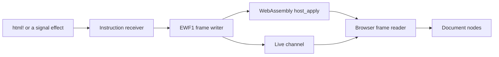

# Runtime and document updates

The Document Object Model (DOM) is the browser tree. A frame is one encoded update.
EWF1 identifies the first version of the frame format.
Each operation uses a generated Rust type. A registry connects numeric identifiers to document nodes.

Both delivery paths apply the same operations through the browser reader.

## Signals and frame delivery

`App::new()` creates the signal runtime and its instruction receiver.
A signal change schedules dependent effects. `app.stabilize()?` runs the effects and flushes the accumulated operations.
Each successful local flush supplies one frame to `host_apply`.
The browser copies its bytes before it acknowledges the WebAssembly allocation.
The frame reader can then schedule document work after the allocation is released.

The receiver lives on the thread that owns the application.
Use `Runtime::builder().protocol(FrameV1::new(0)).global_arena().build()` to configure the local bridge directly.
Use `Runtime::attach` to flush after a signal update.

## Node identity and cleanup

The reader seeds its registry with the page head, body and document element.
Their identifiers are zero, one and two. Generated elements use application identifiers.
A detached child retains its registration for reattachment.
Removing a node disposes its local scope and unregisters the subtree.
A keyed node that survives a morph keeps its signal scope.

## Testing the loop

`App::mock()` records generated operations. Inspect their `ui` and `web` members.
`App::server()` collects the bytes that the browser reads.
Use the real browser test harness to check document effects, focus and signal delivery.

See [server delivery](./server-and-protocols.md) and the [runtime examples](../README.md).
