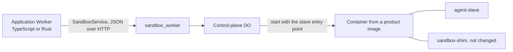

# The Cloudflare Sandbox product with this crate

_Written in ASD-STE100 Simplified Technical English (STE). Code and identifiers stay as they
are._

**Abbreviations in this file.** Hypertext Transfer Protocol (HTTP); JavaScript Object
Notation (JSON); Durable Object (DO); TypeScript (TS); uniform resource locator (URL);
remote procedure call (RPC); Secure Hash Algorithm 256 (SHA-256); AeroSpace and Defence
Industries Association of Europe (ASD), the owner of the STE standard ASD-STE100.

## 1. What the product is

Cloudflare Sandbox is a Cloudflare product. Since version 1.0, a sandbox is a DO and the
container that the DO starts. The package `@cloudflare/sandbox` adds file helpers, bucket
mounts and directory backups. A small static program, `sandbox-shim`, is in the image and
does the file work.

This crate uses the same primitive. The control plane is a DO, and it starts `agent-slave`
in its container. So a product image runs under the control plane with no new driver.



_Caption: a product image gets the slave beside the shim; the control-plane DO starts the slave, and any Worker can call the control plane._

## 2. Add the slave to a product image

An operator with an existing product image adds two lines to the Dockerfile. The first
line copies the shim from Cloudflare's donor image. The second line copies the slave from
the donor image that `mise run sandbox:slave-image` made.

```dockerfile
FROM docker.io/cloudflare/sandbox:1.0.3 AS sandbox-tools
FROM ewe/agent-slave:0.0.8 AS agent-slave

FROM ubuntu:24.04
COPY --from=sandbox-tools /usr/local/bin/sandbox-shim /usr/local/bin/sandbox-shim
COPY --from=agent-slave /usr/local/bin/agent-slave /usr/local/bin/agent-slave
CMD ["sleep", "infinity"]
```

The template `infrastructure/sandbox_worker/Dockerfile.product.in` is the same file with
three placeholders. `mise run sandbox:product-dockerfile` writes `Dockerfile.product`
beside it. The written file is in `.gitignore`.

The Worker configuration `infrastructure/sandbox_worker/wrangler.product.toml` names
`./Dockerfile.product` as the container image. `wrangler dev --local -c
wrangler.product.toml` starts it. The deployable is
`DeploymentPlan::sandbox_worker_product()`; both deploy adapters accept it.

The image `CMD` does not run for a sandbox. The control-plane DO starts the slave with an
entry point, so a product image with `CMD ["sleep", "infinity"]` works with no change.

## 3. The JSON wire

`SandboxService` has the JSON codec (spec 77 feature 00). The Connect protocol has two
call kinds. `Create` is server-streaming in this crate, so it belongs to the second row.

| Call kind | Methods | Request | Answer |
|---|---|---|---|
| Unary | `Probe`, `Get`, `List`, `Stop`, `Kill`, `ExecInput`, `ExecSignal`, `FileWriteBegin`, `FileWriteChunk`, `FileWriteCommit`, `FileWriteAbort` | `POST <base>/ewe.sandbox.control.v1.SandboxService/<Method>`; `Content-Type: application/json`; `Authorization: Bearer <token>`; the body is the request message as JSON | `200` and the answer message as JSON; or an HTTP error status and `{"code": "...", "message": "..."}` |
| Server stream | `Create`, `Exec`, `FileRead` | the same path; `Content-Type: application/connect+json`; the body is one envelope: 1 byte of flags (0), 4 bytes of length (big-endian), the JSON message | `200`; a stream of envelopes; the last one has the flag `0x02` and holds `{}` or `{"error": {..}}` |

A Worker in the same account can call `sandbox_worker` through a service binding. The
request is the same; only the `fetch` target changes.

### 3.1 A unary call

The `List` request is the empty message `{}`.

```bash
BASE=https://ewe-sandbox.example.workers.dev
TOKEN=change-me
curl -sS -X POST "$BASE/ewe.sandbox.control.v1.SandboxService/List" \
  -H "content-type: application/json" \
  -H "authorization: Bearer $TOKEN" \
  -d '{}'
```

The answer is one JSON message. This example has one ready sandbox:

```json
{"sandboxes":[{"id":"0123456789abcdef","driver":"cloudflare-container","state":"ready","created_unix_ms":1764312000000,"slave":{"slave_version":"0.0.8","arch":"x86_64","kernel":"6.18.0","is_pid1":true,"prepared":true,"can_control":false}}]}
```

A scoped unary call names the sandbox in the body. `Stop` uses the same body as `Get`,
`Kill`, `ExecInput`, `ExecSignal` and the file-write calls:

```bash
curl -sS -X POST "$BASE/ewe.sandbox.control.v1.SandboxService/Get" \
  -H "content-type: application/json" \
  -H "authorization: Bearer $TOKEN" \
  -d '{"sandbox_id":"0123456789abcdef"}'
```

### 3.2 A server-streaming call

The `Exec` request is one envelope. Make the envelope with a small program, then send it:

```bash
python3 - <<'PY' > exec.frame
import json, struct
message = {
    "sandbox_id": "0123456789abcdef",
    "exec_id": "0000000000000001",
    "argv": ["echo", "hello"],
    "env": [],
    "cwd": None,
    "stdin": False,
    "timeout_ms": None,
}
body = json.dumps(message, separators=(",", ":")).encode()
# Flag 0, then the message length as four big-endian bytes, then the message.
open("exec.frame", "wb").write(bytes([0]) + struct.pack(">I", len(body)) + body)
PY
curl -sS -X POST "$BASE/ewe.sandbox.control.v1.SandboxService/Exec" \
  -H "content-type: application/connect+json" \
  -H "authorization: Bearer $TOKEN" \
  --data-binary @exec.frame
```

The answer is a stream of envelopes. This example shows the payload of each envelope in
order. The first byte is the flag, and the next four bytes are the length:

```text
flags 00  length 00000027  {"seq":0,"event":{"Started":{"pid":7}}}
flags 00  length 00000030  {"seq":1,"event":{"Stdout":{"data":"aGVsbG8K"}}}
flags 00  length 00000033  {"seq":2,"event":{"Exit":{"code":0,"signal":null}}}
flags 02  length 00000002  {}
```

`aGVsbG8K` is the base64 of the bytes `hello\n`. The flag `0x02` ends the stream. It holds
`{}` after a clean end, or `{"error":{"code":"...","message":"..."}}` after a failure.

`FileRead` is the same form. The request is `{"sandbox_id":"0123456789abcdef","path":"/etc/hostname"}`.
Each answer frame is `{"offset":0,"data":"...","eof":true}`.

`Create` is the same form. The request is `{"spec":{...}}` with the full `SandboxSpec`.
Each answer frame is a `CreateEvent`: `{"Progress":"preparing"}` and at the end
`{"Created":{...}}` with the `SandboxInfo`.

### 3.3 A call with no token

```bash
curl -sS -i -X POST "$BASE/ewe.sandbox.control.v1.SandboxService/List" \
  -H "content-type: application/json" \
  -d '{}'
```

```text
HTTP/1.1 401 Unauthorized
content-type: application/json

{"code":"unauthenticated","message":"the bearer token is absent or wrong"}
```

### 3.4 Read the `Exec` stream with TypeScript

This function sends the same envelope and reads the frames with `fetch`. It returns after
the end frame.

```ts
async function exec(base: string, token: string, id: string): Promise<void> {
  const json = JSON.stringify({ sandbox_id: id, exec_id: "0000000000000001", argv: ["echo", "hello"], env: [], cwd: null, stdin: false, timeout_ms: null });
  const message = new TextEncoder().encode(json);
  const frame = new Uint8Array(5 + message.length); new DataView(frame.buffer).setUint32(1, message.length); frame.set(message, 5);
  const res = await fetch(`${base}/ewe.sandbox.control.v1.SandboxService/Exec`, { method: "POST", headers: { "content-type": "application/connect+json", authorization: `Bearer ${token}` }, body: frame });
  const reader = res.body!.getReader(); let buffer = new Uint8Array();
  for (;;) {
    const { value, done } = await reader.read(); if (done) return;
    buffer = new Uint8Array([...buffer, ...value]);
    while (buffer.length >= 5) {
      const length = new DataView(buffer.buffer).getUint32(1); if (buffer.length < 5 + length) break;
      const flags = buffer[0], payload = buffer.slice(5, 5 + length); buffer = buffer.slice(5 + length);
      console.log(flags & 0x02 ? "end" : "event", JSON.parse(new TextDecoder().decode(payload)));
      if (flags & 0x02) return;
    }
  }
}
```

## 4. The function map

| Cloudflare Sandbox product | This crate | State |
|---|---|---|
| One sandbox = one DO and its container | One sandbox = one control-plane DO and its container (feature 07) | equal |
| `container.start({ enableInternet })` | `SandboxSpec.network` (`None` or `Host`) | equal |
| `container.start({ image })`, more than one image for each class | The image of the container class in the Worker configuration. One deployment has one image. | gap: the Rust `worker` crate has no image option |
| `container.exec(argv, { cwd, env })` and `process.output()` | `SandboxHandle::exec`, `SandboxHandle::run` through the slave | equal |
| `exec` with a terminal (`pty`) | none | gap (requirements section 7.3: interactive terminals) |
| `Files.readFile`, `writeFile`, with Linux error names | `read_file`, `write_file`; errors of feature 00 | equal for read and write; the other `Files` calls are done with `exec` |
| Inactivity time-out | The idle alarm of feature 07 | equal |
| `container.destroy()` | `SandboxHandle::stop` | equal |
| `getTcpPort(port).fetch` to a program in the sandbox | none for a caller; the control plane uses it for the slave only | gap (requirements section 7.3: port forwards) |
| `snapshotContainer` | none | gap (requirements section 7.3: snapshots) |
| `interceptOutboundHttp` | none | gap (requirements section 7.3: egress allow list) |
| `S3Mount`, `DirectoryBackup` | none | gap; an application can use the package beside this crate in the same image, because the shim is still there |

Each gap is a line in requirements section 7.3 and becomes a GitHub issue.

## 5. The shim version

The shim version must be equal to the package version that the application uses. This is
Cloudflare's rule. The value `cloudflare_sandbox_tools_image` in `ci/sandbox.toml` holds
the tag `docker.io/cloudflare/sandbox:1.0.3`. Change that tag and the application package
version together.
