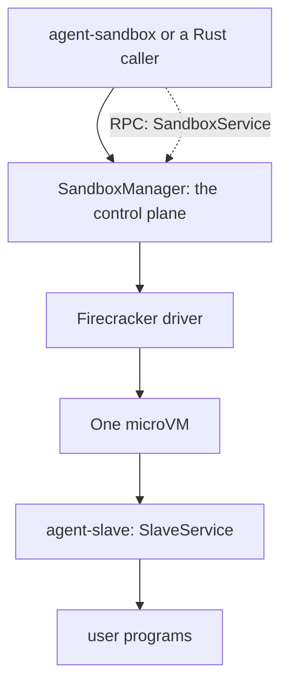

# Sandboxes

This guide shows how to start one sandbox on a Linux host and how the parts fit
together. The code is in `backends/foundation_sandbox` (spec 77).

## The parts



_Caption: a caller reaches one control plane; the control plane starts a microVM through a driver and talks to the slave inside it._

- **The control plane** is one library, `SandboxManager`. It validates a
  request, starts a substrate, waits until the slave answers and cleans up.
- **A driver** starts and stops one substrate. Firecracker is the first driver.
- **The slave** is `agent-slave`. It is process identifier 1 in the guest and
  serves `SlaveService`.
- **A boundary** translates. `agent-sandbox`, `SandboxRpcClient` and the
  `Provider` facade hold no rule about sandboxes.

## What the host needs

- Linux with Kernel-based Virtual Machine (KVM). The user must open `/dev/kvm`
  for reading and writing.
- A `firecracker` program on `PATH`, or `EWE_FIRECRACKER=<path>`.
- The static slave program: `mise run sandbox:slave`. The task writes
  `target/sandbox/agent-slave-x86_64` and `target/sandbox/agent-slave-aarch64`.
  Put the file of the host architecture beside `agent-sandbox`, or name it with
  `EWE_SANDBOX_SLAVE`.

## First sandbox

1. Check the host:

   ```bash
   agent-sandbox doctor
   ```

   The command prints one report for each driver. Its exit code is 0 when one
   driver is usable, and 1 when none is.

2. Run one command:

   ```bash
   agent-sandbox run --rootfs /images/ubuntu.squashfs -- echo hello
   ```

   The command prints the output of the program and exits with the program's
   exit code. A signal ends both the program and its sandbox.

3. Serve the control plane for other programs:

   ```bash
   agent-sandbox serve --listen unix:/run/ewe-sandbox.sock
   agent-sandbox create --connect unix:/run/ewe-sandbox.sock --rootfs /images/ubuntu.squashfs
   agent-sandbox exec --connect unix:/run/ewe-sandbox.sock <id> -- echo ok
   agent-sandbox list --connect unix:/run/ewe-sandbox.sock
   agent-sandbox stop --connect unix:/run/ewe-sandbox.sock <id>
   ```

4. Use a TCP listener with a token:

   ```bash
   agent-sandbox serve --listen tcp:127.0.0.1:7777 --token-file /etc/ewe/token
   ```

   A TCP listener does not start without a token. The check compares the bearer
   token in constant time before every call.

## Exit codes of `agent-sandbox`

| Code | Meaning |
|---|---|
| the program's code | `run` and `exec` ended normally |
| `128 + n` | A signal ended the program |
| 1 | `doctor`: no driver is usable |
| 64 | Usage error |
| 125 | The sandbox or the control plane failed |

## Security

- The virtual machine boundary isolates the guest. The virtual machine monitor
  (VMM) runs with the rights of the caller; this version does not confine it.
- A Unix domain socket trusts every process that can open it. Its file has mode
  `0600`.
- A TCP listener uses one shared token and no TLS. Use `127.0.0.1` or a private
  network until spec 87 adds mutual TLS.
- A path in a request is a path on the control plane's machine.
