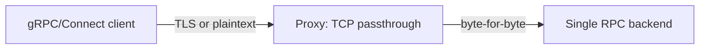
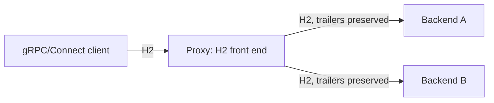
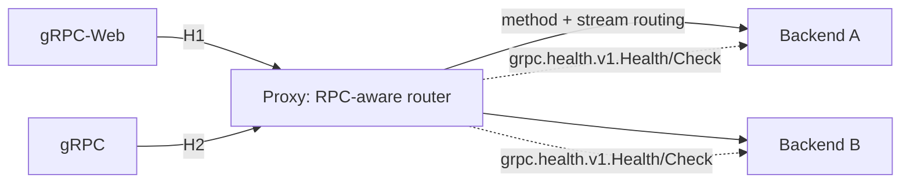
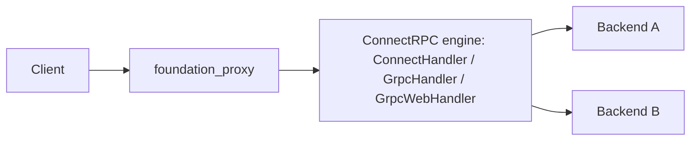

# Feature: ConnectRPC Proxy

## Overview

`foundation_proxy` fronts plain HTTP, WebSocket, and raw TCP/UDP. This feature
adds the ability to route RPC traffic — **Connect**, **gRPC**, and **gRPC-Web**
(as produced by `foundation_connectrpc`) — through the proxy. It starts from a
research question, because the working assumption was *"just forward it like raw
TCP."*

This document is written for a decision, in three parts — followed by the
decision (recorded 2026-10-18) and its implementation plan:

1. **What the wire formats actually require** (grounded in
   `foundation_connectrpc/src/shared/protocol/*`).
2. **What `foundation_proxy` does today and where it breaks.**
3. **The options** (A → D), the decision (B + D), and the implementation plan.

---

## 1. The research question, answered

> **Do proxies need to *understand* ConnectRPC/RPC to work effectively?**

**No — not to be *correct* — but yes, in specific ways, to be *effective* at
scale.** The answer decomposes by protocol and by what "effective" means:

- **Correctness** only requires the proxy to be a **faithful HTTP/2 relay**:
  no H2→H1 downgrade, `te: trailers` preserved, and HTTP/2 trailing HEADERS
  forwarded. It does **not** require decoding protobuf or RPC envelopes.
- **Effectiveness** (multi-backend load balancing, RPC health, deadline/retry
  awareness, per-method observability) requires **stream-level (L7)
  awareness**, because HTTP/2 multiplexes many concurrent RPCs over one TCP
  connection and a connection-level balancer pins them all to a single backend.

So there is a ladder of support, and "raw TCP" is only the bottom rung.

---

## 2. What the wire formats require

These facts come straight from the protocol implementations in
`backends/foundation_connectrpc/src/shared/protocol/`, and are confirmed by the
external [Connect protocol spec](https://connectrpc.com/docs/protocol/) and the
[gRPC over HTTP/2 spec](https://github.com/grpc/grpc/blob/master/doc/PROTOCOL-HTTP2.md).

### Connect (`connect.rs`)

Deliberately proxy/browser-friendly — the flagship runs on HTTP/1.1 from day one.

| Aspect | Behaviour | Proxy implication |
|---|---|---|
| Transport | HTTP/1.1 **or** HTTP/2 | Unary + server-streaming survive a plain HTTP/1.1 proxy |
| Unary request | `POST` bare body (`application/{codec}`), or idempotent `GET` with the message in the query | Transparent |
| Unary error | HTTP status + JSON body (`application/json`) | Transparent — status codes pass through |
| Unary trailers | Rendered as `Trailer-`-prefixed **response headers** (`trailer-*`) | No HTTP/2 trailers needed for unary |
| Streaming | `application/connect+{codec}`, envelope framing (1 flag byte + 4-byte BE length) | Transparent bytes |
| Streaming end | In-body `EndStreamResponse` envelope (flag `0x02`) carrying JSON error + metadata | Transparent — not HTTP/2 trailers |
| Compression | `content-encoding`/`accept-encoding` (unary), `connect-content-encoding`/`connect-accept-encoding` (streaming) | Transparent |
| Timeout | `connect-timeout-ms` header | Proxy may ignore, or enforce |
| Full-duplex | Client-streaming + bidi need HTTP/2 (README: "Full-duplex bidi needs a full-duplex transport") | **Broken by H2→H1 downgrade** |

**Takeaway:** Connect unary + server-streaming *already* pass through today's
HTTP/1.1 proxy. Client-streaming and bidi are the only Connect modes that need
an H2-correct path.

### gRPC (`grpc.rs`)

The strict one. HTTP/2 is mandatory, and the outcome lives in trailers.

| Aspect | Behaviour | Proxy implication |
|---|---|---|
| Transport | HTTP/2 **required** | **Breaks on H2→H1 downgrade** |
| Status | Always HTTP `200`; errors ride trailers | Proxy must not translate 200→something-else, and must forward trailers |
| Error | `grpc-status` / `grpc-message` / `grpc-status-details-bin` **trailing HEADERS** | **Trailers must be forwarded** |
| Trailers-only | A single HEADERS frame with END_STREAM for early errors | Proxy must pass a HEADERS-with-END_STREAM through |
| Header | `te: trailers` is **required** | **Must not be stripped as hop-by-hop** |
| Content-type | `application/grpc+{codec}` | Transparent |
| Body | Envelope framing (even unary = one envelope) | Transparent |
| Compression | `grpc-encoding`/`grpc-accept-encoding` | Transparent |
| Timeout | `grpc-timeout` | Proxy may ignore, or enforce |

**Takeaway:** native gRPC needs three things the current proxy does not provide:
(1) HTTP/2 end-to-end, (2) `te: trailers` preserved, (3) trailing HEADERS
forwarded. Lose any one and a client that *looks* successful can decode an
`Ok(default)` from a missing status (see `grpc.rs`'s
`read_grpc_response`, which explicitly guards against "silently converted every
server error into a clean EOF").

### gRPC-Web (`grpc_web.rs`)

gRPC framing without HTTP/2 — browser reach over HTTP/1.1.

| Aspect | Behaviour | Proxy implication |
|---|---|---|
| Transport | HTTP/1.1 | Survives a byte-transparent HTTP/1.1 proxy |
| Status/trailers | In-body trailer frame (flag `0x80`) — **not** HTTP/2 trailers | Transparent |
| Text mode | `application/grpc-web-text` base64-encodes the body | Transparent bytes |
| To reach native gRPC | Needs a translation hop (gRPC-Web ↔ gRPC) | **RPC-aware operation** (option C/D) |

**Takeaway:** gRPC-Web is the *most* proxy-tolerant, but only as long as the
backend also speaks gRPC-Web. If the backends speak native gRPC, a translator is
required.

---

## 3. What `foundation_proxy` does today — and where it breaks

Ground truth from `backends/foundation_proxy/src/`.

| # | Current behaviour | Source | Effect on RPC |
|---|---|---|---|
| 1 | ~~H2 front end **terminates H2 and forwards to backends over HTTP/1.1**~~ → **fixed for gRPC (T3)**: `application/grpc` forwards H2→H2 via `forward_upstream_h2`; plain (non-gRPC) H2 keeps the H1 path | `h2_proxy.rs` `forward_upstream_h2` | Native gRPC no longer breaks; Connect bidi/client-streaming over H2 still unexercised (D leg) |
| 2 | ~~Hop-by-hop strip list includes `te`, `trailer`, `trailers`~~ → **fixed (T2)**: `strip_hop_by_hop_request` preserves them on requests | `forward.rs` | **No longer strips** gRPC's required `te: trailers` |
| 3 | ~~Response trailers are never forwarded~~ → **fixed (T4)**: trailing HEADERS relayed as `H2Frame::Trailers` | `h2_proxy.rs` `forward_upstream_h2` | `grpc-status` now survives |
| 4 | ~~Sets `Connection: close` on every upstream request~~ → **fixed (T5)**: `is_streaming_request` gates it so RPC streaming responses keep the connection open | `forward.rs` `forward_request_headers` | No longer tears down long-lived streams |
| 5 | ~~Load balancing is per-backend (connection/lease), not per-stream~~ → **fixed for the RPC leg (T11)**: each relayed RPC picks a backend at `open()` time | `rpc_relay.rs` / `runtime.rs` | The `http`/`https` (B) leg keeps per-connection LB; the RPC (D) leg balances per stream |
| 6 | ~~Health checks are HTTP path probes (`/`, `GET`)~~ → **fixed for the RPC leg (T12)**: `grpc://` backends are gated on `grpc.health.v1.Health/Check` | `health.rs` | RPC backends use the gRPC health protocol; plain-HTTP keeps path probes |
| 7 | Routing is `Host` + `path_prefix` only | `router.rs` | Fine for Connect/gRPC (they use path); method-level *policy* (retries, per-method metrics) remains out of scope |

**Net:** all seven items are now addressed. Items 1–4 are fixed by Workstream 1
(T2–T5) and verified end-to-end (T6); items 5–6 by Workstream 2 (T11/T12); item 7
is fine for Connect/gRPC by design (the D leg routes by method path, but
method-level *policy* stays out of scope). Both legs now round-trip all four
Connect/gRPC/gRPC-Web stream kinds to real `foundation_connectrpc` backends —
with stream-level LB, the gRPC health gate, deadline pass-through, and
cancellation propagation.

---

## 4. The options

### Option A — Raw TCP (or TLS-SNI) passthrough — *the original assumption*

Route RPC traffic as opaque `tcp://` (and/or SNI-based TLS passthrough), like the
existing `TcpPassthrough`. The proxy does **nothing** RPC-aware.

| Pro | Con |
|---|---|
| Zero RPC knowledge; reuses existing `TcpPassthrough` | One backend per listener/SNI name — no host/path routing |
| Preserves everything (TLS+H2) end-to-end | No load balancing, no health checks, no zero-downtime |
| Simple to reason about | No TLS termination (must passthrough TLS, or run plaintext) |
| | No per-RPC observability/retries/deadlines |

**Verdict:** correct only for a *single opaque backend*. The moment you want the
proxy's actual value (routing, LB, health, TLS termination, zero-downtime),
option A gives it up. It is the "dumb pipe," not the effective tier.

### Option B — H2-correct HTTP forwarding (transparent, but faithful)

Keep the proxy protocol-agnostic, but make its HTTP/2 path correct: forward
H2→H2 (no downgrade), preserve `te: trailers`, forward trailing HEADERS,
disable response buffering, stream DATA immediately, and lengthen timeouts for
long-lived streams. This is the floor that NGINX `grpc_pass` / a bare Envoy
provide.

| Pro | Con |
|---|---|
| All three protocols work at the HTTP layer | LB stays **per-connection** (coarse under H2 multiplexing) |
| Keeps host/path routing, LB, TLS termination | Health checks stay HTTP (not RPC health protocol) |
| No RPC decoding — lower effort, less coupling | No method routing / retries / deadline awareness |
| Matches what mainstream proxies do by default | No gRPC-Web → gRPC translation |

**Verdict:** the necessary first step and, alone, sufficient for *correctness*.
This is the honest answer to the research question: **you do not need to
understand RPC to forward it correctly — you need to be H2-faithful.** It
directly fixes items 1–4 above.

### Option C — RPC-aware proxy (the "gRPC filter" tier)

Add enough RPC awareness to be *effective*: parse the content-type + method path
(already implemented in `foundation_connectrpc`'s protocol handlers), balance
per **stream/RPC**, health-check via the gRPC health protocol
(`grpc.health.v1.Health/Check`), honour `grpc-timeout` / `connect-timeout-ms`,
apply idempotency-aware retries, emit per-method metrics, and translate
gRPC-Web ↔ gRPC. This is the Envoy gRPC-filter / linkerd / NGINX-Plus tier.

| Pro | Con |
|---|---|
| True per-RPC load balancing (fixes the pinning problem) | Real effort: stream routing, health client, retry policy |
| RPC-native health checks | Couples proxy to RPC semantics |
| Deadlines, retries, per-method metrics | Must parse content-type + path at minimum (envelopes for metrics) |
| gRPC-Web ↔ gRPC translation | More surface to test for protocol conformance |

**Verdict:** the "fully effective" tier. Bigger than B, but it is where the
proxy stops being a pipe and becomes an ingress.

### Option D — Embed `foundation_connectrpc` as the proxy's RPC engine

Option C, but instead of hand-rolling RPC parsing in the proxy, **reuse
`foundation_connectrpc`'s own protocol handlers** (`ConnectHandler`,
`GrpcHandler`, `GrpcWebHandler`) to decode/re-encode, route by method, and
translate protocols. The proxy owns routing/LB/health/observability; connectrpc
owns the wire format.

| Pro | Con |
|---|---|
| Maximum reuse — no second implementation of the wire formats | Architectural question: where to cut routing (proxy) vs codec (connectrpc) without buffering bodies |
| Enables protocol translation + method routing for free | Tightest coupling between the two crates |
| One source of truth for Connect/gRPC/gRPC-Web conformance | The proxy's streaming/valtron model must compose with connectrpc's frame pipes |

**Verdict:** the natural end-state given both crates already exist in this
workspace, and the interesting engineering problem. Not a first step.

---

## 5. Decision (recorded 2026-10-18)

**Ship Option B *and* Option D. D resolves C.** Rather than hand-rolling RPC
awareness in the proxy (C), the proxy reuses `foundation_connectrpc`'s own
handlers (D), so stream-level load balancing, the gRPC health protocol, deadline
pass-through, and gRPC-Web ↔ gRPC translation all come along with D. Nothing in
C is lost; C and D are the same capability reached either by re-implementation
(C) or by reuse (D) — and both crates already live in this workspace, so D is
the lower-effort, single-source-of-truth path.

The two paths are selected **per proxy endpoint**, by the protocol the operator
declares for that backend:

| Backend protocol | Forwarding path | What the proxy does |
|---|---|---|
| `http` / `https` | **B** — transparent, H2-correct HTTP forward | Relay HTTP faithfully: H2→H2 (no downgrade), `te: trailers` preserved, trailing HEADERS forwarded, bodies streamed. Protocol-agnostic — plain HTTP, Connect, and gRPC-over-H2 all flow through untouched. |
| `connect` / `grpc` / `grpc-web` | **D** — route through `foundation_connectrpc` | Hand the stream to connectrpc's `ConnectHandler` / `GrpcHandler` / `GrpcWebHandler`: method routing, stream-level LB, gRPC health checks, deadline pass-through, and gRPC-Web ↔ gRPC translation. |

The `http`/`https` leg is the honest "just forward it (correctly)" tier — it
makes all three protocols *work* with no RPC coupling. The RPC leg is the
*effective* tier — the point where the proxy stops being a pipe and becomes an
ingress — and it costs nothing we wouldn't otherwise build, because connectrpc
already owns the wire formats.

**Why B remains a first-class leg, not just a stepping stone to D:** B is what
an operator wants when they only need the proxy's existing value (routing, LB,
TLS, zero-downtime) applied to RPC traffic without the proxy decoding anything.
D is what they want when they need method routing, protocol translation, or
RPC-native health. Both stay, selected per endpoint.

**Why not A?** A (raw TCP passthrough) is valid only for a single opaque backend
and forfeits routing/LB/health/TLS — it is kept as the existing `tcp://` path,
not the RPC answer.

---

## 6. Open questions — resolved

The five questions from the pre-decision draft are answered by the B + D choice:

1. **Backend protocol surface** — *resolved:* operators declare it per endpoint
   (`connect` / `grpc` / `grpc-web`, or plain `http`/`https`). We do not assume
   one backend language; the declared protocol picks the path (B or D).
2. **Load-balancing granularity** — *resolved:* the `http`/`https` leg keeps
   per-connection LB (acceptable, documented); the RPC leg gets stream-level LB
   via connectrpc, because that leg exists precisely for the cases where
   per-connection pinning is not acceptable.
3. **Health** — *resolved:* the RPC leg uses the gRPC health protocol
   (`grpc.health.v1.Health/Check`) for RPC backends; the plain-HTTP leg keeps
   HTTP path probes.
4. **TLS** — *resolved:* terminate at the proxy (H2/ALPN + the proxy's existing
   cert provisioning), which both paths require; no TLS passthrough for RPC.
5. **Streaming modes** — *resolved:* all four RPC kinds must survive. Unary +
   server-streaming work on either leg; client-streaming + bidi require the
   H2-correct path (B) and are fully supported on the RPC leg (D).

---

## 7. Implementation plan (B + D)

Two workstreams. Workstream 1 (B) is the prerequisite transport work; workstream
2 (D) is the RPC leg and the per-endpoint protocol selection.

### Workstream 1 — H2-correct transparent forward (B)

Fixes the concrete gaps in §3, items 1–4. No RPC coupling.

1. Add an H2 upstream path to `foundation_proxy` (`h2_proxy.rs`): forward to
   `http(s)://` backends over HTTP/2 rather than terminating H2 and re-emitting
   HTTP/1.1. (Unconditionally for `application/grpc`; or whenever the front end
   is H2 and the backend is `http(s)`.)
2. Stop stripping `te`, `trailer`, `trailers` for RPC requests — `te: trailers`
   is required by gRPC and is *not* hop-by-hop here despite its
   `Connection`-listed appearance (`forward.rs` `HOP_BY_HOP`).
3. Forward HTTP/2 trailing HEADERS through the H2 path (today
   `forward_upstream` emits only HEADERS + DATA + empty END_STREAM DATA, so
   `grpc-status` is dropped).
4. Stream response bodies without buffering; relax the `Connection: close`
   policy for long-lived streams.
5. Tests: gRPC unary + streaming round-trip through the proxy with `grpc-status`
   preserved; Connect bidi through the proxy; gRPC-Web through the proxy;
   regression for plain HTTP / WebSocket / TCP / UDP.

### Workstream 2 — RPC leg + per-endpoint protocol selection (D)

1. **Extend the backend protocol surface.** `BackendProtocol`
   (`config.rs`, currently `Http/Https/Tcp/Udp` inferred from the URL scheme)
   gains `Connect`, `Grpc`, `GrpcWeb`. The operator selects the application
   protocol per proxy endpoint — e.g. a scheme (`connect://`, `grpc://`,
   `grpc-web://`) or an explicit `protocol` field on the backend target — so
   `http`/`https` → B and `connect`/`grpc`/`grpc-web` → D.
2. **Embed the connectrpc Router as the RPC ingress.** Wire `foundation_proxy`'s
   routed endpoint to `foundation_connectrpc`'s `ConnectHandler` / `GrpcHandler`
   / `GrpcWebHandler`, selected by the endpoint's declared protocol.
3. **Forward via the connectrpc Client.** From the handler, re-invoke the
   backend with `foundation_connectrpc`'s Client (Connect/gRPC/gRPC-Web),
   enabling protocol translation (gRPC-Web → gRPC) and method routing.
4. **Stream-level LB + RPC health.** Place each RPC on a backend via the
   proxy's weighted round-robin balancer; gate health via
   `grpc.health.v1.Health/Check`.
5. **Honour deadlines.** Pass through `grpc-timeout` / `connect-timeout-ms` and
   propagate cancellation end-to-end.
6. **Boundary care.** Respect the project's streaming rules (`.agents/AGENTS.md`):
   bodies stay streams, never buffered; the proxy's valtron model composes with
   connectrpc's frame pipes (`into_ready_future` / `into_future_stream`), so the
   seam is async-native rather than blocking at a buffer.
7. Tests: per-endpoint selection (B vs D); gRPC-Web → native-gRPC translation
   through the proxy; stream-level LB exercised under concurrency; gRPC health
   gate flips on backend failure.

---

## 8. Task list (TDD, one red test per item)

Tasks run in order; each is independently shippable and gated on a named test
going green (not on "it compiles"). T1 is a `foundation_connectrpc`
prerequisite — its gap is documented in that crate's own `grpc_tests.rs`.

- [x] **T1 — connectrpc H2 transport forwards trailers** (prerequisite)
  - *Red test:* `foundation_connectrpc/tests/grpc_tests.rs` — assert a gRPC
    response's `grpc-status` / `grpc-message` are observable at the typed
    `Client` over H2 (today "not yet verifiable" per the in-file note).
  - *Green:* plumb HTTP/2 trailing HEADERS through the H2 pump into the seam's
    `ClientConn` trailer pipe.
  - *Gate:* `cargo test -p foundation_connectrpc --test grpc_tests`

- [x] **T2 — proxy preserves `te: trailers` for RPC**
  - *Red test:* `foundation_proxy/tests/forward_headers_tests.rs` — a gRPC
    request's `te: trailers` (and `trailer` / `trailers`) reaches the backend
    intact instead of being stripped as hop-by-hop.
  - *Green:* special-case `te` / `trailer` / `trailers` in `forward.rs`
    `HOP_BY_HOP` for Connect/gRPC requests.
  - *Gate:* `cargo test -p foundation_proxy --test forward_headers_tests`

- [x] **T3 — proxy forwards upstream over H2 (no downgrade)**
  - *Red test:* `foundation_proxy/tests/h2_integration_tests.rs` — an H2
    front-end request arrives at the backend as HTTP/2 (backend observes H2
    pseudo-headers), not re-emitted over HTTP/1.1.
  - *Green:* add an H2 upstream path (`forward_upstream_h2`) gated on
    `application/grpc` / `application/grpc+*` (plain H2 keeps the existing H1
    path), using connectrpc's `H2Transport` for streaming + trailers.
  - *Gate:* `cargo test -p foundation_proxy --test h2_integration_tests`
  - *Dependency (decided 2026-10-20):* reuse connectrpc's `H2Transport` as the H2
    upstream (streaming + trailers); `foundation_proxy` gains a real
    `foundation_connectrpc` dependency. See LEARNINGS.md.

- [x] **T4 — proxy relays trailing HEADERS (`grpc-status`)**
  - *Red test:* `foundation_proxy/tests/h2_integration_tests.rs` — a backend
    sends `grpc-status` in trailing HEADERS; the H2 client observes it (not
    dropped, not defaulted to `Ok`).
  - *Green:* relay trailing HEADERS as `H2Frame::Trailers` in `forward_upstream_h2`
    (the old H1 path emitted only HEADERS + DATA + empty END_STREAM DATA).
  - *Gate:* `cargo test -p foundation_proxy --test h2_integration_tests`

- [x] **T5 — stream bodies without buffering; relax `Connection: close`**
  - *Red test:* a server-streaming response's first frame reaches the client
    before the stream completes (no full-body buffering), and a long-lived
    stream is not torn down by the proxy.
  - *Green:* stream DATA immediately; relax the `Connection: close` policy in
    `forward_request_headers` for streams.
  - *Gate:* `cargo test -p foundation_proxy --test h2_integration_tests`
  - *Done:* added `is_streaming_request` (gRPC / `connect+` / `grpc-web` content
    types) and made `forward_request_headers` insert `Connection: close` only for
    non-streaming requests; `forward_request_headers` is now `pub` (shared with
    the H2 leg), which no longer needs its own `headers.remove(&CONNECTION)`.
    `forward_headers_tests` is 6/6 and `h2_integration_tests` 7/7. The streaming
    test is signal-gated (see LEARNINGS.md), not time-gated.

- [x] **T6 — end-to-end RPC through the proxy (Layer 3, B leg)**
  - *Red test:* new `foundation_proxy/tests/rpc_proxy_e2e_tests.rs` — a real
    `foundation_connectrpc` `Router` + `HttpServer` backend, `foundation_proxy`
    fronting it, a real `foundation_connectrpc` typed `Client` calling through
    the proxy. Assert Connect unary + server-streaming (H1 and H2), gRPC unary +
    streaming with `grpc-status` intact, and gRPC-Web — all via the transparent
    `http`/`https` leg.
  - *Green:* confirm all four ConnectRPC modes round-trip; fix anything the test
    still surfaces.
  - *Done:* 8/8 green. Surfaced and fixed two latent bugs — `PipeSender::drop`
    closing the pipe on any clone's drop (lost gRPC trailers), and
    `Http11ResponseIterator::ChunkedBodyStreaming` emitting malformed chunked
    framing — detailed in LEARNINGS.md.
  - *Gate:* `cargo test -p foundation_proxy --test rpc_proxy_e2e_tests`

Workstream 1 (B leg) is complete — T1–T6 are all green.

### Workstream 2 (D leg) — RPC engine + per-endpoint protocol selection

The D leg is a **codec-agnostic frame relay**, not a typed `Client<Req,Res>`:
the proxy has no upstream protobuf types, so it de-frames the inbound protocol
into opaque message frames (`ConnectHandler` / `GrpcHandler` / `GrpcWebHandler`)
and re-encodes them in the backend's protocol (`ConnectClient` / `GrpcClient` /
`GrpcWebClient` over `H2Transport`). Message bytes stay opaque; the relay only
re-envelopes them. Method identity is the URL path.

- [x] **T7 — `BackendProtocol` gains `Connect` / `Grpc` / `GrpcWeb`**
  - *Red test:* `foundation_proxy/tests/backend_target_tests.rs` — assert the
    three new schemes (`connect://`, `grpc://`, `grpc-web://`) map to the new
    variants and `Display` round-trips.
  - *Green:* add the variants + `Display` strings; extend
    `BackendTarget::protocol()` to infer them from the scheme.
  - *Gate:* `cargo test -p foundation_proxy --test backend_target_tests`

- [x] **T8 — gRPC-Web → gRPC translation, unary (keystone)**
  - *Red test:* `rpc_proxy_e2e_tests.rs` — a gRPC-Web client dials the proxy
    whose backend is declared `grpc://` and serves **only** native gRPC; the
    unary round-trips.
  - *Green:* `relay()` selects the D-leg seam by `lease.backend().protocol()`;
    inbound `GrpcWebHandler` de-frames (0x00/0x80), outbound `GrpcClient`
    re-envelopes over `H2Transport`.
  - *Gate:* `cargo test -p foundation_proxy --test rpc_proxy_e2e_tests`

- [x] **T9 — gRPC-Web ↔ gRPC streaming + status fidelity**
  - *Red test:* e2e server-stream + `grpc-web-text` base64 round-trip; assert
    `grpc-status` arrives (no silent `Ok(default)` from a dropped trailer).
  - *Green:* relay the `0x80` end-of-stream trailer frame and the text base64 path.
  - *Gate:* `cargo test -p foundation_proxy --test rpc_proxy_e2e_tests`

- [x] **T10 — Connect ↔ gRPC translation (closes the T6 bidi gap)**
  - *Red test:* e2e — a Connect client against a `grpc://` backend, all four
    stream types (unary, server-, client-, and bidi-streaming).
  - *Green:* `ConnectHandler` ↔ `GrpcClient` frame relay over `H2Transport`.
  - *Gate:* `cargo test -p foundation_proxy --test rpc_proxy_e2e_tests`

- [x] **T11 — stream-level LB under concurrency**
  - *Red test:* two `grpc://` backends, N concurrent streams; assert both
    backends observe traffic (not pinned to one).
  - *Green:* each relayed RPC picks a backend at `open()` time via the weighted
    round-robin balancer (`H2Transport` is one connection per call).
  - *Gate:* `cargo test -p foundation_proxy --test rpc_proxy_e2e_tests`

- [x] **T12 — gRPC health gate**
  - *Red test:* a backend flipping `Health/Check` NOT_SERVING is excluded from
    rotation; SERVING restores it.
  - *Green:* minimal `grpc.health.v1.Health/Check` client (the two well-known
    messages, hand-encoded) wired into `probe_once()` for `Grpc` backends.
  - *Gate:* `cargo test -p foundation_proxy --test rpc_health_tests`

- [x] **T13 — deadline pass-through + cancellation**
  - *Red test:* `rpc_deadline_tests.rs` — the client's deadline is observed at
    the backend; a cancelled server-stream tears down both sides.
  - *Green:* `translate_connect_deadline_to_grpc` re-encodes
    `connect-timeout-ms` → `grpc-timeout`; the streaming relay races against a
    shared `CancelSignal` fired on client reset; the outbound H2 pump aborts the
    backend stream (`RST_STREAM`) when the response consumer goes away.
  - *Gate:* `cargo test -p foundation_proxy --test rpc_deadline_tests`

Workstream 2 (D leg) is complete — T7–T13 are all green. Both workstreams are
done and the feature is folded back into the spec.

---

## 9. Success Criteria

All six criteria below are now met and asserted by the Layer-3 tests
(`rpc_proxy_e2e_tests`, `rpc_health_tests`, `rpc_deadline_tests`, and the
existing B-leg suites).

- Connect (unary + server-streaming) round-trips through the `http`/`https`
  (B) leg, and all four Connect kinds round-trip through the RPC (D) leg, to
  real `foundation_connectrpc` backends.
- gRPC `grpc-status` and Connect error status survive the proxy intact on both
  legs (no `Ok(default)` from a dropped trailer).
- Per-endpoint protocol selection works: an `http(s)` backend is forwarded
  transparently; a `connect`/`grpc`/`grpc-web` backend is routed through the
  RPC engine.
- gRPC-Web → native-gRPC translation succeeds through the RPC leg.
- Under concurrent streaming on the RPC leg, multiple backends are exercised
  (not pinned to one).
- No regression to existing plain-HTTP / WebSocket / TCP / UDP behaviour.

---

## 10. Validation — how we prove it locally (not "it builds")

Success criteria are asserted by real, runnable tests in four layers. Layers
1–3 run with plain `cargo test` on loopback sockets — no Docker. Layer 4 is the
opt-in container suite.

### Layer 1 — protocol conformance (`foundation_connectrpc`)

`cargo test -p foundation_connectrpc` already exercises the wire formats
end-to-end over real loopback TCP: `grpc_tests`, `connect_protocol_tests`,
`grpc_web_tests`, `h2_streaming_tests`, `conformance_tests`,
`server_socket_tests`. Each spins a real `HttpServer` plus a typed `Client` /
`H2Transport`. These are the safety net proving the proxy cannot break the
protocols at the wire level.

### Layer 2 — proxy HTTP/2 correctness (`foundation_proxy`)

`cargo test -p foundation_proxy` already has the harness
(`h2_integration_tests.rs`): a real `HttpServer` backend, the real `ProxyServer`,
and a real H2 client, all on ephemeral ports. Workstream 1 extends it:

- an H2 backend instead of H1 → proves no downgrade;
- `te: trailers` survives the forward (`forward_headers_tests.rs`);
- a gRPC-shaped response whose status rides trailing HEADERS → assert the proxy
  relays them.

### Layer 3 — RPC-through-proxy end-to-end (new, decisive)

A cross-crate test in `foundation_proxy/tests/` (connectrpc becomes a dependency
for the D leg anyway) composes the real pieces: a `foundation_connectrpc`
`Router` + `HttpServer` backend, `foundation_proxy` fronting it, and a real
`foundation_connectrpc` typed `Client` calling **through the proxy**. It asserts:

- Connect unary + server-streaming (H1 and H2 legs),
- gRPC unary + streaming with `grpc-status` / `grpc-message` intact,
- gRPC-Web unary + streaming,
- per-endpoint protocol selection (B vs D).

### Layer 4 — multi-backend under concurrency (`docker-tests`, opt-in)

`cargo test -p foundation_proxy --features docker-tests` — the existing
container testbed (`foundation_testbed`) proves stream-level LB actually spreads
load across backends and the gRPC health gate flips on failure. This is the one
layer that needs Docker and is not part of the fast local loop.

### Known gap the tests must expose first — **closed (T1)**

The gap this section originally documented is now closed.
`foundation_connectrpc`'s H2 transport forwards HTTP/2 trailing HEADERS through
`TransportStream::trailers` into the seam's `ClientConn` (and
`Response::trailers()`), and `grpc_tests.rs` asserts it directly
(`grpc_trailers_readable_from_transport_stream`,
`grpc_unary_response_carries_trailers`, `grpc_error_trailers_readable_from_response`).
The remaining red test is the Layer-3 "assert `grpc-status` at the client through
**the proxy**" — it stays red until the proxy relays trailing HEADERS (§3 item 3,
T4), which is the one side of the pipe still missing.

### Test discipline

Follow the feature's TDD workflow (`start.md`): one red test per item, make it
green, move on. Do not batch the H2 upstream + trailer plumbing + protocol
selection into one change and assume it works because it builds.

---

_Created: 2026-10-18_
_Last Updated: 2026-10-20_
