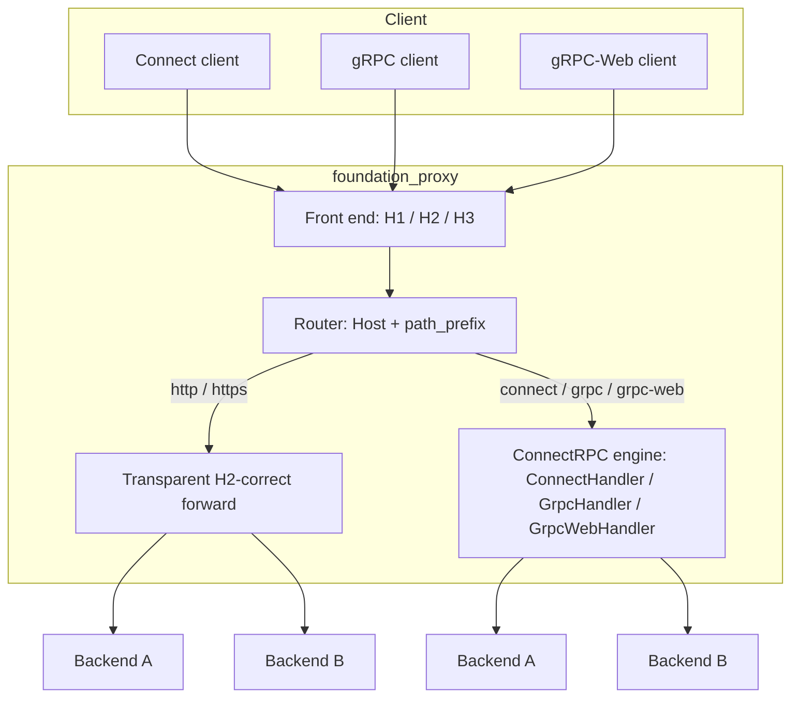

# Overview

`foundation_proxy` today fronts plain HTTP, WebSocket, and raw TCP/UDP — but has
no handling for RPC traffic (Connect / gRPC / gRPC-Web) served by
`foundation_connectrpc`. This specification answers one question first: **does a
reverse proxy need to *understand* RPC to route it effectively?** — and then
implements the tier of support we choose.

The initial assumption was "just forward it like raw TCP." Research (against the
actual wire formats in `foundation_connectrpc` and against external guidance)
shows that answer is incomplete: gRPC in particular does not survive a naive
proxy. The full findings and the option space live in the feature, below.

**Decision (2026-10-18):** ship Option B (H2-correct transparent HTTP forwarding)
*and* Option D (embed `foundation_connectrpc` as the proxy's RPC engine). D
resolves C — instead of hand-rolling RPC awareness, the proxy reuses connectrpc's
handlers, so stream-level LB, the gRPC health protocol, deadline pass-through,
and gRPC-Web ↔ gRPC translation all come along with D. The two paths are
selected **per proxy endpoint** by the protocol the operator declares for that
backend: `http`/`https` → B (transparent), `connect`/`grpc`/`grpc-web` → D
(RPC engine).

# Goals

- Establish, with evidence, what each protocol (Connect / gRPC / gRPC-Web)
  actually requires from an intermediary.
- Lay out the realistic tiers of proxy support — from raw TCP passthrough up to
  a fully RPC-aware ingress — with trade-offs, so a decision can be made
  deliberately rather than by assumption.
- Implement the chosen tier in `foundation_proxy`, reusing
  `foundation_connectrpc` where it helps.

# Implementation Location

- Primary implementation: `backends/foundation_proxy`
- RPC wire/protocol engine to reuse: `backends/foundation_connectrpc`
- Feature specification: `specifications/63-connectrpc-proxy/features/*/feature.md`

# Known Issues

- **H2 upstream query string is dropped (latent, 2026-10-20).** The B leg's H2
  forward reuses `foundation_connectrpc::H2Transport`, whose `open()` builds the
  upstream `:path` from `request_uri.path()`, which omits the query string. gRPC
  POSTs carry no query, so this is invisible on the RPC path, but any future H2
  forward of a query-bearing request would silently drop it. Fix in
  `H2Transport` (or widen the seam) when the H2 leg is extended beyond gRPC. See
  LEARNINGS.md.

- **`ChunkedData::into_bytes()` emits malformed chunked framing (latent,
  2026-10-20).** `foundation_netio`'s `ChunkedData::into_bytes` renders a `Data`
  frame as `{len}{bytes}` (missing the `\r\n` delimiters) and `DataEnded` as a
  bare `0\r\n` (missing the blank line). The response renderer was fixed to use
  `Http11Chunk::ChunkedExt(..).render()` instead, leaving `into_bytes` dead code
  in the crate — but it is `pub` and remains a footgun for any external/future
  caller. Fix: correct or remove the method. See LEARNINGS.md.

- **`proxy_features_tests` has two pre-existing failures (2026-10-20).**
  `sticky_cookie_pins_requests_to_one_backend` and
  `websocket_upgrade_relays_and_tunnels_bytes` fail identically at clean `HEAD`
  (verified via a tagged `git stash` round-trip), so they are environment /
  raw-socket-timing issues, not T6 regressions. Scheduled for a fix. See
  LEARNINGS.md.

# Language Stack

**IMPORTANT:** Agents MUST identify the language stack below and read the
corresponding skills BEFORE implementation.

### Languages Used

| Language | Purpose | Skill Location |
|----------|---------|----------------|
| Rust | Proxy forwarding, HTTP/2 + HTTP/3, RPC routing | `.agents/skills/rust-clean-code/skill.md` |

### Mandatory Pre-Implementation Steps

1. Read `.agents/skills/rust-clean-code/skill.md` (implementation) and
   `.agents/skills/rust-valtron-usage/skill.md` (async/valtron boundaries).
2. Follow the streaming rules in `.agents/AGENTS.md`: stream bodies, never
   buffer them; use generated/protocol types; async all the way down.

# Feature Index

| #  | Feature | Description | Dependencies | Status |
|----|---------|-------------|--------------|--------|
| 0  | [ConnectRPC Proxy](./features/00-connectrpc-proxy/feature.md) | Research + options + implementation for routing Connect/gRPC/gRPC-Web through `foundation_proxy` | None | ✅ Complete (13/13 — B + D legs) |

Status Key: ⬜ Pending | 🔄 In Progress | ✅ Complete

# Requirements Conversation Summary

The user wants to put RPC traffic through `foundation_proxy` and initially
assumed it could be forwarded opaquely (like the existing `tcp://` passthrough).
This spec captures the outcome of researching that assumption:

- **Connect** is deliberately proxy-friendly (HTTP/1.1 native, errors as HTTP
  status + JSON, no dependence on HTTP/2 trailers) — a large subset already
  works through a plain HTTP proxy.
- **gRPC** requires HTTP/2 end-to-end, a preserved `te: trailers` header, and
  faithful forwarding of HTTP/2 trailing HEADERS (`grpc-status`). A proxy that
  downgrades H2→H1 or strips hop-by-hop headers silently breaks it.
- **gRPC-Web** survives HTTP/1.1 byte-transparent proxies, but reaching a native
  gRPC backend requires a translation hop (RPC-aware).
- Even "transparent" RPC forwarding at scale wants **stream-level (L7) load
  balancing**, because a single HTTP/2 connection multiplexes many concurrent
  RPCs and connection-level balancing pins them all to one backend.

The decision is not "understand RPC or not" but "which tier of correctness and
intelligence," and that is the subject of the feature's option analysis.

**Recorded decision:** Option B + Option D (D resolving C), selected per proxy
endpoint by the declared backend protocol:

- `http` / `https` backend → **B**: transparent, H2-correct HTTP forward
  (H2→H2, `te: trailers` preserved, trailing HEADERS forwarded, streaming
  bodies). Protocol-agnostic — Connect, gRPC-over-H2, and plain HTTP all flow
  through untouched.
- `connect` / `grpc` / `grpc-web` backend → **D**: route through the embedded
  `foundation_connectrpc` engine (method routing, stream-level LB, gRPC health,
  deadline pass-through, gRPC-Web ↔ gRPC translation).

The `tcp://`/`udp://` passthrough (Option A) remains for single opaque backends
but is not the RPC answer.

# High-Level Architecture

The proxy's front ends already accept HTTP/1.1, HTTP/2, and HTTP/3. What happens
between the front end and the RPC backends is selected **per endpoint** by the
backend's declared protocol.

- **B leg (`http`/`https`)** — transparent, H2-correct HTTP forward: H2→H2 (no
  downgrade), `te: trailers` preserved, trailing HEADERS forwarded, streaming
  bodies. Protocol-agnostic: Connect, gRPC-over-H2, and plain HTTP all flow
  through untouched.
- **D leg (`connect`/`grpc`/`grpc-web`)** — routes through the embedded
  `foundation_connectrpc` engine: method routing, stream-level LB, the gRPC
  health protocol, deadline pass-through, and gRPC-Web ↔ gRPC translation.
- The operator picks the leg per endpoint by declaring the backend protocol,
  extending `BackendProtocol` (`config.rs`, currently `Http/Https/Tcp/Udp`).
- Option A (`tcp://`/`udp://` passthrough) remains for single opaque backends
  but is not the RPC answer.

# Success Criteria (Spec-Wide)

Defined by the B + D decision (2026-10-18):

1. Each of Connect (unary + streaming), gRPC (unary + streaming), and gRPC-Web
   (unary + streaming) can be routed through `foundation_proxy` to real
   `foundation_connectrpc` backends and round-trip correctly.
2. gRPC error status (`grpc-status`) and Connect error status survive the proxy
   intact in both directions (no silent `Ok(default)` from lost trailers).
3. Per-endpoint protocol selection works: an `http(s)` backend is forwarded
   transparently (B); a `connect`/`grpc`/`grpc-web` backend is routed through the
   RPC engine (D), including gRPC-Web ↔ gRPC translation.
4. On the RPC leg, multiple RPC backends are actually exercised (not pinned to
   one) under concurrent streaming load.
5. Existing plain-HTTP / WebSocket / TCP / UDP proxy behaviour is not regressed.

# Out of Scope

- `foundation_connectrpc` changes **except where the proxy work requires them**.
  What the proxy needs is in scope and tracked here: the H2 trailer plumbing
  (T1, so a gRPC client can observe `grpc-status`) and, for the D leg, wiring
  connectrpc's Router/Client as the RPC engine. The crate's own protocols,
  codecs, and codegen design are otherwise out of scope — this spec concerns how
  `foundation_proxy` *routes* that traffic, not redesigning the RPC layer.
- gRPC-JSON transcoding (exposing RPCs as REST). That is a separate, larger
  surface and not requested.

# Module References

- `backends/foundation_proxy/README.md` (none yet) and `src/lib.rs` (module map)
- `backends/foundation_proxy/src/h2_proxy.rs` — the H2 front-end/forward path
- `backends/foundation_proxy/src/forward.rs` — HTTP/1.1 forward + hop-by-hop policy
- `backends/foundation_connectrpc/src/shared/protocol/{connect,grpc,grpc_web}.rs` — wire formats
- `specifications/completed/41-connectrpc/` — the RPC layer's own history
- `specifications/completed/53-docker-container-testbed/decisions/14-foundation-proxy.md` — proxy intent

---

_Created: 2026-10-18_
_Last Updated: 2026-10-20_
_Structure: Feature-based (has_features: true)_
