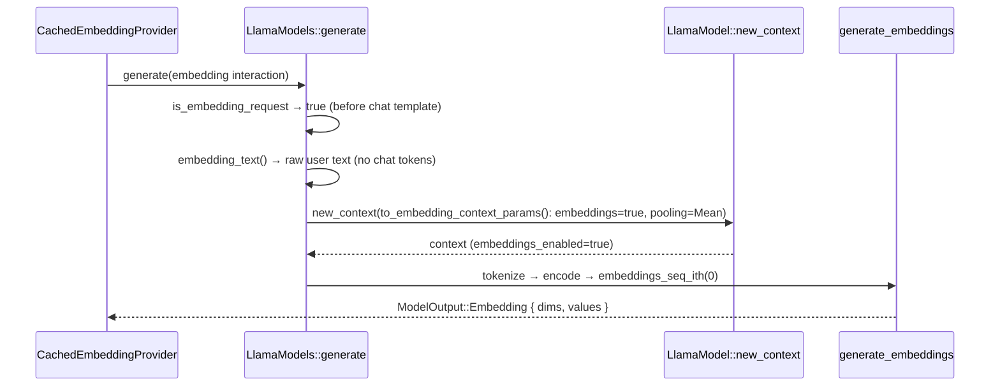

# Overview

`foundation_ai` exposes embeddings through `CachedEmbeddingProvider` (agentic memory, `shed` tool).
The OpenAI backend serves them correctly; the **local llama.cpp backend has an embedding branch that
can never succeed**. This spec makes local embeddings actually work — embedding the *raw input text*
rather than the chat-templated prompt, with a configurable pooling type (Mean default, CLS/Last
selectable) — and proves it end-to-end with a real embedding GGUF (`nomic-embed-text-v1.5`).

# Problem

`LlamaModels::generate` detects an embedding request (`is_embedding_request`, `llamacpp.rs:1085`) and
runs `generate_embeddings` (`llamacpp.rs:1272`), which calls `ctx.embeddings_seq_ith(0)`.

That call returns `EmbeddingsError::NotEnabled` unconditionally because the embedding context is built
with generation-oriented params:

- `LlamaBackendConfig::to_context_params` (`llamacpp.rs:204`) never calls `with_embeddings(true)`, so
  `LlamaModelContext.embeddings_enabled == false` (`context.rs:53`, set from `params.embeddings()`,
  `context/params.rs:538`). `embeddings_seq_ith` short-circuits on that flag (`context.rs:148-151`).
- Even with embeddings on, the context has no pooling type, so `llama_get_embeddings_seq` would return
  null (→ `NonePoolType`). Pooling is a context param (`LlamaModelContextParams::with_pooling_type`,
  `context/params.rs:610`), and `to_context_params` never sets it.

The comment at `llamacpp.rs:192-198` ("generation and embeddings share one context") is stale — the
embedding branch actually builds a **separate** context (`llamacpp.rs:524-527`), which is exactly what
lets us give it embedding-specific params without affecting generation.

A second, quality-level issue: even with the context fixed, the embedding branch feeds the
**chat-templated** prompt to the encoder. Embedding input should be the raw text, not text wrapped in
chat-control tokens, so raw-text embedding is folded into this spec (see R3).

# Decisions

| # | Decision | Rationale |
|---|---|---|
| 1 | **Fix** the embedding branch (do not remove it) | Local/offline embeddings are a wanted capability; OpenAI is not the only embedding backend |
| 2 | Pooling type is **configurable**, default **Mean**; CLS and Last selectable | Embedding pooling is model-dependent; Mean suits retrieval/sentence embeddings (incl. nomic-embed-text), Last suits causal LMs, CLS suits encoder models |
| 3 | Pooling lives on `LlamaBackendConfig`, not a hard-coded constant | Mirrors how the other llama.cpp knobs (GPU layers, context size, KV cache) are exposed |
| 4 | **Embed the raw input text**, not the chat-templated prompt | Embedding is over the input text; chat-control tokens add noise and no information |
| 5 | Verify with a **GGUF integration test** (not unit-only) | Proves the branch works against real llama.cpp, not just param plumbing |
| 6 | Test model: **`nomic-embed-text-v1.5`** (768 dims, Mean pooling) | The standard llama.cpp/Ollama embedding model — small (~137 MB Q8), Apache-2.0, BERT-style with a known-good GGUF |

# Requirements

## R1 — configurable pooling type on `LlamaBackendConfig`

- Add `pub pooling_type: LlamaPoolingType` to `LlamaBackendConfig` (`llamacpp.rs:117`).
- `Default` → `LlamaPoolingType::Mean` (`llamacpp.rs:141`).
- Add builder method `with_pooling_type(mut self, t: LlamaPoolingType) -> Self` on
  `LlamaBackendConfigBuilder` (`llamacpp.rs:219`).
- Import `LlamaPoolingType` from `infrastructure_llama_cpp::context::params` (extend the import at
  `llamacpp.rs:13`).
- Supported public choices are Mean / Cls / Last (the `LlamaPoolingType` enum also carries
  Unspecified/None/Rank; those are not offered as embedding choices).

## R2 — embedding context built with embeddings + pooling

- Add `LlamaBackendConfig::to_embedding_context_params()` that chains
  `to_context_params().with_embeddings(true).with_pooling_type(self.pooling_type)`.
- In `generate()`'s embedding branch (`llamacpp.rs:523-527`), build the context from
  `backend_config.to_embedding_context_params()` instead of `ctx_params`.
- Update the stale doc comment on `to_context_params` (`llamacpp.rs:192-198`): generation and
  embeddings no longer share a context; the embedding branch builds its own with embeddings + pooling.
- No change to `generate_embeddings` itself (`llamacpp.rs:1272`) — `ctx.encode` + `embeddings_seq_ith(0)`
  are correct once the context is built in embedding mode.
- Reused bindings (already exist): `with_embeddings` (`context/params.rs:553`), `with_pooling_type`
  (`context/params.rs:610`).

## R3 — embed raw input text, not the chat-templated prompt

- Detect the embedding request **before** `apply_chat_template` runs, and short-circuit with the raw
  text so the encoder never sees chat-control tokens.
- Add a helper (e.g. `embedding_text(&ModelInteraction) -> GenerationResult<String>`) that returns the
  raw text of the user message(s) (concatenated with `\n`), ignoring the `Assistant` embedding-marker
  message (`llamacpp.rs:1211` already skips it) and any non-text content.
- Pass that raw text to `generate_embeddings` instead of the templated `prompt`.
- **BOS check**: `generate_embeddings` tokenizes with `str_to_token(prompt, AddBos::Always)`
  (`llamacpp.rs:1279`). For BERT-style embedding models the chat BOS is wrong — confirm at
  implementation whether the embedding path should tokenize with `AddBos::Never` (expected), and
  adjust if so.

## R4 — GGUF integration test with `nomic-embed-text-v1.5`

- Commit `nomic-embed-text-v1.5` GGUF under `artefacts/models/`, following the existing convention
  (e.g. `artefacts/models/nomic-ai--nomic-embed-text-v1.5-GGUF/nomic-embed-text-v1.5.Q8_0.gguf`),
  downloaded from HuggingFace at implementation time.
- New test `backends/foundation_ai/tests/harness/integrations/llamacpp_embeddings.rs`, registered with a
  `mod llamacpp_embeddings;` line in `tests/harness/integrations/mod.rs` (gated by `live-model-tests`,
  `tests/harness/mod.rs:9`; alias `integration_tests`, `Cargo.toml:203`).
- Follow the `mtp_generate.rs` pattern: `project_root()`, a `Option<PathBuf>` model locator that returns
  `None` (→ skip) when the GGUF is absent.
- Build an embedding interaction in the same shape as `make_embedding_interaction`
  (`agentic/embedding.rs:283`) — an `Assistant` message carrying `ModelOutput::Embedding` plus the user
  text — and call `Model::generate` on a `LlamaBackends` handle (Mean pooling default).
- Assert the result contains `ModelOutput::Embedding` with `!values.is_empty()`,
  `dimensions == 768`, and `values.len() == dimensions`.
- Optional (cheap, no model needed): a unit assertion that `to_embedding_context_params()` reports
  `embeddings() == true` and the configured pooling type.

# Architecture

# Verification

- Spec is verified when R1-R4 are implemented and the integration test passes:
  `cargo test -p foundation_ai --features integration_tests --test foundation_ai_tests -- --nocapture harness::integrations::llamacpp_embeddings`
- Plus `cargo build -p foundation_ai` (config field compiles across the crate; only the `Default` impl
  and builder construct the struct — no external struct literals).
- Code quality: `cargo clippy`/`fmt` clean per `.agents/skills/rust-clean-code`.

# Out of scope

- Adding an **explicit embedding capability** (e.g. `supports_embeddings()`) to the `Model` /
  `ModelProvider` trait — the branch still triggers via the `is_embedding_request` request-shape
  heuristic. This spec fixes and uses the existing branch; it does not redesign capability discovery.
- Adding embedding support to providers that cannot produce embeddings (e.g. Anthropic Messages) —
  embedding is a property of the engine/model, not a universal, and is out of scope to add elsewhere.
- Changing remote-provider embedding behaviour (OpenAI path is untouched).
- Embedding *quality* evaluation/benchmarking — the test proves plumbing (correct dims, non-empty
  values), not retrieval quality.
- Supporting multiple embedding models / cross-model vector-index compatibility.
