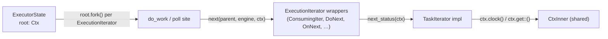

# Thread Ctx

## Overview

The engine owns the single `Ctx` (feature 00) and hands a clone to every poll.
This feature makes that mechanical: the two iterator traits gain a `ctx: Ctx`
parameter **by value**, and every implementation forwards or consumes it.

## Signatures

```rust
// task.rs
pub trait TaskIterator {
    type Pending;
    type Ready;
    type Spawner: ExecutionAction;
    fn next_status(&mut self, ctx: Ctx) -> Option<TaskStatus<Self::Ready, Self::Pending, Self::Spawner>>;
}

pub trait ExecutionIterator {
    fn next(&mut self, parent_id: Entry, engine: BoxedExecutionEngine, ctx: Ctx) -> Option<State>;
}
```

- `Ctx` is `Clone` + `Send + Sync`; a `ctx` parameter is an `Arc` refcount bump.
- Passing **by value** means an impl may hold the `Ctx` across an internal `.await`
  or move it into a spawned sub-task, with no borrow and no `&mut Arc`.



## Churn inventory

| Location | Change |
|----------|--------|
| `task.rs` — both traits | add `ctx: Ctx` |
| `executors/{future_task,stream_task,…}.rs` | every `TaskIterator` impl adds `ctx` (mostly `_ctx`/unused) |
| `executors/{task_iters,do_next,on_next,collect_next,…}.rs` | wrappers add `ctx` to `next`, forward to `next_status(ctx)` |
| `executors/{local.rs, multi/mod.rs}` | poll sites pass `self.ctx.clone()` |
| executor state (`ExecutorState` / `Engine`) | gains `root: Ctx`; forks `root.fork()` per ExecutionIterator (top-level + spawn) |
| **all backends** | every task impl that implements `TaskIterator` gains `ctx` |
| completed specs (22/33/50/58/41) | trait-signature examples go stale |

- Spawn methods (`sequenced`/`lift`/`schedule`/`broadcast`) are **unchanged** — the
  Ctx is injected at poll time, not at `BoxedExecutionIterator` construction.
- The `ExecutionIterator` change is **internal-only**: task authors implement
  `TaskIterator`, not `ExecutionIterator`, so the wrappers are the only
  `ExecutionIterator` impls.

## Design decisions

- **No defaulted/optional trait method** to ease migration. The user explicitly
  accepts the churn for maximum threading depth; a shim would leave a second
  signature to maintain forever.
- **Unused `ctx` in leaf impls is `_ctx`** and is expected — not every task needs
  the context on every turn, but the signature is uniform.
- **Ordering:** `ctx` is the **last** parameter on both traits, so existing
  positional arguments (`parent_id`, `engine`) keep their order.
- **Fork once per ExecutionIterator.** The engine forks its root `Ctx`
  (`root.fork()`) when an ExecutionIterator enters the engine (top-level schedule
  and every spawn), then passes that forked ctx **by value** (share) each poll.
  Forking at poll time would reset a task's map every turn, so the fork is
  per-ExecutionIterator, not per-`next`.

## Error handling

No new error paths. The `catch_unwind(AssertUnwindSafe(|| …))` closures around
`next_status` simply move the `ctx` (which is `Send + Sync`) into the closure —
`AssertUnwindSafe` remains sound.

## Trade-offs

- Large diff, but mechanical and compiler-driven (a missing `ctx` is a compile
  error at each impl).
- The RNG-in-Ctx open decision from feature 00 must be settled before wiring
  `ctx.rng()` into tasks, but the *plumbing* here is independent of it.

## Tasks

1. Add `ctx: Ctx` to `TaskIterator::next_status` and `ExecutionIterator::next`.
2. Add `ctx: Ctx` to `ExecutorState`/`Engine`; seed it at init; pass `self.ctx.clone()`
   at every poll site (`local.rs`, `multi`).
3. Update every internal wrapper to forward `ctx`.
4. Update every core `TaskIterator` impl (`FutureTask`, `StreamTask`, `from_future`,
   `from_stream`, task_iters, …).
5. Update every backend task impl across the workspace.
6. Fix any macro-generated/downstream callers of `next_status`/`next`.
7. Compile under `multi` and `!multi` (incl. wasm single-threaded).
8. Update completed specs' trait-signature examples + run the valtron test suite.

## Success criteria

- The workspace compiles with the new signatures under both `multi` and `!multi`.
- A task observes the engine-seeded `Ctx` (e.g. reads `ctx.clock()`) on every poll.
- Existing `FutureTask`/`StreamTask`/`from_future`/`from_stream` tests pass unchanged.
