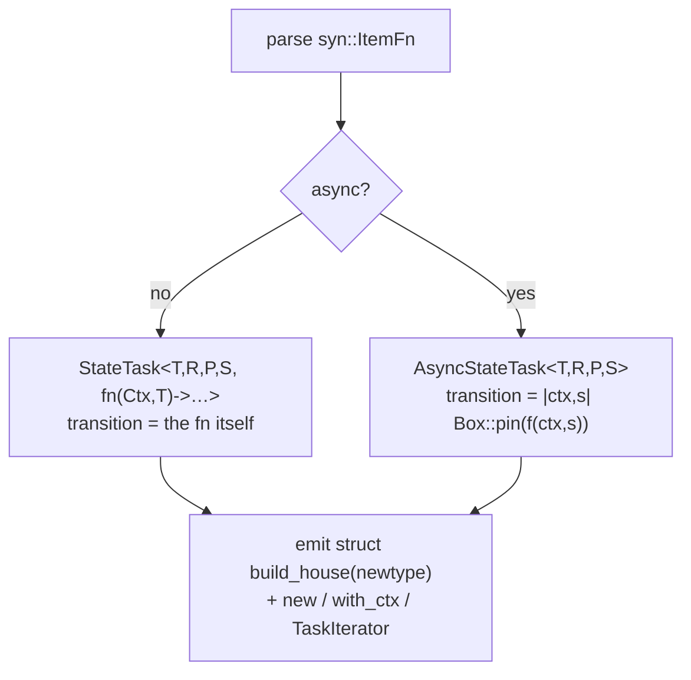

# Task macro

## Overview

`#[valtron::task]` is an attribute proc-macro in `foundation_macros`. It reads the
transition function's signature and emits:

- a `struct` with the **same name** as the function (`#[allow(non_camel_case_types)]`),
- `new(T)` and `with_ctx(T, Ctx)` constructors,
- a `TaskIterator` impl that delegates to `StateTask` (sync) or `AsyncStateTask`
  (async) with the user's function as the transition.

> Note: `#[valtron:task]` (single colon) is not valid Rust; the attribute path is
> `#[valtron::task]`, i.e. the `task` macro re-exported from the `valtron` module.

## Surface

```rust
#[valtron::task]
async fn build_house(ctx: Ctx, state: BuildHouseState)
    -> Option<(BuildHouseState, TaskStatus<House, Progress, NoSpawner>)>
{
    match state {
        Plan                    => { let p = fetch_permits(ctx).await?; Some((Frame { done: 0 }, TaskStatus::Pending(Progress::Planning))) }
        Frame { done } if done < 100 => { dry_one_wall().await?;        Some((Frame { done: done + 1 }, TaskStatus::Pending(Progress::Framing))) }
        Frame { done }         => Some((Done, TaskStatus::Ready(House { walls: done }))),
        Done                   => None,
    }
}

// use:
let task = build_house::new(BuildHouseState::Plan);
let task = build_house::with_ctx(BuildHouseState::Plan, shared_ctx);
valtron::execute(task, …);

// unit test WITHOUT valtron — the transition is a plain function:
let (next, status) = build_house(Ctx::new(), BuildHouseState::Plan).unwrap();
```

The function and struct share the name because Rust keeps the **value namespace**
(the `fn`) and the **type namespace** (the `struct`) separate; `build_house::new`
resolves to the struct's associated fn, `build_house(…)` to the transition.

## Expansion

The macro parses `syn::ItemFn`, requires exactly two inputs `(ctx: Ctx, state: T)`,
and detects async via `sig.asyncness`.

- **Signature extraction.** `T` is the type of the second argument; `R`, `P`, `S`
  are the three generics of `TaskStatus<…>` inside the `Option<(T, …)>` return
  type. Malformed signatures (wrong arg count, missing `Option<(T, TaskStatus<..>)>`
  return) are rejected at expansion time with a `syn::Error`.
- **Sync body** generates:

  ```rust
  #[allow(non_camel_case_types)]
  pub struct build_house(StateTask<T, R, P, S, fn(Ctx, T) -> Option<(T, TaskStatus<R, P, S>)>>);

  impl build_house {
      pub fn new(state: T) -> Self { build_house(StateTask::new(state, build_house)) }
      pub fn with_ctx(state: T, ctx: Ctx) -> Self { build_house(StateTask::with_ctx(state, ctx, build_house)) }
  }
  impl TaskIterator for build_house { /* delegate to self.0 */ }
  ```

  The user's `fn` coerces to the `fn` pointer `F` directly (nameable, no erasure).

- **Async body** generates:

  ```rust
  #[allow(non_camel_case_types)]
  pub struct build_house(AsyncStateTask<T, R, P, S>);

  impl build_house {
      pub fn new(state: T) -> Self {
          build_house(AsyncStateTask::new(state, |ctx, s| Box::pin(build_house(ctx, s))))
      }
      pub fn with_ctx(state: T, ctx: Ctx) -> Self {
          build_house(AsyncStateTask::with_ctx(state, ctx, |ctx, s| Box::pin(build_house(ctx, s))))
      }
  }
  impl TaskIterator for build_house { /* delegate to self.0 */ }
  ```

  The closure erases into the core's `Box<dyn Fn>`; the future erases into
  `Box<dyn Future>`. `AsyncStateTask<T, R, P, S>` is nameable (no `impl Future` in
  type position), which is exactly why the async core erases.

- **Path hygiene.** Generated code references `foundation_core` via
  `crate_paths::foundation_core_path()` (`resolve_crate("foundation_core")`), the
  same helper `valtron_entry.rs` uses, so the expansion works whether the caller
  depends on `foundation_core` directly or renames it in `Cargo.toml`.



## Registration & re-export

- Add `#[proc_macro_attribute] pub fn task(…)` to `foundation_macros/src/lib.rs`,
  backed by `state_task.rs` (mirroring `valtron_entry.rs`).
- Re-export it from `foundation_core/src/valtron/mod.rs`:
  `pub use foundation_macros::{task, timeout, valtron, valtron_test};`, so
  `use foundation_core::valtron;` + `#[valtron::task]` works. The bare
  `#[valtron]` entry macro and the `valtron` module coexist because they live in
  different namespaces (macro vs type/module).

## Error handling

Compile-time, via `syn::Error::to_compile_error()` for:

- wrong argument count or a first arg that isn't `Ctx`;
- a return type that isn't `Option<(T, TaskStatus<R, P, S>)>`;
- (async only) a transition whose inferred future is not `Send` under `multi` —
  surfaced as the core's `Box<dyn Future + Send>` bound failing, pointing at the
  offending `.await`.

## Trade-offs

- **Same-name struct** is non-idiomatic (`non_camel_case_types`), accepted
  deliberately for the "easy to refer to" property the user asked for. The
  `#[allow]` scopes the lint to the generated struct only.
- **Async closure boxing** means one extra `Arc`/`Box` per task construction;
  construction is one-time, not per-poll.

## Tasks

1. Add `foundation_macros/src/state_task.rs` implementing `task`; register in
   `lib.rs`.
2. Re-export `task` from `foundation_core/src/valtron/mod.rs`.
3. Sync + async compile tests: struct is same-named; `new`/`with_ctx` exist;
   `TaskIterator` impl composes with `execute`/`from_future`.
4. Direct-call test: `build_house(Ctx::new(), state)` returns the expected
   `(next, status)` with no engine.
5. `Send` test: `fn assert_send<T: Send>() {}` on the generated struct under
   `multi`; a `!Send` future under single/wasm still compiles.

## Success criteria

- `#[valtron::task]` works on both `fn` and `async fn`, producing a same-named
  struct with the two constructors.
- Malformed signatures fail to compile with a clear `syn::Error`.
- The transition function is directly unit-testable without valtron.
- The generated struct is `Send` when `T, R, P, S` are `Send`.
