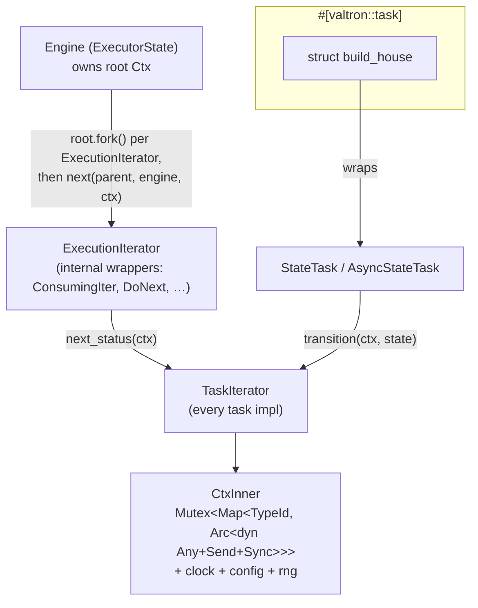

# Overview

Valtron tasks today reach engine-level services (RNG, clock, config) by manual
threading or ambient globals — nothing is *provided* to a task by the engine.
This specification changes that:

- The **engine owns a `Ctx`** — `Ctx = Arc<CtxInner>`, everything inside
  `Send + Sync` — and **clones it into every poll**. `Ctx` is passed **by value**
  (a cheap `Arc` clone) down `ExecutionIterator::next` → `TaskIterator::next_status`.
- The Ctx is **seeded with standard elements** (clock, config, RNG) so every task,
  at every turn, can reach them without threading them through signatures.
- On top of that, `#[valtron::task]` turns a state-transition function into a
  `TaskIterator` that receives the engine `Ctx` alongside its state `T`, removing
  the hand-written enum + match transition boilerplate.

The headline win is two-fold: **standard elements thread deeply through the whole
task graph**, and the state-machine pattern is a **plain function** you can
unit-test with no engine at all.

# Goals

- Make the engine the single source of ambient services (clock, config, RNG),
  threaded to every task via a shared, cheaply-cloned `Ctx`.
- Expand the `TaskIterator`/`ExecutionIterator` signatures to carry the `Ctx`
  **by value**, accepting the mechanical churn this causes.
- Provide native state-machine iterators (`StateTask` sync, `AsyncStateTask`
  async) and the `#[valtron::task]` macro that consumes the threaded `Ctx`.
- Keep the generated task `Send` by default so it runs unchanged under `multi`,
  and equally usable under single-threaded wasm/non-wasm.

# Implementation Location

- `backends/foundation_core/src/valtron/ctx.rs` — `Ctx` + `CtxInner` (feature 00).
- `backends/foundation_core/src/valtron/task.rs` — `TaskIterator::next_status` and
  `ExecutionIterator::next` signature change (feature 01).
- `backends/foundation_core/src/valtron/executors/*` — poll sites + wrappers
  forward `ctx` (feature 01).
- `backends/foundation_core/src/valtron/executors/state_task.rs` — `StateTask`,
  `AsyncStateTask`, `TransitionPending` (feature 02).
- `backends/foundation_macros/src/state_task.rs` — `#[valtron::task]` (feature 02).

# Known Issues

- `Ctx` is `std`/`alloc`-gated (`Arc`, `HashMap`, `TypeId`, `dyn Any`), matching
  the existing gating on `FutureTask`/`StreamTask`.
- The signature change breaks **every** `TaskIterator` impl in the workspace
  (core + all backends) and makes the completed specs that document the trait
  (22/33/50/58/41) stale. This is accepted, tracked churn.

# Language Stack

| Language | Purpose | Skill Location |
|----------|---------|----------------|
| Rust | `Ctx`, trait threading, core iterators, proc-macro | `.agents/skills/rust-valtron-usage/skill.md`, `.agents/skills/rust-valtron-iterator/skill.md` |

Mandatory pre-implementation: read `.agents/skills/rust-valtron-usage/skill.md`
and `.agents/skills/rust-valtron-iterator/skill.md`; follow the async/valtron
boundary and `Send`/`!Send` rules from `.agents/AGENTS.md`.

# Feature Index

| #  | Feature | Description | Dependencies | Status |
|----|---------|-------------|--------------|--------|
| 0  | [Ctx](./features/00-ctx/feature.md) | `Ctx = Arc<CtxInner>`; interior-mutable type map + engine-seeded standard elements | None | ⬜ Pending |
| 1  | [Thread Ctx](./features/01-thread-ctx/feature.md) | `next_status(&mut self, ctx: Ctx)` + `next(…, ctx: Ctx)`; executor owns + clones; update all impls | 00 | ⬜ Pending |
| 2  | [State task macro](./features/02-state-task/feature.md) | `StateTask`/`AsyncStateTask`/`TransitionPending` + `#[valtron::task]` | 01 | ⬜ Pending |

Status Key: ⬜ Pending | 🔄 In Progress | ✅ Complete

# Requirements Conversation Summary

The design went through three phases. Recorded decisions:

- **Global engine Ctx → per-task Ctx → engine Ctx threaded through the traits.**
  A *global* Ctx conflicted with the `ExecutionIterator` ownership model and with
  `Send` migration under `multi`. A *per-task* Ctx (spec v1) isolated benefit to a
  single task type. The chosen design: the **engine owns the Ctx and threads it
  through every poll**, forking it per ExecutionIterator so each gets a unique map
  while every task still sees the engine's standard elements.
- **`Ctx = Arc<CtxInner>`, everything `Send + Sync`.** `Arc` makes the Ctx cheap
  to clone and share; `Send + Sync` makes it usable on worker threads under
  `multi` *and* on single-threaded wasm/non-wasm (wasm merely loses `!Send`
  entries, which is deferred).
- **`Ctx` by value everywhere, no borrow.** Because it wraps an `Arc`, `Ctx` is
  passed **by value** (a cheap clone) through `ExecutionIterator::next` and
  `TaskIterator::next_status`. No `&Ctx`/`&mut Ctx`: a `&mut Arc<…>` would be a
  mutable ref to the pointer, not the map, and mutation goes through the interior
  lock. Passing by value also means an async transition's future simply *owns* its
  clone — no self-referential borrow.
- **Fork at the ExecutionIterator boundary, share within it.** `Ctx` has two
  operations: `clone()` **shares** the map (used inside one ExecutionIterator — the
  wrapper forwards its ctx to its inner task), and `fork()` **copies** the map into
  a fresh handle (used by the engine at each ExecutionIterator boundary: top-level
  schedule and every spawn). Sibling ExecutionIterators get unique maps and never
  pollute each other; a wrapper and its inner task share one. The fork copies the
  map *structure* — the `Arc` values stay shared — so it stays cheap.
- **Signature expansion is accepted churn.** `next_status(&mut self, ctx: Ctx)` is
  a breaking change to every task impl; the `ExecutionIterator::next` change is
  internal-only (wrappers). Spawn methods (`sequenced`/`lift`/`schedule`/
  `broadcast`) are unchanged — the Ctx is injected at poll time, not spawn time.
- **Standard elements seeded by the engine** — clock and config (read-only
  shared), and the RNG. The RNG sharing model (single shared `Arc<Mutex<Rng>>`
  stream vs per-task seeded clones) is an open decision; default recorded below.
- **Termination via `Option`.** The state-machine transition returns
  `Option<(T, TaskStatus<R, P, S>)>`; `None` = finished.
- **Struct name == function name.** `fn build_house` → `struct build_house`
  (separate value/type namespaces; `#[allow(non_camel_case_types)]`).

**Decision (RNG):** a single shared `Arc<Mutex<Rng>>` — every task draws from one
engine-seeded stream (per-task seeded clones dropped). Cross-run reproducibility
holds for a deterministic single-threaded scheduler; under `multi` the draw
interleaving is schedule-dependent. Standard elements are `Arc<T>` and accessors
return `Arc<T>` (owned clone), not `&T`.
**Decision (standard set):** clock + config + RNG in the first cut;
deadline/cancellation token and tracing span are candidates but not yet in scope.

# High-Level Architecture

- The executor owns the root `Ctx`; each ExecutionIterator gets a `root.fork()`
  (unique map) once, and each poll passes that forked ctx **by value** (share) down.
- Internal `ExecutionIterator` wrappers forward the `Ctx` to `TaskIterator::next_status`.
- The state-machine macro's transition is `fn(ctx: Ctx, state: T) ->
  Option<(T, TaskStatus<R,P,S>)>` — the engine's forked Ctx, not a task-owned one.

# Success Criteria (Spec-Wide)

1. `Ctx` round-trips insert/get/remove/contains by `TypeId`; `clone()` shares the
   map and `fork()` yields a structurally independent map (inserts don't cross
   forks); `Ctx: Send + Sync`; clock/config/RNG are reachable from any task.
2. A task's `next_status` receives the same `Ctx` the engine seeded, on every
   poll, under both `multi` and single-threaded engines.
3. `StateTask`/`AsyncStateTask` drive a multi-state machine to `Ready`; the async
   variant parks on `Depends` during `await` (no busy-poll).
4. `#[valtron::task]` generates a same-named struct with `new(T)` for both `fn`
   and `async fn`; the transition is directly callable with `(Ctx::new(), state)`.
5. The generated struct is `Send` when `T, R, P, S` are `Send`.
6. No regression to `FutureTask`/`StreamTask`/`from_future`/`from_stream` after the
   signature change.

# Out of Scope

- A non-`Send` `Ctx`/`T` (for `Rc`/`JsFuture` entries). Deferred.
- Yielding intermediate statuses from *inside* an async transition (async
  generators are unstable); the async core synthesizes `TransitionPending::Awaiting`.
- Deadline/cancellation and tracing-span standard elements (candidates only).
- Removing the dormant `CloneableExecutionIterator`/`CanCloneExecutionIterator`
  cluster in `task.rs` — tracked separately.

# Module References

- `backends/foundation_core/src/valtron/task.rs` — `TaskIterator`, `TaskStatus`,
  `ExecutionIterator`
- `backends/foundation_core/src/valtron/executors/future_task.rs` — `FutureTask`/
  `StreamTask`, the waker seam
- `backends/foundation_core/src/valtron/executors/{local.rs,multi/mod.rs}` — poll sites
- `backends/foundation_core/src/valtron/executors/{task_iters.rs,do_next.rs,on_next.rs,collect_next.rs}` — wrappers
- `backends/foundation_core/src/valtron/mod.rs:25` — macro re-export precedent
- `backends/foundation_macros/src/{valtron_entry.rs,crate_paths.rs}` — macro patterns

---

_Created: 2026-10-18_
_Last Updated: 2026-10-18_
_Structure: Feature-based (has_features: true)_
