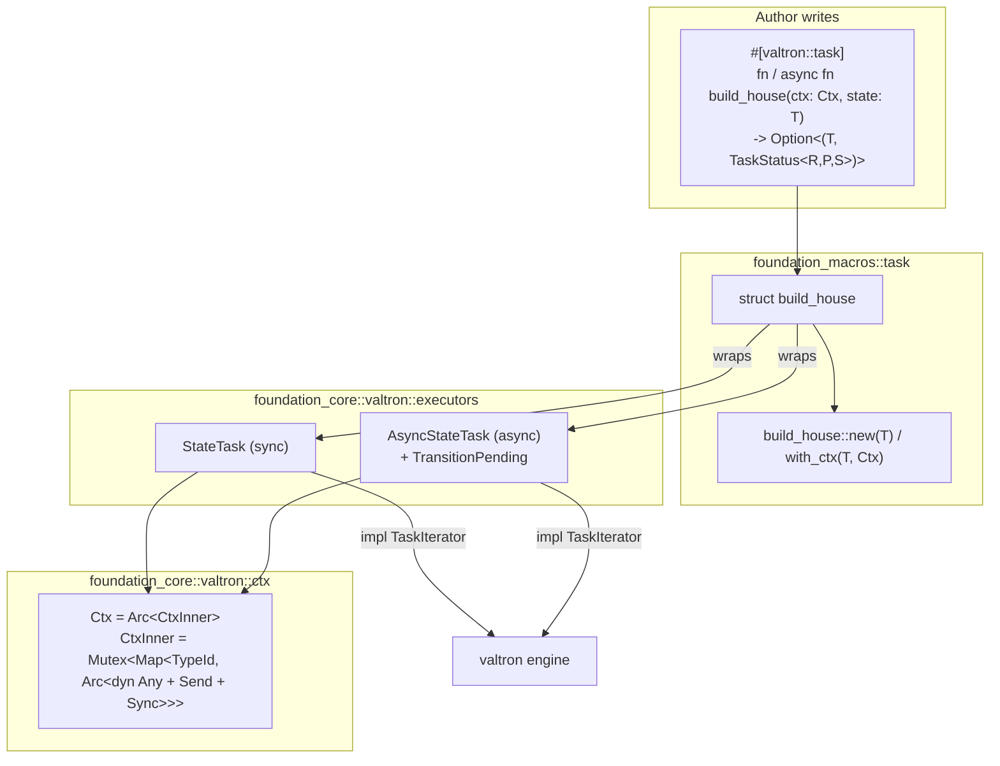

# Overview

Every non-trivial valtron task today is the same two-step dance by hand:

1. an `enum` (or `struct`) that names every state and the values each carries, and
2. a `TaskIterator` impl whose `next_status` `match`es on the current state and
   returns the next `TaskStatus`.

`FutureTask`/`StreamTask` already hide this for the "one future / one stream"
cases. There is no equivalent for the **multi-turn state machine** case, so
authors keep re-implementing the enum + transition loop by hand.

This specification adds that missing primitive, plus the ergonomic layer over it:

- **`Ctx`** — a cloneable, `Send + Sync` scratch bag (a type map of `Arc<T>`
  entries) that a task owns and can cheaply share with sub-tasks and async
  futures.
- **`StateTask`** (sync) and **`AsyncStateTask`** (async) — two native
  `TaskIterator` types, parallel to `FutureTask`/`StreamTask`, that own a `Ctx`
  and a state `T` and drive a transition function turn by turn.
- **`#[valtron::task]`** — a proc-macro in `foundation_macros` that turns

  ```rust
  #[valtron::task]
  async fn build_house(ctx: Ctx, state: BuildHouseState)
      -> Option<(BuildHouseState, TaskStatus<House, Progress, NoSpawner>)> { … }
  ```

  into a `struct build_house` (same name as the function) with
  `build_house::new(state)` returning a ready-to-run `TaskIterator`.

The headline win: the transition function is a **plain free function**, so it is
unit-testable with no valtron engine at all — construct a `Ctx`, pass the current
`T`, assert the returned `(next, status)`.

# Goals

- Eliminate hand-written `TaskIterator` state machines for the common case: an
  enum of states plus a transition over them.
- Provide the same primitive for **sync** and **async** transitions, reusing
  valtron's existing future/waker machinery rather than inventing new runtime
  plumbing.
- Give tasks a **per-task, shareable** `Ctx` (not a global), so spawned sub-tasks
  and in-flight futures can read/write shared scratch state without threading it
  through every signature.
- Make the generated task `Send` by default so it runs unchanged under the
  `multi` engine.

# Implementation Location

- `backends/foundation_core/src/valtron/ctx.rs` — `Ctx` + `CtxInner` (feature 00).
- `backends/foundation_core/src/valtron/executors/state_task.rs` — `StateTask`,
  `AsyncStateTask`, `TransitionPending` (feature 01).
- `backends/foundation_macros/src/state_task.rs` — `#[valtron::task]` (feature 02).
- Re-exports: `valtron/mod.rs` (`Ctx`, `task`), `valtron/executors/mod.rs`
  (`StateTask`, `AsyncStateTask`, `TransitionPending`).

# Known Issues

None — green-field capability. The only latent constraint is that `Ctx` is
`std`/`alloc`-gated (it needs `Arc`, `HashMap`, `TypeId`, `dyn Any`), matching the
existing `#[cfg(any(feature = "std", feature = "alloc"))]` gating on
`FutureTask`/`StreamTask`.

# Language Stack

| Language | Purpose | Skill Location |
|----------|---------|----------------|
| Rust | `Ctx`, core iterators, proc-macro | `.agents/skills/rust-valtron-usage/skill.md`, `.agents/skills/rust-valtron-iterator/skill.md` |

Mandatory pre-implementation: read `.agents/skills/rust-valtron-usage/skill.md`
and `.agents/skills/rust-valtron-iterator/skill.md`; follow the async/valtron
boundary and `Send`/`!Send` rules from `.agents/AGENTS.md`.

# Feature Index

| #  | Feature | Description | Dependencies | Status |
|----|---------|-------------|--------------|--------|
| 0  | [Ctx](./features/00-ctx/feature.md) | `Ctx` = `Arc<CtxInner>`; interior-mutable type map of `Arc<T>` entries | None | ⬜ Pending |
| 1  | [State task iterators](./features/01-state-task/feature.md) | `StateTask` (sync) + `AsyncStateTask` (async) + `TransitionPending` | 00 | ⬜ Pending |
| 2  | [Task macro](./features/02-task-macro/feature.md) | `#[valtron::task]` proc-macro generating a same-named struct | 01 | ⬜ Pending |

Status Key: ⬜ Pending | 🔄 In Progress | ✅ Complete

# Requirements Conversation Summary

The user explored, then abandoned, a **global engine-provided `Ctx`** threaded
through every `ExecutionIterator` — it conflicted with the `ExecutionIterator`
ownership model and with `Send` migration under `multi`. The idea evolved into a
**per-task `Ctx` + a generated state-machine task**, with the following recorded
decisions:

- **Native core iterators, not inline macro output.** `StateTask` and
  `AsyncStateTask` are first-class `TaskIterator` types in
  `executors/`, exactly like `FutureTask`/`StreamTask`; the macro is a thin layer
  that wires the user's named function into them. The core is usable directly
  with a closure, no macro required.
- **`Ctx` is owned by the task and is a shareable handle.** `Ctx` wraps
  `Arc<CtxInner>`; `CtxInner` holds the interior-mutable map. Every task is
  already `Send` (it migrates to the worker thread under `multi`), so `Ctx` is
  `Send + Sync` by construction and every entry is `Arc<T>` (`T: Send + Sync`).
  Sub-tasks and async futures get a cheap clone of the same `Arc<CtxInner>`.
- **The transition function takes `ctx: Ctx` by value** (a cheap clone) — the
  same signature for sync and async. This makes the future own its own clone and
  avoids the self-referential borrow that `&mut Ctx` across `.await` would cause.
- **Struct name == function name.** `fn build_house` generates `struct
  build_house`; the two share a name because Rust keeps the value and type
  namespaces separate. The generated struct carries
  `#[allow(non_camel_case_types)]`.
- **Async is a first-class target.** `async fn` is `fn(…) -> impl Future`; the
  async core reuses `FutureTask`'s poll-once + `Depends`/`Pending` waker seam.
- **Termination via `Option`.** The transition returns
  `Option<(T, TaskStatus<R, P, S>)>`; `None` means "task finished" and maps to
  `next_status() -> None`.
- **`Send` by default, `!Send` deferred.** `T` is `Send` under `multi` (the
  `!Send` single/wasm impls mirror `FutureTask`'s cfg-split), but a non-`Send`
  `Ctx`/`T` (for `Rc`/`JsFuture` entries) is out of scope for this spec.

# High-Level Architecture



- **`Ctx`** is the owned, cloneable scratch bag. Cloning shares the same
  `Arc<CtxInner>`, so a sub-task or a future mutates the same map.
- **`StateTask`** holds `Option<T>` + `Ctx` + a `FnMut(Ctx, T) ->
  Option<(T, TaskStatus<R,P,S>)>`; each `next_status` calls the transition once.
- **`AsyncStateTask`** holds `Option<T>` + `Ctx` + a boxed future; each
  `next_status` polls the current transition's future once (`FutureTask`
  semantics), parks on `Depends` during an `await`, and stores the returned state
  when the future completes.
- **The macro** emits the same-named struct as a thin newtype over the core, with
  the user's function (or a boxed call to it) as the transition.

# Success Criteria (Spec-Wide)

1. `Ctx` insert/get/remove/contains round-trip by `TypeId`; a clone observes
   mutations made through any other clone; `Ctx: Send + Sync`.
2. A `StateTask` and an `AsyncStateTask` both drive a multi-state machine to
   `Ready` under the engine, and both can `Spawn` sub-tasks that share the parent
   `Ctx`.
3. `AsyncStateTask` parks on `Depends` during an `await` (no busy-poll) and
   resumes on wake, matching `FutureTask`'s behaviour.
4. `#[valtron::task]` generates a struct named exactly like the function with
   `new(T)`/`with_ctx(T, Ctx)`, for both `fn` and `async fn` bodies.
5. The transition function is directly callable — `build_house(Ctx::new(),
   state)` — and asserts on its `(next, status)` output with no engine.
6. The generated struct is `Send` when `T`, `R`, `P`, `S` are `Send`, and runs
   under `multi`.
7. No regression to `FutureTask`/`StreamTask`/`from_future`/`from_stream`.

# Out of Scope

- A non-`Send` `Ctx`/`T` variant (for `Rc`/`JsFuture` entries). Deferred; would
  be a later `#[valtron::task(non_send)]` or a separate non-send core impl.
- Yielding intermediate statuses from *inside* an async transition (Rust async
  generators are unstable); the async core yields `TransitionPending::Awaiting`
  implicitly and the author's `TaskStatus` only on future completion.
- Removing the dormant `CloneableExecutionIterator`/`CanCloneExecutionIterator`
  cluster in `task.rs` — tracked separately, not part of this spec.

# Module References

- `backends/foundation_core/src/valtron/task.rs` — `TaskIterator`, `TaskStatus`
- `backends/foundation_core/src/valtron/executors/future_task.rs` — `FutureTask`/
  `StreamTask`, the waker seam (`wake_queue` + `queue_waker` + `QueueReadiness`)
- `backends/foundation_core/src/valtron/executors/mod.rs` — executor re-exports
- `backends/foundation_core/src/valtron/mod.rs:25` — macro re-export precedent
  (`pub use foundation_macros::{timeout, valtron, valtron_test};`)
- `backends/foundation_macros/src/valtron_entry.rs` — `#[valtron]`/`#[valtron_test]`
  expansion pattern, `crate_paths::foundation_core_path()`
- `backends/foundation_macros/src/crate_paths.rs` — `resolve_crate` helper

---

_Created: 2026-10-18_
_Last Updated: 2026-10-18_
_Structure: Feature-based (has_features: true)_
