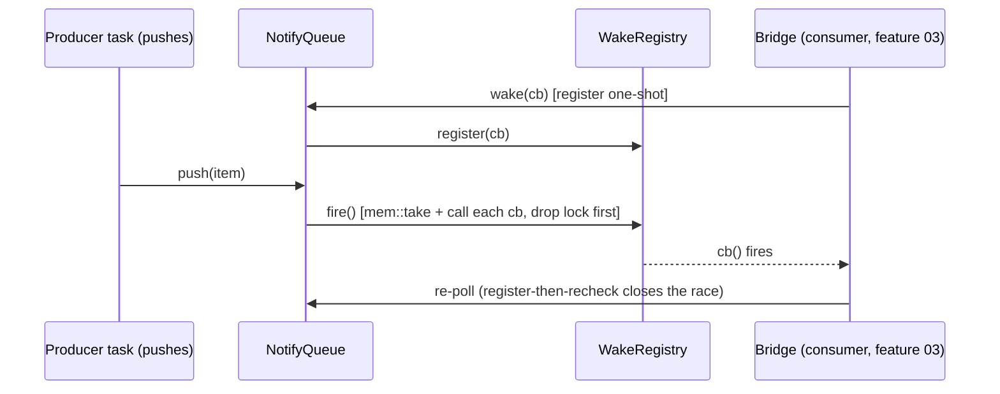
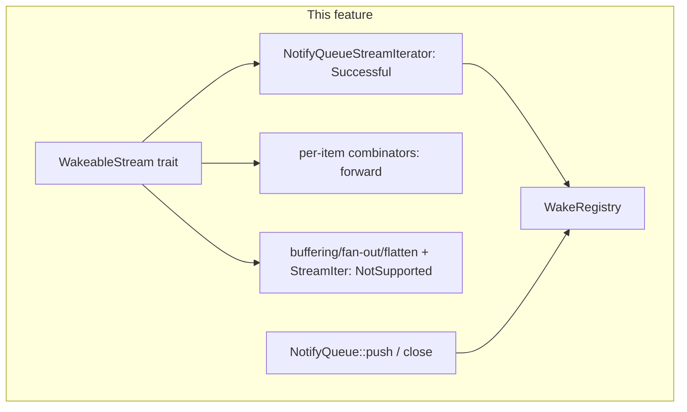

# WakeableStream capability

## Overview

Add the wake side-channel without changing any item type or bridge behavior.
`WakeableStream` is an **opt-in** trait (super-trait `StreamIterator`) whose
`wake(Fn() -> ())` registers a one-shot readiness callback. The execution-path
producer (`NotifyQueue::push` / `close`) fires every registered callback and clears
the list; the consumer (the `stream_future.rs` bridges, wired in feature 03)
re-polls after being woken.

This feature is behavior-preserving on its own: the bridges are not touched, so
everything still self-wakes. It only lands the capability and the firing point.
Feature 03 rewires the bridges to park on the wake signal.

The wake signal carries **no payload** and is level-triggered ("the queue became
non-empty or closed"). The producer must **not** filter by `Stream` variant — it
fires on every `push` and on `close`; the woken bridge re-polls and re-classifies.
This is the `Waker::wake()` contract.

## Language Stack

| Language | Purpose | Skill Location |
|----------|---------|----------------|
| Rust | Trait + registry + combinator impls | `.agents/skills/rust-clean-code/skill.md`, `.agents/skills/rust-valtron-usage/skill.md`, `.agents/skills/rust-valtron-iterator/skill.md` |

## Requirements

1. **`WakeableStream` trait** — opt-in, super-trait `StreamIterator`, method
   `fn wake(&mut self, cb: WakeCallback) -> WakeResult` with a default returning
   `WakeResult::NotSupported`. No blanket impl (see *Why opt-in* below).
2. **`WakeResult` enum** — `Successful | NotSupported`, `Copy`/`Clone`/`Eq`/`Debug`.
3. **`WakeCallback` type alias** — `Box<dyn Fn() + Send + 'static>` under `multi`,
   `Box<dyn Fn() + 'static>` under `!multi`.
4. **`WakeRegistry`** — fire-all-then-clear: `fire()` `mem::take`s the callback vec
   under the lock, releases the lock, then calls each callback. Never calls user
   code under the lock. Manual `Debug` (a `Vec<Box<dyn Fn()>>` is not `Debug`).
5. **`NotifyQueue` wiring** — hold a shared `Arc<WakeRegistry>`; `register_wake(cb)`
   accessor; fire in `push` (on successful push) and in `close` (only when the
   queue actually transitions to closed). Producer side only — never fire from
   `wait_for_item`.
6. **`NotifyQueueStreamIterator`** — `wake` registers the cb and returns `Successful`.
7. **Per-item combinators** — forward `wake` to the wrapped `inner` iterator.
8. **Buffering / fan-out / flatten combinators, task observers, `StreamIter`** —
   inherit the default `NotSupported` (empty impl).

## Architecture (COMPREHENSIVE)

### Why opt-in (no blanket)

A blanket `impl<M: Iterator<Item = Stream<D,P>>> WakeableStream for M` (default
`NotSupported`) would overlap the waking terminal's `Successful` impl — E0119, no
stable specialization. Dropping the `StreamIterator` blanket instead is ~10× worse
(~56 explicit impls + cross-crate `dyn StreamIterator` breakage). So: **keep the
`StreamIterator` blanket, make `WakeableStream` opt-in**, implement it explicitly
on the handful of types that matter.

### Wake flow





### Trait shape

```rust
pub enum WakeResult { Successful, NotSupported }

/// One-shot readiness callback. Fired exactly once (and the list cleared) when the
/// backing queue has/will have an item, or closes.
#[cfg(feature = "multi")]
pub type WakeCallback = Box<dyn Fn() + Send + 'static>;
#[cfg(not(feature = "multi"))]
pub type WakeCallback = Box<dyn Fn() + 'static>;

pub trait WakeableStream: StreamIterator {
    fn wake(&mut self, cb: WakeCallback) -> WakeResult {
        let _ = cb; // default: cannot deliver the signal
        WakeResult::NotSupported
    }
}

/// fire-all-then-clear registry. `fire()` must `mem::take` the vec under the lock,
/// release the lock, then call each callback (never call user code under the lock).
pub struct WakeRegistry {
    callbacks: Mutex<Vec<WakeCallback>>,
}
```

`Mutex` here is `crate::compati::Mutex` (`std::sync::Mutex` native /
`foundation_nostd::primitives::Mutex` wasm) — the same mutex `pipe.rs` uses for its
waker stash. **Not** the condvar-compatible `CondVarMutex`.

### Component: `WakeRegistry` sharing across `NotifyQueue` clones

`NotifyQueue<T>` is `Clone`, and every clone shares the same underlying
`Arc<ConcurrentQueue<T>>` / condvar / mutex. The producer and the consumer hold
different clones of the **same** queue (e.g. `stream_iter_with_config` hands
`iter_chan.clone()` to the producing task and the same `Arc` to the returned
iterator). A wake registered by the consumer must therefore be visible to the
producer's `push`, so the registry **must be shared**, not copied.

Concretely:

- `NotifyQueue` gains a field `wake: Arc<WakeRegistry>`.
- `NotifyQueue::unbounded()` / `bounded()` construct `Arc::new(WakeRegistry::new())`.
- `NotifyQueue::clone()` clones the `Arc` (same registry).
- `WakeRegistry` needs **manual `Debug`** (derive fails: `Vec<Box<dyn Fn()>>` has no
  `Debug`); it does **not** need `Clone` (it is only ever stored behind the `Arc`).

This is a deliberate, necessary refinement of the sketch above (the sketch omits the
`Arc`, but a plain `Mutex<Vec<..>>` field would not survive the `Clone` that the
producer/consumer handoff relies on).

### Component: `NotifyQueue` firing points

`NotifyQueue` lives in `executors/local.rs` (`struct` at line 242). Add:

```rust
pub fn register_wake(&self, cb: WakeCallback) {
    self.wake.register(cb);
}
```

- **`push` (`:290`)** — after `self.queue.push(item)?` succeeds (i.e. after the `?`,
  before returning `Ok(())`), call `self.wake.fire()`. Do **not** fire on a failed
  push (`PushError::Full`/`Closed`): no item became available, so there is nothing
  to wake.
- **`close` (`:378`)** — `self.queue.close()` returns `true` on the transition
  open→closed and `false` if already closed. Fire **only when it returns `true`**,
  so a consumer parked on an empty-but-open queue is woken to observe the close.
- **`wait_for_item`** — **do not** fire here. It runs on the consumer side; firing
  there would self-wake the consumer and defeat the producer-side signal.

Firing on every `push` (not only the "empty→non-empty" edge) is correct and cheap:
a callback is one-shot and the list is cleared on fire, so a push into a non-empty
queue fires an empty list and costs a single lock + `mem::take`.

### Component: `NotifyQueueStreamIterator` (the waking terminal)

`executors/local.rs:506`. It holds `chan: Arc<NotifyQueue<Stream<D, P>>>`. Its
`WakeableStream` impl registers into that queue and reports success:

```rust
impl<D, P> WakeableStream for NotifyQueueStreamIterator<D, P> {
    fn wake(&mut self, cb: WakeCallback) -> WakeResult {
        self.chan.register_wake(cb);
        WakeResult::Successful
    }
}
```

This is the **only** `Successful` impl; it is what a blanket `WakeableStream` would
have E0119-conflicted with.

### Component: `StreamIter` and buffering/fan-out/flatten combinators

`StreamIter` (`streams.rs:165`) and every buffering / fan-out / flatten / observer
type get an **empty** impl, inheriting `NotSupported`. Rationale:

- They cannot forward a single ready signal (a fan-out has many downstreams; a
  flatten drains an inner iterator that may be mid-flight; a `Collect` buffers).
- A waking chain that routes through `into_stream_iter()` degrades to self-wake,
  which is correct — never a lost wake (the bridge still self-wakes in feature 03's
  `NotSupported` branch).

### Implementer classification (EXACT)

`extensions/streams/{sendable,non_sendable}.rs` each define **42** stream structs
(symmetric). **23 forward** (single `inner: I` field, per-item 1:1 readiness —
forward `self.inner.wake(cb)`) and **19 default** (buffering / fan-out / flatten —
empty impl). Plus 4 task observers (default) in each of
`extensions/tasks/{sendable,non_sendable}.rs`.

#### Forward (23) — implement `wake` = `self.inner.wake(cb)`

All 23 have a field literally named `inner: I`. The `Iterator` item type and exact
bounds determine the `where` clause (see *Bound rule*).

| # | Struct | Item (D, P) | F/R bound carried from its `Iterator` impl |
|---|--------|-------------|--------------------------------------------|
| 1 | `TryMapDone<I, R>` | `Stream<R, I::P>` | `R: Send + 'static` |
| 2 | `MapDone<I, R>` | `Stream<R, I::P>` | `R: Send + 'static` |
| 3 | `MapPending<I, R>` | `Stream<I::D, R>` | `R: Send + 'static` |
| 4 | `MapPendingAndDone<I, R>` | `Stream<R, R>` | `R: Send + 'static` |
| 5 | `FilterDone<I>` | `Stream<I::D, I::P>` | — |
| 6 | `MapDelayed<I>` | `Stream<I::D, I::P>` | — |
| 7 | `MapCircuit<I>` | `Stream<I::D, I::P>` | `I::D: Send + 'static, I::P: Send + 'static` |
| 8 | `SMapState<I, F, R>` | `Stream<R, I::P>` | `F: Fn(Stream<I::D,I::P>) -> Stream<R,I::P> + Send + 'static, R: Send + 'static` |
| 9 | `SInspectState<I, F>` | `Stream<I::D, I::P>` | `F: Fn(&Stream<I::D,I::P>) + Send + 'static` |
| 10 | `SFilterState<I, F>` | `Stream<I::D, I::P>` | `F: Fn(&Stream<I::D,I::P>) -> bool + Send + 'static` |
| 11 | `STakeWhileState<I, F>` | `Stream<I::D, I::P>` | `F: Fn(&Stream<I::D,I::P>) -> bool + Send + 'static` |
| 12 | `STransformUntil<I, F>` | `Stream<I::D, I::P>` | `F: Fn(Stream<I::D,I::P>) -> Option<Stream<I::D,I::P>> + Send + 'static` |
| 13 | `SSkipWhileState<I, F>` | `Stream<I::D, I::P>` | `F: Fn(&Stream<I::D,I::P>) -> bool + Send + 'static` |
| 14 | `STakeState<I, F>` | `Stream<I::D, I::P>` | `F: Fn(&Stream<I::D,I::P>) -> bool + Send + 'static` |
| 15 | `SSkipState<I, F>` | `Stream<I::D, I::P>` | `F: Fn(&Stream<I::D,I::P>) -> bool + Send + 'static` |
| 16 | `SEnumerate<I>` | `Stream<(usize, I::D), I::P>` | — |
| 17 | `SFind<I, F>` | `Stream<Option<I::D>, I::P>` | `F: Fn(&I::D) -> bool + Send + 'static` |
| 18 | `SFindMap<I, F, R>` | `Stream<Option<R>, I::P>` | `F: Fn(I::D) -> Option<R> + Send + 'static, R: Send + 'static` |
| 19 | `SFold<I, F, R>` | `Stream<R, I::P>` | `F: Fn(R, I::D) -> R + Send + 'static` |
| 20 | `SAll<I, F>` | `Stream<bool, I::P>` | `F: Fn(I::D) -> bool + Send + 'static` |
| 21 | `SAny<I, F>` | `Stream<bool, I::P>` | `F: Fn(I::D) -> bool + Send + 'static` |
| 22 | `SCount<I>` | `Stream<usize, I::P>` | — |
| 23 | `SCountAll<I>` | `Stream<usize, I::P>` | — |

#### Default (19) — empty impl (`NotSupported`)

`Collect`, `SCollectorStreamIterator`, `SSplitCollectorContinuation`,
`SBroadcastContinuation`, `SSplitUntilObserver`, `SSplitUntilContinuation`,
`SSplitCollectorMapObserver`, `SSplitCollectorMapContinuation`, `CollectAll`,
`MapAllDone`, `MapAllPendingAndDone`, `MapIterPending`, `MapIterDone`, `MapIter`,
`SFlattenNext`, `SFlattenPending`, `SFlatMapNext`, `SFlatMapPending`,
`CollectNextFromStreams`.

#### Task observers (4, default) — empty impl (`NotSupported`)

In each of `extensions/tasks/{sendable,non_sendable}.rs`:
`CollectorStreamIterator<D, P>`, `SplitUntilObserver<D, P>`,
`SplitUntilObserverMap<D, P>`, `SplitCollectorMapObserver<M, P>`. (The other task
structs there are `TaskIterator`s with `Item = TaskStatus`, **not** stream
iterators — leave them alone.)

#### Entry point (default)

`StreamIter` (`streams.rs:165`) — empty impl.

### Bound rule for forward impls (CRITICAL)

`I: WakeableStream` implies only `I: StreamIterator` (the super-trait), and
associated-type bounds do **not** propagate through the trait. So
`I: WakeableStream` does **not** give `I::D: Send` / `I::P: Send`. The blanket
`StreamIterator` impl still requires the *output* `D`/`P` to be `Send + 'static`
(`'static` under `!multi`), so each forward impl must spell those out.

**Rule** — for a forward struct `X` with `Iterator` impl
`impl<I, …> Iterator for X<I, …> where <ITER> { type Item = Stream<D_out, P_out>; }`:

```rust
impl<I, …> WakeableStream for X<I, …>
where
    <ITER, with `I: StreamIterator` → `I: WakeableStream`>,  // carry F/R bounds verbatim
    D_out: Send + 'static,   // add unless already in <ITER>
    P_out: Send + 'static,   // add unless already in <ITER>
{
    fn wake(&mut self, cb: WakeCallback) -> WakeResult {
        self.inner.wake(cb)
    }
}
```

Under `!multi`, replace every `Send + 'static` with `'static` and drop `Send` from
the `F` bounds (the non_sendable files already use `+ 'static`).

**Worked examples (`multi`):**

```rust
// D_out = R, P_out = I::P  (MapDone, TryMapDone)
impl<I, R> WakeableStream for MapDone<I, R>
where
    I: WakeableStream,
    R: Send + 'static,
    I::P: Send + 'static,
{
    fn wake(&mut self, cb: WakeCallback) -> WakeResult { self.inner.wake(cb) }
}

// D_out = I::D, P_out = I::P  (FilterDone, MapDelayed, SEnumerate)
impl<I> WakeableStream for FilterDone<I>
where
    I: WakeableStream,
    I::D: Send + 'static,
    I::P: Send + 'static,
{
    fn wake(&mut self, cb: WakeCallback) -> WakeResult { self.inner.wake(cb) }
}

// D_out = I::D, P_out = R  (MapPending)
impl<I, R> WakeableStream for MapPending<I, R>
where
    I: WakeableStream,
    R: Send + 'static,
    I::D: Send + 'static,
{
    fn wake(&mut self, cb: WakeCallback) -> WakeResult { self.inner.wake(cb) }
}
```

A struct whose `Iterator` impl already carries `I::D`/`I::P` bounds (e.g.
`MapCircuit`) still spells them out — they are simply already satisfied.

## Implementation

### Files to create

- `backends/foundation_core/src/valtron/wake.rs` — `WakeResult`, `WakeCallback`,
  `WakeableStream`, `WakeRegistry` (+ manual `Debug`, `Default`).

### Files to modify

- `backends/foundation_core/src/valtron/mod.rs` — `mod wake;` + `pub use wake::*;`.
- `backends/foundation_core/src/valtron/executors/local.rs` — add `wake: Arc<WakeRegistry>`
  to `NotifyQueue` (+ constructors + `Clone`), `register_wake`, fire in `push`/`close`;
  `impl WakeableStream for NotifyQueueStreamIterator` (register + `Successful`).
- `backends/foundation_core/src/valtron/streams.rs` — `impl WakeableStream for StreamIter`
  (empty).
- `backends/foundation_core/src/valtron/extensions/streams/sendable.rs` — 23 forward +
  19 default impls.
- `backends/foundation_core/src/valtron/extensions/streams/non_sendable.rs` — same 42.
- `backends/foundation_core/src/valtron/extensions/tasks/sendable.rs` — 4 observer impls.
- `backends/foundation_core/src/valtron/extensions/tasks/non_sendable.rs` — 4 observer impls.

Each combinator file must `use crate::valtron::{WakeableStream, WakeCallback, WakeResult};`
(already transitively available via `crate::valtron::*`, but add the explicit `use` for
clarity where the file does not already glob-import valtron).

## Tasks

1. **Create `wake.rs`** — `WakeResult`, `WakeCallback` (cfg-split on `Send`),
   `WakeableStream` (default `NotSupported`), `WakeRegistry` (fire-all-then-clear,
   no user code under the lock, manual `Debug`). Re-export from `valtron/mod.rs`
   (`mod wake;` + `pub use wake::*;`). `cargo check` before wiring `NotifyQueue`.
2. **Wire `NotifyQueue`** — add `wake: Arc<WakeRegistry>` field; update `unbounded`,
   `bounded`, and `Clone`; add `register_wake(cb)`. Fire in `push` (after a
   successful push) and in `close` (only on the true open→closed transition). Do not
   fire from `wait_for_item`.
3. **`NotifyQueueStreamIterator`** — `impl WakeableStream` → `self.chan.register_wake(cb);
   WakeResult::Successful`.
4. **Per-item combinators** — 23 forward impls in `sendable.rs` and 23 in
   `non_sendable.rs`, following the bound rule (carry F/R bounds; add output D/P
   `Send + 'static` / `'static`).
5. **Buffering / fan-out / flatten + task observers** — 19 empty impls in each
   `extensions/streams/*.rs`; 4 empty impls in each `extensions/tasks/*.rs`.
6. **`StreamIter`** — empty impl in `streams.rs` (inherits `NotSupported`; must not
   forward).
7. **Build + test** — `foundation_core` under `multi` and `!multi`; run the valtron
   suite. Green with no behavior change (bridges still self-wake).

## Testing

This feature is behavior-preserving, so the existing valtron suite is the regression
net (no new runtime behavior to assert). Add one focused unit test to pin the
registry semantics:

1. **`WakeRegistry` fires once then clears**
   - Given: a registry with two registered callbacks that each increment a shared
     `AtomicUsize`.
   - When: `fire()` is called twice.
   - Then: the counter is `2` (each callback ran exactly once), not `4`.

2. **`NotifyQueue` fires on push and on close (single-threaded)**
   - Given: an `Arc<NotifyQueue<…>>` with a registered callback writing to a shared
     flag; a `NotifyQueueStreamIterator` over it.
   - When: `wake(cb)` returns `Successful`, then `push` fires it once, then `close`
     (first call) fires a second registration once.
   - Then: the first callback ran after `push`; a second registered callback runs
     after the true `close`; a second `close` fires nothing further.

3. **Combinator forward / default split**
   - Given: a `NotifyQueueStreamIterator` chained through `FilterDone` and through
     `into_stream_iter`.
   - When: `wake` is called on each chain end.
   - Then: `FilterDone` returns `Successful` (forwarded); `StreamIter` and a
     buffering combinator (e.g. `collect`) return `NotSupported`.

## Success Criteria

- [x] `WakeableStream::wake(f)` on a `NotifyQueueStreamIterator` returns `Successful`;
      `f` fires exactly once on the next `push` or `close`, then the list is cleared.
- [x] A combinator chain forwards `wake` to its inner; `FilterDone` over a waking
      inner still returns `Successful`.
- [x] `StreamIter`, buffering/fan-out/flatten combinators, and task observers return
      `NotSupported`.
- [x] `foundation_core` compiles under `multi` and `!multi`; the full valtron suite
      passes with the bridges untouched.

## Out of scope

- Touching the bridges (`stream_future.rs`) — feature 03.
- Changing `Stream`, `StreamIterator`, or the `StreamIterator` blanket impl.
- Any change to `Pipe`/`PipeSender`/`PipeReceiver`.

---

_Created: 2026-10-18 · Last updated: 2026-10-18_
