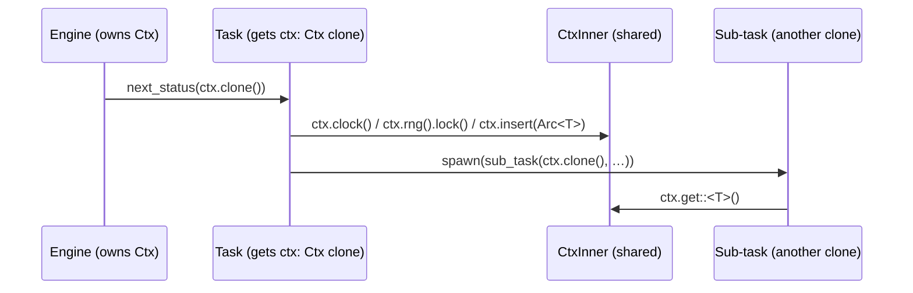

# Ctx

## Overview

`Ctx` is the engine-provided, per-poll context handed to every task. It is a
cloneable `Send + Sync` handle over a `CtxInner`. Two operations: `clone()`
**shares** the map (a cheap `Arc` refcount bump — used within one
ExecutionIterator's subtree), and `fork()` **copies** the map into a fresh handle
(used by the engine at each ExecutionIterator boundary, so siblings never mutate
each other's map).

## Design

```rust
// foundation_core/src/valtron/ctx.rs

pub struct Ctx(Arc<CtxInner>);

pub(crate) struct CtxInner {
    // general extension point: arbitrary Arc<T> entries keyed by TypeId
    map: Mutex<HashMap<TypeId, Arc<dyn Any + Send + Sync>>>,
    // engine-seeded standard elements
    clock: Arc<dyn Clock>,        // read-only; shared (trait object; default MonotonicClock)
    config: Arc<Config>,          // read-only; shared
    rng: Arc<Mutex<Rng>>,         // single shared stream — all tasks draw from one Rng
}

impl Ctx {
    pub fn new() -> Self;                                              // empty map + default standard elements
    pub fn insert<T: Any + Send + Sync>(&self, value: Arc<T>) -> Option<Arc<T>>;
    pub fn get<T: Any + Send + Sync>(&self) -> Option<Arc<T>>;
    pub fn get_or_insert<T: Any + Send + Sync>(&self, value: T) -> Arc<T>;
    pub fn remove<T: Any + Send + Sync>(&self) -> Option<Arc<T>>;
    pub fn contains<T: Any + Send + Sync>(&self) -> bool;

    // Standard elements return Arc<T> (owned, cheap clone), not &T — so a task can
    // hold them across `.await` or move them into a spawned sub-task without
    // borrowing from `self`.
    pub fn clock(&self) -> Arc<dyn Clock>;
    pub fn config(&self) -> Arc<Config>;
    pub fn rng(&self) -> Arc<Mutex<Rng>>;     // lock() to draw

    /// A new handle over a *copied* map. The standard elements stay shared (Arc);
    /// the type-map is a fresh HashMap whose `Arc` values are shared. The engine
    /// calls this once per ExecutionIterator so siblings never mutate each other's map.
    pub fn fork(&self) -> Ctx;
}

impl Clone for Ctx { /* clones the Arc — SHARES the map */ }
impl Default for Ctx { /* Ctx::new() */ }
// Ctx: Send + Sync automatically — Arc<CtxInner> is Send + Sync iff CtxInner is
// Send + Sync, and every field (Mutex<HashMap<…>>, Arc<dyn Any + Send + Sync>,
// Arc<dyn Clock>, Arc<Config>, Arc<Mutex<Rng>>) is Send + Sync.
```

- **`Mutex`** is the codebase's `compati::Mutex` (`std::sync::Mutex` under `std`).
- **Type erasure** is `Arc<dyn Any + Send + Sync>`; `get` downcasts via
  `Arc::downcast::<T>()` (`T: Any + Send + Sync + 'static`).
- **Gating (landed):** `#[cfg(feature = "std")]`. The type map and standard
  elements need `std` (`HashMap`, `Arc`, `TypeId`, `dyn Any`, and a monotonic
  clock). The spec's original `alloc`-only relaxation is a documented deviation —
  deferred until a `!std` build actually needs `Ctx` (the traits it threads
  through, `TaskIterator`/`ExecutionIterator`, are themselves `std`-gated today).
- **`fork()` copies the map structure, not the values.** Each entry is an `Arc`,
  so the fresh `HashMap` holds shared `Arc` pointers — structural isolation
  (insert/remove/replace are private) while the values stay shareable on purpose.



## Interface contract

| Method                           | Behaviour                  | Notes                                             |
| -------------------------------- | -------------------------- | ------------------------------------------------- |
| `new()`                          | empty map + defaults       | engine seeds further at init                      |
| `insert(Arc<T>)`                 | replace by `TypeId`        | returns prior entry                               |
| `get<T>()`                       | downcast                   | `None` if absent/mismatched                       |
| `get_or_insert(T)`               | wrap + insert if absent    | returns live `Arc<T>`                             |
| `remove<T>()` / `contains<T>()`  | remove / presence          |                                                   |
| `clock()` / `config()` / `rng()` | standard elements (Arc)     | owned `Arc<T>`; rng: lock-to-draw                 |
| `fork()`                         | copy map into a new handle | standard elements shared; map values `Arc`-shared |

## Decision — RNG (shared)

A single shared `Arc<Mutex<Rng>>` is the intended design: every task draws from
one engine-seeded stream, so a fixed seed reproduces the same sequence across the
whole run — "the current RNG" as a standard engine element. Closed in favour of
shared RNG; per-task seeded clones are dropped.

Note: cross-run reproducibility holds for a deterministic (single-threaded)
scheduler. Under `multi`, the interleaving of `lock()` draws is schedule-dependent,
so a single global sequence is only guaranteed on the single-threaded engine.

**Landed concrete types** (resolving the open decision):

- **`Rng` = `foundation_compact::rng::ChaCha8Rng`** — the same RNG the executor
  already draws from, so the two stay interchangeable. The default engine seed is
  deterministic (`ChaCha8Rng::seed_from_u64(0)`) and the engine replaces it at init
  when it wants a non-default seed. Draws go through `ctx.rng().lock().next_u64()`
  with `use foundation_compact::rng::Rng;` in scope (`RngCore` is deprecated on
  rand_core 0.10).
- **`Clock`** = an object-safe `Send + Sync + 'static` trait (`now`/`elapsed`), so
  the engine can seed a mock as easily as the real clock. Its default
  implementation, **`MonotonicClock`**, is a minimal `Copy` struct wrapping
  `foundation_compact::Instant` (`new`/`now`/`elapsed`). `Ctx` stores
  `Arc<dyn Clock>`; read-only, no interior mutation, safe to share.
- **`Config`** = a minimal opaque unit struct (`Copy`, `Default`) as a stable
  handle for a later feature to populate; the engine owns the real configuration
  source.

## Error handling

Infallible API. `get` maps both "absent" and "wrong type" to `None`. No `Ctx`
method returns a lock guard, so no lock can be held across an `await`.

## Trade-offs

- `Arc<dyn Any + Send + Sync>` erasure costs a `downcast` on read and an `Arc`
  allocation per entry — negligible next to task I/O.
- `Send + Sync` only is deliberate; `!Send` entries are deferred.
- `Mutex` (not `RwLock`) for the first cut; swappable later without an API change.

## Tasks

1. Add `ctx.rs` with `Ctx`/`CtxInner` (map + standard elements) and the methods.
2. Define/select `Clock`, `Config`, `Rng` concrete types (reuse `SeedableRng` where
   it fits); resolve the RNG open decision.
3. Re-export `Ctx` from `valtron/mod.rs`.
4. Unit tests: map round-trip; clone-shares-map; `Send + Sync` asserted at compile
   time; clock/config/rng reachable.
5. Doc example of the sub-task sharing pattern.

## Success criteria

- Map methods behave per the contract; clones observe each other's writes.
- `Ctx: Send + Sync` compiles; clock/config/rng are reachable from any clone.
