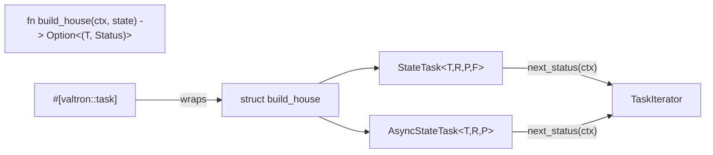

# State task macro

## Overview

The state-machine pattern is the ergonomic payoff. A transition **function** —
`fn(ctx: Ctx, state: T) -> Option<(T, TaskStatus<R, P>)>` — is wrapped by a
native core iterator (`StateTask` sync, `AsyncStateTask` async) and surfaced as
`#[valtron::task]`. The transition receives the **engine Ctx** on every turn
(threaded by feature 05), so the iterator does **not** own a Ctx of its own.

`TaskStatus` is **two-parameter** — `TaskStatus<R, P>` — and its `Spawn` variant
carries a **boxed** action (`BoxedExecutionAction`, or `BoxedSendExecutionAction`
under `multi`). There is no `Spawner` associated type to thread through
`TaskIterator`; a transition that spawns a sub-task just `Box::new`s its spawner
and emits `TaskStatus::Spawn(boxed)`.

## Current-state alignment (post feature 05)

Feature 05 landed before this feature was implemented, so this spec is written
against the code as it now stands:

- `TaskIterator::next_status(&mut self, ctx: Ctx)` is the live signature; every
  `TaskIterator` (including `StateTask`/`AsyncStateTask`) receives the engine's
  forked `Ctx` **by value** at poll time. Spawn methods are unchanged.
- `TaskIterator` already exposes `with_ctx(self, ctx: Ctx) -> TaskAsIterator<..>`
  (`task.rs:564`) — a plain-`TaskIterator` bridge into the contextual
  orchestration surface. `StateTask`/`AsyncStateTask` are ordinary
  `TaskIterator`s, so `with_ctx`, all `TaskIteratorExt` combinators, and
  `execute()`/`spawn()` all work on them unchanged.
- `Ctx` is **`std`-gated** (`#[cfg(feature = "std")]`, `valtron/mod.rs:23`), so
  `StateTask`/`AsyncStateTask` are gated the same way (not `alloc`).
- The `FutureTask` waker seam (`executors/future_task.rs`) is the reference for
  the async variant: `wake_queue: Arc<ConcurrentQueue<WakeToken>>`,
  `queue_waker(queue, id)` (a `Waker` whose `wake` pushes a `WakeToken`),
  **drain stale tokens → poll once → `Depends(QueueReadiness)` on external-wake
  vs `Ignore` on self-wake**. `queue_waker`, `WakeToken` and
  `QueueReadiness` are all re-exported through `executors/mod.rs` /
  `valtron/mod.rs`, so `AsyncStateTask` reuses them directly.
- `TaskStatus` has the full variant set (`Delayed`, `Spawn(BoxedExecutionAction)`,
  `Pending(P)`, `Init`, `Ready(D)`, `Ignore`, `Wait`, `Spread`, `Depends`).
  `StateTask` passes any non-`Ready` status straight through, so a transition may
  legally emit `Delayed`/`Depends`/`Wait`/`Spread`/`Spawn` too.
- `map_pending` already exists as the `TMapPending` combinator in
  `TaskIteratorExt`, so no per-task `map` helper is needed — the pending type
  is the user's own `P` and maps directly.

## Core iterators

```rust
// executors/state_task.rs (new, #[cfg(feature = "std")])

pub struct StateTask<T, R, P, F> {
    state: Option<T>,
    transition: F,           // FnMut(Ctx, T) -> Option<(T, TaskStatus<R, P>)>
    completed: bool,
    // NOTE: no ctx field — the engine Ctx is supplied by next_status
    _marker: PhantomData<fn() -> (R, P)>,   // surface types, never stored
}

impl<T, R, P, F> StateTask<T, R, P, F> {
    pub fn new(state: T, transition: F) -> Self {
        Self {
            state: Some(state),
            transition,
            completed: false,
            _marker: PhantomData,
        }
    }
}

impl<T, R, P, F> TaskIterator for StateTask<T, R, P, F>
where
    F: FnMut(Ctx, T) -> Option<(T, TaskStatus<R, P>)>,
{
    type Ready = R; type Pending = P;
    fn next_status(&mut self, ctx: Ctx) -> Option<TaskStatus<R, P>> {
        if self.completed { return None; }
        let state = self.state.take()?;
        match (self.transition)(ctx, state) {
            Some((next, TaskStatus::Ready(r))) => { self.completed = true; Some(TaskStatus::Ready(r)) }
            Some((next, status))              => { self.state = Some(next); Some(status) }
            None                              => { self.completed = true; None }
        }
    }
}
```

The async pending type is the user's own `P` (the same shape as sync) — there is
no wrapper: while the future is in flight the core synthesizes
`TaskStatus::Ignore` for the self-wake case, and a transition that surfaces a
domain pending emits `TaskStatus::Pending(p)` directly.

Async variant erases both the transition and its future so the type is nameable,
reusing the `FutureTask` waker seam exactly:

```rust
pub type AsyncTransition<T, R, P> = Box<
    dyn Fn(Ctx, T) -> Pin<Box<dyn Future<Output = Option<(T, TaskStatus<R, P>)>> + Send>> + Send,
>;   // (+ Send bounds dropped under !multi)

pub struct AsyncStateTask<T, R, P> {
    state: Option<T>,
    transition: AsyncTransition<T, R, P>,
    future: Option<Pin<Box<dyn Future<Output = Option<(T, TaskStatus<R, P>)>> + Send>>>,
    wake_queue: Arc<ConcurrentQueue<WakeToken>>,   // the FutureTask poll-once seam
    completed: bool,
}

impl<T, R, P> TaskIterator for AsyncStateTask<T, R, P> {
    type Ready = R; type Pending = P;
    fn next_status(&mut self, ctx: Ctx) -> Option<TaskStatus<R, P>> {
        if self.completed { return None; }

        // 1. (Re)build the future from (transition)(ctx, state.take()) if none in flight.
        if self.future.is_none() {
            let state = self.state.take()?;
            self.future = Some((self.transition)(ctx, state));
        }

        // 2. Drain stale wake tokens, then poll once (FutureTask discipline).
        while self.wake_queue.pop().is_ok() {}
        let waker = queue_waker(self.wake_queue.clone(), 0);
        let mut cx = Context::from_waker(&waker);

        match self.future.as_mut().unwrap().as_mut().poll(&mut cx) {
            Poll::Ready(Some((next, TaskStatus::Ready(r)))) => {
                self.completed = true;
                Some(TaskStatus::Ready(r))
            }
            Poll::Ready(Some((next, status))) => {
                self.state = Some(next);
                self.future = None;
                Some(status)
            }
            Poll::Ready(None) => {
                self.completed = true;
                None
            }
            Poll::Pending => {
                if self.wake_queue.is_empty() {
                    // External-wake: park on the queue readiness.
                    Some(TaskStatus::Depends(Arc::new(QueueReadiness::new(self.wake_queue.clone()))))
                } else {
                    // Self-wake: requeue without parking.
                    Some(TaskStatus::Ignore)
                }
            }
        }
    }
}
```

- The future **owns** its `ctx` clone (moved in at construction via
  `(self.transition)(ctx, state)`) — no borrow.
- `Send`/`!Send` impls follow the `multi`/`!multi` cfg-split: under `multi` the
  transition/future are `+ Send` (above); under `!multi` the `+ Send` bounds are
  dropped so `!Send` transitions (e.g. a `JsFuture` body) still work.
- The `StateTask` `F` bound is `FnMut`; the async `Fn` bound is `Fn` (the
  transition is invoked once per step, so `Fn` is enough and lets `move` closures
  with `Arc`s pass).

## Macro

```rust
#[valtron::task]
fn build_house(ctx: Ctx, state: HouseState) -> Option<(HouseState, TaskStatus<House, MyPending>)> { … }

#[valtron::task]
async fn build_house_async(ctx: Ctx, state: HouseState) -> Option<(HouseState, TaskStatus<House, MyPending>)> { … }
```

The macro is `#[proc_macro_attribute] pub fn task` in `foundation_macros`
(`src/state_task.rs`), registered in `foundation_macros/src/lib.rs` and
re-exported from `foundation_core::valtron` next to the other engine macros:

```rust
// valtron/mod.rs
pub use foundation_macros::{task, timeout, valtron, valtron_test};
```

so users write `use foundation_core::valtron::task;` then `#[task]` (or the fully
qualified `#[foundation_core::valtron::task]`).

It generates a **braced** `struct build_house` (same name,
`#[allow(non_camel_case_types)]`) that wraps the matching core iterator in an
`inner` field, and whose `new(T)` seeds the transition. The struct is braced
rather than a tuple struct deliberately: a tuple struct introduces a
value-namespace constructor `build_house(..)` that would collide with the `fn
build_house` (value namespace). A braced struct lives only in the *type*
namespace, so `build_house::new(state)` and the `fn build_house(ctx, state)`
coexist:

```rust
// sync expansion
#[allow(non_camel_case_types)]
pub struct build_house {
    inner: StateTask<HouseState, House, MyPending,
        fn(Ctx, HouseState) -> Option<(HouseState, TaskStatus<House, MyPending>)>>,
}
impl build_house {
    pub fn new(state: HouseState) -> Self {
        build_house {
            inner: StateTask::new(state, build_house), // fn (value ns) vs struct (type ns)
        }
    }
}

// async expansion
#[allow(non_camel_case_types)]
pub struct build_house_async {
    inner: AsyncStateTask<HouseState, House, MyPending>,
}
impl build_house_async {
    pub fn new(state: HouseState) -> Self {
        build_house_async {
            inner: AsyncStateTask::new(state,
                Box::new(move |ctx, s| Box::pin(build_house_async(ctx, s)))),
        }
    }
}
```

Each generated struct also gets an `impl TaskIterator` delegating
`next_status(ctx)` to its `inner`, with `type Ready = R` and `type Pending = P`
(sync and async alike).

- The transition is still callable directly: `build_house(ctx, state)` /
  `build_house_async(ctx, state).await`.
- Sync uses the **fn-pointer** `F = fn(Ctx, T) -> …` (nameable, always `Send`),
  so the generated struct is `Send` whenever `T, R, P` are `Send` — no boxed
  closure needed.
- Async boxes the transition (`Box<dyn Fn(..) + Send>`) because an `async fn`'s
  future type is unnameable.
- **Signature validation** (compile-time `syn::Error`, descriptive):
  - exactly two inputs, the first named `ctx` with type `Ctx`;
  - return type `Option<(T, TaskStatus<R, P>)>` (sync and async alike);
  - `T` = the second input type AND the tuple's first element (assert equal);
  - `R`, `P` extracted from the `TaskStatus<…>` arguments.
- Async is detected via `sig.asyncness`, the same as `valtron_entry.rs`; path
  hygiene uses `crate_paths::foundation_core_path()` for `Ctx`, `TaskStatus`,
  `StateTask`, `AsyncStateTask`.



## Interface contract

| Construct | Sync | Async |
|-----------|------|-------|
| Transition type | `FnMut(Ctx, T) -> Option<(T, TaskStatus<R,P>)>` | `async fn(Ctx, T) -> Option<(T, TaskStatus<R,P>)>` |
| Pending wrapper | none (`P`) | none (`P`) |
| Ctx | received per-poll | received per-poll, owned by the in-flight future |
| Generated ctor | `new(T)` | `new(T)` |

## Error handling

The transition is infallible in the `Option`/`TaskStatus` sense (no `Result`);
`None` = termination. The macro's malformed-signature errors are compile-time
(`syn::Error::to_compile_error`). Async `panic!` inside the transition is caught
by the executor's existing `catch_unwind`, as with `FutureTask`.

## Trade-offs

- Type-erasing the async transition (`Box<dyn Fn>` + `Box<dyn Future>`) costs a
  boxed future per step but makes `AsyncStateTask<T,R,P>` nameable — a
  non-negotiable for the generated struct.
- The async pending type is the user's own `P` — the same unwrapped shape as
  sync — so simple machines stay simple on both paths; the "still in flight"
  self-wake is expressed with `TaskStatus::Ignore` instead of a wrapper type.
- Generic transitions are out of scope for the first cut: the macro extracts
  concrete `T, R, P` from the signature and does not add its own type params.

## Tasks

1. Add `StateTask<T,R,P,F>` with `new(state, transition)` and the
   `TaskIterator` impl (`#[cfg(feature = "std")]`).
2. Add `AsyncStateTask<T,R,P>` reusing the `FutureTask` waker seam
   (`queue_waker`/`WakeToken`/`QueueReadiness`); self-wake emits
   `TaskStatus::Ignore`; `multi`/`!multi` impls.
3. Re-export `StateTask`, `AsyncStateTask` from `executors/mod.rs` and
   `valtron/mod.rs`.
4. Implement `#[valtron::task]` in `foundation_macros/src/state_task.rs`
   (signature validation + sync/async expansion), register it in `lib.rs`, and
   re-export it from `valtron/mod.rs`.
5. Compile tests: sync surface, async surface (parks on `Depends`, resumes on
   wake), malformed-signature errors.
6. Doc example: the `build_house` state machine, sync + async.
7. Cross-check `Send` bounds and the `multi`/`!multi` build.

## Success criteria

- A multi-state machine drives to `Ready` through `StateTask`; the async variant
  parks on `Depends` (no busy-poll) and resumes on wake.
- `#[valtron::task]` generates `struct build_house` with `new(T)` for both `fn`
  and `async fn`; the transition runs as `build_house(Ctx::new(), state)`.
- Generated struct is `Send` when `T,R,P` are `Send`; compiles under `multi`.
- `execute(build_house::new(state), None)` schedules the generated struct like
  any other task, and `build_house::new(state).with_ctx(ctx)` drives it manually.
