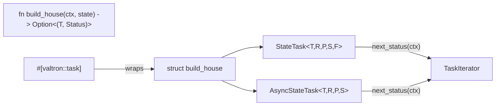

# State task macro

## Overview

The state-machine pattern is the ergonomic payoff. A transition **function** —
`fn(ctx: Ctx, state: T) -> Option<(T, TaskStatus<R, P, S>)>` — is wrapped by a
native core iterator (`StateTask` sync, `AsyncStateTask` async) and surfaced as
`#[valtron::task]`. The transition receives the **engine Ctx** on every turn
(threaded by feature 05), so the iterator does **not** own a Ctx of its own.

## Core iterators

```rust
// executors/state_task.rs

pub struct StateTask<T, R, P, S, F> {
    state: Option<T>,
    transition: F,           // FnMut(Ctx, T) -> Option<(T, TaskStatus<R, P, S>)>
    completed: bool,
    // NOTE: no ctx field — the engine Ctx is supplied by next_status
}

impl<T, R, P, S, F> TaskIterator for StateTask<T, R, P, S, F> {
    type Ready = R; type Pending = P; type Spawner = S;
    fn next_status(&mut self, ctx: Ctx) -> Option<TaskStatus<R, P, S>> {
        if self.completed { return None; }
        let state = self.state.take()?;
        match (self.transition)(ctx, state) {
            Some((next, TaskStatus::Ready(r))) => { self.completed = true; Some(Ready(r)) }
            Some((next, status))              => { self.state = Some(next); Some(status) }
            None                              => { self.completed = true; None }
        }
    }
}
```

Async variant erases both the transition and its future so the type is nameable:

```rust
pub enum TransitionPending<P> { Awaiting, Domain(P) }

pub struct AsyncStateTask<T, R, P, S> {
    state: Option<T>,
    transition: Box<dyn Fn(Ctx, T) -> Pin<Box<dyn Future<Output = Option<(T, TaskStatus<R, TransitionPending<P>, S>)>> + Send>> + Send>,
    future: Option<Pin<Box<dyn Future<Output = …> + Send>>>,
    wake_queue: Arc<ConcurrentQueue<WakeToken>>,   // FutureTask poll-once seam
    completed: bool,
}

impl TaskIterator for AsyncStateTask<T, R, P, S> {
    fn next_status(&mut self, ctx: Ctx) -> Option<TaskStatus<R, TransitionPending<P>, S>> {
        // 1. build future from (transition)(ctx, state.take()) if none in flight
        // 2. poll once: Ready(output) => fold state/status; Pending =>
        //    wake_queue.is_empty() ? Depends(queue) : Pending(TransitionPending::Awaiting)
    }
}
```

- The async core reuses the `FutureTask` waker seam: `Depends(wake_queue)` to park
  on an external wake, `Pending(TransitionPending::Awaiting)` on a self-wake.
- The future **owns** its `ctx` clone (moved in at construction) — no borrow.
- `Send`/`!Send` impls follow the `multi`/`!multi` cfg-split; the `!Send` path
  uses `Box<dyn Fn …>` without `Send` bounds.

## Macro

```rust
#[valtron::task]
fn build_house(ctx: Ctx, state: HouseState) -> Option<(HouseState, TaskStatus<House, MyPending, MySpawner>)> { … }
```

generates `struct build_house` (same name, `#[allow(non_camel_case_types)]`) with:

- `build_house::new(state)` — sync fn; wraps the closure in `StateTask`.
- `build_house::with_state(state)` / `::new(…)` — for `async fn`, wraps in
  `AsyncStateTask`.
- The transition is still callable directly: `build_house(ctx, state)`.

The macro validates the signature (two args, `ctx: Ctx` first, `Option` return)
and emits a descriptive compile error otherwise. Async is detected via
`sig.asyncness`, the same as `valtron_entry.rs`; path hygiene uses
`crate_paths::foundation_core_path()`.



## Interface contract

| Construct | Sync | Async |
|-----------|------|-------|
| Transition type | `FnMut(Ctx, T) -> Option<(T, TaskStatus<R,P,S>)>` | `async fn(Ctx, T) -> Option<(T, TaskStatus<R,TransitionPending<P>,S>)>` |
| Pending wrapper | none (`P`) | `TransitionPending<P>` (`Awaiting` / `Domain(P)`) |
| Ctx | received per-poll | received per-poll, owned by the in-flight future |
| Generated ctor | `new(T)` | `new(T)` |

## Error handling

The transition is infallible in the `Option`/`TaskStatus` sense (no `Result`);
`None` = termination. The macro's malformed-signature errors are compile-time.
Async `panic!` inside the transition is caught by the executor's existing
`catch_unwind`, as with `FutureTask`.

## Trade-offs

- Type-erasing the async transition (`Box<dyn Fn>` + `Box<dyn Future>`) costs a
  boxed future per step but makes `AsyncStateTask<T,R,P,S>` nameable — a
  non-negotiable for the generated struct.
- The `TransitionPending` wrapper is visible in the async user's return type; the
  sync path stays unwrapped so simple machines stay simple.

## Tasks

1. Add `StateTask<T,R,P,S,F>` with `new(T)` and the `TaskIterator` impl.
2. Add `TransitionPending<P>` and a `map_pending` helper.
3. Add `AsyncStateTask<T,R,P,S>` with the waker seam; `multi`/`!multi` impls.
4. Re-export both + `TransitionPending` from `valtron/executors` and `valtron/mod.rs`.
5. Implement `#[valtron::task]` in `foundation_macros` (signature validation +
   expansion), wiring `crate_paths::foundation_core_path()`.
6. Compile tests: sync surface, async surface, malformed-signature errors.
7. Doc example: the `build_house` state machine, sync + async.
8. Cross-check `Send` bounds and the `multi`/`!multi` build.

## Success criteria

- A multi-state machine drives to `Ready` through `StateTask`; the async variant
  parks on `Depends` (no busy-poll) and resumes on wake.
- `#[valtron::task]` generates `struct build_house` with `new(T)` for both `fn`
  and `async fn`; the transition runs as `build_house(Ctx::new(), state)`.
- Generated struct is `Send` when `T,R,P,S` are `Send`; compiles under `multi`.
