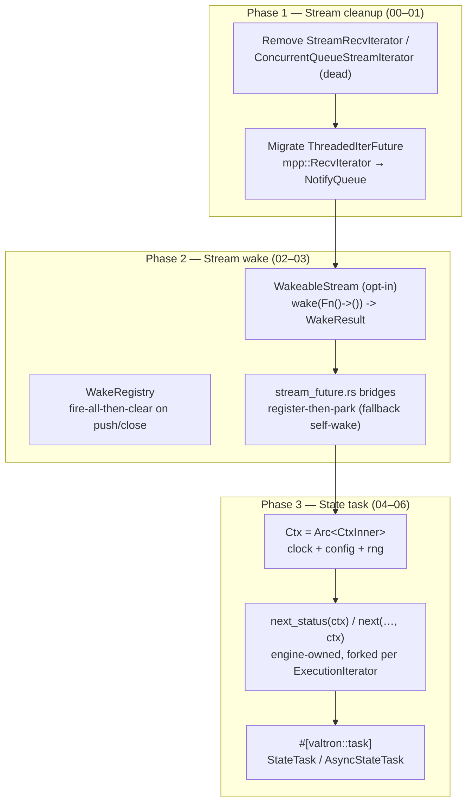

# Overview

This specification consolidates three former specs — `64-valtron-state-task`,
`65-valtron-stream-cleanup`, `66-valtron-stream-wake` — into one ordered arc over
valtron's stream and task layers. Work proceeds in three phases, each building on
the last:

1. **Stream cleanup** (features 00–01) — shrink the public stream surface. Remove
   the two dead `ConcurrentQueue<Stream<D, P>>` iterators, retire their tests and
   stale doc claims, and migrate the one live `RecvIterator` caller
   (`ThreadedIterFuture`, `multi`) onto the condvar-based `NotifyQueue` family.
2. **Stream wake** (features 02–03) — add an opt-in `WakeableStream` push-signal
   (`wake(Fn() -> ()) -> WakeResult`) fired on every producer push and on close, and
   rewire the async bridges (`stream_future.rs`) to **park** on it rather than
   self-wake busy-loop. The `StreamIterator` blanket impl stays; `WakeableStream`
   is opt-in.
3. **State task** (features 04–06) — give tasks an engine-seeded `Ctx`
   (`Arc<CtxInner>`, `Send + Sync`) threaded by value through every poll, and a
   `#[valtron::task]` macro that turns a state-transition function into a
   `TaskIterator` over that context.

The phases are **sequenced** cleanup → wake → state-task, but only intra-phase
features carry hard dependencies (see the Feature Index); the phases themselves are
a work order, not a compile-order. This ordering is deliberate: the stream layer is
cleaned and made wake-capable *before* the larger state-task feature lands on top.

# Goals

**Stream cleanup (00–01)**

- Delete the two dead `ConcurrentQueue<Stream<D, P>>` iterators
  (`StreamRecvIterator`, `ConcurrentQueueStreamIterator`) and their unused imports.
- Retire their tests; keep the combinator-layer tests that share the file.
- Correct every stale doc reference that names the removed types, and confirm (with
  a full cross-crate audit) that nothing outside `foundation_core` depends on them.
- Migrate `ThreadedIterFuture` (multi) off `mpp::RecvIterator` onto
  `NotifyQueue`/`NotifyRecvIterator`, keeping the `run_future_iter` contract.

**Stream wake (02–03)**

- Add `WakeableStream` — an **opt-in** trait (super-trait `StreamIterator`) with
  `wake(Fn() -> ()) -> WakeResult::{Successful, NotSupported}`, plus a reusable
  fire-all-then-clear callback registry.
- Implement it on the execution-path `NotifyQueueStreamIterator` by teaching
  `NotifyQueue` to fire registered callbacks on `push` **and** `close`.
- Forward the capability through per-item combinators; buffering/fan-out combinators
  and the `StreamIter` plain-iterator wrapper default to `NotSupported`.
- Rewrite the `stream_future.rs` bridges to require `WakeableStream`, **park** on
  `Successful`, and fall back to self-wake on `NotSupported`.
- Keep the `StreamIterator` blanket impl untouched.

**State task (04–06)**

- Make the engine the single source of ambient services (clock, config, RNG),
  threaded to every task via a shared, cheaply-cloned `Ctx`.
- Expand `TaskIterator::next_status` / `ExecutionIterator::next` to carry the `Ctx`
  by value, accepting the mechanical churn this causes.
- Provide native state-machine iterators (`StateTask` sync, `AsyncStateTask` async)
  and the `#[valtron::task]` macro that consumes the threaded `Ctx`.
- Keep the generated task `Send` by default so it runs unchanged under `multi`.

# Implementation Location

- `backends/foundation_core/src/valtron/streams.rs` — remove the two dead iterators
  (feature 00); `StreamIter` (`:165`) gains a `WakeableStream → NotSupported` impl
  (feature 02).
- `backends/foundation_core/tests/valtron/stream_iterators.rs` — retire the
  `ConcurrentQueueStreamIterator` section (`:755–893`); keep combinator tests.
- Stale doc comments: `sendables.rs:352,395`, `non_sendables.rs:469`, `config.rs`,
  `constants.rs`, `multi/mod.rs:1023,1042,1053,1058`,
  `foundation_netio/src/shared/http/pushable_body.rs:14`.
- `backends/foundation_core/src/valtron/executors/future_task.rs` — feature 01:
  swap `FutureIterator`/`ThreadedIterFuture::execute()` (multi) to `NotifyQueue`.
- `backends/foundation_core/src/valtron/wake.rs` (new) — `WakeResult`,
  `WakeableStream`, `WakeRegistry` (feature 02).
- `backends/foundation_core/src/valtron/executors/local.rs` — `NotifyQueue` gains a
  callback registry (fired in `push`/`close`); `NotifyQueueStreamIterator`
  implements `WakeableStream` (feature 02).
- `backends/foundation_core/src/valtron/extensions/streams/{sendable,non_sendable}.rs`
  and `extensions/tasks/*` — `WakeableStream` impls on combinators (feature 02) and
  `Self: WakeableStream` on the four `into_*` constructors (`sendable.rs:614-641`,
  feature 03).
- `backends/foundation_core/src/valtron/stream_future.rs` — rewrite the four
  parking bridges to register-then-park (feature 03).
- `backends/foundation_core/src/valtron/ctx.rs` — `Ctx` + `CtxInner` (feature 04).
- `backends/foundation_core/src/valtron/task.rs` — `TaskIterator::next_status` /
  `ExecutionIterator::next` signature change (feature 05).
- `backends/foundation_core/src/valtron/executors/*` — poll sites + wrappers
  forward `ctx` (feature 05).
- `backends/foundation_core/src/valtron/executors/state_task.rs` — `StateTask`,
  `AsyncStateTask`, `TransitionPending` (feature 06).
- `backends/foundation_macros/src/state_task.rs` — `#[valtron::task]` (feature 06).

# Known Issues

- **Public-API deletion.** `streams.rs` is re-exported via `pub use streams::*`
  (`valtron/mod.rs:37`), so removing the two `pub struct`s is a public-API
  deletion. The audit shows zero external callers, so it is safe; the
  `concurrent_queue` crate dependency must remain (still the primitive under
  `NotifyQueue`, `worker.rs`, `buffer_pool.rs`, `synca/mpp.rs`).
- **`WakeableStream` must be opt-in, not a blanket.** A blanket
  `impl<M: Iterator<Item = Stream<D,P>>> WakeableStream for M` (default
  `NotSupported`) would overlap `impl WakeableStream for NotifyQueueStreamIterator`
  (`Successful`) — E0119. So `WakeableStream` has **no blanket impl**; the
  `StreamIterator` blanket stays, and `WakeableStream` is implemented explicitly on
  the waking terminal, the forwarding combinators, and the `NotSupported` wrapper.
- **Autoref-specialization detection is off the table.** The bridges are generic
  (`impl<SI> Future for StreamCollectFuture<SI>`); autoref specialization only
  dispatches at concrete-type/macro call sites, never over a generic `SI`. Hence the
  compile-time bound (`SI: WakeableStream`) with the *runtime* `WakeResult` deciding
  park vs self-wake — not a probe.
- **Lost-wakeup race.** A producer may `push` between the bridge's `iter.next()`
  (empty → `Wait`) and its `wake(…)` registration; that push already fired the
  (empty) registry and will not re-fire. The bridge must use the Pipe
  register-then-drain discipline (stash the callback, then re-check `next()` once,
  then park) — `pipe.rs:247-279` is the reference.
- **`wake` is a hint, like a `Waker`.** It may fire spuriously (a `FilterDone`
  drops the item after the inner fired; a wake lands for an item another bridge
  wants). Consumers must re-poll and re-register. `close()` must fire the callbacks
  too, otherwise a parked `FutureStream` never observes EOF.
- **Callback `Send` bound is cfg-split.** Under `multi` the callback crosses the
  producer thread, so it must be `Send`; under `!multi` there is no producer thread,
  so the bound relaxes to `'static` only.
- **Bridge-bound ripple (small).** Requiring `Self: WakeableStream` on the four
  `into_*` constructors touches cross-crate callers (`collect_one`/`collect_result`,
  connectrpc split observers, d1_wasm `StreamReadyFuture`, cf-valtron-counter).
  All sit on `execute()`/`Pipe` outputs, which become `WakeableStream`, so the fix
  is adding the impls — the one real caller rewrite is d1_wasm wrapping its
  type-erased `Box<dyn Iterator>` in `into_stream_iter()` (feature 03 audited this).
- **`Ctx` is `std`/`alloc`-gated** (`Arc`, `HashMap`, `TypeId`, `dyn Any`), matching
  the existing gating on `FutureTask`/`StreamTask`.
- **The signature change breaks every `TaskIterator` impl** in the workspace and
  makes the completed specs that document the trait (22/33/50/58/41) stale. This is
  accepted, tracked churn.

# Language Stack

| Language | Purpose | Skill Location |
|----------|---------|----------------|
| Rust | dead-code removal, opt-in wake trait, Ctx threading, core iterators, proc-macro | `.agents/skills/rust-valtron-usage/skill.md`, `.agents/skills/rust-valtron-iterator/skill.md` |

Mandatory pre-implementation: read `.agents/skills/rust-valtron-usage/skill.md`
and `.agents/skills/rust-valtron-iterator/skill.md`; follow the async/valtron
boundary and `Send`/`!Send` rules from `.agents/AGENTS.md`.

# Feature Index

| # | Feature | Description | Dependencies | Status |
|---|---------|-------------|--------------|--------|
| 0 | [Cleanup dead stream iterators](./features/00-cleanup/feature.md) | Remove `StreamRecvIterator`/`ConcurrentQueueStreamIterator`; full cross-crate audit as the task list | None | ✅ Complete |
| 1 | [Migrate RecvIterator to NotifyQueue](./features/01-migrate-recv-iterator/feature.md) | `ThreadedIterFuture` worker-channel: `mpp::RecvIterator` → `NotifyQueue` (condvar) | 00 | ⬜ Pending |
| 2 | [WakeableStream capability](./features/02-wakeable-stream/feature.md) | `WakeableStream` trait + `WakeRegistry` + `NotifyQueue` firing + terminal/combinator/wrapper impls | None | ✅ Complete |
| 3 | [Parking bridges](./features/03-bridge-park/feature.md) | Rewrite the four parking `stream_future.rs` bridges to require `WakeableStream`, park on `Successful`, fall back on `NotSupported`; audit cross-crate callers | 02 | ✅ Complete |
| 4 | [Ctx](./features/04-ctx/feature.md) | `Ctx = Arc<CtxInner>`; interior-mutable type map + engine-seeded standard elements | None | ✅ Complete |
| 5 | [Thread Ctx](./features/05-thread-ctx/feature.md) | `next_status(&mut self, ctx: Ctx)` + `next(…, ctx: Ctx)`; executor owns + clones; update all impls | 04 | ⬜ Pending |
| 6 | [State task macro](./features/06-state-task/feature.md) | `StateTask`/`AsyncStateTask`/`TransitionPending` + `#[valtron::task]` | 05 | ⬜ Pending |

Status Key: ⬜ Pending | 🔄 In Progress | ✅ Complete

Work order is 00 → 06 (the three phases are sequenced, and each phase's features
chain internally). See `start.md`.

# Requirements Conversation Summary

## Phase 1 — Stream cleanup (was spec 65)

- **Scope came from a cross-crate audit.** The user asked to find every
  `ConcurrentQueue<Stream<D, P>>` communicator with zero callers (or whose users
  also have zero callers), after `Pipe`/`NotifyQueue` superseded the old mechanics.
  Exactly two types are dead — `StreamRecvIterator` and
  `ConcurrentQueueStreamIterator`; the combinator layer also carries
  `Arc<ConcurrentQueue<Stream<D, P>>>` but is alive and cross-crate (netio,
  connectrpc), so it is explicitly out of scope.
- **Record the audit as todos.** The feature maps the full cross-crate audit up
  front and wraps each finding as a concrete task.
- **`RecvIterator` migrates, `Pipe` does not fit.** `RecvIterator`'s sole live
  caller (`ThreadedIterFuture`, multi) is a sync bridge whose consumer is a raw
  blocking thread. `NotifyQueue` is the right replacement (condvar, thread-blocking);
  `Pipe` is waker-based and has no blocking receive, so it cannot park a `std::thread`.
- **The migration breaks three tests by contract, not by determinism.** Three
  `multi` tests (`future_error`, `empty_iterator`, `backpressure`) assert
  `Waiting => unreachable!`; once `Waiting` is a legitimate ~1 s heartbeat on the
  multi path they must become tolerant, plus a deterministic slow-iterator case.

## Phase 2 — Stream wake (was spec 66)

- **Borrow the `Pipe` consumer-waker lesson.** `Pipe` parks a consumer on an empty
  pipe and wakes it on the opposite end's `push` (stash-then-recheck to close the
  wake-before-park race); `close`/drop fire the waker so a parked consumer sees EOF.
- **The signal shape.** `wake(Fn() -> ()) -> WakeResult::{Successful, NotSupported}`
  — a one-shot readiness callback stored in a list that is fired (all of them) and
  cleared when the stream's backing queue has/will have an item, or closes.
- **Fire on every push, unconditionally — the bridge decides.** The wake fires on
  *every* item the producer pushes and on `close`, never filtered by variant. The
  producer cannot know which variant a given bridge is waiting for; the callback is
  untyped, so the woken bridge re-polls and re-classifies the item itself. This is
  the `Waker::wake()` contract: level-triggered, spurious-allowed, consumer-decided.
- **"Optionally implement" ⇒ opt-in trait, enforced by bound.** A defaulted `wake`
  on `StreamIterator` cannot be overridden (the blanket impl occupies the slot). A
  separate `WakeableStream` trait is implemented explicitly; the bridges enforce
  `SI: WakeableStream`; `WakeResult` decides park vs fallback at runtime. (The
  user's original return-enum name `Waker` clashed with `std::task::Waker`.)
- **Keep the `StreamIterator` blanket impl.** Dropping it would force ~56 explicit
  impls and break cross-crate users (`dyn StreamIterator` in foundation_ai,
  `LlamaCppStream`, the DB `Async*StreamIterator`s). `WakeableStream` is the only
  new surface.
- **The wake actually reaches the driver — the machinery already exists.**
  `FutureTask::next_status` polls with a `queue_waker` and already splits self-wake
  (requeue) from external-wake (`Depends(QueueReadiness)` = park). The bridges today
  self-wake into the requeue branch; `WakeableStream` lets them land in the park
  branch. The single-threaded `FutureIterator`/`ThreadedIterFuture` path polls with
  a noop waker and re-polls inline, so it never relies on `wake` — unaffected.
- **Two `Pending`s, two layers.** `Stream::Pending(P)` is a data/progress item
  (pushed); `Poll::Pending` is a scheduling signal. Done-collectors park on
  `Stream::Pending`; `StreamPendingFuture` treats it as the target. Each bridge keeps
  the same shape — skip `Ignore`, park on non-target waiting variants, `Ready` on
  target, `None` on end.
- **The loop doesn't disappear — it loses its self-wake arm.** `Ignore` (a
  `FilterDone`-dropped `Next`, or a `TaskStatus::Spawn/Ignore/Depends` mapping) is
  "consumed but not meaningful": the bridge must keep pulling and cannot park on it.
  So the `loop` stays for the `Ignore` skip; only the `Pending`/`Wait`/`Init`/
  `Delayed` arm changes from `wake_by_ref(); return Pending` to `wake(…); park-or-fallback`.

## Phase 3 — State task (was spec 64)

- **Global Ctx → per-task Ctx → engine Ctx threaded through the traits.** A *global*
  Ctx conflicted with the `ExecutionIterator` ownership model and with `Send`
  migration under `multi`; a *per-task* Ctx isolated benefit to one task type. Chosen:
  the **engine owns the Ctx and threads it through every poll**, forking it per
  ExecutionIterator so each gets a unique map while every task still sees the
  engine's standard elements.
- **`Ctx = Arc<CtxInner>`, everything `Send + Sync`.** `Arc` makes the Ctx cheap to
  clone and share; `Send + Sync` makes it usable on worker threads under `multi`
  *and* on single-threaded wasm/non-wasm.
- **`Ctx` by value everywhere, no borrow.** Because it wraps an `Arc`, `Ctx` is
  passed **by value** through `ExecutionIterator::next` and `TaskIterator::next_status`.
  No `&Ctx`/`&mut Ctx`; passing by value means an async transition's future simply
  *owns* its clone.
- **Fork at the ExecutionIterator boundary, share within it.** `clone()` **shares**
  the map (wrapper → inner task); `fork()` **copies** the map into a fresh handle
  (engine, at each ExecutionIterator boundary). `fork()` copies the map *structure*
  — the `Arc` values stay shared — so it stays cheap.
- **Signature expansion is accepted churn.** `next_status(&mut self, ctx: Ctx)` is a
  breaking change to every task impl; spawn methods (`sequenced`/`lift`/`schedule`/
  `broadcast`) are unchanged — the Ctx is injected at poll time, not spawn time.
- **Standard elements seeded by the engine** — clock and config (read-only shared),
  and the RNG. **Decision (RNG):** a single shared `Arc<Mutex<Rng>>` (per-task seeded
  clones dropped); accessors return `Arc<T>`, not `&T`. **Decision (standard set):**
  clock + config + RNG in the first cut; deadline/cancellation and tracing span are
  candidates but not yet in scope.
- **Termination via `Option`.** The transition returns `Option<(T, TaskStatus<R,P,S>)>`;
  `None` = finished.
- **Struct name == function name.** `fn build_house` → `struct build_house`
  (separate value/type namespaces; `#[allow(non_camel_case_types)]`).

# High-Level Architecture

- The three phases form one arc: clean the stream surface, make it wake-capable,
  then build the Ctx + state-machine task layer on top.
- Each phase's detailed diagram lives in its feature file (`00-cleanup`,
  `02-wakeable-stream`, `04-ctx`, `05-thread-ctx`, `06-state-task`).
- `WakeableStream` is orthogonal to `StreamIterator` (no new `Stream` variant);
  the wake signal originates at `NotifyQueue::push`/`close` and lands in the bridges.
- `Ctx` is threaded by value down `ExecutionIterator::next` →
  `TaskIterator::next_status`; the `#[valtron::task]` transition is
  `fn(ctx: Ctx, state: T) -> Option<(T, TaskStatus<R,P,S>)>`.

# Success Criteria (Spec-Wide)

1. `StreamRecvIterator` and `ConcurrentQueueStreamIterator` are gone from
   `streams.rs` and from the public `valtron` namespace; `rg
   "ConcurrentQueueStreamIterator|StreamRecvIterator"` finds no reference outside
   git history.
2. `ThreadedIterFuture` (multi) no longer touches `mpp::bounded`/`into_recv_iter`;
   its channel is `NotifyQueue` and handoff is condvar-driven; the three formerly
   `Waiting => unreachable!` tests are tolerant and a deterministic `Waiting` case
   passes.
3. `WakeableStream::wake(f)` on a `NotifyQueueStreamIterator` returns `Successful`
   and `f` fires exactly once on the next `push` **or** `close`.
4. The `stream_future.rs` bridges do not self-wake on the `Pending`/`Wait`/`Init`/
   `Delayed` path when the underlying iterator returns `Successful`; they park and
   are woken by the producer.
5. A `NotSupported` iterator (e.g. `vec![Stream::Next(1)].into_iter().into_stream_iter()`,
   or a buffering combinator) still resolves via self-wake; combinator chains
   forward `wake` so `execute(..).map_done(..).into_future_stream()` parks.
6. `Ctx` round-trips insert/get/remove/contains by `TypeId`; `clone()` shares the
   map and `fork()` yields a structurally independent map; `Ctx: Send + Sync`;
   clock/config/RNG are reachable from any task, on every poll, under both `multi`
   and single-threaded engines.
7. `StateTask`/`AsyncStateTask` drive a multi-state machine to `Ready`; the async
   variant parks on `Depends` during `await` (no busy-poll); `#[valtron::task]`
   generates a same-named struct with `new(T)` for both `fn` and `async fn`, `Send`
   when `T, R, P, S` are `Send`.
8. No regression to `FutureTask`/`StreamTask`/`from_future`/`from_stream`; the full
   valtron suite and DB/connectrpc cross-crate builds pass under `multi` and `!multi`.

# Out of Scope

- Migrating the combinator layer (`extensions/{streams,tasks}/*`) from
  `ConcurrentQueue` to `NotifyQueue`/`Pipe`. It is alive and cross-crate; a
  migration is a separate spec if ever wanted.
- Removing `RecvIterator`/`mpp` (`synca/mpp.rs`) entirely — the module stays for
  `Broadcaster`/`Receiver`/`recv_timeout`; only `ThreadedIterFuture` migrates.
- Any change to `Pipe`/`PipeSender`/`PipeReceiver` itself (only its waker discipline
  is borrowed as a pattern). The producer-side waker (`PipeSender::send` parking on
  a full pipe) is likewise out of scope.
- Removing or altering the `StreamIterator` blanket impl (decision: keep it);
  changing the `Stream` enum or `StreamIterator` item type.
- A non-`Send` `Ctx`/`T` (for `Rc`/`JsFuture` entries). Deferred.
- Yielding intermediate statuses from *inside* an async transition (async generators
  are unstable); the async core synthesizes `TransitionPending::Awaiting`.
- Deadline/cancellation and tracing-span standard elements (candidates only).
- Removing the dormant `CloneableExecutionIterator`/`CanCloneExecutionIterator`
  cluster in `task.rs` — tracked separately.

# Module References

- `backends/foundation_core/src/valtron/streams.rs` — `Stream`/`StreamIterator`/
  blanket impl, `StreamIter`, the two dead types
- `backends/foundation_core/src/valtron/pipe.rs` — `Pipe` (cross-crate replacement,
  waker discipline borrowed)
- `backends/foundation_core/src/valtron/executors/local.rs` — `NotifyQueue`,
  `NotifyQueueStreamIterator`, `NotifyRecvIterator`
- `backends/foundation_core/src/valtron/executors/future_task.rs` — `FutureTask`
  self-wake-vs-`Depends`, `queue_waker`; `ThreadedIterFuture` (feature 01)
- `backends/foundation_core/src/valtron/stream_future.rs` — the async bridges (feature 03)
- `backends/foundation_core/src/valtron/extensions/streams/{sendable,non_sendable}.rs`
  and `extensions/tasks/*` — combinators, the five `into_*` constructors
- `backends/foundation_core/src/valtron/task.rs` — `TaskIterator`, `TaskStatus`,
  `ExecutionIterator`
- `backends/foundation_core/src/valtron/executors/{task_iters,do_next,on_next,collect_next}.rs` — wrappers
- `backends/foundation_core/src/valtron/executors/state_task.rs` — `StateTask`/
  `AsyncStateTask` (feature 06)
- `backends/foundation_core/src/valtron/mod.rs:37` — `pub use streams::*`; `:25` —
  macro re-export precedent
- `backends/foundation_macros/src/{valtron_entry.rs,crate_paths.rs,state_task.rs}` — macro patterns
- `backends/foundation_core/src/valtron/doc.rs` — stale self-wake docs (feature 03)
- `backends/foundation_netio/src/shared/http/pushable_body.rs` — stale doc reference

---

_Created: 2026-10-18_
_Last Updated: 2026-10-19_
_Structure: Feature-based (has_features: true)_
_Consolidates: 64-valtron-state-task, 65-valtron-stream-cleanup, 66-valtron-stream-wake_
