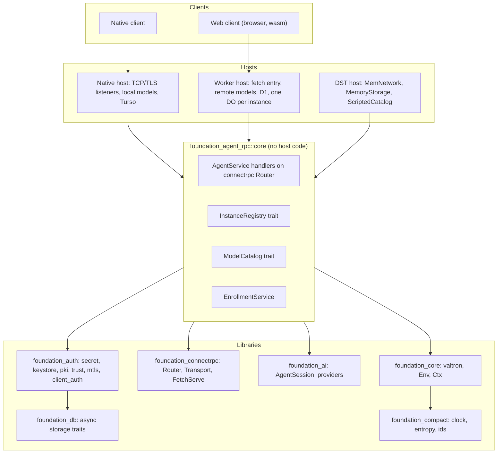
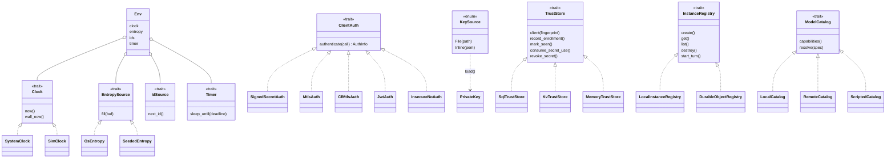
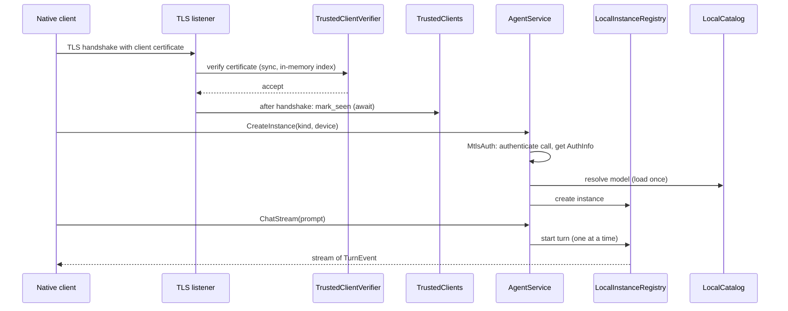
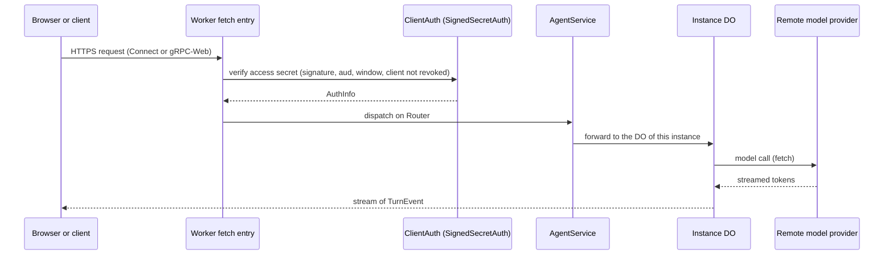
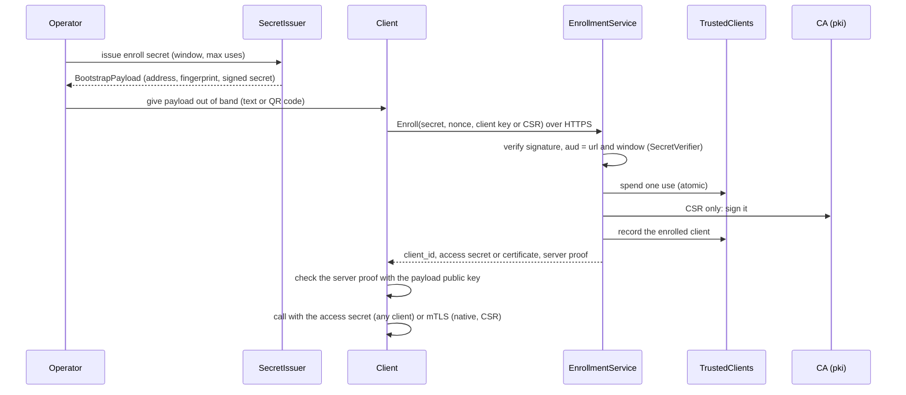
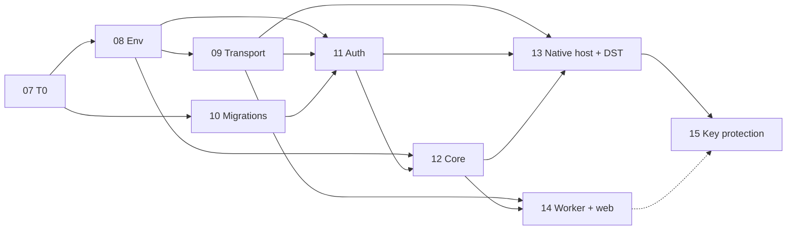
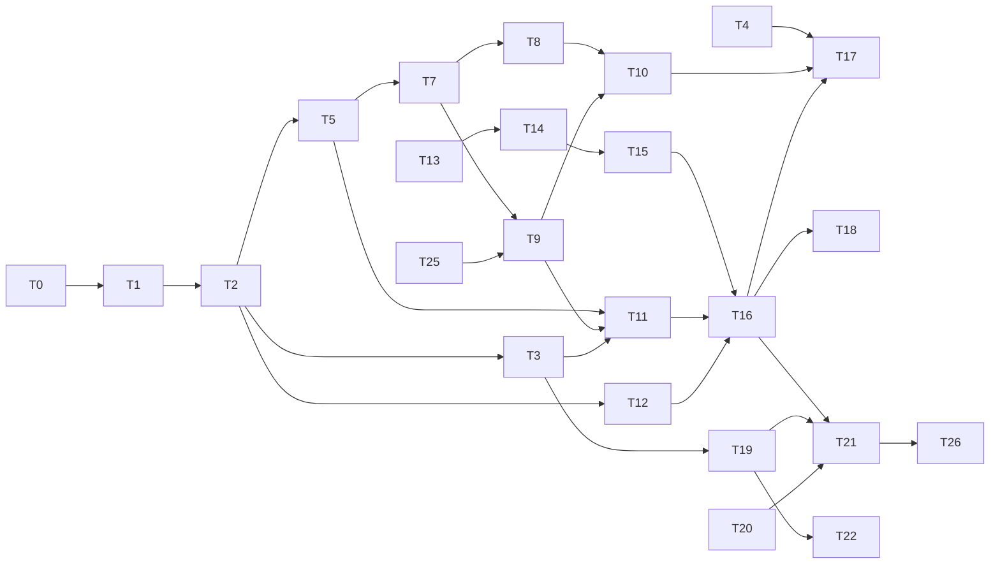

# Pluggable Agent RPC: architecture and shared decisions

_The overview of spec 65 features 07 to 15. Moved out of feature 07 on 2026-10-27, when feature 07
was reduced to one task (owner direction: each feature is focused on one thing). It holds the
glossary, the architecture, the owner decisions and the open questions that the features share.
Each feature holds its own design files. Written in ASD-STE100 Simplified Technical English
(STE). Code and identifiers stay as they are._

# Pluggable Agent RPC

_Written in ASD-STE100 Simplified Technical English (STE). Code and identifiers stay as they
are._

**Abbreviations in this file.** remote procedure call (RPC); Transport Layer Security (TLS);
mutual TLS (mTLS); Certificate Authority (CA); certificate signing request (CSR); Durable
Object (DO); WebAssembly (wasm); JavaScript (JS); identifier (ID); random number generator
(RNG); deterministic simulation testing (DST); input/output (I/O); key-value store (KV);
Structured Query Language (SQL); Hypertext Transfer Protocol (HTTP); JavaScript Object
Notation (JSON); JSON Web Token (JWT); application programming interface (API); key encryption key (KEK); key management service (KMS); central
processing unit (CPU); graphics processing unit (GPU); Compute Unified Device Architecture
(CUDA); GPT-Generated Unified Format (GGUF); continuous integration (CI); pull request (PR);
AeroSpace and Defence Industries Association of Europe (ASD), the owner of the STE standard
ASD-STE100. Section 2 explains each term.

## 1. Overview

### 1.1 What this design does

Feature 01 made `foundation_agent_rpc`: a server that loads a model one time and serves named
agent instances over RPC. It runs only as a native program with its own TLS listeners.

This design changes feature 01 so that **one RPC surface runs in four places**:

- bare metal (a normal Linux, macOS or Windows machine),
- Docker (the same native program in a container),
- Cloudflare Workers (WebAssembly in the Cloudflare network),
- the browser (as a client only).

It does this with three ideas:

1. **A core with no host code.** The service logic sits behind traits. A **host** is the
   small part of each program that gives the core its network, storage, models and side
   effects.
2. **Shared auth.** The signed secrets, the CA, the trusted-client store and the mTLS checks
   move into `foundation_auth`, on top of `foundation_db`. Other services can use them.
3. **Injected side effects.** The clock, randomness, IDs and timers come from one `Env`
   bundle in valtron's context (`Ctx`). Tests swap them for fakes. This makes
   deterministic simulation testing possible (`CLAUDE.md` rule 11).

### 1.2 Where to read

Each feature holds its own design files. This file holds only what the features share.

| Feature | Design files | What it covers |
|---|---|---|
| This file | — | Overview, glossary, architecture, owner directions, breaking changes, migration, testing strategy, the feature list and order, owner decisions, open questions, how to work |
| [07 Bring #126 onto master](./features/07-pluggable-agent-rpc/feature.md) | — | Task T0 only |
| [08 Env and side effects](./features/08-env-and-side-effects/feature.md) | [`env.md`](./features/08-env-and-side-effects/env.md), [`deterministic-simulation-testing.md`](./features/08-env-and-side-effects/deterministic-simulation-testing.md) | Side effects, the `Env` bundle, valtron's `Ctx`, the lint; DST in plain words |
| [09 Transport prerequisites](./features/09-transport-prerequisites/feature.md) | — (small; the feature file says what to change) | connectrpc request extensions and clock; TLS peer certificates |
| [10 Migration groups](./features/10-migration-groups/feature.md) | [`migrations.md`](./features/10-migration-groups/migrations.md) | Migrations per database, as ordered groups, each numbered from 1 and recorded by group |
| [11 Auth in `foundation_auth`](./features/11-foundation-auth/feature.md) | [`auth.md`](./features/11-foundation-auth/auth.md) | Signed secrets, operator key files, CA, trusted clients, mTLS, client auth providers, security |
| [12 Agent RPC core](./features/12-agent-rpc-core/feature.md) | [`proto.md`](./features/12-agent-rpc-core/proto.md), [`registry-and-models.md`](./features/12-agent-rpc-core/registry-and-models.md) | The wire contract; model catalog, kinds and devices, the instance registry |
| [13 Native host and DST](./features/13-native-host-and-dst/feature.md) | [`hosts.md`](./features/13-native-host-and-dst/hosts.md) | What each host gives the core, Cargo features, the native host, the native client |
| [14 Worker host and web client](./features/14-worker-host-and-web-client/feature.md) | [`worker-and-web.md`](./features/14-worker-host-and-web-client/worker-and-web.md) | The Worker host, Durable Objects, the web client, the R2 archive |
| [15 Key protection at rest](./features/15-key-protection-at-rest/feature.md) (todo, last) | [`keystore.md`](./features/15-key-protection-at-rest/keystore.md), [`key-protection.md`](./features/15-key-protection-at-rest/key-protection.md) | Key store, encryption at rest, KMS, rotation by `kid` |

### 1.3 Goals

- One `AgentService` RPC surface on native, Worker and browser.
- Every part that differs between hosts sits behind a trait.
- Every side effect is injected through `Env`. No core code reads a global clock or RNG.
- Auth is a library in `foundation_auth`, not code inside agent-rpc.
- The default client credential is our signed JSON secret, not a JWT. Its version 1 wire
  format does not change.
- A client can ask which model kinds and devices a server supports, and choose one.
- Every limit is a configuration field with a documented default (`CLAUDE.md` rule 8).

### 1.4 Non-goals

- Local models (Candle, GGUF) on a Worker. A Worker has no threads and about 128 MB of
  memory. It uses remote models only.
- Full gRPC on a Worker or in a browser. gRPC needs HTTP trailers. A Worker cannot send them
  reliably. Connect and gRPC-Web work.
- A Postgres backend for `foundation_db` (decision 7: a separate feature).
- The proxy registration work (features 03 and 04).

### 1.5 Before you start

- The branch `65-f01-agent-rpc` is behind `master` and has merge conflicts. Task T0 merges
  `master` first.
- `master` has async-only storage (#131 to #133). The topic files use the trait names
  `KeyValueStore`, `QueryStore` and so on. After the rename PR (branch
  `db/rename-async-traits`) these traits are `KeyValueStore`, `QueryStore` and so on. Use
  the names that `master` has when you start.

## 2. Glossary

| Term | Meaning |
|---|---|
| ASD-STE100 | A standard for simple technical English. Short sentences, one meaning per word. |
| AuthInfo | The result of a successful auth check: who the caller is and what it can do. Handlers see only this. |
| Bootstrap payload | The text (or QR code) that a client gets out of band. It holds the server URL, an optional TLS fingerprint, an optional enrollment URL and a signed secret. It has no version field ([proto.md](./features/12-agent-rpc-core/proto.md) section 6). |
| Bundle (`Env`) | One value that holds all ambient side effects: clock, entropy, IDs, timer. |
| CA | Certificate Authority: the key that signs certificates for clients and the server. |
| Capabilities | The list of model kinds and devices that a server supports. `GetCapabilities` returns it. |
| Catalog (`ModelCatalog`) | The trait that finds or loads a model for an instance. |
| Client auth (`ClientAuth`) | The trait that checks one incoming call and returns `AuthInfo`. |
| Connect | An RPC protocol over HTTP/1.1 and HTTP/2. Works in browsers. |
| Context (`Ctx`) | A box of typed values that travels with each valtron task. |
| Contract test | One set of tests that every implementation of a trait must pass. |
| CSR | Certificate signing request: a client asks the CA to sign its public key. |
| Deterministic | The same inputs always give the same result. |
| Device | Where a local model runs: CPU, CUDA GPU or Metal GPU. |
| DO | Durable Object: a Cloudflare object with its own storage and one thread. We use one per instance. |
| DST | Deterministic simulation testing: tests where every side effect comes from one seed, so a run can be repeated exactly. |
| Enrollment | The step where a client (native, Worker or browser) shows a signed secret, a nonce and a credential (a client public key or a CSR), and gets a `client_id`, an access secret or a client certificate, and a server proof. [auth.md](./features/11-foundation-auth/auth.md) section 9.1. |
| Server proof | The host's signature, with the payload private key, over the client's nonce and credential. It proves the right server answered, without a pinned TLS channel. |
| Access secret | A short-lived `SignedSecret` (purpose `access`, `sub` = client ID) that a client-key client sends on each call and renews with `RefreshAccess`. |
| Entropy | Random bytes. `EntropySource` is the trait that gives them. |
| Fake | A small, controllable copy of a real part, for tests. |
| gRPC, gRPC-Web | Google's RPC protocol over HTTP/2, and its variant for browsers. |
| Host | The program-specific part that gives the core its network, storage, models and `Env`: native, Worker or DST. |
| Instance | A named agent with its own session and history, on a shared model. |
| Instance kind | `API`, `CANDLE` or `GGUF` (later `VIDEO`, `AUDIO`): what model an instance uses. |
| Key source (`KeySource`) | Where the host reads an operator private key: a file, or an inline value from an environment variable or a Worker secret. The key store trait is deferred to feature 15. |
| Miniflare, wrangler | Cloudflare tools that run a Worker on a local machine. |
| mTLS | Mutual TLS: both sides show a certificate. |
| Registry (`InstanceRegistry`) | The trait that creates, finds, lists and removes instances. |
| Scope | The name space for instance names: shared, or one per caller. |
| Seed | One number from which a DST run takes all its "random" decisions. |
| Side effect | Something that code reads from or does to the world outside its inputs: time, random bytes, network, storage. |
| Signed secret (`SignedSecret`) | Our credential: base64url JSON `{v, alg, public_key, secret, valid_from, valid_until, signature}`. Not a JWT. |
| Trait | A Rust interface: functions that a type promises to provide. |
| Trusted-client store (`TrustStore`) | The trait that records enrolled clients, revocations and secret use counts. |
| Valtron | Our task engine in `foundation_core`. Multi-threaded on native, single-threaded on wasm and in DST. |
| Window | The time span (`valid_from` to `valid_until`) in which a secret works. |
| Worker | A Cloudflare Worker: a wasm program that answers HTTP `fetch` events. |

## 3. Architecture

### 3.1 Layers

_The diagram shows the layers. Clients talk to a host. Every host runs the same core. The
core uses the shared libraries. Arrows point from the user to the part it uses._

### 3.2 Crates and what each one owns

| Crate | Owns | Targets |
|---|---|---|
| `foundation_compact` | `Clock`, `EntropySource`, `IdSource` traits and their real and simulated implementations | all |
| `foundation_core` | `Env` bundle; valtron `Ctx`, `Timer`, `SimRuntime` | all (multi-threaded only on native) |
| `foundation_db` | async storage traits; `DoSqlStore` (new); `Faulty*` test wrappers | all |
| `foundation_connectrpc` | `Router`, `Transport`; `FetchServe` and `FetchTransport` (wasm, new); `MemNetwork` (test) | all |
| `foundation_auth` | `secret`, `keystore`, `trust`, `client_auth` (all targets); `pki`, `mtls` (native) | all, with native-only parts |
| `foundation_ai` | `AgentSession`, model providers | all |
| `foundation_agent_rpc` | `core` (service, registry, catalog, enrollment); `host::native`; `host::worker`; `client::{native, web}` | per module |

### 3.3 The trait map

_The diagram shows each trait and its implementations. `Env` holds the four ambient traits.
The other traits go to each component as a constructor argument._

### 3.4 Which implementation each host uses

| Trait | Native host | Worker host | DST host |
|---|---|---|---|
| `Clock` | `SystemClock` | `SystemClock` (wasm `Date.now()`) | `SimClock` |
| `EntropySource` | `OsEntropy` | `OsEntropy` (wasm `crypto.getRandomValues`) | `SeededEntropy` |
| `ClientAuth` | `MtlsAuth`, `SignedSecretAuth` | `SignedSecretAuth`, `CfMtlsAuth`, `JwtAuth` | any, with fakes |
| `KeySource` | operator key files | public keys from a var; the payload private key from a Worker secret only when `WorkerHostConfig::enrollment` is set | `KeySource::Inline` with fixture or seeded keys |
| `TrustStore` | `SqlTrustStore<Turso>` | `SqlTrustStore<D1>` | `MemoryTrustStore` |
| `InstanceRegistry` | `LocalInstanceRegistry` | `DurableObjectRegistry` (a `LocalInstanceRegistry` inside each DO) | `LocalInstanceRegistry` |
| `ModelCatalog` | `LocalCatalog` (Candle, GGUF, API) | `RemoteCatalog` (API only) | `ScriptedCatalog` |
| Network | TCP/TLS listeners | the Cloudflare `fetch` event | `MemNetwork` |

## 4. Request lifecycle

[hosts.md](./features/13-native-host-and-dst/hosts.md) gives each step in detail. These diagrams show the main path.

### 4.1 Native host

_The diagram shows one native call path. The TLS check is sync and does no I/O. The
last-seen write happens after the handshake, in async code._

### 4.2 Worker host

_The diagram shows one Worker call path. Cloudflare ends TLS. The Worker checks the signed
secret, and the instance's Durable Object runs the turn._

### 4.3 Bootstrap and enrollment

_The diagram shows how any client, a browser included, enrolls. The signed secret proves that the
server issued it; the server proof proves that the right server answered. The trust store makes
sure each secret is used only as often as allowed._

## 5. The owner's directions, and where each one is answered

| # | Direction (PR #126 review) | Answer |
|---|---|---|
| 1 | Traits so one RPC surface runs on bare metal, Docker and Workers | Sections 3 and 4; [hosts.md](./features/13-native-host-and-dst/hosts.md) |
| 2 | Move auth into `foundation_auth`, built on `foundation_db` | [auth.md](./features/11-foundation-auth/auth.md) sections 1 and 2 |
| 3 | A `CaStore` trait for key material in any backend | Proof of concept: operator key files ([auth.md](./features/11-foundation-auth/auth.md) section 4, decision 11). The `KeyStore` trait is designed in [feature 15](./features/15-key-protection-at-rest/keystore.md) (deferred) |
| 4 | Pluggable client auth; the default is our signed JSON secret, not a JWT | [auth.md](./features/11-foundation-auth/auth.md) sections 3 and 8 |
| 5 | `mark_seen` out of the TLS verifier | [auth.md](./features/11-foundation-auth/auth.md) section 7; section 4.1 here |
| 6 | Capabilities endpoint and instance kinds | [proto.md](./features/12-agent-rpc-core/proto.md); [registry-and-models.md](./features/12-agent-rpc-core/registry-and-models.md) section 2 |
| 7 | Candle device: CPU or GPU | [registry-and-models.md](./features/12-agent-rpc-core/registry-and-models.md) section 2.5 |
| 8 | Side effects as traits, for DST and mocks | [env.md](./features/08-env-and-side-effects/env.md); [deterministic-simulation-testing.md](./features/08-env-and-side-effects/deterministic-simulation-testing.md) |
| 9 | The bundle in valtron's `Ctx` as a typed entry | [env.md](./features/08-env-and-side-effects/env.md) sections 5 and 6 |

## 6. Configuration

Every limit and timeout is a field on a configuration type, with a documented default. Each
default names the established server or API it comes from (`CLAUDE.md` rule 8).

| Type | Where | Defined in |
|---|---|---|
| `NativeHostConfig` | native host listeners, shutdown, state | [hosts.md](./features/13-native-host-and-dst/hosts.md) section 4.1 |
| `WorkerHostConfig`, `CorsConfig` | Worker host | [worker-and-web.md](./features/14-worker-host-and-web-client/worker-and-web.md) sections 5.2 and 6.5 |
| `RegistryConfig`, `TurnLimits` | instance limits, page sizes, turn timeouts | [registry-and-models.md](./features/12-agent-rpc-core/registry-and-models.md) section 3.3 |
| `DecodeLimits`, `VerifyPolicy` | signed secret size and window checks, clock skew | [auth.md](./features/11-foundation-auth/auth.md) section 3 |
| `CaConfig`, `ServerIdentityConfig` | certificate lifetimes, backdating | [auth.md](./features/11-foundation-auth/auth.md) section 5 |
| `TrustConfig` | prune interval, grace periods | [auth.md](./features/11-foundation-auth/auth.md) section 6 |
| `EnrollConfig` | enrollment limits | [auth.md](./features/11-foundation-auth/auth.md) section 9 |
| `FetchServeConfig`, `FetchTransportConfig` | wasm request and body limits | [worker-and-web.md](./features/14-worker-host-and-web-client/worker-and-web.md) section 5 |

## 7. Breaking changes

For users of the current `foundation_agent_rpc` on branch `65-f01-agent-rpc`:

- The `Auth` enum on `AgentRpcServerBuilder` is replaced by a `ClientAuth` value.
- `MtlsConfig` and `TrustedClientStore` move to `foundation_auth` with new names
  (`KeySource` / `PrivateKey`, `TrustedClients`). `TrustedClients` takes an `Env` and a store.
- The host no longer makes keys at the first start. The operator makes them with `ssh-keygen` or
  `openssl` ([auth.md](./features/11-foundation-auth/auth.md) section 4.2). A state directory of today keeps working, because
  its key files are the default paths (section 4.7 there).
- `BootstrapSecrets` splits into `SecretIssuer` and `SecretVerifier`.
- `CertificateAuthority::load_or_generate(dir)` becomes `CertificateAuthority::from_key` over
  the operator's CA key.
- `CreateInstanceRequest` gains `kind` and `device`. A request without them still works: the
  server picks a default (rules in [proto.md](./features/12-agent-rpc-core/proto.md) section 5).
- `ModelSource::Candle` gains a `Device`.
- `foundation_connectrpc::AuthInfo` moves to `foundation_auth`. connectrpc re-exports it, so
  its path for connectrpc users does not change.

- `BootstrapPayload` drops `version`, `addr` and `bootstrap_addr` (reserved) and gets `url` and
  `enroll_url`. `Capabilities.auth_mode` becomes `auth_modes`. A payload from feature 01 is
  refused; the operator issues a new one. Feature 01 was never released, so no deployed client
  is affected ([proto.md](./features/12-agent-rpc-core/proto.md) section 6; owner decision 9).
- `NativeHostConfig` gets `public_url` and `public_enroll_url` in place of a payload version.
- Enrollment works for every client (owner, PR #126 review, 2026-10-26). `EnrollRequest` takes a
  nonce and a credential oneof (`csr_pem` or a new `client_key`); `EnrollResponse` adds
  `client_id`, `access_secret` and `server_proof`; `BootstrapService` adds `RefreshAccess`;
  `SignedSecret` v2 adds a signed `sub`. A browser no longer refuses an enrollment payload
  ([auth.md](./features/11-foundation-auth/auth.md) section 9.1, [worker-and-web.md](./features/14-worker-host-and-web-client/worker-and-web.md) section 6).

Unchanged: the version 1 `SignedSecret` wire format and the existing RPC methods.

## 8. Migration, file by file

| File on branch `65-f01-agent-rpc` | After features 07 to 14 |
|---|---|
| `src/secret.rs` | `foundation_auth::secret` (types and verify) and `foundation_auth::keystore` (key loading) |
| `src/auth.rs` | `foundation_auth::{pki, mtls, fingerprint}`; `EnrollmentService` goes to `core/enroll.rs` |
| `src/trust.rs` | `foundation_auth::trust` |
| `src/bootstrap.rs` | `core/bootstrap.rs` (payload encode, and decode into `Bootstrap`, `TlsTrust`, `BootstrapAccess`) |
| `src/service.rs` | `core/service.rs`: handlers that use `InstanceRegistry` and `ModelCatalog` |
| `src/instance.rs` | `core/registry/{mod,local}.rs` |
| `src/model.rs` | `core/model/{mod,handle,catalog,remote}.rs`; local loaders in `host/native/models.rs` |
| `src/server.rs` | `host/native/{mod,config,listener}.rs` |
| `src/client.rs` | `client/native.rs`; the browser client is new in `client/web.rs` |
| `src/error.rs` | `core/error.rs` |
| new | `host/worker/{entry,object,registry,config,do_transport}.rs`; `examples/cf-agent-rpc`; `examples/agent-rpc-web` |

[auth.md](./features/11-foundation-auth/auth.md) section 1 gives the auth moves type by type.

## 9. Testing strategy

| Level | What | Where |
|---|---|---|
| Unit | One behavior of one type | each crate's `tests/` |
| Contract | One test set that every implementation of a trait passes (`TrustStore`, `InstanceRegistry`, `ModelCatalog`, `Clock`, `EntropySource`) | each crate's `tests/*/contract.rs` |
| DST | The full client to server to instance flow from one seed, with failure injection | `foundation_agent_rpc/tests/dst/` |
| Native end to end | Real sockets, real TLS and mTLS | `foundation_agent_rpc/tests/native_*` |
| Worker | Miniflare, as for the other `examples/cf-*` | `foundation_toolings/tests/cf_examples.rs` |
| Web client | `wasm-bindgen-test` in a headless browser | `foundation_agent_rpc/tests/wasm/` |

Each topic file ends with its own test table.

## 10. Features and tasks

Owner direction (2026-10-27): each feature is focused on one thing. The work is features 07 to
14, and each has its own `feature.md` (tasks, what to read, "done when") and its own design files.
Feature 07 is only task T0. This file holds what the features share. Task IDs keep their
numbers, so a reference such as "task T21" still names one task.

Features 07 to 13 make the **agent-rpc proof of concept**: one native agent-rpc host, with
operator key files, that clients enroll with and call, tested end to end and under simulation.
Feature 14 adds Workers and the browser. Feature 15 (key protection at rest) is last, and starts
only after the proof of concept works.

| Feature | Tasks | What | Proof of concept |
|---|---|---|---|
| [07 Bring #126 onto master](./features/07-pluggable-agent-rpc/feature.md) | T0 | Merge `master` into `65-f01-agent-rpc`; adapt to async storage and async `AgentSession` | yes |
| [08 Env and side effects](./features/08-env-and-side-effects/feature.md) | T1, T2, T12 | `Clock`, `EntropySource`, `IdSource`, the `Env` bundle in valtron `Ctx`, the macro argument, `foundation_ai` on `Env` | yes |
| [09 Transport prerequisites](./features/09-transport-prerequisites/feature.md) | T3, T4 | connectrpc keeps request extensions and uses the `Env` clock; `foundation_http` reports the TLS peer certificate | yes |
| [10 Migration groups](./features/10-migration-groups/feature.md) | T25 | Migration groups per database, from code or directories; `FleetRunner` | yes |
| [11 Auth in `foundation_auth`](./features/11-foundation-auth/feature.md) | T5, T7, T8, T9, T10, T11 | Signed secrets, operator key files, CA, trusted clients, mTLS, client auth providers | yes |
| [12 Agent RPC core](./features/12-agent-rpc-core/feature.md) | T13, T14, T15, T16 | `agent.proto`, model catalog, instance registry, service and enrollment handlers | yes |
| [13 Native host and DST](./features/13-native-host-and-dst/feature.md) | T17, T18 | The native host and the simulation harness. **Done here = the proof of concept works** | yes |
| [14 Worker host and web client](./features/14-worker-host-and-web-client/feature.md) | T19, T20, T21, T22, T26 | Workers, Durable Objects, the browser client, the R2 history archive | no |
| [15 Key protection at rest](./features/15-key-protection-at-rest/feature.md) | K1 to K6 (were T6, T23, T24) | Key store, encryption at rest, KMS, rotation by `kid`. Status: todo | no (last) |

### 10.1 Order of the features

_The diagram shows which feature must finish before another starts. Feature 15 waits for the
proof of concept (feature 13); the dashed line means it also covers the Worker when feature 14 is
done._

### 10.2 Order of the tasks

_The diagram shows which task must finish before another task starts._

## 11. Owner decisions (2026-10-22, 2026-10-25 and 2026-10-27)

The owner answered the open questions on 2026-10-22. Decisions 9 and 10 come from the PR #126 review of 2026-10-25. Decision 11 comes from the owner on 2026-10-27.

| # | Question | Decision | Where it is designed |
|---|---|---|---|
| 1 | Instance name scope on the Worker | **Per caller** (`ScopePolicy::PerOwner`) on the Worker; shared on native | [registry-and-models.md](./features/12-agent-rpc-core/registry-and-models.md) section 3.1 |
| 2 | Version 2 signed secrets | **Issue version 2 by default**; still accept version 1 | [auth.md](./features/11-foundation-auth/auth.md) section 3.2 |
| 3 | Private keys at rest | **Always encrypted, on every host and backend.** No plain-text mode. The KEK comes from the safest source of each platform. _Deferred by decision 11: it is the target of feature 15, not of the proof of concept._ | [feature 15 key-protection.md](./features/15-key-protection-at-rest/key-protection.md) |
| 4 | JWT provider | **Ship `JwtAuth` in this feature**, behind a feature flag | [auth.md](./features/11-foundation-auth/auth.md) section 8 |
| 5 | History on `DestroyInstance` | **Archive to R2**, then delete the DO storage | [worker-and-web.md](./features/14-worker-host-and-web-client/worker-and-web.md) section 5.12 |
| 6 | Model provider API keys | **Worker secrets or Secrets Store secrets**; never in vars, D1, KV or logs | [worker-and-web.md](./features/14-worker-host-and-web-client/worker-and-web.md) section 5.11 |
| 7 | Postgres | **Only if it is not too much work.** It is a sizable job (section 11.1), so it is **not part of this feature**. The owner also asked for directory migrations: **yes**, task T25 | [migrations.md](./features/10-migration-groups/migrations.md) |
| 8 | Rename timing | **Wait** for the rename PR (`Async*` to plain names) to merge, then start | section 1.5 |
| 9 | Bootstrap payload versions (2026-10-25) | **No version field.** One `url` for every host; the client derives TLS trust from the fingerprint and access from the token purpose | [proto.md](./features/12-agent-rpc-core/proto.md) section 6 |
| 10 | Migration layout (2026-10-25) | **Groups per database**: a shared group, then specific groups, each numbered from 1 and recorded by group. No number ranges per crate | [migrations.md](./features/10-migration-groups/migrations.md) |
| 11 | Secret setup for the proof of concept (2026-10-27) | **Simple first.** The operator makes each private key with `ssh-keygen` or `openssl`; the host loads it from a file, an environment variable or a Worker secret, and uses it. The host does not make, seal, store or rotate keys. The key store, encryption at rest, remote KMS and rotation by `kid` move to the deferred feature 15 | [auth.md](./features/11-foundation-auth/auth.md) section 4; [feature 15](./features/15-key-protection-at-rest/feature.md) |

### 11.1 Why Postgres is a separate feature

`foundation_db` runs on valtron, not on tokio. The common Rust Postgres clients
(`tokio-postgres`, `sqlx`, and the sync `postgres` crate, which uses tokio inside) need tokio.
So a Postgres backend needs its own connection code on `foundation_netio`:

- the startup message and SCRAM-SHA-256 password authentication;
- TLS through `foundation_netio`;
- the extended query protocol (parse, bind, execute), with `$1` placeholders instead of `?`;
- type conversion between `DataValue` and Postgres types;
- row streaming, query cancellation, and a connection pool with limits as configuration.

The `postgres-protocol` crate encodes and decodes the messages and does SCRAM with no runtime,
so we do not write those parts. The connection state machine, the pool and the type mapping are
still ours. That is a feature of its own, about the size of the libsql backend plus a protocol
client. We record it as a separate feature for spec 50 (storage), after this one.

## 12. Open questions for the owner

1. ~~Migration number ranges.~~ **Resolved** by owner decision 10: migrations are groups per
   database, each numbered from 1 and recorded by group. There are no number ranges and no
   record table per component. [migrations.md](./features/10-migration-groups/migrations.md) has the design and its own open
   questions.
2. ~~Remote KMS order.~~ **Moved** to the deferred [feature 15](./features/15-key-protection-at-rest/feature.md)
   by decision 11. The recommendation there stays: Vault Transit, then AWS KMS, then GCP Cloud KMS.
3. **Archive on native.** [worker-and-web.md](./features/14-worker-host-and-web-client/worker-and-web.md) section 5.12 gives the native host the same archive
   step through a `foundation_db` blob store. **Recommendation: yes, default to a local directory.**
4. **A Worker that enrolls holds the payload private key.** Enrollment from a browser to a
   Worker needs a host that can sign server proofs and access secrets ([auth.md](./features/11-foundation-auth/auth.md)
   section 9.1). Options:
   - A: the Worker holds the private key as the Worker secret `AGENT_RPC_SIGNING_KEY` (PEM
     text, decision 11), behind `WorkerHostConfig::enrollment` (off by default).
   - B: a native host does the enrollment, and the Worker stays verify-only.
   - **Recommendation: A, opt-in.** It keeps one flow on every host. Its risk: a leak of the Worker
     secret lets an attacker issue tokens; a new key and a restart stop it ([auth.md](./features/11-foundation-auth/auth.md)
     section 4.6).

## 13. How to work on features 07 to 14

### Read first

1. `CLAUDE.md` at the repository root. All rules apply. Rules 8 (limits are configuration),
   10 (keep `progress.md` and `LEARNINGS.md` current), 11 (side effects are injected) and 12
   (write in STE) are central to this work.
2. This file: overview, glossary, architecture, the feature list (section 10), open questions.
   Then the `feature.md` of the feature you work on (07 to 14), and its design files.
3. [`deterministic-simulation-testing.md`](./features/08-env-and-side-effects/deterministic-simulation-testing.md): why every
   side effect is a trait.
4. The design file of your feature (section 1.2 lists them).
5. [`progress.md`](./progress.md) and [`LEARNINGS.md`](./LEARNINGS.md) for the state of spec 65.

### Workflow

1. Do task T0 first. Merge `master` into `65-f01-agent-rpc` with a merge commit (no rebase,
   no force-push). Adapt the crate to the async storage traits and the async `AgentSession`.
2. Do the features in the order of section 10.1 (features 08 to 14; feature 15 is
   last and waits for the proof of concept). Each feature's `feature.md` lists its tasks, what
   to read, and its pull requests. Inside a feature, follow the task order of section 10.2.
3. For each task:
   1. Read its section in the topic file.
   2. Write the code. Use the trait signatures in the design. If a signature must change, update
      the design file in the same commit, and say why.
   3. Write the tests that the task names, in the crate's `tests/` directory.
   4. Run `python3 scripts/ci/ci.py run <crate> --step build --step clippy --step test --step wasm`
      for each crate that you change.
   5. Update the task table in that feature's `feature.md` and the spec's `progress.md`. Add what you learned to
      `LEARNINGS.md`.
   6. Commit and push.
4. If a design choice is not clear, stop. Ask the owner with the options and your
   recommendation. Section 11 of `feature.md` has the questions that are still open.

### Rules to check before each push

- No `SystemTime::now()`, `Instant::now()`, `thread_rng()`, `getrandom` or similar in core
  code. Use the `Env` bundle. The clippy lint stops the build otherwise.
- No function-local `use` statements. No fully qualified paths in function bodies. Imports go
  at the top of the file.
- No `#[cfg(test)] mod tests` in source files. Tests go in `tests/`.
- No `todo!()` in code. The `todo!("Tn")` marks in the design files only show which task
  writes a body.
- Every new limit is a configuration field with a documented default.
