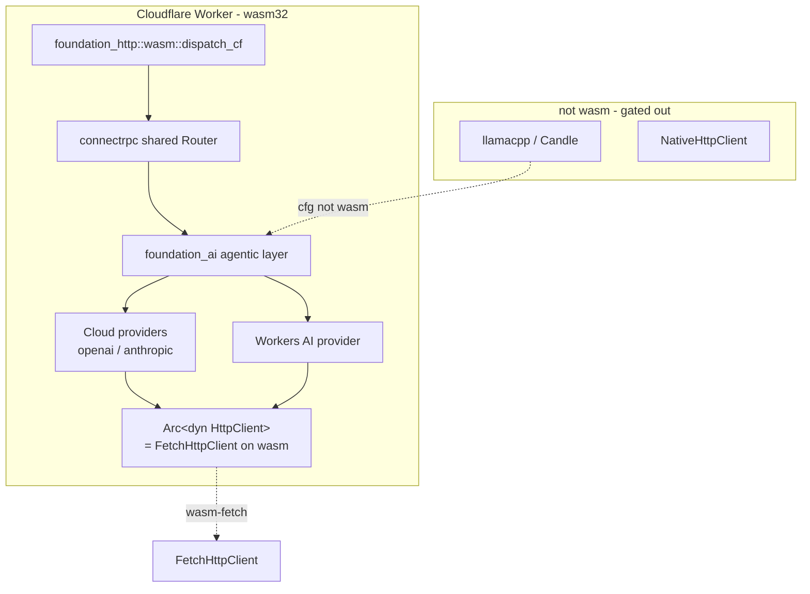

# WASM & Cloudflare Workers Readiness (Foundation)

## Overview

This feature is the **foundation** of the whole serving system: it makes
`foundation_ai` — and every crate it pulls in — compile and *run* on
`wasm32-unknown-unknown`, so the later Cloudflare Workers target
(`05-cloudflare`) has a clean foundation to build on. It is sequenced **first**
on purpose: "shore up the foundation before we even build the agent rpc."

It does **not** invent new platform abstractions. The repo already ships the
cross-platform HTTP seam — `foundation_netio::network_client::DynNetClient`
(`Arc<dyn NetClient>`, the combined `HttpClient + WebSocketConnector` handle)
and the singular `foundation_netio::shared::client::http_client::HttpClient`
trait (`Arc<dyn HttpClient>` for HTTP-only callers). The rule this feature
follows, per use-case:

- **HTTP only** (OpenAI/Anthropic/Workers-AI cloud providers) → code against the
  singular `HttpClient` trait (`Arc<dyn HttpClient>`), built by `HttpClientBuilder`.
- **HTTP + WebSocket** (a transport that does both) → use the combined
  `DynNetClient`/`NetClient`.

Beyond HTTP, `foundation_compact` is the repo's **central cross-platform
substrate** and the home for every non-I/O primitive: `time` (JS
`Performance.now`/`Date.now` on wasm), `entropy` (vendored, all targets), `rng`
(ChaCha CSPRNG with **no external rand/getrandom**), `ids` (scru128), `crypto`,
and `send_wrapper`. Any cross-platform primitive this feature needs routes
through `foundation_compact` — never re-invented per crate.

This feature is a **direct continuation of the completed
`28-cloudflare-workers-readiness` spec**, which already made
`foundation_core`/`foundation_auth`/`foundation_http`/`foundation_db`/`foundation_wire`
wasm-compatible, shipped the `cf-valtron-counter` valtron-in-Workers example, and
added a `wasm-check` CI job. The gap that spec left open is exactly what this
feature closes: **`foundation_ai` (and its AI-specific deps) was out of scope
there.** Everything below is grounded in that prior work plus the existing
`foundation_toolings::harness::Miniflare` local-test harness and
`foundation_http::wasm::{serve_cf, dispatch_cf}`.

## Language Stack

### Languages for This Feature

| Language | Purpose | Skill Location |
|----------|---------|----------------|
| Rust | wasm build flags, provider client swap, Workers AI provider, examples | `.agents/skills/rust-clean-code/skill.md` |

### Pre-Implementation Checklist

- [ ] Read `.agents/skills/rust-clean-code/skill.md`.
- [ ] Read `.agents/skills/rust-valtron-usage/skill.md` (the Workers examples run
      the valtron executor single-threaded — `JSThreadYielder`; no threaded pool).
- [ ] Read `specifications/completed/28-cloudflare-workers-readiness/requirements.md`
      and its `13-cf-valtron-counter` + `07-ci-wasm-checks` features — this feature
      extends their pattern, it does not re-derive it.
- [ ] Confirm `.agents/AGENTS.md`: stream bodies (never buffer), use generated
      types, async all the way down (the Worker edge is `fetch`-based, no sockets).

---

## Requirements

1. **`foundation_ai` compiles to `wasm32-unknown-unknown` (no-default-features).**
   - Gate: `cargo check --target wasm32-unknown-unknown -p foundation_ai
     --no-default-features` exits 0.
   - Local backends (`llamacpp`/`candle`) stay `not(target_family = "wasm")`-gated
     (already true in `src/backends/mod.rs`); this feature does **not** port them.
   - The agentic layer + cloud providers must be wasm-clean.
   - Cross-platform primitives (time/entropy/RNG/IDs) route through
     `foundation_compact`, the central substrate — no per-crate
     `getrandom`/`rand`/`std::time`.

2. **Providers use the existing cross-platform client seam — no new type.**
   - Cloud providers hold `Arc<dyn HttpClient>` (singular trait) built by
     `HttpClientBuilder`, replacing the concrete native-only
     `foundation_netio::http::default_http_client()`.
   - Only a transport that needs WebSocket uses the combined `DynNetClient`.
   - The wasm impl (`FetchHttpClient`) already exists behind `wasm-fetch`; it just
     has to be reachable from `foundation_ai`'s wasm target.

3. **Dependency crates are wasm-clean.**
   - `foundation_netio`, `foundation_vectors`, `foundation_compact`,
     `foundation_arrow`, and `foundation_connectrpc` (shared `Router` + handlers)
     must each pass a wasm32 `cargo check` with the features this system uses.
   - `foundation_arrow` currently shows **no** `target_family = "wasm"` gating —
     audit it and feature-flag any native-only deps.

4. **CI keeps it clean.** Extend the `wasm-check` job (spec 28 feature 07, which
   covered only core/auth/http/db) to `foundation_ai` + its AI deps.

5. **Workers AI provider.** A `RoutableProvider`/`ModelBackend` impl for
   Cloudflare Workers AI (`env.ai.run()` + streaming), wasm-safe, no local model.

6. **Verification examples, each testing a different thing, verified with
   miniflare locally and on Cloudflare** (the point of this feature: prove it
   before building agent-rpc on top):
   - `cf-agent-loop` — agentic layer + Workers AI, served via `dispatch_cf`.
   - `cf-cloud-provider` — `foundation_ai` **deployed on Cloudflare calling
     OpenRouter** (the OpenAI-compatible gateway) through `FetchHttpClient` using
     the existing `OpenAIConfig::openrouter`, validating the cross-platform
     provider path end-to-end.

7. **Streamed and typed.** Workers AI streaming is a `Stream`; responses are never
   buffered whole; generated/protocol types, not hand-rolled JSON.

---

## Architecture (COMPREHENSIVE)

### Technical Approach

- **Three-tier wasm strategy, inherited from spec 28:** (a) pure logic compiles
  everywhere; (b) deps with native backends are feature-flagged and swapped on
  wasm; (c) genuinely native code (local LLM backends, raw sockets, mmap) is
  `cfg(not(target_family = "wasm"))`-gated out. `foundation_compact` is the
  central home for tier-(b)/(c) substrate (time/entropy/RNG/IDs/crypto), so
  `foundation_ai` follows (a)+(c) and routes its primitives through
  `foundation_compact`; this feature completes (b) for the networking path.
- **Cross-platform client via one seam.** `HttpClientBuilder::build()` returns
  `DynNetClient` (`Arc<dyn NetClient>`), which on native is `NativeHttpClient` and
  on wasm is `FetchHttpClient`. Providers depend on the *trait*, not the concrete
  type, so the same provider source compiles both ways. No new `DynHttpClient`
  type — the singular `HttpClient` trait is the HTTP-only surface.
- **Verify first, build later.** Every change is proven by (i) a wasm32 compile
  gate, (ii) a miniflare-local smoke test via `foundation_toolings::harness::
  Miniflare`, and (iii) an on-Cloudflare smoke test via `wrangler deploy`.

### Changes required in existing crates

The user-facing heart of this feature: the concrete changes needed, and why.
Every "why" was verified against the repo (file/line) on 2026-10-19.

| # | Crate | Change | Why (verified) | Task |
|---|-------|--------|----------------|------|
| 0 | `foundation_compact` | None to add — it **is** the cross-platform substrate; route any new primitive here | already hosts `time`, `entropy` (vendored, all targets), `rng` (ChaCha, no getrandom), `ids` (scru128), `crypto`, `send_wrapper`; `foundation_ai` already uses its `ids`/`SystemTime`/`entropy` (`types/agentic.rs`) | T1 |
| 1 | `foundation_ai` | Route hashing/RNG through `foundation_compact` — seed `ahash` from `foundation_compact::rng`/`entropy` (not `ahash`'s default `runtime-rng`) | `ahash` default `runtime-rng` pulls `getrandom`, which has no wasm-unknown-unknown backend (`Cargo.toml:43`). `foundation_compact` is the central substrate and already vendors wasm-safe entropy (Web Crypto) + a ChaCha CSPRNG with no external rand/getrandom | T1 |
| 2 | `foundation_ai` | Providers hold `Arc<dyn HttpClient>` via `HttpClientBuilder` (singular trait) instead of concrete `foundation_netio::http::default_http_client()` | `foundation_netio::http` is `cfg(all(feature="multi", not(wasm)))`; the concrete `NativeHttpClient` doesn't exist on wasm. The cross-platform `HttpClient` trait + `HttpClientBuilder` already exist (`network_client.rs:41,350`). Sites: `openai_provider.rs:392`, `anthropic_messages_provider.rs:484`, `openai_responses_provider.rs:537` | T1 |
| 3 | `foundation_ai` | Enable `foundation_netio/wasm-fetch` on the wasm target | `foundation_ai` depends on `foundation_netio` with no features (`Cargo.toml:20`), so `FetchHttpClient` (`wasm::client`) is not built on wasm | T1 |
| 4 | `foundation_ai` | Replace `std::thread::sleep` retry backoff with async sleep | compiles on wasm but panics at runtime (no threads) — audit exact sites during T1 | T1 |
| 5 | `foundation_arrow` | Audit + feature-flag native-only deps | no `target_family = "wasm"` gating found in its `Cargo.toml` — must be verified/fixed for wasm | T2 |
| 6 | `foundation_vectors`, `foundation_compact`, `foundation_connectrpc` | Verify wasm32 `cargo check` (fix only if a gate fails) | `vectors` has `not(wasm32)` gating; `compact` has wasm deps (time polyfill + Web Crypto); `connectrpc` `shared::Router` + handlers are wasm-compatible, H2/H3 native-only | T2 |
| 7 | `.github/workflows/*` (CI) | Extend `wasm-check` job to `foundation_ai` + `foundation_netio` + `foundation_vectors` + `foundation_compact` + `foundation_arrow` + `foundation_connectrpc` | spec 28 feature 07 only checks core/auth/http/db; the AI crates regress silently | T3 |
| 8 | `foundation_ai` | New Workers AI `RoutableProvider`/`ModelBackend` | no Workers AI provider exists yet | T4 |

### Component Structure



- The agentic layer is shared between wasm and native; only the model backend and
  the concrete HTTP client differ per target.
- `DynNetClient`/`HttpClient` is the single cross-platform seam; providers never
  name a concrete client type.

### Data Flow (Workers AI stream)

```mermaid
sequenceDiagram
    participant C as Client
    participant W as Worker (dispatch_cf)
    participant A as foundation_ai agentic
    participant P as Workers AI provider
    participant F as FetchHttpClient
    C->>W: Connect/gRPC-Web request
    W->>A: dispatch to agentic layer
    A->>P: chat stream request
    P->>F: send_sse_async / send_async
    F-->>P: token stream
    P-->>A: Stream&lt;TurnEvent&gt;
    A-->>W: streamed response
    W-->>C: streamed response
```

### Data Flow (OpenRouter — the validation path)

```mermaid
sequenceDiagram
    participant C as Client
    participant W as Worker (dispatch_cf)
    participant P as foundation_ai provider<br/>openai → OpenRouter
    participant F as FetchHttpClient
    participant V as OpenRouter<br/>OpenAI-compatible gateway
    C->>W: request (prompt + vendor)
    W->>P: route to provider
    P->>F: send_sse_async (PreparedRequest)
    F->>V: fetch() to vendor endpoint (env-secret auth)
    V-->>F: token stream
    F-->>P: SimpleResponse stream
    P-->>W: Stream&lt;TurnEvent&gt;
    W-->>C: streamed response
```

This is the decisive validation: `foundation_ai` compiled to wasm, deployed on
Cloudflare, calling OpenRouter (via the existing `OpenAIConfig::openrouter`)
through the same `HttpClient`/`FetchHttpClient` seam the native build uses.

### Interface Definitions

**Reused (no new type):**
```rust
// foundation_netio — the existing cross-platform seam
pub trait HttpClient: Send + Sync { /* send_async, send_sse_async, send, send_sse */ }
pub type DynNetClient = Arc<dyn NetClient>;       // combined HTTP + WebSocket
// HttpClientBuilder::build() -> DynNetClient       // native -> NativeHttpClient, wasm -> FetchHttpClient
```

**New (wasm-only provider):**
```rust
// foundation_ai — Workers AI provider
#[cfg(target_family = "wasm")]
pub struct WorkersAiProvider { /* env binding, model id */ }
#[cfg(target_family = "wasm")]
impl RoutableProvider for WorkersAiProvider {
    async fn stream(&self, req: ChatRequest)
        -> Result<impl Stream<Item = TurnEvent>, ProviderError>;
}
```

### Error Handling Strategy

- `ProviderError` for Workers AI (auth, model-not-found, stream-aborted), mapped
  to Connect status; never a bare string.
- Worker errors surface as `dispatch_cf` HTTP/Connect responses, never panics
  (a Worker panic is a 500 with no detail — always convert to a typed error).
- The wasm compile gate is a red→green test: red = the `getrandom`/native-dep
  failure, green = clean `cargo check`.

### Security Considerations

- Workers AI auth uses the Worker's bound `env` binding/secret, never a hardcoded
  token in the bundle.
- The `HttpClient` swap does not change how credentials are sent; it changes only
  the transport behind the trait.

### Performance Considerations

- Worker CPU/memory budget is the hard constraint: no local model, no threads;
  the agentic layer orchestrates only, and streaming keeps memory flat.
- `FetchHttpClient`/SSE streaming is unbuffered (never read whole bodies).

### Trade-offs and Decisions

| Decision | Rationale | Alternatives Considered |
|----------|-----------|------------------------|
| Reuse `DynNetClient`/`HttpClient` (no new type) | Cross-platform seam already exists; providers depend on a trait, not a platform type | New `DynHttpClient` type (rejected: redundant — singular `HttpClient` trait already covers HTTP-only) |
| Providers hold `Arc<dyn HttpClient>` | AI cloud providers are HTTP-only (SSE streaming) | `DynNetClient` everywhere (rejected: pulls WebSocket where unneeded) |
| Build on spec 28, don't re-do core/auth/http/db | Those were already made wasm-compatible | Re-audit everything (rejected: wasted work) |
| Miniflare + Cloudflare verification | Matches the existing harness + cf-valtron-counter pattern; proves before agent-rpc | CI compile-check only (rejected: doesn't prove runtime) |

---

## Implementation

### Files to Create/Modify

- `backends/foundation_ai/Cargo.toml` — `ahash` default-features=false; enable
  `foundation_netio/wasm-fetch` on the wasm target; `workers-ai` feature.
- `backends/foundation_ai/src/backends/{openai_provider,anthropic_messages_provider,openai_responses_provider}.rs`
  — hold `Arc<dyn HttpClient>` via `HttpClientBuilder`; async sleep.
- `backends/foundation_ai/src/backends/workers_ai.rs` — new provider (wasm).
- `backends/foundation_arrow/Cargo.toml` (+ source as needed) — wasm gating.
- `.github/workflows/check.yaml` — extend the `wasm-check` matrix.
- `examples/cf-agent-loop/` — new: agentic layer + Workers AI, served via
  `dispatch_cf` + shared `Router` (wasm-pack layout, mirroring cf-valtron-counter).
- `examples/cf-cloud-provider/` — new: `foundation_ai` deployed on Cloudflare
  calling OpenRouter via `FetchHttpClient` using the existing
  `OpenAIConfig::openrouter` (proves change #2; the end-to-end validation).
- `backends/foundation_toolings` tests (or a spec test crate) — miniflare smoke
  tests driving the examples through `harness::Miniflare`.

## Tasks

- [ ] **T1 — `foundation_ai` wasm-clean.** Apply changes #1–#4; gate is
      `cargo check --target wasm32-unknown-unknown -p foundation_ai --no-default-features`
      passing (red = the `getrandom` failure, green = clean check).
- [ ] **T2 — dependency-crate wasm audit.** `cargo check --target wasm32-unknown-unknown`
      on `foundation_netio`, `foundation_vectors`, `foundation_compact`,
      `foundation_arrow`, `foundation_connectrpc` (shared `Router`); fix
      `foundation_arrow` if it has native-only deps (change #5/#6).
- [ ] **T3 — extend CI `wasm-check`.** Add the five AI crates to the job (change #7);
      red test = CI fails to check a crate that regressed.
- [ ] **T4 — Workers AI provider.** `WorkersAiProvider` as a `RoutableProvider`,
      streaming; unit test against a mocked `fetch`; red test = first streamed
      token arrives.
- [ ] **T5 — examples.** `cf-agent-loop` (agentic + Workers AI via `dispatch_cf`)
      and `cf-cloud-provider` (`foundation_ai` deployed on Cloudflare calling
      OpenRouter via `FetchHttpClient`, using the existing `OpenAIConfig::openrouter`);
      both
      `cargo check --target wasm32-unknown-unknown` + `wasm-pack build`.
- [ ] **T6 — miniflare-local verification.** Drive each example through
      `foundation_toolings::harness::Miniflare` (wrangler `dev --local`), with a
      **mocked vendor `fetch`** (no live keys); red test = an OpenRouter request
      streams through the Worker locally.
- [ ] **T7 — on-Cloudflare verification.** `wrangler deploy` each example; smoke
      test with a **live OpenRouter call gated behind an env secret**
      (`OPENROUTER_API_KEY` in Worker bindings) plus the mocked path; red test =
      a real OpenRouter answer streams from the deployed Worker.

## Testing

### Test Cases

1. **`foundation_ai` wasm gate** — `cargo check --target wasm32-unknown-unknown -p
   foundation_ai --no-default-features` exits 0 (no `getrandom`/native-dep errors).
2. **Provider client seam** — the three cloud providers compile on wasm while
   holding `Arc<dyn HttpClient>`; on native they still hit `NativeHttpClient`.
3. **Dependency audit** — all five AI crates pass their wasm32 `cargo check` with
   the system's feature set.
4. **Workers AI provider streams** — a mocked `fetch` body streams unbuffered.
5. **Miniflare smoke (OpenRouter)** — `cf-cloud-provider` calls OpenRouter through
   `FetchHttpClient` (existing `OpenAIConfig::openrouter`) under `wrangler dev
   --local` with a mocked vendor `fetch`; tokens stream unbuffered.
6. **Cloudflare smoke (OpenRouter)** — the deployed `cf-cloud-provider` Worker
   calls OpenRouter (env-secret-gated `OPENROUTER_API_KEY`) and streams the
   answer back, proving `foundation_ai`'s provider path works on Cloudflare.

### Local run commands

```bash
rustup target add wasm32-unknown-unknown   # one-time
cargo check --target wasm32-unknown-unknown -p foundation_ai --no-default-features
cargo check --target wasm32-unknown-unknown -p foundation_arrow
cargo test -p foundation_ai --features workers-ai
cargo test -p foundation_toolings --test miniflare_smoke   # harness-driven
```

## Success Criteria

- [ ] All 7 tasks completed with one red→green test each
- [ ] `foundation_ai` compiles clean to `wasm32-unknown-unknown` (no-default)
- [ ] Providers depend on `HttpClient`/`DynNetClient` (no new client type, no
      concrete native client on the wasm path)
- [ ] `foundation_arrow` (and the other AI deps) compile clean to wasm32
- [ ] CI `wasm-check` covers the AI crates and fails on regression
- [ ] `cf-agent-loop` + `cf-cloud-provider` verified via miniflare locally **and**
      on Cloudflare
- [ ] A deployed Cloudflare Worker running `foundation_ai` streams a real
      OpenRouter answer (env-secret-gated), validating the cross-platform
      provider path end-to-end
- [ ] No TODO/FIXME/stubs; streamed, typed; no ignored `Result`s

---

_Created: 2026-10-19_
