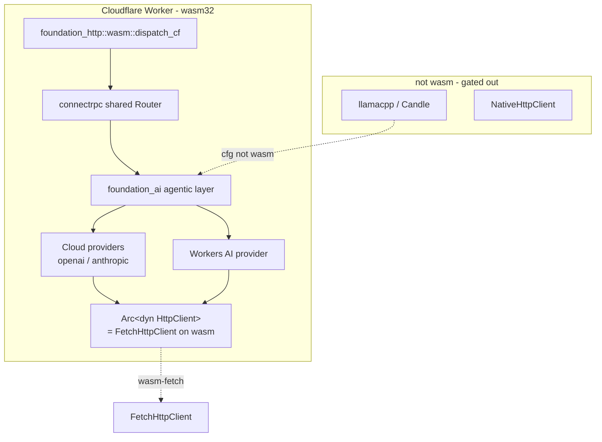
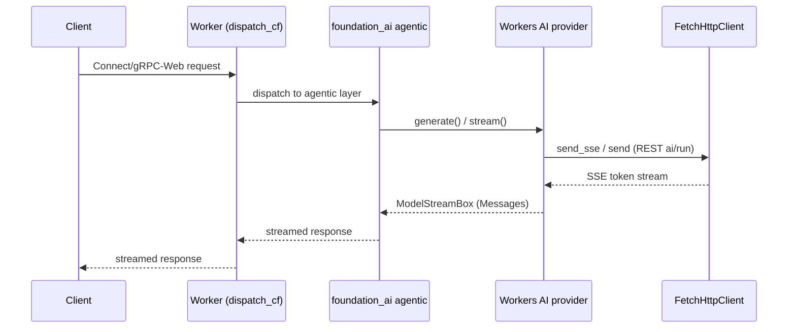
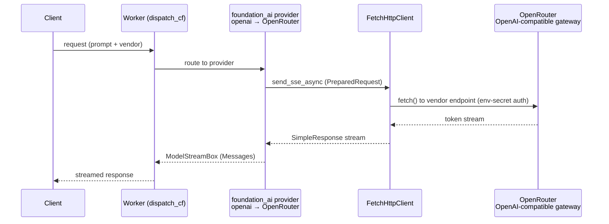

# WASM & Cloudflare Workers Readiness (Foundation)

## Overview

This feature is the **foundation** of the whole serving system: it makes
`foundation_ai` — and every crate it pulls in — compile and *run* on
`wasm32-unknown-unknown`, so the later Cloudflare Workers target
(`05-cloudflare`) has a clean foundation to build on. It is sequenced **first**
on purpose: "shore up the foundation before we even build the agent rpc."

It does **not** invent new platform abstractions. The repo already ships the
cross-platform HTTP seam — `foundation_netio::network_client::DynNetClient`
(`Arc<dyn NetClient>`, the combined `HttpClient + WebSocketConnector` handle)
and the singular `foundation_netio::shared::client::http_client::HttpClient`
trait (`Arc<dyn HttpClient>` for HTTP-only callers). The rule this feature
follows, per use-case:

- **HTTP only** (OpenAI/Anthropic/Workers-AI cloud providers) → code against the
  singular `HttpClient` trait (`Arc<dyn HttpClient>`), built by `HttpClientBuilder`.
- **HTTP + WebSocket** (a transport that does both) → use the combined
  `DynNetClient`/`NetClient`.

Beyond HTTP, `foundation_compact` is the repo's **central cross-platform
substrate** and the home for every non-I/O primitive: `time` (JS
`Performance.now`/`Date.now` on wasm), `entropy` (vendored, all targets), `rng`
(ChaCha CSPRNG with **no external rand/getrandom**), `ids` (scru128), `crypto`,
and `send_wrapper`. Any cross-platform primitive this feature needs routes
through `foundation_compact` — never re-invented per crate.

This feature is a **direct continuation of the completed
`28-cloudflare-workers-readiness` spec**, which already made
`foundation_core`/`foundation_auth`/`foundation_http`/`foundation_db`/`foundation_wire`
wasm-compatible, shipped the `cf-valtron-counter` valtron-in-Workers example, and
added a `wasm-check` CI job. The gap that spec left open is exactly what this
feature closes: **`foundation_ai` (and its AI-specific deps) was out of scope
there.** Everything below is grounded in that prior work plus the existing
`foundation_toolings::harness::Miniflare` local-test harness and
`foundation_http::wasm::{serve_cf, dispatch_cf}`.

## Language Stack

### Languages for This Feature

| Language | Purpose | Skill Location |
|----------|---------|----------------|
| Rust | wasm build flags, provider client swap, Workers AI provider, examples | `.agents/skills/rust-clean-code/skill.md` |

### Pre-Implementation Checklist

- [ ] Read `.agents/skills/rust-clean-code/skill.md`.
- [ ] Read `.agents/skills/rust-valtron-usage/skill.md` (the Workers examples run
      the valtron executor single-threaded — `JSThreadYielder`; no threaded pool).
- [ ] Read `specifications/completed/28-cloudflare-workers-readiness/requirements.md`
      and its `13-cf-valtron-counter` + `07-ci-wasm-checks` features — this feature
      extends their pattern, it does not re-derive it.
- [ ] Confirm `.agents/AGENTS.md`: stream bodies (never buffer), use generated
      types, async all the way down (the Worker edge is `fetch`-based, no sockets).

---

## Requirements

1. **`foundation_ai` compiles to `wasm32-unknown-unknown` (no-default-features).**
   - Gate: `cargo check --target wasm32-unknown-unknown -p foundation_ai
     --no-default-features` exits 0.
   - Local backends (`llamacpp`/`candle`) stay `not(target_family = "wasm")`-gated
     (already true in `src/backends/mod.rs`); this feature does **not** port them.
   - The agentic layer + cloud providers must be wasm-clean.
   - Cross-platform primitives (time/entropy/RNG/IDs) route through
     `foundation_compact`, the central substrate — no per-crate
     `getrandom`/`rand`/`std::time` for new `foundation_ai` code. The sole
     transitive exception (`getrandom 0.3.4` via `foundation_auth`'s `rand 0.9`
     and `foundation_ai`'s `ahash`) is fixed in the Changes table.

2. **Providers use the existing cross-platform client seam — no new type.**
   - Cloud providers already hold `Arc<dyn HttpClient>` (singular trait) built by
     `HttpClientBuilder`, and the native
     `foundation_netio::http::default_http_client()` default is already
     `#[cfg(not(target_family = "wasm"))]`-gated — verify only, no code change.
   - Only a transport that needs WebSocket uses the combined `DynNetClient`.
   - The wasm impl (`FetchHttpClient`) already exists behind `wasm-fetch`;
     `foundation_ai` must declare `foundation_netio` with `default-features = false`
     + `wasm-fetch` on the wasm target so the `multi` executor isn't leaked in
     (change #4 — a real compile blocker, now fixed).

3. **Dependency crates are wasm-clean.**
   - `foundation_netio`, `foundation_vectors`, `foundation_compact`,
     `foundation_arrow`, and `foundation_connectrpc` (shared `Router` + handlers)
     must each pass a wasm32 `cargo check` with the features this system uses.
   - `foundation_arrow` currently shows **no** `target_family = "wasm"` gating —
     audit it and feature-flag any native-only deps.

4. **CI keeps it clean.** Extend the `wasm-check` job (spec 28 feature 07, which
   covered only core/auth/http/db) to `foundation_ai` + its AI deps.

5. **Workers AI provider.** A `WorkersAiProvider` (`ModelProvider`) +
   `WorkersAiModel` (`Model`) pair for Cloudflare Workers AI, calling its REST API
   (`POST /client/v4/accounts/{account_id}/ai/run/{model}`) over the existing
   `HttpClient` seam — not the `env.ai.run()` Worker binding. Target-agnostic
   (compiles native + wasm, like OpenAI/Anthropic), streaming via
   `Model::stream()` → `ModelStreamBox`.

6. **Verification examples, each testing a different thing, verified with
   miniflare locally and on Cloudflare** (the point of this feature: prove it
   before building agent-rpc on top):
   - `cf-agent-loop` — agentic layer + Workers AI, served via `dispatch_cf`.
   - `cf-cloud-provider` — `foundation_ai` **deployed on Cloudflare calling
     OpenRouter** (the OpenAI-compatible gateway) through `FetchHttpClient` using
     the existing `OpenAIConfig::openrouter`, validating the cross-platform
     provider path end-to-end.

7. **Streamed and typed.** Workers AI streaming is a `Stream`; responses are never
   buffered whole; generated/protocol types, not hand-rolled JSON.

---

## Architecture (COMPREHENSIVE)

### Technical Approach

- **Three-tier wasm strategy, inherited from spec 28:** (a) pure logic compiles
  everywhere; (b) deps with native backends are feature-flagged and swapped on
  wasm; (c) genuinely native code (local LLM backends, raw sockets, mmap) is
  `cfg(not(target_family = "wasm"))`-gated out. `foundation_compact` is the
  central home for tier-(b)/(c) substrate (time/entropy/RNG/IDs/crypto), so
  `foundation_ai` follows (a)+(c) and routes its primitives through
  `foundation_compact`; this feature completes (b) for the networking path.
- **Cross-platform client via one seam.** `HttpClientBuilder::build()` returns
  `DynNetClient` (`Arc<dyn NetClient>`), which on native is `NativeHttpClient` and
  on wasm is `FetchHttpClient`. Providers depend on the *trait*, not the concrete
  type, so the same provider source compiles both ways. No new `DynHttpClient`
  type — the singular `HttpClient` trait is the HTTP-only surface.
- **Verify first, build later.** Every change is proven by (i) a wasm32 compile
  gate, (ii) a miniflare-local smoke test via `foundation_toolings::harness::
  Miniflare`, and (iii) an on-Cloudflare smoke test via `wrangler deploy`.

### Changes required in existing crates

The user-facing heart of this feature: the concrete changes needed, and why.
Re-verified against the repo (`cargo tree --target wasm32-unknown-unknown`,
`cargo check`, crate source) on 2026-10-20 — the getrandom blocker and the
provider-client status below differ from the original 2026-10-19 write-up.

| # | Crate | Change | Why (verified) | Task |
|---|-------|--------|----------------|------|
| 0 | `foundation_compact` | Add a `hash` module (foldhash `quality` newtype) — it **is** the cross-platform substrate | already hosts `time`, `entropy` (vendored, all targets), `rng` (ChaCha, no external rand/getrandom), `ids` (scru128), `crypto`, `send_wrapper`; the new `hash::Hasher` is the deterministic wasm-safe home for content hashing (#2) | T1 ✅ |
| 1 | `foundation_auth` | **Remove `rand = "0.9"`**; route its 8 RNG sites through `foundation_compact::rng::rng()`/`Rng` | `rand 0.9` (`os_rng` → `rand_core 0.9` → `getrandom 0.3.4`) was the compile blocker. `foundation_compact::rng` is a ChaCha CSPRNG with no external rand/getrandom. Files: `server/models/code.rs`, `server/services/{client,provider,pow,token}_service.rs`, `shared/{oauth,session,two_factor}.rs`. `user_service.rs` keeps `password_hash::rand_core::OsRng` (argon2 → getrandom 0.2, already handled). **Supersedes the earlier `wasm_js`-patch plan — getrandom 0.3 is removed from the wasm graph entirely.** | T1 ✅ |
| 2 | `foundation_ai` | **Remove `ahash = "0.8"`**; route its 3 content-hash sites through `foundation_compact::hash::Hasher` (foldhash `quality`) | `ahash`'s `runtime-rng` pulled `getrandom 0.3`. `foldhash 0.2` is `no_std`, deterministic-by-default, no AES (fast on wasm). `quality` over `fast` because SimHash relies on per-token hash statistics. Sites: `agentic/embedding.rs:274`, `agentic/loop_detection.rs:103,189`. | T1 ✅ |
| 3 | `foundation_ai` | Providers already hold `Arc<dyn HttpClient>` — verify only | The 3 providers already declare `http_client: Option<Arc<dyn HttpClient>>` + a `with_http_client(Arc<dyn HttpClient>)` builder, and the native `foundation_netio::http::default_http_client()` default is already `#[cfg(not(target_family = "wasm"))]`-gated (`openai_provider.rs:198,390`, `openai_responses_provider.rs:354,536`, `anthropic_messages_provider.rs:483`). | T1 ✅ |
| 4 | `foundation_ai` + `foundation_netio` | Target-gate `foundation_netio` in `foundation_ai` (native = defaults, wasm = `default-features = false, features = ["wasm-fetch"]`) + add explicit `impl TaskIterator for StreamToTaskAdapter` in `websocket/wasm/browser.rs` | **Was a compile blocker, not just runtime.** `foundation_ai` declared `foundation_netio` with default features, leaking `multi` → `foundation_core/multi` → valtron's `+ Send` `TaskIteratorExt`/`send` into wasm, contradicting the wasm code's non-`Send` single-threaded design. valtron also removed the `Iterator → TaskIterator` blanket (`task.rs:619`), which `StreamToTaskAdapter` relied on. Mirrors `foundation_auth`'s existing target-gating. | T1 ✅ |
| 5 | `foundation_auth` | Gate `password_hash.rs` wasm WebCrypto PBKDF2 code by `#[cfg(all(target_family = "wasm", feature = "wasm-pbkdf2"))]` | Its wasm code used `js_sys`/`web_sys`/`wasm_bindgen`/`wasm_bindgen_futures`, which only exist under `wasm-pbkdf2`/`wasm-bindgen-oauth`; `#[cfg(target_family = "wasm")]` alone left them unlinked. Matches `lib.rs`'s `wasm-bindgen-oauth` gating. | T1 ✅ |
| 6 | `foundation_ai` | Add `foundation_nativeapis` to the wasm target deps with `default-features = false, features = ["vfs", "vfs-search"]` | `agentic/tools/{files,search}.rs` + `harness/tools.rs` import the VFS traits/searcher from `foundation_nativeapis`, but it was declared native-only in `foundation_ai`. The `shared/vfs` module is **already wasm-safe** (native searchers `CliSearcher`/`native_vfs_searcher` are `cfg(not(target_family = "wasm"))`-gated in its `lib.rs`), and `vfs`+`vfs-search` only pull `async-trait`+`regex`. Verified: `cargo check --target wasm32-unknown-unknown -p foundation_nativeapis --no-default-features --features "vfs,vfs-search"` is clean. No relocation needed. | T1 ✅ |
| 7 | `foundation_ai` | Use `foundation_compact::SystemTime` (not `std::time::SystemTime`) at the two `SystemTime::now()` sites | On wasm `foundation_compact::SystemTime` is a polyfill, not `std::time::SystemTime`, so `std::time::SystemTime::now()` no longer matches the `foundation_compact::SystemTime` struct fields. Sites: `agentic/tools/memory.rs:17` (import) + `:52,:138`, `agentic/agent_loop.rs:1028` (inconsistent with `:473,:1254` which already used `foundation_compact::SystemTime`). | T1 ✅ |
| 8 | `foundation_ai` + `foundation_compact` | Wrap `TurnStream`'s `DrivenStreamIterator<AgentLoop<D, M>>` in `foundation_compact::SendWrapper` (and add `Deref`/`DerefMut` to `SendWrapper`) | `ToolImpl: Send + Sync` (`tool_impl.rs:349`) + `async_trait`'s `+ Send` future require `AgentTool<D, M>` → `Arc<Mutex<HashMap<String, AgentRun<D, M>>>>` → `TurnStream` → `DrivenStreamIterator<AgentLoop<D, M>>` to be `Send`, but `AgentLoop`'s valtron handles are `!Send` on wasm (no `multi`). `SendWrapper` asserts `Send`+`Sync` on single-threaded wasm (transparent on native); `Deref` added so `TurnStream`'s methods keep forwarding to the iterator. | T1 ✅ |
| 9 | `foundation_ai` | Replace `std::thread::sleep` retry backoff with async sleep (runtime) | **Compiles on wasm but panics at runtime** ("time not implemented"). Sites: `openai_provider.rs:316,613`, `openai_responses_provider.rs:467,822`, `anthropic_messages_provider.rs:661`, `agentic/tools/agent.rs:788`. Not a T1 blocker; required before T6/T7 | T6 |
| 10 | `foundation_arrow` | Audit only — verify wasm32 `cargo check` | Passes clean (`cargo check --target wasm32-unknown-unknown -p foundation_arrow` exits 0). The `arrow-array` → `ahash/compile-time-rng` concern is build-time `const-random` (host-only) and never reaches the wasm runtime graph — no change needed. | T2 ✅ |
| 11 | `foundation_vectors`, `foundation_compact`, `foundation_connectrpc` (+ `foundation_http`) | Verify wasm32 `cargo check` (fix only if a gate fails) | `vectors` and `compact` pass clean. `connectrpc` **failed**: `foundation_netio`/`foundation_http` were unconditional default-feature deps, leaking `multi` into netio's single-threaded `!Send` wasm code (`body_reader.rs:3370` — its wasm `ExchangeContinuation` drops `+ Send`, so `map_ready`'s `Send` bound under `multi` no longer type-checks). Fix: target-gate `foundation_netio`+`foundation_http` in **both** `foundation_connectrpc` and `foundation_http` (native = defaults, wasm = `wasm-fetch`/`wasm`), and pull `foundation_auth` with `default-features = false` (its default `turso` → `foundation_db/turso` → `foundation_db/multi` is a native-only backend that also leaked `multi` on wasm). | T2 ✅ |
| 12 | `.github/workflows/check.yaml` + `scripts/ci/ci.py` + `ci/packages.toml` (CI) | Re-establish the wasm32 compile gate and extend it to `foundation_ai` + `foundation_netio` + `foundation_vectors` + `foundation_compact` + `foundation_arrow` + `foundation_connectrpc` | spec 28 feature 07's `wasm-check` job **no longer exists** — the CI refactor to the per-package model (`check.yaml` + `ci.py` + `packages.toml`) dropped it, so *no* crate was wasm-checked and the AI crates (and `foundation_auth` itself — see #1) regressed silently. Fix: add a `wasm` step to `ci.py` (`cargo check --target wasm32-unknown-unknown` per `wasm-runs` entry) + a `wasm = "off"` default in `packages.toml`, opt in the four original crates (core/auth/http/db) **and** the six AI crates with their wasm-relevant feature sets, and wire `--step wasm` into both CI jobs. | T3 ✅ |
| 13 | `foundation_ai` | New Workers AI provider: `WorkersAiProvider` (`ModelProvider`) + `WorkersAiModel` (`Model`), REST via the `HttpClient` seam (`send_sse` streaming) | no Workers AI provider exists yet | T4 |

### Component Structure



- The agentic layer is shared between wasm and native; only the model backend and
  the concrete HTTP client differ per target.
- `DynNetClient`/`HttpClient` is the single cross-platform seam; providers never
  name a concrete client type.

### Data Flow (Workers AI stream)



### Data Flow (OpenRouter — the validation path)



This is the decisive validation: `foundation_ai` compiled to wasm, deployed on
Cloudflare, calling OpenRouter (via the existing `OpenAIConfig::openrouter`)
through the same `HttpClient`/`FetchHttpClient` seam the native build uses.

### Interface Definitions

**Reused (no new type):**
```rust
// foundation_netio — the existing cross-platform seam
pub trait HttpClient: Send + Sync { /* send_async, send_sse_async, send, send_sse */ }
pub type DynNetClient = Arc<dyn NetClient>;       // combined HTTP + WebSocket
// HttpClientBuilder::build() -> DynNetClient       // native -> NativeHttpClient, wasm -> FetchHttpClient
```

**New (Workers AI provider — mirrors the OpenAI provider pair):**
```rust
// foundation_ai — Workers AI provider, REST over the HttpClient seam
pub struct WorkersAiConfig { account_id, base_url, auth: Option<AuthCredential>, timeout, ... }
pub struct WorkersAiProvider { config, http_client: Arc<dyn HttpClient>, ... }

impl ModelProvider for WorkersAiProvider { /* create/describe/get_model/get_all */ }

pub struct WorkersAiModel { config, model_id, http_client, ... }
impl Model for WorkersAiModel {
    fn generate(&self, interaction, params) -> GenerationResult<Vec<Messages>>;
    fn stream(&self, interaction, params) -> GenerationResult<ModelStreamBox>;
}
```

### Error Handling Strategy

- Workers AI surfaces the existing `GenerationError`/`ModelProviderErrors`
  (`NotFound`, `FailedFetching`, `Backend`) for auth, model-not-found and
  stream-aborted, mapped to Connect status — never a bare string.
- Worker errors surface as `dispatch_cf` HTTP/Connect responses, never panics
  (a Worker panic is a 500 with no detail — always convert to a typed error).
- The wasm compile gate is a red→green test: red = the `getrandom`/native-dep
  failure, green = clean `cargo check`.

### Security Considerations

- Workers AI auth is a Bearer API token via `AuthCredential::SecretOnly`
  (`CLOUDFLARE_API_TOKEN`), injected through the provider config — never hardcoded
  in the bundle.
- The `HttpClient` swap does not change how credentials are sent; it changes only
  the transport behind the trait.

### Performance Considerations

- Worker CPU/memory budget is the hard constraint: no local model, no threads;
  the agentic layer orchestrates only, and streaming keeps memory flat.
- `FetchHttpClient`/SSE streaming is unbuffered (never read whole bodies).

### Trade-offs and Decisions

| Decision | Rationale | Alternatives Considered |
|----------|-----------|------------------------|
| Reuse `DynNetClient`/`HttpClient` (no new type) | Cross-platform seam already exists; providers depend on a trait, not a platform type | New `DynHttpClient` type (rejected: redundant — singular `HttpClient` trait already covers HTTP-only) |
| Providers hold `Arc<dyn HttpClient>` | AI cloud providers are HTTP-only (SSE streaming) | `DynNetClient` everywhere (rejected: pulls WebSocket where unneeded) |
| Build on spec 28, don't re-do core/auth/http/db | Those were already made wasm-compatible | Re-audit everything (rejected: wasted work) |
| Miniflare + Cloudflare verification | Matches the existing harness + cf-valtron-counter pattern; proves before agent-rpc | CI compile-check only (rejected: doesn't prove runtime) |

---

## Implementation

### Files to Create/Modify

- `backends/foundation_compact/Cargo.toml` + `src/hash.rs` + `src/lib.rs` — new
  `hash` module (foldhash `quality` newtype, `Hasher` + `FixedState`/`RandomState`
  re-exports), the deterministic wasm-safe content hasher (changes #0/#2). **Done.**
- `backends/foundation_auth/Cargo.toml` — drop `rand = "0.9"` (change #1). **Done.**
- `backends/foundation_auth/src/server/models/code.rs` +
  `src/server/services/{client,provider,pow,token}_service.rs` +
  `src/shared/{oauth,session,two_factor}.rs` — 8 RNG sites re-routed from
  `rand 0.9` to `foundation_compact::rng` (change #1); `src/shared/password_hash.rs`
  wasm code re-gated by `wasm-pbkdf2` (change #5). **Done.**
- `backends/foundation_ai/Cargo.toml` — drop `ahash = "0.8"` (change #2);
  target-gate `foundation_netio` (native = defaults, wasm =
  `default-features = false, features = ["wasm-fetch"]`) (change #4); add
  `foundation_nativeapis` to the wasm target (`default-features = false,
  features = ["vfs", "vfs-search"]`) (change #6).
  **Done (netio + nativeapis gating).** No `workers-ai` feature: the provider is
  always-compiled (target-agnostic), like OpenAI/Anthropic.
- `backends/foundation_ai/src/agentic/{embedding,loop_detection}.rs` — 3
  `AHasher::default()` → `foundation_compact::hash::Hasher` (change #2). **Done.**
- `backends/foundation_netio/src/websocket/wasm/browser.rs` — explicit
  `impl TaskIterator for StreamToTaskAdapter` (change #4). **Done.**
- `backends/foundation_ai/src/agentic/tools/memory.rs` +
  `src/agentic/agent_loop.rs` — `std::time::SystemTime::now()` →
  `foundation_compact::SystemTime::now()` (change #7). **Done.**
- `backends/foundation_compact/src/send_wrapper.rs` + `src/lib.rs` — add
  `Deref`/`DerefMut` to `SendWrapper` so it can wrap a `!Send` newtype and still
  forward its methods (change #8). **Done.**
- `backends/foundation_ai/src/agentic/turn.rs` — wrap `TurnStream`'s
  `DrivenStreamIterator<AgentLoop<D, M>>` field in `foundation_compact::SendWrapper`
  (change #8). **Done.**
- `backends/foundation_ai/src/backends/{openai_provider,anthropic_messages_provider,openai_responses_provider}.rs`
  — already hold `Arc<dyn HttpClient>` (change #3, verified); replace
  `std::thread::sleep` backoff with async sleep (change #9, runtime).
- `backends/foundation_ai/src/backends/workers_ai.rs` — new `WorkersAiProvider`
  (`ModelProvider`) + `WorkersAiModel` (`Model`) + `WorkersAiStream` (SSE parser),
  REST via the `HttpClient` seam (change #13).
- `backends/foundation_arrow/Cargo.toml` (+ source as needed) — wasm gating.
- `scripts/ci/ci.py` + `ci/packages.toml` + `.github/workflows/check.yaml` — add a
  `wasm` step to the per-package CI model (`cargo check --target
  wasm32-unknown-unknown` per `wasm-runs` entry) and opt in the wasm-relevant
  crates (change #12). **Done.**
- `examples/cf-agent-loop/` — new: agentic layer + Workers AI, served via
  `dispatch_cf` + shared `Router` (wasm-pack layout, mirroring cf-valtron-counter).
- `examples/cf-cloud-provider/` — new: `foundation_ai` deployed on Cloudflare
  calling OpenRouter via `FetchHttpClient` using the existing
  `OpenAIConfig::openrouter` (proves change #3; the end-to-end validation).
- `backends/foundation_toolings` tests (or a spec test crate) — miniflare smoke
  tests driving the examples through `harness::Miniflare`.

## Tasks

- [x] **T1 — `foundation_ai` wasm-clean.** Remove `getrandom 0.3` from the wasm
      graph by routing both call sites through `foundation_compact`: drop
      `rand 0.9` → `foundation_compact::rng` in `foundation_auth` (change #1) and
      drop `ahash` → `foundation_compact::hash::Hasher` in `foundation_ai`
      (change #2). Then fix the unblocked breakages, each fix unmasking the next:
      target-gate `foundation_netio` + explicit `impl TaskIterator for
      StreamToTaskAdapter` (change #4), re-gate `password_hash.rs` wasm code by
      `wasm-pbkdf2` (change #5), add `foundation_nativeapis` (wasm, `vfs` +
      `vfs-search`) to the wasm target deps (change #6), switch the two
      `SystemTime::now()` sites to `foundation_compact::SystemTime` (change #7),
      and wrap `TurnStream`'s iterator in `foundation_compact::SendWrapper`
      (change #8). Gate: `cargo check --target wasm32-unknown-unknown
      -p foundation_ai --no-default-features` exits 0 — **verified green** (only
      pre-existing dead-code warnings). Change #9 (`thread::sleep`) is
      runtime-readiness, not a compile blocker — deferred to T6.
- [x] **T2 — dependency-crate wasm audit.** `cargo check --target wasm32-unknown-unknown`
      on `foundation_netio` (`wasm-fetch`), `foundation_vectors`, `foundation_compact`,
      `foundation_arrow`, `foundation_connectrpc` (`--no-default-features --features rpc`).
      Four passed unchanged; `connectrpc` failed on a transitive `multi` leak and was
      fixed (target-gate `foundation_netio`/`foundation_http` in `foundation_connectrpc`
      **and** `foundation_http`, and pull `foundation_auth` with `default-features = false`
      so its native-only `turso` backend stops leaking `foundation_db/multi` into wasm —
      changes #10/#11). **Verified green**; native `foundation_http`/`foundation_connectrpc`
      unchanged.
- [x] **T3 — re-establish the wasm32 CI gate.** The spec-28 `wasm-check` job was
      lost in the per-package CI refactor, so no crate was wasm-checked. Added a
      `wasm` step to `scripts/ci/ci.py` (per-package `cargo check --target
      wasm32-unknown-unknown` driven by a new `wasm-runs` setting), defaulted
      `wasm = "off"` in `ci/packages.toml`, opted in the four original crates
      (core/auth/http/db) **and** the six AI crates (ai/netio/vectors/compact/
      arrow/connectrpc) with their wasm-relevant feature sets, and wired
      `--step wasm` into both CI jobs in `.github/workflows/check.yaml` (change
      #12). **Verified** all ten gates green; red test = CI fails when a crate
      regresses on wasm.
- [x] **T4 — Workers AI provider.** `WorkersAiProvider` (`ModelProvider`) +
      `WorkersAiModel` (`Model`), streaming via `Model::stream()` over the
      `HttpClient` seam (REST `ai/run`); integration test against a mocked HTTP
      server (SSE); red test = first streamed token arrives. **Verified green:**
      `test_workers_ai_generate` (non-stream `{"result":{"response":…}}`) and
      `test_workers_ai_stream` (SSE `{"response":…}` chunks) both pass against a
      real local HTTP server; the streaming test uses `SseTestServer` +
      `clean_close()` because Workers AI streams have no `[DONE]` sentinel (the
      stream ends on EOF, not a sentinel — see LEARNINGS.md "WASM T4 resolution").
      wasm `cargo check --no-default-features` stays green (provider holds
      `Arc<dyn HttpClient>`, no native client, no `thread::sleep`).
- [ ] **T5 — examples.** `cf-agent-loop` (agentic + Workers AI via `dispatch_cf`)
      and `cf-cloud-provider` (`foundation_ai` deployed on Cloudflare calling
      OpenRouter via `FetchHttpClient`, using the existing `OpenAIConfig::openrouter`);
      both
      `cargo check --target wasm32-unknown-unknown` + `wasm-pack build`.
- [ ] **T6 — miniflare-local verification.** Drive each example through
      `foundation_toolings::harness::Miniflare` (wrangler `dev --local`), with a
      **mocked vendor `fetch`** (no live keys); red test = an OpenRouter request
      streams through the Worker locally.
- [ ] **T7 — on-Cloudflare verification.** `wrangler deploy` each example; smoke
      test with a **live OpenRouter call gated behind an env secret**
      (`OPENROUTER_API_KEY` in Worker bindings) plus the mocked path; red test =
      a real OpenRouter answer streams from the deployed Worker.

## Testing

### Test Cases

1. **`foundation_ai` wasm gate** — `cargo check --target wasm32-unknown-unknown -p
   foundation_ai --no-default-features` exits 0 (no `getrandom`/native-dep errors).
2. **Provider client seam** — the three cloud providers compile on wasm while
   holding `Arc<dyn HttpClient>`; on native they still hit `NativeHttpClient`.
3. **Dependency audit** — all five AI crates pass their wasm32 `cargo check` with
   the system's feature set.
4. **Workers AI provider streams** — a mocked SSE HTTP body streams unbuffered:
   the first `Messages::Assistant` token arrives before the stream closes.
5. **Miniflare smoke (OpenRouter)** — `cf-cloud-provider` calls OpenRouter through
   `FetchHttpClient` (existing `OpenAIConfig::openrouter`) under `wrangler dev
   --local` with a mocked vendor `fetch`; tokens stream unbuffered.
6. **Cloudflare smoke (OpenRouter)** — the deployed `cf-cloud-provider` Worker
   calls OpenRouter (env-secret-gated `OPENROUTER_API_KEY`) and streams the
   answer back, proving `foundation_ai`'s provider path works on Cloudflare.

### Local run commands

```bash
rustup target add wasm32-unknown-unknown   # one-time
cargo check --target wasm32-unknown-unknown -p foundation_ai --no-default-features
cargo check --target wasm32-unknown-unknown -p foundation_arrow
cargo test -p foundation_ai --test provider_tests workers_ai   # mocked SSE server
cargo test -p foundation_toolings --test miniflare_smoke   # harness-driven
```

## Success Criteria

- [ ] All 7 tasks completed with one red→green test each
- [ ] `foundation_ai` compiles clean to `wasm32-unknown-unknown` (no-default)
- [ ] Providers depend on `HttpClient`/`DynNetClient` (no new client type, no
      concrete native client on the wasm path)
- [ ] `foundation_arrow` (and the other AI deps) compile clean to wasm32
- [ ] CI `wasm-check` covers the AI crates and fails on regression
- [ ] `cf-agent-loop` + `cf-cloud-provider` verified via miniflare locally **and**
      on Cloudflare
- [ ] A deployed Cloudflare Worker running `foundation_ai` streams a real
      OpenRouter answer (env-secret-gated), validating the cross-platform
      provider path end-to-end
- [ ] No TODO/FIXME/stubs; streamed, typed; no ignored `Result`s

---

_Created: 2026-10-19_
