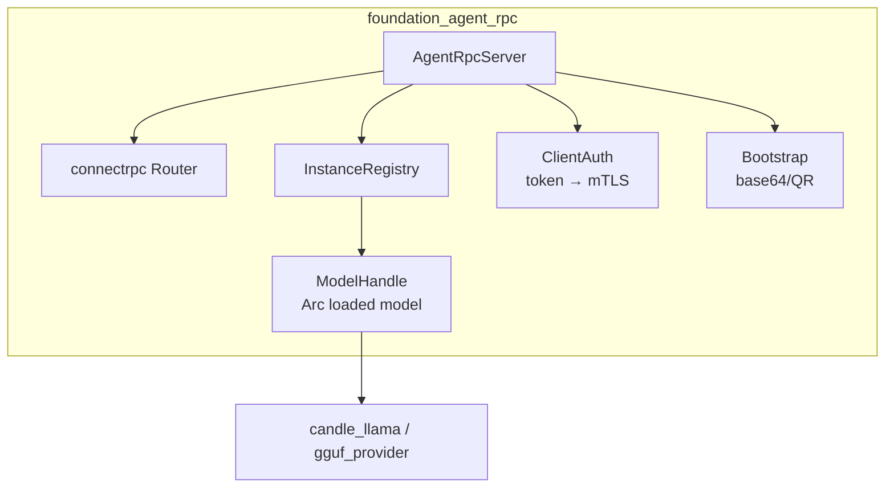
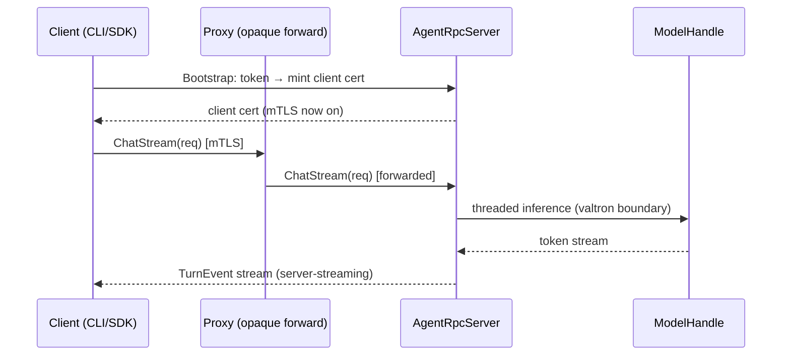

# Agent RPC Model Server

## Overview

`foundation_agent_rpc` is the crate that makes "launch the binary and it starts
an RPC server to interact with agents" true. It is a **per-machine control
plane**: it loads a model **once**, runs **many threaded inference sessions**
against it, and exposes **named instances** (each a lightweight logical session
with its own memory + provider config) over Connect/gRPC/gRPC-Web. It owns its
**own** client-facing auth — a secret token for bootstrap, mTLS ongoing — and
advertises that to clients as a base64 (and renderable QR) payload.

It knows nothing of the manifest, the registrar, or the proxy. The proxy merely
forwards to it (spec 63); the registrar merely tells the proxy it exists
(spec 65 F3).

## Language Stack

**IMPORTANT:** Agents MUST identify languages used in this feature and read the
corresponding skills BEFORE implementation.

### Languages for This Feature

| Language | Purpose | Skill Location |
|----------|---------|----------------|
| Rust | RPC server, model sharing, threaded inference, auth | `.agents/skills/rust-clean-code/skill.md` |

### Pre-Implementation Checklist

- [ ] Read `.agents/skills/rust-clean-code/skill.md`.
- [ ] Read `.agents/skills/rust-valtron-usage/skill.md` (inference core is
      threaded/valtron; the RPC edge is async; the seam is a valtron boundary).
- [ ] Read `.agents/skills/test-driven-development/skill.md` (one red test per task).
- [ ] Confirm streaming rules in `.agents/AGENTS.md` (stream bodies, never buffer).

---

## Requirements

1. **Load a model once; share it across instances.**
   - The loaded backend (`gguf_provider`/`infrastructure_llama_cpp` for GGUF, or
     `candle_llama` for Candle) is wrapped in a `ModelHandle` that is
     `Send + Sync + 'static`.
   - `ModelHandle` is cheap to clone (`Arc`-backed) and handed to every instance;
     there is exactly one loaded model per server, regardless of instance count.
   - A single server may host multiple distinct models (e.g. one GGUF + one
     Candle), each its own `ModelHandle`, keyed by name.

2. **Named instances are lightweight logical state.**
   - An `InstanceHandle` = a `foundation_ai::AgentSession` + its memory store +
     its provider/routing config, addressed by a client-chosen name.
   - Creating a second instance does **not** reload the model; it reuses the
     existing `ModelHandle` and allocates only the session state.

3. **Serve over Connect, gRPC, and gRPC-Web.**
   - The service is defined with generated types (not hand-rolled structs) and
     registered on a `foundation_connectrpc::Router`.
   - Unary + streaming (server-streaming for chat) must round-trip on all three
     protocols, validated over real loopback TCP.

4. **Client-facing auth: secret token → mTLS, owned by agent-rpc.**
   - A shared **secret token** (random, high-entropy) bootstraps the first
     authenticated contact; that contact provisions a client certificate so
     subsequent calls use **mTLS**.
   - The token never appears in the proxy; this channel is between the client
     and agent-rpc only.

5. **Advertise a bootstrap payload.**
   - agent-rpc emits a base64 payload (and a QR rendering of the same bytes)
     containing: server address, TLS fingerprint, the bootstrap secret token,
     and a capabilities list (protocols, models, auth mode).
   - A client can point at the payload and connect without manual config.

6. **Async all the way down; valtron at the boundary.**
   - RPC handlers are async `async fn`; the sync/threaded inference runs behind a
     valtron boundary (`execute`/`into_*_future`) with `Send + 'static` and no
     blocking inside async.
   - Streaming responses are consumed/produced as `Stream`/`FutureStream`; a
     response body is never read whole into memory.

---

## Architecture (COMPREHENSIVE)

### Technical Approach

- **Model sharing via an `Arc`-ed handle.** The key insight: the model is loaded
  once and its handle is cloned into every `AgentSession`; threads share the
  model's weights, only per-session state is per-thread.
- **Instance registry.** A `HashMap<String, InstanceHandle>` (behind a lock or a
  valtron task) maps client-chosen names to sessions; create/list/destroy are
  cheap registry ops, never model loads.
- **Generated service types.** The RPC surface is a `.proto`/codegen-derived set
  of request/response types registered with `foundation_connectrpc`. If a type
  is missing or wrong, fix the generator — do not hand-roll.
- **Two-phase auth.** Bootstrap token validates the initial handshake and mints
  a client cert; thereafter every request presents the cert (mTLS). Both layers
  reuse `foundation_auth` primitives.

### Component Structure

**Feature Architecture:**


**File Structure:**
```
backends/foundation_agent_rpc/
├── Cargo.toml
├── src/
│   ├── lib.rs             - crate root, feature-gated modules, re-exports
│   ├── server.rs          - AgentRpcServer + AgentRpcServerBuilder
│   ├── model.rs           - ModelHandle (Arc<LoadedModel>), Send+Sync+'static
│   ├── instance.rs        - InstanceHandle, InstanceRegistry (named, lock/valtron)
│   ├── service.rs         - generated RPC service impl (instance/chat methods)
│   ├── auth.rs            - BootstrapToken, MtlsConfig, provisioning
│   └── bootstrap.rs       - base64 payload + QR rendering
└── tests/
    ├── model_share_tests.rs   - the shareability spike (task 1)
    ├── instance_tests.rs      - registry create/list/destroy (task 4)
    └── rpc_e2e_tests.rs       - Connect/gRPC/gRPC-Web over loopback (task 10)
```

### Component Details

1. **`AgentRpcServer` / `AgentRpcServerBuilder`** (`src/server.rs`)
   - **Purpose**: assembles model handle(s), registry, auth, and the connectrpc
     `Router` into a runnable server; owns startup/graceful shutdown.
   - **Interfaces**: `AgentRpcServerBuilder::with_model(name, ModelHandle)`,
     `with_bootstrap_token(secret)`, `with_mtls(cfg)`, `build() -> AgentRpcServer`,
     `AgentRpcServer::serve(addr) -> …`, `::graceful_shutdown()`.
   - **Dependencies**: `foundation_connectrpc`, `foundation_ai`, `foundation_auth`.

2. **`ModelHandle`** (`src/model.rs`)
   - **Purpose**: the shared, cheaply-clonable handle to one loaded model.
   - **Bounds**: `ModelHandle: Clone + Send + Sync + 'static`; inner weights live
     behind `Arc`. If the backend is not `Sync`, the spike's fallback is
     `Arc<Mutex<Backend>>` (serialized, still shared).
   - **Key methods**: `ModelHandle::load(…)-> Result<Self>`, `clone()` (cheap),
     `spawn_session(config) -> InstanceHandle`.

3. **`InstanceHandle` / `InstanceRegistry`** (`src/instance.rs`)
   - **Purpose**: lightweight per-instance state; registry maps `name → handle`.
   - **Key methods**: `InstanceRegistry::create(name, config) -> InstanceHandle`,
     `::get(name)`, `::list()`, `::destroy(name)` — none of these load a model.

4. **`service.rs`** (generated types)
   - **Purpose**: the Connect/gRPC/gRPC-Web service: `CreateInstance`,
     `Chat` (unary), `ChatStream` (server-streaming), `ListInstances`,
     `DestroyInstance`, `Health`.
   - **Streaming**: `ChatStream` returns a `FutureStream`/`Stream` of `TurnEvent`s;
     never a buffered `Vec`.

5. **`auth.rs`**
   - **Purpose**: client-facing auth. `BootstrapToken` (validate + mint cert),
     `MtlsConfig` (verify client certs). The **only** auth agent-rpc owns.

6. **`bootstrap.rs`**
   - **Purpose**: `BootstrapPayload { addr, tls_fingerprint, token, capabilities }`
     → base64 string + QR render (PNG/text). Consumed by the CLI/SDK.

### Data Flow



1. Client authenticates to agent-rpc with the bootstrap token, receives a cert.
2. Client calls `ChatStream` through the proxy (which forwards opaquely).
3. agent-rpc runs inference on the shared `ModelHandle` (threaded/valtron).
4. Results stream back as `TurnEvent`s, unbuffered.

### Interface Definitions

**Public APIs (Rust, proposed):**
```rust
pub struct ModelHandle { /* Arc<…> */ }
impl ModelHandle {
    pub fn load(spec: &ModelSpec) -> Result<Self, AgentRpcError>;
    pub fn name(&self) -> &str;
}

pub struct InstanceRegistry { /* HashMap<String, InstanceHandle> + lock/task */ }
impl InstanceRegistry {
    pub fn create(&self, name: &str, cfg: InstanceConfig) -> Result<InstanceHandle, AgentRpcError>;
    pub fn get(&self, name: &str) -> Option<InstanceHandle>;
    pub fn list(&self) -> Vec<InstanceMeta>;
    pub fn destroy(&self, name: &str) -> Result<(), AgentRpcError>;
}

pub struct AgentRpcServerBuilder { /* … */ }
impl AgentRpcServerBuilder {
    pub fn with_model(self, name: impl Into<String>, model: ModelHandle) -> Self;
    pub fn with_bootstrap_token(self, secret: Secret) -> Self;
    pub fn with_mtls(self, cfg: MtlsConfig) -> Self;
    pub fn build(self) -> Result<AgentRpcServer, AgentRpcError>;
}
```

**RPC service (generated; illustrative signatures):**
```proto
service AgentService {
  rpc CreateInstance(CreateInstanceRequest) returns (InstanceHandle);
  rpc Chat(ChatRequest) returns (ChatResponse);
  rpc ChatStream(ChatRequest) returns (stream TurnEvent);
  rpc ListInstances(ListInstancesRequest) returns (ListInstancesResponse);
  rpc DestroyInstance(DestroyInstanceRequest) returns (Empty);
  rpc Health(HealthRequest) returns (HealthResponse);
}
```

**Internal contracts:**
- `service.rs` depends only on `instance.rs` + `model.rs`; it never touches raw
  backend types (those stay inside `model.rs`).
- `auth.rs` gates the router; the router has no auth logic itself.

### Error Handling Strategy

- Single `AgentRpcError` enum (thiserror) with variants: `ModelLoad`, `Auth`,
  `InstanceNotFound`, `InstanceExists`, `Inference`, `Codec`, `Shutdown`.
- RPC errors map to `grpc-status`/Connect status with a machine-readable code,
  never a bare string. Never swallow a `Result` (`.unwrap()` banned); bubble via
  `?` and log at the boundary.

### Security Considerations

- Bootstrap token is high-entropy, single-use-ish (rotatable), never logged.
- After bootstrap, all traffic is mTLS; token replay is rejected.
- Instance names are validated (no path traversal / control chars) before use.
- The QR/base64 payload is treated as a secret: emitted once, to the operator,
  not written to unencrypted disk by default.

### Performance Considerations

- One model load amortized across all instances (the whole point of the design).
- Threaded inference with a valtron pool sized to the machine; no blocking inside
  async handlers (inference runs on the pool, results bridged back as futures).
- Streaming keeps memory bounded: a long chat response is a stream, not a buffer.

### Trade-offs and Decisions

| Decision | Rationale | Alternatives Considered |
|----------|-----------|------------------------|
| Per-machine `ModelHandle` shared via `Arc` | Avoids 10× memory (per-instance loads) | Process-per-instance (rejected: memory blow-up) |
| Named instances as lightweight state | Cheap create/destroy, model loaded once | Full per-instance model (rejected: above) |
| Generated service types | Type-safe, matches `.agents/AGENTS.md` | Hand-written structs (rejected: violates rule) |
| Async edge + valtron inference core | Composes with connectrpc, keeps hot path threaded | All-sync or all-async (rejected: no, blocks I/O) |
| Own client-facing token→mTLS | Client auth is agent-rpc's business | Proxy-mediated auth (rejected: couples proxy) |

---

## Implementation

### Files to Create/Modify

- `backends/foundation_agent_rpc/Cargo.toml` — new crate, deps on
  `foundation_connectrpc`, `foundation_ai`, `foundation_auth`, `foundation_core`,
  `foundation_errstacks`, `tracing`.
- `backends/foundation_agent_rpc/src/{lib,server,model,instance,service,auth,bootstrap}.rs`.
- `backends/foundation_agent_rpc/tests/{model_share_tests,instance_tests,rpc_e2e_tests}.rs`.
- Root `Cargo.toml` — add `backends/foundation_agent_rpc` to members.

## Tasks

- [x] **T1 — Shareability spike (gate).** Prove `foundation_ai`'s loaded backend
      (llamacpp GGUF and/or Candle) is `Send + Sync` and that one loaded model
      serves two+ `AgentSession`s concurrently. Red test: two sessions on one
      model complete interleaved chats without per-session reload.
- [x] **T2 — Crate scaffold.** `foundation_agent_rpc` crate + workspace wiring;
      `lib.rs` module map; compile-clean with zero deps beyond the allowed set.
- [ ] **T3 — `ModelHandle`.** `Arc`-backed load-once handle with the
      `Send + Sync + 'static` bound; if the backend isn't `Sync`, apply the
      `Arc<Mutex<…>>` fallback and record it in LEARNINGS.
- [ ] **T4 — `InstanceRegistry` + `InstanceHandle`.** Named create/get/list/destroy;
      tests assert create is cheap and never reloads the model.
- [ ] **T5 — Generated RPC service.** Define + generate the `AgentService` types
      (CreateInstance/Chat/ChatStream/ListInstances/DestroyInstance/Health);
      wire into a connectrpc `Router`.
- [ ] **T6 — Unary round-trip.** `CreateInstance` + `Chat` (unary) round-trip
      over Connect on loopback; error → status mapping asserted.
- [ ] **T7 — Streaming round-trip.** `ChatStream` server-streaming over Connect;
      assert streaming (not buffered) with a slow producer.
- [ ] **T8 — Client auth.** `BootstrapToken` → mTLS provisioning; reject a call
      without a valid cert after bootstrap; never log the token.
- [ ] **T9 — Bootstrap payload.** Emit base64 + QR `BootstrapPayload`; round-trip
      decode asserts address/fingerprint/token/capabilities survive.
- [ ] **T10 — End-to-end over all three protocols.** gRPC + gRPC-Web (unary +
      streaming) round-trip on real loopback TCP; note gRPC `grpc-status` assertion
      is gated on spec 63 T1 (see LEARNINGS).

## Testing

### Test Cases

1. **Model is shared, not copied**
   - Given: one `ModelHandle`, two `InstanceHandle`s
   - When: both instances run concurrent `Chat`
   - Then: both complete; the model was loaded exactly once (load counter == 1)

2. **Instance lifecycle is cheap**
   - Given: a running server with one loaded model
   - When: `CreateInstance` → `ListInstances` → `DestroyInstance`
   - Then: list reflects create/destroy; no model reload triggered

3. **Unary + streaming over Connect**
   - Given: a loopback Connect server
   - When: `Chat` and `ChatStream` are called
   - Then: unary returns one response; stream yields multiple `TurnEvent`s

4. **Auth is enforced**
   - Given: a server with bootstrap token + mTLS enabled
   - When: a call arrives with no token (first) and then no cert (after)
   - Then: rejected with an auth status; token never appears in logs

### Local run commands (loopback = real TCP on 127.0.0.1)

```bash
cargo test -p foundation_agent_rpc --test model_share_tests
cargo test -p foundation_agent_rpc --test instance_tests
cargo test -p foundation_agent_rpc --test rpc_e2e_tests
```

## Success Criteria

- [ ] All 10 tasks completed with one red→green test each
- [ ] One loaded model serves ≥2 concurrent instances (proven by T1)
- [ ] Connect + gRPC + gRPC-Web round-trip unary and streaming
- [ ] Client token→mTLS enforced; token never logged
- [ ] No TODO/FIXME/stubs; no buffered bodies; no ignored `Result`s

---

_Created: 2026-10-19_
