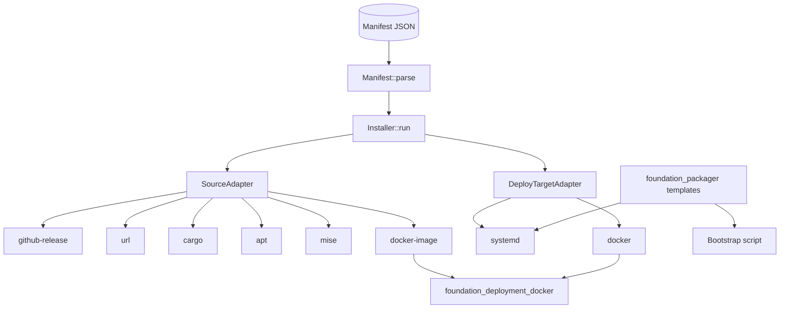
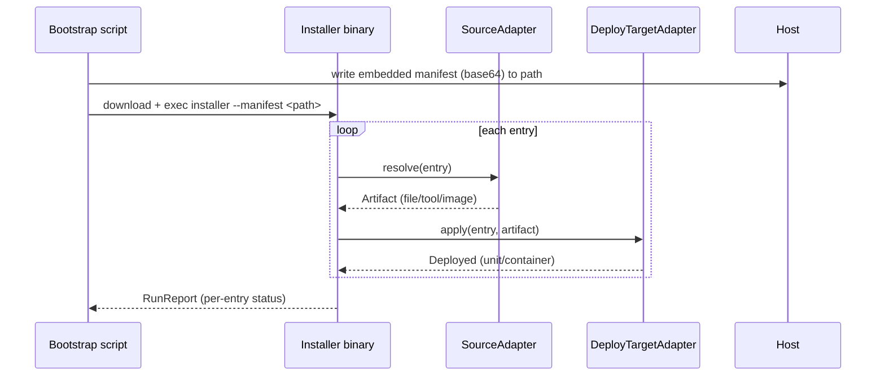

# Manifest Installer

## Overview

`foundation_installer` is the distribution half of the serving system. A
**manifest** declares *what* to install (software entries), *where* each comes
from (a **source adapter**), and *how* it runs on the target (a **deploy-target
adapter**). A tiny **bootstrap script** embeds the manifest (base64), writes it
to a known location, pulls the Rust installer binary, and then the installer
does everything else — the same shape as a `rustup`/`mise` bootstrap.

The installer reuses the platform's existing templating stack
(`foundation_packager`, minijinja/tinytemplate) to *render* scripts and unit
files, and delegates all Docker work to `foundation_deployment_docker`
(pull-by-tag preferred — CI/CD builds the image — build as a fallback).

Only the installer and the registrar (F3) read the manifest. agent-rpc and the
proxy never see it.

## Language Stack

### Languages for This Feature

| Language | Purpose | Skill Location |
|----------|---------|----------------|
| Rust | Manifest schema, adapters, installer binary, script generation | `.agents/skills/rust-clean-code/skill.md` |

### Pre-Implementation Checklist

- [ ] Read `.agents/skills/rust-clean-code/skill.md`.
- [ ] Read `.agents/skills/test-driven-development/skill.md`.
- [ ] Confirm `.agents/AGENTS.md` streaming rules (installer streams downloads to
      disk, never buffers a whole artifact in memory).

---

## Requirements

1. **Manifest is a single serialized contract.**
   - JSON at the top level; versioned (`manifest.version`); validated with a
     schema (reuse `foundation_jsonschema` if present, else a typed parse with
     clear errors).
   - Each entry: `name`, `version`, `source { kind, … }`, `deploy { kind, … }`,
     and an optional `proxy` hint (which binaries need proxying — consumed by the
     registrar, not by the installer's install path).

2. **Source adapters (where software comes from).**
   - `github-release` (fetch a release asset by repo + tag + asset pattern),
     `url` (download a file), `cargo` (`cargo install`), `apt` (`apt-get`),
     `mise` (`mise install`), `docker-image` (pull by tag via
     `foundation_deployment_docker`).
   - One trait: `SourceAdapter::resolve(&Entry) -> Artifact`, where `Artifact` is
     a local path/descriptor (a downloaded file, an installed tool, or a pulled
     image) — never an in-memory blob.

3. **Deploy-target adapters (how it runs).**
   - `systemd` — render + install a unit file (via `foundation_packager`
     templates), `systemctl enable --now`.
   - `docker` — `pull`/`run`/`inspect` via `foundation_deployment_docker`;
     reference the image + tag from the manifest (CI/CD-built image preferred).
   - One trait: `DeployTargetAdapter::apply(&Entry, &Artifact) -> Deployed`, where
     `Deployed` records what now exists on the host (unit name, container id).

4. **Bootstrap script (tiny, static).**
   - A generated shell script that: (a) embeds the manifest as base64, (b) writes
     it to a fixed path, (c) downloads the installer binary (pinned URL + SHA),
     (d) execs the installer with the manifest path. No logic beyond that.

5. **Installer binary (runtime).**
   - Reads the manifest, resolves each entry through its source adapter, applies
     its deploy-target adapter, and reports per-entry status.
   - Idempotent where the adapter allows (skip already-installed version); a
     failure in one entry is surfaced, not silently swallowed.

6. **Everything is streamed.**
   - Downloads stream to disk (`Stream` → file); checksums verified incrementally
     where possible; no whole-artifact buffering.

---

## Architecture (COMPREHENSIVE)

### Technical Approach

- **Two adapter axes, one trait each.** `SourceAdapter` turns a manifest `source`
  block into a local `Artifact`; `DeployTargetAdapter` turns a manifest `deploy`
  block + `Artifact` into a running deployment. Adding a new platform is adding
  an adapter, never editing core logic.
- **Templating via `foundation_packager`.** systemd units and the bootstrap
  script are rendered from minijinja/tinytemplate templates, not string-built.
- **Docker via `foundation_deployment_docker`.** No `docker` CLI string-munging;
  call the crate's typed pull/run/inspect/build surface.
- **Bootstrap mirrors mise/rustup.** Script is dumb by design: embed → write →
  fetch installer → exec.

### Component Structure



**File Structure:**
```
backends/foundation_installer/
├── Cargo.toml
├── src/
│   ├── lib.rs             - re-exports, module map
│   ├── manifest.rs        - Manifest/Entry/Version + parse + validate
│   ├── source/
│   │   ├── mod.rs         - SourceAdapter trait, Artifact
│   │   ├── github_release.rs
│   │   ├── url.rs
│   │   ├── cargo.rs
│   │   ├── apt.rs
│   │   ├── mise.rs
│   │   └── docker_image.rs
│   ├── deploy/
│   │   ├── mod.rs         - DeployTargetAdapter trait, Deployed
│   │   ├── systemd.rs
│   │   └── docker.rs
│   ├── bootstrap.rs       - bootstrap-script generator
│   └── installer.rs       - Installer::run (resolve → apply → report)
├── templates/
│   ├── systemd.service.j2
│   └── bootstrap.sh.j2
└── tests/
    ├── manifest_tests.rs
    ├── source_adapter_tests.rs
    ├── bootstrap_tests.rs
    └── install_e2e_tests.rs   # docker-tests feature
```

### Component Details

1. **`Manifest` / `Entry`** (`src/manifest.rs`)
   - **Purpose**: typed parse of the JSON contract; `validate()` returns field-
     level errors (unknown adapter, missing required fields, bad version).
   - **Key methods**: `Manifest::parse(&str) -> Result<Manifest, InstallError>`,
     `Manifest::validate(&self) -> Result<(), InstallError>`.
   - **Schema (illustrative):**
     ```json
     {
       "manifest": { "version": 1 },
       "entries": [
         {
           "name": "agent-rpc",
           "version": "0.1.0",
           "source": { "kind": "github-release", "repo": "…", "tag": "…", "asset": "…" },
           "deploy": { "kind": "systemd", "unit": "agent-rpc", "args": [] },
           "proxy": { "register": ["agent-rpc"], "protocol": "grpc" }
         }
       ]
     }
     ```

2. **`SourceAdapter` trait** (`src/source/mod.rs`)
   - **Purpose**: one resolver per source kind.
   - **Signature**: `trait SourceAdapter { fn kind(&self) -> &str; fn resolve(&self, e: &Entry) -> Result<Artifact, InstallError>; }`
   - `Artifact` variants: `File(PathBuf)`, `Tool(String)` (installed by cargo/apt/
     mise), `Image(ImageRef)` (pulled tag).

3. **`DeployTargetAdapter` trait** (`src/deploy/mod.rs`)
   - **Signature**: `trait DeployTargetAdapter { fn kind(&self) -> &str; fn apply(&self, e: &Entry, a: &Artifact) -> Result<Deployed, InstallError>; }`
   - `Deployed` variants: `Systemd(String)` (unit name), `Container(String)` (id).

4. **`Installer::run`** (`src/installer.rs`)
   - **Purpose**: orchestrates resolve→apply per entry; collects per-entry status;
     reports a `RunReport { succeeded, failed }` — never ignores a failure.

5. **`bootstrap.rs`** (`src/bootstrap.rs` + `templates/bootstrap.sh.j2`)
   - **Purpose**: `BootstrapScript::render(manifest, installer_url, sha) -> String`.

### Data Flow



### Interface Definitions

**Public APIs (Rust, proposed):**
```rust
pub struct Manifest { pub version: u32, pub entries: Vec<Entry> }
pub struct Entry {
    pub name: String,
    pub version: String,
    pub source: SourceBlock,
    pub deploy: DeployBlock,
    pub proxy: Option<ProxyBlock>,
}

pub enum Artifact { File(PathBuf), Tool(String), Image(ImageRef) }

pub trait SourceAdapter {
    fn kind(&self) -> &'static str;
    fn resolve(&self, entry: &Entry) -> Result<Artifact, InstallError>;
}

pub enum Deployed { Systemd(String), Container(String) }

pub trait DeployTargetAdapter {
    fn kind(&self) -> &'static str;
    fn apply(&self, entry: &Entry, artifact: &Artifact) -> Result<Deployed, InstallError>;
}

pub struct Installer { /* source + deploy adapter maps */ }
impl Installer {
    pub fn run(&self, manifest: &Manifest) -> RunReport;
}
```

**Internal contracts:**
- `Installer::run` knows only the two traits; adapters are registered by `kind`
  in a map. Adding an adapter never touches `installer.rs`.
- `docker_image.rs` (source) and `deploy/docker.rs` both call
  `foundation_deployment_docker`; no raw `docker` invocation in this crate.

### Error Handling Strategy

- `InstallError` (thiserror): `Parse(…field errors)`, `UnknownSourceKind`,
  `UnknownDeployKind`, `Resolve`, `Apply`, `ChecksumMismatch`, `Unsupported`.
- Per-entry failures are collected into `RunReport`; the process exits non-zero
  if any entry failed, with each failure named.

### Security Considerations

- Downloads are verified against the manifest's SHA-256 (or adapter-provided
  checksum) before use; a mismatch aborts that entry.
- The installer URL in the bootstrap is pinned (URL + SHA), so the bootstrap
  cannot be repointed to a malicious installer.
- The manifest is untrusted input: parsed defensively (bounded sizes, no path
  escape, no command injection via entry names).

### Performance Considerations

- Artifacts stream to disk; memory use is bounded by the largest single buffer,
  never the whole artifact.
- Idempotent skip (version already present) avoids redundant downloads/installs
  on re-run.

### Trade-offs and Decisions

| Decision | Rationale | Alternatives Considered |
|----------|-----------|------------------------|
| Two adapter traits (source + deploy) | Each axis varies independently | One monolithic installer (rejected: hard to extend) |
| Bootstrap is a dumb static script | Mirrors rustup/mise; no runtime logic to break | Smart installer-in-script (rejected: fragile) |
| Docker via `foundation_deployment_docker` | Reuses proven, typed Docker integration | Shelling out to `docker` CLI (rejected: string-munging) |
| Render scripts via `foundation_packager` | Reuses templating stack | String-building units (rejected: unmaintainable) |
| JSON manifest, versioned | Simple, validatable, diffable | YAML/TOML (rejected: no clear win, one more dep) |

---

## Implementation

### Files to Create/Modify

- `backends/foundation_installer/Cargo.toml` — deps on `foundation_packager`,
  `foundation_deployment_docker`, `foundation_jsonschema` (if used), `serde`,
  `serde_json`, `thiserror`, `tracing`.
- `backends/foundation_installer/src/**` + `templates/**` as above.
- Root `Cargo.toml` — add `backends/foundation_installer` to members.

## Tasks

- [ ] **T1 — Manifest schema + parse + validate.** `Manifest::parse`/`validate`
      with field-level errors; red test: unknown source kind rejected.
- [ ] **T2 — `SourceAdapter` trait + `github-release`.** Resolve a pinned asset
      by repo/tag/asset pattern; red test: bad tag → `Resolve` error.
- [ ] **T3 — `url` + `cargo` + `apt` + `mise` source adapters.** Each resolves to
      `Artifact::File`/`Tool`; red test per adapter (happy path + failure).
- [ ] **T4 — `docker-image` source adapter.** Pull-by-tag via
      `foundation_deployment_docker`; red test: pull returns `Image(ImageRef)`.
- [ ] **T5 — `DeployTargetAdapter` trait + `systemd`.** Render unit via
      `foundation_packager`, install + enable; red test: unit file content
      contains the entry's `ExecStart`.
- [ ] **T6 — `docker` deploy adapter.** `pull`/`run`/`inspect` via
      `foundation_deployment_docker`; red test: run returns `Deployed::Container`.
- [ ] **T7 — Bootstrap script generator.** Render `bootstrap.sh.j2` with embedded
      base64 manifest + pinned installer URL/SHA; red test: decode the embedded
      manifest back to the source JSON.
- [ ] **T8 — Installer runtime.** `Installer::run` resolves+applies every entry,
      collects `RunReport`, exits non-zero on any failure; red test: one bad entry
      → non-empty `failed` in the report.
- [ ] **T9 — End-to-end install (docker-tests).** In a test container, run the
      installer against a manifest installing a dummy binary + a systemd unit (or
      a docker entry); assert the binary is on PATH and the unit is installed.

## Testing

### Test Cases

1. **Manifest validation**
   - Given: JSON with an unknown `source.kind`
   - When: `Manifest::parse` then `validate`
   - Then: `InstallError::Parse`/`UnknownSourceKind` names the offending entry

2. **Source adapter resolves to an artifact**
   - Given: a `github-release` entry with a pinned tag
   - When: `resolve` runs
   - Then: `Artifact::File` points at a streamed, checksum-verified file

3. **Deploy adapter installs**
   - Given: a `systemd` entry + a resolved file
   - When: `apply` runs
   - Then: `Deployed::Systemd(name)`; the rendered unit matches the template

4. **Bootstrap round-trip**
   - Given: a manifest
   - When: `BootstrapScript::render` then base64-decode the embedded blob
   - Then: decoded JSON equals the source manifest

### Local run commands

```bash
cargo test -p foundation_installer --test manifest_tests
cargo test -p foundation_installer --test source_adapter_tests
cargo test -p foundation_installer --test bootstrap_tests
cargo test -p foundation_installer --features docker-tests --test install_e2e_tests
```

## Success Criteria

- [ ] All 9 tasks completed with one red→green test each
- [ ] Every source + deploy adapter behind its trait; no core-logic edits to add one
- [ ] Downloads streamed + checksum-verified; no whole-artifact buffering
- [ ] Bootstrap script embeds + round-trips the manifest
- [ ] Docker path fully delegated to `foundation_deployment_docker`
- [ ] No TODO/FIXME/stubs; no ignored `Result`s

---

_Created: 2026-10-19_
