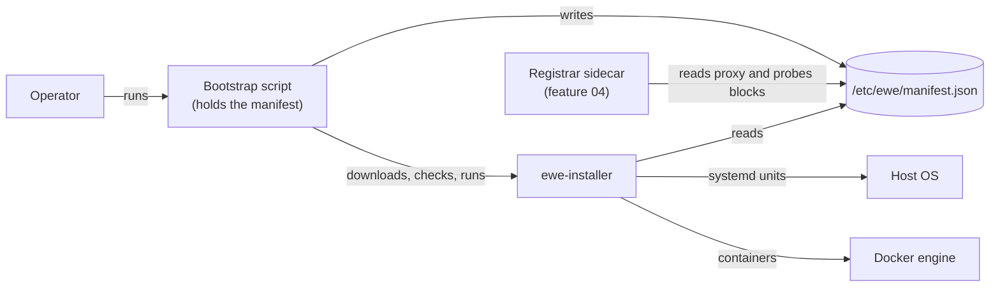
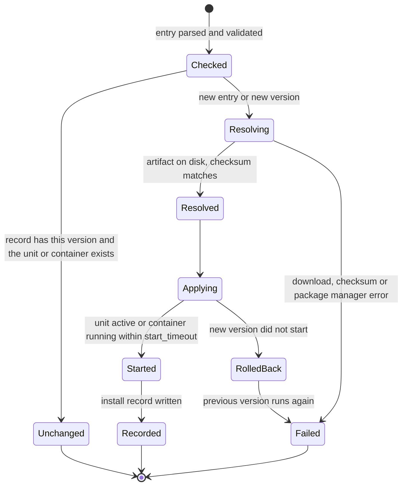

# Manifest Installer

_Written in ASD-STE100 Simplified Technical English (STE). Code and identifiers stay as they
are._

**Abbreviations in this file.** JavaScript Object Notation (JSON); uniform resource locator
(URL); Secure Hash Algorithm with 256 bits (SHA-256); remote procedure call (RPC); command-line
interface (CLI); input/output (I/O); operating system (OS); identifier (ID); Transmission
Control Protocol (TCP); Hypertext Transfer Protocol (HTTP); Advanced Package Tool (apt, the
Debian and Ubuntu package manager); AeroSpace and Defence Industries Association of Europe
(ASD), the owner of the STE standard ASD-STE100. Section 2 explains each term.

## 1. Overview

`foundation_installer` puts software on a machine and starts it. It reads one file, the
**manifest**. The manifest lists **entries**. Each entry says three things:

1. **What** to install: a name and a version.
2. **Where** the software comes from: the `source` block. A **source adapter** reads it.
3. **How** the software runs: the `deploy` block. A **deploy-target adapter** reads it.

An operator starts the work with a small **bootstrap script**. The script holds the manifest.
It writes the manifest to disk, downloads the installer program, checks its checksum and runs
it. The installer does all other work. `rustup` and `mise` use the same pattern.

The manifest can also hold two blocks that the installer does not use: `proxy` and `probes`.
The registrar sidecar (feature 04) reads them. The installer keeps them as opaque JSON values
and does not interpret them. Only the installer and the registrar read the manifest. agent-rpc
and the proxy never see it.

This diagram shows where the installer sits.



_The diagram shows that the bootstrap script starts the installer, and that the installer and
the registrar both read the same manifest file._

## 2. Glossary

| Term | Meaning |
|---|---|
| Adapter | One implementation of a trait for one kind of thing. Example: the `github-release` source adapter. |
| apt | The Debian and Ubuntu package manager (`apt-get install`). |
| Artifact (`Artifact`) | The local result of a source adapter: a file on disk, a program that a package manager installed, or a container image in the local Docker image store. Section 4.3. |
| Bootstrap script | A short shell script that holds the manifest, writes it to disk, downloads the installer, checks it and runs it. Section 4.7. |
| Checksum | A SHA-256 hash of a file. The installer compares it with the value in the manifest to prove that the file did not change. |
| Container | A running copy of a container image, managed by the Docker engine. |
| Deploy-target adapter (`DeployTargetAdapter`) | The trait that makes an artifact run on the host: as a systemd unit, as a container, or not at all (`none`). Section 4.4. |
| Deployed (`Deployed`) | The record of what a deploy-target adapter made: a unit name, a container name and ID, or an installed path. Section 4.4. |
| Entry (`Entry`) | One item of the manifest: one piece of software to install. Section 4.1. |
| Idempotent | Running the same step two times gives the same result as running it one time. |
| Image (`ImageRef`) | A container image: a packed file system and start command that Docker can run. An `ImageRef` names it by repository, tag and digest. |
| Image digest | The SHA-256 of an image manifest, for example `sha256:4f3c…`. It names exactly one image. A tag can move; a digest cannot. |
| Install record | The installer's own file of what it installed. It makes a second run skip finished work. Section 4.6. |
| Manifest (`Manifest`) | The JSON file that lists the entries. Section 4.1. |
| mise | A tool manager that installs language runtimes and command-line tools (`mise install`). |
| Probe | A check that the registrar runs against a program: startup, liveness or readiness (feature 04). The installer only stores the `probes` block. |
| Run report (`RunReport`) | The result of one installer run: one line for each entry, with its outcome. Section 4.5. |
| Source adapter (`SourceAdapter`) | The trait that gets software from where it lives and gives back an `Artifact`. Section 4.2. |
| systemd unit | A file that tells systemd, the Linux service manager, how to start, stop and restart one program. |
| Tool (`Artifact::Tool`) | A program that a package manager (cargo, apt, mise) installed into its own location. The installer does not own its file. It records the program name and the path. |

## 3. Requirements

1. **The manifest is one versioned JSON contract.** Section 4.1 gives every field.
2. **Source adapters** for `github-release`, `url`, `cargo`, `apt`, `mise` and `docker-image`.
   Each one returns an `Artifact`. A downloaded file goes to disk as a stream. The installer
   never holds a whole artifact in memory (`CLAUDE.md` rule 4).
3. **Deploy-target adapters** for `systemd`, `docker` and `none`. Each one returns a `Deployed`.
4. **A bootstrap script** that only writes the manifest, gets the installer, checks it and runs
   it.
5. **The installer program** (`ewe-installer`) applies every entry, reports each outcome, and
   exits with a non-zero code if any entry failed.
6. **Idempotent runs.** A second run with the same manifest changes nothing. A run with a new
   version of an entry upgrades only that entry.
7. **Safe upgrades.** If the new version fails to start, the old version stays in place and
   runs.
8. **Async all the way.** Adapter methods are `async fn` (`CLAUDE.md` rule 6). The binary's `main` is
   `#[valtron] async fn main` (the `foundation_macros` entry macro), so it makes no blocking call.
9. **Limits are configuration.** Every size limit and timeout is a field on `InstallerConfig`
   with a documented default (`CLAUDE.md` rule 8).

## 4. Design

### 4.1 The manifest

The manifest is a JSON file. The installer and the registrar parse it independently, each with
its own Rust types. There is no shared Rust crate (requirements: "nothing shared"). The JSON
format is the only contract.

**Who writes it:** the operator, or a release pipeline that makes one manifest for each kind of
host. **Who reads it:** `ewe-installer` (all blocks except `proxy` and `probes`) and the
registrar (only `name`, `version`, `deploy`, `proxy` and `probes`).

**Where it lives:** `/etc/ewe/manifest.json` on a host. In a container deployment, the operator
mounts the same file into the registrar container (feature 04).

A complete example:

```json
{
  "manifest_version": 1,
  "entries": [
    {
      "name": "agent-rpc",
      "version": "0.4.0",
      "source": {
        "kind": "github-release",
        "repo": "ewe-studios/ewe_platform",
        "tag": "agent-rpc-v0.4.0",
        "assets": {
          "x86_64-unknown-linux-gnu": { "name": "agent-rpc-x86_64-linux", "sha256": "9f2c…" },
          "aarch64-unknown-linux-gnu": { "name": "agent-rpc-aarch64-linux", "sha256": "1ab4…" }
        }
      },
      "deploy": {
        "kind": "systemd",
        "args": ["serve", "--bind", "0.0.0.0:7443"],
        "env": { "RUST_LOG": "info" },
        "user": "ewe",
        "restart": "on-failure"
      },
      "proxy": {
        "service": "agents",
        "route": { "host": "agents.example.com", "path_prefix": "/" },
        "port": 7443,
        "protocol": "grpc"
      },
      "probes": {
        "startup":   { "kind": "tcp",  "port": 7443, "period_secs": 2,  "failure_threshold": 30 },
        "liveness":  { "kind": "grpc", "port": 7443, "period_secs": 10 },
        "readiness": { "kind": "http", "port": 7443, "path": "/healthz", "period_secs": 5 }
      }
    },
    {
      "name": "ripgrep",
      "version": "14.1.0",
      "source": { "kind": "cargo", "crate": "ripgrep", "program": "rg" },
      "deploy": { "kind": "none" }
    },
    {
      "name": "vector-db",
      "version": "1.9.0",
      "source": { "kind": "docker-image", "repository": "ghcr.io/example/vector-db", "tag": "1.9.0", "digest": "sha256:4f3c…" },
      "deploy": {
        "kind": "docker",
        "ports": [{ "host": 6333, "container": 6333, "protocol": "tcp" }],
        "env": { "LOG_LEVEL": "info" },
        "volumes": [{ "host": "/var/lib/vector-db", "container": "/data" }],
        "restart": "unless-stopped"
      }
    }
  ]
}
```

What the example shows: `agent-rpc` is a downloaded binary that runs as a systemd unit, and
the registrar will tell the proxy about it. `ripgrep` is a tool that cargo installs; nothing
runs. `vector-db` is an image that runs as a container; it has no `proxy` block, so no proxy
route points to it.

**Top-level fields:**

| Field | Type | Required | Meaning |
|---|---|---|---|
| `manifest_version` | integer | yes | The format version of this file. Today `1`. A parser that sees a higher number stops with `UnsupportedManifestVersion`. Two programs that are built at different times read the file, so each one must know when it cannot read it. See open question 1. |
| `entries` | list of `Entry` | yes | The software to install, in install order. Names are unique. |

**`Entry` fields:**

| Field | Type | Required | Meaning | Example |
|---|---|---|---|---|
| `name` | string | yes | The unique name of the entry. Lowercase letters, digits and `-`, 1 to 63 characters (the rule for a DNS label). It becomes the systemd unit name (`ewe-<name>.service`), the container name and the registrar's backend name. | `agent-rpc` |
| `version` | string | yes | The version of the software, as its publisher writes it. The installer compares it as text with the install record. It does not sort versions. | `0.4.0` |
| `source` | `SourceSpec` | yes | Where the software comes from. Section 4.2. | see above |
| `deploy` | `DeploySpec` | yes | How the software runs. Section 4.4. | see above |
| `proxy` | JSON object | no | The registrar uses it to register the program with the proxy. The installer stores it and does not read it. Feature 04 defines it. | see above |
| `probes` | JSON object | no | The registrar uses it to check startup, liveness and readiness. The installer stores it and does not read it. Feature 04 defines it. | see above |

The Rust types (in `src/manifest.rs`):

```rust
/// The parsed manifest. Made by `Manifest::parse`; read by `Installer::run`.
#[derive(Debug, Clone, PartialEq, Deserialize)]
pub struct Manifest {
    pub manifest_version: u32,
    pub entries: Vec<Entry>,
}

/// One piece of software to install.
#[derive(Debug, Clone, PartialEq, Deserialize)]
pub struct Entry {
    pub name: EntryName,
    pub version: String,
    pub source: SourceSpec,
    pub deploy: DeploySpec,
    /// Kept, not read. The registrar (feature 04) owns its meaning.
    #[serde(default)]
    pub proxy: Option<serde_json::Value>,
    /// Kept, not read. The registrar (feature 04) owns its meaning.
    #[serde(default)]
    pub probes: Option<serde_json::Value>,
}

/// A checked entry name: `[a-z0-9-]{1,63}`, no leading or trailing `-`.
/// It is safe to put in a unit file name, a container name and a path.
#[derive(Debug, Clone, PartialEq, Eq, Hash)]
pub struct EntryName(String);
```

`proxy` and `probes` are `serde_json::Value` on purpose. The installer does not own their
meaning, so it must not reject a change that only the registrar understands. This is not an
untyped work-around for a missing generated type (`CLAUDE.md` rule 5): no generated type
exists for these blocks, and the installer never acts on them.

### 4.2 Sources: `SourceSpec` and `SourceAdapter`

A `SourceSpec` says where one entry's software comes from. Its `kind` field picks the variant.

```rust
/// Where the software of one entry comes from. JSON: `{"kind": "...", ...}`.
#[derive(Debug, Clone, PartialEq, Deserialize)]
#[serde(tag = "kind", rename_all = "kebab-case")]
pub enum SourceSpec {
    /// A file attached to a GitHub release.
    GithubRelease {
        /// `owner/repo`.
        repo: String,
        /// The release tag.
        tag: String,
        /// One asset for each target triple, with its checksum. The installer
        /// picks the asset for the target it was built for.
        assets: BTreeMap<String, AssetSpec>,
    },
    /// A file at a plain HTTPS URL.
    Url { url: String, sha256: String },
    /// `cargo install <crate> --version <version> --locked`.
    Cargo {
        #[serde(rename = "crate")]
        krate: String,
        /// The program name that the crate installs. Default: the crate name.
        program: Option<String>,
    },
    /// `apt-get install <package>=<version>`.
    Apt { package: String, program: Option<String> },
    /// `mise install <tool>@<version>`.
    Mise { tool: String, program: Option<String> },
    /// A container image, pulled through `foundation_deployment_docker`.
    DockerImage { repository: String, tag: String, digest: Option<String> },
}

#[derive(Debug, Clone, PartialEq, Deserialize)]
pub struct AssetSpec {
    /// The asset file name in the release.
    pub name: String,
    /// The lowercase hex SHA-256 of the asset.
    pub sha256: String,
}
```

| Variant | What it does | Gives | Who checks integrity |
|---|---|---|---|
| `GithubRelease` | Downloads the release asset for this target from `https://github.com/<repo>/releases/download/<tag>/<asset>`. | `Artifact::File` | The installer: SHA-256 against `assets[target].sha256`. |
| `Url` | Downloads the file at `url`. Only `https://` is accepted. | `Artifact::File` | The installer: SHA-256 against `sha256`. |
| `Cargo` | Runs `cargo install --locked`. | `Artifact::Tool` | cargo: `Cargo.lock` and crates.io checksums. |
| `Apt` | Runs `apt-get install -y <package>=<version>`. | `Artifact::Tool` | apt: signed repository metadata. |
| `Mise` | Runs `mise install <tool>@<version>`. | `Artifact::Tool` | mise: its own checksums for the tool. |
| `DockerImage` | Pulls the image with `DockerClient::image_pull`. | `Artifact::Image` | Docker: the digest. If `digest` is set, the installer checks that the pulled image has it. |

The trait (in `src/source/mod.rs`):

```rust
/// Gets the software of one entry and returns what is now on the host.
/// One implementation for each `SourceSpec` variant. `async_trait` makes the
/// trait object-safe, so `Installer` can hold `Arc<dyn SourceAdapter>`. This is
/// the pattern of the `foundation_db` storage traits.
#[async_trait::async_trait]
pub trait SourceAdapter: Send + Sync {
    /// The `kind` value that this adapter handles, for example "github-release".
    fn kind(&self) -> &'static str;

    /// Gets the software. Downloads stream to a temporary file in
    /// `InstallerConfig::artifact_dir` and are renamed into place only after
    /// the checksum matches.
    ///
    /// # Errors
    /// `InstallError::Resolve` when the software cannot be got;
    /// `InstallError::ChecksumMismatch` when the bytes are wrong.
    async fn resolve(&self, entry: &Entry, ctx: &InstallContext) -> Result<Artifact, InstallError>;
}
```

`InstallContext` gives an adapter its side effects and limits: the HTTP client
(`Arc<dyn HttpClient>` from `foundation_netio`), the `DockerClient`, a process runner trait
(`CommandRunner`, so tests can fake `cargo`, `apt-get` and `mise`), the target triple, and the
`InstallerConfig`. No adapter reads a global (`CLAUDE.md` rule 11).

### 4.3 `Artifact`: what a source gives back

```rust
/// What a source adapter put on the host. Made by `SourceAdapter::resolve`;
/// read by `DeployTargetAdapter::apply` and written to the install record.
#[derive(Debug, Clone, PartialEq, Eq, Serialize, Deserialize)]
pub enum Artifact {
    /// A file that the installer downloaded and checked. The installer owns it.
    File {
        /// Example: /var/lib/ewe/artifacts/agent-rpc/0.4.0/agent-rpc
        path: PathBuf,
        /// The SHA-256 that the installer checked.
        sha256: String,
    },
    /// A program that a package manager (cargo, apt, mise) installed into its
    /// own location. The package manager owns the file, not the installer.
    Tool {
        /// The program name. Example: "rg".
        program: String,
        /// Where the package manager put it. Example: /root/.cargo/bin/rg
        path: PathBuf,
    },
    /// A container image in the local Docker image store.
    Image(ImageRef),
}

/// The name of one container image.
#[derive(Debug, Clone, PartialEq, Eq, Serialize, Deserialize)]
pub struct ImageRef {
    /// Example: "ghcr.io/example/vector-db".
    pub repository: String,
    /// Example: "1.9.0".
    pub tag: String,
    /// The digest that Docker reports after the pull. Example: "sha256:4f3c…".
    pub digest: String,
}
```

Why three variants: each one needs a different deploy step.

- A `File` must be put in place and made executable. The installer owns it, so it can delete
  old versions.
- A `Tool` is already in place. The installer must not move or delete it, because the package
  manager owns it.
- An `Image` can run only as a container.

This table says which deploy kind accepts which artifact. Any other pair fails validation
before any download starts, with `InstallError::Incompatible`.

| Artifact | `systemd` | `docker` | `none` |
|---|---|---|---|
| `File` | yes | no | yes |
| `Tool` | yes | no | yes |
| `Image` | no | yes | yes (pull only) |

### 4.4 Deploy targets: `DeploySpec`, `DeployTargetAdapter` and `Deployed`

```rust
/// How one entry runs on the host. JSON: `{"kind": "...", ...}`.
#[derive(Debug, Clone, PartialEq, Deserialize)]
#[serde(tag = "kind", rename_all = "kebab-case")]
pub enum DeploySpec {
    /// A systemd service. The installer writes /etc/systemd/system/ewe-<name>.service.
    Systemd {
        #[serde(default)]
        args: Vec<String>,
        #[serde(default)]
        env: BTreeMap<String, String>,
        /// The OS user that runs the program. Default "ewe". The installer
        /// makes the user if it does not exist.
        user: Option<String>,
        /// systemd `Restart=`. Default `on-failure`.
        restart: Option<SystemdRestart>,
    },
    /// A container. The container name is the entry name.
    Docker {
        #[serde(default)]
        ports: Vec<PortSpec>,
        #[serde(default)]
        env: BTreeMap<String, String>,
        #[serde(default)]
        volumes: Vec<VolumeSpec>,
        /// Docker restart policy. Default `unless-stopped`.
        restart: Option<DockerRestart>,
        /// Overrides the image command.
        command: Option<Vec<String>>,
    },
    /// Install only. Nothing runs. For tools and for images that other
    /// entries use.
    None,
}

/// What a deploy-target adapter made. Written to the install record.
#[derive(Debug, Clone, PartialEq, Eq, Serialize, Deserialize)]
pub enum Deployed {
    /// A systemd unit that is enabled and started. Example: "ewe-agent-rpc.service".
    Systemd { unit: String, exec_path: PathBuf },
    /// A started container.
    Container {
        /// Example: "vector-db".
        name: String,
        /// The Docker container ID, from `create_container`.
        id: String,
        image: ImageRef,
    },
    /// Installed, not started (`DeploySpec::None`).
    Installed { artifact: Artifact },
}

#[async_trait::async_trait]
pub trait DeployTargetAdapter: Send + Sync {
    /// The `kind` value that this adapter handles, for example "systemd".
    fn kind(&self) -> &'static str;

    /// Makes the artifact run (or only records it, for `none`). For an upgrade,
    /// `previous` is what the last run made. The adapter keeps the previous
    /// version until the new one has started (section 4.6).
    ///
    /// # Errors
    /// `InstallError::Apply`, or `InstallError::Incompatible` for an artifact
    /// that this target cannot run.
    async fn apply(
        &self,
        entry: &Entry,
        artifact: &Artifact,
        previous: Option<&Deployed>,
        ctx: &InstallContext,
    ) -> Result<Deployed, InstallError>;
}
```

What each adapter does:

- **`systemd`**
  1. For a `File`: copy it to `/opt/ewe/<name>/<version>/<file>` and set mode `0755`. Point the
     link `/opt/ewe/<name>/current` at that directory. For a `Tool`: use its `path`.
  2. Render `templates/systemd.service.j2` with `foundation_packager`. `ExecStart` is the
     `current` link plus `args`.
  3. Run `systemctl daemon-reload`, then `systemctl enable --now` (first install) or
     `systemctl restart` (upgrade).
  4. Wait until `systemctl is-active` says `active`, up to `InstallerConfig::start_timeout`.
- **`docker`**: all calls go through `foundation_deployment_docker`, with its generated types.
  No `docker` CLI string is built (`CLAUDE.md` rule 5).
  1. Create the new container as `<name>-next` with `create_container`, then
     `start_container`.
  2. Wait until `inspect_container` reports `running`, up to `start_timeout`.
  3. Stop and remove the old container, then rename `<name>-next` to `<name>`
     (`rename_container`).
- **`none`**: it records the artifact and does nothing more.

**Marks for the registrar.** The installer marks what it starts, so the registrar (feature 04)
can find it without the installer's private install record:

- A systemd unit gets `Environment=EWE_ENTRY=<name>` and `Environment=EWE_VERSION=<version>`.
- A container gets the labels `dev.ewe.entry=<name>` and `dev.ewe.version=<version>`.

These marks are part of the contract between the installer and the registrar, as the manifest
is.

The installer checks only that a program **started**. It does not check that the program is
**healthy**. Health is the registrar's job (feature 04), with the `probes` block.

### 4.5 The installer: `Installer`, `RunReport`

```rust
/// Runs a manifest. Holds one adapter for each source kind and each deploy kind.
pub struct Installer {
    sources: BTreeMap<&'static str, Arc<dyn SourceAdapter>>,
    targets: BTreeMap<&'static str, Arc<dyn DeployTargetAdapter>>,
    config: InstallerConfig,
}

impl Installer {
    /// An installer with every built-in adapter.
    pub fn with_defaults(config: InstallerConfig) -> Self;
    /// Adds or replaces an adapter. Adding a platform never changes `run`.
    pub fn with_source(self, adapter: Arc<dyn SourceAdapter>) -> Self;
    pub fn with_target(self, adapter: Arc<dyn DeployTargetAdapter>) -> Self;

    /// Applies every entry in order. One failed entry does not stop the
    /// others. Never returns early on an entry error: each one goes in the report.
    pub async fn run(&self, manifest: &Manifest, ctx: &InstallContext) -> RunReport;

    /// Says what `run` would do, with no change to the host.
    pub async fn plan(&self, manifest: &Manifest, ctx: &InstallContext) -> Result<Vec<PlannedStep>, InstallError>;
}

/// The result of one run. `ewe-installer` prints it and exits non-zero if
/// any entry is `Failed`.
#[derive(Debug, Clone, PartialEq)]
pub struct RunReport {
    pub entries: Vec<EntryOutcome>,
}

#[derive(Debug, Clone, PartialEq)]
pub enum EntryOutcome {
    /// Installed or upgraded now.
    Applied { name: EntryName, version: String, deployed: Deployed },
    /// The install record already has this version, and the unit or
    /// container exists. Nothing changed.
    Unchanged { name: EntryName, version: String },
    /// Failed. For an upgrade, `kept` is the version that still runs.
    Failed { name: EntryName, error: InstallError, kept: Option<String> },
}

/// One step that `plan` reports.
#[derive(Debug, Clone, PartialEq)]
pub enum PlannedStep {
    Install { name: EntryName, version: String },
    Upgrade { name: EntryName, from: String, to: String },
    Unchanged { name: EntryName },
}
```

### 4.6 Lifecycle of one entry

The installer keeps an **install record** at `<state_dir>/installed.json`. It holds, for each
entry name: the version, the `Artifact` and the `Deployed`. Only the installer reads and
writes it. The registrar does not read it: it checks the real host (systemd, Docker) instead
(feature 04).



_The diagram shows the states of one entry in one run. A failed upgrade goes back to the
previous version before it reports the failure._

**Rollback on a failed upgrade:**

- `systemd`: point the `current` link back at the previous version directory, then
  `systemctl restart`.
- `docker`: stop and remove `<name>-next`. The old container was not touched.
- The report says `Failed { kept: Some(<old version>) }`. The install record keeps the old
  version, so the next run tries the upgrade again.

**Entries removed from the manifest** are not removed from the host in this feature. See open
question 2.

**Process lifecycle of `ewe-installer`:** it starts, reads the manifest and the install
record, runs the entries one at a time in manifest order, writes the record after each entry,
prints the report and exits. It is not a daemon. A second instance must not run at the same
time: the installer takes an exclusive lock on `<state_dir>/installer.lock` at start and
fails with `InstallError::Locked` if another run holds it.

### 4.7 The bootstrap script

```rust
/// Renders the bootstrap script from `templates/bootstrap.sh.j2`.
pub struct BootstrapScript;

impl BootstrapScript {
    pub fn render(input: &BootstrapInput) -> Result<String, InstallError>;
}

/// Everything the script needs. Made by the release pipeline.
#[derive(Debug, Clone, Serialize)]
pub struct BootstrapInput {
    /// The manifest JSON text. The script holds it as base64.
    pub manifest_json: String,
    /// Where the script writes the manifest. Default /etc/ewe/manifest.json.
    pub manifest_path: PathBuf,
    /// One installer build for each target, chosen with `uname -s -m`.
    pub installers: Vec<InstallerBuild>,
}

#[derive(Debug, Clone, Serialize)]
pub struct InstallerBuild {
    /// Example: "x86_64-unknown-linux-gnu".
    pub target: String,
    /// An https URL of the `ewe-installer` binary.
    pub url: String,
    /// Its lowercase hex SHA-256. The script refuses a binary that does not match.
    pub sha256: String,
}
```

The script does exactly these steps, and nothing more:

1. Decode the base64 manifest and write it to `manifest_path`, mode `0600`.
2. Find the target with `uname -s -m`. Stop if no `InstallerBuild` matches.
3. Download the installer with `curl --fail --location` to a temporary file.
4. Check the SHA-256 with `sha256sum -c`. Stop on a mismatch.
5. Run `ewe-installer apply --manifest <manifest_path>`.

### 4.8 The binary

The binary follows the repository pattern: the library is in `src/lib.rs` and the binary is in
`src/bin/<name>.rs`, declared with `[[bin]]` in `Cargo.toml` (as in
`backends/foundation_testbed/src/bin/wasm-testbed.rs`). There is no `src/main.rs`.

```toml
[[bin]]
name = "ewe-installer"
path = "src/bin/ewe-installer.rs"
```

Commands:

| Command | What it does |
|---|---|
| `ewe-installer apply --manifest <path>` | Runs `Installer::run` and prints the `RunReport`. Exit code 0 when no entry failed, 1 when one or more failed, 2 for a bad manifest or a lock error. |
| `ewe-installer plan --manifest <path>` | Prints the `PlannedStep`s. Changes nothing. |
| `ewe-installer render-bootstrap --input <path>` | Prints a bootstrap script for a `BootstrapInput` JSON file. The release pipeline uses it. |

### 4.9 Configuration

```rust
/// Limits and paths of the installer (`CLAUDE.md` rule 8).
#[derive(Debug, Clone)]
pub struct InstallerConfig {
    /// The install record and the lock. Default /var/lib/ewe/installer.
    pub state_dir: PathBuf,
    /// Downloaded files. Default /var/lib/ewe/artifacts.
    pub artifact_dir: PathBuf,
    /// Largest manifest file that `Manifest::parse` reads. Default 1 MiB:
    /// the default `client_max_body_size` of nginx.
    pub max_manifest_bytes: u64,
    /// Time to open a download connection. Default 30 s: the dial timeout of
    /// Go's `http.DefaultTransport`.
    pub connect_timeout: Duration,
    /// Longest wait for the next bytes of a download. Default 60 s: the
    /// default `proxy_read_timeout` of nginx.
    pub read_timeout: Duration,
    /// Longest wait for a unit or container to start. Default 90 s: the
    /// default `TimeoutStartSec` of systemd.
    pub start_timeout: Duration,
}
```

### 4.10 Errors

```rust
#[derive(Debug, Clone, PartialEq, thiserror::Error)]
pub enum InstallError {
    /// The manifest is not valid JSON or breaks a field rule. Every problem is
    /// listed, with the entry name and field.
    #[error("manifest is invalid: {0:?}")]
    Parse(Vec<FieldError>),
    #[error("manifest_version {found} is not supported (this build reads {supported})")]
    UnsupportedManifestVersion { found: u32, supported: u32 },
    #[error("no source adapter for kind {kind:?} (entry {entry})")]
    UnknownSourceKind { entry: String, kind: String },
    #[error("no deploy adapter for kind {kind:?} (entry {entry})")]
    UnknownDeployKind { entry: String, kind: String },
    #[error("deploy kind {deploy} cannot run a {artifact} artifact (entry {entry})")]
    Incompatible { entry: String, deploy: String, artifact: String },
    #[error("cannot get the software of {entry}: {reason}")]
    Resolve { entry: String, reason: String },
    #[error("checksum mismatch for {entry}: expected {expected}, got {actual}")]
    ChecksumMismatch { entry: String, expected: String, actual: String },
    #[error("cannot deploy {entry}: {reason}")]
    Apply { entry: String, reason: String },
    #[error("{entry} did not start within {timeout:?}")]
    StartTimeout { entry: String, timeout: Duration },
    #[error("another installer run holds {0}")]
    Locked(PathBuf),
    #[error("install record I/O: {0}")]
    Record(String),
}
```

### 4.11 Security

- Every downloaded file is checked against a SHA-256 from the manifest before use. A file with
  no checksum is refused at validation.
- Only `https://` URLs are accepted.
- The bootstrap script pins the installer by URL and SHA-256.
- The manifest is untrusted input. `EntryName` allows only `[a-z0-9-]`, so a name cannot
  escape a path or inject into a unit file or a shell command. Package names and arguments
  are passed to `CommandRunner` as an argument list, never through a shell.
- The installer runs as root, because it writes systemd units and talks to the Docker socket.
  The programs it starts run as `DeploySpec::Systemd::user` (default `ewe`), not as root.

### 4.12 Crate layout

```text
backends/foundation_installer/
├── Cargo.toml                 [[bin]] ewe-installer -> src/bin/ewe-installer.rs
├── src/
│   ├── lib.rs                 module map, re-exports
│   ├── bin/
│   │   └── ewe-installer.rs   CLI: apply, plan, render-bootstrap
│   ├── manifest.rs            Manifest, Entry, EntryName, parse, validate
│   ├── config.rs              InstallerConfig
│   ├── context.rs             InstallContext, CommandRunner
│   ├── record.rs              install record, lock file
│   ├── source/
│   │   ├── mod.rs             SourceSpec, SourceAdapter, Artifact, ImageRef
│   │   ├── github_release.rs
│   │   ├── url.rs
│   │   ├── cargo.rs
│   │   ├── apt.rs
│   │   ├── mise.rs
│   │   └── docker_image.rs
│   ├── deploy/
│   │   ├── mod.rs             DeploySpec, DeployTargetAdapter, Deployed
│   │   ├── systemd.rs
│   │   ├── docker.rs
│   │   └── none.rs
│   ├── bootstrap.rs           BootstrapScript, BootstrapInput
│   ├── installer.rs           Installer, RunReport, EntryOutcome, PlannedStep
│   └── error.rs               InstallError, FieldError
├── templates/
│   ├── systemd.service.j2
│   └── bootstrap.sh.j2
└── tests/
    ├── manifest_tests.rs
    ├── source_adapter_tests.rs
    ├── deploy_adapter_tests.rs
    ├── installer_tests.rs
    ├── bootstrap_tests.rs
    └── install_e2e_tests.rs   (feature docker-tests)
```

### 4.13 Trade-offs

| Decision | Why | Other choice |
|---|---|---|
| Two adapter traits | Source and deploy change independently. | One installer type with every case inside (rejected: hard to extend). |
| The bootstrap script has no logic | Mirrors rustup and mise. Less to break. | A script that also installs (rejected: fragile). |
| Docker through `foundation_deployment_docker` | Typed, generated, already tested. | Running the `docker` CLI (rejected: string building). |
| Templates through `foundation_packager` | Reuses the templating stack. | Building unit files as strings (rejected). |
| JSON manifest | Simple to check and to compare. | YAML or TOML (rejected: no clear gain, one more parser). |
| The installer checks "started", the registrar checks "healthy" | One job each. | The installer runs probes (rejected: it exits after the run). |

## 5. Tasks

- [ ] **T1: Manifest.** `Manifest`, `Entry`, `EntryName`, `SourceSpec`, `DeploySpec`, `parse`,
      `validate` with every field error. Test: an unknown source kind and a bad name each fail
      with the entry and field named.
- [ ] **T2: `SourceAdapter`, `InstallContext`, `github-release`.** Streamed download with the
      checksum check. Test: a wrong checksum gives `ChecksumMismatch` and leaves no file.
- [ ] **T3: `url`, `cargo`, `apt`, `mise`.** Test per adapter, with a fake `CommandRunner`.
- [ ] **T4: `docker-image`.** Pull by tag and check the digest. Test: the result is
      `Artifact::Image` with the digest.
- [ ] **T5: `DeployTargetAdapter`, `systemd`, `none`.** Test: the rendered unit has the
      expected `ExecStart`, `User` and `Restart`.
- [ ] **T6: `docker` deploy.** Create, start, check, swap. Test: the result is
      `Deployed::Container`.
- [ ] **T7: Install record, lock, upgrade and rollback.** Test: an upgrade whose new version
      does not start leaves the old version running and reports `kept`.
- [ ] **T8: Bootstrap script.** Test: the embedded manifest decodes back to the same JSON;
      the script refuses a wrong installer checksum.
- [ ] **T9: `Installer::run`, `plan`, `ewe-installer` binary.** Test: one bad entry gives one
      `Failed` and the others still apply; exit code is 1.
- [ ] **T10: End to end (`docker-tests`).** In a test container: install a test binary as a
      systemd unit and an image as a container, run again (all `Unchanged`), then upgrade one
      entry.

## 6. Tests

| Test | File | What it proves |
|---|---|---|
| Manifest rules | `tests/manifest_tests.rs` | Each field rule in section 4.1 has one failing case. `proxy` and `probes` pass through unread. |
| Sources | `tests/source_adapter_tests.rs` | Each source gives the correct `Artifact`; a checksum mismatch leaves no file. |
| Deploy | `tests/deploy_adapter_tests.rs` | The compatibility table of section 4.3; the systemd unit text. |
| Installer | `tests/installer_tests.rs` | Idempotent second run; upgrade; rollback; lock. |
| Bootstrap | `tests/bootstrap_tests.rs` | Manifest round trip; target choice. |
| End to end | `tests/install_e2e_tests.rs` | Section 5, T10. |

```bash
cargo test -p foundation_installer --test manifest_tests
cargo test -p foundation_installer --features docker-tests --test install_e2e_tests
```

## 7. Open questions

1. **Keep `manifest_version`?** Two programs, built at different times, read the manifest.
   - Option A: keep it. A reader stops when the number is higher than it knows.
   - Option B: drop it, and only add optional fields. Old readers ignore new fields.
   - **Recommendation: A.** Option B cannot express a change in the meaning of an existing
     field. The owner removed the version from the bootstrap payload (feature 07), but that is
     a protobuf message, where field numbers already give this safety. JSON has no field
     numbers.
2. **Remove software that left the manifest?**
   - Option A: never remove. The operator removes by hand.
   - Option B: `ewe-installer apply --prune` stops and removes units, containers and owned
     files that the install record has and the manifest does not.
   - **Recommendation: B, as a flag, off by default.** A plain run must not delete things.
3. **Non-Linux hosts.** systemd exists only on Linux. **Recommendation:** Linux only for this
   feature. macOS `launchd` is a later deploy adapter.

---

_Created: 2026-10-19 · Rewritten for completeness and STE: 2026-10-26_
