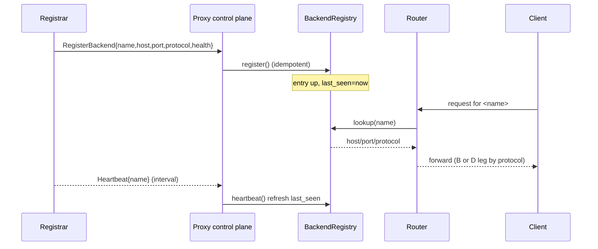

# Proxy Registration Authority

## Overview

This feature gives `foundation_proxy` the one thing it is currently missing to
front a dynamic fleet of agent-rpc (and other) backends: a way for a backend to
**register itself** rather than be hand-listed in config. A registrar (spec 65
F3) calls the proxy's authenticated control plane — `RegisterBackend`,
`DeregisterBackend`, `Heartbeat` — and the proxy maintains a live **routing
table** of `backend name → host/port/protocol/health`. Incoming requests then
route to registered backends through the per-endpoint protocol selection already
specified in `specifications/completed/63-connectrpc-proxy`.

The proxy remains protocol-opaque about the *payloads* it forwards; it does not
interpret agent-rpc's RPCs and does not see agent-rpc's client auth. It only
knows "this backend is here and healthy, forward to it."

## Language Stack

### Languages for This Feature

| Language | Purpose | Skill Location |
|----------|---------|----------------|
| Rust | Registration control plane, routing table, health | `.agents/skills/rust-clean-code/skill.md` |

### Pre-Implementation Checklist

- [ ] Read `.agents/skills/rust-clean-code/skill.md`.
- [ ] Read `.agents/skills/rust-valtron-usage/skill.md` (proxy is async; health
      probes run as tasks/streams).
- [ ] Read `specifications/completed/63-connectrpc-proxy/features/00-connectrpc-proxy/feature.md`
      — this feature extends that one (per-endpoint `BackendProtocol` selection).
- [ ] Confirm `.agents/AGENTS.md` streaming + generated-types rules.

---

## Requirements

1. **Authenticated registration control plane.**
   - `RegisterBackend`, `DeregisterBackend`, `Heartbeat` — typed, generated types,
     served over the proxy's HTTP/2 front end (Connect unary, reusing
     `foundation_connectrpc` where it is already embedded for spec 63's D leg).
   - Auth: a **registration token** for the first contact, then **mTLS** ongoing.
     This channel is independent of agent-rpc's client auth.

2. **Live routing table.**
   - `BackendRegistry` maps `backend name → BackendRegistration { host, port,
     protocol, health_endpoint, tls }`. Registration is idempotent by name;
     re-registering replaces the entry.
   - Entries expire on missed heartbeats (a configured timeout); expiry marks the
     backend `down`, and a subsequent register/heartbeat marks it `up`.

3. **Routing integration (spec 63).**
   - A registered backend participates in the proxy's existing per-endpoint
     protocol selection: its declared `protocol` (`http`/`https`/`connect`/`grpc`/
     `grpc-web`) chooses the B leg (transparent forward) or D leg (connectrpc
     engine), exactly as config-declared backends do today.

4. **Health.**
   - The proxy probes each registered backend's `health_endpoint` on an interval
     and marks it up/down; down backends are excluded from routing until they
     recover (or re-register).

5. **Zero-downtime updates.**
   - Register/deregister/heartbeat update the routing table without dropping
     unrelated live connections; only the changed backend's routing is affected.

---

## Architecture (COMPREHENSIVE)

### Technical Approach

- **Control plane is a small typed service**, not a new server: it rides the
  proxy's existing HTTP/2 listener on a dedicated control path/prefix, so there
  is one listener and one auth boundary to operate.
- **`BackendRegistry` is the single source of truth** for routing, replacing the
  config-only backend list with "config backends + registered backends" unified
  behind one lookup.
- **Heartbeat expiry** turns the registry into an eventually-consistent live
  view; a dead registrar's backends age out automatically.

### Component Structure

```mermaid
graph TD
    REG[Registrar] -->|register/deregister/heartbeat| CP[Control plane]
    CP --> AUTH[Registration auth<br/>token → mTLS]
    AUTH --> REGISTRY[BackendRegistry<br/>name → host/port/protocol/health]
    REGISTRY --> ROUTER[Router (spec 63)<br/>per-endpoint protocol selection]
    ROUTER -->|http/https| B[Transparent forward]
    ROUTER -->|connect/grpc/grpc-web| D[ConnectRPC engine]
    HEALTH[Health prober] --> REGISTRY
```

**File Structure (additions to `backends/foundation_proxy`):**
```
backends/foundation_proxy/
├── src/
│   ├── registration.rs     - NEW: control-plane service + BackendRegistry
│   ├── config.rs           - MOD: registration auth config (token, mTLS, timeout)
│   └── router.rs           - MOD: resolve backends via BackendRegistry
└── tests/
    └── registration_tests.rs - NEW: register/route/deregister/heartbeat
```

### Component Details

1. **`BackendRegistry`** (`src/registration.rs`)
   - **Purpose**: live routing table + expiry.
   - **Key methods**: `register(BackendRegistration)`, `deregister(name)`,
     `heartbeat(name)`, `lookup(name) -> Option<BackendRegistration>`,
     `list() -> Vec<BackendRegistration>`, `expire_stale(now)`.
   - **State**: interior-mutable map (`RwLock`/async-lock), each entry carrying a
     `last_seen` timestamp and an `up`/`down` flag.

2. **Control-plane service** (`src/registration.rs`)
   - **Purpose**: the `RegisterBackend`/`DeregisterBackend`/`Heartbeat` handlers;
     auth check first, then registry mutation.
   - **Generated types**: `RegisterBackendRequest { name, host, port, protocol,
     health_endpoint, tls }`, `BackendAck { status }`, etc.

3. **Registration auth** (`src/registration.rs` + `config.rs`)
   - **Purpose**: token (bootstrap) → mTLS (ongoing). `RegistrationAuthConfig
     { token, mtls, heartbeat_timeout }` lives in the proxy config.

4. **Health prober** (`src/registration.rs`)
   - **Purpose**: async task that probes `health_endpoint` per backend and flips
     `up`/`down`; feeds the same registry.

5. **Router change** (`src/router.rs`)
   - **Purpose**: `lookup_backend(name)` now consults `BackendRegistry` (config
     backends seeded at startup, registered backends added/removed live), and
     picks the B/D leg by `protocol`.

### Data Flow



### Interface Definitions

**Generated types (illustrative):**
```proto
service RegistrationService {
  rpc RegisterBackend(RegisterBackendRequest) returns (BackendAck);
  rpc DeregisterBackend(DeregisterBackendRequest) returns (BackendAck);
  rpc Heartbeat(HeartbeatRequest) returns (BackendAck);
}

message RegisterBackendRequest {
  string name = 1;
  string host = 2;
  uint32 port = 3;
  BackendProtocol protocol = 4;  // http|https|connect|grpc|grpc-web
  string health_endpoint = 5;
  optional TlsInfo tls = 6;
}
```

**Internal contracts:**
- The control plane mutates only `BackendRegistry`; the router reads only
  `BackendRegistry`. No direct registry writes from the router.
- `config.rs` holds auth + timeout settings; `registration.rs` consumes them.

### Error Handling Strategy

- `RegisterError` variants: `Unauthenticated`, `InvalidBackend`, `Conflict`
  (re-register with changed identity), `Timeout`. Map to typed status codes; never
  a bare string.
- A backend whose health probe fails is marked `down` (and logged), not dropped;
  it can recover or re-register.

### Security Considerations

- Registration requires the token (first) and mTLS (ongoing); no unauthenticated
  register/deregister.
- Registration payload is validated: `host`/`port`/`protocol` bounded and
  sanitized; no SSRF-able free-form URL without an allowlist check.

### Performance Considerations

- `lookup()` is a cheap map read on the hot path (no allocation beyond the clone
  of a small registration struct).
- Health probes run on the valtron/async task pool, off the request path; a slow
  backend probe never blocks routing.

### Trade-offs and Decisions

| Decision | Rationale | Alternatives Considered |
|----------|-----------|------------------------|
| Control plane on the existing listener | One listener, one auth boundary | Separate mgmt port (rejected: more surface) |
| In-memory registry + heartbeat expiry | Simple, self-healing | Persistent store (rejected: overkill for first milestone) |
| Registration as typed Connect unary | Reuses connectrpc, generated types | Raw HTTP+JSON (rejected: no generated types) |
| `up`/`down` via probe + expiry | Eventually-consistent live view | Synchronous LB (rejected: complexity) |

---

## Implementation

### Files to Create/Modify

- `backends/foundation_proxy/src/registration.rs` (new).
- `backends/foundation_proxy/src/config.rs` (extend `BackendProtocol` + add
  `RegistrationAuthConfig`).
- `backends/foundation_proxy/src/router.rs` (route via `BackendRegistry`).
- `backends/foundation_proxy/tests/registration_tests.rs` (new).
- `backends/foundation_proxy/Cargo.toml` (dev-deps if a connectrpc client is
  needed in tests).

## Tasks

- [ ] **T1 — Generated registration types.** Define + generate
      `RegisterBackendRequest`/`BackendAck`/`HeartbeatRequest` and the
      `RegistrationService`; compile-clean.
- [ ] **T2 — `BackendRegistry`.** Register/deregister/heartbeat/lookup/list with
      idempotent-by-name semantics; red test: re-register replaces the entry.
- [ ] **T3 — Heartbeat expiry.** Entries age out past `heartbeat_timeout`; red
      test: no heartbeat for N → `lookup` returns down/absent, heartbeat → up.
- [ ] **T4 — Registration auth.** Token → mTLS enforced on the control plane;
      red test: unauthenticated register is rejected.
- [ ] **T5 — Control-plane handlers.** `RegisterBackend`/`DeregisterBackend`/
      `Heartbeat` wired to the registry over HTTP/2; red test per handler.
- [ ] **T6 — Routing integration.** `router.rs` resolves a registered backend and
      selects the B/D leg by its `protocol`; red test: a `grpc` registration is
      routed on the D leg.
- [ ] **T7 — Health prober.** Probe `health_endpoint`, flip `up`/`down`; red test:
      a failing endpoint → down → excluded from routing.
- [ ] **T8 — End-to-end registration.** A registrar registers a backend over
      loopback, a client's request is forwarded to it, deregister removes it; red
      test is the whole chain.

## Testing

### Test Cases

1. **Register then route**
   - Given: a live backend on loopback
   - When: `RegisterBackend` then a client request for its name
   - Then: the request is forwarded to the backend

2. **Heartbeat keeps it alive**
   - Given: a registered backend with a short timeout
   - When: heartbeats stop
   - Then: the entry ages out; a later heartbeat restores it

3. **Auth is enforced**
   - Given: token + mTLS required
   - When: a register arrives without auth
   - Then: `Unauthenticated`, no registry mutation

4. **Protocol leg selection**
   - Given: a `grpc` registration
   - When: routed
   - Then: the D leg (connectrpc engine) is used, not the transparent B leg

### Local run commands (loopback = real TCP on 127.0.0.1)

```bash
cargo test -p foundation_proxy --test registration_tests
```

## Success Criteria

- [ ] All 8 tasks completed with one red→green test each
- [ ] Register/route/deregister/heartbeat round-trip on loopback
- [ ] Registration auth (token → mTLS) enforced
- [ ] Backend `protocol` drives the B/D leg selection from spec 63
- [ ] Zero-downtime: unrelated live connections unaffected by register/deregister
- [ ] No TODO/FIXME/stubs; no ignored `Result`s

---

_Created: 2026-10-19_
