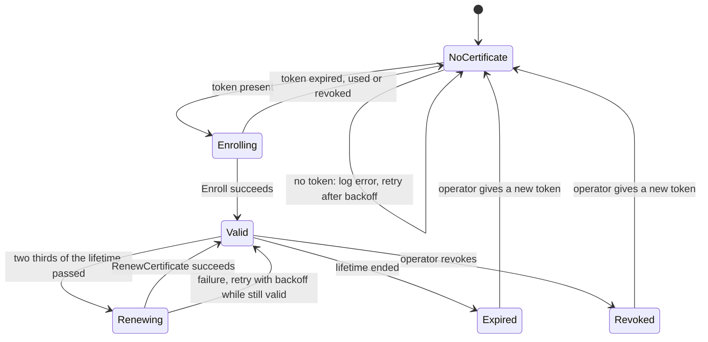
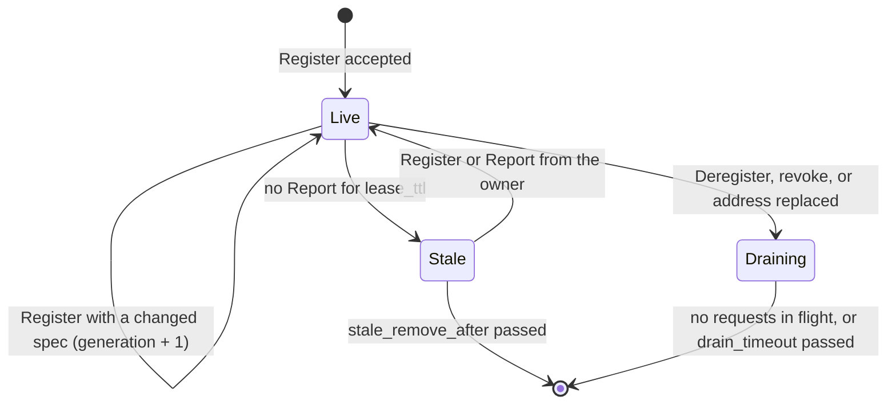
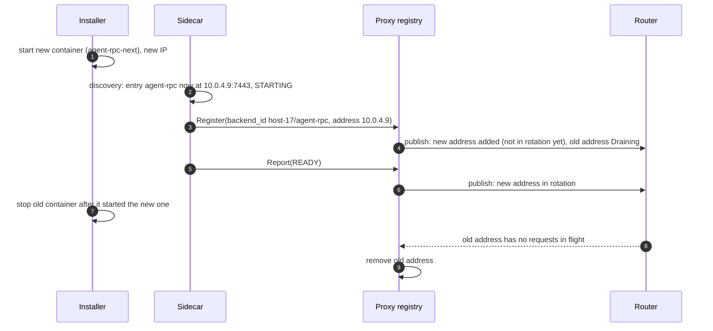

# Proxy Registration Authority

_Written in ASD-STE100 Simplified Technical English (STE). Code and identifiers stay as they
are._

**Abbreviations in this file.** Transport Layer Security (TLS); mutual TLS (mTLS); remote
procedure call (RPC); Certificate Authority (CA); certificate signing request (CSR); Hypertext
Transfer Protocol (HTTP); Transmission Control Protocol (TCP); Internet Protocol (IP);
time to live (TTL); identifier (ID); central processing unit (CPU); server-side request forgery
(SSRF); Automatic Certificate Management Environment (ACME); Classless Inter-Domain Routing
(CIDR); Domain Name System (DNS); Secure Hash Algorithm with 256 bits (SHA-256); AeroSpace and
Defence Industries Association of Europe (ASD), the owner of the STE standard ASD-STE100.
Section 2 explains each term.

## 1. Overview

### 1.1 The problem

`foundation_proxy` routes client traffic to **backends**. Today an operator lists every backend
in the proxy configuration file (`ServiceConfig::backends`). When a program moves, restarts on
a new port, or gets a new version, someone must edit the file and reload the proxy.

This feature lets a **registrar sidecar** (feature 04) tell the proxy about backends while the
proxy runs. The sidecar runs beside the programs. It knows what is installed, what runs, and
whether it is healthy. The proxy knows how to route. The **registration authority** is the
part of the proxy that receives what the sidecar says and keeps the routing table correct.

### 1.2 Who does what

| Part | Does | Does not |
|---|---|---|
| Proxy, public listener | Ends client TLS (the proxy owns the public certificate, static or ACME). Routes each request to a backend in rotation. | Read the manifest. See how agent-rpc checks its own clients. |
| Proxy, registration authority | Enrolls sidecars. Accepts `Register`, `Report` and `Deregister` from enrolled sidecars. Keeps one lease for each sidecar session. Puts backends in and out of rotation. | Probe the apps for the sidecar. Start or stop apps. |
| Registrar sidecar (feature 04) | Reads the manifest. Finds what is installed and running. Runs startup, liveness and readiness probes. Reads CPU and memory use. Tells the proxy all of this. | End client TLS. Route client traffic. |
| Backend (for example agent-rpc) | Serves requests. | Know that a proxy or a sidecar exists. |

### 1.3 The one place where the sidecar authenticates

The sidecar proves who it is **only on the link from the sidecar to the proxy registration
authority**. It does not take part in client TLS. The proxy ends client TLS on the public
listener, as before.

Why this link needs authentication: a `Register` call changes where the proxy sends client
traffic. If anyone could call it, an attacker could register their own address under
`agents.example.com` and receive the users' requests. So the proxy must know that the caller is
a sidecar that the operator trusts.

How: the sidecar shows a one-time **enrollment token** one time, and gets a client certificate.
After that, every call uses **mTLS** with that certificate. Section 5 gives the details. When
the sidecar and the proxy are on the same machine, a Unix socket with file permissions can
replace mTLS (section 5.5).

### 1.4 How the parts connect

```mermaid
flowchart LR
    C["Client<br/>(CLI, SDK, browser)"] -->|"1. HTTPS; proxy ends TLS<br/>(public certificate)"| PUB["Proxy public listener"]
    PUB --> RT["Router<br/>(snapshot)"]
    RT -->|"2. forward: B leg (http) or D leg (connect, grpc, grpc-web)<br/>private network"| BE["Backend<br/>(agent-rpc, other apps)"]
    SC["Registrar sidecar"] -->|"3. Register, Report, Deregister<br/>mTLS with registration CA"| REGL["Proxy registration listener"]
    REGL --> AUTHZ["Registration authority<br/>(BackendRegistry, leases)"]
    AUTHZ -->|"4. publish new snapshot"| RT
    SC -->|"5. probes and metrics<br/>(local: HTTP, TCP, gRPC, systemd, Docker)"| BE
    OPS["Operator"] -->|"6. Unix control socket<br/>(file permissions)"| CTRL["Proxy control socket"]
    CTRL --> AUTHZ
```



_The diagram shows the six links. Only link 3 carries the sidecar's identity. The proxy ends
client TLS on link 1._

| # | From → to | Transport | Auth | Defined in |
|---|---|---|---|---|
| 1 | Client → proxy public listener | HTTPS (HTTP/1.1, HTTP/2, HTTP/3) | TLS ended by the proxy; the client checks the proxy certificate. Request-level auth (for example agent-rpc's signed secret) passes through to the backend. | spec 63, `tls.rs` |
| 2 | Proxy → backend | the backend URL scheme: `http`, `https`, `connect`, `grpc`, `grpc-web` | none added by the proxy; `https` checks the backend certificate | spec 63 |
| 3 | Sidecar → registration listener | Connect unary over HTTPS (HTTP/2) | enrollment token one time, then mTLS | this feature, section 5 |
| 4 | Registration authority → router | in-process | none | this feature, section 6 |
| 5 | Sidecar → its apps | local probes, systemd and Docker | none (same machine or same pod) | feature 04 |
| 6 | Operator → control socket | Unix socket, one JSON line | file permissions | existing `control.rs` |

## 2. Glossary

| Term | Meaning |
|---|---|
| Backend | One network address that serves one service. Example: `grpc://10.0.4.7:7443`. In code: `BackendTarget` (config) and `BackendRuntime` (live state). |
| Backend ID (`backend_id`) | A name that the sidecar gives one backend, stable across restarts. Form: `<host_id>/<entry name>`, for example `host-17/agent-rpc`. |
| B leg, D leg | The two forwarding paths of spec 63. The B leg forwards HTTP as is. The D leg runs the `foundation_connectrpc` engine for Connect, gRPC and gRPC-Web. |
| Control socket | The existing Unix socket of the proxy for operator commands (`list`, `drain`, `pause`, ...). |
| Deregister | The call that says "take this backend out of rotation and forget it". |
| Drain | Send no new requests to a backend, but let running requests finish. |
| Enrollment | The one step where a sidecar shows an enrollment token and a CSR and gets a client certificate. |
| Enrollment token | A signed secret (`foundation_auth::secret::SignedSecret`, purpose `Enroll`) that the operator makes for one sidecar. It has a validity window and a use limit. |
| Generation | A number that the proxy adds 1 to each time a backend's registration changes. It shows which registration is newer. |
| Lease | The proxy's promise to keep one sidecar session's backends in the registry while reports arrive. It ends `lease_ttl` after the last report. |
| Liveness, readiness, startup | Kubernetes probe kinds. Startup: the app finished starting. Liveness: the app is not stuck. Readiness: the app can take traffic now. The sidecar runs them (feature 04). |
| Registrar, sidecar | The program of feature 04. "Sidecar" means it runs beside the apps: on the same machine, or in the same pod. |
| Registration authority | The part of the proxy that this feature adds. |
| Report | The periodic call from a sidecar: heartbeat, health and metrics for all its backends in one message. |
| Rotation | The set of backends that the load balancer can pick for new requests. |
| Router snapshot | An unchanging `Router` value. The proxy replaces the whole value when the registry changes. Running requests keep the old value. |
| Service | A route (host and path prefix) and its backends. In code: `ServiceConfig` and `ServiceRuntime`. |
| Session (`session_id`) | One run of a sidecar process. The sidecar makes a new random ID at each start. |
| Stale | A backend whose lease ended. It is out of rotation. |

### 2.1 What exists today in `foundation_proxy`

This feature builds on code that exists. It does not replace it.

| Item | File | Today |
|---|---|---|
| `ServiceConfig { name, host, path_prefix, backends, health_check }` | `config.rs` | A service from the config file. |
| `BackendTarget { url, weight, max_connections }` | `config.rs` | A backend. The URL scheme picks the protocol (`BackendProtocol`). |
| `BackendState { Active, Draining, Paused }` | `config.rs` | The operator's state for a backend. |
| `BackendRuntime`, `ServiceRuntime` | `runtime.rs` | Live state: health flag, in-flight count, weights. |
| `Router::route(host, path)` | `router.rs` | Picks a service. The list of services is fixed at start. |
| Health probes, `ProbeState` | `health.rs` | The proxy probes HTTP, TCP and gRPC backends with thresholds. |
| `ControlSocket` | `control.rs` | Operator commands over a Unix socket. |
| `ProxyStateStore` | `persistence.rs` | Saves operator state across restarts. |
| Static and ACME certificates | `tls.rs`, `acme.rs` | The public listener's TLS. |

The router's service list is fixed today. Section 6 makes it change at run time.

## 3. Requirements

1. **A registration listener**, separate from the public listener, that requires mTLS with
   certificates from the proxy's own registration CA (section 5).
2. **Enrollment** of a sidecar with a one-time token, through `foundation_auth` (feature 07).
3. **Three calls**: `Register`, `Report`, `Deregister`, with generated types (section 4).
4. **Leases.** Each sidecar session has one lease. A lease ends when reports stop. Backends of
   an ended lease leave rotation.
5. **Rotation rules.** A registered backend gets new requests only when all are true: the
   sidecar reports it `READY`, its lease is live, the operator state is `Active`, and (if the
   service has a proxy health check) the proxy probe passes.
6. **No dropped connections.** A change to the registry never stops a running request. A
   replaced address drains.
7. **Every failure path in section 7** has a defined result and a test.
8. **Limits are configuration** (`CLAUDE.md` rule 8), section 8.
9. **Address policy.** A sidecar can register only addresses and hosts that the policy allows
   (section 5.4).

## 4. The wire contract

File: `backends/foundation_proxy/proto/ewe/proxy/registration/v1/registration.proto`. `build.rs`
makes Rust types with `buffa-build` and the service code with
`foundation_connectrpc_codegen`, as `foundation_agent_rpc` does. The sidecar (feature 04)
generates its client from the same `.proto` file. It does not depend on the
`foundation_proxy` crate.

The first version of this spec named one reply type, `BackendAck { status }`, for all three
calls, with no meaning for `status`. It is removed. Each call now has its own typed reply, below.

```proto
syntax = "proto3";

package ewe.proxy.registration.v1;

// Calls from an enrolled sidecar. Every call needs mTLS (or the local Unix
// socket, section 5.5).
service RegistrationService {
  // Add or update backends. Starts a new session when session_id is new.
  rpc Register(RegisterRequest) returns (RegisterResponse);
  // Heartbeat, health and metrics for every backend of this session.
  rpc Report(ReportRequest) returns (ReportResponse);
  // Take backends out of rotation and forget them, after a drain.
  rpc Deregister(DeregisterRequest) returns (DeregisterResponse);
  // Get a new client certificate before the current one expires.
  rpc RenewCertificate(RenewCertificateRequest) returns (RenewCertificateResponse);
}

// Called with server-auth TLS only (no client certificate yet).
service RegistrarEnrollmentService {
  rpc Enroll(EnrollRequest) returns (EnrollResponse);
}

// ---------------------------------------------------------------------------

// Who sends the call. The proxy also reads the identity from the client
// certificate; these fields must agree with it.
message SessionRef {
  // A random ID that the sidecar makes at each process start (128 bits,
  // lowercase hex). A new value means "the sidecar restarted".
  string session_id = 1;
  // A stable name of the machine or pod, for example "host-17". It is the
  // first part of every backend_id of this sidecar.
  string host_id = 2;
}

enum Protocol {
  PROTOCOL_UNSPECIFIED = 0;
  PROTOCOL_HTTP = 1;
  PROTOCOL_HTTPS = 2;
  PROTOCOL_CONNECT = 3;
  PROTOCOL_GRPC = 4;
  PROTOCOL_GRPC_WEB = 5;
}

// The route of a service: which client requests go to it.
message Route {
  // Exact host or "*.example.com".
  string host = 1;
  // "" or "/" = everything under the host.
  string path_prefix = 2;
}

// One backend, as the sidecar sees it.
message BackendSpec {
  // "<host_id>/<entry name>", for example "host-17/agent-rpc".
  string backend_id = 1;
  // The proxy service name, for example "agents".
  string service = 2;
  Route route = 3;
  Protocol protocol = 4;
  // The address that the proxy dials: an IP literal or a DNS name, and a port.
  string address = 5;
  uint32 port = 6;
  // Load-balancer weight. 0 = the default (1).
  uint32 weight = 7;
  // The software version that runs at this address (manifest entry version).
  string version = 8;
}

message RegisterRequest {
  SessionRef session = 1;
  // At most RegistrationConfig::max_backends_per_session entries.
  repeated BackendSpec backends = 2;
}

message RegisterResponse {
  // One result for each BackendSpec, in the same order.
  repeated RegisterResult results = 1;
  // How often the sidecar must call Report. The proxy decides.
  uint32 report_interval_ms = 2;
  // A lease with no Report for this long ends.
  uint32 lease_ttl_ms = 3;
}

message RegisterResult {
  string backend_id = 1;
  // Set when the registration was accepted. It goes up by 1 at each change.
  uint64 generation = 2;
  // Empty when accepted. Otherwise why not, for example
  // "address 8.8.8.8 is outside allowed_networks".
  string rejected_reason = 3;
}

// The health of one backend, from the sidecar's probes (feature 04).
enum BackendHealth {
  BACKEND_HEALTH_UNSPECIFIED = 0;
  // Installed and running, startup probe not passed yet.
  BACKEND_HEALTH_STARTING = 1;
  // Readiness passes: may take traffic.
  BACKEND_HEALTH_READY = 2;
  // Alive, readiness fails: no new traffic.
  BACKEND_HEALTH_NOT_READY = 3;
  // Liveness fails: the app is stuck.
  BACKEND_HEALTH_NOT_LIVE = 4;
  // Startup did not pass within its threshold.
  BACKEND_HEALTH_FAILED_TO_START = 5;
  // Installed, not running (unit inactive, container stopped).
  BACKEND_HEALTH_NOT_RUNNING = 6;
}

// Resource use of one backend. A field that the sidecar cannot read is not set.
message BackendMetrics {
  optional uint64 cpu_usage_micros = 1;  // CPU time used since the process started
  optional uint64 memory_bytes = 2;      // resident memory now
  optional uint64 memory_limit_bytes = 3;
  optional uint32 restarts = 4;          // restarts seen by the sidecar
  optional uint64 uptime_ms = 5;
}

message BackendReport {
  string backend_id = 1;
  BackendHealth health = 2;
  BackendMetrics metrics = 3;
  // The text of the last probe failure, at most 256 bytes. Empty when healthy.
  string detail = 4;
}

message ReportRequest {
  SessionRef session = 1;
  // One entry for each registered backend of this session.
  repeated BackendReport backends = 2;
}

enum ReportAction {
  REPORT_ACTION_UNSPECIFIED = 0;
  // Keep reporting.
  REPORT_ACTION_CONTINUE = 1;
  // The proxy does not know this session (for example it restarted).
  // Call Register for every backend again, then keep reporting.
  REPORT_ACTION_REREGISTER = 2;
}

message ReportResponse {
  ReportAction action = 1;
  // The backend_ids in the report that the proxy does not know. The sidecar
  // registers them again.
  repeated string unknown_backend_ids = 2;
  uint32 lease_ttl_ms = 3;
}

message DeregisterRequest {
  SessionRef session = 1;
  repeated string backend_ids = 2;
}

message DeregisterResponse {
  // The backend_ids that were found and are now draining.
  repeated string draining = 1;
}

message EnrollRequest {
  // A SignedSecret, purpose Enroll, domain "ewe.proxy.registrar_secret".
  string token = 1;
  // The host_id of this sidecar. It becomes the certificate common name.
  string host_id = 2;
  // PKCS#10 CSR. The private key stays on the sidecar.
  string csr_pem = 3;
}

message EnrollResponse {
  string client_cert_pem = 1;
  // The registration CA. The sidecar uses it to check the proxy's
  // registration listener certificate from now on.
  string ca_cert_pem = 2;
}

message RenewCertificateRequest {
  string csr_pem = 1;
}

message RenewCertificateResponse {
  string client_cert_pem = 1;
}
```

**Field and type summary.** Who makes each message and who reads it:

| Message | Made by | Read by | Purpose |
|---|---|---|---|
| `SessionRef` | sidecar, at start | proxy | Says which sidecar run sends the call. |
| `BackendSpec` | sidecar, from the manifest `proxy` block plus the address it found | proxy | Says where one backend is and which route it serves. |
| `RegisterResponse`, `RegisterResult` | proxy | sidecar | Accept or reject each backend; give the report timing. |
| `BackendReport`, `BackendHealth`, `BackendMetrics` | sidecar, each report interval | proxy | Health decides rotation. Metrics are for operators (control socket `list`), not for routing in this feature. |
| `ReportResponse`, `ReportAction` | proxy | sidecar | Tells the sidecar to keep going or to register again. |
| `EnrollRequest`, `EnrollResponse` | sidecar, proxy | proxy, sidecar | One-time exchange of the token for a certificate. |

Status codes: an unauthenticated call gets `UNAUTHENTICATED`. A call that would change a
backend that another sidecar owns gets `PERMISSION_DENIED`. A report from a session that a newer
session of the same `host_id` replaced gets `ABORTED` with the message "session superseded".
A request with more than `max_backends_per_session` backends gets `RESOURCE_EXHAUSTED`. One bad
backend in a `Register` does not fail the call: its `RegisterResult` says why.

## 5. Authentication of the sidecar

### 5.1 The parts

All the security parts come from `foundation_auth` (feature 07, [auth.md](../07-pluggable-agent-rpc/auth.md)).
The proxy does not have its own copy.

| Part | Type (feature 07) | Use here |
|---|---|---|
| Enrollment token | `SignedSecret`, `SecretIssuer`, `SecretVerifier`, domain `SecretDomain::PROXY_REGISTRATION` = `"ewe.proxy.registrar_secret"` | The operator makes one token for each sidecar. |
| Registration CA | `KeyMaterial::certificate_authority` over a `KeyStore` | Signs the sidecar certificates and the registration listener certificate. It is **not** the public certificate of the proxy, and **not** agent-rpc's CA. |
| Trusted sidecars | `TrustedClients` over a `TrustStore` | Records each enrolled sidecar, its certificate fingerprint, last-seen time and revocation. |
| TLS checks | `mtls::server_config_mutual`, `TrustedClientVerifier` | The registration listener requires a client certificate that the registration CA signed and that is not revoked. |

### 5.2 Enrollment and calls

```mermaid
sequenceDiagram
    autonumber
    participant O as Operator
    participant P as Proxy (registration authority)
    participant S as Sidecar
    O->>P: control socket: issue-registrar-token host-17 (window 1 h, 1 use)
    P-->>O: token (SignedSecret, purpose Enroll)
    O->>S: put token in the sidecar secret (file or env), one time
    S->>S: make key pair and CSR (key sealed at rest, feature 07)
    S->>P: Enroll(token, host_id, CSR) over server-auth TLS
    P->>P: verify signature, purpose, window; spend one use; sign CSR; record sidecar
    P-->>S: client certificate, registration CA certificate
    S->>S: delete the token; keep certificate and key
    S->>P: Register(...) over mTLS
    P->>P: TrustedClientVerifier: certificate signed by registration CA, not revoked
    P-->>S: RegisterResponse(report_interval, lease_ttl)
```

_The diagram shows how a sidecar gets its certificate one time, and then uses mTLS for every
call._

At enrollment, the sidecar checks the proxy's registration certificate against a pinned SHA-256
fingerprint that comes with the token (the same way as an agent-rpc client in feature 07). After
enrollment it checks against the registration CA.

### 5.3 Certificate lifecycle



_The diagram shows the states of a sidecar's certificate. Only an operator can recover an
expired or revoked sidecar, with a new token._

- Lifetime: `RegistrationConfig::client_cert_lifetime`, default 30 days.
- Renewal uses the current certificate (mTLS) to sign a new CSR. No token is needed.
- Revocation: control socket `revoke-registrar <host_id>`. The proxy marks the certificate
  revoked in `TrustedClients`, closes the sidecar's connections, and moves all backends of that
  sidecar to `Draining`.

### 5.4 Address policy (prevents SSRF and traffic theft)

A valid certificate is not enough. `RegistrationPolicy` also limits what a sidecar may register:

```rust
/// What sidecars may register. Part of `RegistrationConfig`.
#[derive(Debug, Clone)]
pub struct RegistrationPolicy {
    /// Backend addresses must be inside one of these networks. Default:
    /// loopback and the private ranges (127.0.0.0/8, ::1/128, 10.0.0.0/8,
    /// 172.16.0.0/12, 192.168.0.0/16, fc00::/7). A DNS name is resolved
    /// and every result must match.
    pub allowed_networks: Vec<IpNet>,
    /// Route hosts that a sidecar may create a new service for. Default
    /// empty: a sidecar may join only services in the config file.
    pub allowed_route_hosts: Vec<String>,
    /// Optional: the services that each host_id may join. None = any.
    pub services_by_host: Option<BTreeMap<String, Vec<String>>>,
}
```

### 5.5 The same-machine case: a Unix socket

When the sidecar runs on the same machine as the proxy, the proxy can also serve
`RegistrationService` on a Unix socket (`RegistrationConfig::unix_socket`). File permissions
(owner and group of the socket) then do the job of mTLS, as for the existing control socket.
There is no token and no certificate. The `host_id` comes from the request. The address policy
still applies. See open question 2.

### 5.6 Why a separate listener

The public listener has the public certificate and does not ask clients for a certificate. The
registration listener has a registration-CA certificate and requires one. In rustls, the
"require a client certificate" choice belongs to the server configuration of a listener. A
separate listener also lets the operator bind it to a private network only
(`RegistrationConfig::bind`, for example `10.0.0.2:9443`).

## 6. The registry and the router

### 6.1 Types

```rust
// backends/foundation_proxy/src/registration/registry.rs

/// All registered backends and all sidecar sessions. Owned by the
/// registration authority; the router never writes to it.
pub struct BackendRegistry {
    inner: Mutex<RegistryState>,
    /// The current router. Requests clone the inner `Arc` and keep it.
    router: RouterHandle,
    env: Env,                         // clock for leases (feature 07, rule 11)
    config: RegistrationConfig,
}

/// One registered backend.
#[derive(Debug, Clone)]
pub struct RegisteredBackend {
    pub spec: BackendSpecOwned,       // the last accepted BackendSpec
    pub owner_host_id: String,        // the sidecar that owns it
    pub session_id: String,           // the session that last registered it
    pub generation: u64,
    pub health: BackendHealth,        // from the last report
    pub metrics: Option<BackendMetricsOwned>,
    pub state: RegistrationState,
    pub last_report_at: Instant,
}

/// The registration state of one backend. Separate from the operator
/// state (`BackendState`) and from the proxy's own probe result.
#[derive(Debug, Clone, Copy, PartialEq, Eq)]
pub enum RegistrationState {
    /// Registered, lease live. In rotation only when health is READY.
    Live,
    /// The lease ended. Out of rotation. Removed after `stale_remove_after`.
    Stale { since: Instant },
    /// Deregistered or replaced. Out of rotation. Removed when no request
    /// runs on it, or after `drain_timeout`.
    Draining { since: Instant },
}

/// One sidecar run.
#[derive(Debug, Clone)]
pub struct Session {
    pub host_id: String,
    pub session_id: String,
    pub started_at: Instant,
    pub lease_expires_at: Instant,
}

/// A shared, swappable `Arc<Router>`. Readers take a read lock only to clone
/// the `Arc`; the registry takes the write lock only to swap it.
#[derive(Clone)]
pub struct RouterHandle(Arc<RwLock<Arc<Router>>>);

impl RouterHandle {
    pub fn load(&self) -> Arc<Router>;
    pub fn store(&self, router: Arc<Router>);
}

impl BackendRegistry {
    pub fn register(&self, peer: &PeerIdentity, req: &RegisterRequest) -> Result<RegisterResponse, RegistrationError>;
    pub fn report(&self, peer: &PeerIdentity, req: &ReportRequest) -> Result<ReportResponse, RegistrationError>;
    pub fn deregister(&self, peer: &PeerIdentity, req: &DeregisterRequest) -> Result<DeregisterResponse, RegistrationError>;
    /// Ends leases, removes old Stale and Draining entries, publishes a new
    /// router if anything changed. Called by the sweeper task.
    pub fn sweep(&self);
    /// For the control socket `list` command.
    pub fn snapshot(&self) -> Vec<RegisteredBackend>;
}
```

`PeerIdentity` is what the listener learned about the caller: the `host_id` from the client
certificate common name and the certificate fingerprint, or "local Unix socket".

### 6.2 How a change reaches the router

1. A call changes `RegistryState` under its mutex.
2. If the set of in-rotation backends changed, the registry builds a new `Router` from the
   config services plus the registered services.
3. For a backend whose address did not change, the new `Router` reuses the same
   `Arc<BackendRuntime>`. So in-flight counts, weights and the proxy health state stay.
4. `RouterHandle::store` swaps the pointer. New requests use the new router. Running requests
   keep the old `Arc<Router>` until they end. No connection is dropped.

`ProxyState` holds a `RouterHandle` instead of a fixed `Arc<Router>`. This is the only change
to the request path. The hot path cost is one read lock and one `Arc` clone per request.

### 6.3 Rotation rule

A backend gets new requests only when **all** of these are true:

| Check | Owner |
|---|---|
| `RegistrationState::Live` (lease live) | registration authority |
| `health == BACKEND_HEALTH_READY` | sidecar (its readiness probe) |
| `BackendState::Active` | operator (control socket) |
| proxy health check passes, if the service has one | proxy (`health.rs`) |

The sidecar checks the app from inside the machine. The proxy check, when configured, checks
the network path from the proxy to the app, which the sidecar cannot see. Config-file backends
keep today's rules (operator state and proxy check only).

### 6.4 Lifecycle of one registered backend



_The diagram shows how a registered backend enters rotation, leaves it, and is removed._

### 6.5 Lifecycle of the registration authority

| Phase | What happens |
|---|---|
| Start | Load `RegistrationConfig`. Load or make the registration CA and the listener certificate (`KeyMaterial`, feature 07; keys always encrypted at rest). Open the trust store. Start the registration listener and, if set, the Unix socket. Start the sweeper task. The registry starts empty (see 7.2). |
| Run | Serve calls. The sweeper runs every `sweep_interval` and calls `BackendRegistry::sweep`. |
| Config reload | The existing `reload` command re-reads the file. Config services are rebuilt. Registered services stay. Policy changes apply to the next call; a backend that the new policy forbids moves to `Draining`. |
| Stop | Stop accepting registration calls. The public listener drains as today (`start_drain`). Registered backends are not deregistered: the apps still run. |

## 7. Failure and edge paths

Each row has a test (section 10).

| # | Case | What happens | Recovery |
|---|---|---|---|
| 7.1 | **Missed reports** (sidecar slow, network partition) | After `lease_ttl` with no report, the sweeper moves every backend of the session to `Stale`: out of rotation. Config backends of the same service still serve. | The next `Report` returns `CONTINUE` and the backends return to `Live`. After `stale_remove_after`, they are removed; a later `Report` lists them in `unknown_backend_ids` and the sidecar registers them again. |
| 7.2 | **Proxy restart** | The registry is in memory and starts empty. The first `Report` of each sidecar gets `REREGISTER`. | The sidecar sends `Register` for all its backends. Registered-only services have no backend for at most one `report_interval` (default 10 s); requests for them get 503 meanwhile. Open question 1 proposes to save the registry to remove this gap. |
| 7.3 | **Sidecar restart** | The new process has a new `session_id`. Its `Register` replaces the old session of the same `host_id`: the old session's lease ends at once. Backends with the same `backend_id` keep their `BackendRuntime` (generation + 1). Backends that the new session does not register move to `Draining`. | A report that still arrives from the old session gets `ABORTED: session superseded`; that old process stops. |
| 7.4 | **Sidecar stops for good** | Host mode: the sidecar does not deregister on stop, because the apps still run. Its backends go `Stale` after `lease_ttl`, then are removed. Container mode: the pod stops the app too, so the sidecar sends `Deregister` first (feature 04). | Start the sidecar again; see 7.3. |
| 7.5 | **App (backend) restart** | The sidecar's probes see `NOT_RUNNING` or `STARTING`, then `READY`. Each report updates health, so the backend leaves and re-enters rotation. | Automatic. |
| 7.6 | **Update or redeploy, same address** (systemd upgrade by the installer) | As 7.5. The sidecar sends `Register` with the new `version`; generation + 1. | Automatic. |
| 7.7 | **Update or redeploy, new address** (Docker swap gives a new IP or port) | `Register` with the same `backend_id` and a new address. The proxy adds the new address and moves the old one to `Draining`. The new address joins rotation when it reports `READY`. | Zero downtime when the new container is ready before the old one stops (feature 02 starts the new one first). |
| 7.8 | **Stale or conflicting registration** | A `Register` for a `backend_id` that another live sidecar owns gets `PERMISSION_DENIED` in its `RegisterResult`. If the owner's lease ended, the new sidecar takes ownership. | Operator: `drain` or `revoke-registrar` on the old owner. |
| 7.9 | **Address outside the policy** | That `RegisterResult` has `rejected_reason`. Other backends in the call still register. | Fix the manifest or the policy. |
| 7.10 | **Certificate expired or revoked** | The TLS handshake fails. The sidecar cannot report, so its backends go `Stale` (7.1). | Operator gives a new token (section 5.3). |
| 7.11 | **Enrollment token expired or used up** | `Enroll` fails with `UNAUTHENTICATED`. The sidecar logs it and retries with backoff; it never logs the token. | Operator issues a new token. |
| 7.12 | **Proxy probe and sidecar disagree** | Both must pass (section 6.3). The control socket `list` shows both results, so the operator sees which one fails. | Check the network between proxy and app. |
| 7.13 | **Too many backends from one sidecar** | `RESOURCE_EXHAUSTED`. | Raise `max_backends_per_session`, or split hosts. |

The diagram shows a redeploy with a new address (7.7).



_The diagram shows that the new address joins rotation before the old one leaves, so no request
fails._

## 8. Configuration

```rust
/// The registration authority's settings (`CLAUDE.md` rule 8).
#[derive(Debug, Clone)]
pub struct RegistrationConfig {
    /// The mTLS listener, for example "10.0.0.2:9443". None = feature off.
    pub bind: Option<String>,
    /// Optional same-machine socket (section 5.5).
    pub unix_socket: Option<PathBuf>,
    /// How often sidecars report. Default 10 s: the default `periodSeconds`
    /// of a Kubernetes probe.
    pub report_interval: Duration,
    /// A lease with no report for this long ends. Default 30 s: three missed
    /// reports, as the default Kubernetes `failureThreshold` of 3.
    pub lease_ttl: Duration,
    /// Stale backends are removed after this. Default 300 s: the default
    /// Kubernetes `pod-eviction-timeout`.
    pub stale_remove_after: Duration,
    /// Longest drain of a removed address. Default 30 s: the default
    /// Kubernetes `terminationGracePeriodSeconds`.
    pub drain_timeout: Duration,
    /// How often the sweeper runs. Default 1 s.
    pub sweep_interval: Duration,
    /// Most backends in one session. Default 256.
    pub max_backends_per_session: usize,
    /// Largest registration request body. Default 64 KiB: 256 backends of
    /// about 200 bytes each, with room.
    pub max_request_bytes: usize,
    /// Sidecar certificate lifetime. Default 30 days.
    pub client_cert_lifetime: Duration,
    pub policy: RegistrationPolicy,
}
```

The defaults of 256 backends, 64 KiB and 1 s have no outside source. They are sized for one
machine with many apps. The doc comment says so.

## 9. Errors

```rust
#[derive(Debug, Clone, PartialEq, Eq, thiserror::Error)]
pub enum RegistrationError {
    #[error("caller is not an enrolled sidecar")]
    Unauthenticated,
    #[error("backend {backend_id} belongs to sidecar {owner}")]
    NotOwner { backend_id: String, owner: String },
    #[error("session {session_id} was replaced by a newer session of {host_id}")]
    SessionSuperseded { host_id: String, session_id: String },
    #[error("{count} backends is more than the limit {limit}")]
    TooManyBackends { count: usize, limit: usize },
    #[error("invalid request: {0}")]
    Invalid(String),
}
```

Each variant maps to one Connect code (section 4). No variant is a bare string sent to the
client without a code.

## 10. Crate changes

```text
backends/foundation_proxy/
├── proto/ewe/proxy/registration/v1/registration.proto   NEW
├── build.rs                                             NEW or MOD: generate types and service
├── src/
│   ├── registration/                                    NEW
│   │   ├── mod.rs        RegistrationAuthority: start, stop, listeners
│   │   ├── config.rs     RegistrationConfig, RegistrationPolicy
│   │   ├── registry.rs   BackendRegistry, RegisteredBackend, RegistrationState, Session, sweep
│   │   ├── service.rs    RegistrationService and RegistrarEnrollmentService handlers
│   │   ├── enroll.rs     sidecar enrollment over foundation_auth
│   │   └── policy.rs     address and route checks
│   ├── router.rs         MOD: RouterHandle; build from config plus registry
│   ├── state.rs          MOD: ProxyState holds a RouterHandle
│   ├── control.rs        MOD: issue-registrar-token, revoke-registrar, list shows registered backends
│   └── config.rs         MOD: ProxyConfig gets `registration: Option<RegistrationConfig>`
└── tests/
    ├── registration_registry_tests.rs
    ├── registration_auth_tests.rs
    ├── registration_failure_tests.rs
    └── registration_e2e_tests.rs
```

## 11. Tasks

- [ ] **T1: Proto and generated types.** `registration.proto`, `build.rs`. Done when the crate
      builds with the generated client and server.
- [ ] **T2: `RouterHandle`.** `ProxyState` uses it; requests clone the snapshot. Test: a swap
      during a long request does not end that request.
- [ ] **T3: `BackendRegistry` and sessions.** Register, report, deregister, ownership,
      generations. Tests 7.3, 7.8, 7.13.
- [ ] **T4: Leases and the sweeper.** With a simulated clock (`Env`). Tests 7.1, 7.4.
- [ ] **T5: Rotation rule.** All four checks of section 6.3. Test 7.12.
- [ ] **T6: Address policy.** Test 7.9, and a DNS name that resolves outside the policy.
- [ ] **T7: Enrollment and mTLS listener** over `foundation_auth`. Tests 7.10, 7.11; an
      unauthenticated `Register` changes nothing.
- [ ] **T8: Certificate renewal and revocation.** Test: a revoked sidecar's backends drain.
- [ ] **T9: Unix socket transport** (section 5.5). Test: a socket with wrong permissions is
      refused at start.
- [ ] **T10: Control socket commands.** `issue-registrar-token`, `revoke-registrar`, `list`.
- [ ] **T11: End to end.** A test sidecar client registers a loopback backend, a client request
      reaches it through the proxy, a redeploy with a new address loses no request (7.7), and
      a proxy restart recovers through `REREGISTER` (7.2).

## 12. Tests

| File | What it proves |
|---|---|
| `tests/registration_registry_tests.rs` | Register, replace, ownership, generations, rotation rule. |
| `tests/registration_failure_tests.rs` | One test for each row of section 7, with a simulated clock. |
| `tests/registration_auth_tests.rs` | Enrollment, mTLS, renewal, revocation, Unix socket permissions. |
| `tests/registration_e2e_tests.rs` | Real TCP on loopback: section 11, T11. |

```bash
cargo test -p foundation_proxy --test registration_registry_tests
cargo test -p foundation_proxy --test registration_e2e_tests
```

## 13. Trade-offs

| Decision | Why | Other choice |
|---|---|---|
| Separate mTLS listener | The client-certificate rule is per listener; it can bind to a private network. | The public listener with optional client certificates (rejected: mixes two trust domains). |
| One `Report` per sidecar for all backends | Few calls, one lease per sidecar. | One heartbeat per backend (rejected: N times more calls). |
| The proxy sets the report timing | One place decides lease behavior. | The sidecar picks (rejected: sidecars could disagree with the lease). |
| Sidecar health and proxy health both required | Each sees what the other cannot. | Only one of them (rejected: blind spots). |
| In-memory registry first | Simple; sidecars rebuild it in one interval. | Saved registry (open question 1). |
| Generated proto types | `CLAUDE.md` rule 5. | JSON over HTTP (rejected). |

## 14. Open questions

1. **Save the registry across proxy restarts?** Today a registered-only service has no backend
   for up to one `report_interval` after a proxy restart (7.2).
   - Option A: no. Accept the gap.
   - Option B: save registrations with `ProxyStateStore`. At start, load them as `Live` with a
     fresh lease, so they route until `lease_ttl` passes with no report.
   - **Recommendation: B.** The store exists, and the lease limits the risk of a stale entry.
2. **Ship the Unix socket transport (5.5) in this feature?**
   - **Recommendation: yes.** Same-machine is the first milestone, and it removes the token
     step there.
3. **mTLS from a client to agent-rpc through the proxy.** The proxy ends client TLS, so agent-rpc
   cannot see a client certificate on a TLS-ended route. Clients behind the proxy use
   agent-rpc's signed-secret bearer auth (feature 07, `SignedSecretAuth`). End-to-end client mTLS
   needs TLS passthrough, routed by the TLS server name (SNI). The `tcp` passthrough of today
   uses one listener for each backend and cannot be registered at run time.
   - **Recommendation:** signed-secret auth behind the proxy now; SNI passthrough as a later
     feature.
4. **Move the generic enrollment steps into `foundation_auth`.** agent-rpc (feature 07,
   `core::enroll`) and the proxy run the same five steps.
   - **Recommendation: yes**, as `foundation_auth::enroll::EnrollmentService`, used by both.
5. **Use metrics for load balancing?** This feature stores and shows them only.
   - **Recommendation:** not now; a later feature can weight by CPU or memory.

---

_Created: 2026-10-19 · Rewritten for completeness and STE: 2026-10-26_
