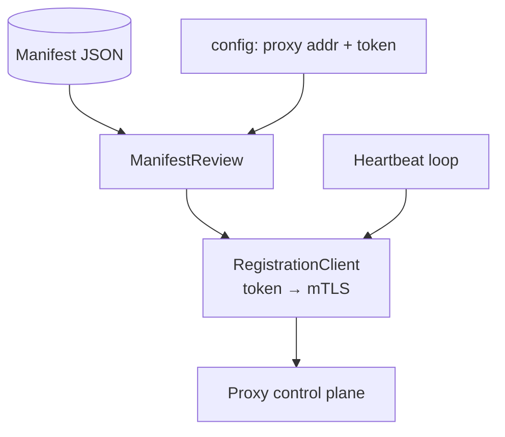
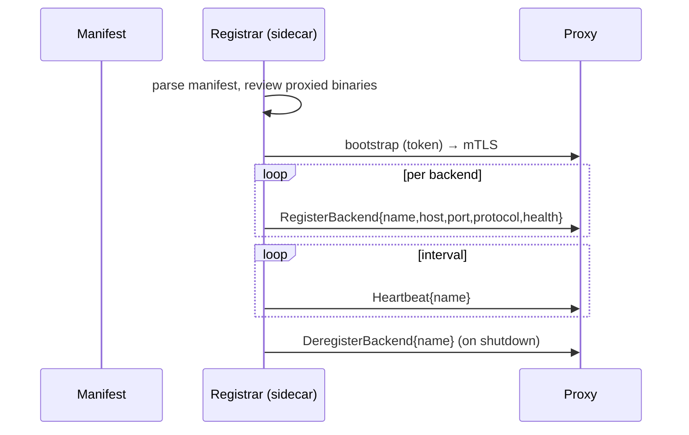

# Registrar Sidecar

## Overview

`foundation_registrar` is the sidecar that closes the loop between "installed by
the manifest" and "served by the proxy." It reads the manifest independently,
reviews it to determine **which installed binaries must be proxied**, and then
tells the proxy — via the authenticated registration handshake from
`02-proxy-registration` — "this binary is here at host:port" and keeps that
registration alive.

It owns the **registration auth channel** (token → mTLS) to the proxy. It has no
opinion about agent-rpc's client-facing auth and does not share any Rust library
with the installer — it parses the manifest from its serialized form, just like
the installer does, on its own.

The sidecar is a **deployment-time choice**, not an architecture change:
one sidecar per bare-metal host, or the sidecar riding inside a container for
Docker deployments. Both are the same binary, differently placed.

## Language Stack

### Languages for This Feature

| Language | Purpose | Skill Location |
|----------|---------|----------------|
| Rust | Manifest review, registration client, heartbeat loop | `.agents/skills/rust-clean-code/skill.md` |

### Pre-Implementation Checklist

- [ ] Read `.agents/skills/rust-clean-code/skill.md`.
- [ ] Read `.agents/skills/rust-valtron-usage/skill.md` (heartbeat loop as a task).
- [ ] Read `01-manifest-installer/feature.md` (the manifest schema it parses).
- [ ] Read `02-proxy-registration/feature.md` (the handshake it speaks).

---

## Requirements

1. **Read the manifest independently.**
   - Parse the same JSON contract as `01-manifest-installer`, but from this crate's
     own types (no shared library with the installer). Only `entry.proxy` blocks
     matter to the registrar; the rest of the manifest is ignored.

2. **Review which binaries must be proxied.**
   - A `ManifestReview` reduces entries with a `proxy` hint into a list of
     `BackendRegistration`s: `name`, `host`, `port`, `protocol`, `health_endpoint`.
   - It is told its proxy (address + registration token) at startup; it does not
     discover the proxy from the manifest.

3. **Register with the proxy (token → mTLS).**
   - On start, bootstrap with the registration token, provision mTLS, then call
     `RegisterBackend` for each reviewed backend.

4. **Heartbeat + re-registration.**
   - Heartbeat each registered backend on an interval so the proxy's routing table
     stays live; on restart, re-register (the handshake is idempotent by name).
   - On local failure (proxy unreachable), retry with backoff; never silently drop
     the duty to register.

5. **Two deployment shapes, one binary.**
   - `host` mode: one registrar per bare-metal host, registering all of the host's
     proxied binaries.
   - `container` mode: the registrar rides in the container and registers that
     container's binary(ies). Selected by config, not by code fork.

---

## Architecture (COMPREHENSIVE)

### Technical Approach

- **Single binary, config-driven mode.** `host` vs `container` is a runtime flag;
  both paths share the manifest-review → register → heartbeat pipeline.
- **Manifest is input, not shared code.** The registrar parses `entry.proxy` from
  the same JSON the installer uses, using its own structs.
- **Registration is a generated client** against `02-proxy-registration`'s
  `RegistrationService`, with token → mTLS layered on.

### Component Structure



**File Structure:**
```
backends/foundation_registrar/
├── Cargo.toml
├── src/
│   ├── main.rs          - binary entry, mode flag (host|container), config load
│   ├── lib.rs           - reusable surface (for host-side embedding/tests)
│   ├── review.rs        - ManifestReview (parse entry.proxy → BackendRegistration)
│   ├── client.rs        - RegistrationClient (register/deregister/heartbeat)
│   └── config.rs        - RegistrarConfig { mode, proxy_addr, token, interval }
└── tests/
    ├── review_tests.rs
    └── register_e2e_tests.rs
```

### Component Details

1. **`ManifestReview`** (`src/review.rs`)
   - **Purpose**: parse the manifest, filter entries with a `proxy` hint, emit
     `Vec<BackendRegistration>`.
   - **Key methods**: `ManifestReview::from_manifest(json) -> Self`,
     `::registrations(&self) -> Vec<BackendRegistration>`.
   - **`BackendRegistration`** here mirrors the proxy's registration message
     (name/host/port/protocol/health_endpoint) — independent types, wire-compatible.

2. **`RegistrationClient`** (`src/client.rs`)
   - **Purpose**: generated client to the proxy's `RegistrationService`; owns the
     token → mTLS handshake.
   - **Key methods**: `bootstrap()`, `register(reg)`, `deregister(name)`,
     `heartbeat(name)`, `run_loop(interval)`.

3. **`RegistrarConfig`** (`src/config.rs`)
   - **Purpose**: `mode` (`host`/`container`), `proxy_addr`, `token`, `interval`,
     optional mTLS material.

4. **`main.rs`**
   - **Purpose**: load config → `ManifestReview` → bootstrap auth → register all →
     heartbeat loop until signal; clean deregister on shutdown.

### Data Flow



### Interface Definitions

**Public APIs (Rust, proposed):**
```rust
pub enum RegistrarMode { Host, Container }

pub struct RegistrarConfig {
    pub mode: RegistrarMode,
    pub proxy_addr: String,
    pub token: Secret,
    pub heartbeat_interval: Duration,
}

pub struct ManifestReview { /* parsed proxy blocks */ }
impl ManifestReview {
    pub fn from_manifest(json: &str) -> Result<Self, RegistrarError>;
    pub fn registrations(&self) -> Vec<BackendRegistration>;
}

pub struct RegistrationClient { /* generated client + auth */ }
impl RegistrationClient {
    pub fn bootstrap(&mut self) -> Result<(), RegistrarError>;
    pub fn register(&self, reg: &BackendRegistration) -> Result<(), RegistrarError>;
    pub fn heartbeat(&self, name: &str) -> Result<(), RegistrarError>;
    pub fn deregister(&self, name: &str) -> Result<(), RegistrarError>;
}
```

**Internal contracts:**
- `review.rs` depends only on the manifest JSON; `client.rs` depends only on the
  proxy registration protocol. Neither imports the other's internals beyond the
  `BackendRegistration` value.

### Error Handling Strategy

- `RegistrarError`: `ManifestParse`, `NoProxyBlocks`, `Auth`, `Register`,
  `Heartbeat`, `Deregister`.
- Heartbeat/registration failures retry with backoff and are logged; a
  permanently unreachable proxy does not crash the sidecar — it keeps retrying.

### Security Considerations

- The registration token is stored/loaded as a secret; never logged.
- After bootstrap, the proxy link is mTLS; the registrar presents its cert on
  every call.
- The manifest is untrusted input: bounded parse, no injection via entry names
  flowing into registration fields.

### Performance Considerations

- Heartbeat interval is configurable (default ~10–30s); registrations are tiny
  unary calls, negligible load on the proxy.
- The registrar is otherwise idle; it does no work on the data path.

### Trade-offs and Decisions

| Decision | Rationale | Alternatives Considered |
|----------|-----------|------------------------|
| One binary, `host`/`container` modes | Same logic, different placement | Two binaries (rejected: duplication) |
| Parse manifest independently | No coupling to the installer | Shared manifest crate (rejected: user's "nothing shared") |
| Sidecar owns registration auth | Proxy comms are the sidecar's job | agent-rpc self-registers (rejected: wrong owner) |
| Re-register idempotently on restart | Self-healing | Manual recovery (rejected: fragile) |

---

## Implementation

### Files to Create/Modify

- `backends/foundation_registrar/Cargo.toml` — deps on `foundation_connectrpc`
  (client), `foundation_auth`, `foundation_core`, `foundation_errstacks`,
  `serde`, `serde_json`, `tracing`, `tokio`/`foundation_netio` for the loop.
- `backends/foundation_registrar/src/{main,lib,review,client,config}.rs`.
- `backends/foundation_registrar/tests/{review_tests,register_e2e_tests}.rs`.
- Root `Cargo.toml` — add `backends/foundation_registrar` to members.

## Tasks

- [ ] **T1 — Crate scaffold + `RegistrarConfig`.** Binary + lib; `host`/`container`
      mode flag; compile-clean.
- [ ] **T2 — `ManifestReview`.** Parse a manifest, reduce `entry.proxy` blocks to
      `Vec<BackendRegistration>`; red test: entries without a `proxy` hint are
      ignored, `proxy` entries are emitted with host/port/protocol.
- [ ] **T3 — Registration client (token → mTLS).** `bootstrap()` then `register()`
      against the proxy control plane; red test: unauthenticated register rejected.
- [ ] **T4 — Heartbeat loop.** `run_loop(interval)` sends heartbeats; red test:
      a short-interval loop is observable as repeated proxy heartbeats.
- [ ] **T5 — Re-registration on restart.** Startup re-registers idempotently by
      name; red test: register twice → second replaces, no error.
- [ ] **T6 — `host` vs `container` mode.** Same pipeline, config-selected; red
      test: both modes produce registrations (host = all, container = subset).
- [ ] **T7 — End-to-end register-and-serve.** Sidecar reads a manifest, registers
      a backend with a real proxy, a client request is forwarded; red test is the
      whole chain over loopback.

## Testing

### Test Cases

1. **Manifest review filters correctly**
   - Given: a manifest with 2 proxied entries + 1 non-proxied
   - When: `ManifestReview::registrations()`
   - Then: exactly 2 registrations, with correct name/host/port/protocol

2. **Registration round-trip**
   - Given: a sidecar + a proxy with registration auth
   - When: `register` runs
   - Then: the proxy's registry contains the backend; `heartbeat` keeps it alive

3. **Idempotent re-register**
   - Given: an already-registered backend
   - When: `register` runs again
   - Then: no error, entry replaced

4. **Mode shapes output**
   - Given: `host` vs `container` mode
   - When: reviewing the same manifest
   - Then: `host` registers all proxied binaries; `container` registers the
     container's subset

### Local run commands

```bash
cargo test -p foundation_registrar --test review_tests
cargo test -p foundation_registrar --test register_e2e_tests
```

## Success Criteria

- [ ] All 7 tasks completed with one red→green test each
- [ ] Sidecar reads manifest independently (no shared crate with installer)
- [ ] Registration uses token → mTLS, idempotent, with heartbeat + re-register
- [ ] `host` and `container` modes both work, config-selected
- [ ] End-to-end: manifest → review → register → proxy serves the backend
- [ ] No TODO/FIXME/stubs; no ignored `Result`s; token never logged

---

_Created: 2026-10-19_
