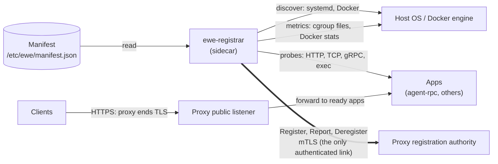
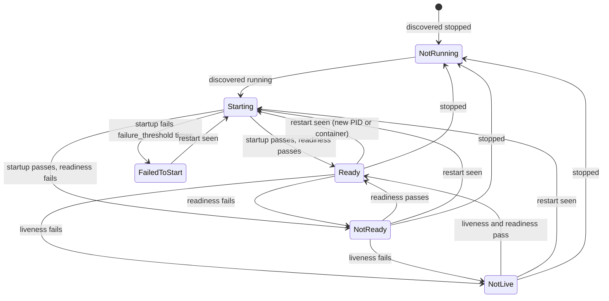
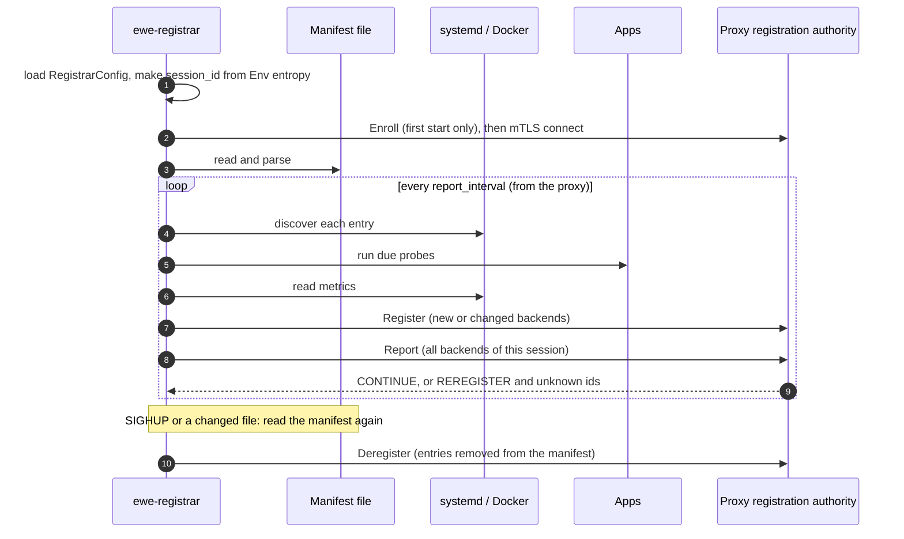

# Registrar Sidecar

_Written in ASD-STE100 Simplified Technical English (STE). Code and identifiers stay as they
are._

**Abbreviations in this file.** Transport Layer Security (TLS); mutual TLS (mTLS); remote
procedure call (RPC); JavaScript Object Notation (JSON); Hypertext Transfer Protocol (HTTP);
Transmission Control Protocol (TCP); Internet Protocol (IP); central processing unit (CPU);
control group (cgroup, the Linux kernel feature that limits and counts a group of processes);
certificate signing request (CSR); identifier (ID); operating system (OS); AeroSpace and Defence
Industries Association of Europe (ASD), the owner of the STE standard ASD-STE100. Section 2
explains each term.

## 1. Overview

### 1.1 What the sidecar is

The registrar is a **sidecar**: a small program that runs beside the apps and watches them. It
runs in one of these places:

- on a bare-metal machine or a virtual machine, as a systemd unit (**host mode**);
- in a Docker container or a Kubernetes pod, next to one app (**container mode**).

It does five jobs:

1. **Read the manifest** (feature 02) to learn which apps should exist on this machine.
2. **Discover** which of them are installed and running, and at which version and address.
3. **Check health**: run the startup, liveness and readiness probes from the manifest.
4. **Measure**: read CPU and memory use, restarts and uptime of each app.
5. **Report** all of this to the proxy registration authority (feature 03), so the proxy routes
   only to apps that are ready.

### 1.2 What the sidecar is not

- It does **not** end client TLS. The proxy ends client TLS on its public listener.
- It does **not** take part in how agent-rpc checks its own clients.
- It does **not** install, start, stop or restart apps. The installer (feature 02) installs.
  systemd and Docker restart, with their restart policies. See open question 1.
- It does **not** carry client traffic. It is off the data path.

### 1.3 The one place where the sidecar authenticates

The sidecar proves its identity **only on its link to the proxy registration authority**. That
link can change where the proxy sends client traffic, so the proxy must know that the caller is
a sidecar that the operator trusts. The sidecar shows an enrollment token one time and gets a
client certificate; then it uses mTLS on every call. On the same machine as the proxy, it can use
a Unix socket with file permissions instead. Feature 03, section 5, gives the full design. The
sidecar has no other credential and checks no other caller.



_The diagram shows that the sidecar only reads and probes locally, and that its one
authenticated link goes to the proxy. Client traffic does not pass through the sidecar._

## 2. Glossary

| Term | Meaning |
|---|---|
| Advertise address | The address that the proxy must dial to reach an app. The sidecar finds it (section 4.3). The manifest gives only the port, because one manifest serves many machines. |
| App | A program that a manifest entry installs and runs, for example agent-rpc. |
| cgroup | A Linux kernel group of processes. Its files (for example `memory.current`) give the resource use of the group. |
| Container mode | The sidecar runs next to one app, in the same pod or Docker network. |
| Discovery | Finding which manifest entries are installed and running, and where. |
| Host mode | The sidecar runs on the machine and watches every manifest entry on it. |
| Host ID (`host_id`) | A stable name of this machine or pod, for example `host-17`. It is the certificate name of the sidecar and the first part of every backend ID. |
| Liveness probe | Asks "is the app stuck?". A failure is reported as `NOT_LIVE`. |
| Observation | The sidecar's current view of one app: installed, running, address, health, metrics. Section 4.5. |
| Probe | One check of an app: HTTP request, TCP connect, gRPC health call, or a command. |
| Readiness probe | Asks "can the app take traffic now?". Only `READY` apps get traffic. |
| Reconcile loop | The loop that compares the manifest with what runs, and tells the proxy about the difference. Section 4.7. |
| Session | One run of the sidecar process, with a random `session_id` (feature 03). |
| Startup probe | Asks "did the app finish starting?". Liveness and readiness wait until it passes. |

Feature 03's glossary defines lease, report, rotation, enrollment and registration authority.

## 3. Requirements

1. **Read the manifest** with this crate's own types. No shared Rust crate with the installer.
   The sidecar reads only `name`, `version`, `deploy.kind`, `proxy` and `probes`.
2. **Discover** each entry: installed or not, running or not, which version, which address.
3. **Probe** each running entry with its startup, liveness and readiness probes, with the
   semantics of Kubernetes probes.
4. **Measure** CPU, memory, restarts and uptime where the platform allows. A metric that cannot
   be read is left out, never guessed.
5. **Register** every entry that has a `proxy` block and runs; **report** on the interval that the
   proxy gives; **deregister** what left the manifest.
6. **Recover** from every failure in section 6 without operator action, except an expired or
   revoked certificate.
7. **One binary, two modes**, chosen by configuration.
8. **Async all the way, side effects injected.** Clock, timers and randomness (for
   `session_id`) come from `Env` (feature 07, `CLAUDE.md` rule 11), so a simulated test can
   replay a run.

## 4. Design

### 4.1 The manifest blocks that the sidecar reads

Feature 02 defines the manifest. The installer stores `proxy` and `probes` without reading them.
This feature defines them.

```rust
// backends/foundation_registrar/src/manifest.rs — this crate's own types.

/// The part of the manifest that the sidecar reads. Unknown fields are ignored.
#[derive(Debug, Clone, Deserialize)]
pub struct ManifestView {
    pub manifest_version: u32,
    pub entries: Vec<EntryView>,
}

#[derive(Debug, Clone, Deserialize)]
pub struct EntryView {
    /// Same rule as the installer: `[a-z0-9-]{1,63}`.
    pub name: String,
    pub version: String,
    pub deploy: DeployView,
    /// None: the sidecar watches the app but does not register it.
    pub proxy: Option<ProxyBlock>,
    /// None: no probes. A running app counts as READY.
    pub probes: Option<ProbesBlock>,
}

#[derive(Debug, Clone, Deserialize)]
pub struct DeployView {
    /// "systemd", "docker" or "none". Picks how discovery finds the app.
    pub kind: String,
}

/// How the proxy should route to this app. Made by the operator in the
/// manifest; read by the sidecar; becomes a `BackendSpec` (feature 03).
#[derive(Debug, Clone, Deserialize)]
pub struct ProxyBlock {
    /// The proxy service name. Example: "agents".
    pub service: String,
    /// Which client requests go to this service.
    pub route: RouteBlock,
    /// The port that the app listens on.
    pub port: u16,
    /// "http", "https", "connect", "grpc" or "grpc-web".
    pub protocol: String,
    /// Load-balancer weight. Default 1.
    #[serde(default)]
    pub weight: Option<u32>,
}

#[derive(Debug, Clone, Deserialize)]
pub struct RouteBlock {
    /// Exact host or "*.example.com". Example: "agents.example.com".
    pub host: String,
    /// Default "/".
    #[serde(default)]
    pub path_prefix: Option<String>,
}

/// The three probe kinds. Each is optional.
#[derive(Debug, Clone, Deserialize)]
pub struct ProbesBlock {
    pub startup: Option<ProbeSpec>,
    pub liveness: Option<ProbeSpec>,
    pub readiness: Option<ProbeSpec>,
}

/// One probe. The fields and defaults are the ones of a Kubernetes probe.
#[derive(Debug, Clone, Deserialize)]
pub struct ProbeSpec {
    #[serde(flatten)]
    pub check: ProbeCheck,
    /// Seconds between checks. Default 10 (Kubernetes `periodSeconds`).
    pub period_secs: Option<u32>,
    /// Seconds before one check fails. Default 1 (Kubernetes `timeoutSeconds`).
    pub timeout_secs: Option<u32>,
    /// Failures in a row that make the probe fail. Default 3
    /// (Kubernetes `failureThreshold`).
    pub failure_threshold: Option<u32>,
    /// Successes in a row that make the probe pass. Default 1
    /// (Kubernetes `successThreshold`).
    pub success_threshold: Option<u32>,
    /// Seconds to wait after the app starts. Default 0
    /// (Kubernetes `initialDelaySeconds`).
    pub initial_delay_secs: Option<u32>,
}

/// What one probe does.
#[derive(Debug, Clone, Deserialize)]
#[serde(tag = "kind", rename_all = "lowercase")]
pub enum ProbeCheck {
    /// GET http://<address>:<port><path>. A 2xx or 3xx status passes.
    Http { port: u16, path: String },
    /// A TCP connect to <address>:<port> passes.
    Tcp { port: u16 },
    /// `grpc.health.v1.Health/Check`; `SERVING` passes. `service` empty = the
    /// whole server.
    Grpc { port: u16, #[serde(default)] service: String },
    /// Runs a command (host mode only); exit code 0 passes. The command is an
    /// argument list, never a shell string.
    Exec { command: Vec<String> },
}
```

Example: the `agent-rpc` entry of feature 02, section 4.1, has a `proxy` block for the
`agents` service on port 7443 with protocol `grpc`, and three probes.

### 4.2 Discovery: installed, running, version

The installer marks what it makes, so the sidecar can find it without reading the installer's
private install record:

| Deploy kind | Mark that the installer writes (feature 02, section 4.4) | How the sidecar reads it |
|---|---|---|
| `systemd` | Unit `ewe-<name>.service` with `Environment=EWE_ENTRY=<name>` and `Environment=EWE_VERSION=<version>` | `systemctl show ewe-<name>.service -p LoadState,ActiveState,MainPID,Environment,NRestarts,ExecMainStartTimestampMonotonic` through `CommandRunner` |
| `docker` | Container `<name>` with labels `dev.ewe.entry=<name>` and `dev.ewe.version=<version>` | `DockerClient::container_list` with a label filter, then `inspect_container` (generated types, `foundation_deployment_docker`) |
| `none` | nothing runs | not watched |

```rust
/// Finds one entry on the host. One implementation for each deploy kind.
#[async_trait::async_trait]
pub trait Discovery: Send + Sync {
    fn kind(&self) -> &'static str;
    async fn discover(&self, entry: &EntryView, ctx: &RegistrarContext) -> Result<Discovered, RegistrarError>;
}

/// What discovery found. Made by `Discovery::discover`; read by the
/// reconcile loop.
#[derive(Debug, Clone, PartialEq, Eq)]
pub enum Discovered {
    /// No unit or container with this entry's mark.
    NotInstalled,
    /// Installed, not running (unit inactive or failed, container exited).
    Stopped { version: String },
    /// Running.
    Running {
        version: String,
        /// The process (systemd MainPID) or the container ID.
        handle: RunHandle,
        /// When it started, from systemd or Docker.
        started_at_unix_ms: u64,
        /// Restarts that systemd (`NRestarts`) or Docker (`RestartCount`) counted.
        restarts: u32,
        /// Docker only: the container IP on its network.
        container_ip: Option<IpAddr>,
    },
}

#[derive(Debug, Clone, PartialEq, Eq)]
pub enum RunHandle {
    Process { pid: u32, unit: String },
    Container { id: String },
}
```

A running version that differs from the manifest version is reported as is (`BackendSpec.version`).
It is not an error: during an upgrade the old version runs for a short time.

### 4.3 The advertise address

The manifest gives a port only. The sidecar picks the address that the proxy dials:

| Mode | Address |
|---|---|
| Host mode | `RegistrarConfig::advertise_host`. It is required in host mode: the sidecar does not guess a network interface. |
| Container mode, Docker | `Discovered::Running::container_ip` on the network named by `RegistrarConfig::docker_network`. |
| Container mode, Kubernetes | The pod IP from the environment variable `POD_IP` (set with the Kubernetes downward API). |

### 4.4 Probes

```rust
/// Runs probes. Made once at start; the reconcile loop calls it.
pub struct Prober {
    http: Arc<dyn HttpClient>,        // foundation_netio
    commands: Arc<dyn CommandRunner>,
    env: Env,
}

/// The result of one probe kind after its thresholds.
#[derive(Debug, Clone, Copy, PartialEq, Eq)]
pub enum ProbeVerdict { Unknown, Passing, Failing }
```

The rules (as Kubernetes):

1. Until the startup probe passes, the sidecar does not run liveness or readiness. The app is
   `STARTING`.
2. If the startup probe fails `failure_threshold` times in a row, the app is `FAILED_TO_START`.
3. After startup, liveness and readiness run on their own periods.
4. A liveness failure gives `NOT_LIVE`. A readiness failure gives `NOT_READY`. Both passing gives
   `READY`.
5. An app with no `probes` block is `READY` when it runs.
6. A restart (new PID or container ID) starts again at rule 1.



_The diagram shows the health of one app as the sidecar sees it. Each state is one
`BackendHealth` value of feature 03. Only `Ready` puts the app in rotation._

### 4.5 Metrics

```rust
/// Reads the resource use of one running app.
#[async_trait::async_trait]
pub trait MetricsSource: Send + Sync {
    async fn read(&self, handle: &RunHandle) -> Result<AppMetrics, RegistrarError>;
}

/// Converted to `BackendMetrics` (feature 03). A `None` field is not sent.
#[derive(Debug, Clone, Default, PartialEq, Eq)]
pub struct AppMetrics {
    pub cpu_usage_micros: Option<u64>,
    pub memory_bytes: Option<u64>,
    pub memory_limit_bytes: Option<u64>,
}

/// The sidecar's whole view of one app, made each loop.
#[derive(Debug, Clone, PartialEq)]
pub struct Observation {
    pub entry: String,
    pub discovered: Discovered,
    pub health: BackendHealth,
    pub metrics: AppMetrics,
    /// The last probe failure text, cut to 256 bytes.
    pub detail: String,
}
```

| Source | Used for | Reads |
|---|---|---|
| `CgroupMetrics` | systemd units (host mode) | `/sys/fs/cgroup/system.slice/ewe-<name>.service/{cpu.stat,memory.current,memory.max}` (cgroup version 2) |
| `DockerMetrics` | containers | `DockerClient::container_stats` (one sample, not the stream) |
| none | Kubernetes pod without a Docker socket | Metrics are left out. The kubelet has them. |

### 4.6 The registration client

```rust
/// The generated `RegistrationServiceClient` (feature 03 proto) plus the
/// sidecar's identity. One per sidecar process.
pub struct RegistrationClient {
    client: RegistrationServiceClient,
    session: SessionRef,              // host_id + a new random session_id
    identity: IdentityStore,          // certificate and key, sealed at rest (feature 07)
}

impl RegistrationClient {
    /// Enrolls if there is no valid certificate, then connects with mTLS.
    pub async fn connect(config: &RegistrarConfig, env: &Env) -> Result<Self, RegistrarError>;
    pub async fn register(&self, backends: &[BackendSpec]) -> Result<RegisterResponse, RegistrarError>;
    pub async fn report(&self, reports: &[BackendReport]) -> Result<ReportResponse, RegistrarError>;
    pub async fn deregister(&self, backend_ids: &[String]) -> Result<DeregisterResponse, RegistrarError>;
    /// Renews at two thirds of the certificate lifetime.
    pub async fn renew_if_due(&mut self) -> Result<(), RegistrarError>;
}
```

The client is generated from `backends/foundation_proxy/proto/ewe/proxy/registration/v1/registration.proto`
by this crate's own `build.rs`. The crate does not depend on `foundation_proxy`.

### 4.7 The reconcile loop and the sidecar lifecycle



_The diagram shows one sidecar from start through its steady loop. The proxy decides the
loop interval._

The steps of one loop:

1. For each entry with a `proxy` block: discover, probe, measure. The result is an
   `Observation`.
2. Build a `BackendSpec` for each running entry. If it differs from the last accepted spec
   (address, port, version, route, weight), send `Register` for it.
3. Send one `Report` with a `BackendReport` for every registered backend.
4. On `REREGISTER`: send `Register` for every backend, then report again.
5. For entries that left the manifest since the last loop: send `Deregister`.

Probes run on their own periods inside the loop. The loop does not wait for a slow probe: each
probe has its own timeout.

**Lifecycle of the sidecar process:**

| Phase | What happens |
|---|---|
| Start | Load config. Make a new `session_id`. Load the certificate, or enroll with the token. Read the manifest. Run the first loop at once. |
| Run | The loop, on the proxy's `report_interval`. Renew the certificate when due. |
| Manifest change | On `SIGHUP`, or when the file's change time differs (checked each loop), read the manifest again. A parse error keeps the last good manifest and logs the error. |
| Stop (`SIGTERM`) | Container mode: send `Deregister` for this sidecar's backends, because the pod stops the app too. Host mode: send nothing; the apps still run, and the lease ends on its own (feature 03, 7.4). Then exit. Wait at most `shutdown_grace`. |

## 5. Configuration

```rust
#[derive(Debug, Clone)]
pub struct RegistrarConfig {
    pub mode: RegistrarMode,
    /// Required. Example: "host-17".
    pub host_id: String,
    /// Default /etc/ewe/manifest.json.
    pub manifest_path: PathBuf,
    /// The registration authority: "https://10.0.0.2:9443", or "unix:///run/ewe/registration.sock".
    pub proxy: String,
    /// Optional extra check at enrollment: the SHA-256 fingerprint of the
    /// proxy registration certificate. The server proof (feature 03, section
    /// 5.2) already proves the proxy; a pin adds protection.
    pub proxy_fingerprint_sha256: Option<String>,
    /// The enrollment token file. Read at first start, then deleted.
    pub enrollment_token_path: Option<PathBuf>,
    /// Certificate, key and session data. Default /var/lib/ewe/registrar.
    pub state_dir: PathBuf,
    /// Host mode: the address the proxy dials. Required in host mode.
    pub advertise_host: Option<String>,
    /// Container mode with Docker: the network to read the container IP from.
    pub docker_network: Option<String>,
    /// Container mode: the entries this sidecar watches. Empty = all.
    pub entries: Vec<String>,
    /// First retry delay after a failed call. Default 1 s.
    pub backoff_initial: Duration,
    /// Longest retry delay. Default 30 s: one lease_ttl of feature 03, so a
    /// recovered proxy hears from the sidecar within one lease.
    pub backoff_max: Duration,
    /// Longest wait at stop. Default 10 s.
    pub shutdown_grace: Duration,
}

#[derive(Debug, Clone, Copy, PartialEq, Eq)]
pub enum RegistrarMode {
    /// One sidecar for the machine. Watches every entry.
    Host,
    /// One sidecar next to one app (or the listed `entries`).
    Container,
}
```

The binary reads the config from flags and environment variables (`EWE_REGISTRAR_*`).

## 6. Failure and edge paths

| # | Case | What the sidecar does |
|---|---|---|
| 6.1 | Proxy unreachable | Keeps probing. Retries `Report` with backoff (`backoff_initial` to `backoff_max`). Never drops the duty to register. Its backends go `Stale` at the proxy after `lease_ttl` (feature 03, 7.1). |
| 6.2 | Proxy restarted | Gets `REREGISTER`, sends `Register` for all backends (feature 03, 7.2). |
| 6.3 | Sidecar restarted | New `session_id`. The first loop registers everything; the proxy replaces the old session (feature 03, 7.3). |
| 6.4 | App stopped or crashed | Reports `NOT_RUNNING`. systemd or Docker restarts it by its restart policy. On restart, health goes back through `STARTING`. |
| 6.5 | App upgraded, same address | Reports the new version in the next `Register` (feature 03, 7.6). |
| 6.6 | App redeployed at a new address | Discovery sees the new container IP or port; `Register` with the new address (feature 03, 7.7). |
| 6.7 | Manifest unreadable or invalid | Keeps the last good manifest. Logs the error each loop. At first start with no good manifest, it registers nothing and retries. |
| 6.8 | Entry removed from the manifest | `Deregister` for it. |
| 6.9 | `PERMISSION_DENIED` (another sidecar owns the backend ID) | Logs it with the owner's name. Retries each loop: the proxy gives ownership when the owner's lease ends. |
| 6.10 | `ABORTED: session superseded` | Another process with the same `host_id` runs. This process logs and exits with code 3, so systemd does not start two sidecars that fight. |
| 6.11 | Certificate expired or revoked | Cannot connect. Logs an error each loop that says an operator must give a new token. |
| 6.12 | A metric cannot be read | Leaves the field out. Not an error. |
| 6.13 | A probe hangs | Its timeout fails that check. Other probes are not delayed. |

## 7. Errors

```rust
#[derive(Debug, Clone, PartialEq, Eq, thiserror::Error)]
pub enum RegistrarError {
    #[error("manifest: {0}")]
    Manifest(String),
    #[error("manifest_version {found} is not supported (this build reads {supported})")]
    UnsupportedManifestVersion { found: u32, supported: u32 },
    #[error("config: {0}")]
    Config(String),
    #[error("enrollment failed: {0}")]
    Enroll(String),
    #[error("registration call failed: {code}: {message}")]
    Call { code: String, message: String },
    #[error("session superseded by a newer sidecar with host_id {0}")]
    Superseded(String),
    #[error("discovery of {entry}: {reason}")]
    Discovery { entry: String, reason: String },
    #[error("metrics: {0}")]
    Metrics(String),
}
```

## 8. Security

- The enrollment token is read one time and the file is deleted. It is never logged.
- The private key is sealed at rest (feature 07, key protection).
- The manifest is untrusted input: entry names have the installer's rule; `exec` probes take an
  argument list, never a shell string; `exec` probes are refused in container mode.
- The sidecar needs read access to the systemd bus or `systemctl`, the Docker socket (read-only
  calls only) and the cgroup files. It needs no write access to apps.

## 9. Crate layout

The binary follows the repository pattern: the library is in `src/lib.rs`, the binary is in
`src/bin/<name>.rs` with a `[[bin]]` entry in `Cargo.toml` (as
`backends/foundation_testbed/src/bin/wasm-testbed.rs`). There is no `src/main.rs`.

```text
backends/foundation_registrar/
├── Cargo.toml              [[bin]] ewe-registrar -> src/bin/ewe-registrar.rs
├── build.rs                generates the client from foundation_proxy's registration.proto
├── src/
│   ├── lib.rs              module map, re-exports
│   ├── bin/
│   │   └── ewe-registrar.rs  flags and env; #[valtron(env = Env::system())] async fn main awaits run(config)
│   ├── config.rs           RegistrarConfig, RegistrarMode
│   ├── manifest.rs         ManifestView, EntryView, ProxyBlock, ProbesBlock, ProbeSpec, ProbeCheck
│   ├── discovery/
│   │   ├── mod.rs          Discovery, Discovered, RunHandle
│   │   ├── systemd.rs
│   │   └── docker.rs
│   ├── probe.rs            Prober, ProbeVerdict, the health state machine
│   ├── metrics.rs          MetricsSource, AppMetrics, CgroupMetrics, DockerMetrics
│   ├── client.rs           RegistrationClient, IdentityStore
│   ├── reconcile.rs        Observation, the loop
│   └── error.rs            RegistrarError
└── tests/
    ├── manifest_tests.rs
    ├── discovery_tests.rs
    ├── probe_tests.rs
    ├── reconcile_tests.rs
    └── register_e2e_tests.rs
```

## 10. Tasks

- [ ] **T1: Crate, config, binary.** `src/lib.rs`, `src/bin/ewe-registrar.rs`, `RegistrarConfig`.
      Test: host mode without `advertise_host` fails with `Config`.
- [ ] **T2: Manifest view.** Test: entries without `proxy` are not registered; unknown fields
      are ignored; a bad probe kind fails with the entry named.
- [ ] **T3: systemd discovery.** With a fake `CommandRunner`. Test: each `Discovered` variant.
- [ ] **T4: Docker discovery.** With the Docker test helper. Test: label filter, container IP.
- [ ] **T5: Prober and health state machine.** With a simulated clock. Test: every transition of
      the diagram in section 4.4.
- [ ] **T6: Metrics.** Cgroup files from a fixture directory; Docker stats. Test: an unreadable
      metric is left out.
- [ ] **T7: Registration client.** Enrollment, mTLS, renewal, Unix socket. Test against feature
      03's test server.
- [ ] **T8: Reconcile loop.** Test: `REREGISTER` re-registers all; a changed address sends
      `Register`; a removed entry sends `Deregister`.
- [ ] **T9: Failure paths.** One test for each row of section 6.
- [ ] **T10: End to end.** Installer installs a test app with probes; the sidecar registers it; a
      client request reaches it through the proxy; the app is upgraded with no failed request.

## 11. Tests

```bash
cargo test -p foundation_registrar --test probe_tests
cargo test -p foundation_registrar --test register_e2e_tests
```

## 12. Trade-offs

| Decision | Why | Other choice |
|---|---|---|
| The sidecar observes and reports; it does not restart apps | One job. systemd and Docker already restart. | Restart on liveness failure, as the kubelet does (open question 1). |
| The installer marks units and containers | The sidecar finds apps without the installer's private record or a shared crate. | Read the install record (rejected: couples the two). |
| Kubernetes probe semantics and defaults | Operators know them. | Our own rules (rejected). |
| One binary, two modes | Same logic, different placement. | Two binaries (rejected: duplication). |
| Proto shared as a file, not a crate | No Rust dependency on the proxy. | Depend on `foundation_proxy` (rejected: couples the two). |

## 13. Open questions

1. **Should the sidecar restart an app whose liveness probe fails?** The kubelet does this in
   Kubernetes.
   - Option A: no. Report `NOT_LIVE` only. systemd `Restart=` and Docker restart policies handle
     crashes, but not a stuck process that is still alive.
   - Option B: yes, when the probe sets `restart_on_failure: true`: the sidecar runs
     `systemctl restart` or `restart_container`.
   - **Recommendation: B, off by default.** Without it, a stuck app stays out of rotation until
     someone acts. Option B needs write access to systemd or Docker.
2. **In Kubernetes, use the kubelet's probes instead?** The pod already has probes.
   - **Recommendation:** keep our probes for one behavior on every platform. A later option can
     read the pod's readiness from the Kubernetes API.
3. **Should metrics include request rates or app-specific values?** This feature sends only
   CPU, memory, restarts and uptime.
   - **Recommendation:** not now.

---

_Created: 2026-10-19 · Rewritten for the sidecar role and STE: 2026-10-26_
