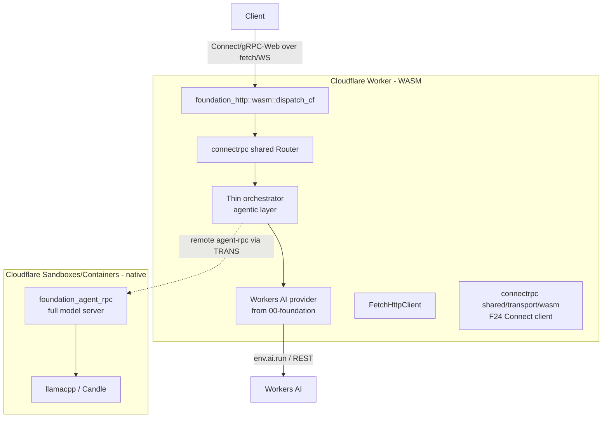
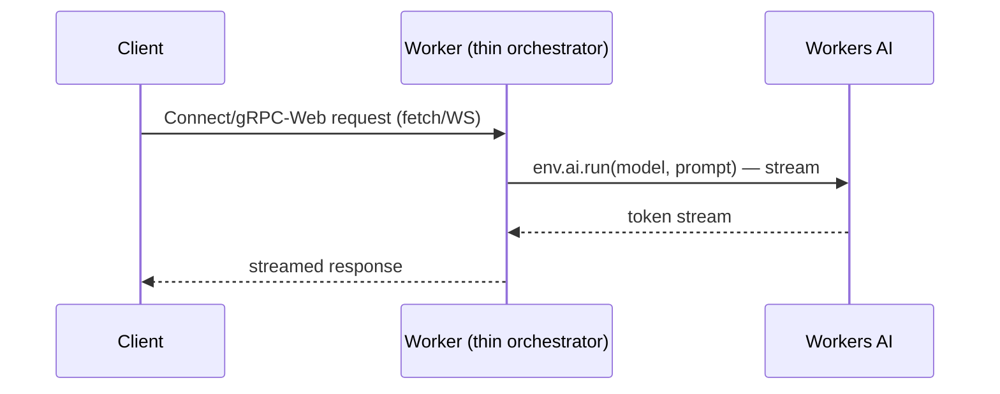

# Cloudflare Deployment

_Status note (2026-10-26): pending. New text is in ASD-STE100 Simplified Technical English (STE);
older paragraphs keep their wording. Code and identifiers stay as they are. **Feature 14 now
builds the Worker side of this feature**; section "Relation to feature 14" says which tasks
remain here._

**Abbreviations in this file.** WebAssembly (wasm); Cloudflare (CF); remote procedure call
(RPC); Transport Layer Security (TLS); mutual TLS (mTLS); Hypertext Transfer Protocol (HTTP);
HTTP version 2 (H2); WebSocket (WS); Representational State Transfer (REST); application
programming interface (API); continuous integration and continuous delivery (CI/CD); foreign
function interface (FFI); AeroSpace and Defence Industries Association of Europe (ASD), the
owner of the STE standard ASD-STE100.

## Glossary

| Term | Meaning |
|---|---|
| Worker | A Cloudflare Worker: a wasm program that answers HTTP `fetch` events. One thread, about 128 MB of memory. |
| Thin orchestrator | The agent layer on a Worker, with remote models only. Feature 07 calls it the Worker host. |
| Sandboxes, Containers | Cloudflare products that run a normal Linux container. The full native agent-rpc can run there. |
| Workers AI | Cloudflare's hosted model service. |
| F24 fetch transport | The `foundation_connectrpc` client transport over `fetch`. Feature 07 names it `FetchTransport`. |
| `dispatch_cf` | The `foundation_http` function that hands a Worker `fetch` event to a router. |


## Overview

agent-rpc targets Cloudflare in **two shapes**, not one — and this feature only
builds the *agent-rpc-specific* half of each. The wasm/CF-Workers foundation
(`foundation_ai` wasm-clean, the Workers AI provider, the `HttpClient` seam, and
the miniflare/Cloudflare example harness) is **already done by `00-foundation`**;
this feature consumes that ready foundation.

1. **Cloudflare Workers — a thin WASM agent orchestrator.** The local model
   backends (llamacpp/Candle) stay infeasible on Workers and remain
   `not(target_family = "wasm")`-gated. The agentic layer + Workers AI provider
   (from `00-foundation`) run on the Worker, served through
   `foundation_http::wasm::dispatch_cf` + `foundation_connectrpc::shared::Router`.

2. **Cloudflare Sandboxes/Containers — the full native model-server agent-rpc.**
   Long-running Linux containers with enough memory/CPU for the real
   `foundation_agent_rpc` + llama.cpp CPU inference. This is the `01-agent-rpc`
   binary packaged as a container — **not** WASM.

**Scope boundary (the overstep that was removed):** `foundation_installer` does
**not** know about Cloudflare. Its deploy targets are systemd and Docker, full
stop. Cloudflare deployment lives in `foundation_deployment_cloudflare` /
`ewe_deployables::cloudflare` — a deployment concern, not an installer concern.

## Language Stack

### Languages for This Feature

| Language | Purpose | Skill Location |
|----------|---------|----------------|
| Rust | thin orchestrator cdylib, F24 fetch transport, Sandboxes/Containers surface | `.agents/skills/rust-clean-code/skill.md` |

### Pre-Implementation Checklist

- [ ] Read `.agents/skills/rust-clean-code/skill.md`.
- [ ] Read `.agents/skills/rust-valtron-usage/skill.md` (Worker is single-threaded;
      native Sandboxes/Containers keep the threaded pool).
- [ ] Read `../00-foundation/feature.md` (the wasm readiness this consumes) and
      `../01-agent-rpc/feature.md` (the model server being deployed).
- [ ] Confirm `.agents/AGENTS.md`: stream bodies, use generated types, async all
      the way down (the Worker edge is `fetch`-based, no raw sockets).

---

## Requirements

1. **Thin WASM orchestrator build target in `foundation_agent_rpc`.**
   - A `wasm` feature / `crate-type = ["cdylib"]` target producing the Worker
     entry: agentic layer + Workers AI provider, served via
     `foundation_http::wasm::dispatch_cf` + `foundation_connectrpc::shared::Router`
     (Connect/gRPC-Web over fetch/WebSocket; **no H2 trailers** — gRPC `grpc-status`
     stays unavailable, matching spec 65's known gap).
   - The native full model-server build is unaffected.

2. **Worker-as-client fetch transport (the "remote agent-rpc" variant).**
   - Implement `foundation_connectrpc::shared::transport::wasm` (currently a
     capabilities stub, "lands in F24") so the thin orchestrator can act as a
     Connect **client** to a remote native agent-rpc when a custom model is
     required instead of Workers AI.

3. **Sandboxes/Containers support in `foundation_deployment_cloudflare`.**
   - The crate has Workers + API v4 (+ `generated/ai`) but **no Sandboxes/Containers**
     surface. Add it — the gap the full model server depends on.

4. **Everything streamed, everything typed.**
   - Workers AI streaming is a `Stream`; responses are never buffered whole; the
     Worker uses generated request/response types, not hand-rolled JSON.

---

## Architecture (COMPREHENSIVE)

### Technical Approach

- **Two artifacts, one agentic core.** The agentic layer (`foundation_ai::agentic`)
  is the shared brain, compiled to wasm for the Worker and native for
  Sandboxes/Containers. Only the model backend differs (Workers AI/remote vs local
  llamacpp/Candle).
- **Fetch-native edge.** A Worker's only I/O is `fetch`/WebSocket; `00-foundation`
  already wired `FetchHttpClient` (behind `wasm-fetch`) and
  `foundation_http::wasm::{serve_cf, dispatch_cf}`. This feature adds the
  agent-rpc entry point and the Connect client transport on top.
- **Deployment stays out of the installer.** Worker upload goes through
  `ewe_deployables::cloudflare::CloudflareWorker`; containers go through the new
  `foundation_deployment_cloudflare` Sandboxes/Containers surface.

### Component Structure



_The diagram shows the two Cloudflare shapes: a thin orchestrator on a Worker, and the full native server in a container._


### Changes required in existing crates

The user-facing heart of this feature: the concrete changes needed, and why.
Every "why" was verified against the repo (file/line) on 2026-10-19. The
foundation changes (foundation_ai/arrow/CI/Workers-AI provider) live in
`00-foundation`, not here.

| # | Crate | Change | Why (verified) | Task |
|---|-------|--------|----------------|------|
| 1 | `foundation_agent_rpc` | Add `wasm` feature / cdylib target for the thin orchestrator | new build target | T1 |
| 2 | `foundation_http` | None (use existing) | `wasm::{serve_cf, dispatch_cf}` already exist | T1 |
| 3 | `foundation_connectrpc` | Implement `shared/transport/wasm.rs` (the F24 fetch transport) | currently a capabilities stub (`shared/transport/wasm.rs:1-5`) | T2 |
| 4 | `foundation_netio` | None (use existing) | `FetchHttpClient` + `HttpClientBuilder` already exist (wired by `00-foundation`) | T2 |
| 5 | `foundation_deployment_cloudflare` | Add Sandboxes/Containers support | has Workers + API v4 + `generated/ai`, no Sandboxes/Containers | T3 |

### Component Details

1. **Thin orchestrator** (`foundation_agent_rpc`, `wasm` feature)
   - **Purpose**: the Worker entry — agentic layer + Workers AI provider, no local
     model, served as Connect/gRPC-Web over `dispatch_cf`.
   - **Interfaces**: `#[cfg(target_family = "wasm")]` entry wiring the
     `foundation_connectrpc::shared::Router` into `dispatch_cf`.

2. **Connect fetch transport** (`foundation_connectrpc::shared::transport::wasm`)
   - **Purpose**: `Transport` impl over `FetchHttpClient`, enabling the thin
     orchestrator to be a Connect client to a remote native agent-rpc.

3. **Sandboxes/Containers surface** (`foundation_deployment_cloudflare`)
   - **Purpose**: deploy/manage the native agent-rpc container on CF
     Sandboxes/Containers.

### Data Flow



_The diagram shows one streamed answer from Workers AI through the Worker._


1. Client hits the Worker over Connect/gRPC-Web (fetch/WebSocket, no H2).
2. The thin orchestrator calls Workers AI (or a remote agent-rpc via the F24
   transport) with the agentic-layer prompt.
3. Tokens stream back through the Worker to the client, unbuffered.

### Interface Definitions

**Public APIs (Rust, proposed):**
```rust
// foundation_agent_rpc — thin orchestrator entry
#[cfg(target_family = "wasm")]
pub fn wasm_worker_entry(env: Env) -> CfServe; // wires Router into dispatch_cf

// foundation_connectrpc — F24 fetch transport
pub struct WasmFetchTransport { /* FetchHttpClient + endpoint */ }
impl Transport for WasmFetchTransport { /* Connect client over fetch */ }

// foundation_deployment_cloudflare — Sandboxes/Containers
pub struct ContainersDeploy { /* account, image tag, container spec */ }
impl ContainersDeploy { async fn deploy(&self, spec: ContainerSpec) -> Result<(), DeployError>; }
```

### Error Handling Strategy

- `ProviderError` for Workers AI (auth, model-not-found, stream-aborted), mapped
  to Connect status; never a bare string.
- Worker errors surface as `dispatch_cf` HTTP/Connect responses, never panics
  (a Worker panic is a 500 with no detail — always convert to a typed error).

### Security Considerations

- Workers AI auth uses the Worker's bound binding/env secrets, never a hardcoded
  token in the bundle.
- _Corrected 2026-10-26:_ Cloudflare ends TLS in front of a Worker, so a Worker cannot run
  agent-rpc's own mTLS. Client auth on a Worker is a signed secret sent as a bearer credential,
  or Cloudflare's own mTLS (`request.cf.tlsClientAuth`), through the `ClientAuth` providers of
  feature 11 ([auth.md](../11-foundation-auth/auth.md) section 8).
- Sandboxes/Containers credentials are never bundled in the container image; they
  are injected by the deployment surface.

### Performance Considerations

- Worker CPU/memory budget is the hard constraint: no local model, no threads;
  the orchestrator only orchestrates. Streaming keeps memory flat.
- Sandboxes/Containers carry the real inference load (llama.cpp CPU), so the
  Worker stays a thin front.

### Trade-offs and Decisions

| Decision | Rationale | Alternatives Considered |
|----------|-----------|------------------------|
| Thin orchestrator on Workers, model remote | Workers can't run local LLMs (verified) | Port llama.cpp to wasm (rejected: impossible C FFI/threads/128 MB) |
| Full model server on Sandboxes/Containers | Native, real memory/CPU | Run inference in Workers (rejected: above) |
| Workers AI as default model provider | Serverless GPU, zero local model | Self-host model on Sandboxes (kept as alternative via F24) |
| Cloudflare deployment lives in `foundation_deployment_cloudflare`, not the installer | installer's mission is systemd + Docker | `cloudflare` deploy adapter in `foundation_installer` (rejected — overstep) |

---

## Implementation

### Files to Create/Modify

- `backends/foundation_agent_rpc/Cargo.toml` + `src/wasm.rs` — thin orchestrator
  cdylib entry.
- `backends/foundation_connectrpc/src/shared/transport/wasm.rs` — implement F24.
- `backends/foundation_deployment_cloudflare/src/` — Sandboxes/Containers support.
- `backends/foundation_agent_rpc/tests/wasm_orchestrator_tests.rs`,
  `backends/foundation_deployment_cloudflare/tests/containers_tests.rs`.

## Tasks

- [ ] **T1 — Thin orchestrator build target.** `wasm` cdylib in
      `foundation_agent_rpc`; serve Connect/gRPC-Web via `dispatch_cf` + shared
      `Router`; red test = a Connect unary round-trips through `dispatch_cf`.
- [ ] **T2 — Connect fetch transport (F24).** Implement
      `shared/transport/wasm.rs`; thin orchestrator acts as a Connect client to a
      remote agent-rpc; red test = a remote-agent-rpc round-trip over fetch.
- [ ] **T3 — Sandboxes/Containers.** Add the surface to
      `foundation_deployment_cloudflare`; native agent-rpc as a CI/CD-built image
      + tag; red test = deploy a container spec through the CF surface (mocked).
- [ ] **T4 — e2e: thin orchestrator on Workers.** Stream a Workers-AI answer over
      Connect/gRPC-Web (miniflare local + Cloudflare); red test = the whole chain.
- [ ] **T5 — e2e: remote agent-rpc over F24.** Thin orchestrator calls a remote
      native agent-rpc as a Connect client; red test = full round-trip.
- [ ] **T6 — e2e: Sandboxes native agent-rpc.** The containerized model server
      round-trips its model path on Sandboxes/Containers.

## Testing

### Test Cases

1. **Thin orchestrator serves Connect over `dispatch_cf`**
   - Given: the wasm orchestrator wired to a shared `Router`
   - When: a Connect unary request is dispatched
   - Then: a typed response round-trips; gRPC-Web also works (no H2 trailers)

2. **Remote agent-rpc via F24**
   - Given: the fetch transport implemented
   - When: the orchestrator calls a remote native agent-rpc
   - Then: Connect client round-trips over `FetchHttpClient`

3. **Sandboxes/Containers deploy**
   - Given: a container spec (image + tag)
   - When: `ContainersDeploy::deploy`
   - Then: the container is deployed through the CF surface

4. **End-to-end (Worker + Workers AI, and remote agent-rpc)**
   - Given: a deployed Worker and a model source
   - When: a client streams a chat
   - Then: tokens arrive unbuffered over Connect/gRPC-Web

### Local run commands

```bash
rustup target add wasm32-unknown-unknown   # one-time
cargo check --target wasm32-unknown-unknown -p foundation_agent_rpc --features wasm
cargo test -p foundation_agent_rpc --test wasm_orchestrator_tests
cargo test -p foundation_deployment_cloudflare --test containers_tests
```

## Success Criteria

- [ ] All 6 tasks completed with one red→green test each
- [ ] Thin orchestrator serves Connect/gRPC-Web on a Worker and streams a
      Workers-AI (or remote agent-rpc) answer
- [ ] F24 fetch transport lets the orchestrator act as a Connect client
- [ ] Full model-server agent-rpc runs on Sandboxes/Containers (native, not WASM)
- [ ] No installer involvement in Cloudflare deployment
- [ ] No TODO/FIXME/stubs; streamed, typed; no ignored `Result`s

## Relation to feature 14

Feature 07 designs the Worker host in full ([worker-and-web.md](../14-worker-host-and-web-client/worker-and-web.md)
section 5). To keep one design, the tasks map like this:

| Task here | State | Where it is now |
|---|---|---|
| T1: thin orchestrator build target (`src/wasm.rs`, `wasm_worker_entry`) | **Replaced** | Feature 14 T21: `host/worker/*` with `FetchServe` and one Durable Object per instance. |
| T2: Connect fetch transport (`WasmFetchTransport`) | **Replaced** | Feature 14 T19: `FetchTransport` and `FetchServe` in `foundation_connectrpc/src/wasm/`. |
| T3: Sandboxes and Containers in `foundation_deployment_cloudflare` | **Stays here** | This feature. |
| T4: end to end on Workers with Workers AI | **Stays here**, built on feature 14 T21 | The `cf-agent-rpc` example of feature 14 is its base. |
| T5: end to end, Worker to a remote native agent-rpc | **Stays here**, built on feature 14 T19 | |
| T6: end to end, native agent-rpc in a Cloudflare container | **Stays here** | |

So `depends_on` of this feature is now 00, 01 and 07.

### Lifecycle of the native container (T3, T6)

| Phase | What happens |
|---|---|
| Deploy | `ContainersDeploy::deploy` sends the image (a CI/CD-built tag) and the container settings through the generated Cloudflare API types. |
| Start | Cloudflare starts the container. The native agent-rpc host starts as on any machine (feature 13, hosts.md section 4). |
| Update | Deploy a new image tag. The open question below covers how traffic moves. |
| Stop | Cloudflare stops the container; the native host shuts down with its `shutdown_grace`. |

## Open questions

1. **How traffic moves to a new container version.** Cloudflare's container rollout settings
   decide this. **Recommendation:** read the current Containers API when T3 starts, and write
   the rollout steps here before building.
2. **Secrets for the container** (model keys, the operator key files of feature 11). They must
   come from the deployment surface, never from the image. **Recommendation:** use the same
   secret source as the Worker (owner decision 6 in agent-rpc-architecture.md), passed as container environment
   at deploy.

---

_Created: 2026-10-19_
