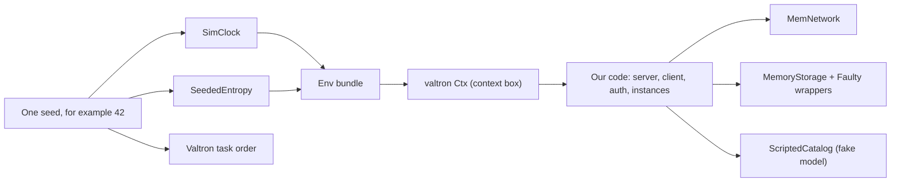
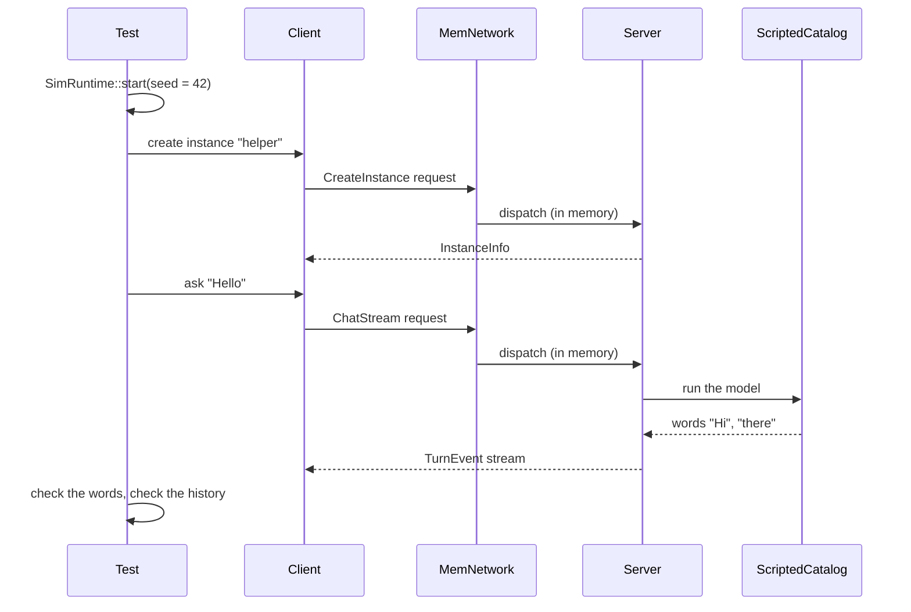

# Deterministic simulation testing

_Part of [feature 07](./feature.md). Written in ASD-STE100 Simplified Technical English
(STE). The reader can be 15 years old and new to this code._

**Abbreviations in this file.** deterministic simulation testing (DST); remote procedure call
(RPC); random number generator (RNG); identifier (ID); continuous integration (CI); key-value
store (KV); Structured Query Language (SQL); Transport Layer Security (TLS); AeroSpace and
Defence Industries Association of Europe (ASD), the owner of the STE standard ASD-STE100.
The [glossary in feature.md](./feature.md#2-glossary) explains each term.

## 1. The problem

A **test** is a small program. It runs our code and checks the result.

Some tests pass on one run and fail on the next run. Nobody changed the code. We call these
tests **flaky**. Flaky tests are bad for three reasons:

1. We stop trusting the tests.
2. A real bug can hide behind "it is only flaky".
3. A bug that happens one time in a thousand is very hard to find again.

Why does a test change from run to run? Because the code reads things from the world outside
it. Each run, the world is a little different:

| What the code reads | Why it changes on each run |
|---|---|
| The time | The clock moves. Each run starts at a different time. |
| Random numbers | They are random. That is their job. |
| The network | Messages can arrive late, in a different order, or not at all. |
| Storage | A disk or a database can be slow, full, or broken. |
| Threads | Two threads can run their steps in a different order each time. |

We call each of these a **side effect**: the code reads from, or changes, something outside
its own inputs.

## 2. The idea

**Deterministic** means "the same inputs always give the same result". A calculator is
deterministic: 2 + 2 is 4 on every run.

DST makes our whole program deterministic during a test. It does this in two steps:

1. We replace each side effect with a **fake**. A fake is a small, simple copy of the real
   thing that we control fully.
2. We make every fake get its decisions from one number. We call this number the **seed**.

Think of a board game with dice. Real dice give a new result on each throw. Now think of
"dice" that read their results from a list of numbers that you wrote down before the game.
If you play again with the same list, every throw is the same, so the whole game is the
same. The seed is like the start of that list.

The result: **one seed gives one exact run**. When a test fails, we write down its seed. Then
we run the test again with the same seed, and the same failure happens again, step by step.
Now we can find the bug.

## 3. The fakes

This table shows each side effect, the real part that a program uses, and the fake that a
DST run uses.

| Side effect | Real part (in a running program) | Fake part (in a DST run) |
|---|---|---|
| Time | `SystemClock`: reads the computer clock | `SimClock`: a clock that moves only when the test tells it to |
| Random numbers | `OsEntropy`: asks the operating system for random bytes | `SeededEntropy`: makes "random" bytes from the seed |
| New IDs | `Scru128Source` with the real clock and real random bytes | the same `Scru128Source`, but with `SimClock` and `SeededEntropy` |
| Waiting ("sleep") | `ValtronTimer` on real time | the same `ValtronTimer`, which now follows `SimClock` |
| Network | real sockets (`H1Transport`, `H2Transport`) | `MemNetwork`: the client and the server talk inside one program, with no sockets |
| Storage | Turso, libsql, D1, KV | `MemoryStorage`, with `Faulty*` wrappers that can fail on purpose |
| The model (the AI) | a real local or remote model | `ScriptedCatalog`: a fake model that "says" a list of words that the test wrote |
| Threads | the multi-threaded valtron pool | the single-threaded valtron engine: one step at a time, in a fixed order |

**Valtron** is our engine that runs tasks. A **task** is one piece of work, for example one
chat answer. On a real server, valtron runs many tasks on many threads at the same time. In
a DST run, valtron runs all tasks on one thread. It picks the next task with its own RNG, and
the seed sets that RNG. So the order of the steps is also fixed by the seed.

## 4. How the fakes reach the code

Our code does not call the real clock or the real RNG directly. A rule in `CLAUDE.md` (rule
11) forbids it, and a lint check stops the build if someone tries.

Instead, the code reads all side effects from one **bundle**. The bundle is a Rust value of
type `Env`. It holds the clock, the random source, the ID source and the timer.

The program puts the `Env` into valtron's **context** (`Ctx`). The context is a box that
travels with every task. Any code that runs inside a task can ask the box for the `Env`:

```rust
let env = Env::current()?;          // get the bundle from the task's context box
let now = env.clock().wall_now();   // ask the clock in the bundle for the time
```

- Line 1 asks the context box for the bundle. If there is no bundle, it returns an error. It
  never falls back to the real clock in secret.
- Line 2 reads the time from the clock in the bundle.

On a real server, the bundle holds the real clock. In a DST run, the bundle holds `SimClock`.
The code is the same. Only the bundle changes.



_The diagram shows how one seed sets the clock, the random bytes and the task order. All of
them reach our code through the `Env` bundle in the context box._

## 5. One DST run, step by step

1. The test picks a seed, for example `42`.
2. The test starts `SimRuntime::start(42, start_time)`. This makes the `SimClock`, the
   `SeededEntropy` and the `Env`, and it starts the single-threaded valtron engine.
3. The test builds the server with in-memory parts: `MemoryStorage` for storage, and
   `ScriptedCatalog` for the model.
4. The test connects a client to the server through `MemNetwork`. No socket opens.
5. The test runs the normal flow: create a secret, sign in, create an instance, ask a
   question, read the streamed answer, end the instance.
6. When the code waits ("sleep 5 seconds"), no real time passes. The test moves the
   `SimClock` forward with `advance`. The waiting task then continues at once.
7. The test checks the results: the answer words, the stored history, the counters.
8. If a check fails, the test prints the seed. A person can run the test again with that seed
   and see the same failure.



_The diagram shows one simulated run. The client and the server talk through `MemNetwork`,
in memory. The fake model answers with words that the test wrote._

## 6. Failures on purpose

A good test also checks what happens when things go wrong. In DST, we make things go wrong
on purpose, at a time that the seed chooses. We call this **failure injection**.

| Failure | How the test makes it happen | What our code must do |
|---|---|---|
| The connection drops | `MemNetwork` closes the stream in the middle of an answer | The client gets an error. The server ends the turn and frees the instance. |
| Storage breaks | A `Faulty*` wrapper returns an error from a write | The turn ends with a storage error. No half-written data stays. |
| A secret expires | The test moves `SimClock` past the end of the secret's time window | The server refuses the secret with "unauthenticated". |
| The clocks disagree | The test gives the client one `SimClock` and the server another, 10 minutes apart | Inside the allowed difference (5 minutes by default) the secret works. Outside it, the server refuses it. |
| The model is slow | `ScriptedCatalog` waits between words; the test advances the clock past the idle limit | The server ends the turn with "turn failed" after the idle time. |

The seed also chooses **when** a failure happens. For example, the seed can choose "drop the
connection after word number 3". So a test with many seeds tries many different moments.

## 7. Many seeds

One seed tests one path. Bugs often hide on paths that we did not think of. So we run the
same test with many seeds:

- In normal CI runs, each DST test runs with a small fixed list of seeds (for example 32
  seeds). The list is the same on every run, so CI stays stable.
- In a longer "soak" run, a test runs with thousands of new seeds. When one fails, the test
  prints its seed. We add that seed to the fixed list, so the bug never comes back without a
  failing test.

## 8. A small example

This test checks that a secret stops working when its time window ends.

```rust
#[test]
fn expired_secret_is_refused() {
    for seed in DST_SEEDS {                                  // 1
        let sim = SimRuntime::start(seed, START);            // 2
        let world = TestWorld::in_memory(&sim);              // 3
        let secret = world.issue_secret(Duration::from_secs(60)); // 4
        assert!(world.client().health(&secret).is_ok());     // 5
        sim.clock.advance(Duration::from_secs(61 + 300));    // 6
        let result = world.client().health(&secret);         // 7
        assert_eq!(result.unwrap_err().code(), Code::Unauthenticated, "seed {seed}"); // 8
    }
}
```

What each line does:

1. Run the test body once for each seed in the fixed list.
2. Start a simulated runtime from the seed. Time starts at `START` and does not move by
   itself.
3. Build a server and a client with only in-memory parts.
4. Make a signed secret that is good for 60 seconds.
5. Use the secret one time. It works, because no time has passed.
6. Move the simulated clock forward by 61 seconds plus the allowed clock difference (300
   seconds). This takes no real time.
7. Use the secret again.
8. Check that the server refuses it. If the check fails, the message shows the seed, so we
   can run the same path again.

The test runs in a few milliseconds, even though it "waits" more than 6 minutes.

## 9. What DST does not cover

- **Real TLS.** The TLS libraries read their own random numbers, and we cannot give them our
  seed. DST does not run TLS. The native end-to-end tests cover TLS with real sockets.
- **Real models.** DST uses the fake model. Separate tests load a small real model.
- **Real Cloudflare.** DST does not run inside Cloudflare. Tests with Miniflare (a local copy
  of Cloudflare) cover the Worker host.
- **Speed.** DST checks that the behavior is correct, not how fast it is.

## 10. Where the parts live

| Part | Crate and file | Task |
|---|---|---|
| `SimClock`, `SeededEntropy`, `Scru128Source` | `foundation_compact` (`clock`, `entropy`, `ids`) | T1 |
| `Env`, and the `Env` in valtron's context | `foundation_core` (`env`, `valtron`) | T2 |
| `SimRuntime` | `foundation_core/src/valtron/sim.rs` (feature `testing`) | T18 |
| `MemNetwork`, `MemTransport` | `foundation_connectrpc` (feature `testing`) | T18 |
| `Faulty*` storage wrappers | `foundation_db` (feature `testing`) | T18 |
| `ScriptedCatalog`, `TestWorld` | `foundation_agent_rpc` (feature `testing`) | T18 |

All DST tests live in each crate's `tests/` directory (`CLAUDE.md` rule 7). The fakes live
behind each crate's `testing` feature, so they never go into a release build.
