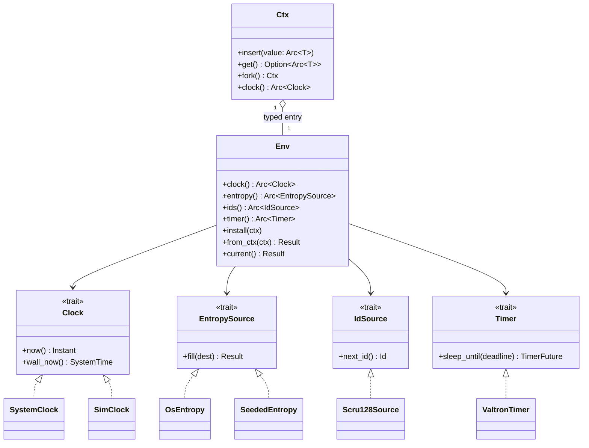
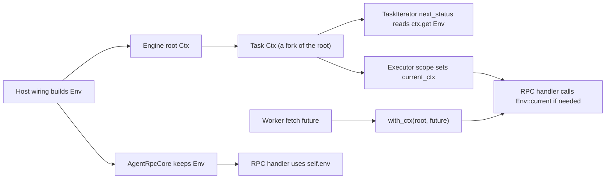

# Side effects and the `Env` bundle

_Part of [feature 07](./feature.md). Written in ASD-STE100 Simplified Technical English (STE).
Code and identifiers stay as they are._

**Abbreviations in this file.** random number generator (RNG); identifier (ID);
deterministic simulation testing (DST); remote procedure call (RPC); WebAssembly (wasm);
JavaScript (JS); Durable Object (DO); Transport Layer Security (TLS); mutual TLS (mTLS);
Certificate Authority (CA); certificate signing request (CSR); Elliptic Curve Digital
Signature Algorithm (ECDSA); Rivest–Shamir–Adleman (RSA), a public-key algorithm;
Probabilistic Signature Scheme (PSS), a padding mode for RSA signatures; authenticated
encryption with associated data (AEAD); key encryption key (KEK); application programming
interface (API); continuous integration (CI); Request for Comments (RFC), an internet
standard document; Sortable, Clock and Random number based 128-bit ID (scru128); Structured
Query Language (SQL); Hypertext Transfer Protocol (HTTP); JavaScript Object Notation (JSON); JSON Web Token (JWT); key-value
store (KV); AeroSpace and Defence Industries Association of Europe (ASD), the owner of the
STE standard ASD-STE100. D1 and R2 are names of Cloudflare products (a SQL database and an object store), not
abbreviations. The
[glossary in feature.md](./feature.md#2-glossary) explains each term.

## 1. What a side effect is

A **side effect** is something that a function reads from, or does to, the world outside its
arguments. Examples:

- It reads the time.
- It reads random bytes.
- It makes a new ID.
- It waits ("sleeps") for a time.
- It sends bytes over the network.
- It reads or writes storage.
- It runs a model.

A side effect makes a test hard to repeat. The time is different on each run. The random
bytes are different on each run. So a test can pass once and fail the next time.

## 2. The rule

1. Put every side effect behind a trait. A **trait** is a Rust interface: a set of functions that a type promises to provide.
2. Give the trait to the code that needs it. Do not let core code reach a global function.
3. Only the **host wiring** picks the real implementations. The host wiring is the small part of each program that starts it: the native `main`, the Worker `fetch` entry, the DST harness.
4. Core code must not call `SystemTime::now()`, `Instant::now()`, `rand::thread_rng()`, `getrandom`, `foundation_compact::entropy::fill`, `foundation_compact::ids::new_scru128()`, `chrono::Utc::now()` or `time::OffsetDateTime::now_utc()`. A lint enforces this (section 11).

The side effects split into two groups:

| Group | Side effects | Where the trait lives | How code gets it |
|---|---|---|---|
| Ambient effects: every part of the program needs them | clock, entropy, IDs, timer | `foundation_compact` (clock, entropy, IDs), `foundation_core::valtron` (timer) | the `Env` bundle in valtron's `Ctx` |
| Input/output resources: each component needs its own | network, storage, models | `foundation_connectrpc` (transport, dispatch), `foundation_db` (stores), `foundation_agent_rpc::core` (model catalog) | a constructor argument |

## 3. What exists today, and what is missing

We read the code on `master` before we designed this. We extend what exists. We do not build
a second system.

| Item | What exists (file on `master`) | What is missing |
|---|---|---|
| Monotonic time | `foundation_compact::Instant`: `std::time::Instant` on native, `performance.now()` on wasm (`src/wasm/instant.rs`) | Nothing. We use it as the real clock. |
| Wall time | `foundation_compact::SystemTime`: `std::time::SystemTime` on native, `Date.now()` on wasm | Nothing. |
| A clock trait | `foundation_core::valtron::Clock` with `now()` and `elapsed()`, real impl `MonotonicClock` (`valtron/ctx.rs`). Tests already have a `MockClock` (`tests/valtron/ctx.rs`). | Wall time in the trait. The engine has no way to take a clock from the caller. The executor timers do not use it. |
| Entropy | `foundation_compact::entropy::fill` (vendored getrandom, all targets); `rng::SysRng`, `rng::ThreadRng` | A trait that a caller can inject. A seeded source for tests. |
| A seeded RNG | `valtron::Ctx::rng()`: a `ChaCha8Rng` seeded from `initialize_pool(seed, …)` | Nothing for scheduling. It is not a source for secrets: its seed is a small number that the caller passes. |
| IDs | `foundation_compact::ids::Generator<R: RandSource, T: TimeSource>` (scru128) | A trait. A generator built from the injected clock and entropy. |
| Sleep | `valtron::sleep_async(duration)` and `SleepingTask` (`executors/sleep.rs`) | A trait. They read `std::time::Instant::now()` directly. That call panics on `wasm32-unknown-unknown`, and a test cannot move it. |
| Deadline timer | `foundation_connectrpc::DeadlineTimer::sleep_until(std::time::Instant)` | The type `std::time::Instant` cannot exist on wasm. Use `foundation_compact::Instant`. |
| Typed context | `valtron::Ctx`: a type map (`insert::<T>(Arc<T>)`, `get::<T>()`), forked per task from one root | A way to put entries in the root at start. A way for an `async fn` to read the current `Ctx`. A way to run a task under a given `Ctx`. |

## 4. The four ambient effect traits

### 4.1 `Clock` (in `foundation_compact::clock`)

We move valtron's `Clock` trait down into `foundation_compact` and add wall time. One trait
gives both kinds of time. A simulated clock then moves both together.

```rust
// foundation_compact/src/clock/mod.rs (new module)
//! Clocks: monotonic time and wall time behind one trait.

use alloc::sync::Arc;

use crate::{Duration, Instant, SystemTime, UNIX_EPOCH};

/// A source of time.
///
/// `now` is monotonic: it never goes back. Use it for deadlines,
/// timeouts and durations. `wall_now` is the calendar time. Use it for
/// validity windows, certificate dates and stored records.
pub trait Clock: Send + Sync + 'static {
    /// Monotonic time.
    fn now(&self) -> Instant;
    /// Wall (calendar) time.
    fn wall_now(&self) -> SystemTime;
}

/// The real clock. Only host wiring creates it.
#[derive(Debug, Clone, Copy, Default)]
pub struct SystemClock;

impl Clock for SystemClock {
    // The one place in the workspace that reads the real monotonic clock.
    #[allow(clippy::disallowed_methods)]
    fn now(&self) -> Instant {
        Instant::now()
    }

    // The one place in the workspace that reads the real wall clock.
    #[allow(clippy::disallowed_methods)]
    fn wall_now(&self) -> SystemTime {
        SystemTime::now()
    }
}

/// Whole seconds since the Unix epoch, or 0 for a time before it.
#[must_use]
pub fn unix_secs(t: SystemTime) -> u64 {
    t.duration_since(UNIX_EPOCH).map_or(0, |d| d.as_secs())
}

/// A shared clock handle.
pub type DynClock = Arc<dyn Clock>;
```

What the code does: it defines the `Clock` trait with two functions. `SystemClock` reads
the real time. It is the only code that may call `Instant::now()` and `SystemTime::now()`.
`unix_secs` turns a wall time into seconds, which the stores and the secret format use.

`foundation_core::valtron` re-exports this trait: `pub use foundation_compact::clock::Clock;`.
`MonotonicClock` becomes `pub type MonotonicClock = SystemClock;` with a deprecation note.
The old `Clock::elapsed()` goes away. Its only user is a test in `tests/valtron/ctx.rs`; that
test computes `now() - origin` instead.

The simulated clock lives behind the `testing` feature of `foundation_compact`:

```rust
// foundation_compact/src/clock/sim.rs (feature "testing")
use std::sync::Mutex;

use crate::{Duration, Instant, SystemTime};
use super::Clock;

/// A clock that moves only when a test moves it.
///
/// Monotonic and wall time move together. `skew_wall` moves only the wall
/// time, to imitate a host whose calendar clock is wrong.
pub struct SimClock {
    state: Mutex<SimState>,
}

struct SimState {
    // Real `Instant`s have no constructor, so the clock takes one real
    // reading at creation and adds the simulated time to it. Code only
    // uses differences between `Instant`s, so runs stay identical.
    origin: Instant,
    elapsed: Duration,
    wall_start: SystemTime,
    // Milliseconds added to (positive) or taken from (negative) wall time.
    wall_skew_ms: i64,
}

impl SimClock {
    /// A clock whose wall time starts at `wall_start`.
    #[allow(clippy::disallowed_methods)] // the single real reading, test-only
    #[must_use]
    pub fn new(wall_start: SystemTime) -> Self {
        Self {
            state: Mutex::new(SimState {
                origin: Instant::now(),
                elapsed: Duration::ZERO,
                wall_start,
                wall_skew_ms: 0,
            }),
        }
    }

    /// Move monotonic and wall time forward by `by`.
    pub fn advance(&self, by: Duration) {
        let mut s = self.state.lock().unwrap_or_else(std::sync::PoisonError::into_inner);
        s.elapsed += by;
    }

    /// Move time forward to `deadline`. A deadline in the past does nothing.
    pub fn advance_to(&self, deadline: Instant) {
        let mut s = self.state.lock().unwrap_or_else(std::sync::PoisonError::into_inner);
        let now = s.origin + s.elapsed;
        if deadline > now {
            s.elapsed += deadline - now;
        }
    }

    /// Set the wall clock error, in milliseconds (positive = ahead).
    pub fn skew_wall_ms(&self, skew_ms: i64) {
        let mut s = self.state.lock().unwrap_or_else(std::sync::PoisonError::into_inner);
        s.wall_skew_ms = skew_ms;
    }

    /// The simulated time since creation.
    #[must_use]
    pub fn elapsed(&self) -> Duration {
        self.state.lock().unwrap_or_else(std::sync::PoisonError::into_inner).elapsed
    }
}

impl Clock for SimClock {
    fn now(&self) -> Instant {
        let s = self.state.lock().unwrap_or_else(std::sync::PoisonError::into_inner);
        s.origin + s.elapsed
    }

    fn wall_now(&self) -> SystemTime {
        let s = self.state.lock().unwrap_or_else(std::sync::PoisonError::into_inner);
        let base = s.wall_start + s.elapsed;
        let skew = Duration::from_millis(s.wall_skew_ms.unsigned_abs());
        if s.wall_skew_ms >= 0 { base + skew } else { base - skew }
    }
}
```

What the code does: a test creates a `SimClock` and calls `advance`. Nothing else moves the
time. `skew_wall_ms` makes one side of a test think that the calendar time is different.
We use it to test the clock-skew rules of the signed secret.

### 4.2 `EntropySource` (in `foundation_compact::entropy`)

```rust
// foundation_compact/src/entropy/source.rs (new file, re-exported from entropy)
use super::Error;

/// A source of random bytes for secrets, keys, nonces and IDs.
///
/// `&self`, so one source is shared by `Arc` between threads and tasks.
pub trait EntropySource: Send + Sync + 'static {
    /// Fill `dest` with random bytes.
    ///
    /// # Errors
    /// The platform source is not available.
    fn fill(&self, dest: &mut [u8]) -> Result<(), Error>;
}

/// The real source: the vendored platform entropy (`getrandom` code,
/// `crypto.getRandomValues` on wasm). Only host wiring creates it.
#[derive(Debug, Clone, Copy, Default)]
pub struct OsEntropy;

impl EntropySource for OsEntropy {
    #[allow(clippy::disallowed_methods)] // the one real entropy read
    fn fill(&self, dest: &mut [u8]) -> Result<(), Error> {
        super::fill(dest)
    }
}

/// Lets an API that wants a `rand_core` RNG draw from any `EntropySource`.
pub struct EntropyRng<'a>(pub &'a dyn EntropySource);

impl rand_core::TryRng for EntropyRng<'_> {
    type Error = Error;

    fn try_next_u32(&mut self) -> Result<u32, Error> {
        let mut b = [0u8; 4];
        self.0.fill(&mut b)?;
        Ok(u32::from_le_bytes(b))
    }

    fn try_next_u64(&mut self) -> Result<u64, Error> {
        let mut b = [0u8; 8];
        self.0.fill(&mut b)?;
        Ok(u64::from_le_bytes(b))
    }

    fn try_fill_bytes(&mut self, dst: &mut [u8]) -> Result<(), Error> {
        self.0.fill(dst)
    }
}

impl rand_core::TryCryptoRng for EntropyRng<'_> {}
```

What the code does: `EntropySource` gives random bytes. `OsEntropy` is the real source.
`EntropyRng` lets other libraries (for example the scru128 generator) use the same source.

The seeded source for tests:

```rust
// foundation_compact/src/entropy/seeded.rs (feature "testing")
use std::sync::Mutex;

use rand_chacha::ChaCha20Rng;
use rand_core::{Rng, SeedableRng};

use crate::hash::Hasher;
use super::{EntropySource, Error};

/// Random bytes from a seed. The same seed gives the same bytes.
pub struct SeededEntropy {
    seed: u64,
    rng: Mutex<ChaCha20Rng>,
}

impl SeededEntropy {
    #[must_use]
    pub fn new(seed: u64) -> Self {
        Self { seed, rng: Mutex::new(ChaCha20Rng::seed_from_u64(seed)) }
    }

    /// The seed of this source.
    #[must_use]
    pub fn seed(&self) -> u64 {
        self.seed
    }

    /// A separate source for one part of a test (for example "network").
    ///
    /// The child seed comes from (seed, label) only. So a new consumer of
    /// randomness in one part does not change the bytes of other parts.
    #[must_use]
    pub fn fork(&self, label: &str) -> Self {
        let mut h = Hasher::default();
        core::hash::Hasher::write_u64(&mut h, self.seed);
        core::hash::Hasher::write(&mut h, label.as_bytes());
        Self::new(core::hash::Hasher::finish(&h))
    }
}

impl EntropySource for SeededEntropy {
    fn fill(&self, dest: &mut [u8]) -> Result<(), Error> {
        self.rng
            .lock()
            .unwrap_or_else(std::sync::PoisonError::into_inner)
            .fill_bytes(dest);
        Ok(())
    }
}
```

What the code does: `SeededEntropy` makes the same bytes for the same seed. `fork` gives each
part of a test its own stream. `foundation_compact::hash::Hasher` is the deterministic
foldhash wrapper that already exists.

### 4.3 `IdSource` (in `foundation_compact::ids`)

```rust
// foundation_compact/src/ids/source.rs (new file, re-exported from ids)
use std::sync::{Arc, Mutex};

use rand_chacha::ChaCha12Rng;
use rand_core::{Rng, SeedableRng};

use crate::clock::{unix_secs, Clock};
use crate::entropy::{EntropySource, Error};
use super::{Generator, Id, RandSource, TimeSource};

/// A source of new, sortable IDs.
pub trait IdSource: Send + Sync + 'static {
    fn next_id(&self) -> Id;
}

/// scru128 IDs from an injected clock and an injected entropy source.
pub struct Scru128Source {
    generator: Mutex<Generator<SeededDraws, ClockTime>>,
}

impl Scru128Source {
    /// Take a 32-byte seed from `entropy` once. Later IDs never fail.
    ///
    /// # Errors
    /// The entropy source failed.
    pub fn new(clock: Arc<dyn Clock>, entropy: &dyn EntropySource) -> Result<Self, Error> {
        let mut seed = [0u8; 32];
        entropy.fill(&mut seed)?;
        let draws = SeededDraws(ChaCha12Rng::from_seed(seed));
        Ok(Self {
            generator: Mutex::new(Generator::with_rand_and_time_sources(draws, ClockTime(clock))),
        })
    }
}

impl IdSource for Scru128Source {
    fn next_id(&self) -> Id {
        self.generator
            .lock()
            .unwrap_or_else(std::sync::PoisonError::into_inner)
            .generate()
    }
}

struct SeededDraws(ChaCha12Rng);

impl RandSource for SeededDraws {
    fn next_u32(&mut self) -> u32 {
        self.0.next_u32()
    }
}

struct ClockTime(Arc<dyn Clock>);

impl TimeSource for ClockTime {
    fn unix_ts_ms(&mut self) -> u64 {
        let wall = self.0.wall_now();
        unix_secs(wall) * 1000 + u64::from(wall_subsec_millis(wall))
    }
}

fn wall_subsec_millis(t: crate::SystemTime) -> u32 {
    t.duration_since(crate::UNIX_EPOCH).map_or(0, |d| d.subsec_millis())
}
```

What the code does: it builds the existing scru128 `Generator` from the injected clock and
entropy. The seed is read once, so `next_id` cannot fail. With `SimClock` and
`SeededEntropy`, the IDs are the same on every run.

### 4.4 `Timer` (in `foundation_core::valtron`)

Sleeping needs the executor, so this trait lives in valtron.

```rust
// foundation_core/src/valtron/timer.rs (new file)
use core::future::Future;
use core::pin::Pin;

use foundation_compact::{Duration, Instant};

/// A future that a `Timer` returns.
pub type TimerFuture = Pin<Box<dyn Future<Output = ()> + Send + 'static>>;

/// Waits until a monotonic deadline.
pub trait Timer: Send + Sync + 'static {
    /// Resolve once `deadline` has passed on the engine clock.
    fn sleep_until(&self, deadline: Instant) -> TimerFuture;
}

/// The real timer: a valtron `SleepingTask` on the current engine.
///
/// The engine compares deadlines with its own `Clock` (section 6.2), so
/// under a `SimClock` this timer runs on simulated time with no change.
#[derive(Debug, Clone, Copy, Default)]
pub struct ValtronTimer;

impl Timer for ValtronTimer {
    fn sleep_until(&self, deadline: Instant) -> TimerFuture {
        Box::pin(super::sleep_until_async(deadline))
    }
}
```

What the code does: `Timer` is one function, `sleep_until`. `ValtronTimer` asks the valtron
engine to wake the caller at the deadline. It reads no clock itself. The engine reads the
clock that the host gave it. So the same timer works on real time and on simulated time.

`foundation_connectrpc::DeadlineTimer` gets an adapter, so the RPC deadline also uses the
injected time:

```rust
// foundation_connectrpc/src/shared/router/dispatch.rs (changed)
/// Waits until an instant: how dispatch enforces a call's deadline.
pub trait DeadlineTimer: Send + Sync {
    fn sleep_until(&self, deadline: foundation_compact::Instant) -> BoxFuture<'_, ()>;
}

/// Any valtron `Timer` is a `DeadlineTimer`.
pub struct TimerDeadline(pub std::sync::Arc<dyn foundation_core::valtron::Timer>);

impl DeadlineTimer for TimerDeadline {
    fn sleep_until(&self, deadline: foundation_compact::Instant) -> BoxFuture<'_, ()> {
        self.0.sleep_until(deadline)
    }
}
```

On native, `foundation_compact::Instant` is the same type as `std::time::Instant`. So the
native HTTP/1.1 timer (`ConnIo`) needs no change except its signature path.

## 5. The `Env` bundle (in `foundation_core::env`)

The owner chose one bundle, not one generic type parameter per effect. `Env` holds the four
ambient effects. It is cheap to clone: each field is an `Arc`.

```rust
// foundation_core/src/env.rs (new module, `std` feature)
//! The effect environment: clock, entropy, IDs and timer in one bundle.

use std::sync::Arc;

use foundation_compact::clock::{unix_secs, Clock, SystemClock};
use foundation_compact::entropy::{EntropySource, OsEntropy};
use foundation_compact::ids::{Id, IdSource, Scru128Source};
use foundation_compact::{Duration, Instant, SystemTime};

use crate::valtron::{current_ctx, Ctx, Timer, TimerFuture, ValtronTimer};

/// The ambient side effects of a program.
#[derive(Clone)]
pub struct Env {
    clock: Arc<dyn Clock>,
    entropy: Arc<dyn EntropySource>,
    ids: Arc<dyn IdSource>,
    timer: Arc<dyn Timer>,
}

/// Why an `Env` is not available.
#[derive(Debug, Clone, PartialEq, Eq, derive_more::Display, derive_more::Error)]
pub enum EnvError {
    /// The code runs outside a valtron task and outside `with_ctx`.
    #[display("no valtron task context here (run inside a task or `with_ctx`)")]
    NoTaskContext,
    /// The context holds no `Env`. The host did not install one.
    #[display("the task context holds no Env (the host did not install one)")]
    Missing,
    /// The entropy source failed while the real `Env` was built.
    #[display("entropy source failed: {_0}")]
    Entropy(#[error(not(source))] String),
    /// `EnvBuilder::build` found a missing member.
    #[display("the Env builder has no {_0}")]
    Incomplete(#[error(not(source))] &'static str),
}

impl Env {
    /// The real effects. Call this only in host wiring.
    ///
    /// # Errors
    /// [`EnvError::Entropy`] when the platform entropy source fails.
    pub fn system() -> Result<Self, EnvError> {
        let clock: Arc<dyn Clock> = Arc::new(SystemClock);
        let entropy: Arc<dyn EntropySource> = Arc::new(OsEntropy);
        let ids = Scru128Source::new(Arc::clone(&clock), entropy.as_ref())
            .map_err(|e| EnvError::Entropy(e.to_string()))?;
        Ok(Self { clock, entropy, ids: Arc::new(ids), timer: Arc::new(ValtronTimer) })
    }

    /// Start a bundle with explicit members (tests, DST).
    #[must_use]
    pub fn builder() -> EnvBuilder {
        EnvBuilder::default()
    }

    #[must_use] pub fn clock(&self) -> &Arc<dyn Clock> { &self.clock }
    #[must_use] pub fn entropy(&self) -> &Arc<dyn EntropySource> { &self.entropy }
    #[must_use] pub fn ids(&self) -> &Arc<dyn IdSource> { &self.ids }
    #[must_use] pub fn timer(&self) -> &Arc<dyn Timer> { &self.timer }

    /// A copy with one member changed. The other three stay shared.
    #[must_use]
    pub fn with_clock(&self, clock: Arc<dyn Clock>) -> Self {
        Self { clock, ..self.clone() }
    }
    #[must_use]
    pub fn with_entropy(&self, entropy: Arc<dyn EntropySource>) -> Self {
        Self { entropy, ..self.clone() }
    }
    #[must_use]
    pub fn with_ids(&self, ids: Arc<dyn IdSource>) -> Self {
        Self { ids, ..self.clone() }
    }
    #[must_use]
    pub fn with_timer(&self, timer: Arc<dyn Timer>) -> Self {
        Self { timer, ..self.clone() }
    }

    // ---- Short forms for the common calls ----

    #[must_use] pub fn now(&self) -> Instant { self.clock.now() }
    #[must_use] pub fn wall_now(&self) -> SystemTime { self.clock.wall_now() }
    #[must_use] pub fn unix_secs(&self) -> u64 { unix_secs(self.clock.wall_now()) }
    #[must_use] pub fn next_id(&self) -> Id { self.ids.next_id() }

    /// Fill `buf` with random bytes.
    ///
    /// # Errors
    /// [`EnvError::Entropy`] when the entropy source fails.
    pub fn fill_random(&self, buf: &mut [u8]) -> Result<(), EnvError> {
        self.entropy.fill(buf).map_err(|e| EnvError::Entropy(e.to_string()))
    }

    /// Sleep for `duration` on the engine clock.
    #[must_use]
    pub fn sleep(&self, duration: Duration) -> TimerFuture {
        self.timer.sleep_until(self.clock.now() + duration)
    }

    // ---- The link with valtron's Ctx ----

    /// Put this bundle into `ctx` (replaces an earlier one).
    pub fn install(&self, ctx: &Ctx) {
        let _previous = ctx.insert(Arc::new(self.clone()));
    }

    /// The bundle in `ctx`.
    ///
    /// # Errors
    /// [`EnvError::Missing`] when `ctx` holds none. Never falls back to
    /// the real effects.
    pub fn from_ctx(ctx: &Ctx) -> Result<Arc<Env>, EnvError> {
        ctx.get::<Env>().ok_or(EnvError::Missing)
    }

    /// The bundle of the task that runs now.
    ///
    /// # Errors
    /// [`EnvError::NoTaskContext`] outside a valtron task or `with_ctx`
    /// scope; [`EnvError::Missing`] when the context holds no `Env`.
    pub fn current() -> Result<Arc<Env>, EnvError> {
        let ctx = current_ctx().ok_or(EnvError::NoTaskContext)?;
        Self::from_ctx(&ctx)
    }
}

/// Builds an `Env` from explicit members. Every member is required.
#[derive(Default)]
pub struct EnvBuilder {
    clock: Option<Arc<dyn Clock>>,
    entropy: Option<Arc<dyn EntropySource>>,
    ids: Option<Arc<dyn IdSource>>,
    timer: Option<Arc<dyn Timer>>,
}

impl EnvBuilder {
    #[must_use] pub fn clock(mut self, c: Arc<dyn Clock>) -> Self { self.clock = Some(c); self }
    #[must_use] pub fn entropy(mut self, e: Arc<dyn EntropySource>) -> Self { self.entropy = Some(e); self }
    #[must_use] pub fn ids(mut self, i: Arc<dyn IdSource>) -> Self { self.ids = Some(i); self }
    #[must_use] pub fn timer(mut self, t: Arc<dyn Timer>) -> Self { self.timer = Some(t); self }

    /// # Errors
    /// [`EnvError::Incomplete`] names the first missing member.
    pub fn build(self) -> Result<Env, EnvError> {
        Ok(Env {
            clock: self.clock.ok_or(EnvError::Incomplete("clock"))?,
            entropy: self.entropy.ok_or(EnvError::Incomplete("entropy"))?,
            ids: self.ids.ok_or(EnvError::Incomplete("ids"))?,
            timer: self.timer.ok_or(EnvError::Incomplete("timer"))?,
        })
    }
}
```

What the code does:

- `Env::system()` builds the real bundle. Only host wiring calls it.
- `Env::builder()` builds a bundle from parts. Tests and DST use it.
- `with_clock` (and the other `with_*`) change one member and keep the rest.
- `install` puts the bundle into a valtron `Ctx`. `from_ctx` and `current` read it back.
- A missing bundle is a typed error (`EnvError`). The code never uses the real clock as a fallback.

## 6. The `Env` in valtron's `Ctx`

### 6.1 Two different `Ctx` types

The workspace has two types with the name `Ctx`. Do not mix them up.

| Type | What it is | Lifetime | Who makes it |
|---|---|---|---|
| `foundation_core::valtron::Ctx` | The context of one valtron task: a type map plus the engine clock and RNG. | One per task, forked from the engine root. | The valtron engine. |
| `foundation_connectrpc::Ctx` | The context of one RPC call: the call deadline, headers, peer, cancel signal, extensions. | One per call. | The RPC dispatcher. |

The `Env` lives in the **valtron** `Ctx`. An RPC handler reaches it as section 6.4 shows.

This class diagram shows where `Env` sits. The engine root `Ctx` holds the `Env`. Each task
gets a fork of the root, so each task sees the same `Env`.



### 6.2 What valtron must add (task T2)

The `Ctx` of today has the type map, but it lacks five things. We add them in
`foundation_core::valtron`.

1. **Root entries at start.** Today a task gets a fork of the engine root `Ctx`, and nobody can put an entry into that root. Add an `Env` (and its clock) to the start configuration:

   ```rust
   // foundation_core/src/valtron/executors/multi/mod.rs (changed)
   #[derive(Debug, Clone)]            // no longer `Copy`: it holds an Env
   pub struct PoolConfig {
       pub background_shutdown_timeout: std::time::Duration,
       /// The effects of this program. `None` = `Env::system()`.
       pub env: Option<crate::env::Env>,
   }

   impl PoolConfig {
       #[must_use]
       pub fn with_env(mut self, env: crate::env::Env) -> Self {
           self.env = Some(env);
           self
       }
   }

   // foundation_core/src/valtron/executors/single/mod.rs (new)
   pub struct SingleConfig {
       pub seed_for_rng: u64,
       pub env: Option<crate::env::Env>,
   }
   pub fn initialize_pool_with(config: SingleConfig) { /* … */ }
   ```

   At start the engine makes its root `Ctx` with `clock = env.clock()` and calls
   `env.install(&root)`. `initialize_pool(seed, …)` keeps its signature. It uses
   `Env::system()`, so every program that runs today still runs. That call is host wiring:
   it is the start of the program.

2. **Timers on the engine clock.** `SleepingTask` (`executors/sleep.rs`), `DurationWaker` (`synca/sleepers.rs`), `SleepIterator` (`delayed_iterators.rs`), `executors/wrappers.rs` and `executors/background.rs` call `std::time::Instant::now()`. Change each to read `ctx.clock().now()` (the engine clock). This also removes a panic: `std::time::Instant::now()` panics on `wasm32-unknown-unknown`. Add `sleep_until_async(deadline)` next to `sleep_async(duration)`.

3. **The current context for `async` code.** A future that runs inside `FutureTask` cannot see the `Ctx`: `FutureTask::next_status` drops it (`executors/future_task.rs`). Add a thread-local stack:

   ```rust
   // foundation_core/src/valtron/current.rs (new)
   std::thread_local! {
       static CURRENT: core::cell::RefCell<Vec<Ctx>> = const { core::cell::RefCell::new(Vec::new()) };
   }

   /// The `Ctx` of the task (or `with_ctx` scope) that runs on this thread now.
   #[must_use]
   pub fn current_ctx() -> Option<Ctx> {
       CURRENT.with(|s| s.borrow().last().cloned())
   }

   /// Pushes `ctx` for the life of the guard. The executor makes one guard
   /// around every `next_status` call, so code inside a task (including a
   /// future that `FutureTask` or `ConnIo::block_on` polls) sees it.
   pub(crate) struct CtxScope;

   impl CtxScope {
       pub(crate) fn enter(ctx: &Ctx) -> Self {
           CURRENT.with(|s| s.borrow_mut().push(ctx.clone()));
           Self
       }
   }

   impl Drop for CtxScope {
       fn drop(&mut self) {
           let _ = CURRENT.with(|s| s.borrow_mut().pop());
       }
   }
   ```

   The guard also runs when a task panics, so the stack stays correct.

4. **A scope for futures that valtron does not poll.** The Worker `fetch` future runs on the JavaScript event loop, not in a valtron task. Wrap it:

   ```rust
   // foundation_core/src/valtron/current.rs (new)
   /// Make `ctx` the current context during each poll of `fut`.
   pub fn with_ctx<F: core::future::Future>(ctx: Ctx, fut: F) -> WithCtx<F> {
       WithCtx { ctx, fut }
   }

   pub struct WithCtx<F> {
       ctx: Ctx,
       fut: F,
   }

   impl<F: core::future::Future> core::future::Future for WithCtx<F> {
       type Output = F::Output;
       fn poll(
           self: core::pin::Pin<&mut Self>,
           cx: &mut core::task::Context<'_>,
       ) -> core::task::Poll<F::Output> {
           // SAFETY: `fut` is never moved out of `self`; `ctx` is not pinned.
           // This is the same structural projection that `SendWrapper` uses.
           let this = unsafe { self.get_unchecked_mut() };
           let _scope = CtxScope::enter(&this.ctx);
           unsafe { core::pin::Pin::new_unchecked(&mut this.fut) }.poll(cx)
       }
   }
   ```

   The workspace does not use `pin-project`, so the projection is written by hand with
   `// SAFETY:` comments.

5. **Run a task under a given context.** Today `execute` always forks the engine root. Add:

   ```rust
   /// Schedule `task` with `ctx` as its root (the engine forks it as usual).
   ///
   /// # Errors
   /// No pool is running.
   pub fn execute_in<T>(ctx: &Ctx, task: T) -> GenericResult<DrivenStreamIterator<T>>
   where
       T: TaskIterator + Send + 'static, // `Send` only under `multi`, as `execute`
   { /* … */ }
   ```

   A component that needs a different `Env` for its own tasks (for example one instance with a skewed clock in a test) uses `execute_in`.

Also add `pub const IS_MULTI_THREADED: bool = cfg!(feature = "multi");`. The DST harness
checks it (see [deterministic-simulation-testing.md](./deterministic-simulation-testing.md)).

### 6.3 How core code reads the `Env`

Core code gets the `Env` in one of three ways. Use the first one that fits.

1. **A constructor argument.** The host reads the `Env` from the root `Ctx` once. It passes the `Env` to each constructor, for example `AgentRpcCore::builder(env)`. The object keeps it. This is the normal way for structs with state, such as services, stores and verifiers.
2. **The task `Ctx`.** Code inside `TaskIterator::next_status(ctx)` or a `#[task]` function calls `Env::from_ctx(&ctx)`. Example: the agent loop of `foundation_ai` (task T12).
3. **`Env::current()`.** Code in an `async fn` with no `Env` field calls it, at an edge only (for example the first line of a handler). Do not call it in a loop.

If the `Env` is missing, the code returns the error. It maps to `AgentRpcError::Config` and
then to the RPC code `INTERNAL`. It never uses the real clock as a fallback.

```rust
// foundation_agent_rpc/src/core/error.rs (new conversion)
impl From<foundation_core::env::EnvError> for AgentRpcError {
    fn from(e: foundation_core::env::EnvError) -> Self {
        AgentRpcError::Config(format!("effect environment: {e}"))
    }
}
```

### 6.4 How an RPC handler gets the `Env`

An RPC handler receives a `foundation_connectrpc::Ctx`, not a valtron `Ctx`. It gets the
`Env` like this:

- `AgentRpcService` is a struct. It keeps an `Env` from its constructor (way 1). Each handler uses `self.env`. This is the normal path.
- If a handler needs the valtron `Ctx` itself, it calls `valtron::current_ctx()`. This works on every host:
  - **Native:** the HTTP/1.1 and HTTP/2 connection handlers are valtron tasks. Dispatch runs inside them, so the executor scope (section 6.2, item 3) is active.
  - **Worker:** the host wraps the dispatch future in `with_ctx(root_ctx, …)` (item 4).
  - **DST:** everything runs in valtron tasks on one thread.

This diagram shows how the `Env` reaches code on each path.



### 6.5 How a test changes one member

A test that needs only a different clock keeps the other three members:

```rust
// A test (in tests/): swap only the clock.
let clock = Arc::new(SimClock::new(start_wall));
let env = Env::system()?.with_clock(clock.clone());
```

A test that needs a different `Env` for one part of the program forks the context:

```rust
// Only the tasks of this instance see the skewed clock.
let child = root_ctx.fork();
let skewed = Arc::new(SimClock::new(start_wall));
skewed.skew_wall_ms(-6 * 60 * 1000);           // six minutes behind
Env::from_ctx(&root_ctx)?.with_clock(skewed).install(&child);
let stream = valtron::execute_in(&child, instance_task)?;
```

What the code does: `fork` copies the type map, so the new `Env` is private to `child`.
`execute_in` runs the task under `child`. The rest of the program keeps the old clock.

### 6.6 `Send`, `Sync` and wasm

- `Ctx::insert` needs `T: Send + Sync`. Each `Env` member is an `Arc<dyn Trait>` where the trait has `Send + Sync`. So `Env` is `Send + Sync` on every target.
- The real impls hold no JavaScript objects. `SystemClock` calls the compact time functions. `OsEntropy` calls `crypto.getRandomValues` through compact. `ValtronTimer` holds nothing. So they need no `SendWrapper` on wasm.
- Types that hold JavaScript objects (`worker::Env`, a DO `State`, a D1 binding) are not part of `Env`. They follow the existing repository rule: `unsafe impl Send/Sync` with a safety comment, or `foundation_compact::SendWrapper` around a `!Send` future (as `D1WasmStorage` and `foundation_ai::agentic::TurnStream` do). This is sound only on single-threaded wasm.
- We keep the same trait bounds on every target. We do not use a `cfg`-dependent `MaybeSend` bound. Reason: `foundation_connectrpc::Router` already needs `Send + Sync + 'static` handlers and `Send` futures on every target. A looser bound in our traits would not help.

## 7. How each host builds the `Env`

### 7.1 Native host

```rust
// host wiring: the native agent-rpc binary (src/bin/agent-rpc.rs, task T17)
use foundation_core::env::Env;
use foundation_core::valtron::valtron;

#[valtron(threads = 16, env = Env::system())]                  // at least 8 workers (LEARNINGS 01 T6)
async fn main() -> Result<(), Box<dyn std::error::Error>> {
    let env = Env::current();                                   // the Env the macro installed
    let server = start(env).await?;
    server.shutdown_signal().await;                             // waits for SIGINT/SIGTERM
    server.stop().await?;
    Ok(())
}
```

What the code does: the `#[valtron]` entry macro (`foundation_macros`) starts the pool, puts the
`Env` into the root `Ctx`, runs the `async fn main` body to the end, and then shuts the pool
down. `main` never calls `initialize_pool_with_config` or `block_on_future` itself. The macro is
the program boundary: it is the only place that blocks (owner, PR #126 review, 2026-10-26).

**Macro change (task T2).** Today `#[valtron]` takes `seed`, `threads`, `timeout`,
`shutdown_grace` and the tracing options, and it accepts an `async fn` body. It cannot take an
`Env` yet. Task T2 adds one optional argument:

| Argument | Type | Default | What it does |
|---|---|---|---|
| `env = <expr>` | an expression that gives `Env` or `Result<Env, E>` | `Env::system()` | The macro puts the value into the pool's root `Ctx` before it runs the body. A `Result` that is `Err` stops the program with the error before the pool starts. |

Tests and DST use the same argument, for example
`#[valtron_test(seed = 7, env = test_env(7))]` where `test_env` builds a simulated `Env` with
`Env::builder()` (section 7.3). `Env::current()` reads the `Env` from the current `Ctx` (section 5).

### 7.2 Worker host

```rust
// examples/cf-agent-rpc/src/lib.rs (task T21): the Worker entry.
use foundation_core::env::Env;
use foundation_core::valtron::single::{initialize_pool_with, root_ctx, SingleConfig};
use foundation_core::valtron::with_ctx;

#[worker::event(fetch)]
async fn fetch(req: worker::Request, bindings: worker::Env, _c: worker::Context)
    -> worker::Result<worker::Response>
{
    // Once per isolate. The JS event loop drives the single-threaded engine.
    let host = WORKER_HOST.get_or_try_init(|| {
        let env = Env::system().map_err(|e| worker::Error::RustError(e.to_string()))?;
        initialize_pool_with(SingleConfig { seed_for_rng: 42, env: Some(env.clone()) });
        WorkerHost::new(env, &bindings)
    })?;
    // `fetch` is polled by JavaScript, so give it the engine root context.
    with_ctx(root_ctx(), host.fetch(req, bindings)).await
}
```

What the code does: the first request in an isolate builds the real `Env` and starts the
engine. Each request runs inside `with_ctx`, so `Env::current()` works inside it.
`worker::Env` is the Cloudflare binding object. It is a different thing from our `Env`.

`root_ctx()` is a new function in `valtron::single`: it returns a clone of the engine root.

### 7.3 DST harness

```rust
// foundation_core/src/valtron/sim.rs (feature "testing", task T18)
pub struct SimRuntime {
    pub clock: Arc<SimClock>,
    pub entropy: Arc<SeededEntropy>,
    pub env: Env,
}

impl SimRuntime {
    /// One single-threaded engine whose time and randomness come from `seed`.
    pub fn start(seed: u64, wall_start: SystemTime) -> Self {
        assert!(!IS_MULTI_THREADED, "DST needs a build without valtron `multi`");
        let clock = Arc::new(SimClock::new(wall_start));
        let entropy = Arc::new(SeededEntropy::new(seed));
        let ids = Arc::new(
            Scru128Source::new(clock.clone(), &entropy.fork("ids")).expect("seeded entropy never fails"),
        );
        let env = Env::builder()
            .clock(clock.clone())
            .entropy(entropy.clone())
            .ids(ids)
            .timer(Arc::new(ValtronTimer))
            .build()
            .expect("all members set");
        single::initialize_pool_with(SingleConfig { seed_for_rng: seed, env: Some(env.clone()) });
        Self { clock, entropy, env }
    }
}
```

What the code does: it builds a simulated `Env` from one seed and starts the single-threaded
engine with it. The [DST file](./deterministic-simulation-testing.md) explains how it runs.

## 8. Randomness inside cryptography libraries

Some libraries read randomness themselves. This table says which steps can use the injected
`EntropySource`, and which cannot.

| Step | Library | Randomness today | Can DST repeat it? | Design |
|---|---|---|---|---|
| Make the Ed25519 signing key | `ed25519-compact` `KeyPair::from_seed` | a 32-byte seed | yes | Read the seed from `Env::entropy`. |
| Sign a secret (Ed25519) | `ed25519-compact` | none (RFC 8032 signatures are deterministic) | yes | Use `sign(msg, None)`. |
| Sign a secret (RSA-PSS, operator key) | `ring` | `ring::rand::SystemRandom` (a sealed trait: we cannot pass our own) | no | Native only. DST uses Ed25519. |
| Make a CA or server key (ECDSA P-256) | `rcgen::KeyPair::generate` (`ring`) | `SystemRandom` | no | Replace: make the key with the `p256` crate from 32 bytes of `Env::entropy`. |
| Sign a certificate (ECDSA P-256) | `rcgen` with `ring` | a random nonce from `SystemRandom` | no | Replace: an `rcgen::RemoteKeyPair` over `p256::ecdsa::SigningKey`. It uses RFC 6979 nonces, which are deterministic. |
| Sign a certificate (Ed25519) | `rcgen` | none | yes | Option `KeyAlgorithm::Ed25519` (DST and tests). |
| Certificate serial number | `rcgen` | none: SHA-256 of the public key | yes | No change. |
| Certificate validity dates | `rcgen` `CertificateParams` | we pass them | yes | Take them from `Env::wall_now()`. |
| Client key and CSR | `rcgen` | `SystemRandom` | no | Use the same `RemoteKeyPair` signer with a key from `Env::entropy`. |
| TLS handshake | `rustls` with `ring` | key exchange uses `SystemRandom` (sealed) | no | DST does not run TLS. Native end-to-end tests cover TLS. |
| AEAD nonce for sealed keys | `chacha20poly1305` | we pass it | yes | Read 12 bytes from `Env::entropy`. |
| Argon2id salt for a passphrase KEK | `argon2` | we pass it | yes | Read 16 bytes from `Env::entropy`. |
| Secret bytes of a signed secret | — | we pass them | yes | Read 32 bytes from `Env::entropy`. |
| Time in JWT checks | `jwt-simple` | its own clock (`coarsetime`) | yes, with a change | Set `VerificationOptions::artificial_time` from `Env::wall_now()` on each check. |

`p256` and `ed25519-compact` are pure Rust. `jwt-simple` already brings them into the
dependency graph, and both build for wasm. [auth.md](./auth.md) shows the signer code.

## 9. The input/output seams

These side effects do not go into `Env`. Each component takes them as constructor
arguments.

| Side effect | Trait (crate) | Real implementations | Test implementations |
|---|---|---|---|
| Network, client side | `Transport` (`foundation_connectrpc`, exists) | `H1Transport`, `H2Transport` (native); `FetchTransport` (wasm, task T19); `DoStubTransport` (Worker to DO, task T21) | `MemTransport` (task T18) |
| Network, server side | `ConnectRpcHandler::dispatch_to(bag, request, body, sink, hooks)` (`foundation_connectrpc`, exists) | `ConnectRpcServe` (native HTTP/1.1), `ConnectRpcServeH2`; `FetchServe` (wasm, task T19) | `MemNetwork` calls `dispatch_to` directly (task T18) |
| Listener | owned by each host: `foundation_http::native::server::HttpServer` (native); the Cloudflare runtime (Worker) | — | none: DST has no sockets |
| Storage | `KeyValueStore`, `QueryStore`, `BlobStore`, `DocumentStore` (`foundation_db`, exist) | Turso, libsql, D1, KV, R2, JSON file | `MemoryStorage`, `MemoryDocumentStore`, and the `Faulty*` wrappers (task T18) |
| Key material | `KeyStore` (`foundation_auth::keystore`, new) | `FsKeyStore`, `DbKeyStore<K>`, `EnvKeyStore` | `MemoryKeyStore` |
| Trusted clients | `TrustStore` (`foundation_auth::trust`, new) | `SqlTrustStore<Q>`, `KvTrustStore<K>` | `MemoryTrustStore` |
| Model inference | `ModelCatalog` (`foundation_agent_rpc::core::model`, new) | `LocalCatalog` (native), `RemoteCatalog` (Worker) | `ScriptedCatalog` (task T18) |

## 10. Generics, `Arc<dyn …>` or one bundle

| Option | Good | Bad |
|---|---|---|
| A generic type parameter per effect (`Service<C: Clock, E: Entropy, …>`) | No dynamic calls. The compiler checks each type. | Every type in the chain carries four or more parameters. Code size grows with each combination (monomorphization). `dyn`-safe handler tables in connectrpc need erased types anyway. |
| One `Arc<dyn …>` per effect, passed one by one | Small code. Easy to swap one effect. | Constructors take many arguments. It is easy to forget one, and then code reaches for a global. |
| **One bundle of `Arc<dyn …>` (`Env`) in valtron's `Ctx`** | One argument. `with_*` swaps one member. Valtron tasks find it without new parameters. A missing bundle is a typed error. | One dynamic call per use (a few nanoseconds; the calls are rare next to network and model work). |

The owner chose the bundle. We agree: the cost of a dynamic call is very small here, and the
bundle removes the risk that code reaches a global.

## 11. Enforcement

Each crate with core logic gets a `clippy.toml` next to its `Cargo.toml`. The workspace has
no `clippy.toml` today, so there is nothing to merge.

```toml
# backends/foundation_agent_rpc/clippy.toml (also foundation_auth, task T5)
disallowed-methods = [
  { path = "std::time::SystemTime::now", reason = "read time through Env::clock (spec 65 F07)" },
  { path = "std::time::Instant::now", reason = "read time through Env::clock (spec 65 F07)" },
  { path = "foundation_compact::SystemTime::now", reason = "read time through Env::clock" },
  { path = "foundation_compact::Instant::now", reason = "read time through Env::clock" },
  { path = "foundation_compact::entropy::fill", reason = "draw randomness through Env::entropy" },
  { path = "foundation_compact::rng::rng", reason = "draw randomness through Env::entropy" },
  { path = "foundation_compact::ids::new_scru128", reason = "make IDs through Env::ids" },
  { path = "foundation_compact::ids::new_scru128_string", reason = "make IDs through Env::ids" },
  { path = "chrono::Utc::now", reason = "read time through Env::clock" },
  { path = "time::OffsetDateTime::now_utc", reason = "read time through Env::clock" },
  { path = "ring::rand::SystemRandom::new", reason = "draw randomness through Env::entropy" },
  { path = "rcgen::KeyPair::generate", reason = "make keys from Env::entropy" },
]
```

- The only allowed calls are in `SystemClock`, `OsEntropy`, `SimClock::new` and the RSA-PSS signer. Each has `#[allow(clippy::disallowed_methods)]` and a comment that says why.
- CI already runs clippy for each package (`scripts/ci/ci.py`). So a new global call fails the build.

## 12. Tests for this file

| Test | Crate and file | What it proves |
|---|---|---|
| Clock contract | `foundation_compact/tests/clock_tests.rs` | `SystemClock` is monotonic. `SimClock::advance` moves both times. `skew_wall_ms` moves only wall time. |
| Entropy contract | `foundation_compact/tests/entropy_source_tests.rs` | `SeededEntropy` gives the same bytes for the same seed. `fork` streams differ. `EntropyRng` draws through the source. |
| ID contract | `foundation_compact/tests/id_source_tests.rs` | `Scru128Source` with `SimClock` and `SeededEntropy` gives the same IDs on two runs. IDs sort by time. |
| Env | `foundation_core/tests/env_tests.rs` | `builder` refuses a missing member. `with_clock` keeps the others. `from_ctx` on an empty `Ctx` is `Missing`. `current()` outside a task is `NoTaskContext`. |
| Root install | `foundation_core/tests/valtron/env_install_tests.rs` | A task sees the `Env` from `PoolConfig::with_env`. `execute_in` sees an override. `with_ctx` makes `current_ctx` work in a plain future. |
| Engine clock | `foundation_core/tests/valtron/sim_time_tests.rs` | With a `SimClock`, `sleep_async(10 s)` resolves only after `advance(10 s)`, and with no real wait. |
| Wasm | `foundation_core/integration/wasm_tests` | `sleep_until_async` works on `wasm32-unknown-unknown` (no `Instant::now()` panic). |
