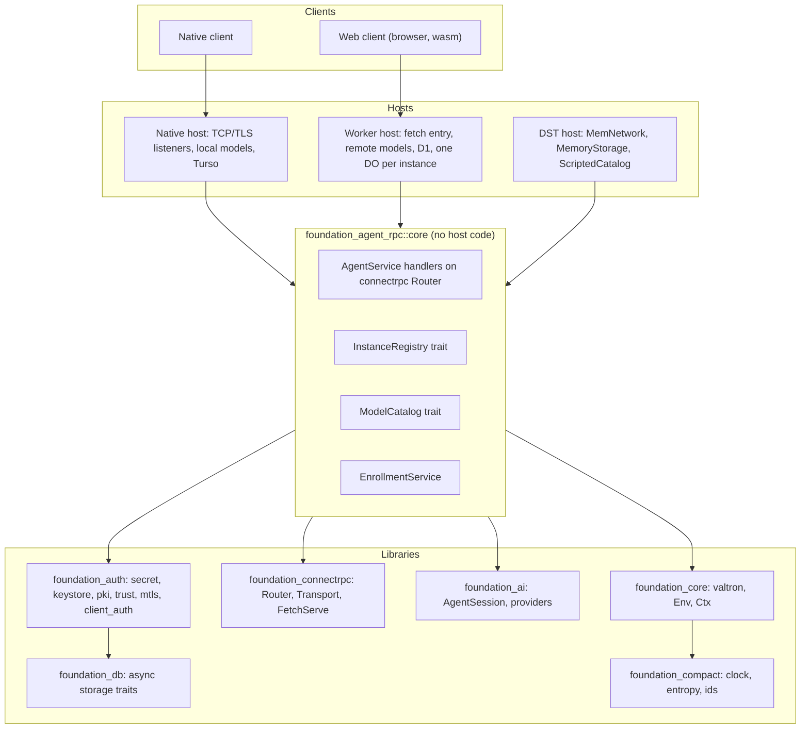
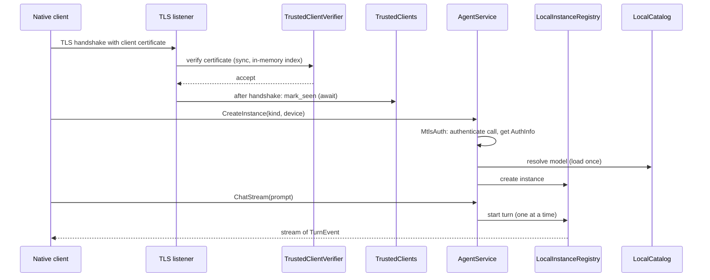
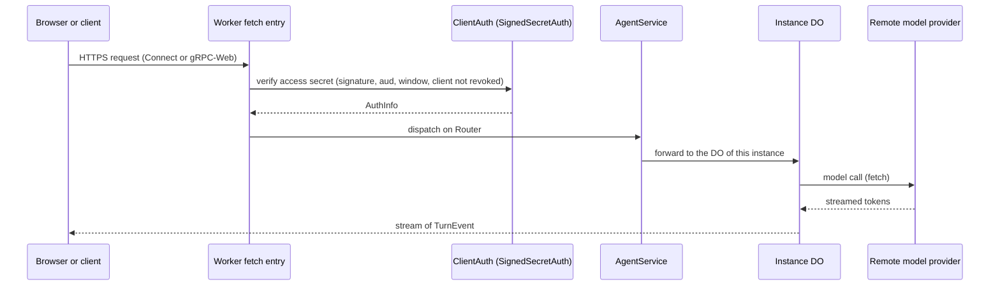
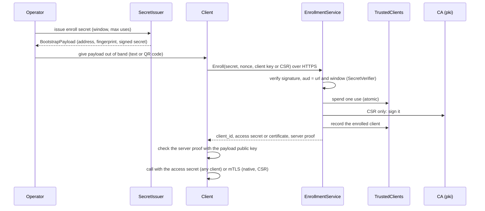
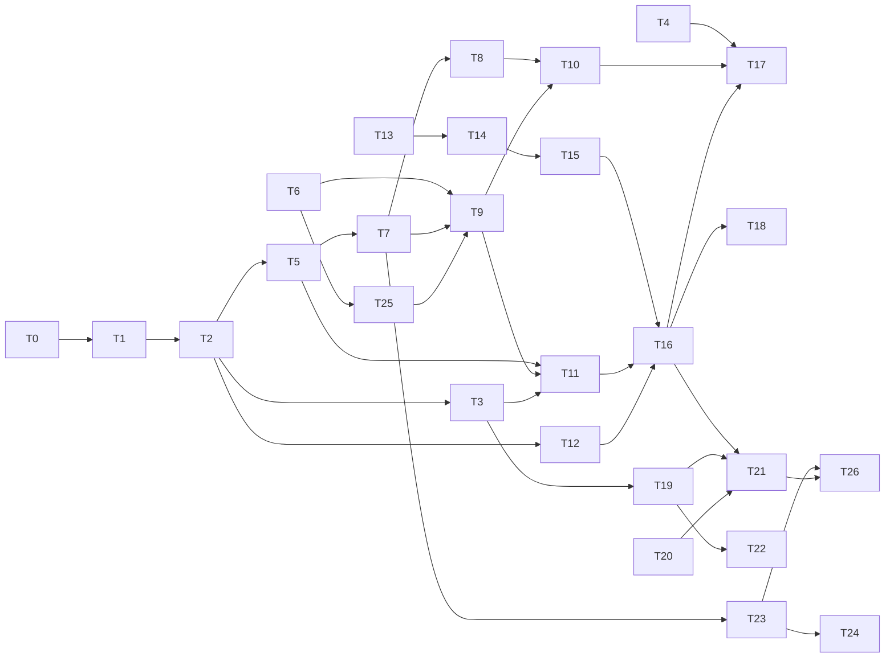

# Pluggable Agent RPC

_Written in ASD-STE100 Simplified Technical English (STE). Code and identifiers stay as they
are._

**Abbreviations in this file.** remote procedure call (RPC); Transport Layer Security (TLS);
mutual TLS (mTLS); Certificate Authority (CA); certificate signing request (CSR); Durable
Object (DO); WebAssembly (wasm); JavaScript (JS); identifier (ID); random number generator
(RNG); deterministic simulation testing (DST); input/output (I/O); key-value store (KV);
Structured Query Language (SQL); Hypertext Transfer Protocol (HTTP); JavaScript Object
Notation (JSON); JSON Web Token (JWT); application programming interface (API); key encryption key (KEK); key management service (KMS); central
processing unit (CPU); graphics processing unit (GPU); Compute Unified Device Architecture
(CUDA); GPT-Generated Unified Format (GGUF); continuous integration (CI); pull request (PR);
AeroSpace and Defence Industries Association of Europe (ASD), the owner of the STE standard
ASD-STE100. Section 2 explains each term.

## 1. Overview

### 1.1 What this feature does

Feature 01 made `foundation_agent_rpc`: a server that loads a model one time and serves named
agent instances over RPC. It runs only as a native program with its own TLS listeners.

This feature changes the design so that **one RPC surface runs in four places**:

- bare metal (a normal Linux, macOS or Windows machine),
- Docker (the same native program in a container),
- Cloudflare Workers (WebAssembly in the Cloudflare network),
- the browser (as a client only).

It does this with three ideas:

1. **A core with no host code.** The service logic sits behind traits. A **host** is the
   small part of each program that gives the core its network, storage, models and side
   effects.
2. **Shared auth.** The signed secrets, the CA, the trusted-client store and the mTLS checks
   move into `foundation_auth`, on top of `foundation_db`. Other services can use them.
3. **Injected side effects.** The clock, randomness, IDs and timers come from one `Env`
   bundle in valtron's context (`Ctx`). Tests swap them for fakes. This makes
   deterministic simulation testing possible (`CLAUDE.md` rule 11).

### 1.2 Where to read

| File | What it covers |
|---|---|
| This file | Overview, glossary, architecture, owner directions, breaking changes, migration, tests, task list, open questions |
| [`start.md`](./start.md) | How an agent starts the work |
| [`env.md`](./env.md) | Side effects, the `Env` bundle, valtron's `Ctx`, the lint |
| [`auth.md`](./auth.md) | Auth in `foundation_auth`: signed secrets, key store, CA, trusted clients, mTLS, client auth providers, security |
| [`registry-and-models.md`](./registry-and-models.md) | Model catalog, kinds and devices, the instance registry, Durable Objects |
| [`hosts.md`](./hosts.md) | The native host, the Worker host, the web client, the native client |
| [`proto.md`](./proto.md) | The wire contract (`agent.proto`) |
| [`key-protection.md`](./key-protection.md) | Private keys always encrypted at rest: where the KEK comes from on each platform, remote KMS |
| [`migrations.md`](./migrations.md) | Migrations per database, as ordered groups (shared, then specific), each numbered from 1 and recorded by group |
| [`deterministic-simulation-testing.md`](./deterministic-simulation-testing.md) | DST in plain words |

### 1.3 Goals

- One `AgentService` RPC surface on native, Worker and browser.
- Every part that differs between hosts sits behind a trait.
- Every side effect is injected through `Env`. No core code reads a global clock or RNG.
- Auth is a library in `foundation_auth`, not code inside agent-rpc.
- The default client credential is our signed JSON secret, not a JWT. Its version 1 wire
  format does not change.
- A client can ask which model kinds and devices a server supports, and choose one.
- Every limit is a configuration field with a documented default (`CLAUDE.md` rule 8).

### 1.4 Non-goals

- Local models (Candle, GGUF) on a Worker. A Worker has no threads and about 128 MB of
  memory. It uses remote models only.
- Full gRPC on a Worker or in a browser. gRPC needs HTTP trailers. A Worker cannot send them
  reliably. Connect and gRPC-Web work.
- A Postgres backend for `foundation_db` (decision 7: a separate feature).
- The proxy registration work (features 03 and 04).

### 1.5 Before you start

- The branch `65-f01-agent-rpc` is behind `master` and has merge conflicts. Task T0 merges
  `master` first.
- `master` has async-only storage (#131 to #133). The topic files use the trait names
  `AsyncKeyValueStore`, `AsyncQueryStore` and so on. After the rename PR (branch
  `db/rename-async-traits`) these traits are `KeyValueStore`, `QueryStore` and so on. Use
  the names that `master` has when you start.

## 2. Glossary

| Term | Meaning |
|---|---|
| ASD-STE100 | A standard for simple technical English. Short sentences, one meaning per word. |
| AuthInfo | The result of a successful auth check: who the caller is and what it can do. Handlers see only this. |
| Bootstrap payload | The text (or QR code) that a client gets out of band. It holds the server URL, an optional TLS fingerprint, an optional enrollment URL and a signed secret. It has no version field ([proto.md](./proto.md) section 6). |
| Bundle (`Env`) | One value that holds all ambient side effects: clock, entropy, IDs, timer. |
| CA | Certificate Authority: the key that signs certificates for clients and the server. |
| Capabilities | The list of model kinds and devices that a server supports. `GetCapabilities` returns it. |
| Catalog (`ModelCatalog`) | The trait that finds or loads a model for an instance. |
| Client auth (`ClientAuth`) | The trait that checks one incoming call and returns `AuthInfo`. |
| Connect | An RPC protocol over HTTP/1.1 and HTTP/2. Works in browsers. |
| Context (`Ctx`) | A box of typed values that travels with each valtron task. |
| Contract test | One set of tests that every implementation of a trait must pass. |
| CSR | Certificate signing request: a client asks the CA to sign its public key. |
| Deterministic | The same inputs always give the same result. |
| Device | Where a local model runs: CPU, CUDA GPU or Metal GPU. |
| DO | Durable Object: a Cloudflare object with its own storage and one thread. We use one per instance. |
| DST | Deterministic simulation testing: tests where every side effect comes from one seed, so a run can be repeated exactly. |
| Enrollment | The step where a client (native, Worker or browser) shows a signed secret, a nonce and a credential (a client public key or a CSR), and gets a `client_id`, an access secret or a client certificate, and a server proof. [auth.md](./auth.md) section 9.1. |
| Server proof | The host's signature, with the payload private key, over the client's nonce and credential. It proves the right server answered, without a pinned TLS channel. |
| Access secret | A short-lived `SignedSecret` (purpose `access`, `sub` = client ID) that a client-key client sends on each call and renews with `RefreshAccess`. |
| Entropy | Random bytes. `EntropySource` is the trait that gives them. |
| Fake | A small, controllable copy of a real part, for tests. |
| gRPC, gRPC-Web | Google's RPC protocol over HTTP/2, and its variant for browsers. |
| Host | The program-specific part that gives the core its network, storage, models and `Env`: native, Worker or DST. |
| Instance | A named agent with its own session and history, on a shared model. |
| Instance kind | `API`, `CANDLE` or `GGUF` (later `VIDEO`, `AUDIO`): what model an instance uses. |
| Key store (`KeyStore`) | The trait that loads and saves key material (CA key, signing key) in any backend. |
| Miniflare, wrangler | Cloudflare tools that run a Worker on a local machine. |
| mTLS | Mutual TLS: both sides show a certificate. |
| Registry (`InstanceRegistry`) | The trait that creates, finds, lists and removes instances. |
| Scope | The name space for instance names: shared, or one per caller. |
| Seed | One number from which a DST run takes all its "random" decisions. |
| Side effect | Something that code reads from or does to the world outside its inputs: time, random bytes, network, storage. |
| Signed secret (`SignedSecret`) | Our credential: base64url JSON `{v, alg, public_key, secret, valid_from, valid_until, signature}`. Not a JWT. |
| Trait | A Rust interface: functions that a type promises to provide. |
| Trusted-client store (`TrustStore`) | The trait that records enrolled clients, revocations and secret use counts. |
| Valtron | Our task engine in `foundation_core`. Multi-threaded on native, single-threaded on wasm and in DST. |
| Window | The time span (`valid_from` to `valid_until`) in which a secret works. |
| Worker | A Cloudflare Worker: a wasm program that answers HTTP `fetch` events. |

## 3. Architecture

### 3.1 Layers

_The diagram shows the layers. Clients talk to a host. Every host runs the same core. The
core uses the shared libraries. Arrows point from the user to the part it uses._

### 3.2 Crates and what each one owns

| Crate | Owns | Targets |
|---|---|---|
| `foundation_compact` | `Clock`, `EntropySource`, `IdSource` traits and their real and simulated implementations | all |
| `foundation_core` | `Env` bundle; valtron `Ctx`, `Timer`, `SimRuntime` | all (multi-threaded only on native) |
| `foundation_db` | async storage traits; `DoSqlStore` (new); `Faulty*` test wrappers | all |
| `foundation_connectrpc` | `Router`, `Transport`; `FetchServe` and `FetchTransport` (wasm, new); `MemNetwork` (test) | all |
| `foundation_auth` | `secret`, `keystore`, `trust`, `client_auth` (all targets); `pki`, `mtls` (native) | all, with native-only parts |
| `foundation_ai` | `AgentSession`, model providers | all |
| `foundation_agent_rpc` | `core` (service, registry, catalog, enrollment); `host::native`; `host::worker`; `client::{native, web}` | per module |

### 3.3 The trait map

```mermaid
classDiagram
    class Clock {
        <<trait>>
        now()
        wall_now()
    }
    class EntropySource {
        <<trait>>
        fill(buf)
    }
    class IdSource {
        <<trait>>
        next_id()
    }
    class Timer {
        <<trait>>
        sleep_until(deadline)
    }
    class Env {
        clock
        entropy
        ids
        timer
    }
    class ClientAuth {
        <<trait>>
        authenticate(call) AuthInfo
    }
    class KeyStore {
        <<trait>>
        get(id)
        create(record)
        replace(record)
    }
    class TrustStore {
        <<trait>>
        client(fingerprint)
        record_enrollment()
        mark_seen()
        consume_secret_use()
        revoke_secret()
    }
    class InstanceRegistry {
        <<trait>>
        create()
        get()
        list()
        destroy()
        start_turn()
    }
    class ModelCatalog {
        <<trait>>
        capabilities()
        resolve(spec)
    }
    Env o-- Clock
    Env o-- EntropySource
    Env o-- IdSource
    Env o-- Timer
    Clock <|.. SystemClock
    Clock <|.. SimClock
    EntropySource <|.. OsEntropy
    EntropySource <|.. SeededEntropy
    ClientAuth <|.. SignedSecretAuth
    ClientAuth <|.. MtlsAuth
    ClientAuth <|.. CfMtlsAuth
    ClientAuth <|.. JwtAuth
    ClientAuth <|.. InsecureNoAuth
    KeyStore <|.. FsKeyStore
    KeyStore <|.. DbKeyStore
    KeyStore <|.. MemoryKeyStore
    TrustStore <|.. SqlTrustStore
    TrustStore <|.. KvTrustStore
    TrustStore <|.. MemoryTrustStore
    InstanceRegistry <|.. LocalInstanceRegistry
    InstanceRegistry <|.. DurableObjectRegistry
    ModelCatalog <|.. LocalCatalog
    ModelCatalog <|.. RemoteCatalog
    ModelCatalog <|.. ScriptedCatalog
```

_The diagram shows each trait and its implementations. `Env` holds the four ambient traits.
The other traits go to each component as a constructor argument._

### 3.4 Which implementation each host uses

| Trait | Native host | Worker host | DST host |
|---|---|---|---|
| `Clock` | `SystemClock` | `SystemClock` (wasm `Date.now()`) | `SimClock` |
| `EntropySource` | `OsEntropy` | `OsEntropy` (wasm `crypto.getRandomValues`) | `SeededEntropy` |
| `ClientAuth` | `MtlsAuth`, `SignedSecretAuth` | `SignedSecretAuth`, `CfMtlsAuth`, `JwtAuth` | any, with fakes |
| `KeyStore` | `FsKeyStore` or `DbKeyStore<Turso>` | `DbKeyStore<KV>`: verify-only, or the sealed payload private key when `WorkerHostConfig::enrollment` is set | `MemoryKeyStore` |
| `TrustStore` | `SqlTrustStore<Turso>` | `SqlTrustStore<D1>` | `MemoryTrustStore` |
| `InstanceRegistry` | `LocalInstanceRegistry` | `DurableObjectRegistry` (a `LocalInstanceRegistry` inside each DO) | `LocalInstanceRegistry` |
| `ModelCatalog` | `LocalCatalog` (Candle, GGUF, API) | `RemoteCatalog` (API only) | `ScriptedCatalog` |
| Network | TCP/TLS listeners | the Cloudflare `fetch` event | `MemNetwork` |

## 4. Request lifecycle

[hosts.md](./hosts.md) gives each step in detail. These diagrams show the main path.

### 4.1 Native host

_The diagram shows one native call path. The TLS check is sync and does no I/O. The
last-seen write happens after the handshake, in async code._

### 4.2 Worker host

_The diagram shows one Worker call path. Cloudflare ends TLS. The Worker checks the signed
secret, and the instance's Durable Object runs the turn._

### 4.3 Bootstrap and enrollment

_The diagram shows how any client, a browser included, enrolls. The signed secret proves that the
server issued it; the server proof proves that the right server answered. The trust store makes
sure each secret is used only as often as allowed._

## 5. The owner's directions, and where each one is answered

| # | Direction (PR #126 review) | Answer |
|---|---|---|
| 1 | Traits so one RPC surface runs on bare metal, Docker and Workers | Sections 3 and 4; [hosts.md](./hosts.md) |
| 2 | Move auth into `foundation_auth`, built on `foundation_db` | [auth.md](./auth.md) sections 1 and 2 |
| 3 | A `CaStore` trait for key material in any backend | `KeyStore` in [auth.md](./auth.md) section 4 |
| 4 | Pluggable client auth; the default is our signed JSON secret, not a JWT | [auth.md](./auth.md) sections 3 and 8 |
| 5 | `mark_seen` out of the TLS verifier | [auth.md](./auth.md) section 7; section 4.1 here |
| 6 | Capabilities endpoint and instance kinds | [proto.md](./proto.md); [registry-and-models.md](./registry-and-models.md) section 2 |
| 7 | Candle device: CPU or GPU | [registry-and-models.md](./registry-and-models.md) section 2.5 |
| 8 | Side effects as traits, for DST and mocks | [env.md](./env.md); [deterministic-simulation-testing.md](./deterministic-simulation-testing.md) |
| 9 | The bundle in valtron's `Ctx` as a typed entry | [env.md](./env.md) sections 5 and 6 |

## 6. Configuration

Every limit and timeout is a field on a configuration type, with a documented default. Each
default names the established server or API it comes from (`CLAUDE.md` rule 8).

| Type | Where | Defined in |
|---|---|---|
| `NativeHostConfig` | native host listeners, shutdown, state | [hosts.md](./hosts.md) section 4.1 |
| `WorkerHostConfig`, `CorsConfig` | Worker host | [hosts.md](./hosts.md) sections 5.2 and 6.5 |
| `RegistryConfig`, `TurnLimits` | instance limits, page sizes, turn timeouts | [registry-and-models.md](./registry-and-models.md) section 3.3 |
| `DecodeLimits`, `VerifyPolicy` | signed secret size and window checks, clock skew | [auth.md](./auth.md) section 3 |
| `CaConfig`, `ServerIdentityConfig` | certificate lifetimes, backdating | [auth.md](./auth.md) section 5 |
| `TrustConfig` | prune interval, grace periods | [auth.md](./auth.md) section 6 |
| `EnrollConfig` | enrollment limits | [auth.md](./auth.md) section 9 |
| `FetchServeConfig`, `FetchTransportConfig` | wasm request and body limits | [hosts.md](./hosts.md) section 5 |

## 7. Breaking changes

For users of the current `foundation_agent_rpc` on branch `65-f01-agent-rpc`:

- The `Auth` enum on `AgentRpcServerBuilder` is replaced by a `ClientAuth` value.
- `MtlsConfig` and `TrustedClientStore` move to `foundation_auth` with new names
  (`KeyMaterial`, `TrustedClients`). Their constructors take an `Env` and a store.
- `BootstrapSecrets` splits into `SecretIssuer` and `SecretVerifier`.
- `CertificateAuthority::load_or_generate(dir)` becomes `KeyMaterial::certificate_authority`
  over any `KeyStore`.
- `CreateInstanceRequest` gains `kind` and `device`. A request without them still works: the
  server picks a default (rules in [proto.md](./proto.md) section 5).
- `ModelSource::Candle` gains a `Device`.
- `foundation_connectrpc::AuthInfo` moves to `foundation_auth`. connectrpc re-exports it, so
  its path for connectrpc users does not change.

- `BootstrapPayload` drops `version`, `addr` and `bootstrap_addr` (reserved) and gets `url` and
  `enroll_url`. `Capabilities.auth_mode` becomes `auth_modes`. A payload from feature 01 is
  refused; the operator issues a new one. Feature 01 was never released, so no deployed client
  is affected ([proto.md](./proto.md) section 6; owner decision 9).
- `NativeHostConfig` gets `public_url` and `public_enroll_url` in place of a payload version.
- Enrollment works for every client (owner, PR #126 review, 2026-10-26). `EnrollRequest` takes a
  nonce and a credential oneof (`csr_pem` or a new `client_key`); `EnrollResponse` adds
  `client_id`, `access_secret` and `server_proof`; `BootstrapService` adds `RefreshAccess`;
  `SignedSecret` v2 adds a signed `sub`. A browser no longer refuses an enrollment payload
  ([auth.md](./auth.md) section 9.1, [hosts.md](./hosts.md) section 6).

Unchanged: the version 1 `SignedSecret` wire format and the existing RPC methods.

## 8. Migration, file by file

| File on branch `65-f01-agent-rpc` | After this feature |
|---|---|
| `src/secret.rs` | `foundation_auth::secret` (types and verify) and `foundation_auth::keystore` (key loading) |
| `src/auth.rs` | `foundation_auth::{pki, mtls, fingerprint}`; `EnrollmentService` goes to `core/enroll.rs` |
| `src/trust.rs` | `foundation_auth::trust` |
| `src/bootstrap.rs` | `core/bootstrap.rs` (payload encode, and decode into `Bootstrap`, `TlsTrust`, `BootstrapAccess`) |
| `src/service.rs` | `core/service.rs`: handlers that use `InstanceRegistry` and `ModelCatalog` |
| `src/instance.rs` | `core/registry/{mod,local}.rs` |
| `src/model.rs` | `core/model/{mod,handle,catalog,remote}.rs`; local loaders in `host/native/models.rs` |
| `src/server.rs` | `host/native/{mod,config,listener}.rs` |
| `src/client.rs` | `client/native.rs`; the browser client is new in `client/web.rs` |
| `src/error.rs` | `core/error.rs` |
| new | `host/worker/{entry,object,registry,config,do_transport}.rs`; `examples/cf-agent-rpc`; `examples/agent-rpc-web` |

[auth.md](./auth.md) section 1 gives the auth moves type by type.

## 9. Testing strategy

| Level | What | Where |
|---|---|---|
| Unit | One behavior of one type | each crate's `tests/` |
| Contract | One test set that every implementation of a trait passes (`KeyStore`, `TrustStore`, `InstanceRegistry`, `ModelCatalog`, `Clock`, `EntropySource`) | each crate's `tests/*/contract.rs` |
| DST | The full client to server to instance flow from one seed, with failure injection | `foundation_agent_rpc/tests/dst/` |
| Native end to end | Real sockets, real TLS and mTLS | `foundation_agent_rpc/tests/native_*` |
| Worker | Miniflare, as for the other `examples/cf-*` | `foundation_toolings/tests/cf_examples.rs` |
| Web client | `wasm-bindgen-test` in a headless browser | `foundation_agent_rpc/tests/wasm/` |

Each topic file ends with its own test table.

## 10. Task list

Each task names its files and tests and ends with a "done when" line. Tasks in the same row
group of section 10.2 can be one PR.

| Task | What | Main files | Done when |
|---|---|---|---|
| T0 | Merge `master` into `65-f01-agent-rpc`; adapt to async storage and async `AgentSession` | the crate | `ci.py run foundation_agent_rpc` passes |
| T1 | `Clock`, `EntropySource`, `IdSource` traits; `SystemClock`, `SimClock`, `OsEntropy`, `SeededEntropy`, `Scru128Source`; `seal_with` | `foundation_compact/src/{clock,entropy,ids}` | contract tests pass natively and on wasm |
| T2 | `Env` bundle; `Env` in valtron's root `Ctx`; `current_ctx`, `with_ctx`; `Timer` on the `Env` clock; `single::initialize_pool_with` | `foundation_core/src/{env.rs,valtron/*}` | `env_tests`, `env_install_tests`, `sim_time_tests` pass |
| T3 | connectrpc: keep request extensions through dispatch (`build_ctx` fix); `CallHooks::with_clock` | `foundation_connectrpc/src/shared/router/dispatch.rs` | dispatch tests pass; deadlines follow the `Env` clock |
| T4 | `ConnectionContext::tls` holds the peer certificates after the handshake | `foundation_http` | `tls_peer_info_tests` pass |
| T5 | `foundation_auth::secret`: `SignedSecret` v1 and v2, `SigningKey`, `VerifyingKey`, `SecretIssuer`, `SecretVerifier`; the clippy lint file | `foundation_auth/src/secret/*` | v1 secrets from the branch tests verify unchanged; verify-order tests pass |
| T6 | `foundation_db`: `insert_if_absent_async` with a default body; `StorageError::Unsupported` if missing | `foundation_db/src/core/storage_provider.rs` | tests pass on memory, Turso, libsql |
| T7 | `foundation_auth::keystore`: `KeyStore`, `KeyMaterial`, sealing (`KekSealer`, `PassphraseSealer`) | `foundation_auth/src/keystore/*` | `KeyStore` contract, sealing and race tests pass |
| T8 | `foundation_auth::pki` (native): CA, server identity, CSR signing with `Env` time and randomness | `foundation_auth/src/pki/*` | same seed gives byte-identical certificates |
| T9 | `foundation_auth::trust`: `TrustStore`, `SqlTrustStore`, `KvTrustStore`, `TrustedClients` | `foundation_auth/src/trust/*` | `TrustStore` contract and concurrent-use tests pass |
| T10 | `foundation_auth::mtls` (native): pure `TrustedClientVerifier`, `PinnedServerVerifier`, rustls config builders | `foundation_auth/src/mtls/*` | verifier tests show zero store calls during a handshake |
| T11 | `foundation_auth::client_auth`: `ClientAuth`, providers, `ClientAuthInterceptor`, presets | `foundation_auth/src/client_auth/*` | provider tests pass with `SimClock` |
| T12 | `foundation_ai` reads IDs and time through `Env` (`SessionId::from_id`) | `foundation_ai/src/agentic/*` | agent loop runs under `SimRuntime` with stable IDs |
| T13 | New `agent.proto`; `InstanceSpec::from_wire`; model selection rules | `proto/`, `core/model/mod.rs` | one test per selection rule passes |
| T14 | `ModelCatalog` trait, `ModelHandle`, `RemoteCatalog` | `core/model/*` | load-once and remote catalog tests pass |
| T15 | `InstanceRegistry` trait, `Scope`, `RegistryConfig`, `TurnLimits`, `LocalInstanceRegistry` | `core/registry/*` | registry contract tests pass on the local registry |
| T16 | `core/service.rs`: `AgentService` handlers over the traits; `GetCapabilities`; `core/enroll.rs` | `core/{service,enroll}.rs` | handler tests pass with fakes |
| T17 | Native host: config, listeners, mTLS, last-seen after handshake, `LocalCatalog` with Candle device, `keys migrate` command | `host/native/*` | native end-to-end and revocation tests pass |
| T18 | DST: `SimRuntime`, `MemNetwork`, `MemTransport`, `Faulty*` wrappers, `ScriptedCatalog`, `TestWorld`; first DST tests | `testing` features in `foundation_core`, `foundation_connectrpc`, `foundation_db`, `foundation_agent_rpc` | DST tests pass for 32 fixed seeds, twice in a row with identical traces |
| T19 | `FetchServe` and `FetchTransport` (wasm) | `foundation_connectrpc/src/wasm/*` | wasm fetch tests pass under Node |
| T20 | `DoSqlStore`: `foundation_db` storage over a DO's SQL | `foundation_db` | contract tests pass under Miniflare |
| T21 | Worker host: entry, instance DO, `DurableObjectRegistry`, `DoStubTransport`; `examples/cf-agent-rpc` | `host/worker/*` | the `cf-agent-rpc` Miniflare case passes |
| T22 | Web client: `WebClient` over `FetchTransport`; `examples/agent-rpc-web` | `client/web.rs` | the web client tests pass in a headless browser |
| T23 | Key protection: `KekSource`, async `KeySealer`, native and Worker KEK sources, `WebCryptoSealer`, always-encrypt rule, plain-text migration, KEK rotation | `foundation_auth/src/keystore/*`, `host/*/kek.rs` | [key-protection.md](./key-protection.md) section 8 tests pass (except Vault) |
| T24 | Envelope encryption with a remote KMS: `EnvelopeSealer`, `KmsBackend`; Vault Transit, then AWS KMS and GCP Cloud KMS | `foundation_auth/src/keystore/kms.rs` | sealer contract passes with `FakeKms`; the Vault test passes |
| T25 | Migration runner by groups: `MigrationSet` from code, embedded files and directories; `MigrationRunner::from_static` / `add_from_static`; per-group numbering from 1 with no gaps; checksums; one transaction per migration; record rows keyed by group; upgrade of today's table with the 023 repair; `embed_migrations!` | `foundation_db/src/core/schema/*`, `foundation_macros` | [migrations.md](./migrations.md) section 6 tests pass |
| T26 | History archive to R2 on `DestroyInstance` (Worker and native) | `host/worker/object.rs`, `core/archive.rs` | the archive tests pass; a failed upload deletes nothing |

### 10.1 Order

_The diagram shows which task must finish before another task starts._

### 10.2 Suggested PRs

| PR | Tasks | Why together |
|---|---|---|
| A | T0 | Gets #126 green on current `master` |
| B | T1, T2 | Side effects and `Env` (cross-crate base) |
| C | T3, T4, T6, T25 | Library changes that others need (T25: migration runner) |
| D | T5, T7, T23, T8, T9, T10, T11 | Auth in `foundation_auth`, with key protection |
| E | T12, T13, T14, T15, T16 | The transport-agnostic core |
| F | T17, T18 | Native host and DST |
| G | T19, T20, T21, T22, T26 | Worker host, web client, history archive |
| H | T24 | Remote KMS backends (can come after the rest) |

## 11. Owner decisions (2026-10-22 and 2026-10-25)

The owner answered the open questions on 2026-10-22. Decisions 9 and 10 come from the PR #126 review of 2026-10-25.

| # | Question | Decision | Where it is designed |
|---|---|---|---|
| 1 | Instance name scope on the Worker | **Per caller** (`ScopePolicy::PerOwner`) on the Worker; shared on native | [registry-and-models.md](./registry-and-models.md) section 3.1 |
| 2 | Version 2 signed secrets | **Issue version 2 by default**; still accept version 1 | [auth.md](./auth.md) section 3.2 |
| 3 | Private keys at rest | **Always encrypted, on every host and backend.** No plain-text mode. The KEK comes from the safest source of each platform | [key-protection.md](./key-protection.md) |
| 4 | JWT provider | **Ship `JwtAuth` in this feature**, behind a feature flag | [auth.md](./auth.md) section 8 |
| 5 | History on `DestroyInstance` | **Archive to R2**, then delete the DO storage | [hosts.md](./hosts.md) section 5.12 |
| 6 | Model provider API keys | **Worker secrets or Secrets Store secrets**; never in vars, D1, KV or logs | [hosts.md](./hosts.md) section 5.11 |
| 7 | Postgres | **Only if it is not too much work.** It is a sizable job (section 11.1), so it is **not part of this feature**. The owner also asked for directory migrations: **yes**, task T25 | [migrations.md](./migrations.md) |
| 8 | Rename timing | **Wait** for the rename PR (`Async*` to plain names) to merge, then start | section 1.5 |
| 9 | Bootstrap payload versions (2026-10-25) | **No version field.** One `url` for every host; the client derives TLS trust from the fingerprint and access from the token purpose | [proto.md](./proto.md) section 6 |
| 10 | Migration layout (2026-10-25) | **Groups per database**: a shared group, then specific groups, each numbered from 1 and recorded by group. No number ranges per crate | [migrations.md](./migrations.md) |

### 11.1 Why Postgres is a separate feature

`foundation_db` runs on valtron, not on tokio. The common Rust Postgres clients
(`tokio-postgres`, `sqlx`, and the sync `postgres` crate, which uses tokio inside) need tokio.
So a Postgres backend needs its own connection code on `foundation_netio`:

- the startup message and SCRAM-SHA-256 password authentication;
- TLS through `foundation_netio`;
- the extended query protocol (parse, bind, execute), with `$1` placeholders instead of `?`;
- type conversion between `DataValue` and Postgres types;
- row streaming, query cancellation, and a connection pool with limits as configuration.

The `postgres-protocol` crate encodes and decodes the messages and does SCRAM with no runtime,
so we do not write those parts. The connection state machine, the pool and the type mapping are
still ours. That is a feature of its own, about the size of the libsql backend plus a protocol
client. We record it as a separate feature for spec 50 (storage), after this one.

## 12. Open questions for the owner

1. ~~Migration number ranges.~~ **Resolved** by owner decision 10: migrations are groups per
   database, each numbered from 1 and recorded by group. There are no number ranges and no
   record table per component. [migrations.md](./migrations.md) has the design and its own open
   questions.
2. **Remote KMS order.** [key-protection.md](./key-protection.md) section 4.6 starts with Vault
   Transit, then AWS KMS, then GCP Cloud KMS. **Recommendation: this order**, unless a deployment
   needs one of the clouds first.
3. **Archive on native.** [hosts.md](./hosts.md) section 5.12 gives the native host the same archive
   step through a `foundation_db` blob store. **Recommendation: yes, default to a local directory.**
4. **A Worker that enrolls holds the payload private key.** Enrollment from a browser to a
   Worker needs a host that can sign server proofs and access secrets ([auth.md](./auth.md)
   section 9.1). Options:
   - A: the Worker holds the private key as a sealed Worker secret, behind
     `WorkerHostConfig::enrollment` (off by default).
   - B: a native host does the enrollment, and the Worker stays verify-only.
   - **Recommendation: A, opt-in.** It keeps one flow on every host. Its risk: a leak of the Worker
     secret lets an attacker issue tokens; rotation by `kid` limits it.
