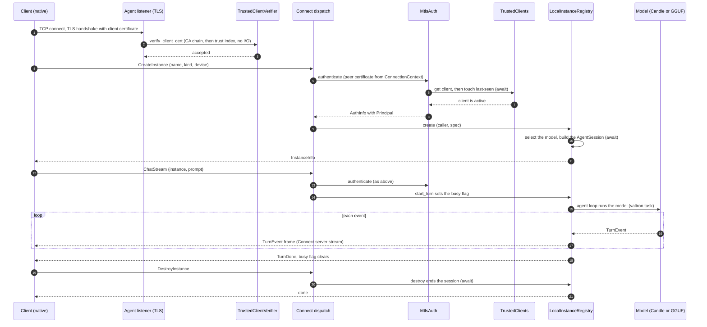
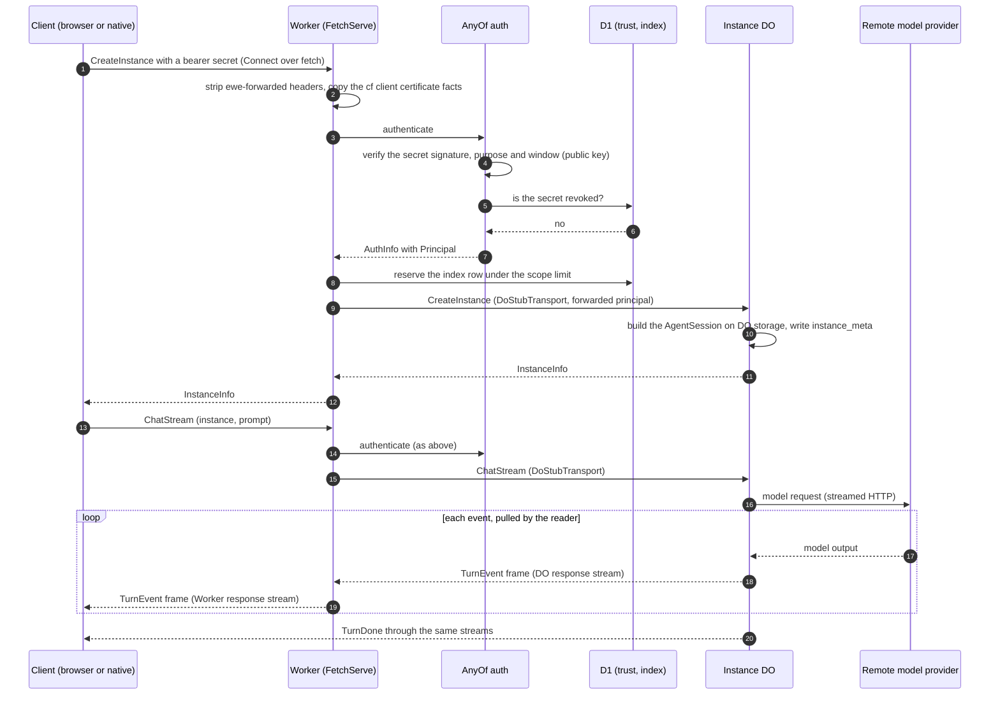
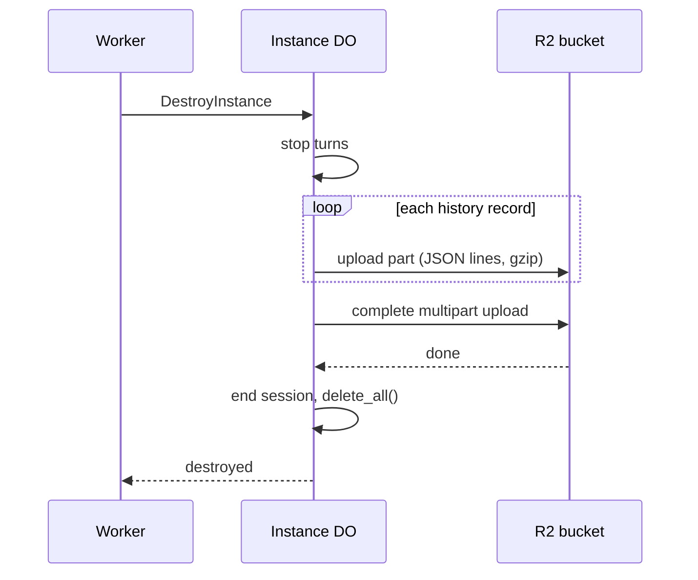

# Hosts: native, Worker and web client

_Part of [feature 07](./feature.md). Written in ASD-STE100 Simplified Technical English (STE).
Code and identifiers stay as they are._

**Abbreviations in this file.** remote procedure call (RPC); Transmission Control Protocol
(TCP); Transport Layer Security (TLS); mutual TLS (mTLS), where both sides show a
certificate; Hypertext Transfer Protocol (HTTP); Durable Object (DO); WebAssembly (wasm);
JavaScript (JS); application programming interface (API); uniform resource locator (URL);
Cross-Origin Resource Sharing (CORS), the browser rule for calls to another origin;
identifier (ID); Structured Query Language (SQL); key-value store (KV); Certificate Authority
(CA); certificate signing request (CSR); Secure Hash Algorithm with 256 bits (SHA-256);
deterministic simulation testing (DST); input/output (I/O); continuous integration (CI);
central processing unit (CPU); graphics processing unit (GPU); Compute Unified Device
Architecture (CUDA); Generative Pre-trained Transformer (GPT); GPT-Generated Unified Format
(GGUF); Internet Protocol (IP); Domain Name System (DNS); kibibyte (KiB), 1,024 bytes;
mebibyte (MiB), 1,048,576 bytes; key encryption key (KEK); JavaScript Object Notation (JSON); Privacy-Enhanced Mail (PEM), a
text form of keys and certificates;
AeroSpace and Defence Industries Association of Europe (ASD), the owner of the STE standard
ASD-STE100. gRPC is the name of a Google RPC protocol over HTTP/2. gRPC-Web is its variant for
browsers. Connect is an RPC protocol that works over HTTP/1.1 and HTTP/2. D1 and R2 are
names of Cloudflare products (a SQL database and an object store). Miniflare and wrangler are
Cloudflare tools that run a Worker on a local machine. The
[glossary in feature.md](./feature.md#2-glossary) explains each term.

## 1. What this file covers

A **host** is the program that runs the agent-rpc core on one platform. The core is the same
on every platform. The host gives the core its side effects: time, randomness, network,
storage and models ([env.md](./env.md)).

| Host | Platform | Module | Build gate |
|---|---|---|---|
| Native host | Linux, macOS, Windows | `foundation_agent_rpc::host::native` | feature `native`, `not(target_family = "wasm")` |
| Worker host | Cloudflare Workers | `foundation_agent_rpc::host::worker` | feature `worker`, `target_family = "wasm"` |
| Instance Durable Object | Cloudflare Durable Objects | `foundation_agent_rpc::host::worker::object` | as the Worker host |
| Web client | browsers | `foundation_agent_rpc::client::web` | feature `web-client`, `target_family = "wasm"` |
| Native client | Linux, macOS, Windows | `foundation_agent_rpc::client::native` | feature `native` |
| DST harness | tests only | the package `foundation_agent_rpc_dst` | feature `testing` |

The DST harness has its own file:
[deterministic-simulation-testing.md](./deterministic-simulation-testing.md).

## 2. What each host gives the core

The core has seams. A **seam** is a trait or a constructor argument where a host plugs in
its own implementation. This table shows what each host plugs into each seam.

| Seam | Native host | Worker host | Instance DO | Web client | DST harness |
|---|---|---|---|---|---|
| `Env` (time, entropy, IDs, timer) | `Env::system()` in the pool configuration | `Env::system()`, once per isolate | `Env::system()`, once per DO isolate | `Env::system()`, once per page | `SimRuntime` (seeded) |
| valtron engine | multi-threaded pool | single-threaded engine that JS drives | as the Worker | as the Worker | single-threaded, fixed seed |
| Server entry | `HttpServer` with TLS, `ConnectRpcServe` (HTTP/1.1) and `ConnectRpcServeH2` (HTTP/2) | `FetchServe` in `#[event(fetch)]` | `FetchServe` in `DurableObject::fetch` | none | `MemNetwork` |
| Protocols served | Connect, gRPC, gRPC-Web | Connect, gRPC-Web | Connect (from the Worker only) | none | Connect |
| Client transport | `H1Transport`, `H2Transport` | `DoStubTransport` (to the DO) | none | `FetchTransport` | `MemTransport` |
| `ClientAuth` | `MtlsAuth`, optionally `AnyOf` with `SignedSecretAuth` | `AnyOf(CfMtlsAuth, SignedSecretAuth)`, optionally `JwtAuth` | `ForwardedPrincipalAuth` | sends a bearer secret | any provider, over memory stores |
| Key material ([auth.md](./auth.md) section 4) | operator key files (`KeySource::File`), or `EWE_AGENT_RPC_*_KEY` variables | public keys from the var `AGENT_RPC_SECRET_PUBLIC_KEYS`; the signing key from the secret `AGENT_RPC_SIGNING_KEY` only with enrollment | none | none | `KeySource::Inline` with fixture or seeded keys |
| `TrustStore` | `SqlTrustStore<TursoStorage>` | `SqlTrustStore<D1WasmStorage>` | none | none | `MemoryTrustStore` |
| `ModelCatalog` | `LocalCatalog` | `RemoteCatalog` (checks requests, fills the index) | `RemoteCatalog` (runs the turns) | none | `ScriptedCatalog` |
| `InstanceRegistry` | `LocalInstanceRegistry<InMemoryStores>` | `DurableObjectRegistry` | `LocalInstanceRegistry<DoStores>`, `max_instances = 1` | none | `LocalInstanceRegistry<InMemoryStores>` |
| Enrollment | `EnrollmentService` with the CA | none | none | none | `EnrollmentService` with a test CA (native DST only) |

`AgentRpcCore` takes these parts through its builder ([feature.md](./feature.md), section 6).
The core never asks which host it runs on.

## 3. Cargo features and `cfg` gates

```toml
# backends/foundation_agent_rpc/Cargo.toml (tasks T17, T21 and T22)
[features]
default = ["native", "candle"]
# The native host and the native client: TCP and TLS listeners, files, the
# multi-threaded valtron pool, the CA. Native targets only.
native = [
    "foundation_core/multi",
    "foundation_ai/multi",
    "foundation_http/multi",
    "foundation_http/ssl",
    "foundation_netio/multi",
    "foundation_netio/ssl",
    "foundation_auth/mtls",
    "foundation_db/turso",
]
candle = ["native", "foundation_ai/candle"]
candle-cuda = ["candle", "foundation_ai/candle-cuda"]
gguf = ["native", "foundation_ai/llamacpp"]
gguf-cuda = ["gguf", "foundation_ai/cuda"]
gguf-vulkan = ["gguf", "foundation_ai/vulkan"]
gguf-metal = ["gguf", "foundation_ai/metal"]
# The Cloudflare Worker host and the instance Durable Object. wasm32 only.
worker = [
    "dep:worker",
    "foundation_core/js-wasmbindgen",
    "foundation_netio/wasm-fetch",
    "foundation_db/wasm-bindgen-storage",
    "foundation_db/workers-rs",
]
# The browser client. wasm32 only.
web-client = ["foundation_core/js-wasmbindgen", "foundation_netio/wasm-fetch"]
# Fakes for tests. Never in a release build.
testing = [
    "foundation_ai/testing",
    "foundation_auth/testing",
    "foundation_core/testing",
    "foundation_compact/testing",
]

# All targets: no `multi`, no TLS listener, no files.
[dependencies]
foundation_core = { path = "../foundation_core", version = "0.0.6", default-features = false, features = ["std"] }
foundation_compact = { path = "../foundation_compact", version = "0.2.2" }
foundation_ai = { path = "../foundation_ai", version = "0.0.2", default-features = false }
foundation_auth = { path = "../foundation_auth", default-features = false, features = ["secret"] }
foundation_db = { path = "../foundation_db", version = "0.0.4", default-features = false }
foundation_connectrpc = { path = "../foundation_connectrpc", version = "0.0.3" }
foundation_netio = { path = "../foundation_netio", version = "0.0.4", default-features = false }

[target.'cfg(not(target_family = "wasm"))'.dependencies]
foundation_http = { path = "../foundation_http", version = "0.0.3" }
qrcode = { version = "0.14", default-features = false, features = ["svg"] }

[target.'cfg(target_family = "wasm")'.dependencies]
worker = { version = "0.8.7", optional = true }
wasm-bindgen = "0.2"
wasm-bindgen-futures = "0.4"
js-sys = "0.3"
web-sys = { version = "0.3", features = ["Request", "RequestInit", "Response", "ResponseInit", "Headers", "ReadableStream"] }
```

What the code does: the default build is the native host of today, with Candle. A Worker
build turns the defaults off: `--no-default-features --features worker`. The valtron feature
`multi` comes only with `native`, because a wasm target has no threads. The DST package uses
`--no-default-features --features testing`, so it also has no `multi`.

```rust
// backends/foundation_agent_rpc/src/lib.rs (after)
pub mod core;     // all targets: traits, the service, the registry, selection
pub mod proto;    // all targets: generated messages and service stubs
pub mod client;   // all targets: the transports differ per target

pub mod host {
    #[cfg(all(feature = "native", not(target_family = "wasm")))]
    pub mod native;
    #[cfg(all(feature = "worker", target_family = "wasm"))]
    pub mod worker;
}

#[cfg(all(feature = "native", target_family = "wasm"))]
compile_error!(
    "feature `native` is for native targets; build a Worker with \
     `--no-default-features --features worker`"
);
```

What the code does: each host module compiles only on its target and with its feature. A
wrong combination stops the build with a clear message, not with a long list of link errors.

## 4. The native host

### 4.1 Configuration

```rust
// foundation_agent_rpc/src/host/native/config.rs
/// Everything a native host needs. `Default` gives the behavior of today.
#[derive(Debug, Clone)]
pub struct NativeHostConfig {
    /// The agent listener, `host:port`. Port 0 picks a free port.
    pub bind: String,
    /// The enrollment listener. `None`: the host of `bind`, port 0 (as today).
    pub bootstrap_bind: Option<String>,
    /// Key files and the trust database. Default: `default_state_dir()` (as today).
    pub state_dir: PathBuf,
    pub models: Vec<ModelSource>,
    /// Load every model at start, so the first `CreateInstance` does not
    /// wait. Default true (as today).
    pub preload: bool,
    pub security: NativeSecurity,
    /// The AgentService URL that `RunningServer::payload_with` writes in
    /// `BootstrapPayload.url`. `None`: `https://` and the bound agent address
    /// (as today). Set it when clients reach the host by another name, for
    /// example "https://agents.example.com:7443" (proto.md section 6.4).
    pub public_url: Option<String>,
    /// The BootstrapService URL for `BootstrapPayload.enroll_url`. `None`:
    /// `https://` and the bound enrollment address.
    pub public_enroll_url: Option<String>,
    /// The HTTP limits of `foundation_http` (`ServerConfig::defaults()`).
    pub http: ServerConfig,
    pub registry: RegistryConfig,
    pub turns: TurnLimits,
    pub enroll: EnrollConfig,
    pub trust: TrustConfig,
    pub ca: CaConfig,
    pub server_identity: ServerIdentityConfig,
    /// Workers in the valtron pool. Default 16: at least 8 (LEARNINGS 01 T6).
    pub workers: usize,
    /// How long shutdown waits for running turns. Default 30 s: the default
    /// `terminationGracePeriodSeconds` of Kubernetes, the time that a process
    /// gets after `SIGTERM` before `SIGKILL`.
    pub shutdown_grace: Duration,
}

#[derive(Debug, Clone, PartialEq, Eq)]
pub enum NativeSecurity {
    /// Enrollment and mTLS (the default, as today). With
    /// `accept_access_secrets`, a call can also show a bearer secret with
    /// purpose `access` (for example from a browser).
    Mtls { accept_access_secrets: bool },
    /// Development only: no TLS and no auth. The host refuses to start
    /// unless `bind` is a loopback address.
    InsecurePlaintext,
}
```

What the code does: it collects every limit and choice of the native host in one place. Each
limit has a documented default (CLAUDE.md rule 8). The binary fills it from command-line
flags and environment variables, as today.

### 4.2 Start-up

```rust
// foundation_agent_rpc/src/host/native/mod.rs
pub struct NativeHost;

impl NativeHost {
    /// Build every part, bind the listeners and serve. Call it on the
    /// valtron pool: the binary's `#[valtron] async fn main` awaits it.
    ///
    /// # Errors
    /// `Config` for a bad configuration; `Storage` when a store cannot open;
    /// `ModelLoad` when `preload` is on and a model cannot load; `Transport`
    /// when an address cannot be bound.
    pub async fn start(config: NativeHostConfig, env: Env) -> AgentRpcResult<RunningServer> {
        // 1. Keys: operator files (auth.md section 4.5). A missing key stops the
        //    start with the command that makes it; the host never makes a key.
        let keys = security::load_operator_keys(&config).await?;    // signing, CA, server
        let ca = security::certificate_authority(&config, &keys.ca, &env).await?;   // writes ca-cert.pem if new
        let identity = security::server_identity(&config, &ca, &keys.server, &env).await?;

        // 2. Trusted clients: one Turso file in the state directory (as today).
        let db_url = config.state_dir.join("trusted-clients.db");
        let db = TursoStorage::new(&db_url.to_string_lossy()).await.map_err(storage_error)?;
        let trust = TrustedClients::open(Arc::new(SqlTrustStore::new(db)), env.clone(), config.trust.clone())
            .await
            .map_err(trust_error)?;

        // 3. Models and instances.
        let catalog = Arc::new(LocalCatalog::new(&config.models, Arc::new(BackgroundLoader))?);
        if config.preload {
            catalog.preload_all().await?;
        }
        let registry = Arc::new(LocalInstanceRegistry::new(
            env.clone(),
            catalog.clone(),
            InMemoryStores,
            config.registry.clone(),
            config.turns.clone(),
        ));

        // 4. Security: CA, server identity, enrollment, client auth.
        let security = security::NativeSecurityParts::build(&config, &material, &trust, &env).await?;

        // 5. The core.
        let core = AgentRpcCore::builder(env.clone())
            .catalog(catalog)
            .registry(registry)
            .turn_limits(config.turns.clone())
            .scope_policy(config.registry.scope_policy)
            .enrollment(security.enrollment.clone())
            .host_info(HostInfo::native(&config))
            .build()?;

        // 6. The listeners.
        listener::serve(&config, &core, security, env).await
    }
}
```

What the code does: it builds the parts in the order of their needs. Each step awaits its
storage. No step reads a global clock or global randomness: each part gets `env`. The
legacy key files of today load unchanged ([auth.md](./auth.md), section 4.6).

`BackgroundLoader` is the real `ModelLoader`. It runs each model load with
`valtron::run_background_job`, because a load blocks for seconds. So a load never holds a
valtron worker.

### 4.3 Listeners and TLS

The native host has two listeners, as today:

| Listener | TLS | Client certificate | Router | Protocols |
|---|---|---|---|---|
| Agent listener (`bind`) | yes | required, from the CA, in the trust index | `core.router(auth)` | Connect and gRPC-Web over HTTP/1.1; Connect, gRPC and gRPC-Web over HTTP/2 |
| Enrollment listener (`bootstrap_bind`) | yes | none | `bootstrap_router(enrollment)` | the same |

```rust
// foundation_agent_rpc/src/host/native/listener.rs
pub(crate) async fn serve(
    config: &NativeHostConfig,
    core: &AgentRpcCore,
    security: NativeSecurityParts,
    env: Env,
) -> AgentRpcResult<RunningServer> {
    let shutdown = Arc::new(OnSignal::new());
    let agent_listener = bind(&config.bind)?;
    let bootstrap_listener = bind(&config.bootstrap_bind_or_default())?;

    // rustls configurations from foundation_auth (task T10). The verifier
    // reads the trust index only: no I/O inside the handshake.
    let agent_tls = mtls::server_config_mutual(&security.identity, &security.ca, security.trust.index(), &env)
        .map_err(pki_error)?;
    let bootstrap_tls = mtls::server_config_server_auth(&security.identity, &env).map_err(pki_error)?;

    let agent_app = routed_app(&AGENT_PROCEDURES, || core.router(Arc::clone(&security.client_auth)));
    let enrollment = Arc::clone(&security.enrollment);
    let bootstrap_app = routed_app(&[bootstrap_procedure::ENROLL], || bootstrap_router(Arc::clone(&enrollment)));

    let threads = vec![
        spawn_tls(agent_app, agent_listener, config.http.clone().with_tls(Arc::new(SSLAcceptor::with_config(agent_tls))), &shutdown)?,
        spawn_tls(bootstrap_app, bootstrap_listener, ServerConfig::defaults().with_tls(Arc::new(SSLAcceptor::with_config(bootstrap_tls))), &shutdown)?,
    ];
    Ok(RunningServer::new(core.clone(), security, shutdown, threads, config.public_urls()))
}
```

What the code does: it binds both addresses, builds the two TLS configurations, and starts
one serve thread per listener, as today. `routed_app` and `spawn_tls` stay as they are in
`server.rs` today. Only their inputs change: the router comes from the core, and the auth
provider comes from `security`.

`HttpServer` runs each connection as a valtron task. The rustls handshake completes on the
first read of `ProtocolDetectHandler`. After that read, task T4 copies the peer certificates
into `ConnectionContext::tls` ([auth.md](./auth.md), section 7.4). So `MtlsAuth` finds the
client certificate in `CallCredentials::connection`.

`InsecurePlaintext` binds one plain listener and uses `InsecureNoAuth`. It refuses a
non-loopback `bind` before it binds anything.

### 4.4 Valtron on a native host

- `main` is `#[valtron(threads = N, env = Env::system())] async fn main` ([env.md](./env.md), section 7.1). The macro starts the multi-threaded pool, puts the `Env` into its root `Ctx`, and runs `main`; `main` awaits `NativeHost::start(config, env)` and then the shutdown signal. `main` makes no blocking call; the macro is the program boundary, as the valtron rules require.
- Each HTTP/1.1 and HTTP/2 connection is a valtron task. RPC dispatch runs inside it. So `valtron::current_ctx()` works inside a handler.
- The agent loop of each turn is a valtron task that `foundation_ai` starts. Its events reach the handler through `TurnStream::events()`, an async stream.
- Model loads run on `run_background_job`. A load never blocks a valtron worker.

### 4.5 One call from start to end

This diagram shows one client on a native host: it connects with mTLS, creates an instance,
streams one chat turn, and destroys the instance. Enrollment came before
([auth.md](./auth.md), section 9.1).



### 4.6 Where state lives and what is awaited

| State | Where it lives | Who writes it | Awaited operations |
|---|---|---|---|
| Signing key, CA key, server key | operator files, by default `state_dir/{bootstrap-signing-key,ca-key,server-key}.pem` | the operator (`ssh-keygen` or `openssl`) | `PrivateKey::load` at start |
| CA certificate, server certificate | `state_dir/{ca-cert,server-cert}.pem` | the host at start, when missing or due for renewal | file read and write at start |
| Trusted clients, secret uses, revocations | `state_dir/trusted-clients.db` (Turso) | `TrustedClients` | `get`, `touch`, `spend_secret`, `record_enrollment` |
| Trust index | memory (`TrustIndex`) | `TrustedClients` after each write | none: the verifier reads it with no I/O |
| Loaded models | memory (`LocalCatalog` slots) | `BackgroundLoader` | `resolve` awaits a load once |
| Instances and sessions | memory (`LocalInstanceRegistry`, `InMemoryStores`) | the registry | `AgentSession::build`, `end` |
| Turn events | nowhere: each event goes out when the model makes it | `guarded_turn` | the next model event, raced with the idle timer |

A restart loses the instances, as today. The keys, the CA and the trusted clients survive.

### 4.7 Shutdown

1. `SIGTERM` or `RunningServer::graceful_shutdown` fires the shutdown signal.
2. The listeners stop accepting connections.
3. The host waits up to `shutdown_grace` for running turns to end.
4. The host aborts the turns that still run. Each client gets the terminal event `TurnFailed("server shutting down")`.
5. The host ends each session (`AgentSession::end().await`) and stops the pool.

## 5. The Worker host

### 5.1 The parts and their bindings

A Worker host has four Cloudflare parts:

| Part | Binding name | Use |
|---|---|---|
| The Worker | — | The public endpoint. It checks the caller, keeps the instance index and forwards calls to the DO. |
| The Durable Object class `AgentInstance` | `AGENT_INSTANCES` | One DO for each instance. It holds the session ([registry-and-models.md](./registry-and-models.md), section 4). |
| A D1 database | `AGENT_RPC_DB` | The trust store and the instance index. |
| A KV namespace (optional) | `AGENT_RPC_KEYS` | The public keys that verify bearer secrets. Operators change keys with no redeploy. |

```toml
# examples/cf-agent-rpc/wrangler.toml (task T21)
name = "cf-agent-rpc"
main = "build/worker/shim.mjs"
compatibility_date = "2025-09-01"

[build]
command = "worker-build --release"

[vars]
AGENT_RPC_PUBLIC_URL = "https://agents.example.com/rpc"
AGENT_RPC_MODELS = '[{"name":"llama-3.1-8b","provider":"workers-ai","model_id":"@cf/meta/llama-3.1-8b-instruct","api_key_secret":"WORKERS_AI_API_TOKEN"}]'
AGENT_RPC_SECRET_PUBLIC_KEYS = '[{"kid":"k1","alg":"ed25519","public_key":"<base64url>"}]'
AGENT_RPC_CORS_ORIGINS = "https://app.example.com"

[[durable_objects.bindings]]
name = "AGENT_INSTANCES"
class_name = "AgentInstance"

[[migrations]]
tag = "v1"
new_sqlite_classes = ["AgentInstance"]

[[d1_databases]]
binding = "AGENT_RPC_DB"
database_name = "agent-rpc"
database_id = "<id>"

# Secrets (never in this file): npx wrangler secret put WORKERS_AI_API_TOKEN
#                                npx wrangler secret put CLOUDFLARE_ACCOUNT_ID
```

What the code does: it declares the Worker, the DO class with SQLite storage
(`new_sqlite_classes`), the D1 database and the configuration variables. API keys are
Worker secrets, as in `examples/cf-agent-loop`. The configuration names the secret, never the
key.

### 5.2 Configuration

```rust
// foundation_agent_rpc/src/host/worker/config.rs
#[derive(Debug, Clone)]
pub struct WorkerHostConfig {
    /// The public base URL. It is the audience of bearer secrets and the
    /// `url` of the bootstrap payload. Var `AGENT_RPC_PUBLIC_URL`.
    pub public_url: String,
    /// Remote models. Var `AGENT_RPC_MODELS` (JSON list of `ApiModelConfig`).
    pub models: Vec<ApiModelConfig>,
    /// Default `PerOwner`: a Worker serves unrelated clients.
    pub registry: RegistryConfig,
    pub turns: TurnLimits,
    pub trust: TrustConfig,               // TrustConfig::worker_default()
    pub cors: CorsConfig,
    /// Accept Cloudflare mTLS (`request.cf.tlsClientAuth`). Default true.
    /// It does nothing until the zone has mTLS rules.
    pub cloudflare_mtls: bool,
    /// Destroy an instance after this long with no turn. Default `None`.
    pub instance_idle_ttl: Option<Duration>,
    /// Largest request body that `FetchServe` reads. Default 4 MiB: the
    /// gRPC default maximum receive message size.
    pub max_request_bytes: usize,
    /// `Some`: this Worker serves `BootstrapService` (Enroll, RefreshAccess)
    /// on its own origin, so browsers and other clients can enroll with a
    /// client key (auth.md section 9.1). The payload private key comes from
    /// the Worker secret named here (PEM text or base64 PEM, auth.md 4.5).
    /// `None` (default): verify-only; only operator-issued access secrets work.
    pub enrollment: Option<WorkerEnrollment>,
}

#[derive(Debug, Clone)]
pub struct WorkerEnrollment {
    /// The name of the Worker secret that holds the payload private key.
    /// Default `AGENT_RPC_SIGNING_KEY`. Set it with
    /// `wrangler secret put AGENT_RPC_SIGNING_KEY < bootstrap-signing-key.pem`.
    pub signing_key_secret: String,
    pub enroll: EnrollConfig,
}

impl WorkerHostConfig {
    /// Read the vars of the Worker.
    ///
    /// # Errors
    /// `AgentRpcError::Config` names the bad or missing var.
    pub fn from_bindings(bindings: &worker::Env) -> AgentRpcResult<Self> { todo!("T21") }
}
```

What the code does: it reads every setting from Worker vars. A bad var stops the first
request with a `Config` error that names the var. No secret is in this struct.

### 5.3 The `fetch` entry

```rust
// foundation_agent_rpc/src/host/worker/entry.rs
pub struct WorkerHost {
    env: Env,
    config: WorkerHostConfig,
    serve: FetchServe,
}

impl WorkerHost {
    /// Build the host once per isolate.
    pub async fn new(env: Env, bindings: &worker::Env) -> AgentRpcResult<Self> {
        let config = WorkerHostConfig::from_bindings(bindings)?;
        let d1: Arc<D1Database> = Arc::new(bindings.d1("AGENT_RPC_DB")?.into());
        let trust_store = SqlTrustStore::new(D1WasmStorage::new(Arc::clone(&d1), "agent_rpc"));
        let trust = TrustedClients::open(Arc::new(trust_store), env.clone(), config.trust.clone())
            .await
            .map_err(trust_error)?;
        let verifier = security::access_verifier(bindings, &config, &env).await?;   // AGENT_RPC_SECRET_PUBLIC_KEYS
        let mut providers: Vec<Arc<dyn ClientAuth>> = Vec::new();
        if config.cloudflare_mtls {
            providers.push(Arc::new(CfMtlsAuth::new(Arc::clone(&trust))));
        }
        providers.push(Arc::new(SignedSecretAuth::new(verifier, trust, AccessPolicy::default())));
        // The same model list as the DOs. Building it makes no network call.
        let http: Arc<dyn HttpClient> = Arc::new(FetchHttpClient::new());
        let catalog: Arc<dyn ModelCatalog> =
            Arc::new(RemoteCatalog::from_config(&config.models, &|name| secret(bindings, name), http)?);
        let registry = Arc::new(DurableObjectRegistry::new(
            bindings.durable_object("AGENT_INSTANCES")?,
            D1WasmStorage::new(d1, "agent_rpc"),
            Arc::clone(&catalog),
            config.registry.clone(),
        ));
        let core = AgentRpcCore::builder(env.clone())
            .catalog(catalog)
            .registry(registry)
            .turn_limits(config.turns.clone())
            .scope_policy(config.registry.scope_policy)
            .host_info(HostInfo::worker(&config))
            .build()?;
        let router = core.router(Arc::new(AnyOf(providers)));
        let serve = FetchServe::new(router.into_handler(), FetchServeConfig::from(&config), env.clone());
        Ok(Self { env, config, serve })
    }

    /// Serve one request from the internet.
    pub async fn fetch(&self, req: worker::Request) -> worker::Result<worker::Response> {
        if req.method() == worker::Method::Options {
            return cors::preflight(&req, &self.config.cors);               // section 6.5
        }
        let mut extensions = Extensions::new();
        if let Some(tls) = req.cf().and_then(|cf| cf.tls_client_auth()) {
            extensions.insert(CfTlsClientAuth::from_worker(&tls));
        }
        // `new Request(req, init)` with a filtered copy of the headers. The body
        // moves to the new request: nothing copies or tees it.
        let web_req = without_forwarded_headers(req.inner())?;            // proto.md section 7
        let response = self.serve.serve(web_req, extensions).await.map_err(js_error)?;
        Ok(cors::decorate(worker::Response::from(response), &self.config.cors))
    }
}
```

What the code does:

1. `new` builds the trust store on D1, the bearer-secret verifier and the auth providers. It builds the remote catalog and the core with the DO registry. The Worker catalog only checks model requests and fills the index. The DO runs the model.
2. `fetch` answers a CORS preflight at once.
3. It copies the Cloudflare client-certificate facts into the request extensions, so `CfMtlsAuth` can read them (task T3 keeps extensions through dispatch).
4. It removes every incoming `ewe-forwarded-*` header, so a caller cannot claim an identity. The headers of an incoming request cannot change in a Worker. So it makes a new request from the old one with a filtered header list. The body moves to the new request. `Request.clone()` is not used, because it tees the body, and an unread branch of a tee keeps every chunk in memory.
5. It gives the request to `FetchServe` and adds the CORS headers to the response.

`CfTlsClientAuth::from_worker` copies the fields of `worker::TlsClientAuth`
(`cert_presented`, `cert_verified`, `cert_fingerprint_sha256`, `cert_subject_dn`,
`cert_not_after`, `cert_serial`). It lives in the Worker host, because `foundation_auth`
does not depend on the `worker` crate.

The thin Worker entry is in `examples/cf-agent-rpc/src/lib.rs` ([env.md](./env.md),
section 7.2). It builds `Env::system()` and the engine once per isolate. It then runs
`with_ctx(root_ctx(), host.fetch(req))` for each request.

### 5.4 `FetchServe`: Connect dispatch over a fetch request

`ConnectRpcHandler::dispatch_to` already streams on native hosts. It writes to a
`ResponseSink` (`whole`, `open`, `chunk`, `finish`). `FetchServe` gives it a sink that feeds a
pull-based `ReadableStream`. It is new, in `foundation_connectrpc` for wasm (task T19).

```rust
// foundation_connectrpc/src/wasm/fetch_serve.rs (cfg(target_family = "wasm"), task T19)
/// Serves Connect and gRPC-Web calls from a fetch event (a Worker or a DO).
pub struct FetchServe {
    handler: ConnectRpcHandler,
    config: FetchServeConfig,
    timer: Arc<dyn DeadlineTimer>,
    clock: Arc<dyn Clock>,
}

#[derive(Debug, Clone)]
pub struct FetchServeConfig {
    /// Largest request body. Default 4 MiB: the gRPC default maximum
    /// receive message size.
    pub max_request_bytes: usize,
    /// Response chunks that may wait for the reader. Default 4: the pipe
    /// depth of `ClientOptions` today. A full queue pauses the handler.
    pub response_queue: usize,
}

impl FetchServe {
    #[must_use]
    pub fn new(handler: ConnectRpcHandler, config: FetchServeConfig, env: Env) -> Self {
        Self {
            handler,
            config,
            timer: Arc::new(TimerDeadline(Arc::clone(env.timer()))),
            clock: Arc::clone(env.clock()),
        }
    }

    /// Serve one call. Returns when the response head is ready. The body
    /// streams after that, one chunk for each read by the runtime.
    ///
    /// # Errors
    /// A `JsValue` when the runtime cannot build the response.
    pub async fn serve(&self, req: web_sys::Request, extensions: Extensions) -> Result<web_sys::Response, JsValue> {
        let (request, body) = request_from_fetch(&req, extensions, self.config.max_request_bytes)?;
        let (head_tx, head_rx) = futures::channel::oneshot::channel();
        let (chunk_tx, chunk_rx) = futures::channel::mpsc::channel(self.config.response_queue);
        let handler = self.handler.clone();
        let timer = Arc::clone(&self.timer);
        let clock = Arc::clone(&self.clock);
        // The dispatch future owns its sink and its hooks.
        let mut dispatch = Box::pin(async move {
            let mut sink = ChannelSink::new(head_tx, chunk_tx);
            let hooks = CallHooks::default().with_timer(&*timer).with_clock(&*clock);
            handler.dispatch_to(Arc::new(ContextBag::new()), request, body, &mut sink, hooks).await
        });
        // Drive the dispatch until the head arrives.
        let head = drive_until_head(&mut dispatch, head_rx).await?;
        // The body stream owns the rest of the dispatch: each read polls it.
        let body = DispatchBody::new(dispatch, chunk_rx);
        foundation_netio::wasm::response::streaming_response_with(head.status, &head.headers, body)
    }
}
```

What the code does:

1. `request_from_fetch` turns the fetch request into a `SimpleIncomingRequest`. The body becomes a `RequestBody` stream over the request `ReadableStream`. It reads at most `max_request_bytes` and then fails with `RESOURCE_EXHAUSTED`. Nothing reads the whole body first.
2. The dispatch future owns its sink. The sink sends the head through a one-shot channel and the frames through a bounded channel.
3. `drive_until_head` polls the dispatch and waits for the head. A unary call usually finishes here.
4. `DispatchBody` is a stream. Each poll first polls the dispatch future, then takes the next frame from the channel. So the handler runs only when the runtime asks for more body. Nothing builds up in memory.
5. When the client goes away, the runtime cancels the `ReadableStream`. That drops `DispatchBody`, which drops the dispatch future, the handler and the turn stream. `guarded_turn` then aborts the session ([registry-and-models.md](./registry-and-models.md), section 4.6).

Changes in other crates that `FetchServe` needs (task T19, except where noted):

| Crate | Change | Why |
|---|---|---|
| `foundation_netio` | `wasm::response::streaming_response_with(status, headers, body)` and `pull_readable_stream(body)`; `streaming_response` keeps its signature and calls them | `streaming_response` sets status 200 and one content type. Connect needs the status and headers of the handler. |
| `foundation_compact` | `impl<S: Stream> Stream for SendWrapper<S>` (adds the small `futures-core` dependency) | `RequestBody` must be `Send`. A JS body stream is not. `SendWrapper` is sound on single-threaded wasm. |
| `foundation_connectrpc` | `CallHooks::with_clock(&dyn Clock)`; dispatch computes the deadline from it (task T3) | Today `dispatch.rs` calls `std::time::Instant::now()` for `connect-timeout-ms`. That call panics on `wasm32-unknown-unknown`. |

The Worker serves Connect and gRPC-Web. It does not serve gRPC: gRPC needs HTTP/2 trailers,
and the fetch API cannot send them. gRPC-Web puts its trailers in the body, so it works.

### 5.5 `DoStubTransport`: the Worker calls a Durable Object

```rust
// foundation_connectrpc/src/wasm/fetch_transport.rs (task T19)
/// Sends one request and returns a response promise: the global `fetch`,
/// or a DO stub.
pub trait Fetcher: 'static {
    fn fetch(&self, request: web_sys::Request) -> LocalBoxFuture<'static, Result<web_sys::Response, JsValue>>;
}

/// A `Transport` over a `Fetcher`. See section 6.2.
pub struct FetchTransport<F: Fetcher> { /* section 6.2 */ }
```

```rust
// foundation_agent_rpc/src/host/worker/do_transport.rs (task T21)
/// The Worker side of a call to an instance DO.
pub struct StubFetcher {
    stub: SendWrapper<worker::Stub>,
    /// The checked caller. It goes into `ewe-forwarded-principal`.
    principal: Principal,
}

impl Fetcher for StubFetcher {
    fn fetch(&self, request: web_sys::Request) -> LocalBoxFuture<'static, Result<web_sys::Response, JsValue>> {
        let header = forwarded::encode(&self.principal);            // JSON, proto.md section 7
        let stub = self.stub.clone();
        Box::pin(async move {
            request.headers().set(forwarded::HEADER, &header)?;
            let response = stub.fetch_with_request(worker::Request::from(request)).await.map_err(js_error)?;
            Ok(web_sys::Response::from(response))
        })
    }
}

/// `DoStubTransport` = `FetchTransport` over a `StubFetcher`.
pub type DoStubTransport = FetchTransport<StubFetcher>;
```

What the code does: the Worker reaches a DO with the same `FetchTransport` that a browser
uses. Only the `Fetcher` differs. `StubFetcher` adds the forwarded principal header and calls
`Stub::fetch_with_request`. The DO response body is a stream, so the turn events pass
through with no buffering.

### 5.6 Inside the Durable Object

The DO serves the normal `AgentService` for its one instance
([registry-and-models.md](./registry-and-models.md), section 4.4).

```rust
// examples/cf-agent-rpc/src/lib.rs (task T21): the thin DO type.
#[durable_object]
pub struct AgentInstance {
    inner: AgentInstanceObject,
}

impl DurableObject for AgentInstance {
    fn new(state: State, bindings: worker::Env) -> Self {
        Self { inner: AgentInstanceObject::new(state, bindings) }
    }

    async fn fetch(&self, req: Request) -> worker::Result<Response> {
        // The JS runtime polls this future, so give it the engine root context.
        with_ctx(root_ctx(), self.inner.fetch(req)).await
    }

    async fn alarm(&self) -> worker::Result<Response> {
        with_ctx(root_ctx(), self.inner.alarm()).await          // instance_idle_ttl
    }
}
```

What the code does: the macro type only forwards to `AgentInstanceObject`. That type holds
the logic, so the logic is in the library and its tests, not in the example.

On its first request, `AgentInstanceObject` builds its parts:

1. `Env::system()` and the single-threaded engine, once per DO isolate.
2. `DoSqlStore` over `state.storage().sql()` (task T20).
3. `DoStores`: a `SessionStores` that opens `SqlDocumentStore<DoSqlStore>` and `KvMemoryStore<DoSqlStore>` for the session.
4. `RemoteCatalog::from_config` over `FetchHttpClient`.
5. `LocalInstanceRegistry<DoStores>` with `max_instances = 1`.
6. A core with `ForwardedPrincipalAuth` and `FetchServe`.

A DO handles one request at a time on one thread. Its requests interleave at each `.await`.
So the busy flag of the one-turn rule is still needed, and it cannot race.

### 5.7 Valtron on a Worker

- A Worker has one thread. The engine is the single-threaded valtron engine: `single::initialize_pool_with(SingleConfig { seed_for_rng, env: Some(env) })` (task T2). It is initialized once per isolate.
- JS drives the work. The runtime polls the `fetch` future and each `ReadableStream` pull. There is no thread to block, so no code blocks. `block_on_future` is never called on wasm.
- Each future that JS polls runs inside `with_ctx(root_ctx(), …)`. So `Env::current()` and `valtron::current_ctx()` work in handlers and in the agent loop.
- Types that hold JS objects (`worker::Stub`, `worker::State`, the D1 binding) are `!Send`. They are wrapped in `SendWrapper`, as `foundation_db` does today. This is sound only on single-threaded wasm.

### 5.8 One call from start to end

This diagram shows one client on a Worker host: it creates an instance and streams one chat
turn. The Worker checks the caller, keeps the index in D1 and forwards to the instance DO.



### 5.9 Where state lives and what is awaited

| State | Where it lives | Awaited operations |
|---|---|---|
| Bearer-secret public keys | the var `AGENT_RPC_SECRET_PUBLIC_KEYS`, or KV `AGENT_RPC_KEYS` | one KV read per isolate start (cached), none per call |
| Trusted clients, revocations, secret uses | D1 `AGENT_RPC_DB` | a revocation read per call; a use-count write only when a limit applies |
| Instance index | D1 `agent_rpc_instances` | `create`, `destroy`, `list`, `get`, `count` |
| Session, history, memory | the instance DO and its SQLite storage | every `AgentSession` store call inside the DO |
| Model access | the remote provider; the API key is a Worker secret | the streamed model request |
| Turn events | nowhere: pull-based streams end to end | each read by the client |

A Worker isolate keeps no instance state. Any isolate can serve any call, because the index
is in D1 and the session is in its DO.

### 5.10 KV and R2

- **KV** is not used for keys in the proof of concept: the public keys are the var `AGENT_RPC_SECRET_PUBLIC_KEYS` ([auth.md](./auth.md) section 4.5). Keys in KV come with the key store of [feature 15](../15-key-protection-at-rest/feature.md). KV never holds the trust store, because it has no atomic write.
- **R2** holds the archive of each destroyed instance (owner decision 5). Section 5.12 describes it.

### 5.11 Model provider API keys

An **API key** here is the secret that a remote model provider (OpenAI, OpenRouter, Anthropic,
Workers AI) gives to its customers. The Worker sends it with each model request. Anyone with the
key can use the account and spend its money. So it is a secret, like a private key.

Owner decision 6: API keys are **Worker secrets** or **Secrets Store secrets**. They are never in
`wrangler.toml`, never in a var, never in D1 or KV, and never in a log.

How it works:

1. The operator stores the key: `npx wrangler secret put OPENAI_API_KEY` for one Worker, or adds it
   to the account's Secrets Store when several Workers share one key.
2. `AGENT_RPC_MODELS` names the secret for each model, never the key:
   `{"name":"gpt-4o","provider":"openai","model_id":"gpt-4o","api_key_secret":"OPENAI_API_KEY"}`.
3. At isolate start, `WorkerHost::new` reads each named secret one time:

```rust
// foundation_agent_rpc/src/host/worker/secrets.rs (task T21)
/// Where one secret lives on the Worker.
#[derive(Debug, Clone, PartialEq, Eq, serde::Deserialize)]
#[serde(tag = "kind", rename_all = "snake_case")]
pub enum SecretRef {
    /// A per-Worker secret (`wrangler secret put <name>`).
    WorkerSecret { name: String },
    /// An account-level Secrets Store binding. Read with `get()`.
    SecretsStore { binding: String },
}

/// Read every API key that the model list names. A missing secret stops
/// the start with an error that names the secret, never a value.
pub async fn read_api_keys(
    bindings: &worker::Env,
    models: &[ApiModelConfig],
) -> AgentRpcResult<HashMap<String, Zeroizing<String>>> { todo!("T21") }
```

What the code does: `SecretRef` says where a key lives. `read_api_keys` reads each one, keeps it
in a `Zeroizing` string, and fails with the secret's name if one is missing. `api_key_secret` in
`ApiModelConfig` accepts a plain name (a Worker secret, as today) or a `SecretRef` object.

4. `RemoteCatalog::from_config` gets the keys through its `secrets` function and builds each
   provider client. The key stays in the provider client and goes only into the
   `Authorization` header of the model request.

The native host uses the same `SecretRef` idea with an environment variable or a secret file (a
path in configuration, mode 0600). More native sources, such as systemd credentials, come with
[feature 15](../15-key-protection-at-rest/key-protection.md).

Rotation: put the new value with the same secret name and redeploy. Cloudflare starts new isolates
with the new value. Revoke the old key at the provider after the deploy.

### 5.12 History archive in R2

Owner decision 5: `DestroyInstance` **archives** the instance history to R2, then deletes the DO
storage.

```toml
# examples/cf-agent-rpc/wrangler.toml (changed, task T26)
[[r2_buckets]]
binding = "AGENT_RPC_ARCHIVE"
bucket_name = "agent-rpc-archive"
```

Steps inside the instance DO, when it gets `DestroyInstance`:

1. Stop new turns. Abort a running turn.
2. Stream the history out of DO storage, one record at a time, as JavaScript Object Notation (JSON)
   lines, compressed with gzip, into an R2 multipart upload. No step holds the whole history in
   memory (`CLAUDE.md` rule 4).
3. The object key is `archives/<scope hash>/<instance name>/<destroyed at, UTC>.jsonl.gz`.
   Metadata on the object: the instance spec, the session ID, the record count, the SHA-256 of the
   content.
4. When R2 confirms the upload, end the session and call `storage.delete_all()`.
5. If the upload fails, the DO keeps its storage and the call fails with `UNAVAILABLE`. A retry
   starts again at step 1. No history is lost.



_The diagram shows the archive step. The DO deletes its storage only after R2 confirms the
archive._

Security: R2 encrypts every object at rest. The proof of concept adds no encryption of its own.
Envelope encryption of each archive object (its own data key, wrapped by a KEK) is task K4 of
[feature 15](../15-key-protection-at-rest/feature.md).

Configuration (`WorkerHostConfig::archive`):

| Field | Default | Why |
|---|---|---|
| `enabled` | `true` when the `AGENT_RPC_ARCHIVE` binding exists | owner decision 5 |
| `part_size` | 8 MiB | above the R2 minimum part size of 5 MiB, and the default part size of the AWS command-line tool |

Keep or delete archives with R2 lifecycle rules (for example, delete after 90 days). The native
host has the same step with any `foundation_db` blob store (a directory or R2 over its REST API).

## 6. The web client

### 6.1 What it is

The web client is Rust code that runs as wasm in a browser page. It calls a Worker host, or a
native host with `accept_access_secrets`. It uses Connect (or gRPC-Web) over the browser
`fetch`. It shows a bearer secret on each call, because a browser page cannot choose a client
certificate.

### 6.2 `FetchTransport`

```rust
// foundation_connectrpc/src/wasm/fetch_transport.rs (task T19)
/// The global `fetch` of a browser page or a Worker.
pub struct GlobalFetcher;

impl Fetcher for GlobalFetcher {
    fn fetch(&self, request: web_sys::Request) -> LocalBoxFuture<'static, Result<web_sys::Response, JsValue>> {
        Box::pin(async move {
            let promise = global_fetch(&request)?;     // window.fetch or the Worker global fetch
            Ok(JsFuture::from(promise).await?.unchecked_into())
        })
    }
}

/// A client `Transport` over fetch. Fetch has no request streaming, so it
/// supports unary and server-streaming calls (`WASM_FETCH_CAPABILITIES`).
pub struct FetchTransport<F: Fetcher> {
    fetcher: Rc<F>,
    config: FetchTransportConfig,
}

#[derive(Debug, Clone)]
pub struct FetchTransportConfig {
    /// Largest request body. Default 4 MiB: the gRPC default maximum send
    /// message size of most clients.
    pub max_request_bytes: usize,
}

impl<F: Fetcher> Transport for FetchTransport<F> {
    fn capabilities(&self) -> TransportCapabilities {
        WASM_FETCH_CAPABILITIES
    }

    fn open(&self, request: RequestDescriptor) -> Result<TransportStream, TransportError> {
        let exchange = SendWrapper::new(Rc::new(FetchExchange::new(Rc::clone(&self.fetcher), request, self.config.clone())));
        Ok(TransportStream {
            send_body: exchange.body_sink(),        // collects the small request body
            head: exchange.head_stream(),           // first poll: send the request, await the head
            recv_body: exchange.body_stream(),      // pulls the response ReadableStream
            trailers: exchange.trailers(),          // none over fetch: gRPC-Web trailers are in the body
        })
    }
}
```

What the code does:

1. `open` returns at once and starts nothing. The work starts when the client polls the head.
2. The client writes the request message into `send_body` and closes it. Our request messages are small (a prompt is at most 1 MiB, `TurnLimits::max_prompt_bytes`), and fetch cannot stream a request body in every browser. So the transport collects the request body, up to `max_request_bytes`. This is the allowed case of CLAUDE.md rule 4: a small body that is needed whole.
3. The first poll of `head` sends the request and awaits the response head.
4. `recv_body` reads the response `ReadableStream` one chunk at a time (`wasm-streams`). It never reads the whole body.
5. When the client drops the call, the transport cancels the reader. The server then sees the client go away.

### 6.3 The client API

A browser client enrolls with the payload, as every other client can (auth.md section 9.1). It
makes a client key with WebCrypto, enrolls, checks the server proof, and then sends a short
access secret on each call. It refreshes the access secret with its key before it expires.

```rust
// foundation_agent_rpc/src/client/web.rs (cfg(target_family = "wasm"), feature "web-client", task T22)
pub struct WebClient {
    agent: AgentServiceClient,
    bootstrap: BootstrapServiceClient,
    /// The client key and the current access secret.
    session: Arc<WebSession>,
}

/// Where a page keeps its enrolled identity between visits. The default,
/// `IndexedDbCredentials`, stores the non-extractable WebCrypto key and the
/// client_id in IndexedDB, so a page reload does not enroll again.
#[async_trait::async_trait(?Send)]
pub trait WebCredentialStore {
    async fn load(&self, url: &str) -> AgentRpcResult<Option<WebIdentity>>;
    async fn save(&self, url: &str, identity: &WebIdentity) -> AgentRpcResult<()>;
}

impl WebClient {
    /// Enroll with a payload whose token purpose is `Enroll`:
    /// 1. decode; check the token signature, window and `aud == url`;
    /// 2. make a non-extractable key (`crypto.subtle.generateKey`, Ed25519,
    ///    or P-256 where the browser has no Ed25519) and a nonce;
    /// 3. call `Enroll` with `client_key` and the nonce;
    /// 4. check `server_proof` with the payload public key;
    /// 5. save the identity; keep the access secret in memory.
    ///
    /// # Errors
    /// `Codec` for a bad payload; `Config` for a payload that a browser
    /// cannot use (section 6.4); `Unauthenticated` for a used, revoked or
    /// expired token, or a server proof that does not verify.
    pub async fn enroll(payload: &str, client_name: &str, store: &dyn WebCredentialStore) -> AgentRpcResult<Self> { todo!("T22") }

    /// Use an identity that `enroll` saved: call `RefreshAccess` for a new
    /// access secret, signed with the stored key.
    pub async fn resume(url: &str, store: &dyn WebCredentialStore) -> AgentRpcResult<Option<Self>> { todo!("T22") }

    /// Use a payload whose token purpose is `Access` (operator-issued bearer):
    /// no enrollment, the token is the bearer secret until it expires.
    pub fn from_access_payload(payload: &str) -> AgentRpcResult<Self> { todo!("T22") }

    pub async fn capabilities(&self) -> AgentRpcResult<pb::GetCapabilitiesResponse> { todo!("T22") }
    pub async fn create_instance(&self, spec: InstanceSpec) -> AgentRpcResult<InstanceInfo> { todo!("T22") }
    pub async fn destroy_instance(&self, name: &str) -> AgentRpcResult<()> { todo!("T22") }

    /// One turn as a stream of events. Dropping the stream cancels the call.
    pub fn chat_stream(&self, instance: &str, prompt: &str) -> TurnEventStream { todo!("T22") }
}
```

What the code does: every call goes through `FetchTransport` with
`Authorization: Bearer <access secret>`. `WebSession` refreshes the access secret when less than
a fifth of its window is left, and once more after an `UNAUTHENTICATED` reply, before it gives
the error to the page.

The example `examples/agent-rpc-web` (task T22) exports `WebClient` to JS with
`wasm-bindgen`. A page can then call it from JS.

### 6.4 Payload rules in a browser

| Payload | Browser client behavior |
|---|---|
| `BootstrapAccess::Enroll` (token purpose `Enroll`) | **Accept.** Enroll with a client key (section 6.3). The server proof, not a pinned channel, proves the server. |
| `BootstrapAccess::Bearer` (token purpose `Access`) | Accept. The token is the bearer secret. |
| `TlsTrust::SystemRoots` | Accept. The browser checks the certificate. |
| `TlsTrust::PinnedSha256` | Refuse with `Config` ("this host has a certificate that only a pin trusts; a browser cannot open TLS to it; serve the host with a public certificate or behind the proxy"). This is a TLS limit of browsers, not an enrollment limit: the browser refuses the TLS connection before any call. |
| `TlsTrust::Plaintext` | Accept. `decode` allows it only for a loopback `url`, for development (proto.md section 6.3). |
| `auth_modes` without `signed-secret` | Refuse with `Config`. The host does not accept access secrets. |

### 6.5 CORS on the server

A page on `https://app.example.com` that calls `https://agents.example.com` needs CORS
answers. The Worker host and the native host (with `accept_access_secrets`) give them.

```rust
// foundation_agent_rpc/src/core/cors.rs (all targets)
#[derive(Debug, Clone, PartialEq, Eq)]
pub struct CorsConfig {
    /// Exact origins. Default empty: no CORS headers, so browsers on other
    /// origins cannot call. Never "*" together with credentials.
    pub allowed_origins: Vec<String>,
    /// Default: the list of `connectrpc.com/cors` plus `Authorization`:
    /// Content-Type, Connect-Protocol-Version, Connect-Timeout-Ms,
    /// Grpc-Timeout, X-Grpc-Web, X-User-Agent, Authorization.
    pub allowed_headers: Vec<String>,
    /// Default: Grpc-Status, Grpc-Message, Grpc-Status-Details-Bin.
    pub exposed_headers: Vec<String>,
    /// Default 7200 s: the value in the CORS guide of Connect
    /// (connect-go), which is also the largest value Chromium accepts.
    pub max_age: Duration,
}
```

What the code does: it holds the CORS answer. The preflight (`OPTIONS`) answer allows `POST`
and `GET` (Connect uses `GET` for idempotent unary calls), the allowed headers and the max
age. Every response for an allowed origin gets `Access-Control-Allow-Origin`, `Vary: Origin`
and the exposed headers. A request from another origin gets no CORS headers, so the browser
blocks the page from the response.

### 6.6 Valtron in a browser

- The page starts the single-threaded engine once, with `Env::system()`. The browser event loop drives it, as on a Worker.
- Client calls are `async fn`s. JS awaits them through `wasm-bindgen-futures`. The engine root context wraps each call with `with_ctx`.
- Nothing blocks. The browser main thread must never block.

### 6.7 One call from start to end

This diagram shows a browser page that enrolls with a Worker host and then streams a turn.

```mermaid
sequenceDiagram
    autonumber
    participant U as Page (JS)
    participant B as WebClient (wasm)
    participant F as FetchTransport
    participant W as Worker host
    U->>B: WebClient.enroll (payload, client name)
    B->>B: decode; check token signature, window, aud = url; make key and nonce
    B->>F: Enroll (token, client key, nonce)
    F->>W: CORS preflight (OPTIONS), then POST
    W-->>F: client_id, access secret, server proof
    F-->>B: EnrollResponse
    B->>B: check server proof with the payload public key; save identity
    U->>B: create_instance (name, kind API)
    B->>F: unary call with the bearer header (access secret)
    F->>W: POST
    W-->>F: InstanceInfo
    F-->>B: InstanceInfo
    U->>B: chat_stream (instance, prompt)
    B->>F: server-stream call
    F->>W: POST
    loop each event, pulled by the page
        W-->>F: TurnEvent frame (response body stream)
        F-->>B: TurnEvent
        B-->>U: event for the page
    end
    U->>B: drop the stream (the user stops)
    B->>F: cancel the body reader
    F->>W: the runtime cancels the response, the DO aborts the turn
```

## 7. The native client

The native client of today (`client.rs`) keeps its behavior. It moves to
`client::native` and uses the new parts:

- `BootstrapAccess::Enroll`: dial `enroll_url` (with the pin when the payload has one, `foundation_auth::mtls::client_config_pinned`, else the system roots). Enroll with a nonce and one of the two credential kinds (auth.md section 9.1.2), and check the server proof:
  - **certificate** (default on native when the host has a CA): send a CSR, then dial `url` with mTLS (`client_config_mutual`);
  - **client key**: send a public key, then send the access secret on each call and refresh it, as the web client does.
- `BootstrapAccess::Bearer`: dial `url` with the pin (`TlsTrust::PinnedSha256`) or the system roots (`TlsTrust::SystemRoots`), and send the token as a bearer secret on each call.
- The client key comes from `Env` entropy, so a DST run makes the same CSR each time ([env.md](./env.md), section 8).
- The client checks the payload window before it dials, as today. The check uses `Env::wall_now()`.

## 8. Configuration of the hosts

Every limit and timeout of a host is a configuration field with a documented default
(CLAUDE.md rule 8). The table lists the host fields. [feature.md](./feature.md), section 11,
lists the fields of the core and of `foundation_auth`.

| Field | Host | Default | Source of the default |
|---|---|---|---|
| `NativeHostConfig::workers` | native | 16 | LEARNINGS 01 T6: at least 8 workers |
| `NativeHostConfig::shutdown_grace` | native | 30 s | Kubernetes `terminationGracePeriodSeconds` |
| `NativeHostConfig::preload` | native | true | as today |
| `NativeHostConfig::public_url`, `public_enroll_url` | native | `None`: `https://` and the bound address | as today |
| `WorkerHostConfig::enrollment` | Worker | `None` (verify-only) | enrollment needs the payload private key, which is opt-in on a Worker |
| `NativeHostConfig::http` | native | `ServerConfig::defaults()` | `foundation_http` (as today) |
| `WorkerHostConfig::max_request_bytes` | Worker | 4 MiB | gRPC default maximum receive message size |
| `WorkerHostConfig::instance_idle_ttl` | Worker | none | an instance lives until `DestroyInstance` (as on the native host) |
| `WorkerHostConfig::cloudflare_mtls` | Worker | true | it has no effect until the zone has mTLS rules |
| `FetchServeConfig::response_queue` | Worker, DO | 4 chunks | the pipe depth of `ClientOptions` today |
| `FetchTransportConfig::max_request_bytes` | web, Worker | 4 MiB | gRPC default maximum send message size |
| `CorsConfig::allowed_origins` | Worker, native | empty | closed by default |
| `CorsConfig::max_age` | Worker, native | 7200 s | the CORS guide of Connect (connect-go) |

## 9. Tests

All tests go in each crate's `tests/` directory (CLAUDE.md rule 7).

| Test | Crate and file | What it proves |
|---|---|---|
| Native end to end | `foundation_agent_rpc/tests/native_e2e_tests.rs` | Enroll, mTLS, create, stream a turn, destroy, over real sockets (the `rpc_e2e_tests` of today, moved). |
| Revocation on a live connection | `foundation_agent_rpc/tests/native_revocation_tests.rs` | After `revoke_client`, the next call on the same keep-alive connection fails with `UNAUTHENTICATED`. |
| Peer certificate reported | `foundation_http/tests/tls_peer_info_tests.rs` | `ConnectionContext::tls` holds the client certificate after the handshake (task T4). |
| Shutdown | `foundation_agent_rpc/tests/native_shutdown_tests.rs` | A running turn gets `TurnFailed("server shutting down")` after `shutdown_grace`; sessions end. |
| `FetchServe` | `foundation_connectrpc/tests/wasm/fetch_serve_tests.rs` (`wasm-bindgen-test`, Node) | Unary, server stream, error status, deadline, a body over the limit, and cancel: dropping the body drops the handler. |
| `FetchTransport` | `foundation_connectrpc/tests/wasm/fetch_transport_tests.rs` | Against a `FetchServe` in the same test through a `Fetcher` that calls it directly. |
| Worker host | `foundation_toolings/tests/cf_examples.rs`, case `cf-agent-rpc` (Miniflare, as for the other `examples/cf-*`) | Bearer auth, a revoked secret, CORS preflight, create, stream, list, destroy; a forged `ewe-forwarded-principal` header has no effect; a DO restart keeps the history. |
| Cloudflare mTLS | the same case, with a fake `request.cf.tlsClientAuth` (Miniflare lets a test set `cf`) | `CfMtlsAuth` accepts a registered fingerprint and refuses `FAILED:…`. |
| Web client | `foundation_agent_rpc/tests/wasm/web_client_tests.rs` (`wasm-bindgen-test`, headless browser in CI) | The payload rules of section 6.4; a full turn against a Miniflare Worker. |
| Feature gates | `ci/packages.toml` | The `foundation_agent_rpc` runs: `""`, `"gguf"`, and a wasm run with `--no-default-features --features worker`. |
