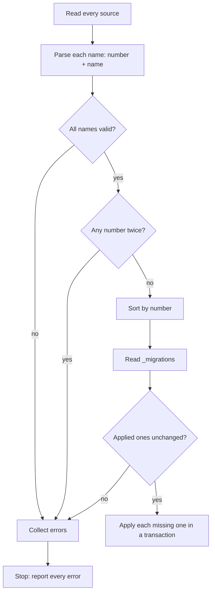

# Migrations from directories and from code

_Part of [feature 07](./feature.md). Written in ASD-STE100 Simplified Technical English (STE).
Code and identifiers stay as they are._

**Abbreviations in this file.** Structured Query Language (SQL); identifier (ID); Secure Hash
Algorithm with 256 bits (SHA-256); input/output (I/O); WebAssembly (wasm); continuous
integration (CI); Durable Object (DO); AeroSpace and Defence Industries Association of Europe
(ASD), the owner of the STE standard ASD-STE100. The
[glossary in feature.md](./feature.md#2-glossary) explains each term.

## 1. What this file covers

A **migration** is one change to a database schema, for example "create the table
`trusted_clients`". A **migration runner** applies the migrations that a database does not have
yet, in order, and records each one.

`foundation_db` has a runner today. The owner asked for two things:

1. Keep the migrations that live in code, as today.
2. Also load migrations from **directories** of files whose names start with a number. The
   runner must check that **no number is used twice**, across all sources.

This file designs that. The trust store and key store of this feature use it
([auth.md](./auth.md) sections 4 and 6).

## 2. What exists today

File on `master`: `backends/foundation_db/src/core/schema/migrations.rs`.

| Item | Today |
|---|---|
| A migration | `Migration { id: &'static str, name: &'static str, sql: &'static str }` |
| The list | `pub static MIGRATIONS: &[Migration]`, built with `include_str!("sql/NNN_name.sql")` |
| The runner | `MigrationRunner::new(&[Migration]).run_async(&dyn AsyncQueryStore)` |
| The record | table `_migrations (id TEXT PRIMARY KEY, name TEXT NOT NULL, applied_at INTEGER)` |
| IDs | three digits and a name, for example `001_create_kv_store` |

Problems we found:

- **Migration 023 is never applied.** The file `sql/023_create_vectors.sql` exists, but
  `MIGRATIONS` does not list it. The list goes from `022` to `024`. Nothing checks this.
- **No duplicate check.** Two entries can have the same number, and the runner does not see it.
- **No change check.** If someone edits a migration after it ran, the runner does not see it.
- **No transaction.** The runner applies the SQL and then records it in two calls. A failure
  between them leaves a migration that is applied but not recorded, so the next start applies
  it again.
- **Order comes from the list,** not from the numbers.

## 3. The design

### 3.1 File names

A migration file name has this form:

```text
<number>_<name>.sql
```

- `<number>` is digits only. New files use **at least four digits**, with leading zeros:
  `0001`, `0042`, `1234`. Numbers can grow past `9999`: `10000_…` is valid. The runner reads the
  number as an integer, so `0001` and `1` are the same number.
- `<name>` is lowercase letters, digits and `_`. It says what the migration does.
- The extension is `.sql`.

This is the same form that Cloudflare's `wrangler d1 migrations` uses (`0001_name.sql`). So one
directory can serve both tools. They record applied migrations in different tables, so do not
use both on one database.

The existing three-digit IDs (`001_create_kv_store`) stay valid. Their numbers are 1 to 25.

### 3.2 Sources

A **source** gives the runner a set of migrations. There are three kinds:

| Source | Where the files are | Targets | When it reads them |
|---|---|---|---|
| `MigrationSource::Static(&'static [Migration])` | in code (today's form) | all | compile time |
| `MigrationSource::Embedded(&'static [EmbeddedMigration])` | a directory, read by a macro at compile time | all, including wasm and Workers | compile time |
| `MigrationSource::Directory(PathBuf)` | a directory on disk | native only | run time, at each `run_async` |

A Worker has no file system. So a Worker uses `Embedded`: the macro reads the directory when the
crate is built and puts each file in the binary.

```rust
// Any crate: embed a directory at compile time (task T25).
static TRUST_MIGRATIONS: &[EmbeddedMigration] =
    foundation_db::embed_migrations!("migrations/trust");
```

What the code does: the macro lists `migrations/trust/*.sql` at compile time, checks every file
name and every number, and fails the build on a bad name or a repeated number. It makes one
`EmbeddedMigration { number, name, sql, sha256 }` per file. The macro lives in
`foundation_macros`.

### 3.3 Types

```rust
// foundation_db/src/core/schema/migrations.rs (changed, task T25)

/// One migration from any source.
#[derive(Debug, Clone, PartialEq, Eq)]
pub struct PlannedMigration {
    /// The number from the file name or the ID. Unique across all sources.
    pub number: u64,
    /// The ID stored in `_migrations`: "<number as written>_<name>".
    /// Existing IDs keep their exact text (for example "001_create_kv_store").
    pub id: String,
    pub name: String,
    pub sql: Cow<'static, str>,
    /// SHA-256 of the SQL text, hex. Stored, to find edited migrations.
    pub checksum: String,
    /// Where it came from, for error messages: a file path or "MIGRATIONS[3]".
    pub origin: String,
}

pub enum MigrationSource {
    Static(&'static [Migration]),
    Embedded(&'static [EmbeddedMigration]),
    #[cfg(not(target_family = "wasm"))]
    Directory(PathBuf),
}

/// Limits and rules for the runner (CLAUDE.md rule 8).
#[derive(Debug, Clone)]
pub struct MigrationConfig {
    /// Fewest digits for a new migration number. Default 4, the form that
    /// `wrangler d1 migrations` makes. Older IDs with fewer digits are
    /// accepted only from `Static` sources.
    pub min_number_digits: usize,
    /// Refuse to start if an applied migration's SQL changed. Default true.
    pub verify_checksums: bool,
    /// Largest migration file the `Directory` source reads. Default 1 MiB:
    /// the default `client_max_body_size` of nginx. A schema change is small.
    pub max_file_bytes: u64,
    /// The record table. Default "_migrations".
    pub table: String,
}

pub struct MigrationRunner {
    sources: Vec<MigrationSource>,
    config: MigrationConfig,
}

impl MigrationRunner {
    pub fn new(config: MigrationConfig) -> Self;
    pub fn with_source(self, source: MigrationSource) -> Self;

    /// Read every source, check the rules, and return the migrations in
    /// number order. No database access.
    ///
    /// # Errors
    /// `MigrationError` for each broken rule (section 3.4), all at once.
    pub async fn plan(&self) -> Result<Vec<PlannedMigration>, MigrationError>;

    /// Apply the migrations that the database does not have, in number
    /// order. Returns how many were applied.
    pub async fn run_async(&self, store: &dyn AsyncQueryStore) -> Result<usize, MigrationError>;
}
```

What the code does: a runner holds many sources. `plan` reads them all, checks the rules and
sorts the result by number. `run_async` calls `plan`, compares the plan with the
`_migrations` table, and applies the missing ones.

`MigrationRunner::new(&MIGRATIONS)` of today stays as a short form:
`MigrationRunner::from_static(&MIGRATIONS)`.

### 3.4 The rules

`plan` checks these rules. It reports **every** broken rule in one error, so an operator fixes
them all in one pass.

| Rule | Example of a break | Error |
|---|---|---|
| A file name has the form `<digits>_<name>.sql` | `create_users.sql`, `01-users.sql` | `BadName { origin }` |
| A new number has at least `min_number_digits` digits | `042_users.sql` in a directory | `ShortNumber { origin, digits }` |
| **No number appears twice**, across all sources together | `0007_a.sql` in one directory and `0007_b.sql` in another, or `7_x` in code | `DuplicateNumber { number, origins }` |
| Two spellings of one number count as the same number | `0007_a.sql` and `07_b.sql` | `DuplicateNumber` |
| No file is larger than `max_file_bytes` | a 5 MiB data dump | `TooLarge { origin }` |
| A file is valid UTF-8 | a binary file | `NotUtf8 { origin }` |
| An applied migration did not change (if `verify_checksums`) | someone edited `0003_x.sql` after it ran | `ChecksumChanged { id, stored, now }` |
| An applied number has the same ID now | `0003_a` ran; the directory now has `0003_b` | `IdChanged { number, applied_id, planned_id }` |
| No applied migration is missing from the plan | `0004_x` ran but its file is gone | `AppliedButMissing { id }` (a warning by default; an error if `MigrationConfig::strict`) |

Gaps in the numbers are allowed (`0001`, `0002`, `0005`). A gap is normal when a branch removes
a migration before it merges.



_The diagram shows the checks. The runner applies nothing until every check passes._

### 3.5 Applying one migration

Each migration runs with its record in **one** transaction, where the backend supports it:

| Backend | How |
|---|---|
| Turso, libsql (SQLite) | `BEGIN; <migration SQL>; INSERT INTO _migrations …; COMMIT;` in one `execute_batch_async` |
| D1 (native REST and Worker) | one `batch` call: D1 runs a batch as one transaction |
| DO SQL storage (`DoSqlStore`, task T20) | `transactionSync` around both statements |
| Memory | one lock for both steps |

If a backend cannot run a transaction, the runner applies the SQL, then records it, and logs a
warning at start. Migrations must then be safe to run twice (`CREATE TABLE IF NOT EXISTS`).

### 3.6 The record table

The `_migrations` table gets two columns. A built-in step adds them before any migration runs:

```sql
ALTER TABLE _migrations ADD COLUMN number INTEGER;
ALTER TABLE _migrations ADD COLUMN checksum TEXT;
```

For rows that existed before this change, the runner fills `number` from the ID and leaves
`checksum` empty. An empty checksum is not compared. The next `migrate --record-checksums`
command fills it.

### 3.7 More than one owner of a database

Two components can share one database: for example `foundation_auth` (trust store) and
`foundation_db` (core tables). Each one has its own migrations. The rule "no number twice" holds
for **one runner**. Two choices:

1. **One runner with all sources.** The host builds one runner with the core migrations and the
   trust store migrations. The numbers must not overlap. Each crate takes a number range by
   convention: `foundation_db` core 1 to 999, `foundation_auth` 1000 to 1999,
   `foundation_agent_rpc` 2000 to 2999. A test in each crate checks that its numbers stay in its
   range.
2. **One record table per component.** `MigrationConfig::table` is `_migrations_auth` for the
   trust store. Each component then numbers from 1.

We recommend choice 1, with the number ranges. One table shows the whole history of the database.

## 4. Errors

```rust
// foundation_db/src/core/schema/migrations.rs (task T25)
#[derive(Debug)]
pub struct MigrationError {
    /// Every broken rule, in a stable order.
    pub problems: Vec<MigrationProblem>,
}

#[derive(Debug, Clone, PartialEq, Eq)]
pub enum MigrationProblem {
    BadName { origin: String },
    ShortNumber { origin: String, digits: usize },
    DuplicateNumber { number: u64, origins: Vec<String> },
    TooLarge { origin: String, bytes: u64 },
    NotUtf8 { origin: String },
    ChecksumChanged { id: String, stored: String, now: String },
    IdChanged { number: u64, applied_id: String, planned_id: String },
    AppliedButMissing { id: String },
    Storage(StorageError),
}
```

What the code does: one error value holds all problems. Its `Display` prints one problem per
line, with the file path or code location, so an operator can fix all of them at once.

## 5. Tests

| Test | File | What it proves |
|---|---|---|
| Name parsing | `foundation_db/tests/migrations/naming_tests.rs` | Valid and invalid names; `0001` and `1` are one number; numbers past `9999` work. |
| Duplicates | `foundation_db/tests/migrations/duplicate_tests.rs` | A number twice in one directory, across two directories, and between code and a directory, all fail with every origin named. |
| Order | `foundation_db/tests/migrations/order_tests.rs` | Files apply in number order, not in name or directory order; gaps are allowed. |
| Checksums | `foundation_db/tests/migrations/checksum_tests.rs` | An edited applied migration stops the run; an old row with no checksum is accepted. |
| Transaction | `foundation_db/tests/migrations/transaction_tests.rs` | A failing migration leaves no record and no partial schema (Turso, libsql, memory). |
| Embedded | `foundation_db/tests/migrations/embedded_tests.rs` | `embed_migrations!` gives the same plan as `Directory` for the same folder. |
| Compile-time check | `foundation_macros/tests/ui/embed_migrations_duplicate.rs` (a `trybuild` test) | A repeated number fails the build with a clear message. |
| Core list | `foundation_db/tests/migrations/core_list_tests.rs` | Every file in `src/core/schema/sql/` is in the plan. This test finds the missing migration 023. |
| Number ranges | each crate's `tests/migration_range_tests.rs` | The crate's numbers stay in its range (section 3.7). |

## 6. Task

| Task | What | Done when |
|---|---|---|
| T25 | `MigrationSource`, `PlannedMigration`, `MigrationConfig`, the rules, `plan`, transactional `run_async`, the record table columns, `embed_migrations!`, the number ranges; register or remove migration 023 | the tests in section 5 pass on memory, Turso and libsql, and under Miniflare for D1 |
