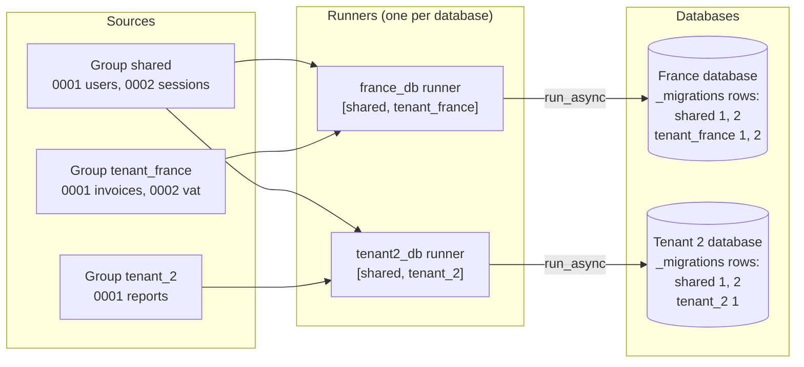
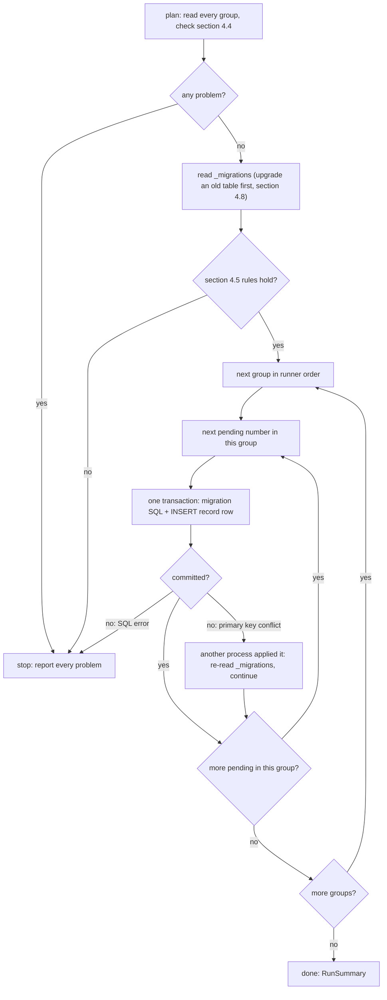
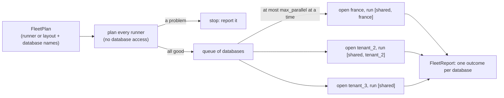

# Migrations: groups per database

_Part of [feature 07](./feature.md). Written in ASD-STE100 Simplified Technical English (STE).
Code and identifiers stay as they are._

**Abbreviations in this file.** Structured Query Language (SQL); identifier (ID); Secure Hash
Algorithm with 256 bits (SHA-256); input/output (I/O); WebAssembly (wasm); continuous
integration (CI); Durable Object (DO); data definition language (DDL), the SQL statements that
change a schema; AeroSpace and Defence Industries Association of Europe (ASD), the owner of the
STE standard ASD-STE100. The [glossary in feature.md](./feature.md#2-glossary) explains the
shared terms. Section 2 explains the terms of this file.

## 1. What this file covers

A **migration** is one change to a database schema, for example "create the table
`trusted_clients`". A **migration runner** applies the migrations that a database does not have
yet, in order, and records each one.

The owner set the design in the PR #126 review (2026-10-25, owner decision 10 in
[feature.md](./feature.md) section 11). The reference is
[`resources/Migration Management.md`](../../resources/Migration%20Management.md) (topic 3: a
shared pipeline first, then tenant pipelines, each with its own tracking records).

1. Migrations belong to **one database**, not to a table or to a crate.
2. Migrations come in **groups**. A **shared group** (for example users and auth) applies to
   every database that includes it. **Specific groups** (for example one tenant) go on top, in
   order: `[SHARED_GROUP, SPECIFIC_GROUP]`.
3. Each group numbers its own migrations from 1, always up by 1: no gaps and no repeats.
4. The database's record table keys each row by group. So two groups never conflict.
5. Groups come from code (static), from files embedded at build time, or from directories on
   disk. The program loads them into the handle that represents one database.
6. A migration does not name its database. The code that builds the handle decides which
   database gets which groups.
7. Separate databases have their own schemas, unless a group is a **template** that many
   databases include.

This replaces the earlier proposal of number ranges per crate and of one record table per
component. Both are removed.

## 2. Terms

| Term | Meaning |
|---|---|
| Group (`MigrationSet`) | A named, ordered list of migrations, numbered 1, 2, 3, ... Example: `shared`, `tenant_france`, `db_core`. |
| Shared group, template group | A group that more than one database includes. Example: `shared` with the users and auth tables. |
| Specific group | A group that only one database (or one kind of database) includes. Example: `tenant_france`. |
| Runner (`MigrationRunner`) | The ordered list of groups for one database, plus the rules. It represents that database's schema. |
| Record table | The table `_migrations` in each database. One row for each applied migration, keyed by group and number. |
| Plan | The list of migrations that a runner would apply to a database, in order. |
| Checksum | The SHA-256 of a migration's SQL text. It shows if someone changed a migration after it ran. |

## 3. What exists today

File on `master`: `backends/foundation_db/src/core/schema/migrations.rs`.

| Item | Today |
|---|---|
| A migration | `Migration { id: &'static str, name: &'static str, sql: &'static str }` |
| The list | `pub static MIGRATIONS: &[Migration]`, built with `include_str!("sql/NNN_name.sql")` |
| The runner | `MigrationRunner::new(&[Migration]).run_async(&dyn QueryStore)` |
| The record | table `_migrations (id TEXT PRIMARY KEY, name TEXT NOT NULL, applied_at INTEGER)` |
| IDs | three digits and a name, for example `001_create_kv_store` |

Problems we found:

- **Migration 023 is never applied.** `sql/023_create_vectors.sql` exists, but `MIGRATIONS`
  goes from `022` to `024`. Nothing checks this.
- **No duplicate check, no gap check.**
- **No change check.** An edit to a migration after it ran is not seen.
- **No transaction.** The SQL and the record are two calls. A failure between them makes the
  next start apply the migration again.
- **One flat list.** There is no way to share some migrations between databases and keep
  others for one database.

## 4. The design

### 4.1 Groups and databases



_The diagram shows one shared group in two runners. Each database records each group in its
own rows, so the groups never conflict._

The code that the owner sketched, in its final form:

```rust
// Groups: each is a static `MigrationSet`. The macro reads a directory at
// build time; the group name is the directory name unless given.
static SHARED: MigrationSet = foundation_db::embed_migrations!("migrations/shared");
static TENANT_FRANCE: MigrationSet = foundation_db::embed_migrations!("migrations/databases/tenant_france");
static TENANT_2: MigrationSet = foundation_db::embed_migrations!("migrations/databases/tenant_2");

// Runners: one per database. `add_from_static` returns a new runner and does
// not change `shared`, so one base serves many databases.
let shared = MigrationRunner::from_static(&SHARED);
let france_db = shared.add_from_static(&TENANT_FRANCE);   // [shared, tenant_france]
let tenant2_db = shared.add_from_static(&TENANT_2);       // [shared, tenant_2]

france_db.run_async(&*france_store).await?;
tenant2_db.run_async(&*tenant2_store).await?;
```

What the code does: it makes two runners that share the first group. Each runner applies the
pending migrations of `shared` first, then those of its specific group, to its own database.

### 4.2 File names and directory layout

A migration file name has this form:

```text
<number>_<name>.sql
```

- `<number>` is digits only. Directory and embedded files use **at least four digits**, with
  leading zeros: `0001`, `0042`. Numbers can grow past `9999`: `10000_…` is valid. The runner
  reads the number as an integer, so `0001` and `1` are the same number.
- `<name>` is lowercase letters, digits and `_`.
- The extension is `.sql`.
- In one group, the numbers are 1, 2, 3, ... with no gap and no repeat.

### 4.2.1 Groups declared by directory (owner, PR #126 review, 2026-10-26)

A program can declare its groups in code (section 4.1) **or** by directory. In a directory
layout, **each folder is one group, and the folder name is the group name**:

```text
database/                        the layout root
├── shared/                      group "shared": a template group, first for every database
│   ├── 0001_create_users.sql
│   └── 0002_create_sessions.sql
├── france/                      group "france": only the database named "france"
│   ├── 0001_create_invoices.sql
│   └── 0002_add_vat_rate.sql
└── tenant_2/                    group "tenant_2": only the database named "tenant_2"
    └── 0001_create_reports.sql
```

The rules of a layout:

1. Each folder directly under the root is a group. Files inside a group follow section 4.2.
   Sub-folders inside a group are an error (`NestedFolder`).
2. The **template groups** are the folders named in `MigrationLayoutConfig::template_groups`
   (default `["shared"]`). They apply to every database, first, in the order of that list.
3. Every other folder is the **specific group** of the database with the same name. It applies
   after the template groups.
4. A database with no folder of its own gets only the template groups.
5. A folder name follows the group name rule (`[a-z0-9_]{1,64}`).

So `layout.runner_for("france")` is the runner `[shared, france]`, the same as
`MigrationRunner::from_dir("database/shared").add_from_dir("database/france")` in code.

```rust
// foundation_db/src/core/schema/layout.rs (task T25)

/// Groups found in one directory tree. Made by `scan` (native) or
/// `embed_migration_layout!` (all targets, at build time). Read by
/// `runner_for` and by `FleetRunner`.
#[derive(Debug, Clone)]
pub struct MigrationLayout {
    templates: Vec<Arc<MigrationSet>>,                // in template order
    specific: BTreeMap<String, Arc<MigrationSet>>,    // database name -> its group
    config: MigrationConfig,
}

#[derive(Debug, Clone)]
pub struct MigrationLayoutConfig {
    /// Folders that apply to every database, in this order. Default ["shared"].
    pub template_groups: Vec<String>,
}

impl MigrationLayout {
    /// Read the folders under `root` (native only). Checks the layout rules
    /// and the rules of section 4.4 for every group.
    #[cfg(not(target_family = "wasm"))]
    pub async fn scan(root: impl Into<PathBuf>, layout: MigrationLayoutConfig, config: MigrationConfig)
        -> Result<Self, MigrationError>;

    /// The runner of one database: the template groups, then its own group
    /// when the layout has one.
    pub fn runner_for(&self, database: &str) -> MigrationRunner;

    /// The database names that have their own folder.
    pub fn databases(&self) -> impl Iterator<Item = &str>;
}

// Any crate: embed a whole layout at build time (Workers have no file system).
static LAYOUT: EmbeddedLayout = foundation_db::embed_migration_layout!("database", templates = ["shared"]);
```

What the code does: `scan` turns each folder into a group and keeps the templates apart from the
specific groups. `runner_for` builds the same runner that code would build. The macro does the same
work at build time and fails the build on a broken rule.

This is the file form that Cloudflare's `wrangler d1 migrations` uses (`0001_name.sql`), so a
group directory can also serve that tool. The two tools record applied migrations in different
tables, so do not use both on one database.

### 4.3 Types

```rust
// foundation_db/src/core/schema/migrations.rs (changed, task T25)

/// One migration in code. Unchanged.
pub struct Migration {
    pub id: &'static str,   // "<number>_<name>", for example "0001_create_users"
    pub name: &'static str,
    pub sql: &'static str,
}

/// A group: a name and its migrations. Made in code, by `embed_migrations!`,
/// or (native only) by reading a directory. Read by `MigrationRunner`.
#[derive(Debug, Clone)]
pub struct MigrationSet {
    /// The group name, stored in every record row of this group.
    /// `[a-z0-9_]{1,64}`. Example: "shared". `Cow::Borrowed` in a static
    /// (the macro writes it); `Cow::Owned` for a directory read at run time.
    pub group: Cow<'static, str>,
    pub source: MigrationSource,
}

#[derive(Debug, Clone)]
pub enum MigrationSource {
    /// Migrations written in code (today's form).
    Static(&'static [Migration]),
    /// Files read at build time by `embed_migrations!`. All targets,
    /// including wasm and Workers, which have no file system.
    Embedded(&'static [EmbeddedMigration]),
    /// A directory read at run time. Native only.
    #[cfg(not(target_family = "wasm"))]
    Directory(PathBuf),
}

/// Made by `embed_migrations!`, one per file.
#[derive(Debug, Clone, Copy)]
pub struct EmbeddedMigration {
    pub number: u64,
    pub name: &'static str,
    pub sql: &'static str,
    /// Lowercase hex SHA-256 of `sql`, computed at build time.
    pub sha256: &'static str,
}

/// One migration after `plan` read and checked it.
#[derive(Debug, Clone, PartialEq, Eq)]
pub struct PlannedMigration {
    pub group: String,
    /// 1, 2, 3, ... inside the group.
    pub number: u64,
    pub name: String,
    pub sql: Cow<'static, str>,
    pub checksum: String,
    /// For error messages: a file path, or "SHARED[3]" for code.
    pub origin: String,
}

/// The ordered groups of one database, plus the rules. Cheap to clone.
#[derive(Debug, Clone)]
pub struct MigrationRunner {
    groups: Vec<Arc<MigrationSet>>,
    config: MigrationConfig,
}

impl MigrationRunner {
    /// A runner whose first group is `set`.
    pub fn from_static(set: &'static MigrationSet) -> Self;
    /// A runner whose first group is read from a directory (native only).
    /// The group name is the last path segment.
    #[cfg(not(target_family = "wasm"))]
    pub fn from_dir(path: impl Into<PathBuf>) -> Self;

    /// A new runner: this runner's groups, then `set`. `self` does not change.
    pub fn add_from_static(&self, set: &'static MigrationSet) -> Self;
    #[cfg(not(target_family = "wasm"))]
    pub fn add_from_dir(&self, path: impl Into<PathBuf>) -> Self;

    pub fn with_config(self, config: MigrationConfig) -> Self;

    /// The group names, in apply order.
    pub fn groups(&self) -> Vec<&str>;

    /// Read every group, check the rules of section 4.4, and return the
    /// migrations in apply order. No database access.
    pub async fn plan(&self) -> Result<Vec<PlannedMigration>, MigrationError>;

    /// Compare the plan with the record table and apply what is missing, in
    /// apply order, each in its own transaction (section 4.6).
    pub async fn run_async(&self, store: &dyn QueryStore) -> Result<RunSummary, MigrationError>;
}

/// What one `run_async` did.
#[derive(Debug, Clone, PartialEq, Eq, Default)]
pub struct RunSummary {
    /// (group, number) of each migration applied now, in order.
    pub applied: Vec<(String, u64)>,
    /// Groups in the record table that this runner does not have
    /// (section 4.5, rule "UnknownGroup").
    pub unknown_groups: Vec<String>,
}

/// Rules and limits of the runner (`CLAUDE.md` rule 8).
#[derive(Debug, Clone)]
pub struct MigrationConfig {
    /// Fewest digits in a directory or embedded file number. Default 4, the
    /// form that `wrangler d1 migrations` makes. `Static` sources may use
    /// fewer (the three-digit core IDs of today).
    pub min_number_digits: usize,
    /// Refuse to run if an applied migration's SQL changed. Default true.
    pub verify_checksums: bool,
    /// Treat an unknown group in the record table as an error. Default false
    /// (a warning in `RunSummary`).
    pub strict_groups: bool,
    /// Largest migration file that `Directory` reads. Default 1 MiB: the
    /// default `client_max_body_size` of nginx. A schema change is small.
    pub max_file_bytes: u64,
    /// The record table. Default "_migrations".
    pub table: String,
}
```

`foundation_db` exports its own tables as one group, `db_core` (today's `MIGRATIONS`, 1 to 25).
`foundation_auth` exports `auth_trust` (trust store) and `auth_keys` (key store). A host that keeps
them in one database builds:

```rust
let runner = MigrationRunner::from_static(&foundation_db::DB_CORE)
    .add_from_static(&foundation_auth::AUTH_KEYS)
    .add_from_static(&foundation_auth::AUTH_TRUST);
```

Each of these groups numbers from 1. They need no number ranges.

### 4.4 Rules that `plan` checks

`plan` reports **every** broken rule in one error, so an operator fixes them all in one pass.

| Rule | Example of a break | Problem |
|---|---|---|
| A group name is `[a-z0-9_]{1,64}` | `Tenant-France` | `BadGroupName { group }` |
| A group appears once in a runner | `shared` added two times | `DuplicateGroup { group }` |
| A file name is `<digits>_<name>.sql` | `create_users.sql`, `01-users.sql` | `BadName { origin }` |
| A directory or embedded number has at least `min_number_digits` digits | `042_users.sql` | `ShortNumber { origin, digits }` |
| No number repeats in a group (`0007` and `07` are the same number) | `0007_a.sql` and `0007_b.sql` | `DuplicateNumber { group, number, origins }` |
| A group starts at 1 | first file is `0002_x.sql` | `Gap { group, missing: 1 }` |
| No gap in a group | `0001`, `0002`, `0004` | `Gap { group, missing: 3 }` |
| No file is larger than `max_file_bytes` | a 5 MiB data dump | `TooLarge { origin, bytes }` |
| A file is valid UTF-8 | a binary file | `NotUtf8 { origin }` |

The same number in two **different** groups is correct: `shared` 1 and `tenant_france` 1 are two
migrations.

### 4.5 Rules that `run_async` checks against the database

| Rule | Example of a break | Problem |
|---|---|---|
| An applied migration did not change (if `verify_checksums`) | someone edited `shared/0002_…sql` after it ran | `ChecksumChanged { group, number, stored, now }` |
| An applied number has the same name now | `shared` 3 ran as `add_email`; the file is now `0003_add_phone.sql` | `NameChanged { group, number, applied, planned }` |
| The applied numbers of a group are 1 to k, with nothing missing | `tenant_france` has 1, 2 and 4 in the record | `AppliedNotPrefix { group, missing }` |
| Every applied number is still in the plan | `shared` 5 ran, but the group ends at 4 | `AppliedButMissing { group, number }` |
| Every group in the record is in the runner | the record has `tenant_2`, the runner is the France runner | `UnknownGroup { group }`: in `RunSummary` by default, an error with `strict_groups` |

### 4.6 Apply order and transactions

1. Groups apply in runner order. Inside a group, numbers apply in order.
2. All pending migrations of an earlier group run before any pending migration of a later group.
   So a new `shared` migration always runs before a new `tenant_france` migration in the same run.
3. A specific group may use tables of an earlier group (for example a foreign key to `users`). An
   earlier group must never use tables of a later group, because the same earlier group is in
   runners that do not have that later group.



_The diagram shows that the runner checks everything before it changes anything, then applies
one migration per transaction, group by group._

Each migration and its record row commit in **one** transaction, where the backend supports it:

| Backend | How |
|---|---|
| Turso, libsql (SQLite) | `BEGIN; <migration SQL>; INSERT INTO _migrations …; COMMIT;` in one `execute_batch_async` |
| D1 (native REST and Worker) | one `batch` call: D1 runs a batch as one transaction |
| DO SQL storage (`DoSqlStore`, task T20) | `transactionSync` around both statements |
| Memory | one lock for both steps |

SQLite and D1 roll back DDL in a failed transaction. If a backend cannot run a transaction, the
runner applies the SQL, then records it, and logs a warning at start. Migrations must then be safe
to run twice (`CREATE TABLE IF NOT EXISTS`).

Two processes can start at the same time on one database (for example two Workers). The
primary key `(group_name, number)` makes the second insert fail, so its transaction rolls back.
The runner then reads the record again and continues.

### 4.7 The record table

```sql
CREATE TABLE IF NOT EXISTS _migrations (
    group_name TEXT    NOT NULL,
    number     INTEGER NOT NULL,
    name       TEXT    NOT NULL,
    checksum   TEXT    NOT NULL,   -- '' for rows from before this change (not compared)
    applied_at INTEGER NOT NULL,   -- Unix seconds, from the Env clock
    PRIMARY KEY (group_name, number)
);
```

One row for each applied migration. The rows of one group are the tracking records of that group.
The reference document puts each pipeline's records in its own table; the owner chose one table
with rows keyed by group, which gives the same isolation in one place. `applied_at` comes from
`Env` (feature 07, `CLAUDE.md` rule 11), so a simulated test gives the same rows each run.

`MigrationRunner::record_checksums(store)` (task T25) fills empty checksums from the current SQL.
An operator calls it after checking that the files did not change. A host can expose it as a
command.

### 4.8 Upgrade from the table of today

A built-in step runs before any group. It sees the old shape (no `group_name` column) and, in one
transaction:

1. Creates `_migrations_next` with the shape of section 4.7.
2. Copies every old row as group `db_core`, with `number` from the leading digits of `id`, the
   same `name`, `checksum = ''` and the old `applied_at`.
3. Drops `_migrations` and renames `_migrations_next` to `_migrations`.

**Repair of migration 023.** Databases of today have `db_core` 1 to 22, 24 and 25, without 23. The
rule "applied numbers are 1 to k" (section 4.5) would stop them. Migration 023 only creates the
`vectors` table and its index with `IF NOT EXISTS`, and 024 and 025 do not use it. So the upgrade
step runs `023_create_vectors.sql` and records it, in the same transaction. After that, `db_core`
is 1 to 25 with no gap. This repair exists only in the upgrade step and only for 023.

### 4.9 Running groups on many databases (`FleetRunner`)

The owner asked for a runner that takes groups and runs them on many databases, one at a time or
in parallel, at the database level. `FleetRunner` does that. It never runs two runners on one
database at the same time, and it never mixes the rows of two databases.

```rust
// foundation_db/src/core/schema/fleet.rs (task T25)

/// Opens a database by name. The host gives it: for example one Turso file
/// for each tenant, or one D1 binding for each tenant on a Worker.
#[async_trait::async_trait]
pub trait DatabaseResolver: Send + Sync {
    async fn open(&self, database: &str) -> Result<Arc<dyn QueryStore>, StorageError>;
}

/// Which runner each database gets.
#[derive(Debug, Clone)]
pub enum FleetPlan {
    /// The same runner on every listed database. Example: a new `shared`
    /// migration on every tenant.
    SameRunner { runner: MigrationRunner, databases: Vec<String> },
    /// `layout.runner_for(name)` on every listed database.
    FromLayout { layout: MigrationLayout, databases: Vec<String> },
}

/// Limits of a fleet run (`CLAUDE.md` rule 8).
#[derive(Debug, Clone)]
pub struct FleetConfig {
    /// Most databases that migrate at the same time. Default 1: one database
    /// at a time, as Flyway and Liquibase migrate one target per run. Set it
    /// higher for many small tenant databases.
    pub max_parallel: usize,
    /// Stop starting new databases after the first failure. Default true:
    /// a broken migration usually fails on every database, so stop early.
    pub stop_on_first_failure: bool,
}

pub struct FleetRunner {
    plan: FleetPlan,
    resolver: Arc<dyn DatabaseResolver>,
    config: FleetConfig,
}

impl FleetRunner {
    pub fn new(plan: FleetPlan, resolver: Arc<dyn DatabaseResolver>, config: FleetConfig) -> Self;

    /// Plans every runner first (no database access), then migrates each
    /// database with at most `max_parallel` in flight. Returns one outcome
    /// for each database, in the order of the list.
    pub async fn run(&self) -> FleetReport;
}

#[derive(Debug)]
pub struct FleetReport {
    pub outcomes: Vec<(String, FleetOutcome)>,
}

#[derive(Debug)]
pub enum FleetOutcome {
    Migrated(RunSummary),
    Failed(MigrationError),
    /// Not started, because an earlier database failed and
    /// `stop_on_first_failure` is set.
    Skipped,
}
```

What the code does: `run` first calls `plan` for every distinct runner, so a broken file stops
the run before any database changes. It then opens and migrates the databases as a bounded stream
of futures (`buffer_unordered(max_parallel)`). Each database uses its own transactions and its own
record rows (section 4.6). The same code runs on native (valtron tasks on many threads) and on a
Worker (one thread; the parallel work is the waiting for D1).



_The diagram shows a fleet run from a layout: every runner is checked first, then the databases
migrate with a limit on how many run at the same time._

## 5. Errors

```rust
// foundation_db/src/core/schema/migrations.rs (task T25)
#[derive(Debug)]
pub struct MigrationError {
    /// Every problem, in a stable order (group order, then number).
    pub problems: Vec<MigrationProblem>,
}

#[derive(Debug, Clone, PartialEq, Eq)]
pub enum MigrationProblem {
    BadGroupName { group: String },
    DuplicateGroup { group: String },
    BadName { origin: String },
    ShortNumber { origin: String, digits: usize },
    DuplicateNumber { group: String, number: u64, origins: Vec<String> },
    Gap { group: String, missing: u64 },
    TooLarge { origin: String, bytes: u64 },
    NotUtf8 { origin: String },
    ChecksumChanged { group: String, number: u64, stored: String, now: String },
    NameChanged { group: String, number: u64, applied: String, planned: String },
    AppliedNotPrefix { group: String, missing: Vec<u64> },
    AppliedButMissing { group: String, number: u64 },
    UnknownGroup { group: String },
    /// A layout group folder contains a folder.
    NestedFolder { origin: String },
    /// A migration's SQL failed. Nothing of that migration is kept.
    Apply { group: String, number: u64, message: String },
    Storage(StorageError),
}
```

What the code does: one error value holds all problems. Its `Display` prints one problem per
line, with the group, the number and the file path or code location.

## 6. Tests

| Test | File | What it proves |
|---|---|---|
| Name parsing | `foundation_db/tests/migrations/naming_tests.rs` | Valid and invalid names; `0001` and `1` are one number; numbers past `9999` work. |
| Group rules | `foundation_db/tests/migrations/group_rules_tests.rs` | Start at 1, no gap, no repeat, bad and duplicate group names: each fails with every origin named. The same number in two groups passes. |
| Composition | `foundation_db/tests/migrations/composition_tests.rs` | `shared.add_from_static(a)` and `shared.add_from_static(b)` give two runners and leave `shared` unchanged; groups apply in order. |
| Record isolation | `foundation_db/tests/migrations/record_tests.rs` | Two groups with the same numbers get separate rows; an unknown group is reported. |
| Applied checks | `foundation_db/tests/migrations/applied_tests.rs` | Changed checksum, changed name, applied-not-prefix, applied-but-missing. |
| Transaction | `foundation_db/tests/migrations/transaction_tests.rs` | A failing migration leaves no record and no partial schema (Turso, libsql, memory). |
| Concurrent runs | `foundation_db/tests/migrations/concurrent_tests.rs` | Two runners on one database apply each migration once. |
| Embedded | `foundation_db/tests/migrations/embedded_tests.rs` | `embed_migrations!` gives the same plan as `from_dir` for the same folder. |
| Compile-time check | `foundation_macros/tests/ui/embed_migrations_gap.rs` (`trybuild`) | A gap or a repeated number fails the build with a clear message. |
| Upgrade | `foundation_db/tests/migrations/upgrade_tests.rs` | An old `_migrations` table with 1 to 22, 24, 25 becomes `db_core` 1 to 25, and `vectors` exists. |
| Core list | `foundation_db/tests/migrations/core_list_tests.rs` | Every file in `src/core/schema/sql/` is in `DB_CORE`. |
| Layout | `foundation_db/tests/migrations/layout_tests.rs` | Folder names become groups; templates come first in config order; a database without a folder gets only the templates; a nested folder fails; `embed_migration_layout!` gives the same runners as `scan`. |
| Fleet | `foundation_db/tests/migrations/fleet_tests.rs` | Sequential and parallel runs give the same records; never more than `max_parallel` databases open at once; a failure with `stop_on_first_failure` skips the rest; one outcome per database. |

## 7. Task

| Task | What | Done when |
|---|---|---|
| T25 | `MigrationSet`, `MigrationSource`, `MigrationRunner` with `from_static`, `add_from_static`, `from_dir`, `add_from_dir`; the rules; `plan`; transactional `run_async`; the record table and its upgrade with the 023 repair; `embed_migrations!`; directory layouts (`MigrationLayout`, `embed_migration_layout!`); `FleetRunner`; the `DB_CORE`, `AUTH_KEYS` and `AUTH_TRUST` groups | the tests in section 6 pass on memory, Turso and libsql, and under Miniflare for D1 |

## 8. Open questions

Both earlier questions are answered (owner, PR #126 review, 2026-10-26):

1. ~~Declare groups on disk?~~ **Yes.** A folder is a group, named by the folder (section 4.2.1).
   Code-built runners stay valid.
2. ~~A runner for many tenant databases?~~ **Yes**, at the database level, sequential or parallel
   with a configured limit: `FleetRunner` (section 4.9).

No open questions remain in this file.
