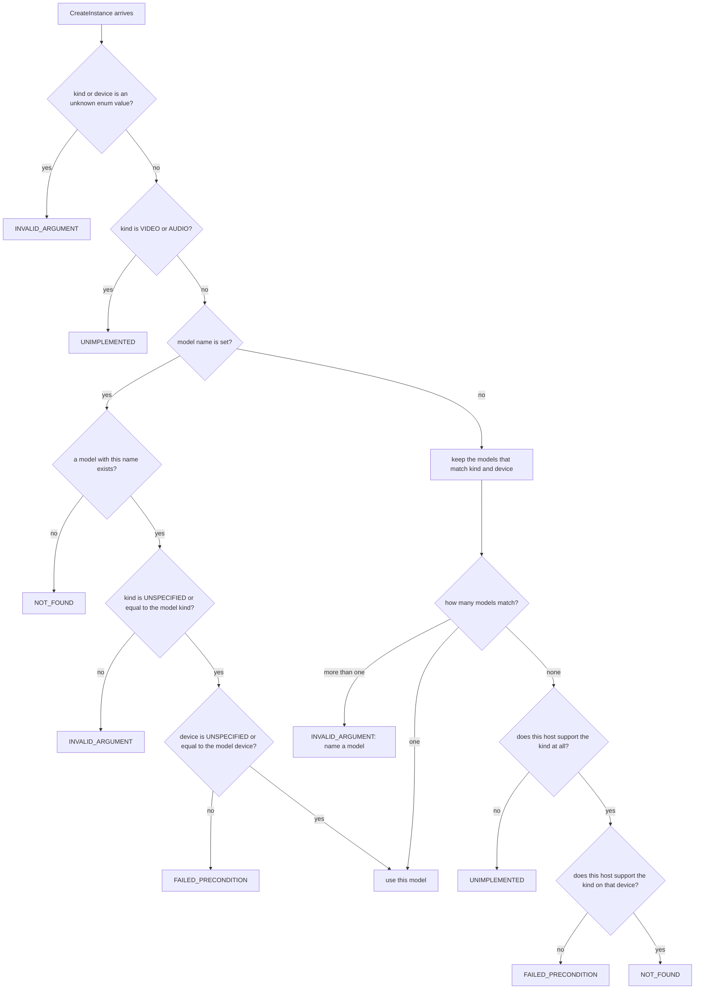

# Wire contract changes (`agent.proto`)

_Part of [feature 07](./feature.md). Written in ASD-STE100 Simplified Technical English (STE).
Code and identifiers stay as they are._

**Abbreviations in this file.** remote procedure call (RPC); Protocol Buffers (protobuf);
uniform resource locator (URL); Hypertext Transfer Protocol (HTTP); JavaScript Object
Notation (JSON); Transport Layer Security (TLS); Secure Hash Algorithm with 256 bits
(SHA-256); Distinguished Encoding Rules (DER), a binary form of a certificate; Certificate
Authority (CA); certificate signing request (CSR); Quick Response code (QR code); central
processing unit (CPU); graphics processing unit (GPU); Compute Unified Device Architecture
(CUDA), the NVIDIA GPU platform; Generative Pre-trained Transformer (GPT);
GPT-Generated Unified Format (GGUF), the model file format of llama.cpp; Durable Object (DO); enumeration (enum). gRPC is the name of a Google RPC
protocol over HTTP/2. gRPC-Web is its variant for browsers. Connect is an RPC protocol that
works over HTTP/1.1 and HTTP/2. AeroSpace and Defence Industries Association of Europe (ASD), the owner of the
STE standard ASD-STE100. The [glossary in feature.md](./feature.md#2-glossary) explains
each term.

## 1. What this file covers

This file gives the complete change to the wire contract of agent-rpc.

- The **wire contract** is the set of messages and calls that a client and a server send to each other.
- We write the contract in Protocol Buffers (protobuf). Protobuf is a language for messages. A tool turns it into Rust types.
- The contract file is `backends/foundation_agent_rpc/proto/ewe/agent_rpc/v1/agent.proto`.
- `build.rs` turns it into Rust with `buffa-build` (messages) and `foundation_connectrpc_codegen` (services). Do not write these types by hand (CLAUDE.md rule 5).

The changes add four things:

1. A new remote procedure call (RPC), `GetCapabilities`. An RPC is a function that a client calls over the network.
2. A model kind and a device on `CreateInstanceRequest`.
3. Paging on `ListInstances`.
4. Version 2 of `BootstrapPayload`, for hosts that a client reaches by a uniform resource locator (URL), for example a Cloudflare Worker.

## 2. Compatibility rules

These rules keep old clients and old servers working.

| Rule | Why |
|---|---|
| Add new fields with new field numbers only. | Old readers skip unknown fields. |
| Never change the number or the type of a field. | A changed number makes old bytes decode wrong. |
| Every new enumeration (enum) starts with `..._UNSPECIFIED = 0`. | Zero is the value an old client sends. It must mean "use the old behavior". |
| Prefix each enum value with the enum name, for example `MODEL_KIND_API`. | In protobuf, all enum values of a package share one name space. |
| Keep `BootstrapPayload.version = 1` exactly as today. Add a new `version = 2`. | Clients that exist today must still read payloads from native hosts. |
| A server answers an unknown enum value with `INVALID_ARGUMENT`. | `buffa` keeps unknown values as `EnumValue::Unknown(i32)`. The server must not guess. |

Generated Rust names: `buffa` keeps the protobuf value names. So the Rust code uses
`ModelKind::MODEL_KIND_CANDLE`. An enum field is a `buffa::EnumValue<ModelKind>`, which is
`Known(ModelKind)` or `Unknown(i32)`.

## 3. The new `agent.proto` (complete file)

The file below replaces the current file. Each `NEW (07)` comment marks an addition.
Lines without that comment are the same as today.

```proto
// agent-rpc wire contract (spec 65 features 01 and 07).
//
// AgentService is the client <-> agent-rpc API.
// BootstrapService is the signed secret + CSR -> client certificate exchange.
// BootstrapPayload is what an operator hands a client (base64url / QR code).
syntax = "proto3";

package ewe.agent_rpc.v1;

service AgentService {
  // Liveness plus what the server hosts.
  rpc Health(HealthRequest) returns (HealthResponse) {
    option idempotency_level = NO_SIDE_EFFECTS;
  }
  // NEW (07): the model kinds, devices, models, protocols and limits of this host.
  rpc GetCapabilities(GetCapabilitiesRequest) returns (GetCapabilitiesResponse) {
    option idempotency_level = NO_SIDE_EFFECTS;
  }
  // Create a named instance on a hosted model (no model load for local
  // models that are already loaded).
  rpc CreateInstance(CreateInstanceRequest) returns (InstanceInfo);
  rpc ListInstances(ListInstancesRequest) returns (ListInstancesResponse) {
    option idempotency_level = NO_SIDE_EFFECTS;
  }
  rpc DestroyInstance(DestroyInstanceRequest) returns (DestroyInstanceResponse);
  // Run one turn and return its text.
  rpc Chat(ChatRequest) returns (ChatResponse);
  // Run one turn and stream its events as they happen.
  rpc ChatStream(ChatRequest) returns (stream TurnEvent);
}

service BootstrapService {
  // Present a signed bootstrap secret and a CSR; receive a client certificate.
  rpc Enroll(EnrollRequest) returns (EnrollResponse);
}

// ---------------------------------------------------------------------------
// Model kinds and devices. NEW (07).

// The family of a model. Zero means "any kind".
enum ModelKind {
  MODEL_KIND_UNSPECIFIED = 0;
  // A model at a remote provider, reached over HTTP (OpenAI-compatible,
  // Anthropic, Workers AI).
  MODEL_KIND_API = 1;
  // A local safetensors model that runs on Candle.
  MODEL_KIND_CANDLE = 2;
  // A local GGUF model that runs on llama.cpp.
  MODEL_KIND_GGUF = 3;
  // Kept for future video models. No host supports it yet.
  MODEL_KIND_VIDEO = 4;
  // Kept for future audio models. No host supports it yet.
  MODEL_KIND_AUDIO = 5;
}

// Where a model runs. Zero means "any device".
enum DeviceKind {
  DEVICE_KIND_UNSPECIFIED = 0;
  DEVICE_KIND_CPU = 1;
  DEVICE_KIND_CUDA = 2;
  DEVICE_KIND_METAL = 3;
  DEVICE_KIND_VULKAN = 4;
  // The model runs at the remote provider. Only for MODEL_KIND_API.
  DEVICE_KIND_REMOTE = 5;
}

message Device {
  DeviceKind kind = 1;
  // The GPU index. Always 0 for CPU and REMOTE.
  uint32 ordinal = 2;
}

// The load state of one configured model.
enum ModelLoadState {
  MODEL_LOAD_STATE_UNSPECIFIED = 0;
  MODEL_LOAD_STATE_NOT_LOADED = 1;
  MODEL_LOAD_STATE_LOADING = 2;
  MODEL_LOAD_STATE_LOADED = 3;
  MODEL_LOAD_STATE_FAILED = 4;
  // Nothing to load: the remote provider holds the model.
  MODEL_LOAD_STATE_REMOTE = 5;
}

message GetCapabilitiesRequest {}

message GetCapabilitiesResponse {
  // One entry per model kind that this host can run.
  repeated ModelKindSupport model_kinds = 1;
  // Every model that the operator configured on this host.
  repeated ModelDescriptor models = 2;
  // "connect", "grpc", "grpc-web".
  repeated string protocols = 3;
  // "mtls", "signed-secret", "jwt", "cloudflare-mtls", "insecure".
  repeated string auth_modes = 4;
  InstanceLimits limits = 5;
  // "native" or "worker".
  string host_kind = 6;
}

message ModelKindSupport {
  ModelKind kind = 1;
  // The devices on which this host can run the kind.
  repeated Device devices = 2;
}

message ModelDescriptor {
  string name = 1;
  ModelKind kind = 2;
  Device device = 3;
  ModelLoadState state = 4;
}

message InstanceLimits {
  uint32 max_instances = 1;
  uint32 max_name_len = 2;
  uint32 max_prompt_bytes = 3;
}

// The error detail that a failed CreateInstance carries. NEW (07).
message ModelSelectionError {
  string requested_model = 1;
  ModelKind requested_kind = 2;
  Device requested_device = 3;
  // What this host supports, so the client can pick again.
  repeated ModelKindSupport supported = 4;
}

// ---------------------------------------------------------------------------
// Health and instances.

message HealthRequest {}

message HealthResponse {
  string status = 1;
  repeated ModelInfo models = 2;
  uint32 instances = 3;
}

message ModelInfo {
  string name = 1;
  ModelKind kind = 2;   // NEW (07)
  Device device = 3;    // NEW (07)
}

message CreateInstanceRequest {
  string name = 1;
  // Empty = pick by kind and device (see "Model selection" in proto.md).
  string model = 2;
  optional string system_prompt = 3;
  optional uint32 max_tokens = 4;
  optional float temperature = 5;
  // NEW (07): UNSPECIFIED = any kind.
  ModelKind kind = 6;
  // NEW (07): not set, or DEVICE_KIND_UNSPECIFIED = any device.
  Device device = 7;
}

message InstanceInfo {
  string name = 1;
  string model = 2;
  uint64 created_unix_ms = 3;
  uint64 turns = 4;
  ModelKind kind = 5;   // NEW (07)
  Device device = 6;    // NEW (07)
}

message ListInstancesRequest {
  // NEW (07): 0 = the server default (RegistryConfig::default_page_size).
  uint32 page_size = 1;
  // NEW (07): empty = the first page.
  string page_token = 2;
}

message ListInstancesResponse {
  repeated InstanceInfo instances = 1;
  // NEW (07): empty = no more pages.
  string next_page_token = 2;
}

message DestroyInstanceRequest {
  string name = 1;
}

message DestroyInstanceResponse {}

// ---------------------------------------------------------------------------
// Chat. No change in 07.

message ChatRequest {
  string instance = 1;
  string prompt = 2;
}

message ChatResponse {
  string text = 1;
  Usage usage = 2;
  uint64 message_count = 3;
}

// Cumulative session token usage.
message Usage {
  uint64 input_tokens = 1;
  uint64 output_tokens = 2;
  uint64 total_tokens = 3;
}

message TurnEvent {
  oneof event {
    // Assistant text (a delta for streaming backends).
    string text = 1;
    string thinking = 2;
    ToolCall tool_call = 3;
    ToolResult tool_result = 4;
    // Drop the text shown so far for this turn; a retry follows.
    Retract retract = 5;
    // Terminal: the turn failed after the events before it.
    TurnFailed failed = 6;
    // Terminal: the turn completed.
    TurnDone done = 7;
  }
}

message ToolCall {
  string id = 1;
  string name = 2;
  string arguments_json = 3;
}

message ToolResult {
  string tool_call_id = 1;
  string name = 2;
  string content = 3;
}

message Retract {
  string reason = 1;
}

message TurnFailed {
  string message = 1;
}

message TurnDone {
  uint64 message_count = 1;
  Usage usage = 2;
}

// ---------------------------------------------------------------------------
// Bootstrap.

message EnrollRequest {
  // A signed bootstrap secret (base64url JSON, see auth.md), as carried by
  // BootstrapPayload.token. Its purpose must be "enroll".
  string token = 1;
  // Recorded as the certificate's common name.
  string client_name = 2;
  // PKCS#10 certificate signing request; the private key stays on the client.
  string csr_pem = 3;
}

message EnrollResponse {
  string client_cert_pem = 1;
  // The CA that signs client and server certificates.
  string ca_cert_pem = 2;
}

// How a client checks the server certificate. NEW (07).
enum TlsTrust {
  // Version 1 meaning: pin tls_fingerprint_sha256.
  TLS_TRUST_UNSPECIFIED = 0;
  TLS_TRUST_PINNED_SHA256 = 1;
  // Use the normal public certificate roots (for example a Cloudflare Worker).
  TLS_TRUST_SYSTEM_ROOTS = 2;
  // No TLS. Loopback development only.
  TLS_TRUST_PLAINTEXT = 3;
}

message BootstrapPayload {
  // 1 = host:port endpoints (native hosts, unchanged).
  // 2 = adds base_url, tls_trust and enroll_url (URL-based hosts). NEW (07)
  uint32 version = 1;
  // host:port of the AgentService listener.
  string addr = 2;
  // host:port of the BootstrapService listener. Empty in version 2 when the
  // host has no enrollment.
  string bootstrap_addr = 3;
  // Lowercase hex SHA-256 of the server certificate (DER).
  string tls_fingerprint_sha256 = 4;
  // The signed, time-boxed secret (see auth.md).
  string token = 5;
  Capabilities capabilities = 6;
  // NEW (07, version 2): the full RPC base URL, for example
  // "https://agents.example.com/rpc".
  string base_url = 7;
  // NEW (07, version 2).
  TlsTrust tls_trust = 8;
  // NEW (07, version 2): the full URL of BootstrapService, when it exists.
  string enroll_url = 9;
}

message Capabilities {
  repeated string protocols = 1;
  repeated string models = 2;
  // Version 1 field. Version 2 readers use auth_modes.
  string auth_mode = 3;
  repeated ModelKind model_kinds = 4;   // NEW (07)
  repeated string auth_modes = 5;       // NEW (07)
}
```

## 4. Field table

| Message.field | Number | Change | Effect on old peers |
|---|---|---|---|
| `AgentService.GetCapabilities` | — | new RPC | An old server answers `UNIMPLEMENTED`. A new client then falls back to `Health`. |
| `CreateInstanceRequest.kind` | 6 | new | An old server ignores it and uses `model` as today. |
| `CreateInstanceRequest.device` | 7 | new | Same as above. |
| `InstanceInfo.kind`, `.device` | 5, 6 | new | An old client ignores them. |
| `ModelInfo.kind`, `.device` | 2, 3 | new | An old client ignores them. |
| `ListInstancesRequest.page_size`, `.page_token` | 1, 2 | new | An old client sends zero and empty: it gets the first page. |
| `ListInstancesResponse.next_page_token` | 2 | new | An old client reads only the first page. |
| `Capabilities.model_kinds`, `.auth_modes` | 4, 5 | new | An old client ignores them. |
| `BootstrapPayload.base_url`, `.tls_trust`, `.enroll_url` | 7, 8, 9 | new, version 2 only | An old client refuses `version = 2` (it says "unknown version"). This is correct: it cannot reach a URL-based host. |

## 5. Model selection for `CreateInstance`

`CreateInstance` now carries `model`, `kind` and `device`. The server picks one configured
model with these rules. The rules live in `core::model::catalog::select` (see
[registry-and-models.md](./registry-and-models.md)).

This diagram shows how the server picks a model and which error code each failure gives.



The same rules as a table:

| Case | Connect code | Error detail |
|---|---|---|
| `kind` or `device.kind` is an unknown number | `INVALID_ARGUMENT` | `ModelSelectionError` |
| `kind` is `MODEL_KIND_VIDEO` or `MODEL_KIND_AUDIO` | `UNIMPLEMENTED` | `ModelSelectionError` |
| `model` names no configured model | `NOT_FOUND` | `ModelSelectionError` |
| `model` is set, `kind` is set and different | `INVALID_ARGUMENT` | `ModelSelectionError` |
| `model` is set, `device` is set and different | `FAILED_PRECONDITION` | `ModelSelectionError` |
| `model` is empty, the host never runs this `kind` (for example `GGUF` on a Worker) | `UNIMPLEMENTED` | `ModelSelectionError` |
| `model` is empty, the host runs `kind` but not on this `device` (for example `CUDA` on a host without CUDA) | `FAILED_PRECONDITION` | `ModelSelectionError` |
| `model` is empty, the host runs `kind` on `device`, but no model is configured | `NOT_FOUND` | `ModelSelectionError` |
| `model` is empty and more than one model matches | `INVALID_ARGUMENT` | `ModelSelectionError` |
| `DEVICE_KIND_REMOTE` with a local kind, or a local device with `MODEL_KIND_API` | `INVALID_ARGUMENT` | `ModelSelectionError` |
| All of `model`, `kind` and `device` are empty and the host has one model | none: use it | — |

The last row is the behavior of today. So old clients see no change.

"Connect code" is the status code of the Connect protocol. The same number goes into
`grpc-status` for gRPC and gRPC-Web.

## 6. `BootstrapPayload` version 1 and version 2

A bootstrap payload is one string. An operator gives it to a client. The client needs nothing
else to connect. The string is base64url (unpadded) of the protobuf bytes.

### 6.1 Validation rules (`core::bootstrap::decode`)

| Field | Version 1 | Version 2 |
|---|---|---|
| `addr` | required | optional (for display; the client uses `base_url`) |
| `bootstrap_addr` | required | must be empty (use `enroll_url`) |
| `tls_fingerprint_sha256` | required | required when `tls_trust = PINNED_SHA256`, else empty |
| `token` | required | required |
| `base_url` | must be empty | required: `https://…`, or `http://…` only with `PLAINTEXT` and a loopback host |
| `tls_trust` | must be `UNSPECIFIED` (it means pinned) | required, not `UNSPECIFIED` |
| `enroll_url` | must be empty | optional: `https://…` |

A decode error is `AgentRpcError::Codec`. It maps to `INVALID_ARGUMENT`.

### 6.2 What each host writes

- The native host writes **version 1** by default. Nothing changes for clients of today.
  Configuration `NativeHostConfig::payload_version` can select version 2.
- The Worker host always writes **version 2**. It has no `host:port` listener and no pinned certificate.

A Worker fills the endpoint fields like this:

```rust
// host::worker::bootstrap — the payload a Worker hands out (version 2).
// `public_url` comes from the Worker configuration (var AGENT_RPC_PUBLIC_URL).
// `token` is a SignedSecret with purpose = Access, issued by the operator's
// tool that holds the private key (the Worker has only the public key).
let payload = BootstrapPayload {
    version: 2,
    addr: "agents.example.com:443".into(),           // display only
    bootstrap_addr: String::new(),                    // no enrollment listener
    tls_fingerprint_sha256: String::new(),            // public certificate roots
    token: token.encode().to_string(),
    capabilities: Capabilities {
        protocols: vec!["connect".into(), "grpc-web".into()],
        models: vec!["llama-3.1-8b".into()],
        auth_mode: String::new(),                     // version 1 field, unused
        model_kinds: vec![ModelKind::MODEL_KIND_API.into()],
        auth_modes: vec!["signed-secret".into()],
        ..Default::default()
    }
    .into(),
    base_url: "https://agents.example.com/rpc".into(),
    tls_trust: TlsTrust::TLS_TRUST_SYSTEM_ROOTS.into(),
    enroll_url: String::new(),
    ..Default::default()
};
```

What the code does: it builds a version 2 payload. The client reads `base_url` and
`tls_trust`. It ignores `addr`. It sends the token as a bearer credential on each call,
because the Worker has no enrollment.

A native host fills the same message like this (version 1, as today):

```rust
// host::native::server::RunningServer::payload_with — unchanged shape.
let payload = BootstrapPayload {
    version: 1,
    addr: "203.0.113.7:7443".into(),
    bootstrap_addr: "203.0.113.7:7444".into(),
    tls_fingerprint_sha256: identity.fingerprint_sha256().into(),
    token: token.encode().to_string(),               // SignedSecret, purpose = Enroll
    capabilities: Capabilities {
        protocols: vec!["connect".into(), "grpc".into(), "grpc-web".into()],
        models: vec!["tiny-llama".into()],
        auth_mode: "mtls".into(),
        model_kinds: vec![ModelKind::MODEL_KIND_CANDLE.into()],
        auth_modes: vec!["mtls".into()],
        ..Default::default()
    }
    .into(),
    ..Default::default()
};
```

What the code does: it keeps every version 1 field. It also fills the two new
`Capabilities` fields. Old clients ignore those two fields.

## 7. Use of `AgentService` between a Worker and a Durable Object

A Durable Object (DO) is a Cloudflare object with one name, one thread and its own storage.
The Worker host runs one DO for each agent instance (see [hosts.md](./hosts.md)).

The Worker does not need a second service definition to talk to the DO:

- The DO serves the same `AgentService`. It holds exactly one instance.
- The Worker calls the DO with the generated `AgentServiceClient` over a `DoStubTransport`.
- The Worker adds the header `ewe-forwarded-principal`. It holds the caller identity that the Worker has already checked. The value is JSON: `{"subject":"…","method":"signed-secret","roles":["agent-rpc:client"]}`.
- The Worker deletes every incoming header that starts with `ewe-forwarded-` before it checks the caller. So a client cannot send a false identity.
- A DO is not reachable from the internet. Only code in the same Cloudflare account reaches it, through the DO namespace binding. So the DO trusts the header.

## 8. Tests for this contract

All tests go in `backends/foundation_agent_rpc/tests/` (CLAUDE.md rule 7).

| Test file | What it proves |
|---|---|
| `tests/proto_compat_tests.rs` | A version 1 payload from the current code (a golden string kept in `tests/fixtures/payload_v1.txt`) still decodes. A version 2 payload round-trips. Each validation rule in section 6.1 has one failing case. |
| `tests/capabilities_tests.rs` | `GetCapabilities` lists exactly the kinds and devices that the catalog reports. |
| `tests/model_selection_tests.rs` | One test for each row of the table in section 5. Each test checks the code and the `ModelSelectionError` detail. |
| `tests/list_paging_tests.rs` | Paging returns every instance once, in name order, with stable tokens. |
