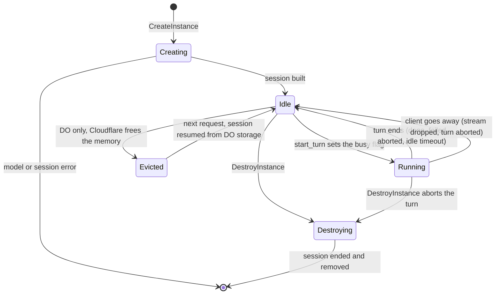
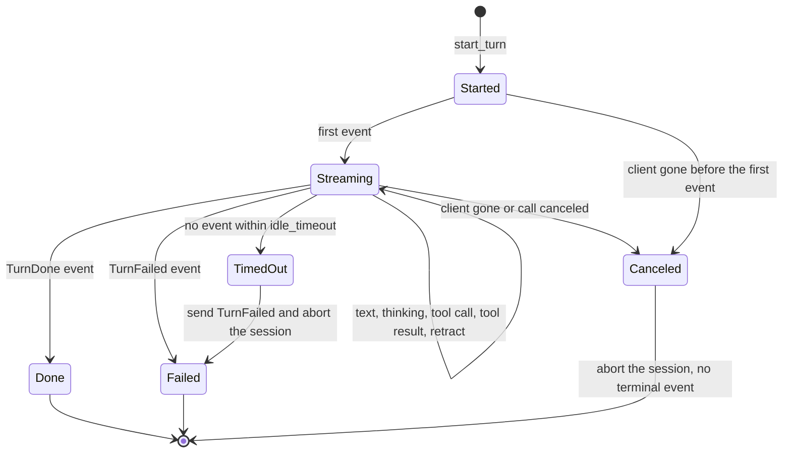

# Instances and models

_Part of [feature 07](./feature.md). Written in ASD-STE100 Simplified Technical English (STE).
Code and identifiers stay as they are._

**Abbreviations in this file.** remote procedure call (RPC); Durable Object (DO);
application programming interface (API); central processing unit (CPU); graphics processing
unit (GPU); Compute Unified Device Architecture (CUDA); Generative Pre-trained Transformer
(GPT); GPT-Generated Unified Format (GGUF);
WebAssembly (wasm); Structured Query Language (SQL); Hypertext Transfer Protocol (HTTP);
identifier (ID); Secure Hash Algorithm with 256 bits (SHA-256); deterministic simulation
testing (DST); uniform resource locator (URL); continuous integration (CI); Request for
Comments (RFC); Domain Name System (DNS); Representational State Transfer (REST); mebibyte
(MiB), 1,048,576 bytes; AeroSpace and Defence Industries Association of Europe (ASD), the owner of the
STE standard ASD-STE100. gRPC is the name of a Google RPC protocol over
HTTP/2. D1 is the name of a Cloudflare SQL database product, not an abbreviation. The
[glossary in feature.md](./feature.md#2-glossary) explains each term.

## 1. What this file covers

- An **instance** is a named agent conversation. It is an `AgentSession` of `foundation_ai` on one model, plus its settings.
- An **instance registry** creates, finds, lists and destroys instances, and starts turns.
- A **turn** is one prompt from the client and the agent's full answer to it.
- A **model catalog** knows which models a host can run and gives a model handle to the registry.

Both become traits in the core of agent-rpc (`foundation_agent_rpc::core`). The native host,
the Worker host and DST give different implementations.

## 2. The model catalog

### 2.1 Kinds and devices in Rust

```rust
// foundation_agent_rpc/src/core/model/mod.rs
/// The family of a model. `MODEL_KIND_VIDEO` and `MODEL_KIND_AUDIO` exist on
/// the wire, but no host runs them yet, so they have no Rust variant: the
/// conversion from the wire gives `UNIMPLEMENTED`.
#[derive(Debug, Clone, Copy, PartialEq, Eq, Hash)]
pub enum ModelKind {
    Api,
    Candle,
    Gguf,
}

/// Where a model runs.
#[derive(Debug, Clone, Copy, PartialEq, Eq, Hash)]
pub enum Device {
    Cpu,
    Cuda { ordinal: u32 },
    Metal { ordinal: u32 },
    Vulkan { ordinal: u32 },
    /// The remote provider runs the model.
    Remote,
}

/// What a `CreateInstance` call asks for. `None` = any.
#[derive(Debug, Clone, Default, PartialEq, Eq)]
pub struct ModelRequest {
    pub name: Option<String>,
    pub kind: Option<ModelKind>,
    pub device: Option<Device>,
}

impl ModelRequest {
    /// Read the wire request. An unknown enum number gives
    /// `INVALID_ARGUMENT`; `VIDEO` or `AUDIO` gives `UNIMPLEMENTED`
    /// (see proto.md section 5).
    ///
    /// # Errors
    /// [`AgentRpcError::ModelSelection`].
    pub fn from_wire(req: &pb::CreateInstanceRequest) -> AgentRpcResult<Self> { todo!("T13") }
}
```

The single `Device` type replaces the `GgufDevice` of today. One type for every backend
maps one-to-one onto the wire `Device`. Each backend says which variants it supports
(section 2.4).

### 2.2 The model handle

`ModelHandle` exists today (`src/model.rs`). It keeps its job: one loaded model that every
instance shares. It gets the kind and the device.

```rust
// foundation_agent_rpc/src/core/model/handle.rs
use foundation_ai::types::{Model, ModelId, PreloadedProvider, ProviderRouter};

/// The shared handle to one model. Clones are cheap (`Arc`) and all refer
/// to the same loaded model. It holds no loader, so nothing can reload it.
#[derive(Clone)]
pub struct ModelHandle {
    inner: Arc<ModelHandleInner>,
}

struct ModelHandleInner {
    name: String,
    kind: ModelKind,
    device: Device,
    model_id: ModelId,
    router: ProviderRouter,
}

impl ModelHandle {
    /// An already-loaded local model (Candle, llama.cpp, a test model).
    /// `PreloadedProvider` gives each session a clone of the same model.
    pub fn from_model<M>(name: impl Into<String>, kind: ModelKind, device: Device, model: M) -> Self
    where
        M: Model + Clone + Send + Sync + 'static,
    {
        let name = name.into();
        let model_id = ModelId::Name(name.clone(), None);
        let router = PreloadedProvider::new(model, model_id.clone()).into_router();
        Self::from_parts(name, kind, device, model_id, router)
    }

    /// A model that a router serves: a remote provider, or a mock.
    pub fn from_router(
        name: impl Into<String>,
        kind: ModelKind,
        device: Device,
        model_id: impl Into<ModelId>,
        router: ProviderRouter,
    ) -> Self {
        Self::from_parts(name.into(), kind, device, model_id.into(), router)
    }

    #[must_use] pub fn name(&self) -> &str { &self.inner.name }
    #[must_use] pub fn kind(&self) -> ModelKind { self.inner.kind }
    #[must_use] pub fn device(&self) -> Device { self.inner.device }
    #[must_use] pub fn model_id(&self) -> &ModelId { &self.inner.model_id }
    #[must_use] pub fn router(&self) -> ProviderRouter { self.inner.router.clone() }
    #[must_use] pub fn same_model(&self, other: &ModelHandle) -> bool { Arc::ptr_eq(&self.inner, &other.inner) }

    fn from_parts(name: String, kind: ModelKind, device: Device, model_id: ModelId, router: ProviderRouter) -> Self {
        Self { inner: Arc::new(ModelHandleInner { name, kind, device, model_id, router }) }
    }
}
```

What the code does: a `ModelHandle` is the bridge to `foundation_ai`. It holds a
`ProviderRouter`, which `AgentSession::builder` takes. Local models enter through
`PreloadedProvider`. Remote models enter through a router that holds a provider.

### 2.3 The trait

```rust
// foundation_agent_rpc/src/core/model/catalog.rs
use core::future::Future;
use core::pin::Pin;

/// The future that core traits return.
pub type AgentRpcFuture<'a, T> = Pin<Box<dyn Future<Output = AgentRpcResult<T>> + Send + 'a>>;

/// The models that a host can run.
pub trait ModelCatalog: Send + Sync + 'static {
    /// What this host supports and has configured. Cheap and sync: it feeds
    /// `GetCapabilities` and `Health`.
    fn capabilities(&self) -> ModelCapabilities;

    /// Pick a model with the rules of proto.md section 5 and return its
    /// handle. A local model loads on its first use (once), unless the host
    /// loaded it at start.
    ///
    /// # Errors
    /// `AgentRpcError::ModelSelection` (the codes of proto.md section 5);
    /// `AgentRpcError::ModelLoad` when a load fails.
    fn resolve<'a>(&'a self, request: &'a ModelRequest) -> AgentRpcFuture<'a, ModelHandle>;
}

#[derive(Debug, Clone, PartialEq, Eq)]
pub struct ModelCapabilities {
    pub kinds: Vec<KindSupport>,
    pub models: Vec<ModelDescriptor>,
}

#[derive(Debug, Clone, PartialEq, Eq)]
pub struct KindSupport {
    pub kind: ModelKind,
    pub devices: Vec<Device>,
}

#[derive(Debug, Clone, PartialEq, Eq)]
pub struct ModelDescriptor {
    pub name: String,
    pub kind: ModelKind,
    pub device: Device,
    pub state: LoadState,
}

#[derive(Debug, Clone, PartialEq, Eq)]
pub enum LoadState {
    NotLoaded,
    Loading,
    Loaded,
    Failed(String),
    Remote,
}

/// One configured model, for the selection rules.
#[derive(Debug, Clone, PartialEq, Eq)]
pub struct CatalogEntry {
    pub name: String,
    pub kind: ModelKind,
    pub device: Device,
}

/// Why no model was picked. Each case has one Connect code (proto.md section 5).
#[derive(Debug, Clone, PartialEq, Eq)]
pub enum SelectionError {
    NotFound,            // NOT_FOUND
    KindMismatch,        // INVALID_ARGUMENT
    DeviceMismatch,      // FAILED_PRECONDITION
    KindUnsupported,     // UNIMPLEMENTED
    DeviceUnsupported,   // FAILED_PRECONDITION
    Ambiguous,           // INVALID_ARGUMENT
    RemoteMismatch,      // INVALID_ARGUMENT
}

/// The selection rules. Every catalog calls this one function, so the
/// rules and their codes are the same on every host.
///
/// # Errors
/// [`SelectionError`].
pub fn select<'e>(
    entries: &'e [CatalogEntry],
    supported: &[KindSupport],
    request: &ModelRequest,
) -> Result<&'e CatalogEntry, SelectionError> {
    if let (Some(kind), Some(device)) = (request.kind, request.device) {
        let remote_kind = kind == ModelKind::Api;
        let remote_device = device == Device::Remote;
        if remote_kind != remote_device {
            return Err(SelectionError::RemoteMismatch);
        }
    }
    if let Some(name) = &request.name {
        let entry = entries.iter().find(|e| &e.name == name).ok_or(SelectionError::NotFound)?;
        if request.kind.is_some_and(|k| k != entry.kind) {
            return Err(SelectionError::KindMismatch);
        }
        if request.device.is_some_and(|d| d != entry.device) {
            return Err(SelectionError::DeviceMismatch);
        }
        return Ok(entry);
    }
    let matches: Vec<&CatalogEntry> = entries
        .iter()
        .filter(|e| request.kind.map_or(true, |k| k == e.kind))
        .filter(|e| request.device.map_or(true, |d| d == e.device))
        .collect();
    match matches.as_slice() {
        [one] => Ok(one),
        [] => {
            let Some(kind) = request.kind else { return Err(SelectionError::NotFound) };
            let Some(support) = supported.iter().find(|s| s.kind == kind) else {
                return Err(SelectionError::KindUnsupported);
            };
            match request.device {
                Some(device) if !support.devices.contains(&device) => Err(SelectionError::DeviceUnsupported),
                _ => Err(SelectionError::NotFound),
            }
        }
        _ => Err(SelectionError::Ambiguous),
    }
}
```

What the code does: `select` is a pure function. It applies the rules of proto.md section 5
in the same order as the diagram there. The unit tests for every row of that table call it
directly (task T14).

### 2.4 Which kinds and devices each build supports

The supported list comes from two things: the Cargo features of the build, and a check of
the hardware at start.

| Kind | Device | Needs (Cargo feature of `foundation_agent_rpc`) | Hardware check at start | `foundation_ai` call |
|---|---|---|---|---|
| `Candle` | `Cpu` | `candle` | none | `CandleBackend::cpu()` |
| `Candle` | `Cuda { n }` | `candle-cuda` (turns on `foundation_ai/candle-cuda`) | `CandleBackend::try_cuda(n)` for `n` in `0..candle_cuda_probe` | `CandleBackend::try_cuda(n)` |
| `Candle` | `Metal { n }` | `candle` on `target_vendor = "apple"` (`foundation_ai` turns on Metal there) | none (Metal device 0 exists on every Apple machine that runs this) | `CandleBackend::metal(n)` |
| `Gguf` | `Cpu` | `gguf` | none | `LlamaBackends::LLamaCPU` |
| `Gguf` | `Cuda { n }` | `gguf-cuda` (turns on `foundation_ai/cuda`) | llama.cpp reports the device count at backend start | `LlamaBackends::LLamaGPU`, `LlamaBackendConfig::main_gpu = n` |
| `Gguf` | `Vulkan { n }` | `gguf-vulkan` (turns on `foundation_ai/vulkan`) | as for CUDA | `LlamaBackends::LLamaGPU`, `main_gpu = n` |
| `Gguf` | `Metal { n }` | `gguf-metal` (turns on `foundation_ai/metal`) | none | `LlamaBackends::LLamaMetal` |
| `Api` | `Remote` | always | none | `ProviderRouter` with `OpenAIProvider`, `AnthropicMessagesProvider` or `WorkersAiProvider` |

Candle has no Vulkan backend. A request for `Candle` on `Vulkan` gets `FAILED_PRECONDITION`.
A Worker build has only `Api` on `Remote`.

### 2.5 The Candle device choice (owner direction 7)

Today `ModelSource::Candle { name, dir }` always loads on the CPU (`model.rs` line 235:
`CandleBackend::cpu()`). We add the device, like the GGUF source has today.

Before:

```rust
// backends/foundation_agent_rpc/src/model.rs (today)
#[cfg(feature = "candle")]
Candle {
    name: String,
    dir: PathBuf,
},
```

After:

```rust
// foundation_agent_rpc/src/host/native/models.rs
pub enum ModelSource {
    /// A safetensors model directory on Candle.
    #[cfg(feature = "candle")]
    Candle { name: String, dir: PathBuf, device: Device },
    /// A GGUF file on llama.cpp.
    #[cfg(feature = "gguf")]
    Gguf { name: String, path: PathBuf, device: Device, gpu_layers: u32 },
    /// A model at a remote provider.
    Api { name: String, provider: ApiProvider, model_id: String },
}

#[cfg(feature = "candle")]
fn candle_backend(device: Device) -> AgentRpcResult<foundation_ai::backends::candle::CandleBackend> {
    use foundation_ai::backends::candle::CandleBackend;
    match device {
        Device::Cpu => Ok(CandleBackend::cpu()),
        #[cfg(feature = "candle-cuda")]
        Device::Cuda { ordinal } => CandleBackend::try_cuda(ordinal as usize)
            .map_err(|e| AgentRpcError::ModelLoad(format!("CUDA device {ordinal}: {e}")).into()),
        #[cfg(target_vendor = "apple")]
        Device::Metal { ordinal } => Ok(CandleBackend::metal(ordinal as usize)),
        other => Err(AgentRpcError::ModelSelection {
            code: SelectionError::DeviceUnsupported,
            detail: format!("Candle cannot run on {other:?} in this build"),
        }
        .into()),
    }
}
```

What the code does: it maps our `Device` to the `CandleBackend` constructor that
`foundation_ai` already has. A device that this build cannot use is an error. It never falls
back to the CPU without telling anyone, which is the rule of `CandleBackend::best_available`
too.

`ModelSource::candle(name, dir)` stays and means `Device::Cpu`. `ModelSource::candle_on(name,
dir, device)` is new. `ModelSource::gguf_on(name, path, GgufDevice::Gpu)` becomes
`ModelSource::gguf_on(name, path, Device::Cuda { ordinal: 0 })` (or `Vulkan`).

### 2.6 `LocalCatalog` (native)

```rust
// foundation_agent_rpc/src/host/native/models.rs
/// The catalog of a native host. A model loads once; every later request
/// gets a clone of the same handle.
pub struct LocalCatalog {
    entries: Vec<LocalEntry>,
    supported: Vec<KindSupport>,
    loader: Arc<dyn ModelLoader>,
}

struct LocalEntry {
    entry: CatalogEntry,
    source: ModelSource,
    slot: LoadSlot,
}

/// The load state of one model. `Loading` holds a shared future, so
/// requests that arrive during a load wait for the same load.
enum SlotState {
    NotLoaded,
    Loading(futures::future::Shared<futures::channel::oneshot::Receiver<Result<ModelHandle, String>>>),
    Loaded(ModelHandle),
    Failed(String),
}

struct LoadSlot(std::sync::Mutex<SlotState>);

/// Runs a blocking model load. The real loader uses
/// `valtron::run_background_job`, so a load never blocks a valtron worker.
pub trait ModelLoader: Send + Sync + 'static {
    fn load(&self, source: ModelSource) -> futures::channel::oneshot::Receiver<Result<ModelHandle, String>>;
}

impl ModelCatalog for LocalCatalog {
    fn capabilities(&self) -> ModelCapabilities { todo!("T17") }

    fn resolve<'a>(&'a self, request: &'a ModelRequest) -> AgentRpcFuture<'a, ModelHandle> {
        Box::pin(async move {
            let entries: Vec<CatalogEntry> = self.entries.iter().map(|e| e.entry.clone()).collect();
            let chosen = select(&entries, &self.supported, request).map_err(selection_error)?;
            let local = self.entries.iter().find(|e| e.entry == *chosen).ok_or_else(internal_error)?;
            // 1. Loaded: clone the handle. 2. Loading: await the shared
            // future. 3. NotLoaded: start one load and store its shared
            // future. 4. Failed: return the stored error (a restart loads again).
            local.slot.get_or_load(&*self.loader, &local.source).await
        })
    }
}
```

What the code does: `resolve` picks the model with `select`, then gets its handle from the
slot. The first request starts the load on a background job. Requests that arrive during the
load wait for the same load. The model is loaded once, which is the reason agent-rpc exists.

`NativeHostConfig::preload` (default true) loads every configured model at start, as today.
So the first `CreateInstance` does not wait for a load.

### 2.7 `RemoteCatalog` (Worker, and native `Api` entries)

```rust
// foundation_agent_rpc/src/core/model/remote.rs (all targets)
use foundation_netio::HttpClient;

/// One remote model, from configuration.
#[derive(Debug, Clone, serde::Deserialize)]
pub struct ApiModelConfig {
    /// The name that clients use.
    pub name: String,
    /// "openai", "openrouter", "anthropic" or "workers-ai".
    pub provider: String,
    /// The model ID at the provider, for example "@cf/meta/llama-3.1-8b-instruct".
    pub model_id: String,
    pub base_url: Option<String>,
    /// The name of the secret that holds the API key (never the key itself).
    pub api_key_secret: String,
}

/// Remote models only. Nothing loads; `resolve` returns a stored handle.
pub struct RemoteCatalog {
    entries: Vec<(CatalogEntry, ModelHandle)>,
}

impl RemoteCatalog {
    /// Build one `ProviderRouter` per model over `http` (`FetchHttpClient`
    /// on wasm, the native client on native).
    ///
    /// # Errors
    /// `AgentRpcError::Config` for an unknown provider or a missing secret.
    pub fn from_config(
        models: &[ApiModelConfig],
        secrets: &dyn Fn(&str) -> Option<String>,
        http: Arc<dyn HttpClient>,
    ) -> AgentRpcResult<Self> { todo!("T14") }
}
```

How each provider maps to `foundation_ai` (all exist on master):

| `provider` | `foundation_ai` type | Configuration |
|---|---|---|
| `openai` | `OpenAIProvider::with_http_client(http).create(Some(OpenAIConfig::…))` | `base_url`, API key |
| `openrouter` | same, with `OpenAIConfig::openrouter(key)` | as `examples/cf-cloud-provider` does |
| `anthropic` | `AnthropicMessagesProvider` (with `with_http_client`) | API key |
| `workers-ai` | `WorkersAiProvider` with `WorkersAiConfig` | account ID, API token, as `examples/cf-agent-loop` does |

Each provider goes into a `ProviderRouter` through `ProviderRouter::builder().provider(p).build()`
(`RoutableProviderBox`). The handle is `ModelHandle::from_router(name, ModelKind::Api,
Device::Remote, model_id, router)`.

### 2.8 How the catalog maps to `foundation_ai`

The owner asked how the new model trait maps to the provider types of `foundation_ai`:

| `foundation_ai` type (exists) | Role | Our use |
|---|---|---|
| `Model` | one model: `generate`, `stream` | Not used directly. Local backends (`CandleModels`, `LlamaModels`) implement it. |
| `ModelProvider` | makes `Model`s; not object-safe (associated types) | Not stored. Wrapped by `RoutableProviderBox`. |
| `RoutableProvider`, `ProviderRouter` | object-safe routing over providers | The router inside each `ModelHandle`. |
| `PreloadedProvider<M>` | serves one loaded model to many sessions | The way local models enter a `ModelHandle`. |
| `AgentSession::builder(router)` | one conversation | The instance; the registry builds it from `ModelHandle::router()`. |

So `ModelCatalog` adds two things that `foundation_ai` does not have: the kind and device of
each model, and the load-once rule across many sessions.

## 3. The instance registry

### 3.1 Scope: whose instances a call sees

Today every enrolled client sees every instance. We keep that as the default on the native
host. A Worker serves many unrelated clients, so it can separate them.

```rust
// foundation_agent_rpc/src/core/registry/mod.rs
/// The name space that an instance name lives in.
#[derive(Debug, Clone, PartialEq, Eq, Hash)]
pub enum Scope {
    /// One name space for every caller (native default, today's behavior).
    Shared,
    /// One name space per caller. The value is a SHA-256 hex of the
    /// principal subject, so names stay short and hide the subject.
    Owner(String),
}

/// Which scope a call gets, from its `AuthInfo`. (`foundation_auth` has a
/// different type, `AccessPolicy`, for bearer secrets. This one is about names.)
#[derive(Debug, Clone, Copy, PartialEq, Eq)]
pub enum ScopePolicy {
    Shared,
    PerOwner,
}

impl ScopePolicy {
    #[must_use]
    pub fn scope_for(self, principal: &Principal) -> Scope {
        match self {
            ScopePolicy::Shared => Scope::Shared,
            ScopePolicy::PerOwner => Scope::Owner(sha256_hex(principal.subject.as_bytes())),
        }
    }

    /// The registry caller for one call.
    #[must_use]
    pub fn caller(self, principal: Principal) -> Caller {
        Caller { scope: self.scope_for(&principal), principal }
    }
}

/// Who calls the registry. Every registry method takes one.
#[derive(Debug, Clone, PartialEq, Eq)]
pub struct Caller {
    /// The name space of the call.
    pub scope: Scope,
    /// The checked identity. The Durable Object registry forwards it to the
    /// DO (proto.md section 7). The local registry does not read it.
    pub principal: Principal,
}
```

What the code does: a handler reads the `Principal` from `AuthInfo`, and the policy turns it
into a `Caller`. The scope decides which names the caller sees. The principal travels with
the call, so the Worker can tell the DO who called.

### 3.2 The trait

```rust
// foundation_agent_rpc/src/core/registry/mod.rs
use futures::Stream;

/// The events of one turn, as wire messages. Nothing is buffered: each
/// event goes out when the model makes it.
pub type TurnEventStream = Pin<Box<dyn Stream<Item = AgentRpcResult<pb::TurnEvent>> + Send>>;

/// What `CreateInstance` asks for.
#[derive(Debug, Clone, Default)]
pub struct InstanceSpec {
    pub name: String,
    pub model: ModelRequest,
    pub system_prompt: Option<String>,
    pub max_tokens: Option<usize>,
    pub temperature: Option<f32>,
}

/// What `ListInstances` and `CreateInstance` report.
#[derive(Debug, Clone, PartialEq, Eq)]
pub struct InstanceInfo {
    pub name: String,
    pub model: String,
    pub kind: ModelKind,
    pub device: Device,
    pub created_unix_ms: u64,
    pub turns: u64,
}

/// One page of a list.
#[derive(Debug, Clone, PartialEq, Eq)]
pub struct Page<T> {
    pub items: Vec<T>,
    /// `None` = no more pages.
    pub next_token: Option<String>,
}

/// Creates, finds and destroys instances, and starts turns.
pub trait InstanceRegistry: Send + Sync + 'static {
    /// # Errors
    /// `InvalidName`, `InstanceExists`, `InstanceLimit`, `ModelSelection`,
    /// `ModelLoad`, `Inference` (the session could not start).
    fn create<'a>(&'a self, caller: &'a Caller, spec: InstanceSpec) -> AgentRpcFuture<'a, InstanceInfo>;

    /// # Errors
    /// `InstanceNotFound`.
    fn get<'a>(&'a self, caller: &'a Caller, name: &'a str) -> AgentRpcFuture<'a, InstanceInfo>;

    /// Instances in name order. `page_size = 0` means the default.
    ///
    /// # Errors
    /// `Codec` for a bad page token.
    fn list<'a>(&'a self, caller: &'a Caller, page_size: u32, page_token: Option<&'a str>)
        -> AgentRpcFuture<'a, Page<InstanceInfo>>;

    /// Abort a running turn, end the session (flush its history), remove it.
    ///
    /// # Errors
    /// `InstanceNotFound`; `Inference` when ending the session fails (the
    /// instance is removed either way, as today).
    fn destroy<'a>(&'a self, caller: &'a Caller, name: &'a str) -> AgentRpcFuture<'a, ()>;

    /// Start one turn. The stream holds the instance's one-turn claim until
    /// it ends or drops. A stream dropped before its last event aborts the
    /// turn (the client went away).
    ///
    /// # Errors
    /// `InstanceNotFound`; `InstanceBusy` (another turn runs: `ABORTED`);
    /// `Inference` when the turn cannot start.
    fn start_turn<'a>(&'a self, caller: &'a Caller, name: &'a str, prompt: String)
        -> AgentRpcFuture<'a, TurnEventStream>;

    /// How many instances the caller's scope holds (for `Health`).
    fn count<'a>(&'a self, caller: &'a Caller) -> AgentRpcFuture<'a, u64>;
}
```

### 3.3 Limits

```rust
// foundation_agent_rpc/src/core/config.rs
/// Registry limits (rule 8). Defaults and their sources:
#[derive(Debug, Clone, PartialEq, Eq)]
pub struct RegistryConfig {
    /// Live instances per host (native) or per scope (Worker). Default
    /// 1024: nginx's `worker_connections` in its shipped `nginx.conf` (as today).
    pub max_instances: usize,
    /// Default 63: an RFC 1123 DNS label (as today).
    pub max_name_len: usize,
    /// `ListInstances` page size when the client sends 0. Default 30: the
    /// GitHub REST API default `per_page`.
    pub default_page_size: u32,
    /// Largest page. Default 100: the GitHub REST API maximum `per_page`.
    pub max_page_size: u32,
    /// Default `Shared` on the native host (today's behavior) and
    /// `PerOwner` on the Worker host (open question 1 in feature.md).
    pub scope_policy: ScopePolicy,
}

/// Turn limits (rule 8).
#[derive(Debug, Clone, PartialEq, Eq)]
pub struct TurnLimits {
    /// End a turn when the model makes no event for this long. Default
    /// 60 s: nginx's default `proxy_read_timeout`.
    pub idle_timeout: Duration,
    /// End a turn after this long in total. Default `None` (no limit): Go
    /// `net/http`'s default `WriteTimeout` is 0, which means no limit.
    pub max_duration: Option<Duration>,
    /// Largest prompt. Default 1 MiB: nginx's default `client_max_body_size`.
    pub max_prompt_bytes: usize,
    /// Largest `Chat` (unary) reply. A longer answer fails with
    /// `RESOURCE_EXHAUSTED` and the hint "use ChatStream". Default 4 MiB:
    /// the gRPC default maximum receive message size.
    pub max_unary_reply_bytes: usize,
}
```

### 3.4 One turn at a time

An `AgentSession` shares its steering queues across turns. So two turns at once on one
instance would read each other's prompts (LEARNINGS 01 T4). The registry allows one turn
per instance:

- The instance has a busy flag (`AtomicBool`).
- `start_turn` sets it with compare-and-swap. If it is already set, the call fails with `InstanceBusy`, which maps to the Connect code `ABORTED`.
- The flag lives in a `TurnGuard`. The turn stream owns the guard. The flag clears when the stream ends or drops.

This works the same way inside a Durable Object. A DO runs one request at a time on one
thread, but its requests interleave at each `.await`. So the flag is still needed there, and
the compare-and-swap cannot race.

### 3.5 `LocalInstanceRegistry` (native, and inside each Durable Object)

The code of `src/instance.rs` moves here with five changes:

1. `create` is `async`: `AgentSessionBuilder::build()` is `async` on master.
2. `destroy` awaits `AgentSession::end()`, which returns a `'static` future on master.
3. The table key is `(Scope, name)`.
4. The session ID comes from `env.next_id()`, so DST runs are the same each time. Today
   `SessionId::new()` reads a global generator. Task T12 adds `SessionId::from_id(Id)` to
   `foundation_ai`.
5. The session stores come from a `SessionStores` value. `AgentSession<D, M>` is generic
   over its document store `D` and memory store `M`. The native host keeps the memory stores
   of today. A Durable Object uses its SQLite storage.

```rust
// foundation_agent_rpc/src/core/registry/local.rs
use foundation_ai::agentic::{KvMemoryStore, MemoryStore};
use foundation_db::{AsyncDocumentStore, MemoryDocumentStore, MemoryStorage};

/// Makes the two stores of a new session.
pub trait SessionStores: Send + Sync + 'static {
    type Doc: AsyncDocumentStore + 'static;
    type Mem: MemoryStore + 'static;

    /// # Errors
    /// `AgentRpcError::Storage` when the stores cannot open.
    fn open(&self, session: &SessionId) -> AgentRpcResult<(Self::Doc, Self::Mem)>;
}

/// The native default: history and memory in process memory, as today.
#[derive(Debug, Clone, Copy, Default)]
pub struct InMemoryStores;

impl SessionStores for InMemoryStores {
    type Doc = MemoryDocumentStore;
    type Mem = KvMemoryStore<MemoryStorage>;

    fn open(&self, _session: &SessionId) -> AgentRpcResult<(Self::Doc, Self::Mem)> {
        Ok((MemoryDocumentStore::new(), KvMemoryStore::new(MemoryStorage::new())))
    }
}

pub struct LocalInstanceRegistry<S: SessionStores = InMemoryStores> {
    env: Env,
    catalog: Arc<dyn ModelCatalog>,
    stores: S,
    instances: RwLock<BTreeMap<(Scope, String), InstanceHandle<S::Doc, S::Mem>>>,
    config: RegistryConfig,
    turns: TurnLimits,
}

impl<S: SessionStores> InstanceRegistry for LocalInstanceRegistry<S> {
    fn create<'a>(&'a self, caller: &'a Caller, spec: InstanceSpec) -> AgentRpcFuture<'a, InstanceInfo> {
        Box::pin(async move {
            validate_name(&spec.name, self.config.max_name_len)?;
            let model = self.catalog.resolve(&spec.model).await?;
            // Build the session outside the lock: it is the only real work,
            // and it never loads the model.
            let session_id = SessionId::from_id(self.env.next_id()); // new in task T12
            let (doc, mem) = self.stores.open(&session_id)?;
            let mut builder = AgentSession::builder(model.router())
                .with_doc_store(doc)
                .with_memory_store(mem)
                .with_model(model.model_id().clone())
                .with_session_id(session_id)
                .with_config(agent_config(&spec));
            if let Some(prompt) = &spec.system_prompt {
                builder = builder.with_system_prompt(prompt.clone());
            }
            let session = builder
                .build()
                .await
                .map_err(|e| AgentRpcError::Inference(format!("building session: {e}")))?;
            self.insert(&caller.scope, &spec.name, model, session) // checks exists + limit under the lock
        })
    }

    fn start_turn<'a>(&'a self, caller: &'a Caller, name: &'a str, prompt: String)
        -> AgentRpcFuture<'a, TurnEventStream>
    {
        Box::pin(async move {
            check_prompt_size(&prompt, &self.turns)?;
            let instance = self.find(&caller.scope, name)?;
            let guard = instance.begin_turn()?;                       // InstanceBusy -> ABORTED
            let turn = instance.session().run_turn_stream(prompt)
                .map_err(|e| AgentRpcError::Inference(e.to_string()))?;
            Ok(guarded_turn(turn.events(), instance, guard, self.env.clone(), self.turns.clone()))
        })
    }

    // get, list, destroy, count: as today, over the (caller.scope, name) key.
}
```

`guarded_turn` (in `core/turn.rs`) maps each `foundation_ai::agentic::TurnEvent` to the wire
`pb::TurnEvent` (the `wire_event` function of `service.rs` today). It also:

- holds the `TurnGuard` until the stream ends or drops;
- aborts the session when the stream drops before a terminal event (as `TurnEvents::drop` does today);
- ends the turn with `TurnFailed("idle timeout")` when no event comes for `idle_timeout`. It races the next event against `env.sleep(idle_timeout)`. The timer is the injected `Timer`, so DST can test it with no real wait.

On master, `TurnStream::events()` already gives an async stream of `TurnEvent`s. So the
hand-written `TurnEvents` adapter of `service.rs` today and its use of the removed
`TurnEvent::from_stream_item` go away.

### 3.6 Instance states

This diagram shows the states of one instance. `Evicted` exists only inside a Durable
Object: Cloudflare can remove an idle DO from memory, and the next request brings it back
from DO storage.



### 3.7 Turn states

This diagram shows the states of one turn. Exactly one terminal event ends each turn that
the client sees to the end.



## 4. `DurableObjectRegistry` (Worker)

### 4.1 One Durable Object per instance

A **Durable Object (DO)** is a Cloudflare object with a unique name. It runs on one thread
in one place, and it has its own storage. The Worker host runs one DO for each instance:

- The DO holds the `AgentSession` of the instance.
- The DO stores the session history in its own SQLite storage. So the instance survives when Cloudflare removes the DO from memory.
- Two requests for the same instance always reach the same DO. So the one-turn rule works across the whole world, not only inside one Worker isolate.

### 4.2 From instance name to DO ID

```rust
// foundation_agent_rpc/src/host/worker/registry.rs
/// The DO name of an instance. The same scope and name always give the
/// same name, so `id_from_name` always gives the same DO.
#[must_use]
pub fn do_name(scope: &Scope, instance: &str) -> String {
    match scope {
        Scope::Shared => format!("shared/{instance}"),
        Scope::Owner(owner_hash) => format!("owner/{owner_hash}/{instance}"),
    }
}

/// The Worker side of the registry. It keeps the index in D1 and sends
/// every instance call to the DO of that instance.
pub struct DurableObjectRegistry {
    /// `worker::ObjectNamespace` is `Send + Sync` already (the `worker`
    /// crate asserts it for single-threaded wasm).
    namespace: worker::ObjectNamespace,
    /// The D1 table of section 4.3.
    index: InstanceIndex<D1WasmStorage>,
    /// Checks the model request before any DO call (proto.md section 5).
    catalog: Arc<dyn ModelCatalog>,
    config: RegistryConfig,
}

impl DurableObjectRegistry {
    #[must_use]
    pub fn new(
        namespace: worker::ObjectNamespace,
        index_db: D1WasmStorage,
        catalog: Arc<dyn ModelCatalog>,
        config: RegistryConfig,
    ) -> Self {
        Self { namespace, index: InstanceIndex::new(index_db), catalog, config }
    }

    /// A client for the DO of one instance. The caller's principal goes into
    /// the `ewe-forwarded-principal` header of each call.
    fn client_for(&self, caller: &Caller, instance: &str) -> AgentRpcResult<AgentServiceClient> {
        let id = self.namespace.id_from_name(&do_name(&caller.scope, instance))
            .map_err(|e| AgentRpcError::Transport(format!("DO id: {e}")))?;
        let stub = id.get_stub().map_err(|e| AgentRpcError::Transport(format!("DO stub: {e}")))?;
        let transport: Arc<dyn Transport> = Arc::new(DoStubTransport::new(stub, caller.principal.clone()));
        AgentServiceClient::new(transport, "https://instance.do.internal", ClientOptions::new())
            .map_err(|e| AgentRpcError::Config(e.current_context().to_string()).into())
    }
}
```

What the code does: `do_name` makes one fixed name from the scope and the instance name.
`id_from_name` turns it into the DO ID (Cloudflare hashes the name). The registry then talks
to that DO with the normal generated client over `DoStubTransport` (see
[hosts.md](./hosts.md)). The base URL is a placeholder: a DO stub ignores the host part.

### 4.3 The instance index

A Worker cannot list Durable Objects. So the registry keeps an index in D1:

```sql
CREATE TABLE IF NOT EXISTS agent_rpc_instances (
    scope TEXT NOT NULL,
    name TEXT NOT NULL,
    model TEXT NOT NULL,
    kind INTEGER NOT NULL,
    device_kind INTEGER NOT NULL,
    device_ordinal INTEGER NOT NULL,
    created_unix_ms INTEGER NOT NULL,
    PRIMARY KEY (scope, name)
);
```

| Operation | Steps | Why this order |
|---|---|---|
| `create` | 1. Resolve the model with the catalog. 2. Reserve the index row and check the limit in one statement (below). 3. Call `CreateInstance` on the DO with the resolved model name. 4. If the DO fails, delete the row. | A bad model request fails before any write. The one statement makes the limit check atomic. The delete undoes a failed create. |
| `destroy` | 1. Call `DestroyInstance` on the DO (`NOT_FOUND` counts as done). 2. Delete the row. | A retry after a failure finishes the job. |
| `list` | `SELECT … WHERE scope = ? AND name > ? ORDER BY name LIMIT ?` | The page token is the last name, base64url. |
| `get` | Read the row. | No DO call. |
| `start_turn` | Call `ChatStream` on the DO. Map its events. | The DO is the only place with the session. |
| `count` | `SELECT COUNT(*) … WHERE scope = ?` | For `Health`. |

```sql
-- create, step 1: reserve the row only while the scope is under its limit.
INSERT INTO agent_rpc_instances
    (scope, name, model, kind, device_kind, device_ordinal, created_unix_ms)
SELECT ?, ?, ?, ?, ?, ?, ?
WHERE (SELECT COUNT(*) FROM agent_rpc_instances WHERE scope = ?) < ?
ON CONFLICT (scope, name) DO NOTHING;
```

If the statement changes 0 rows, a second `SELECT` tells apart "the name exists"
(`ALREADY_EXISTS`) and "the limit is reached" (`RESOURCE_EXHAUSTED`).

### 4.4 Inside the Durable Object

```rust
// foundation_agent_rpc/src/host/worker/object.rs
/// The logic of the instance DO. The thin `#[durable_object]` type in
/// `examples/cf-agent-rpc` calls into it.
pub struct AgentInstanceObject {
    state: SendWrapper<worker::State>,
    bindings: SendWrapper<worker::Env>,
    host: OnceCell<DoHost>,
}

struct DoHost {
    env: Env,
    registry: Arc<LocalInstanceRegistry>,   // max_instances = 1
    handler: Arc<ConnectRpcHandler>,        // AgentService + ForwardedPrincipalAuth
}

impl AgentInstanceObject {
    pub fn new(state: worker::State, bindings: worker::Env) -> Self { todo!("T21") }

    /// Serve one request from the Worker. The first request after a
    /// restart rebuilds the instance from DO storage (section 4.5).
    pub async fn fetch(&self, req: worker::Request) -> worker::Result<worker::Response> { todo!("T21") }
}
```

- The DO serves the normal `AgentService` (see [proto.md](./proto.md) section 7). Its auth provider is `ForwardedPrincipalAuth`. It reads the `ewe-forwarded-principal` header that only the Worker can set.
- The DO registry is a `LocalInstanceRegistry` with `max_instances = 1`. So the DO code is the native code. Only the stores differ.
- The session stores are on DO SQLite storage: `SqlDocumentStore<DoSqlStore>` for history and `KvMemoryStore<DoSqlStore>` for memory. `DoSqlStore` is a new `foundation_db` type (task T20). It implements `AsyncQueryStore` and `AsyncKeyValueStore` over `worker::Storage::sql()`.

### 4.5 When Cloudflare removes the DO from memory

Cloudflare can remove an idle DO from memory. The storage stays. The DO handles that:

1. At `create`, it writes a row `instance_meta` to DO storage: the spec and the session ID.
2. At the first request after a restart, it reads `instance_meta`. If the row exists, it builds the session again with `AgentSession::builder(router).resume(session_id)` over the same stores. The history is then the same as before.
3. At `destroy`, it ends the session and deletes the DO storage (`storage.delete_all()`).

Optional: `WorkerHostConfig::instance_idle_ttl` (default `None`). When it is set, the DO sets
an alarm after each turn and destroys an instance that had no turn for that long.

### 4.6 How turn events leave a Durable Object

This diagram shows the path of one event from the model to the client on a Worker. Each
arrow is a stream that the reader pulls. No step holds the whole answer.

```mermaid
flowchart LR
    model["Remote model (HTTP stream)"] --> loop["Agent loop (valtron task in the DO)"]
    loop --> events["TurnStream events"]
    events --> guard["guarded_turn: wire events, busy flag, idle timeout"]
    guard --> dispatchDo["Connect dispatch in the DO"]
    dispatchDo --> rsDo["ReadableStream (DO response body)"]
    rsDo --> stub["DoStubTransport in the Worker"]
    stub --> client["AgentServiceClient (server stream)"]
    client --> dispatchW["Connect or gRPC-Web dispatch in the Worker"]
    dispatchW --> rsW["ReadableStream (Worker response body)"]
    rsW --> browser["Client"]
```



- The client pulls the Worker body. The Worker body pulls from the DO body. The DO body pulls from the model. So a slow client slows the model stream, and nothing piles up in memory.
- When the client goes away, the runtime cancels the Worker body. The Worker drops the DO response reader, which cancels the DO body. The DO drops its turn stream, and `guarded_turn` aborts the session.
- [hosts.md](./hosts.md) section 3 shows the same flow as a sequence of calls.

## 5. Tests

| Test | Crate and file | What it proves |
|---|---|---|
| Selection rules | `foundation_agent_rpc/tests/model_selection_tests.rs` | One test per row of proto.md section 5, on `select` directly and through `CreateInstance`. |
| Load once | `foundation_agent_rpc/tests/local_catalog_tests.rs` | Ten concurrent `resolve` calls on an unloaded model run the loader once (a counting `ModelLoader`). A failed load is reported to every waiter. |
| Candle device | `foundation_agent_rpc/tests/candle_device_tests.rs` | `Device::Cpu` loads the tiny fixture; `Cuda` without `candle-cuda` is `FAILED_PRECONDITION`; with `candle-cuda` on the CI GPU image, `Cuda { 0 }` loads (image smoke test). |
| Registry contract | `foundation_agent_rpc/tests/registry_contract/*.rs` | The same tests run on `LocalInstanceRegistry` and, under Miniflare, on `DurableObjectRegistry`: create, duplicate, limit, list paging, destroy during a turn, busy instance, drop mid-turn aborts. |
| Turn limits | `foundation_agent_rpc/tests/turn_limits_tests.rs` | With `SimClock`: idle timeout ends the turn with `TurnFailed`; a unary reply over the limit is `RESOURCE_EXHAUSTED`. |
| DO restart | `foundation_toolings/tests/cf_examples.rs` (`cf-agent-rpc` case) | Under Miniflare: create, chat, restart Miniflare, chat again; the second answer sees the first turn in its history. |
