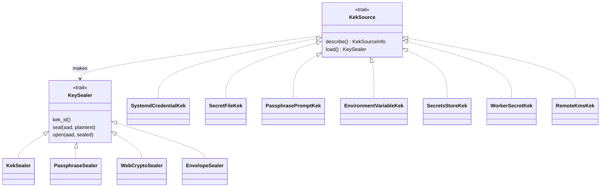
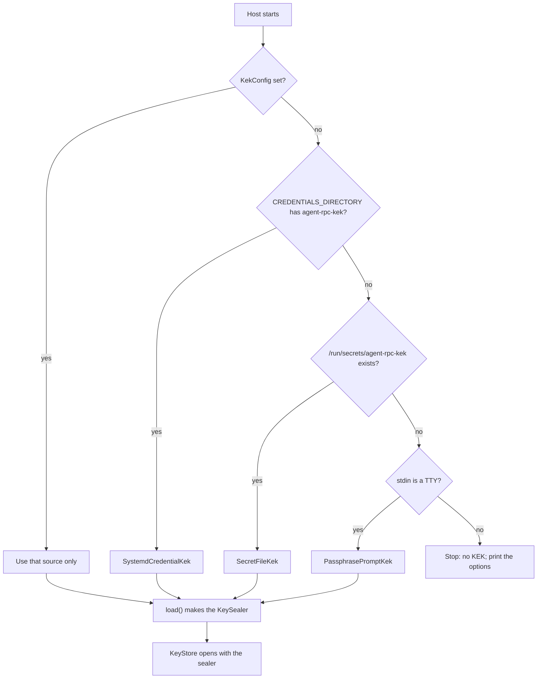
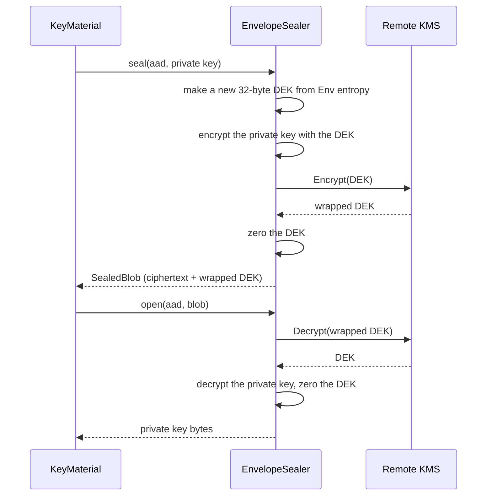

# Key protection: private keys are always encrypted at rest

_Part of [feature 08](./feature.md) (deferred). Written in ASD-STE100 Simplified Technical English (STE).
Code and identifiers stay as they are._

**Abbreviations in this file.** key encryption key (KEK); data encryption key (DEK); key
management service (KMS); hardware security module (HSM); Trusted Platform Module version 2
(TPM2); authenticated encryption with associated data (AEAD); Advanced Encryption Standard
with 256-bit keys in Galois/Counter Mode (AES-256-GCM); ChaCha20 stream cipher with the
Poly1305 authenticator (ChaCha20-Poly1305); application programming interface (API);
Certificate Authority (CA); identifier (ID); input/output (I/O); continuous integration (CI);
deterministic simulation testing (DST); Durable Object (DO); Amazon Web Services (AWS);
Google Cloud Platform (GCP); Identity and Access Management (IAM); temporary file system in
memory (tmpfs); process identifier (PID); random-access memory (RAM); teletypewriter, the name
for an interactive terminal (TTY); AeroSpace and Defence Industries Association of Europe
(ASD), the owner of the STE standard ASD-STE100. The
[glossary in feature 07](../07-pluggable-agent-rpc/feature.md#2-glossary) explains each term.

## 1. The decision

The owner decided (decision 3 in [feature 07](../07-pluggable-agent-rpc/feature.md); for the proof of concept, decision 11 there defers it to this feature): **a private key is always encrypted when it is stored.**
There is no plain-text mode. This applies on every host and every backend: files, databases,
D1, KV, R2.

A **private key** here is any secret key that the system stores: the CA key, the
secret-signing key, and the server TLS key.

A **KEK** is the key that encrypts the private keys. The private keys can sit in a database,
because they are encrypted. The KEK must never sit next to them. The KEK must come from a
safer place. This file says where the KEK comes from on each platform, and how the code gets
it.

## 2. What the platforms give us

We checked each platform before we designed this.

| Platform | Best place for a KEK | What it gives | Limits |
|---|---|---|---|
| Cloudflare Workers | **Secrets Store** (account-level secrets). Second choice: a Worker secret (`wrangler secret put`). | The value is encrypted by Cloudflare, cannot be read back in the dashboard, and is visible only to the bound Worker. Secrets Store adds roles (only "Secrets Store Deployer" or "Super Administrator" can bind a secret), one secret for many Workers, and rotation in one place. A Worker reads a Secrets Store value with `await env.BINDING.get()`. | Cloudflare has **no KMS** that a Worker can call to encrypt with a key that never leaves an HSM. The Worker gets the raw KEK bytes. We limit the harm: we import the bytes one time into a **non-extractable** WebCrypto `CryptoKey` and drop the bytes. |
| Bare metal, Linux with systemd 250 or later | **systemd encrypted credentials** (`systemd-creds encrypt` + `LoadCredentialEncrypted=`) | The credential file is encrypted with AES-256-GCM. The key comes from the machine's TPM2 chip and a host secret, so the file does not decrypt on another machine. systemd decrypts it at service start into a private in-memory directory (`$CREDENTIALS_DIRECTORY`) that only this service can read. | Linux and systemd only. A copy of the disk without the TPM2 chip cannot decrypt it. That is the point, but it also means a new machine needs a new credential. |
| Bare metal, other systems | A **secret file** with owner-only permissions on an encrypted disk, or a **passphrase** typed at start | Works everywhere. | Weaker. The passphrase needs a person at each start. |
| Docker, Docker Compose, Docker Swarm | **Docker secrets** (a file at `/run/secrets/<name>` on tmpfs) | The value is in memory only, never in the image, and not in `docker inspect`. Swarm encrypts secrets in its store. | Plain Compose secrets are files on the host disk. Protect that file. |
| Kubernetes | A **secret volume** (a file), with the cluster's secret store encrypted by a KMS provider; or the Secrets Store Container Storage Interface driver that reads from a cloud vault | The value is a file in a tmpfs volume. | Do not put it in an environment variable. |
| AWS, GCP, Azure, HashiCorp Vault | **A remote KMS with envelope encryption** (section 5) | The master key never leaves the KMS. Each use is logged. Access uses the platform's workload identity (an IAM role, a service account), so no secret sits on the machine. | Needs network calls to the KMS. Needs an account on that cloud. |

### 2.1 Why not an environment variable

The owner asked about a secret in an environment variable. It works, but it is the weakest
choice. Use it only when nothing else is possible:

- Other processes of the same user, and root, can read it from `/proc/<PID>/environ`.
- Child processes get a copy unless the program removes it.
- `docker inspect` shows container environment variables.
- Crash reports, debug dumps and CI logs often print the environment.

So the design supports an environment variable, but only when the configuration says
`allow_environment_variable = true`. The host reads the value one time at start, removes it
from the process environment before any other thread starts, and overwrites its copy in
memory after use (section 4.4).

### 2.2 The better way, in short

1. **On a cloud with a KMS:** use envelope encryption with the KMS (section 5). No KEK is on
   the machine at all.
2. **On Linux bare metal:** use a systemd encrypted credential, sealed to the TPM2 chip.
3. **In Docker or Kubernetes:** use a secret file on tmpfs, not an environment variable.
4. **On Cloudflare Workers:** use a Secrets Store secret, imported as a non-extractable key.
5. **Anywhere else:** a passphrase typed at start, or a file on an encrypted disk.
6. **Last choice:** an environment variable, with explicit permission in the configuration.

## 3. The design

### 3.1 Two traits



_The diagram shows the two traits. A `KekSource` knows where the KEK comes from. It makes a
`KeySealer`, which encrypts and decrypts the private keys._

- A **`KekSource`** knows where the KEK comes from. The host calls it one time at start.
- A **`KeySealer`** encrypts ("seals") and decrypts ("opens") private keys. The key store
  ([keystore.md](./keystore.md)) uses it.

### 3.2 `KeySealer` becomes async

[keystore.md](./keystore.md) section 2 defines `KeySealer` with sync functions. WebCrypto and a remote
KMS are async: they return promises or make network calls. So the trait becomes async. This
replaces the trait in auth.md section 4.2.

```rust
// foundation_auth/src/keystore/sealing.rs (task K3; replaces the sync trait)
use std::future::Future;
use std::pin::Pin;

use foundation_compact::crypto::SecureBytes;

/// A boxed future. `Send` on native; not `Send` on wasm, where JS values
/// are single-threaded.
#[cfg(not(target_family = "wasm"))]
pub type SealFuture<'a, T> = Pin<Box<dyn Future<Output = Result<T, KeyStoreError>> + Send + 'a>>;
#[cfg(target_family = "wasm")]
pub type SealFuture<'a, T> = Pin<Box<dyn Future<Output = Result<T, KeyStoreError>> + 'a>>;

/// Encrypts and decrypts private keys with one KEK.
pub trait KeySealer: Send + Sync + 'static {
    /// The name of the KEK. It is stored with each blob, so a blob names
    /// the KEK that can open it (needed for rotation).
    fn kek_id(&self) -> &str;

    /// Encrypt `plaintext`. `aad` is the associated data: the AEAD signs it
    /// but does not store it, so a blob opens only with the same `aad`.
    fn seal<'a>(&'a self, aad: &'a [u8], plaintext: &'a [u8]) -> SealFuture<'a, SealedBlob>;

    /// Decrypt a blob. An error if the KEK, the `aad` or the blob is wrong.
    fn open<'a>(&'a self, aad: &'a [u8], sealed: &'a SealedBlob) -> SealFuture<'a, SecureBytes>;
}
```

What the code does: the two functions return futures. A local sealer returns a future that is
ready at once. A WebCrypto or KMS sealer awaits its call. `SecureBytes` overwrites itself with
zeros when it is dropped.

### 3.3 `KekSource`

```rust
// foundation_auth/src/keystore/kek.rs (task K3)
use std::sync::Arc;

use foundation_core::env::Env;

/// Where a KEK comes from. The host calls `load` one time at start.
pub trait KekSource: Send + Sync + 'static {
    /// What kind of source this is, for logs and for `agent-rpc keys info`.
    /// It never contains the key.
    fn describe(&self) -> KekSourceInfo;

    /// Read the KEK and make a sealer from it.
    ///
    /// # Errors
    /// `KeyStoreError::KekUnavailable` names the source and says what is
    /// missing (a file, a credential, a binding), never the value.
    fn load<'a>(&'a self, env: &'a Env) -> SealFuture<'a, Arc<dyn KeySealer>>;
}

#[derive(Debug, Clone, PartialEq, Eq)]
pub struct KekSourceInfo {
    /// For example "systemd-credential", "secret-file", "secrets-store".
    pub kind: &'static str,
    /// The credential name, file path or binding name. Never the value.
    pub location: String,
    /// The KEK ID that this source gives.
    pub kek_id: String,
    /// True for sources that keep the key out of this process (remote KMS).
    pub key_leaves_process: bool,
}
```

What the code does: a source reports where it reads from, and `load` makes the sealer. Logs and
the `keys info` command use `describe`, so an operator can check the setup with no risk of
printing the key.

### 3.4 The sources

| Source | Host | Reads | KEK form | Sealer it makes |
|---|---|---|---|---|
| `SystemdCredentialKek { name }` | native, Linux | `$CREDENTIALS_DIRECTORY/<name>` | 32 raw bytes or base64url | `KekSealer` |
| `SecretFileKek { path }` | native, Docker, Kubernetes | a file (for example `/run/secrets/agent-rpc-kek`) | 32 raw bytes or base64url | `KekSealer` |
| `PassphrasePromptKek` | native, with a TTY | a passphrase typed at start, with no echo | a passphrase | `PassphraseSealer` (Argon2id) |
| `EnvironmentVariableKek { name }` | native | an environment variable, only if allowed | base64url 32 bytes, or a passphrase | `KekSealer` or `PassphraseSealer` |
| `SecretsStoreKek { binding }` | Worker | `await env.<binding>.get()` | base64url 32 bytes | `WebCryptoSealer` |
| `WorkerSecretKek { name }` | Worker | the Worker secret `<name>` | base64url 32 bytes | `WebCryptoSealer` |
| `RemoteKmsKek { backend }` | native (and Worker, over `fetch`) | nothing local: it calls the KMS | the KMS holds the master key | `EnvelopeSealer` |
| `FixedKek` | DST and unit tests (feature `testing`) | a key from `SeededEntropy` | 32 bytes | `KekSealer` |

### 3.5 The sealers

| Sealer | Algorithm | Where the key bytes live |
|---|---|---|
| `KekSealer` | ChaCha20-Poly1305, a random 12-byte nonce from `Env::entropy` | in process memory, in a `SecureBytes` that is zeroed on drop |
| `PassphraseSealer` | Argon2id (a random 16-byte salt per blob) then ChaCha20-Poly1305 | the passphrase in process memory, zeroed on drop |
| `WebCryptoSealer` | AES-256-GCM through `crypto.subtle.encrypt` and `decrypt` | inside a non-extractable `CryptoKey` in the Worker runtime. Our code cannot read the bytes back. |
| `EnvelopeSealer` | a new 32-byte DEK per blob, ChaCha20-Poly1305 with the DEK; the DEK is encrypted by the remote KMS | the master key stays in the KMS. Each DEK is in memory only while it is used. |

`SealedBlob` gets one new field for envelope encryption:

```rust
// foundation_auth/src/keystore/sealing.rs (changed, task K3)
pub struct SealedBlob {
    pub v: u32,
    /// "chacha20poly1305", "argon2id+chacha20poly1305", "aes256gcm",
    /// or "kms-envelope+chacha20poly1305".
    pub alg: String,
    pub kek_id: String,
    pub nonce_b64url: String,
    pub ciphertext_b64url: String,
    pub salt_b64url: Option<String>,
    pub argon2: Option<Argon2Params>,
    /// "kms-envelope+…" only: the DEK, encrypted by the KMS.
    pub wrapped_dek_b64url: Option<String>,
}
```

## 4. Each host, step by step

### 4.1 Native host

Configuration (part of `NativeHostConfig`, [hosts.md](../07-pluggable-agent-rpc/hosts.md) section 4.1):

```rust
// foundation_agent_rpc/src/host/native/config.rs (changed, task K3)
#[derive(Debug, Clone)]
pub enum KekConfig {
    /// Default on Linux with systemd: credential name "agent-rpc-kek".
    SystemdCredential { name: String },
    /// For Docker and Kubernetes secrets: default "/run/secrets/agent-rpc-kek".
    SecretFile { path: PathBuf },
    /// Ask for a passphrase on the terminal at start.
    PassphrasePrompt,
    /// Read an environment variable. Only if `allow_environment_variable`.
    EnvironmentVariable { name: String, allow_environment_variable: bool },
    /// Envelope encryption with a remote KMS.
    RemoteKms(KmsConfig),
}
```

What the code does: the operator picks one KEK source. There is no hidden fallback to a
weaker source. If the configuration names no source, the host tries, in this order:

1. a systemd credential named `agent-rpc-kek`, if `$CREDENTIALS_DIRECTORY` is set;
2. the file `/run/secrets/agent-rpc-kek`, if it exists;
3. a passphrase prompt, if standard input is a TTY.

If none of these works, the host **does not start**. The error lists every option and a link
to this file.



_The diagram shows how the native host finds its KEK. An environment variable is never chosen
by itself; only an explicit configuration can choose it._

### 4.2 Linux with systemd: how an operator sets it up

```sh
# 1. Make a random 32-byte KEK and encrypt it to this machine (TPM2 + host key).
head -c 32 /dev/urandom | systemd-creds encrypt --name=agent-rpc-kek - /etc/credstore.encrypted/agent-rpc-kek

# 2. In the service unit:
#    [Service]
#    LoadCredentialEncrypted=agent-rpc-kek
#    LimitCORE=0
```

What the commands do:

1. The first line makes 32 random bytes and encrypts them with the machine's TPM2 key. The
   `--name` value must match the name in the unit, or systemd refuses to decrypt it.
2. `LoadCredentialEncrypted=` tells systemd to decrypt the credential at start and to put it in
   `$CREDENTIALS_DIRECTORY` for this service only. `LimitCORE=0` stops crash dumps, which could
   contain the key.

Check that the machine has a usable TPM2 chip with `systemd-analyze has-tpm2`.

### 4.3 Docker and Kubernetes

- **Docker Compose:** declare the secret under `secrets:` and give it to the service. Docker
  mounts it at `/run/secrets/agent-rpc-kek`. The host finds it with no configuration.
- **Docker Swarm:** `docker secret create agent-rpc-kek -`. Swarm keeps it encrypted in its
  store and mounts it on tmpfs.
- **Kubernetes:** mount a `Secret` as a volume at `/run/secrets`. Turn on encryption of
  secrets in the cluster store with a KMS provider, or use the Secrets Store Container Storage
  Interface driver to read the value from a cloud vault.

Never pass the KEK as an environment variable in these platforms. Their tools show
environment variables in many places.

### 4.4 Environment variable (last choice)

```rust
// foundation_agent_rpc/src/host/native/kek.rs (task K3)
/// Read and remove the KEK variable. Call this in `main` before the valtron
/// pool or any other thread starts: changing the environment is not safe
/// while other threads run.
pub fn take_kek_variable(name: &str) -> Result<Zeroizing<String>, KeyStoreError> {
    let value = std::env::var(name)
        .map_err(|_| KeyStoreError::KekUnavailable(format!("environment variable {name} is not set")))?;
    // SAFETY: called before any other thread starts (see the function docs).
    unsafe { std::env::remove_var(name) };
    Ok(Zeroizing::new(value))
}
```

What the code does: it reads the variable one time, removes it from the process environment,
and returns it in a `Zeroizing` string that is overwritten with zeros when dropped. Child
processes started later do not get the variable. `/proc/<PID>/environ` still shows the
original value on Linux, because the kernel keeps the start-up environment. That is one more
reason why this is the last choice.

### 4.5 Cloudflare Worker

```toml
# examples/cf-agent-rpc/wrangler.toml (changed, task K3)
[[secrets_store_secrets]]
binding = "AGENT_RPC_KEK"
store_id = "<secrets store ID>"
secret_name = "agent-rpc-kek"
```

```rust
// foundation_auth/src/keystore/webcrypto.rs (cfg(target_family = "wasm"), task K3)
/// A sealer whose key lives inside a non-extractable WebCrypto key.
pub struct WebCryptoSealer {
    kek_id: String,
    key: web_sys::CryptoKey,   // AES-GCM, extractable = false, usages = encrypt, decrypt
    env: Env,                  // for the 12-byte nonce
}

impl WebCryptoSealer {
    /// Import 32 raw bytes one time. The bytes are zeroed after the import.
    pub async fn import(kek_id: String, mut raw: SecureBytes, env: Env) -> Result<Self, KeyStoreError> {
        let key = subtle_import_aes_gcm(&raw, /* extractable */ false).await?;
        raw.zeroize();
        Ok(Self { kek_id, key, env })
    }
}
```

What the code does: the Worker reads the secret with `get()`, imports it as an AES-GCM key that
cannot be exported, and overwrites the raw bytes. After that, our code can encrypt and decrypt
with the key, but cannot read it. A bug that logs memory cannot log the key bytes.

`WebCryptoSealer` uses `crypto.subtle.encrypt` and `decrypt`, not `wrapKey`. The Workers
documentation lists `wrapKey` only for AES-CTR, AES-CBC and RSA-OAEP, but `encrypt` and
`decrypt` support AES-GCM.

A Worker that only verifies bearer secrets holds no private key. It needs no KEK
([hosts.md](../07-pluggable-agent-rpc/hosts.md) section 5).

### 4.6 Remote KMS (envelope encryption)

**Envelope encryption** means: a new DEK encrypts each private key, and the KMS encrypts the
DEK. We store the encrypted private key and the encrypted DEK together. To open the blob, we
ask the KMS to decrypt the DEK, then we decrypt the private key locally. The master key never
leaves the KMS.



_The diagram shows envelope encryption. The KMS sees only the DEK, never the private key, and
the master key stays in the KMS._

```rust
// foundation_auth/src/keystore/kms.rs (task K4)
/// One remote KMS. Each backend is a small HTTP client over
/// foundation_netio, so it works on native and in a Worker.
pub trait KmsBackend: Send + Sync + 'static {
    fn key_id(&self) -> &str;
    fn encrypt<'a>(&'a self, plaintext_dek: &'a [u8], context: &'a [u8]) -> SealFuture<'a, Vec<u8>>;
    fn decrypt<'a>(&'a self, wrapped_dek: &'a [u8], context: &'a [u8]) -> SealFuture<'a, SecureBytes>;
}

#[derive(Debug, Clone)]
pub enum KmsConfig {
    /// HashiCorp Vault Transit engine: `POST /v1/transit/encrypt/<key>`.
    VaultTransit { address: String, key_name: String, token_source: SecretRef },
    /// AWS KMS `Encrypt` / `Decrypt`, signed with credentials from the
    /// instance role (instance metadata service version 2).
    AwsKms { region: String, key_id: String },
    /// GCP Cloud KMS `encrypt` / `decrypt`, with a token from the
    /// metadata server (the workload's service account).
    GcpKms { key_name: String },
}
```

What the code does: a backend encrypts and decrypts a DEK. `context` binds the call to one
record (the AEAD associated data), and the KMS logs it. The host gets KMS credentials from the
platform's workload identity, so no long-lived KMS secret is on the machine. Vault is the first
backend, because it runs on bare metal and in every cloud. AWS and GCP follow.

### 4.7 DST and tests

`FixedKek` makes a `KekSealer` with a key from `SeededEntropy`. Nonces come from `Env`, so a
DST run seals byte-identical blobs for the same seed. A `FakeKms` backend (feature `testing`)
lets tests check envelope encryption with no network.

## 5. Rotation

- Each `SealedBlob` names its `kek_id`.
- The host can hold one **current** sealer and some **previous** sealers. It opens a blob with
  the sealer whose `kek_id` matches. It seals new blobs with the current sealer.
- `agent-rpc keys rotate-kek` opens every record with its old sealer and seals it again with the
  current sealer, one record at a time, with the record revision as a guard.
- After rotation, the operator removes the old KEK from the configuration.

## 6. Today's plain-text key files

The proof of concept (decision 11 in [feature 07](../07-pluggable-agent-rpc/feature.md)) reads
operator key files in plain text with mode 0600. With "always encrypt", the host must not keep them.

1. At start, `FsKeyStore` finds a plain-text key file.
2. If a KEK is available, the host seals the key into the new format, writes it, checks that it
   opens, and then deletes the plain-text file.
3. If no KEK is available, the host does not start. The error says to configure a KEK first.

`agent-rpc keys migrate` does the same steps by hand, for an operator who wants to check first.

## 7. Other protections

- `SecureBytes` and `Zeroizing` overwrite key bytes with zeros when dropped.
- The native host turns off core dumps at start (`prctl(PR_SET_DUMPABLE, 0)` on Linux), and the
  systemd unit sets `LimitCORE=0`.
- No log line, error message or `Debug` output contains a key. `KekSourceInfo` names a place,
  never a value. A test checks the `Debug` output of every key type.
- `kek_id` and the record ID are in the associated data, so a blob cannot be copied to another
  record.

## 8. Tests

| Test | Crate and file | What it proves |
|---|---|---|
| Sealer contract | `foundation_auth/tests/keystore/sealer_contract.rs` | Every sealer: open(seal(x)) is x; a wrong `aad` fails; a wrong key fails; a changed byte fails. Runs on `KekSealer`, `PassphraseSealer`, `EnvelopeSealer` with `FakeKms`. |
| WebCrypto | `foundation_auth/tests/wasm/webcrypto_sealer_tests.rs` (`wasm-bindgen-test`) | `WebCryptoSealer` passes the sealer contract; `exportKey` on its key fails. |
| Source selection | `foundation_agent_rpc/tests/kek_selection_tests.rs` | The order of section 4.1; no configured source and no default gives an error that lists the options; an environment variable is used only when allowed. |
| No plain text | `foundation_auth/tests/keystore/no_plaintext_tests.rs` | No store writes an unsealed private key; a legacy plain-text file is sealed and then removed. |
| Rotation | `foundation_auth/tests/keystore/rotation_tests.rs` | After `rotate-kek`, every record opens with the new KEK, and the old KEK is not needed. |
| Vault backend | `foundation_auth/tests/kms/vault_transit_tests.rs` | Against a Vault dev server in a container (skipped when Docker is absent). |
| No key in output | `foundation_auth/tests/keystore/debug_output_tests.rs` | `Debug` and error text of every key type contain no key bytes. |

## 9. Tasks

| Task | What | Done when |
|---|---|---|
| K3 | `KekSource`, async `KeySealer`, `KekSealer`, `PassphraseSealer`, `WebCryptoSealer`; native sources (systemd credential, secret file, passphrase prompt, environment variable with permission); Worker sources (Secrets Store, Worker secret); always-encrypt rule and the plain-text migration; rotation command | the tests in section 8, except the Vault test, pass |
| K4 | `EnvelopeSealer`, `KmsBackend`, Vault Transit backend, then AWS KMS and GCP Cloud KMS | the sealer contract passes with `FakeKms`; the Vault test passes |
