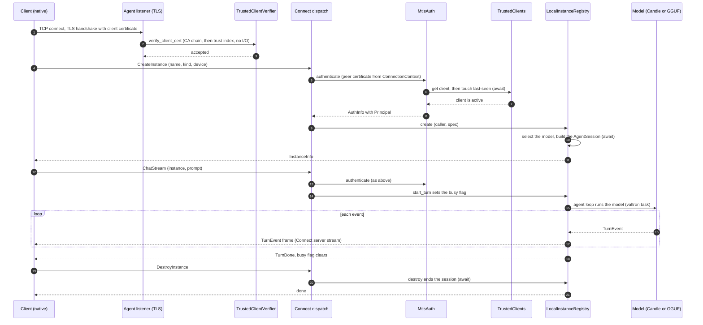

# Hosts: native, Worker and web client

_Part of [feature 13](./feature.md); the shared architecture is [agent-rpc-architecture.md](../../agent-rpc-architecture.md). Written in ASD-STE100 Simplified Technical English (STE).
Code and identifiers stay as they are._

**Abbreviations in this file.** remote procedure call (RPC); Transmission Control Protocol
(TCP); Transport Layer Security (TLS); mutual TLS (mTLS), where both sides show a
certificate; Hypertext Transfer Protocol (HTTP); Durable Object (DO); WebAssembly (wasm);
JavaScript (JS); application programming interface (API); uniform resource locator (URL);
Cross-Origin Resource Sharing (CORS), the browser rule for calls to another origin;
identifier (ID); Structured Query Language (SQL); key-value store (KV); Certificate Authority
(CA); certificate signing request (CSR); Secure Hash Algorithm with 256 bits (SHA-256);
deterministic simulation testing (DST); input/output (I/O); continuous integration (CI);
central processing unit (CPU); graphics processing unit (GPU); Compute Unified Device
Architecture (CUDA); Generative Pre-trained Transformer (GPT); GPT-Generated Unified Format
(GGUF); Internet Protocol (IP); Domain Name System (DNS); kibibyte (KiB), 1,024 bytes;
mebibyte (MiB), 1,048,576 bytes; key encryption key (KEK); JavaScript Object Notation (JSON); Privacy-Enhanced Mail (PEM), a
text form of keys and certificates;
AeroSpace and Defence Industries Association of Europe (ASD), the owner of the STE standard
ASD-STE100. gRPC is the name of a Google RPC protocol over HTTP/2. gRPC-Web is its variant for
browsers. Connect is an RPC protocol that works over HTTP/1.1 and HTTP/2. D1 and R2 are
names of Cloudflare products (a SQL database and an object store). Miniflare and wrangler are
Cloudflare tools that run a Worker on a local machine. The
[glossary in feature.md](../../agent-rpc-architecture.md#2-glossary) explains each term.

## 1. What this file covers

A **host** is the program that runs the agent-rpc core on one platform. The core is the same
on every platform. The host gives the core its side effects: time, randomness, network,
storage and models ([env.md](../08-env-and-side-effects/env.md)).

| Host | Platform | Module | Build gate |
|---|---|---|---|
| Native host | Linux, macOS, Windows | `foundation_agent_rpc::host::native` | feature `native`, `not(target_family = "wasm")` |
| Worker host | Cloudflare Workers | `foundation_agent_rpc::host::worker` | feature `worker`, `target_family = "wasm"` |
| Instance Durable Object | Cloudflare Durable Objects | `foundation_agent_rpc::host::worker::object` | as the Worker host |
| Web client | browsers | `foundation_agent_rpc::client::web` | feature `web-client`, `target_family = "wasm"` |
| Native client | Linux, macOS, Windows | `foundation_agent_rpc::client::native` | feature `native` |
| DST harness | tests only | the package `foundation_agent_rpc_dst` | feature `testing` |

The DST harness has its own file:
[deterministic-simulation-testing.md](../08-env-and-side-effects/deterministic-simulation-testing.md).

## 2. What each host gives the core

The core has seams. A **seam** is a trait or a constructor argument where a host plugs in
its own implementation. This table shows what each host plugs into each seam.

| Seam | Native host | Worker host | Instance DO | Web client | DST harness |
|---|---|---|---|---|---|
| `Env` (time, entropy, IDs, timer) | `Env::system()` in the pool configuration | `Env::system()`, once per isolate | `Env::system()`, once per DO isolate | `Env::system()`, once per page | `SimRuntime` (seeded) |
| valtron engine | multi-threaded pool | single-threaded engine that JS drives | as the Worker | as the Worker | single-threaded, fixed seed |
| Server entry | `HttpServer` with TLS, `ConnectRpcServe` (HTTP/1.1) and `ConnectRpcServeH2` (HTTP/2) | `FetchServe` in `#[event(fetch)]` | `FetchServe` in `DurableObject::fetch` | none | `MemNetwork` |
| Protocols served | Connect, gRPC, gRPC-Web | Connect, gRPC-Web | Connect (from the Worker only) | none | Connect |
| Client transport | `H1Transport`, `H2Transport` | `DoStubTransport` (to the DO) | none | `FetchTransport` | `MemTransport` |
| `ClientAuth` | `MtlsAuth`, optionally `AnyOf` with `SignedSecretAuth` | `AnyOf(CfMtlsAuth, SignedSecretAuth)`, optionally `JwtAuth` | `ForwardedPrincipalAuth` | sends a bearer secret | any provider, over memory stores |
| Key material ([auth.md](../11-foundation-auth/auth.md) section 4) | operator key files (`KeySource::File`), or `EWE_AGENT_RPC_*_KEY` variables | public keys from the var `AGENT_RPC_SECRET_PUBLIC_KEYS`; the signing key from the secret `AGENT_RPC_SIGNING_KEY` only with enrollment | none | none | `KeySource::Inline` with fixture or seeded keys |
| `TrustStore` | `SqlTrustStore<TursoStorage>` | `SqlTrustStore<D1WasmStorage>` | none | none | `MemoryTrustStore` |
| `ModelCatalog` | `LocalCatalog` | `RemoteCatalog` (checks requests, fills the index) | `RemoteCatalog` (runs the turns) | none | `ScriptedCatalog` |
| `InstanceRegistry` | `LocalInstanceRegistry<InMemoryStores>` | `DurableObjectRegistry` | `LocalInstanceRegistry<DoStores>`, `max_instances = 1` | none | `LocalInstanceRegistry<InMemoryStores>` |
| Enrollment | `EnrollmentService` with the CA | none | none | none | `EnrollmentService` with a test CA (native DST only) |

`AgentRpcCore` takes these parts through its builder ([feature.md](../../agent-rpc-architecture.md), section 6).
The core never asks which host it runs on.

## 3. Cargo features and `cfg` gates

```toml
# backends/foundation_agent_rpc/Cargo.toml (tasks T17, T21 and T22)
[features]
default = ["native", "candle"]
# The native host and the native client: TCP and TLS listeners, files, the
# multi-threaded valtron pool, the CA. Native targets only.
native = [
    "foundation_core/multi",
    "foundation_ai/multi",
    "foundation_http/multi",
    "foundation_http/ssl",
    "foundation_netio/multi",
    "foundation_netio/ssl",
    "foundation_auth/mtls",
    "foundation_db/turso",
]
candle = ["native", "foundation_ai/candle"]
candle-cuda = ["candle", "foundation_ai/candle-cuda"]
gguf = ["native", "foundation_ai/llamacpp"]
gguf-cuda = ["gguf", "foundation_ai/cuda"]
gguf-vulkan = ["gguf", "foundation_ai/vulkan"]
gguf-metal = ["gguf", "foundation_ai/metal"]
# The Cloudflare Worker host and the instance Durable Object. wasm32 only.
worker = [
    "dep:worker",
    "foundation_core/js-wasmbindgen",
    "foundation_netio/wasm-fetch",
    "foundation_db/wasm-bindgen-storage",
    "foundation_db/workers-rs",
]
# The browser client. wasm32 only.
web-client = ["foundation_core/js-wasmbindgen", "foundation_netio/wasm-fetch"]
# Fakes for tests. Never in a release build.
testing = [
    "foundation_ai/testing",
    "foundation_auth/testing",
    "foundation_core/testing",
    "foundation_compact/testing",
]

# All targets: no `multi`, no TLS listener, no files.
[dependencies]
foundation_core = { path = "../foundation_core", version = "0.0.6", default-features = false, features = ["std"] }
foundation_compact = { path = "../foundation_compact", version = "0.2.2" }
foundation_ai = { path = "../foundation_ai", version = "0.0.2", default-features = false }
foundation_auth = { path = "../foundation_auth", default-features = false, features = ["secret"] }
foundation_db = { path = "../foundation_db", version = "0.0.4", default-features = false }
foundation_connectrpc = { path = "../foundation_connectrpc", version = "0.0.3" }
foundation_netio = { path = "../foundation_netio", version = "0.0.4", default-features = false }

[target.'cfg(not(target_family = "wasm"))'.dependencies]
foundation_http = { path = "../foundation_http", version = "0.0.3" }
qrcode = { version = "0.14", default-features = false, features = ["svg"] }

[target.'cfg(target_family = "wasm")'.dependencies]
worker = { version = "0.8.7", optional = true }
wasm-bindgen = "0.2"
wasm-bindgen-futures = "0.4"
js-sys = "0.3"
web-sys = { version = "0.3", features = ["Request", "RequestInit", "Response", "ResponseInit", "Headers", "ReadableStream"] }
```

What the code does: the default build is the native host of today, with Candle. A Worker
build turns the defaults off: `--no-default-features --features worker`. The valtron feature
`multi` comes only with `native`, because a wasm target has no threads. The DST package uses
`--no-default-features --features testing`, so it also has no `multi`.

```rust
// backends/foundation_agent_rpc/src/lib.rs (after)
pub mod core;     // all targets: traits, the service, the registry, selection
pub mod proto;    // all targets: generated messages and service stubs
pub mod client;   // all targets: the transports differ per target

pub mod host {
    #[cfg(all(feature = "native", not(target_family = "wasm")))]
    pub mod native;
    #[cfg(all(feature = "worker", target_family = "wasm"))]
    pub mod worker;
}

#[cfg(all(feature = "native", target_family = "wasm"))]
compile_error!(
    "feature `native` is for native targets; build a Worker with \
     `--no-default-features --features worker`"
);
```

What the code does: each host module compiles only on its target and with its feature. A
wrong combination stops the build with a clear message, not with a long list of link errors.

## 4. The native host

### 4.1 Configuration

```rust
// foundation_agent_rpc/src/host/native/config.rs
/// Everything a native host needs. `Default` gives the behavior of today.
#[derive(Debug, Clone)]
pub struct NativeHostConfig {
    /// The agent listener, `host:port`. Port 0 picks a free port.
    pub bind: String,
    /// The enrollment listener. `None`: the host of `bind`, port 0 (as today).
    pub bootstrap_bind: Option<String>,
    /// Key files and the trust database. Default: `default_state_dir()` (as today).
    pub state_dir: PathBuf,
    pub models: Vec<ModelSource>,
    /// Load every model at start, so the first `CreateInstance` does not
    /// wait. Default true (as today).
    pub preload: bool,
    pub security: NativeSecurity,
    /// The AgentService URL that `RunningServer::payload_with` writes in
    /// `BootstrapPayload.url`. `None`: `https://` and the bound agent address
    /// (as today). Set it when clients reach the host by another name, for
    /// example "https://agents.example.com:7443" (proto.md section 6.4).
    pub public_url: Option<String>,
    /// The BootstrapService URL for `BootstrapPayload.enroll_url`. `None`:
    /// `https://` and the bound enrollment address.
    pub public_enroll_url: Option<String>,
    /// The HTTP limits of `foundation_http` (`ServerConfig::defaults()`).
    pub http: ServerConfig,
    pub registry: RegistryConfig,
    pub turns: TurnLimits,
    pub enroll: EnrollConfig,
    pub trust: TrustConfig,
    pub ca: CaConfig,
    pub server_identity: ServerIdentityConfig,
    /// Workers in the valtron pool. Default 16: at least 8 (LEARNINGS 01 T6).
    pub workers: usize,
    /// How long shutdown waits for running turns. Default 30 s: the default
    /// `terminationGracePeriodSeconds` of Kubernetes, the time that a process
    /// gets after `SIGTERM` before `SIGKILL`.
    pub shutdown_grace: Duration,
}

#[derive(Debug, Clone, PartialEq, Eq)]
pub enum NativeSecurity {
    /// Enrollment and mTLS (the default, as today). With
    /// `accept_access_secrets`, a call can also show a bearer secret with
    /// purpose `access` (for example from a browser).
    Mtls { accept_access_secrets: bool },
    /// Development only: no TLS and no auth. The host refuses to start
    /// unless `bind` is a loopback address.
    InsecurePlaintext,
}
```

What the code does: it collects every limit and choice of the native host in one place. Each
limit has a documented default (CLAUDE.md rule 8). The binary fills it from command-line
flags and environment variables, as today.

### 4.2 Start-up

```rust
// foundation_agent_rpc/src/host/native/mod.rs
pub struct NativeHost;

impl NativeHost {
    /// Build every part, bind the listeners and serve. Call it on the
    /// valtron pool: the binary's `#[valtron] async fn main` awaits it.
    ///
    /// # Errors
    /// `Config` for a bad configuration; `Storage` when a store cannot open;
    /// `ModelLoad` when `preload` is on and a model cannot load; `Transport`
    /// when an address cannot be bound.
    pub async fn start(config: NativeHostConfig, env: Env) -> AgentRpcResult<RunningServer> {
        // 1. Keys: operator files (auth.md section 4.5). A missing key stops the
        //    start with the command that makes it; the host never makes a key.
        let keys = security::load_operator_keys(&config).await?;    // signing, CA, server
        let ca = security::certificate_authority(&config, &keys.ca, &env).await?;   // writes ca-cert.pem if new
        let identity = security::server_identity(&config, &ca, &keys.server, &env).await?;

        // 2. Trusted clients: one Turso file in the state directory (as today).
        let db_url = config.state_dir.join("trusted-clients.db");
        let db = TursoStorage::new(&db_url.to_string_lossy()).await.map_err(storage_error)?;
        let trust = TrustedClients::open(Arc::new(SqlTrustStore::new(db)), env.clone(), config.trust.clone())
            .await
            .map_err(trust_error)?;

        // 3. Models and instances.
        let catalog = Arc::new(LocalCatalog::new(&config.models, Arc::new(BackgroundLoader))?);
        if config.preload {
            catalog.preload_all().await?;
        }
        let registry = Arc::new(LocalInstanceRegistry::new(
            env.clone(),
            catalog.clone(),
            InMemoryStores,
            config.registry.clone(),
            config.turns.clone(),
        ));

        // 4. Security: CA, server identity, enrollment, client auth.
        let security = security::NativeSecurityParts::build(&config, &material, &trust, &env).await?;

        // 5. The core.
        let core = AgentRpcCore::builder(env.clone())
            .catalog(catalog)
            .registry(registry)
            .turn_limits(config.turns.clone())
            .scope_policy(config.registry.scope_policy)
            .enrollment(security.enrollment.clone())
            .host_info(HostInfo::native(&config))
            .build()?;

        // 6. The listeners.
        listener::serve(&config, &core, security, env).await
    }
}
```

What the code does: it builds the parts in the order of their needs. Each step awaits its
storage. No step reads a global clock or global randomness: each part gets `env`. The
legacy key files of today load unchanged ([auth.md](../11-foundation-auth/auth.md), section 4.6).

`BackgroundLoader` is the real `ModelLoader`. It runs each model load with
`valtron::run_background_job`, because a load blocks for seconds. So a load never holds a
valtron worker.

### 4.3 Listeners and TLS

The native host has two listeners, as today:

| Listener | TLS | Client certificate | Router | Protocols |
|---|---|---|---|---|
| Agent listener (`bind`) | yes | required, from the CA, in the trust index | `core.router(auth)` | Connect and gRPC-Web over HTTP/1.1; Connect, gRPC and gRPC-Web over HTTP/2 |
| Enrollment listener (`bootstrap_bind`) | yes | none | `bootstrap_router(enrollment)` | the same |

```rust
// foundation_agent_rpc/src/host/native/listener.rs
pub(crate) async fn serve(
    config: &NativeHostConfig,
    core: &AgentRpcCore,
    security: NativeSecurityParts,
    env: Env,
) -> AgentRpcResult<RunningServer> {
    let shutdown = Arc::new(OnSignal::new());
    let agent_listener = bind(&config.bind)?;
    let bootstrap_listener = bind(&config.bootstrap_bind_or_default())?;

    // rustls configurations from foundation_auth (task T10). The verifier
    // reads the trust index only: no I/O inside the handshake.
    let agent_tls = mtls::server_config_mutual(&security.identity, &security.ca, security.trust.index(), &env)
        .map_err(pki_error)?;
    let bootstrap_tls = mtls::server_config_server_auth(&security.identity, &env).map_err(pki_error)?;

    let agent_app = routed_app(&AGENT_PROCEDURES, || core.router(Arc::clone(&security.client_auth)));
    let enrollment = Arc::clone(&security.enrollment);
    let bootstrap_app = routed_app(&[bootstrap_procedure::ENROLL], || bootstrap_router(Arc::clone(&enrollment)));

    let threads = vec![
        spawn_tls(agent_app, agent_listener, config.http.clone().with_tls(Arc::new(SSLAcceptor::with_config(agent_tls))), &shutdown)?,
        spawn_tls(bootstrap_app, bootstrap_listener, ServerConfig::defaults().with_tls(Arc::new(SSLAcceptor::with_config(bootstrap_tls))), &shutdown)?,
    ];
    Ok(RunningServer::new(core.clone(), security, shutdown, threads, config.public_urls()))
}
```

What the code does: it binds both addresses, builds the two TLS configurations, and starts
one serve thread per listener, as today. `routed_app` and `spawn_tls` stay as they are in
`server.rs` today. Only their inputs change: the router comes from the core, and the auth
provider comes from `security`.

`HttpServer` runs each connection as a valtron task. The rustls handshake completes on the
first read of `ProtocolDetectHandler`. After that read, task T4 copies the peer certificates
into `ConnectionContext::tls` ([auth.md](../11-foundation-auth/auth.md), section 7.4). So `MtlsAuth` finds the
client certificate in `CallCredentials::connection`.

`InsecurePlaintext` binds one plain listener and uses `InsecureNoAuth`. It refuses a
non-loopback `bind` before it binds anything.

### 4.4 Valtron on a native host

- `main` is `#[valtron(threads = N, env = Env::system())] async fn main` ([env.md](../08-env-and-side-effects/env.md), section 7.1). The macro starts the multi-threaded pool, puts the `Env` into its root `Ctx`, and runs `main`; `main` awaits `NativeHost::start(config, env)` and then the shutdown signal. `main` makes no blocking call; the macro is the program boundary, as the valtron rules require.
- Each HTTP/1.1 and HTTP/2 connection is a valtron task. RPC dispatch runs inside it. So `valtron::current_ctx()` works inside a handler.
- The agent loop of each turn is a valtron task that `foundation_ai` starts. Its events reach the handler through `TurnStream::events()`, an async stream.
- Model loads run on `run_background_job`. A load never blocks a valtron worker.

### 4.5 One call from start to end

This diagram shows one client on a native host: it connects with mTLS, creates an instance,
streams one chat turn, and destroys the instance. Enrollment came before
([auth.md](../11-foundation-auth/auth.md), section 9.1).



### 4.6 Where state lives and what is awaited

| State | Where it lives | Who writes it | Awaited operations |
|---|---|---|---|
| Signing key, CA key, server key | operator files, by default `state_dir/{bootstrap-signing-key,ca-key,server-key}.pem` | the operator (`ssh-keygen` or `openssl`) | `PrivateKey::load` at start |
| CA certificate, server certificate | `state_dir/{ca-cert,server-cert}.pem` | the host at start, when missing or due for renewal | file read and write at start |
| Trusted clients, secret uses, revocations | `state_dir/trusted-clients.db` (Turso) | `TrustedClients` | `get`, `touch`, `spend_secret`, `record_enrollment` |
| Trust index | memory (`TrustIndex`) | `TrustedClients` after each write | none: the verifier reads it with no I/O |
| Loaded models | memory (`LocalCatalog` slots) | `BackgroundLoader` | `resolve` awaits a load once |
| Instances and sessions | memory (`LocalInstanceRegistry`, `InMemoryStores`) | the registry | `AgentSession::build`, `end` |
| Turn events | nowhere: each event goes out when the model makes it | `guarded_turn` | the next model event, raced with the idle timer |

A restart loses the instances, as today. The keys, the CA and the trusted clients survive.

### 4.7 Shutdown

1. `SIGTERM` or `RunningServer::graceful_shutdown` fires the shutdown signal.
2. The listeners stop accepting connections.
3. The host waits up to `shutdown_grace` for running turns to end.
4. The host aborts the turns that still run. Each client gets the terminal event `TurnFailed("server shutting down")`.
5. The host ends each session (`AgentSession::end().await`) and stops the pool.

_Sections 5 (the Worker host) and 6 (the web client) moved to [worker-and-web.md](../14-worker-host-and-web-client/worker-and-web.md) in feature 14. The section numbers here stay as they were, so references stay valid._

## 7. The native client

The native client of today (`client.rs`) keeps its behavior. It moves to
`client::native` and uses the new parts:

- `BootstrapAccess::Enroll`: dial `enroll_url` (with the pin when the payload has one, `foundation_auth::mtls::client_config_pinned`, else the system roots). Enroll with a nonce and one of the two credential kinds (auth.md section 9.1.2), and check the server proof:
  - **certificate** (default on native when the host has a CA): send a CSR, then dial `url` with mTLS (`client_config_mutual`);
  - **client key**: send a public key, then send the access secret on each call and refresh it, as the web client does.
- `BootstrapAccess::Bearer`: dial `url` with the pin (`TlsTrust::PinnedSha256`) or the system roots (`TlsTrust::SystemRoots`), and send the token as a bearer secret on each call.
- The client key comes from `Env` entropy, so a DST run makes the same CSR each time ([env.md](../08-env-and-side-effects/env.md), section 8).
- The client checks the payload window before it dials, as today. The check uses `Env::wall_now()`.

## 8. Configuration of the hosts

Every limit and timeout of a host is a configuration field with a documented default
(CLAUDE.md rule 8). The table lists the host fields. [feature.md](../../agent-rpc-architecture.md), section 11,
lists the fields of the core and of `foundation_auth`.

| Field | Host | Default | Source of the default |
|---|---|---|---|
| `NativeHostConfig::workers` | native | 16 | LEARNINGS 01 T6: at least 8 workers |
| `NativeHostConfig::shutdown_grace` | native | 30 s | Kubernetes `terminationGracePeriodSeconds` |
| `NativeHostConfig::preload` | native | true | as today |
| `NativeHostConfig::public_url`, `public_enroll_url` | native | `None`: `https://` and the bound address | as today |
| `WorkerHostConfig::enrollment` | Worker | `None` (verify-only) | enrollment needs the payload private key, which is opt-in on a Worker |
| `NativeHostConfig::http` | native | `ServerConfig::defaults()` | `foundation_http` (as today) |
| `WorkerHostConfig::max_request_bytes` | Worker | 4 MiB | gRPC default maximum receive message size |
| `WorkerHostConfig::instance_idle_ttl` | Worker | none | an instance lives until `DestroyInstance` (as on the native host) |
| `WorkerHostConfig::cloudflare_mtls` | Worker | true | it has no effect until the zone has mTLS rules |
| `FetchServeConfig::response_queue` | Worker, DO | 4 chunks | the pipe depth of `ClientOptions` today |
| `FetchTransportConfig::max_request_bytes` | web, Worker | 4 MiB | gRPC default maximum send message size |
| `CorsConfig::allowed_origins` | Worker, native | empty | closed by default |
| `CorsConfig::max_age` | Worker, native | 7200 s | the CORS guide of Connect (connect-go) |

## 9. Tests

All tests go in each crate's `tests/` directory (CLAUDE.md rule 7). The Worker and web client tests are in [worker-and-web.md](../14-worker-host-and-web-client/worker-and-web.md) section 9.

| Test | Crate and file | What it proves |
|---|---|---|
| Native end to end | `foundation_agent_rpc/tests/native_e2e_tests.rs` | Enroll, mTLS, create, stream a turn, destroy, over real sockets (the `rpc_e2e_tests` of today, moved). |
| Revocation on a live connection | `foundation_agent_rpc/tests/native_revocation_tests.rs` | After `revoke_client`, the next call on the same keep-alive connection fails with `UNAUTHENTICATED`. |
| Peer certificate reported | `foundation_http/tests/tls_peer_info_tests.rs` | `ConnectionContext::tls` holds the client certificate after the handshake (task T4). |
| Shutdown | `foundation_agent_rpc/tests/native_shutdown_tests.rs` | A running turn gets `TurnFailed("server shutting down")` after `shutdown_grace`; sessions end. |
| Feature gates | `ci/packages.toml` | The `foundation_agent_rpc` runs: `""`, `"gguf"`, and a wasm run with `--no-default-features --features worker`. |
