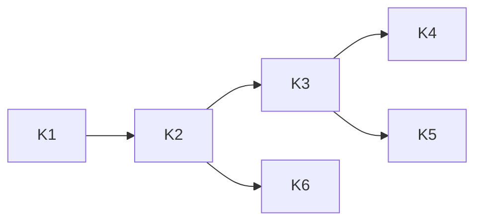

# Key Protection at Rest

_Status: **todo**, the last feature of spec 65 (owner direction, 2026-10-27). Start it only after
the agent-rpc proof of concept works end to end (features 07 to 13). Written in ASD-STE100
Simplified Technical English (STE). Code and identifiers stay as they are._

**Abbreviations in this file.** key encryption key (KEK); key management service (KMS);
Certificate Authority (CA); proof of concept (POC); identifier (ID); AeroSpace and Defence
Industries Association of Europe (ASD), the owner of the STE standard ASD-STE100. The
[glossary](../../agent-rpc-architecture.md#2-glossary) explains each term.

## 1. Why this is a separate feature

The owner said on PR #126: "we are making the secret setup super complex. We need to deliver an
initial poc that is simple and works. Like user adds a style generated private key and we use
that. The other things can be broken into deferred features for later."

So feature 11 now loads keys in the simplest way: the operator makes each private key with `ssh-keygen` or
`openssl`, and the host loads it from a file, an environment variable or a Worker secret
([auth.md](../11-foundation-auth/auth.md) section 4, decision 11 in
[agent-rpc-architecture.md](../../agent-rpc-architecture.md)). Everything else about keys moved here.
The design is complete. It waits until the POC works end to end. It was feature 08; the owner
moved it to the end of the list when feature 07 was split into features 07 to 14.

## 2. Where to read

| File | What it covers |
|---|---|
| This file | Why the work is deferred, the task list, the order |
| [`keystore.md`](./keystore.md) | `KeyStore` trait and records, `DbKeyStore` / `FsKeyStore` / `EnvKeyStore` / `MemoryKeyStore`, `KeyMaterial::load_or_create` and the race between two processes, sealing with a KEK, legacy files, rotation by `kid` |
| [`key-protection.md`](./key-protection.md) | Private keys always encrypted at rest: where the KEK comes from on each platform (systemd credentials, secret files, Secrets Store, WebCrypto), envelope encryption with a remote KMS, KEK rotation |

## 3. Tasks

| Task | What | Was | Done when |
|---|---|---|---|
| K1 | `foundation_db`: `insert_if_absent_async` with a default body; `StorageError::Unsupported` if missing | feature 07 T6 | tests pass on memory, Turso, libsql |
| K2 | `foundation_auth::keystore`: `KeyStore`, `KeyRecord`, `KeyMaterial`, the four stores, sealing (`KekSealer`, `PassphraseSealer`); `seal_with` / `open_with` in `foundation_compact` | feature 07 T7 (store and sealing parts), T1 (`seal_with`) | `KeyStore` contract, sealing and race tests pass |
| K3 | `KekSource`, async `KeySealer`, native and Worker KEK sources, `WebCryptoSealer`, always-encrypt rule, migration of the POC plain-text key files, KEK rotation, `agent-rpc keys migrate` | feature 07 T23 | [key-protection.md](./key-protection.md) section 8 tests pass (except Vault) |
| K4 | Envelope encryption with a remote KMS: `EnvelopeSealer`, `KmsBackend`; Vault Transit, then AWS KMS and GCP Cloud KMS | feature 07 T24 | sealer contract passes with `FakeKms`; the Vault test passes |
| K5 | Passphrase-protected key files (OpenSSH `bcrypt-pbkdf`, encrypted PKCS#8) with the passphrase from a KEK source | new | an encrypted `ssh-keygen` key loads with its passphrase and fails without it |
| K6 | Rotation by `kid` with no gap: several verifying keys from the key store, an `agent-rpc keys rotate` command | feature 11 auth.md section 3.6 | old secrets verify until they expire; new secrets use the new key |

_The diagram shows which task must finish before another task starts._

## 4. What the POC keeps that this feature builds on

- `KeySource` and `PrivateKey` ([auth.md](../11-foundation-auth/auth.md) section 4.4). A
  `KeyStore` becomes one more place that a `PrivateKey` comes from.
- The default file names in the state directory (`bootstrap-signing-key.pem`, `ca-key.pem`,
  `server-key.pem`). Task K3 seals them and removes the plain-text files.
- The history archive to R2 (feature 14 task T26) stores objects without encryption in the POC.
  Task K4 adds envelope encryption of each object.
