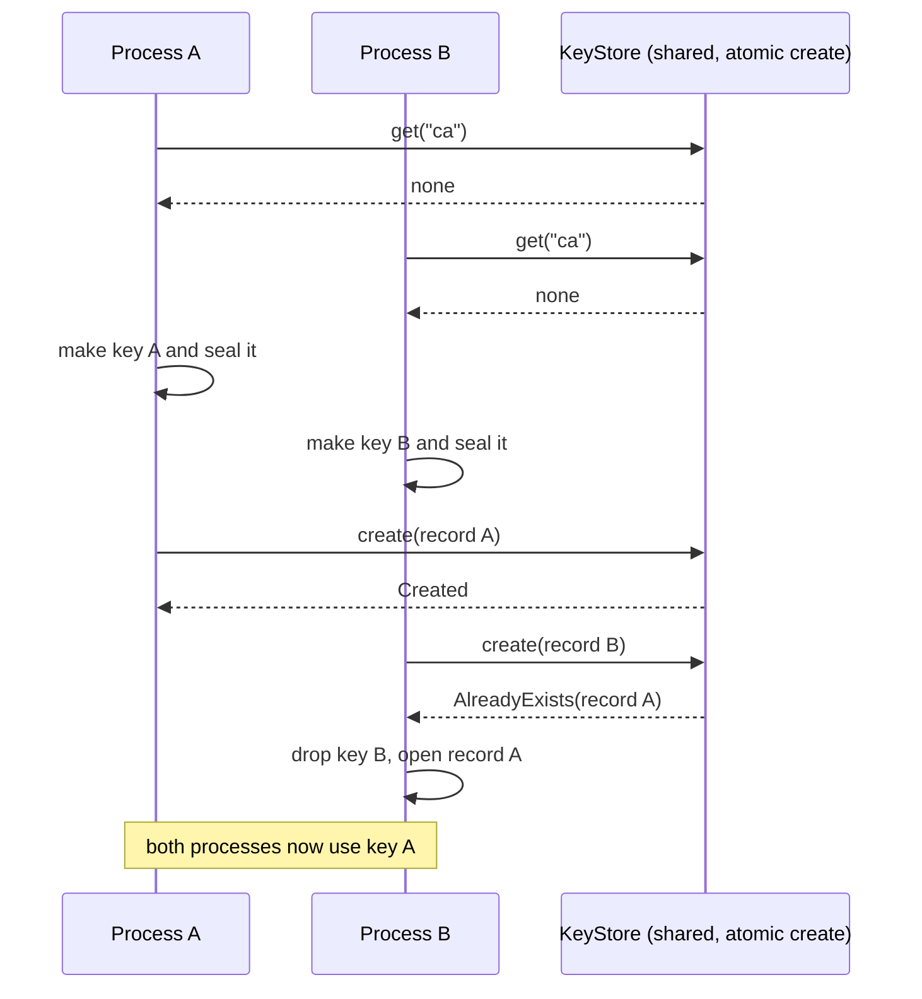

# Key store and sealed key records (deferred)

_Part of [feature 15](./feature.md) (deferred). Written in ASD-STE100 Simplified Technical English
(STE). Code and identifiers stay as they are._

This is the design that was section 4 of [feature 07 auth.md](../07-pluggable-agent-rpc/auth.md)
before the proof of concept (decision 11 in [feature 07](../07-pluggable-agent-rpc/feature.md)).
It is kept here without change, except for the section numbers and the links. Feature 07 now
loads operator key files ([auth.md](../07-pluggable-agent-rpc/auth.md) section 4). This feature
adds back, in order: a key store in `foundation_db` backends, keys that the host makes and
stores, encryption at rest, rotation by `kid`, and remote key management.

The abbreviations and the glossary are the ones of
[feature 07](../07-pluggable-agent-rpc/feature.md#2-glossary).

The owner asked for a `CaStore` provider trait. We call it `KeyStore`, because it holds
every kind of key material: the CA, the secret-signing key and the server identity. A
`KeyStore` loads, or makes and then keeps, key material in any backend: the file system,
memory, JSON files, Turso, libsql, D1, Workers KV or R2.

## 1. The trait and the record

```rust
// foundation_auth/src/keystore/mod.rs
use core::future::Future;
use core::pin::Pin;

use serde::{Deserialize, Serialize};

/// The future that every `KeyStore` call returns.
pub type KeyFuture<'a, T> = Pin<Box<dyn Future<Output = Result<T, KeyStoreError>> + Send + 'a>>;

/// The name of one record: 1 to 64 of `[a-z0-9._-]`.
#[derive(Debug, Clone, PartialEq, Eq, Hash, Serialize, Deserialize)]
pub struct KeyId(String);

impl KeyId {
    pub const CA: &'static str = "ca";
    pub const SECRET_SIGNING: &'static str = "secret-signing";
    pub const SERVER_IDENTITY: &'static str = "server-identity";

    /// # Errors
    /// [`KeyStoreError::BadId`].
    pub fn new(id: &str) -> Result<Self, KeyStoreError> { todo!("K2") }
}

#[derive(Debug, Clone, Copy, PartialEq, Eq, Serialize, Deserialize)]
#[serde(rename_all = "kebab-case")]
pub enum KeyKind {
    CertificateAuthority,
    SecretSigning,
    ServerIdentity,
}

/// One stored item of key material.
#[derive(Clone, Serialize, Deserialize)]
pub struct KeyRecord {
    pub id: KeyId,
    pub kind: KeyKind,
    /// Starts at 1. Each replacement adds 1.
    pub revision: u64,
    pub created_at_unix: u64,
    /// Certificates only.
    pub not_after_unix: Option<u64>,
    pub public: PublicMaterial,
    pub private: StoredPrivateKey,
}

#[derive(Debug, Clone, Serialize, Deserialize)]
pub struct PublicMaterial {
    /// "ed25519", "ecdsa-p256" or "rsa-pss-sha256".
    pub algorithm: String,
    pub public_key_b64url: String,
    /// CA and server identity only.
    pub cert_pem: Option<String>,
    /// Server identity only: the DNS names and IP literals it covers.
    pub subject_names: Vec<String>,
}

/// How the private key is kept.
#[derive(Clone, Serialize, Deserialize)]
#[serde(tag = "protection", rename_all = "kebab-case")]
pub enum StoredPrivateKey {
    /// Encrypted with a KEK (section 2). The normal case.
    Sealed(SealedBlob),
    /// PKCS#8 PEM in clear text. **Read only**, for the legacy files of
    /// today (section 6). No store writes it (owner decision 3: always
    /// encrypt at rest). The host seals it at the first start with a KEK.
    Plaintext { pkcs8_pem: SecretText },
    /// The key lives outside the store (a Worker secret, an environment
    /// variable). The record keeps only the name of that place.
    External { reference: String },
    /// No private key: a verify-only record.
    Absent,
}

/// A `String` that is zeroed on drop and never printed.
#[derive(Clone)]
pub struct SecretText(zeroize::Zeroizing<String>);
// `Serialize`/`Deserialize` are written by hand: they read and write the
// plain string; `Debug` prints "<redacted>".

pub enum CreateOutcome {
    Created,
    /// Another writer made the record first. Use theirs.
    AlreadyExists(KeyRecord),
}

/// Facts about a store, so callers can refuse unsafe setups.
#[derive(Debug, Clone, Copy, PartialEq, Eq)]
pub struct KeyStoreInfo {
    pub name: &'static str,
    /// `create` is atomic across processes ("first writer wins").
    pub atomic_create: bool,
    /// Other processes can write the same records.
    pub shared: bool,
    pub writable: bool,
}

/// Loads and keeps key material in any backend.
pub trait KeyStore: Send + Sync + 'static {
    /// The record, or `None`.
    fn get<'a>(&'a self, id: &'a KeyId) -> KeyFuture<'a, Option<KeyRecord>>;

    /// Store `record` only if no record with its ID exists. The check and
    /// the write are one atomic step when `info().atomic_create` is true.
    fn create<'a>(&'a self, record: &'a KeyRecord) -> KeyFuture<'a, CreateOutcome>;

    /// Replace the record when the stored revision is `expected_revision`.
    /// Rotation is an operator action; it does not race with `create`.
    fn replace<'a>(&'a self, record: &'a KeyRecord, expected_revision: u64) -> KeyFuture<'a, ()>;

    fn info(&self) -> KeyStoreInfo;
}

#[derive(Debug, Clone, PartialEq, Eq, derive_more::Display, derive_more::Error)]
pub enum KeyStoreError {
    #[display("bad key id {_0:?}")]
    BadId(#[error(not(source))] String),
    #[display("no key material named {_0}")]
    NotFound(#[error(not(source))] String),
    #[display("the stored record {_0} is corrupt; it is not overwritten")]
    Corrupt(#[error(not(source))] String),
    #[display("the store is read-only")]
    ReadOnly,
    #[display("this backend cannot create records atomically")]
    NotAtomic,
    #[display("revision conflict for {_0}")]
    Conflict(#[error(not(source))] String),
    #[display("plain-text private keys are not allowed in {_0}")]
    PlaintextRefused(#[error(not(source))] &'static str),
    #[display("sealing failed: {_0}")]
    Seal(#[error(not(source))] String),
    #[display("storage error: {_0}")]
    Storage(#[error(not(source))] String),
}
```

What the code does: `KeyStore` has three operations. `create` is "insert only if absent",
so two processes that start at the same time cannot both write a CA. `KeyRecord` keeps the
public part in clear text and the private part sealed. `KeyStoreInfo` tells the caller if
the backend is safe for shared use.

## 2. Encryption at rest

A private key in a database or a file must be sealed. **Sealing** means AEAD encryption
with a KEK. The AEAD also signs some extra bytes (the associated data), so a sealed key
cannot move to another record.

```rust
// foundation_auth/src/keystore/sealing.rs
use foundation_compact::crypto::{EncryptionKey, SecureBytes};
use foundation_core::env::Env;

/// Encrypts and decrypts private keys.
pub trait KeySealer: Send + Sync + 'static {
    /// The name of the KEK, stored with each blob (for rotation).
    fn kek_id(&self) -> &str;
    fn seal(&self, aad: &[u8], plaintext: &[u8]) -> Result<SealedBlob, KeyStoreError>;
    fn open(&self, aad: &[u8], sealed: &SealedBlob) -> Result<SecureBytes, KeyStoreError>;
}

/// The stored form of a sealed key.
#[derive(Debug, Clone, Serialize, Deserialize)]
pub struct SealedBlob {
    /// Format version: 1.
    pub v: u32,
    /// "chacha20poly1305" or "argon2id+chacha20poly1305".
    pub alg: String,
    pub kek_id: String,
    pub nonce_b64url: String,
    pub ciphertext_b64url: String,
    /// `argon2id+…` only.
    pub salt_b64url: Option<String>,
    /// `argon2id+…` only: memory KiB, iterations, lanes.
    pub argon2: Option<Argon2Params>,
}

/// A 32-byte KEK (from an environment variable, a file or a Worker secret).
pub struct KekSealer {
    kek_id: String,
    key: EncryptionKey<32>,
    env: Env,
}

/// A KEK derived from a passphrase with Argon2id, one salt per blob.
pub struct PassphraseSealer {
    kek_id: String,
    passphrase: zeroize::Zeroizing<String>,
    params: Argon2Params,
    env: Env,
}

/// Argon2id cost. Default: 19 MiB memory, 2 passes, 1 lane — the OWASP
/// Password Storage Cheat Sheet minimum for Argon2id (RFC 9106 profile).
#[derive(Debug, Clone, Copy, PartialEq, Eq, Serialize, Deserialize)]
pub struct Argon2Params {
    pub memory_kib: u32,
    pub iterations: u32,
    pub lanes: u32,
}

/// The associated data for one record. It binds the blob to the record
/// ID, kind and revision.
#[must_use]
pub fn record_aad(id: &KeyId, kind: KeyKind, revision: u64) -> Vec<u8> {
    let mut aad = b"ewe.keystore.v1\0".to_vec();
    aad.extend_from_slice(id.as_str().as_bytes());
    aad.push(0);
    aad.extend_from_slice(kind.as_str().as_bytes());
    aad.push(0);
    aad.extend_from_slice(&revision.to_be_bytes());
    aad
}
```

What the code does: `KekSealer` uses ChaCha20-Poly1305 with a random 12-byte nonce from
`env`. `PassphraseSealer` first turns a passphrase into a key with Argon2id and a random
salt. `record_aad` makes the associated data. A blob for record `ca` revision 3 does not
open as record `secret-signing`.

`foundation_compact::crypto::chacha::{encrypt, decrypt}` take no associated data and read
the nonce from global entropy. Task K2 adds `seal_with(key, nonce, aad, plaintext)` and
`open_with(key, aad, blob)` next to them. The existing functions stay.

Where the KEK comes from: [key-protection.md](./key-protection.md). Owner decision 3: a private
key is **always** encrypted at rest, on every host and every backend. There is no plain-text mode.
key-protection.md also makes `KeySealer` async (for WebCrypto and remote key management services)
and replaces the sync trait above.

## 3. Implementations

| Type | Backends | `atomic_create` | `shared` | Notes |
|---|---|---|---|---|
| `FsKeyStore` | a local directory (native) | yes: write a temporary file, then `std::fs::hard_link` it to the final name; `hard_link` fails if the name exists | no | Reads the legacy files of today (section 6). File I/O runs inside the async functions, like `foundation_db::JsonFileStorage`. |
| `DbKeyStore<K: KeyValueStore>` | `MemoryStorage`, `MemoryJsonStore`, `JsonFileStorage`, `TursoStorage`, `LibsqlStore`, `D1Store` (native REST), `D1WasmStorage`, `StorageProvider` | yes, through the new `insert_if_absent_async` (task K1) | yes | Workers KV is eventually consistent, so its `insert_if_absent_async` returns `Unsupported` and the store is read-only there. |
| `DbKeyStore<BlobKv<B: BlobStore>>` | `R2WasmStorage`, `R2Store` | no | yes | `BlobKv` adapts a blob store to the key-value trait. Read-only use: the operator uploads the records. |
| `EnvKeyStore` | values from configuration (environment variables, Worker vars and secrets) | — | — | Read-only. A Worker uses it for the public verifying keys. |
| `MemoryKeyStore` | memory (feature `testing`) | yes | no | For unit tests and DST. |

`DbKeyStore` stores each record as JSON under the key `ewe/keystore/v1/<id>` (the prefix is
configuration).

`foundation_db` change (task K1): a new method on `KeyValueStore` with a default body,
so existing implementations outside the workspace still build:

```rust
// foundation_db/src/core/storage_provider.rs (changed)
#[async_trait::async_trait]
pub trait KeyValueStore: Send + Sync {
    // … the five existing methods …

    /// Store `value` under `key` only if `key` is absent. Returns `true`
    /// when this call stored it. Atomic across processes on SQL backends
    /// (`INSERT … ON CONFLICT DO NOTHING`) and inside one process on the
    /// memory and JSON-file backends.
    ///
    /// # Errors
    /// [`StorageError::Unsupported`] when the backend cannot do it
    /// atomically (the default, and Workers KV).
    async fn insert_if_absent_async<V: Serialize + Send + 'static>(
        &self,
        key: &str,
        value: V,
    ) -> StorageResult<bool> {
        let _ = (key, value);
        Err(StorageError::Unsupported("insert_if_absent_async".into()))
    }
}
```

If `StorageError` has no `Unsupported` variant on master, task K1 adds it.

## 4. Load or make key material

```rust
// foundation_auth/src/keystore/material.rs
use std::sync::Arc;

use foundation_core::env::Env;

/// How private keys are kept in a store. Owner decision 3: always sealed.
/// There is no plain-text variant ([key-protection.md](./key-protection.md)).
#[derive(Clone)]
pub enum KeyProtection {
    /// The current sealer, and older sealers that can still open blobs
    /// sealed before a KEK rotation.
    Sealed { current: Arc<dyn KeySealer>, previous: Vec<Arc<dyn KeySealer>> },
}

/// Loads or makes the key material of a host.
pub struct KeyMaterial {
    store: Arc<dyn KeyStore>,
    /// `None` for a verify-only host: it never makes or opens a private key.
    protection: Option<KeyProtection>,
    env: Env,
}

impl KeyMaterial {
    #[must_use]
    pub fn new(store: Arc<dyn KeyStore>, protection: KeyProtection, env: Env) -> Self {
        Self { store, protection: Some(protection), env }
    }

    /// For a host that only verifies (a Worker). Every call that needs a
    /// private key returns `KeyStoreError::ReadOnly`.
    #[must_use]
    pub fn verify_only(store: Arc<dyn KeyStore>, env: Env) -> Self {
        Self { store, protection: None, env }
    }

    /// The secret-signing key: loaded, or made (Ed25519) and stored.
    ///
    /// # Errors
    /// [`KeyStoreError`] variants; a corrupt record is an error and is not
    /// replaced.
    pub async fn signing_key(&self, id: &KeyId) -> Result<SigningKey, KeyStoreError> {
        let record = self
            .load_or_create(id, |env| {
                let key = SigningKey::generate_ed25519(env, Some(id.as_str().into()))
                    .map_err(|e| KeyStoreError::Seal(e.to_string()))?;
                self.record_for_signing_key(id, &key)
            })
            .await?;
        self.open_signing_key(&record)
    }

    /// The public keys for a verify-only host (a Worker).
    ///
    /// # Errors
    /// [`KeyStoreError::NotFound`] when a key is missing.
    pub async fn verifying_keys(&self, ids: &[KeyId]) -> Result<Vec<VerifyingKey>, KeyStoreError> { todo!("K2") }

    /// The CA (native): loaded, or made and stored.
    #[cfg(feature = "pki")]
    pub async fn certificate_authority(&self, id: &KeyId, config: &CaConfig) -> Result<CertificateAuthority, KeyStoreError> { todo!("K2") }

    /// The server certificate (native): reused while it covers `names` and
    /// is not close to expiry; else made again and stored (feature 07 [auth.md](../07-pluggable-agent-rpc/auth.md) section 5.3).
    #[cfg(feature = "pki")]
    pub async fn server_identity(&self, ca: &CertificateAuthority, config: &ServerIdentityConfig) -> Result<ServerIdentity, KeyStoreError> { todo!("K2") }

    /// The common algorithm: read; if absent, make and try to store;
    /// if another writer won, use theirs.
    async fn load_or_create<F>(&self, id: &KeyId, make: F) -> Result<KeyRecord, KeyStoreError>
    where
        F: FnOnce(&Env) -> Result<KeyRecord, KeyStoreError>,
    {
        if let Some(found) = self.store.get(id).await? {
            return Ok(found);
        }
        let info = self.store.info();
        if !info.writable {
            return Err(KeyStoreError::NotFound(id.as_str().into()));
        }
        if info.shared && !info.atomic_create {
            return Err(KeyStoreError::NotAtomic);
        }
        let fresh = make(&self.env)?;
        match self.store.create(&fresh).await? {
            CreateOutcome::Created => Ok(fresh),
            CreateOutcome::AlreadyExists(winner) => {
                tracing::info!(key = id.as_str(), "another process created this key first; using it");
                Ok(winner) // `fresh` drops here; its key bytes are zeroed
            }
        }
    }
}
```

What the code does: `load_or_create` reads the record. If it is absent, it makes a new key,
seals it and tries to store it with `create`. If another process stored one first, it uses
that one. A shared store that cannot create atomically is refused, because two processes
could then make two different CAs.

This sequence diagram shows two processes that start at the same time on one shared store.
Only one key wins, and both processes use it.



## 5. Which store on which host

| Host | Signing key | CA and server identity | Trusted clients |
|---|---|---|---|
| Native, one process (default) | `FsKeyStore` in the state directory | `FsKeyStore` | `SqlTrustStore<TursoStorage>` in the state directory |
| Native, several replicas | `DbKeyStore<LibsqlStore>` or `DbKeyStore<D1Store>`, sealed | same | `SqlTrustStore` on the same database |
| Worker, verify only | `EnvKeyStore` (public key from the var `AGENT_RPC_SECRET_PUBLIC_KEYS`) | none (Cloudflare terminates TLS) | `SqlTrustStore<D1WasmStorage>` |
| DST | `MemoryKeyStore` | `MemoryKeyStore` (native DST only) | `MemoryTrustStore`. The `turso` feature of `foundation_db` turns on valtron `multi`, so Turso cannot be in the single-threaded DST build. The `SqlTrustStore` contract tests run in the normal test build. |

## 6. The legacy files of today

A state directory of today holds `ca-cert.pem`, `ca-key.pem`,
`bootstrap-signing-key.pem` and `trusted-clients.db`. They must keep working.

1. `FsKeyStore::get("ca")` reads `keys/ca.json`. If that file is absent and both legacy CA files exist, it returns a record built from them (`revision = 1`, `Plaintext`). If only one of them exists, it returns `Corrupt` (as today).
2. `FsKeyStore::get("secret-signing")` reads `keys/secret-signing.json`, else the legacy `bootstrap-signing-key.pem`.
3. The environment variable `EWE_AGENT_RPC_SIGNING_KEY` (inline PEM or a path) still overrides the signing key. The native host reads it into an `EnvKeyStore` that it puts in front of the `FsKeyStore`.
4. A KEK is required (owner decision 3). At the first start with legacy files, the host seals each key into `keys/*.json`, checks that the sealed record opens, and then removes the plain-text file. `agent-rpc keys migrate` (a sub-command of the native binary, task K3) does the same steps by hand. With no KEK, the host does not start ([key-protection.md](./key-protection.md) section 6).
5. `trusted-clients.db` keeps its tables. `SqlTrustStore` adds one new table (feature 07 [auth.md](../07-pluggable-agent-rpc/auth.md) section 6.2).

## 7. Key rotation by `kid`

The proof of concept rotates a key by a restart with a new key file
([auth.md](../07-pluggable-agent-rpc/auth.md) section 4.6). With a key store, rotation has no
gap:

1. Make a new key with a new `kid`.
2. Give the verifiers both public keys.
3. Issue new secrets with the new key only.
4. When the last old secret has expired (its `valid_until` plus `clock_skew`), remove the old public key from the verifiers.

A lost private key on a native host is made again at start (as today). That makes every
open secret invalid, which is the intended behavior.

