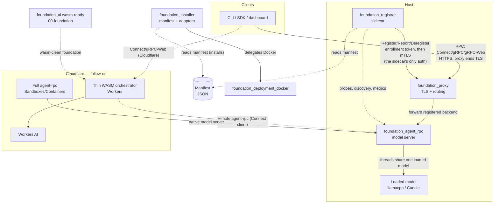

# Overview

_Written in ASD-STE100 Simplified Technical English (STE) from 2026-10-26. Older paragraphs are
being changed to STE feature by feature. Code and identifiers stay as they are._

**Abbreviations in this file.** remote procedure call (RPC); Transport Layer Security (TLS);
mutual TLS (mTLS); WebAssembly (wasm); Cloudflare (CF); JavaScript Object Notation (JSON);
Hypertext Transfer Protocol (HTTP); Quick Response code (QR code); command-line interface (CLI);
software development kit (SDK); continuous integration and continuous delivery (CI/CD);
GPT-Generated Unified Format (GGUF); Hypertext Transfer Protocol version 2 (H2); input/output
(I/O); identifier (ID); random number generator (RNG); central processing unit (CPU); AeroSpace
and Defence Industries Association of Europe (ASD), the owner of the STE standard ASD-STE100.

## Glossary

| Term | Meaning |
|---|---|
| agent-rpc | The model server of feature 01 (`foundation_agent_rpc`). It loads a model one time and serves many named agent instances. |
| Backend | A network address that the proxy forwards requests to, for example one agent-rpc. |
| Bootstrap payload | The text (or QR code) that gives a client an agent-rpc address, the TLS trust data and a signed secret. Feature 07, `proto.md`. |
| Host (feature 07) | The program-specific part that gives the agent-rpc core its network, storage and models: native, Worker or simulation. |
| Installer | `ewe-installer` (feature 02). It installs and starts the entries of a manifest. |
| Manifest | The JSON file that lists the software of a machine. Only the installer and the registrar read it. |
| Proxy | `foundation_proxy`. It ends client TLS and routes requests to backends. |
| Registrar, sidecar | `ewe-registrar` (feature 04). It runs beside the apps, checks what is installed and running, runs health probes, reads metrics, and reports to the proxy. |
| Registration authority | The part of the proxy that enrolls sidecars and accepts their reports (feature 03). |
| Signed secret | The credential of `foundation_auth::secret`: signed JSON with a time window. Not a JSON Web Token. |
| Worker | A Cloudflare Worker: a wasm program that answers HTTP `fetch` events. |

## Summary

This specification turns the platform's RPC and AI layers into a **host-based
agentic serving system**: a machine runs one long-lived `agent-rpc` server that
loads a model *once* and serves many concurrent agent sessions over
Connect/gRPC/gRPC-Web, fronted by `foundation_proxy` for TLS termination and
routing. Distribution is manifest-driven: a small bootstrap script embeds a
manifest, pulls a Rust installer, and the installer places everything else
(software, systemd units, or containers). A sidecar registrar reads that same
manifest, decides which installed binaries must be proxied, and tells the proxy
"this binary is here at this host/port" so it can serve them.

**Foundation first.** Before any of the above is built, `00-foundation` makes
`foundation_ai` and its dependencies compile and run on `wasm32-unknown-unknown`,
reusing the repo's existing cross-platform HTTP seam (`DynNetClient`/`HttpClient`
— no new client type) and routing non-I/O primitives through `foundation_compact`
(the central cross-platform substrate: time/entropy/RNG/IDs/crypto). It extends
the completed `28-cloudflare-workers-readiness` work and is verified with
miniflare locally and on Cloudflare, so the later Cloudflare target
(`05-cloudflare`) builds on a proven foundation.

The design rule that shapes every feature: **no tight coupling.** The installer,
agent-rpc, registrar, and proxy each have exactly one mission. They are composed
by a manifest and by an explicit registration handshake — nothing else. In
particular:

- **Only the installer and the registrar** read the manifest. No other
  component knows it exists.
- **agent-rpc** owns its *own* client-facing auth (a secret token for bootstrap,
  mTLS ongoing) and advertises it to its clients/customers (CLI, SDK, dashboards)
  as a base64/QR payload. It knows nothing of the manifest, the registrar, or
  the proxy.
- **The registrar (sidecar)** runs beside the apps (bare metal, Docker container or
  Kubernetes pod). It reads the manifest, finds what is installed and running, runs startup,
  liveness and readiness probes, reads CPU and memory use, and tells the proxy. It does not end
  client TLS.
- **The proxy** ends client TLS and routes to backends that the sidecar reports ready. It does
  not care how agent-rpc checks its own clients.

The sidecar authenticates in **one place only**: its own link to the proxy registration
authority. A registration changes where client traffic goes, so the proxy must know the caller
is a trusted sidecar. The sidecar uses an enrollment token one time to get a certificate, then
mTLS (or a local Unix socket with file permissions). Feature 03, section 5, explains it.

So there are **two independent auth links**:

1. client ↔ agent-rpc: agent-rpc's own auth (feature 07: signed secret, or mTLS when no proxy
   ends TLS in between),
2. sidecar → proxy registration authority: enrollment token, then mTLS.

This mirrors the existing deployment primitives (`foundation_packager`,
`foundation_deployment_docker`, `foundation_deployment_platform`) and the RPC
layer (`foundation_connectrpc`), and extends the proxy work begun in
`specifications/completed/63-connectrpc-proxy`.

# Goals

- **Foundation:** make `foundation_ai` (and the crates it pulls in) compile and
  run on `wasm32-unknown-unknown`, verified with miniflare locally and on
  Cloudflare — before agent-rpc is built (`00-foundation`).
- Ship an `agent-rpc` crate: a long-lived, per-machine RPC server that loads a
  model once, runs threaded inference, and exposes named agent "instances" as
  lightweight logical state over Connect/gRPC/gRPC-Web.
- Ship a manifest-driven installer that produces platform install scripts via
  the existing templating stack and executes them through pluggable source and
  deploy-target adapters (bare-metal systemd and Docker at a minimum). The
  installer does **not** know about Cloudflare.
- Extend `foundation_proxy` with a registration authority: authenticated
  register/deregister/heartbeat endpoints and a routing table of live backends.
- Ship a sidecar registrar that reads the manifest, checks which apps are installed, running
  and healthy, reads their metrics, and keeps the proxy's routing table current.
- Preserve strict separation of concerns: no shared Rust library between the
  components; the manifest is the only shared *format*, and only installer +
  registrar consume it.

# Implementation Location

- `backends/foundation_agent_rpc` — new crate: the agent-rpc model server.
- `backends/foundation_installer` — new crate: manifest schema, source/deploy
  adapters, bootstrap-script generation; binary `src/bin/ewe-installer.rs` (systemd + Docker only).
- `backends/foundation_registrar` — new crate: the sidecar; binary `src/bin/ewe-registrar.rs`.
- Crate layout rule: a library is `src/lib.rs`; each binary is `src/bin/<name>.rs` with a
  `[[bin]]` entry (as `backends/foundation_testbed/src/bin/wasm-testbed.rs`). No `src/main.rs`.
- `backends/foundation_proxy` — extended: registration authority + routing table.
- `backends/foundation_ai` (+ `foundation_netio`, `foundation_arrow`, etc.) —
  modified only for wasm/CF-Workers readiness in `00-foundation`; the agentic
  design itself is untouched.
- Reused, not modified unless required: `backends/foundation_connectrpc` (RPC
  engine), `backends/foundation_packager` (templating),
  `backends/foundation_deployment_docker` (Docker),
  `backends/foundation_deployment_cloudflare` (Cloudflare Workers + Sandboxes/Containers).
- Feature specifications: `specifications/65-agent-rpc-serving-system/features/*/feature.md`.

# Known Issues

The four *latent* risks that gate the design are called out explicitly and turned
into the first tasks of their features:

1. **Model shareability** (F1): the whole "load once, many threads" model
   depends on `foundation_ai`'s loaded backend (llamacpp GGUF / Candle) being
   `Send + Sync` and handable to many `AgentSession`s. This is a verification
   spike, not an assumption — see `01-agent-rpc`.
2. **H2 trailer plumbing** (inherited from spec 63): a gRPC client cannot yet
   observe `grpc-status` through `foundation_connectrpc` until its H2 transport
   forwards trailing HEADERS. agent-rpc's gRPC status assertions are gated on
   spec 63's T1.
3. **Cloudflare / WASM target** (foundation-first): the full `foundation_ai`
   (llamacpp/Candle) cannot compile to a Worker — those backends are already
   `not(target_family = "wasm")`-gated and are infeasible (C FFI, threads, mmap,
   ~128 MB). But the agentic layer + cloud providers are nearly wasm-clean. The
   readiness work (wasm compile gate, cross-platform `HttpClient` seam, Workers AI
   provider, miniflare + Cloudflare examples) is **`00-foundation`**, built before
   agent-rpc. The Cloudflare *target* itself — thin WASM orchestrator on Workers,
   full native model-server on Sandboxes/Containers — is **`05-cloudflare`**.
4. **`foundation_arrow` wasm status unknown** — it shows no
   `target_family = "wasm"` gating, so its wasm readiness is an explicit
   `00-foundation` T2 audit item, not an assumption.

# Language Stack

**IMPORTANT:** Agents MUST identify the language stack below and read the
corresponding skills BEFORE implementation.

### Languages Used

| Language | Purpose | Skill Location |
|----------|---------|----------------|
| Rust | agent-rpc server, installer, registrar, proxy extension, wasm foundation | `.agents/skills/rust-clean-code/skill.md` |

### Mandatory Pre-Implementation Steps

1. Read `.agents/skills/rust-clean-code/skill.md` (implementation standards) and
   `.agents/skills/rust-valtron-usage/skill.md` (async/valtron boundaries —
   agent-rpc is async on the RPC edge and threaded/valtron in the inference
   core; Workers run the executor single-threaded via `JSThreadYielder`).
2. Follow `.agents/AGENTS.md`: stream bodies (never buffer them), use the
   generated/protocol types (fix the generator, don't hand-roll), async all the
   way down, no stubs, no ignored errors/return values.

# Feature Index

| #  | Feature | Description | Dependencies | Status |
|----|---------|-------------|--------------|--------|
| 0  | [WASM & CF-Workers Readiness (foundation)](./features/00-foundation/feature.md) | Make foundation_ai + deps compile/run on wasm32, verified via miniflare + Cloudflare; reuses DynNetClient/HttpClient, extends spec 28 | None (extends spec 28) | ⬜ Pending |
| 1  | [Agent RPC Model Server](./features/01-agent-rpc/feature.md) | Load-once, threaded-inference RPC server with named instances and client-facing token→mTLS auth | None | ✅ Complete |
| 2  | [Manifest Installer](./features/02-manifest-installer/feature.md) | Manifest schema + source/deploy adapters (systemd/Docker) + bootstrap-script generation | None | ⬜ Pending |
| 3  | [Proxy Registration Authority](./features/03-proxy-registration/feature.md) | Sidecar enrollment, `Register`/`Report`/`Deregister` on leases, live backend registry feeding the router | None (extends spec 63; uses 07's `foundation_auth`) | ⬜ Pending |
| 4  | [Registrar Sidecar](./features/04-registrar-sidecar/feature.md) | Reads the manifest, discovers and probes apps, reads metrics, reports to the proxy | 2, 3 | ⬜ Pending |
| 5  | [Cloudflare Deployment](./features/05-cloudflare/feature.md) | Full native model server on Cloudflare Sandboxes/Containers, and end-to-end tests on Workers; the Worker host itself is designed in 07 | 0, 1, 7 | ⬜ Pending |
| 6  | [WASM Lazy Streaming](./features/06-wasm-async-streaming/feature.md) | Remove the wasm-unsafe `run_future`/`collect()` anti-pattern from the streaming path: park-friendly `into_future_stream`, lazy `send_sse` + `SseProgress::Failed`, zero `Model` API change; fix the T6 sync-streaming hang | 0 | ✅ Complete |
| 7  | [Bring PR #126 onto master](./features/07-pluggable-agent-rpc/feature.md) | Task T0 only: merge master into `65-f01-agent-rpc`, adapt to async storage and async `AgentSession`. The shared design of features 7 to 15 is [`agent-rpc-architecture.md`](./agent-rpc-architecture.md) | 1 | ⬜ Pending (paused) |
| 8  | [Env and Side Effects](./features/08-env-and-side-effects/feature.md) | `Clock`, `EntropySource`, `IdSource`, the `Env` bundle in valtron `Ctx`, the macro `env` argument, foundation_ai on Env | 7 | ⬜ Pending |
| 9  | [Transport Prerequisites](./features/09-transport-prerequisites/feature.md) | connectrpc keeps request extensions and uses the Env clock; foundation_http reports TLS peer certificates | 8 | ⬜ Pending |
| 10 | [Migration Groups](./features/10-migration-groups/feature.md) | Migration groups per database from code or directories; `FleetRunner` | 7 | ⬜ Pending |
| 11 | [Auth in foundation_auth](./features/11-foundation-auth/feature.md) | Signed secrets, operator key files, CA, trusted clients, mTLS, client auth providers | 8, 9, 10 | ⬜ Pending |
| 12 | [Agent RPC Core](./features/12-agent-rpc-core/feature.md) | `agent.proto`, model catalog, instance registry, service and enrollment handlers | 8, 11 | ⬜ Pending |
| 13 | [Native Host and DST](./features/13-native-host-and-dst/feature.md) | Native host and simulation harness; when done, the agent-rpc proof of concept works | 9, 11, 12 | ⬜ Pending |
| 14 | [Worker Host and Web Client](./features/14-worker-host-and-web-client/feature.md) | Workers, Durable Objects, browser client, R2 history archive | 9, 12 | ⬜ Pending |
| 15 | [Key Protection at Rest](./features/15-key-protection-at-rest/feature.md) | Key store over foundation_db, private keys encrypted at rest (KEK sources, WebCrypto, remote KMS), passphrase key files, rotation by kid. Last: starts after the proof of concept works | 11, 13 | 📝 Todo |

Status Key: ⬜ Pending | 🔄 In Progress | ✅ Complete

# Requirements Conversation Summary

The user wants to let someone launch a binary on a host and have it "just start
an RPC/HTTP server" with methods to interact with agents, backed by a model that
is loaded **once per machine** and shared across many concurrent instances. This
conversation settled the shape across several corrections:

- **agent-rpc is per-machine, not per-instance.** Spawning a process per
  instance would defeat memory sharing ("we could 10x memory usage if everyone
  is booting and loading up models"). agent-rpc is a control plane that loads a
  model once and runs many threaded inference sessions against it; instances are
  lightweight logical state.
- **The proxy and agent-rpc are not layered or coupled.** The proxy's job is
  only to receive registrations and forward. It does **not** know about
  agent-rpc's client auth.
- **Two independent auth channels.** (1) client/customer ↔ agent-rpc: a secret
  token for bootstrap, then mTLS ongoing — this is agent-rpc's own business,
  advertised via base64/QR. (2) registrar ↔ proxy: token → mTLS — this is the
  registration channel.
- **Correction (owner, PR #126 review, 2026-10-25).** The sidecar's job is discovery, health and
  metrics. The proxy owns client TLS termination. Token-then-mTLS applies only to the sidecar
  proving its identity to the proxy registration authority (feature 03, section 5).
- **Only installer + registrar know the manifest.** "None of them share
  anything; the registrar can read the manifest — that's all. No one else cares."
- **Distribution is a manifest → script → installer chain**, using the existing
  templating crates, with pluggable source adapters (github-release/url/cargo/
  apt/mise/docker-image) and deploy-target adapters (systemd, Docker). Docker
  delegates to `foundation_deployment_docker`; pull-by-tag is preferred (CI/CD
  builds the image), build is a fallback. The installer does **not** target
  Cloudflare — that overstep was corrected.
- **The sidecar is a deployment-time choice, not an architecture change.** One
  sidecar per bare-metal host; in Docker, the sidecar rides in the container.
- **Foundation before agent-rpc (wasm/CF-Workers).** Shore up `foundation_ai` +
  deps for `wasm32-unknown-unknown` first, verified with miniflare and on
  Cloudflare, before building agent-rpc — grounded in the pre-existing
  `28-cloudflare-workers-readiness` work (cf-valtron-counter, ci-wasm-checks,
  miniflare harness). Reuse the existing cross-platform `DynNetClient`/`HttpClient`
  seam per use-case (singular `HttpClient` for HTTP-only providers, combined
  `NetClient` only when WebSocket is needed) — no new `DynHttpClient` type.

# High-Level Architecture

**CRITICAL:** This section is the complete spec-level architecture. Feature-level
depth (component structure, interfaces, error/security/performance, tasks) lives
in each `feature.md`.

_The diagram shows every component and link. Clients reach agent-rpc through the proxy, which
ends TLS. The sidecar reports apps to the proxy and is the only part that authenticates to it._

### Component Responsibilities

0. **foundation (`00-foundation`)** — makes `foundation_ai` and its AI deps
   (`foundation_netio`/`foundation_vectors`/`foundation_compact`/
   `foundation_arrow`/`foundation_connectrpc`) compile and run on
   `wasm32-unknown-unknown`, reusing the existing `DynNetClient`/`HttpClient`
   seam and extending spec 28's ci-wasm-checks. Verified with miniflare locally
   and on Cloudflare. Not a new crate — a prerequisite slice across existing
   crates.
1. **agent-rpc (`foundation_agent_rpc`)** — a long-lived RPC server built on
   `foundation_connectrpc`. Loads a model once into a shared `ModelHandle`
   (`Send + Sync + 'static`), runs threaded inference, and exposes named
   instances (each a `foundation_ai::AgentSession` + memory store + provider
   config). Owns its own client-facing auth (secret-token → mTLS) and advertises
   a bootstrap payload as base64/QR. See `01-agent-rpc`.
2. **installer (`foundation_installer`)** — reads a manifest, resolves each
   entry through a source adapter, and applies it through a deploy-target
   adapter (systemd unit or Docker). Generates the tiny bootstrap script via
   `foundation_packager`. No Cloudflare. See `02-manifest-installer`.
3. **proxy (`foundation_proxy`, extended)** — ends client TLS. Its registration
   authority enrolls sidecars, accepts their `Register`/`Report`/`Deregister` calls on a
   lease, and keeps a live backend registry that feeds the router. Forwards to ready
   backends, reusing spec 63's per-endpoint protocol selection. See
   `03-proxy-registration`.
4. **registrar (`foundation_registrar`)** — the sidecar. Runs beside the apps. Reads the
   manifest, discovers what is installed and running, runs startup/liveness/readiness
   probes, reads CPU and memory use, and reports to the proxy. Its only credential is
   for its link to the proxy. See `04-registrar-sidecar`.
5. **Cloudflare target (`05-cloudflare`)** — the thin WASM orchestrator on
   Workers and the full native model-server on Sandboxes/Containers, consuming
   the `00-foundation` readiness. Cloudflare deployment lives in
   `foundation_deployment_cloudflare` / `ewe_deployables`, not the installer.

### Cross-component contracts (the *only* touch points)

- **Manifest** — a serialized JSON contract consumed by installer + registrar
  only. There is **no shared Rust type** between them; each parses it
  independently. (This is the "compose by manifest" seam.)
- **Registration protocol** — a typed, authenticated register/deregister/
  heartbeat handshake between registrar and proxy. Defined once, generated as
  types, implemented on both sides independently.
- **RPC service** — the agent-rpc service definition (instance + chat methods)
  is the contract between clients and agent-rpc. The proxy forwards it opaquely
  (spec 63); it does not interpret it.
- **HTTP client seam** (`foundation_netio`) — `DynNetClient`/`HttpClient` is the
  cross-platform contract used by `foundation_ai`'s providers; no new type.
- **Cross-platform substrate** (`foundation_compact`) — the central home for
  time/entropy/RNG/IDs/crypto; `foundation_ai` routes its primitives through it.

### Auth model (two independent channels)

| Channel | Parties | Auth | Owner |
|---------|---------|------|-------|
| Client ↔ proxy | CLI/SDK ↔ proxy public listener | TLS, ended by the proxy (public certificate) | proxy |
| Client ↔ agent-rpc | CLI/SDK ↔ agent-rpc | agent-rpc's `ClientAuth` (feature 07): signed secret as a bearer credential through the proxy; mTLS only on a direct connection | agent-rpc |
| Sidecar → proxy registration authority | sidecar ↔ proxy | enrollment token (one time) → mTLS, or a local Unix socket | proxy (issues), sidecar (holds) |

Neither credential is visible to the other component. The proxy never checks the
agent-rpc client credential; agent-rpc never sees the registration certificate. The
sidecar does not take part in client TLS.

### Deployment topology

- **Foundation first:** `foundation_ai` is wasm-clean and proven via miniflare +
  Cloudflare examples before any server is built (`00-foundation`).
- **Single host (first milestone):** proxy + one or more agent-rpc instances +
  one registrar on the same machine; each agent-rpc on its own port/endpoint.
- **Multi-host (follow-on):** the registrar reports backends by host + port, so
  the proxy can forward across machines. The registration message already
  carries host + port, so the data plane handles remote backends with no new
  mechanism.
- **Cloudflare (follow-on):** two artifacts — a **thin WASM agent orchestrator**
  on Workers (agentic layer + Workers-AI or remote agent-rpc model, served via
  `foundation_http::wasm::dispatch_cf`), and the **full native model-server
  agent-rpc** on Sandboxes/Containers. See `05-cloudflare` (consuming
  `00-foundation`).

# Success Criteria (Spec-Wide)

0. `foundation_ai` (and its AI deps) compile clean to `wasm32-unknown-unknown`,
   providers code against the `HttpClient`/`DynNetClient` seam, and the
   miniflare + Cloudflare examples stream end-to-end — all before agent-rpc is
   built.
1. An operator can bootstrap a host from a manifest: the bootstrap script
   installs agent-rpc (and the sidecar), starts it under systemd (or as a
   container), and the sidecar registers it with the proxy — all without
   hand-editing config.
2. `agent-rpc` loads one model and serves **multiple concurrent** agent
   instances over Connect/gRPC/gRPC-Web on real loopback TCP, round-tripping
   unary and streaming chat.
3. A client reaches an agent through the proxy. The proxy ends TLS; agent-rpc checks
   the client's signed secret. The proxy does not take part in that check.
4. The registrar enrolls with the proxy (token, then mTLS), registers a ready app,
   and the proxy routes to it. Missed reports, restarts of the proxy, the sidecar or
   the app, and redeploys all converge without dropping unrelated live connections.
5. The components remain uncoupled: installer, registrar, agent-rpc, and proxy
   build and run independently, with the manifest as the only shared format and
   the registration handshake as the only live coupling. The installer never
   targets Cloudflare.

# Out of Scope

- **The agentic/harness design of `foundation_ai`** — only the minimum to make it
  wasm/CF-Workers clean (`00-foundation`) and to expose a `Send + Sync` shared
  handle if the spike proves it necessary (`01-agent-rpc`). The harness/agentic
  design itself is out of scope.
- **Changes to `foundation_connectrpc`** except what spec 63 tracks (H2 trailer
  plumbing) and the F24 wasm fetch transport (`05-cloudflare`). agent-rpc
  *consumes* the RPC engine; it does not redesign it.
- **Cloudflare deployment in the installer** — explicitly out. The installer's
  deploy targets are systemd and Docker. Cloudflare deployment belongs to
  `foundation_deployment_cloudflare` / `ewe_deployables`.
- **Reinventing Docker** — the installer's Docker path delegates to
  `foundation_deployment_docker` (pull-by-tag preferred, build as fallback).
- **Porting local model backends to wasm** — llamacpp/Candle stay
  `not(target_family = "wasm")`-gated; Workers use Workers AI or a remote
  agent-rpc.
- **gRPC-JSON transcoding / a REST façade** over the agent RPCs (separate surface,
  not requested).
- **Cross-org or multi-tenant proxy federation** — registrations are within one
  proxy's trust domain (one registration CA that signs the sidecar certificates, feature 03).

# Module References

- `backends/foundation_netio/src/network_client.rs` — `HttpClientBuilder`,
  `DynNetClient`/`NetClient` (the cross-platform HTTP seam; no new client type).
- `backends/foundation_netio/src/shared/client/http_client.rs` — the `HttpClient`
  trait (`Arc<dyn HttpClient>`), object-safe, cross-platform.
- `backends/foundation_netio/src/wasm/client/client.rs` — `FetchHttpClient`
  (wasm-fetch).
- `backends/foundation_compact/` — central cross-platform substrate: `time`,
  `entropy` (vendored, all targets), `rng` (ChaCha, no getrandom), `ids`
  (scru128), `crypto`, `send_wrapper`.
- `backends/foundation_http/src/wasm/{serve_cf,dispatch_cf}.rs` — Worker serve
  + dispatch.
- `backends/foundation_toolings/src/harness/miniflare.rs` — the `Miniflare`
  local-test harness (`wrangler dev --local` / `npx miniflare`).
- `specifications/completed/28-cloudflare-workers-readiness/` — prior wasm
  readiness (cf-valtron-counter example, ci-wasm-checks, three-tier strategy).
- `backends/foundation_connectrpc/` — Router/Client/handlers; `shared/transport/wasm.rs`
  (F24 stub); the RPC engine.
- `backends/foundation_ai/src/harness/` — `RouterPreset`, `RouterMix`,
  `gguf_provider`, `candle_llama`, `into_agent_builder(_with_stores)`.
- `backends/foundation_ai/src/agentic/` — `AgentSession`, `AgentSessionBuilder`,
  `AgentConfig`, `AgentContext`, memory stores.
- `backends/foundation_packager/` — minijinja/tinytemplate script generation.
- `backends/foundation_deployment_docker/` — pull/run/inspect/build.
- `backends/foundation_deployment_cloudflare/` — Workers + API v4 + `generated/ai`
  (Sandboxes/Containers gap is `05-cloudflare` T3).
- `backends/foundation_proxy/src/{config,router,h2_proxy,forward}.rs` — where the
  registration authority and routing table land.
- `specifications/completed/63-connectrpc-proxy/` — per-endpoint protocol selection the
  registrar's routing table plugs into.

---

_Created: 2026-10-19_
_Last Updated: 2026-10-26_
_Structure: Feature-based (has_features: true, has_fundamentals: true)_
