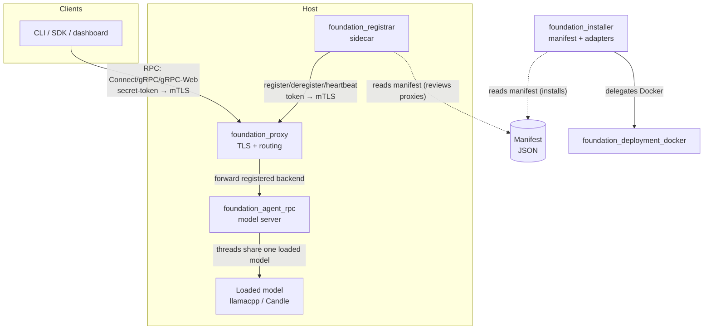

# Overview

This specification turns the platform's RPC and AI layers into a **host-based
agentic serving system**: a machine runs one long-lived `agent-rpc` server that
loads a model *once* and serves many concurrent agent sessions over
Connect/gRPC/gRPC-Web, fronted by `foundation_proxy` for TLS termination and
routing. Distribution is manifest-driven: a small bootstrap script embeds a
manifest, pulls a Rust installer, and the installer places everything else
(software, systemd units, or containers). A sidecar registrar reads that same
manifest, decides which installed binaries must be proxied, and tells the proxy
"this binary is here at this host/port" so it can serve them.

The design rule that shapes every feature: **no tight coupling.** The installer,
agent-rpc, registrar, and proxy each have exactly one mission. They are composed
by a manifest and by an explicit registration handshake — nothing else. In
particular:

- **Only the installer and the registrar** read the manifest. No other
  component knows it exists.
- **agent-rpc** owns its *own* client-facing auth (a secret token for bootstrap,
  mTLS ongoing) and advertises it to its clients/customers (CLI, SDK, dashboards)
  as a base64/QR payload. It knows nothing of the manifest, the registrar, or
  the proxy.
- **The registrar (sidecar)** owns the *registration* auth channel to the proxy
  (token → mTLS) and owns review of which installed binaries need proxying.
- **The proxy** only cares that a backend registered and that it can forward to
  it. It does not care how agent-rpc authenticates its own clients.

There are therefore **two independent auth channels**:

1. client/customer ↔ agent-rpc (owned by agent-rpc),
2. registrar ↔ proxy (owned by the registrar + proxy).

This mirrors the existing deployment primitives (`foundation_packager`,
`foundation_deployment_docker`, `foundation_deployment_platform`) and the RPC
layer (`foundation_connectrpc`), and extends the proxy work begun in
`specifications/63-connectrpc-proxy`.

# Goals

- Ship an `agent-rpc` crate: a long-lived, per-machine RPC server that loads a
  model once, runs threaded inference, and exposes named agent "instances" as
  lightweight logical state over Connect/gRPC/gRPC-Web.
- Ship a manifest-driven installer that produces platform install scripts via
  the existing templating stack and executes them through pluggable source and
  deploy-target adapters (bare-metal systemd and Docker at a minimum).
- Extend `foundation_proxy` with a registration authority: authenticated
  register/deregister/heartbeat endpoints and a routing table of live backends.
- Ship a sidecar registrar that reads the manifest, reviews which binaries must
  be proxied, and keeps the proxy's routing table current (token → mTLS).
- Preserve strict separation of concerns: no shared Rust library between the
  components; the manifest is the only shared *format*, and only installer +
  registrar consume it.

# Implementation Location

- `backends/foundation_agent_rpc` — new crate: the agent-rpc model server.
- `backends/foundation_installer` — new crate: manifest schema, source/deploy
  adapters, bootstrap-script generation, installer binary.
- `backends/foundation_registrar` — new crate: the sidecar registrar binary.
- `backends/foundation_proxy` — extended: registration authority + routing table.
- Reused, not modified unless required: `backends/foundation_connectrpc` (RPC
  engine), `backends/foundation_ai` (harness), `backends/foundation_packager`
  (templating), `backends/foundation_deployment_docker` (Docker).
- Feature specifications: `specifications/65-agent-rpc-serving-system/features/*/feature.md`.

# Known Issues

None yet — green-field. The three *latent* risks that gate the design are called
out explicitly and turned into the first tasks of their features:

1. **Model shareability** (F0): the whole "load once, many threads" model
   depends on `foundation_ai`'s loaded backend (llamacpp GGUF / Candle) being
   `Send + Sync` and handable to many `AgentSession`s. This is a verification
   spike, not an assumption — see `00-agent-rpc`.
2. **H2 trailer plumbing** (inherited from spec 63): a gRPC client cannot yet
   observe `grpc-status` through `foundation_connectrpc` until its H2 transport
   forwards trailing HEADERS. agent-rpc's gRPC status assertions are gated on
   spec 63's T1.
3. **Cloudflare / WASM target** (in research): agent-rpc must also run on
   Cloudflare — Workers (WASM, edge, single-threaded) and Sandboxes/Containers
   (heavier, long-running). Whether `foundation_ai` (or its agentic layer alone)
   compiles to `wasm32` for a Worker is under active research; the dedicated
   Cloudflare feature will be written from those findings, not before.

# Language Stack

**IMPORTANT:** Agents MUST identify the language stack below and read the
corresponding skills BEFORE implementation.

### Languages Used

| Language | Purpose | Skill Location |
|----------|---------|----------------|
| Rust | agent-rpc server, installer, registrar, proxy extension | `.agents/skills/rust-clean-code/skill.md` |

### Mandatory Pre-Implementation Steps

1. Read `.agents/skills/rust-clean-code/skill.md` (implementation standards) and
   `.agents/skills/rust-valtron-usage/skill.md` (async/valtron boundaries —
   agent-rpc is async on the RPC edge and threaded/valtron in the inference
   core).
2. Follow `.agents/AGENTS.md`: stream bodies (never buffer them), use the
   generated/protocol types (fix the generator, don't hand-roll), async all the
   way down, no stubs, no ignored errors/return values.

# Feature Index

| #  | Feature | Description | Dependencies | Status |
|----|---------|-------------|--------------|--------|
| 0  | [Agent RPC Model Server](./features/00-agent-rpc/feature.md) | Load-once, threaded-inference RPC server with named instances and client-facing token→mTLS auth | None | ⬜ Pending |
| 1  | [Manifest Installer](./features/01-manifest-installer/feature.md) | Manifest schema + source/deploy adapters + bootstrap-script generation | None | ⬜ Pending |
| 2  | [Proxy Registration Authority](./features/02-proxy-registration/feature.md) | Authenticated register/deregister/heartbeat + live backend routing table | None (extends spec 63) | ⬜ Pending |
| 3  | [Registrar Sidecar](./features/03-registrar-sidecar/feature.md) | Reads manifest, reviews proxied binaries, registers them with the proxy | 1, 2 | ⬜ Pending |

Status Key: ⬜ Pending | 🔄 In Progress | ✅ Complete

# Requirements Conversation Summary

The user wants to let someone launch a binary on a host and have it "just start
an RPC/HTTP server" with methods to interact with agents, backed by a model that
is loaded **once per machine** and shared across many concurrent instances. This
conversation settled the shape across several corrections:

- **agent-rpc is per-machine, not per-instance.** Spawning a process per
  instance would defeat memory sharing ("we could 10x memory usage if everyone
  is booting and loading up models"). agent-rpc is a control plane that loads a
  model once and runs many threaded inference sessions against it; instances are
  lightweight logical state.
- **The proxy and agent-rpc are not layered or coupled.** The proxy's job is
  only to receive registrations and forward. It does **not** know about
  agent-rpc's client auth.
- **Two independent auth channels.** (1) client/customer ↔ agent-rpc: a secret
  token for bootstrap, then mTLS ongoing — this is agent-rpc's own business,
  advertised via base64/QR. (2) registrar ↔ proxy: token → mTLS — this is the
  registration channel.
- **Only installer + registrar know the manifest.** "None of them share
  anything; the registrar can read the manifest — that's all. No one else cares."
- **Distribution is a manifest → script → installer chain**, using the existing
  templating crates, with pluggable source adapters (github-release/url/cargo/
  apt/mise/docker-image) and deploy-target adapters (systemd, Docker). Docker
  delegates to `foundation_deployment_docker`; pull-by-tag is preferred (CI/CD
  builds the image), build is a fallback.
- **The sidecar is a deployment-time choice, not an architecture change.** One
  sidecar per bare-metal host; in Docker, the sidecar rides in the container.

# High-Level Architecture

**CRITICAL:** This section is the complete spec-level architecture. Feature-level
depth (component structure, interfaces, error/security/performance, tasks) lives
in each `feature.md`.

### Component Responsibilities

1. **agent-rpc (`foundation_agent_rpc`)** — a long-lived RPC server built on
   `foundation_connectrpc`. Loads a model once into a shared `ModelHandle`
   (`Send + Sync + 'static`), runs threaded inference, and exposes named
   instances (each a `foundation_ai::AgentSession` + memory store + provider
   config). Owns its own client-facing auth (secret-token → mTLS) and advertises
   a bootstrap payload as base64/QR. See `00-agent-rpc`.
2. **installer (`foundation_installer`)** — reads a manifest, resolves each
   entry through a source adapter, and applies it through a deploy-target
   adapter (systemd unit or Docker). Generates the tiny bootstrap script via
   `foundation_packager`. See `01-manifest-installer`.
3. **proxy (`foundation_proxy`, extended)** — receives authenticated
   registrations from the registrar and maintains a live routing table
   (backend name → host/port/protocol/health). Forwards to registered backends,
   reusing spec 63's per-endpoint protocol selection. See
   `02-proxy-registration`.
4. **registrar (`foundation_registrar`)** — the sidecar. Reads the manifest
   independently, reviews which installed binaries must be proxied, and keeps the
   proxy's routing table current. Owns the registration auth channel. See
   `03-registrar-sidecar`.

### Cross-component contracts (the *only* touch points)

- **Manifest** — a serialized JSON contract consumed by installer + registrar
  only. There is **no shared Rust type** between them; each parses it
  independently. (This is the "compose by manifest" seam.)
- **Registration protocol** — a typed, authenticated register/deregister/
  heartbeat handshake between registrar and proxy. Defined once, generated as
  types, implemented on both sides independently.
- **RPC service** — the agent-rpc service definition (instance + chat methods)
  is the contract between clients and agent-rpc. The proxy forwards it opaquely
  (spec 63); it does not interpret it.

### Auth model (two independent channels)

| Channel | Parties | Auth | Owner |
|---------|---------|------|-------|
| Client ↔ agent-rpc | CLI/SDK ↔ agent-rpc | secret token (bootstrap) → mTLS (ongoing) | agent-rpc |
| Registrar ↔ proxy | sidecar ↔ proxy | token (bootstrap) → mTLS (ongoing) | registrar + proxy |

Neither channel is visible to the other component. The proxy never sees the
agent-rpc client token; agent-rpc never sees the registration token.

### Deployment topology

- **Single host (first milestone):** proxy + one or more agent-rpc instances +
  one registrar on the same machine; each agent-rpc on its own port/endpoint.
- **Multi-host (follow-on):** the registrar reports backends by host + port, so
  the proxy can forward across machines. The registration message already
  carries host + port, so the data plane handles remote backends with no new
  mechanism.
- **Cloudflare (follow-on):** the same agent-rpc surface targets Cloudflare —
  Workers (WASM edge; a thin orchestration layer, or an agent whose model is
  Cloudflare Workers AI / a remote agent-rpc) and Sandboxes/Containers (heavier,
  hosting the full model server). The exact split is set by the WASM-
  compilability research recorded in Known Issues.

# Success Criteria (Spec-Wide)

1. An operator can bootstrap a host from a manifest: the bootstrap script
   installs agent-rpc (and the sidecar), starts it under systemd (or as a
   container), and the sidecar registers it with the proxy — all without
   hand-editing config.
2. `agent-rpc` loads one model and serves **multiple concurrent** agent
   instances over Connect/gRPC/gRPC-Web on real loopback TCP, round-tripping
   unary and streaming chat.
3. A client reaches an agent through the proxy, having authenticated to
   agent-rpc with a secret token and then mTLS, with the proxy purely
   forwarding (no awareness of the client↔agent-rpc auth).
4. The registrar registers a backend with the proxy using token → mTLS, and the
   proxy routes to it; deregister/restart converges without dropping unrelated
   live connections.
5. The components remain uncoupled: installer, registrar, agent-rpc, and proxy
   build and run independently, with the manifest as the only shared format and
   the registration handshake as the only live coupling.

# Out of Scope

- **Changes to `foundation_ai`** except where the model-shareability spike proves
  them necessary (and then only the minimum to expose a `Send + Sync` shared
  handle). The harness/agentic design itself is out of scope.
- **Changes to `foundation_connectrpc`** except what spec 63 already tracks
  (H2 trailer plumbing). agent-rpc *consumes* the RPC engine; it does not
  redesign it.
- **Reinventing Docker** — the installer's Docker path delegates to
  `foundation_deployment_docker` (pull-by-tag preferred, build as fallback).
- **gRPC-JSON transcoding / a REST façade** over the agent RPCs (separate surface,
  not requested).
- **Cross-org or multi-tenant proxy federation** — registrations are within one
  proxy's trust domain (one token → mTLS issuer).

# Module References

- `backends/foundation_connectrpc/` — Router/Client/handlers; the RPC engine.
- `backends/foundation_ai/src/harness/` — `RouterPreset`, `RouterMix`,
  `gguf_provider`, `candle_llama`, `into_agent_builder(_with_stores)`.
- `backends/foundation_ai/src/agentic/` — `AgentSession`, `AgentSessionBuilder`,
  `AgentConfig`, `AgentContext`, memory stores.
- `backends/foundation_packager/` — minijinja/tinytemplate script generation.
- `backends/foundation_deployment_docker/` — pull/run/inspect/build.
- `backends/foundation_deployment_platform/src/host_bootstrap/install.rs` — the
  existing ad-hoc installer to generalize.
- `backends/foundation_proxy/src/{config,router,h2_proxy,forward}.rs` — where the
  registration authority and routing table land.
- `specifications/63-connectrpc-proxy/` — per-endpoint protocol selection the
  registrar's routing table plugs into.

---

_Created: 2026-10-19_
_Last Updated: 2026-10-19_
_Structure: Feature-based (has_features: true)_
