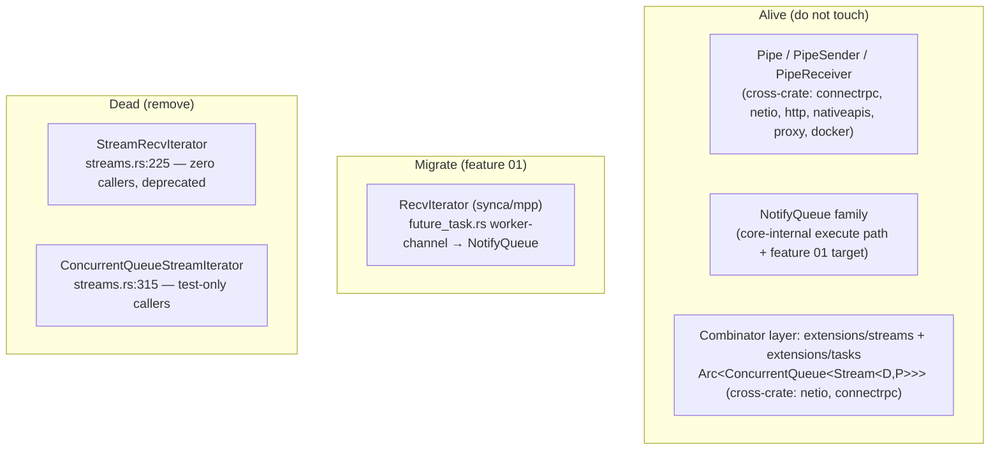

# Overview

Valtron has three generations of stream mechanics. `Pipe` (`PipeSender`/
`PipeReceiver`) is now the cross-crate streaming primitive, and the `NotifyQueue`
family (`NotifyQueueStreamIterator`/`NotifyRecvIterator`) is the core-internal
`execute()` path. Two older `ConcurrentQueue<Stream<D, P>>` iterators are dead:

- `StreamRecvIterator` — deprecated, **zero** references outside its own file.
- `ConcurrentQueueStreamIterator` — referenced only by its own doc comments and
  its tests; the executors actually use `NotifyQueueStreamIterator`.

This specification removes both, retires their tests, and fixes the stale
"default iterator" doc claims. A full cross-crate audit is recorded as the
checklist in feature 00.

It also migrates the one *live* `RecvIterator` caller — `ThreadedIterFuture`'s
worker-channel (`future_task.rs`, `multi` only) — off the `mpp` `park_timeout`
spin onto the condvar-based `NotifyQueue`/`NotifyRecvIterator` (feature 01). Same
bounded-channel + backpressure + close semantics, minus the 100 ms park latency.
`Pipe` is deliberately **not** used here: it is waker-based and cannot block a raw
thread, which is what this sync bridge needs.

This is intended to be worked on **before** `64-valtron-state-task`, as a
house-cleaning pass that shrinks the public stream surface.

# Goals

- Delete the two dead `ConcurrentQueue<Stream<D, P>>` iterators and their
  now-unused imports.
- Retire their tests; keep the combinator-layer tests that share the file.
- Correct every stale doc reference that still names the removed types.
- Confirm — with the audit — that nothing outside `foundation_core` depends on
  the removed types.
- Migrate `ThreadedIterFuture` (multi) off `mpp::RecvIterator` onto
  `NotifyQueue`/`NotifyRecvIterator`, keeping the `run_future_iter` contract.

# Implementation Location

- `backends/foundation_core/src/valtron/streams.rs` — remove `StreamRecvIterator`
  (`:225`) and `ConcurrentQueueStreamIterator` (`:315`) + imports + module docs.
- `backends/foundation_core/tests/valtron/stream_iterators.rs` — retire the
  `ConcurrentQueueStreamIterator` test section (`:755–893`).
- Stale doc comments: `sendables.rs:352,395`, `non_sendables.rs:469`,
  `config.rs`, `constants.rs`, `multi/mod.rs:1023,1042,1053,1058`,
  `foundation_netio/src/shared/http/pushable_body.rs:14`.
- `backends/foundation_core/src/valtron/executors/future_task.rs` — feature 01:
  swap `FutureIterator` (multi) + `ThreadedIterFuture::execute()` to `NotifyQueue`.

# Known Issues

- `streams.rs` is re-exported via `pub use streams::*` (`valtron/mod.rs:37`), so
  removing the two `pub struct`s is a public-API deletion. The audit shows zero
  external callers, so it is safe.
- The `concurrent_queue` crate dependency must remain (still the primitive under
  `NotifyQueue`, `worker.rs`, `buffer_pool.rs`, `synca/mpp.rs`).

# Language Stack

| Language | Purpose | Skill Location |
|----------|---------|----------------|
| Rust | dead-code removal + doc fixes | `.agents/skills/rust-valtron-usage/skill.md`, `.agents/skills/rust-valtron-iterator/skill.md` |

# Feature Index

| # | Feature | Description | Dependencies | Status |
|---|---------|-------------|--------------|--------|
| 0 | [Cleanup](./features/00-cleanup/feature.md) | Remove dead stream iterators; full cross-crate audit as checklist | None | ⬜ Pending |
| 1 | [Migrate RecvIterator](./features/01-migrate-recv-iterator/feature.md) | `ThreadedIterFuture` worker-channel: `mpp::RecvIterator` → `NotifyQueue` (condvar) | 00 | ⬜ Pending |

Status Key: ⬜ Pending | 🔄 In Progress | ✅ Complete

# Requirements Conversation Summary

- **Scope came from a cross-crate audit.** The user asked to find every
  `ConcurrentQueue<Stream<D, P>>` communicator with zero callers (or whose users
  also have zero callers), after `Pipe`/`NotifyQueue` superseded the old mechanics.
- **Audit result:** exactly two types are dead — `StreamRecvIterator` and
  `ConcurrentQueueStreamIterator`. The combinator layer (`extensions/{streams,tasks}/*`)
  also carries `Arc<ConcurrentQueue<Stream<D, P>>>` but is alive and cross-crate
  (netio, connectrpc), so it is explicitly **out of scope**.
- **Record the audit as todos.** The feature must map the full cross-crate audit
  up front and wrap each finding as a concrete task.
- **`RecvIterator` migrates, `Pipe` does not fit.** `RecvIterator`'s sole live
  caller (`ThreadedIterFuture`, multi) is a sync bridge whose consumer is a raw
  blocking thread. `NotifyQueue` is the right replacement because it is the condvar
  (thread-blocking) member of the family; `Pipe` is waker-based and has no blocking
  receive, so it cannot park a `std::thread`.
- **Detailed test/use-case review confirmed the swap.** Every consumer of
  `ThreadedIterFuture` either already tolerates `ThreadedValue::Waiting` (the
  single-threaded path emits it, and the DB backends map it to `Stream::Pending`
  or skip it) or is a `multi` test asserting the now-invalid invariant
  `Waiting => unreachable!`. Three `tests/valtron/threaded_future.rs` tests
  (`future_error`, `empty_iterator`, `backpressure`) must become tolerant and one
  deterministic `Waiting` case (a slow iterator) added. On native, `Waiting` is a
  ~1 s heartbeat (`max_spins = 100` × the 10 ms wait timeout); `close()` does not
  `notify_one`, so close is observed ≤ 10 ms — faster than the old 100 ms park.

# High-Level Architecture

- The two dead iterators sit in `streams.rs`; neither is used by the live
  combinator layer, so removal is self-contained.
- The combinator layer's `ConcurrentQueue<Stream<D, P>>` usage is a separate,
  still-live mechanism (fan-out for `split`/`broadcast`/`collect`) and is not in scope.
- `RecvIterator` is the one live leftover: `mpp` (the module) stays for
  `Broadcaster`/`Receiver`/`recv_timeout`, but its sole `ThreadedIterFuture` caller
  migrates to `NotifyQueue` in feature 01.

# Success Criteria (Spec-Wide)

1. `StreamRecvIterator` and `ConcurrentQueueStreamIterator` are gone from
   `streams.rs` and from the public `valtron` namespace.
2. `rg "ConcurrentQueueStreamIterator|StreamRecvIterator"` finds no remaining
   reference outside git history (doc comments included).
3. The `concurrent_queue` dependency and the combinator layer are untouched and
   still compile; the full `foundation_core` test suite passes.
4. `tests/valtron/stream_iterators.rs` retains its combinator tests and drops only
   the `ConcurrentQueueStreamIterator` section.
5. `ThreadedIterFuture` (multi) no longer touches `mpp::bounded`/`into_recv_iter`;
   its channel is `NotifyQueue` and handoff is condvar-driven.
6. `tests/valtron/threaded_future.rs` has no `Waiting => unreachable!` arms: the
   three formerly-intolerant tests are tolerant, and a deterministic `Waiting`
   case passes.

# Out of Scope

- Migrating the combinator layer (`extensions/{streams,tasks}/*`) from
  `ConcurrentQueue` to `NotifyQueue`/`Pipe`. It is alive and cross-crate; a
  migration is a separate spec if ever wanted.
- Removing `RecvIterator`/`mpp` (`synca/mpp.rs`) entirely — the module stays for
  `Broadcaster`/`Receiver`/`recv_timeout`; only `ThreadedIterFuture` migrates
  (feature 01).
- Any change to `Pipe` or the `NotifyQueue` family.

# Module References

- `backends/foundation_core/src/valtron/streams.rs` — the two dead types
- `backends/foundation_core/src/valtron/extensions/{streams,tasks}/{sendable,non_sendable}.rs` — live combinator layer (out of scope)
- `backends/foundation_core/src/valtron/executors/local.rs` — `NotifyQueue*` (live replacement; feature 01 target)
- `backends/foundation_core/src/valtron/executors/future_task.rs` — `ThreadedIterFuture` (feature 01)
- `backends/foundation_core/src/valtron/pipe.rs` — `Pipe` (cross-crate replacement)
- `backends/foundation_netio/src/shared/http/pushable_body.rs` — stale doc reference
- `backends/foundation_core/src/valtron/mod.rs:37` — `pub use streams::*`

---

_Created: 2026-10-18_
_Last Updated: 2026-10-18_
_Structure: Feature-based (has_features: true)_
