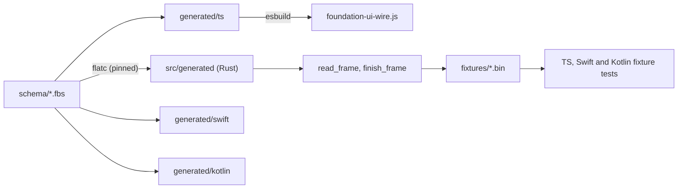

# Feature 01: The wire schema and the generated code

_Written in ASD-STE100 Simplified Technical English (STE). Code and identifiers stay as they
are._

**Abbreviations in this file.** user interface (UI); TypeScript (TS); JavaScript (JS);
continuous integration (CI); identifier (id); inter-process communication (IPC); AeroSpace and
Defence Industries Association of Europe (ASD), the owner of the STE standard ASD-STE100.

## 1. Goal

A new crate, `backends/foundation_ui_wire`, holds the one FlatBuffers schema of the UI wire.
A pinned `flatc` generates Rust, TS, Swift and Kotlin code from it, and the generated code is
checked in. The crate gives a verified reader for the one root `Frame` and for
`SignedState`, with one `WireLimits` config.
No other feature writes a schema type by hand.

## 2. Story

- **S1**: "A developer changes the schema and generates the code for four languages with one
  command."
- **S2**: "A Rust program reads a frame that came from the network."
- **S3**: "A developer changes the schema and forgets to generate the code."
- **S4**: "A program receives bytes that are not a valid frame."
- **S5**: "A program receives a frame that is larger than the limit."
- **S6**: "An old reader receives a union member that it does not know."

| # | Use case | Actor | Trigger | Result |
|---|---|---|---|---|
| U1 | Generate | Developer | `mise run ui-wire:generate` | The four `generated/` trees match the schema |
| U2 | Read a frame | Any Rust caller | `read_frame(bytes, &limits)` | A borrowed `Frame` view, or a `WireError` |
| U3 | Drift check | CI | `mise run ui-wire:check` | Fails when generated code differs from the schema |
| U4 | Reject bad bytes | Any Rust caller | `read_frame` on bad bytes | `WireError::Invalid` |
| U5 | Reject a large frame | Any Rust caller | `read_frame` on a frame above the limit | `WireError::TooLarge` |
| U6 | Unknown union member | Old reader | A frame with a new member | The member reads as `NONE`; the reader does not fail |
| U7 | Read the wrong kind | Any Rust caller | `expect_kind` on a frame of the other kind | `WireError::WrongKind`; no field of the other kind is read (D47) |

## 3. Bounded context

**Inside this feature:** the `.fbs` files; the generated code; `WireLimits`; `WireError`; the
read functions; the root identifier; the alignment helper; the fixture files.

**Outside:**

| Thing | Owner |
|---|---|
| Meaning of `NodeKind`, `PropId`, `EventId` values; which platform a form belongs to | Feature 02 |
| Building a frame from messages; the columnar encoding | Feature 03 |
| The MAC input and the keys of `SignedState` | Feature 04 |
| The `flatbuffers` Rust crate and `flatc` | Google FlatBuffers project |

| Entity | Meaning | Owner (the one writer) |
|---|---|---|
| Schema | The `.fbs` files under `schema/` | A person, by a reviewed change |
| Generated code | The files under `src/generated/` and `generated/` | `scripts/ui_wire/generate.sh` only |
| `WireLimits` | The size and depth caps for a read | The caller that builds it |
| Fixture | A recorded frame file under `fixtures/` | `tests/fixtures_tests.rs` with `UPDATE_FIXTURES=1` |

| Verb | Kind | Trigger | Effect |
|---|---|---|---|
| generate | entity | Developer or CI | Replaces the four generated trees |
| read | entity | Caller | Verifies bytes and returns a view. Changes nothing |
| check drift | entity | CI | Generates into a temporary directory and compares |

**Words.** "Schema" is the `.fbs` text. "Generated code" is `flatc` output. "View" is a
borrowed reader over received bytes. "Object type" is an owned Rust struct that `flatc`
generates with `--gen-object-api` (its name ends in `T`, for example `MessageT`).

## 4. Rules

### 4.1 Law worksheets

```
Entity: Schema
Conserved value:         the number and meaning of every field id and enum value already released
Bound:                   schema_version is a u16
Inverse pairs:           none
Idempotent verbs:        generate (a second run changes no file)
Ordering pairs:          a schema change comes before generate
Monotone values:         enum values and union members only grow; schema_version only grows
Freeze points:           a released field, enum value or union member never changes its number
Links to other entities: generated code must equal flatc(schema)
```

```
Entity: Generated code
Conserved value:         none
Bound:                   none
Inverse pairs:           none
Idempotent verbs:        generate
Ordering pairs:          none
Monotone values:         none
Freeze points:           none
Links to other entities: equals flatc(schema) for the pinned flatc version
```

```
Entity: WireLimits
Conserved value:         none
Bound:                   every field is greater than zero
Inverse pairs:           none
Idempotent verbs:        the builder setters
Ordering pairs:          none
Monotone values:         none
Freeze points:           none
Links to other entities: none
```

### 4.2 Invariants

| # | Invariant |
|---|---|
| I1 | The checked-in generated code equals the output of the pinned `flatc` on the checked-in schema. |
| I2 | For every valid object value `v` of the root `Frame` and of `SignedState`, `read(write(v))` unpacks to a value equal to `v`. |
| I3 | A read never returns a view over bytes that the FlatBuffers verifier rejected. |
| I4 | A read never accepts a buffer longer than its limit. |
| I5 | A read never panics, for any input bytes. |
| I6 | Every numeric vector with `force_align: 8` that the Rust alignment helper writes starts at an offset that is a multiple of 8 from the start of the finished buffer. |
| I7 | A buffer whose union field holds a member number that the reader does not know reads that field as `NONE`. |
| I8 | The Rust, TS, Swift and Kotlin readers return the same field values for one fixture file. (This feature proves Rust and TS. Features 14 and 15 prove Swift and Kotlin with the same files.) |
| I9 | One frame that is not the kind of its reader is rejected with `WrongKind`; no side reads the fields of the other kind (D47). |

### 4.3 Must have

- The schema files of section 6.2, with the exact field order, and one root (D47).
- The `flatc` pin of feature 17, which this feature consumes (D57, D58).
- Generated Rust in `src/generated/`, TS in `generated/ts/`, Swift in `generated/swift/`,
  Kotlin in `generated/kotlin/`.
- `WireLimits` with the four defaults of `requirements.md` section 5.6.
- Fixture files under `fixtures/` (section 6.7).

### 4.4 Must do

- Verify every buffer before it gives a view.
- Check the length against the limit before the verifier runs.
- Check the 4-byte file identifier of the root before any other read step.
- Fail CI when the generated code differs from the schema.

### 4.5 Must not

- Do not edit a generated file by hand.
- Do not reuse or renumber a field id, an enum value or a union member.
- Do not add a field that holds code, markup or an expression to a form that a `Native`
  mount can receive (research 11 section 3.1). `HtmlMorph` and `ScriptNode` are the only
  forms that hold markup or script, and feature 02 marks them web only.
- Do not use `planus`. It generates Rust only (D7).
- Do not use `get_root_unchecked` or another unchecked read on bytes from outside the process.

## 5. Acceptance scenarios

```gherkin
Feature: Wire schema and generated code

  Scenario: A frame round trip keeps every field
    Given a FrameT with stream_id 7, sequence_id 20 and kind FrameMessage{ack 5,
      messages [one MessageT whose operation holds a SetText for node 42 with text "1"]}
    When the caller packs it with finish_frame and reads it with read_frame
    Then the read succeeds
    And the unpacked value equals the original FrameT

  Scenario: A request frame round trips through the same root
    Given a FrameT with stream_id 0, sequence_id 5 and kind FrameRequest{action
      ActionRequestT{action "server:add_todo", node_id 42}}
    When the caller packs it with finish_frame and reads it with read_frame
    Then the read succeeds
    And the kind is FrameRequest and the action name is "server:add_todo"

  Scenario: A frame of the wrong kind is rejected by its reader
    Given a valid FrameT whose kind is FrameRequest
    When the dispatcher reads it and asks for a message
    Then the call fails with WireError::WrongKind { expected: "message", found: "request" }

  Scenario: Bytes with the wrong identifier are rejected
    Given the bytes of a valid SignedState buffer
    When the caller calls read_frame on them with default limits
    Then the call fails with WireError::WrongIdentifier { expected: "EWF1", found: "EWS1" }

  Scenario: Random bytes are rejected
    Given 64 bytes of value 0xFF
    When the caller calls read_frame on them with default limits
    Then the call fails with WireError::Invalid

  Scenario: A frame above the limit is rejected before it is verified
    Given a valid frame of 2048 bytes
    And WireLimits with max_frame_bytes 1024
    When the caller calls read_frame
    Then the call fails with WireError::TooLarge { limit: 1024, actual: 2048 }

  Scenario: An unknown union member reads as NONE
    Given the fixture "frame_unknown_op.bin", whose UiOperation type byte is 250
    When the caller calls read_frame on it with default limits
    Then the read succeeds
    And the operation's ui_type() equals UiOperation::NONE
    And the other fields of the unit are read as usual

  Scenario: Aligned columns start on an 8-byte boundary
    Given a ColumnarBatch with 3 rows written with the alignment helper
    When the caller finishes the frame and reads the node_ids vector
    Then the offset of the first node id from the start of the buffer is a multiple of 8

  Scenario: The TS reader reads the Rust fixture
    Given the fixture "frame_ops_counter.bin" written by the Rust test
    When the TS test reads it with the generated TS reader
    Then stream_id is 7, sequence_id is 20 and the first op is SetText for node 42 with text "1"

  Scenario: Stale generated code fails the check
    Given a schema file with one more field than the generated code has
    When the developer runs "mise run ui-wire:check"
    Then the command exits with a non-zero status
    And the output names the first file that differs
```

## 6. Technical breakdown



_The diagram shows that one schema gives the code of four languages, and that one set of
fixture files proves that they read the same bytes._

### 6.1 Measured facts

| Fact | Source |
|---|---|
| No crate in the workspace uses `flatbuffers` directly | `grep -rn flatbuffers Cargo.toml backends/*/Cargo.toml` gives no direct dependency (2026-11-13) |
| Tools are pinned in `mise.toml` `[tools]`; `mise.lock` records the URL and the hash | `mise.toml:60-90` |
| `protoc = "36.2"` and `"github:wasm-bindgen/wasm-bindgen"` show the two pin styles (registry name, and `github:owner/repo`) | `mise.toml:72`, `:80` |
| The JS runtime is one ES module per file, with no bundler step at run time, and is embedded with `include_str!` | `backends/foundation_wasm_ui/src/embedded.rs:15` |
| A vendored, bundled third-party JS file is already checked in | `backends/foundation_wasm_ui/runtimes/apache-arrow.js` |
| JS tests use `node --test` with no dependencies | `backends/foundation_wasm_ui/integration/package.json` |
| A FlatBuffers reader returns `NONE` for a union type value it does not know, and the Rust verifier accepts it | FlatBuffers documentation, "Schema evolution" and "Unions" |
| FlatBuffers aligns a scalar vector to the size of its element. `force_align` on a vector asks for more; the documentation says that this attribute on a vector is honoured by the C++ generator and does not promise other languages | FlatBuffers documentation, "Writing a schema", attribute `force_align` |

The last fact is why I6 uses a Rust helper (refinement R8). Only Rust writes frames with
numeric columns. TS, Swift and Kotlin read the same frames but write no numeric vector, so
one helper in one language makes D24 true.

### 6.2 The schema

Create six files in `backends/foundation_ui_wire/schema/`. Keep the field order exactly.
A field that is new later goes at the end of its table.

**`common.fbs`**

```flatbuffers
namespace ewe.ui;

enum Platform : ubyte { Unknown = 0, Web = 1, Ios = 2, Android = 3, Desktop = 4 }
enum MountSurface : ubyte { Native = 0, Web = 1 }

// Vocabulary enums. 0 is always UNKNOWN. Append only. Feature 02 owns the meaning.
enum NodeKind : ushort { UNKNOWN = 0, STACK = 1, TEXT = 2, IMAGE = 3, BUTTON = 4,
  TEXT_INPUT = 5, TOGGLE = 6, LIST = 7, SCROLL = 8, SPACER = 9, OVERLAY = 10 }
enum PropId : ushort { UNKNOWN = 0, PADDING = 1, SPACING = 2, ALIGN = 3, COLOR = 4,
  FONT = 5, ENABLED = 6, A11Y_LABEL = 7, AXIS = 8, VALUE = 9, CHECKED = 10, SOURCE = 11,
  PLACEHOLDER = 12, BACKGROUND = 13, WIDTH = 14, HEIGHT = 15, HIDDEN = 16 }
enum EventId : ushort { UNKNOWN = 0, TAP = 1, CHANGE = 2, SUBMIT = 3, FOCUS = 4, BLUR = 5 }

// Behaviour enums (D56). 0 is always UNKNOWN. Append only. Feature 02 owns the meaning.
enum BehaviourId : ushort { UNKNOWN = 0, DIALOG = 1, DISMISS = 2, SCROLL_LOCK = 3,
  TRANSITION = 4 }
enum WebBehaviourId : ushort { UNKNOWN = 0 }
enum MobileBehaviourId : ushort { UNKNOWN = 0 }

enum LengthUnit : ubyte { Point = 0, Percent = 1, Auto = 2 }
enum Alignment : ubyte { Start = 0, Center = 1, End = 2, Stretch = 3 }
enum Axis : ubyte { Vertical = 0, Horizontal = 1 }

struct Length { value: float; unit: LengthUnit; }
table LengthValue { v: Length; }
table ColorToken { id: uint; }
table FontToken { id: uint; }
table AlignmentValue { v: Alignment; }
table AxisValue { v: Axis; }
table BoolValue { v: bool; }
table TextValue { v: string; }
union PropValue { Length: LengthValue, ColorToken, FontToken, Alignment: AlignmentValue,
  Axis: AxisValue, Bool: BoolValue, Text: TextValue }
```

**`state.fbs`**

```flatbuffers
namespace ewe.ui;

// flags bit 0: the body is encrypted (private state). Other bits are 0.
table SignedState {
  format_version: ushort;
  flags: ubyte;
  key_id: uint;
  issued_at: ulong;          // seconds since the Unix epoch
  expires_at: ulong;         // seconds since the Unix epoch
  component_type: uint;
  root_node: uint;
  session_binding: [ubyte];  // 32 bytes, or empty before the state is sealed
  body: [ubyte];
  tag: [ubyte];              // 32 bytes, or empty before the state is sealed
}
root_type SignedState;
file_identifier "EWS1";
```

**`ops.fbs`**

```flatbuffers
include "common.fbs";
namespace ewe.ui;

// ---- shared forms: every runtime applies these (D59) ----
table CreateNode { node_id: uint; kind: NodeKind; }
table SetText { node_id: uint; text: string; }
table SetProp { node_id: uint; prop: PropId; value: PropValue; }
table AppendChild { parent_id: uint; child_id: uint; }
table InsertBefore { parent_id: uint; child_id: uint; before_id: uint; }
table Remove { node_id: uint; }
table BindAction { node_id: uint; event: EventId; action: string; }
table UnbindAction { node_id: uint; event: EventId; }
table AttachState { root_node: uint; state: [ubyte]; }   // state: an EWS1 buffer

enum LiveKind : ubyte { Stream = 0, Data = 1 }
enum LiveTransport : ubyte { Local = 0, Sse = 1, WebSocket = 2, Http = 3 }
table LiveMount { node_id: uint; kind: LiveKind; channel_id: ulong;
  transport: LiveTransport; endpoint: string; resume_from: ulong; }

table BehaviourArg { name: string; value: PropValue; }
table UiBehaviour { node_id: uint; behaviour: BehaviourId; args: [BehaviourArg]; }

union UiOperation {
  CreateNode, SetText, SetProp, AppendChild, InsertBefore, Remove, ReplaceSubtree,
  BindAction, UnbindAction, AttachState, LiveMount, UiBehaviour
}

// ---- web forms (D53) ----
enum SelectorKind : ubyte { NodeId = 0, Id = 1, Class = 2, Query = 3 }
enum MorphAction : ubyte { ReplaceChildren = 0, ReplaceElement = 1, InsertBefore = 2,
  InsertAfter = 3, AppendSibling = 4 }
table TargetSelector { kind: SelectorKind; node_id: uint; text: string; }
table HtmlMorph { target: TargetSelector; action: MorphAction; content: string; }
table ScriptNode { node_id: uint; parent_id: uint; body: string; }
// tag_id / attr_id / name_id: 0 means "use the custom string". Feature 02 owns the tables.
table WebElement { node_id: uint; tag_id: ushort; custom_tag: string; class_name: string; }
table WebText { node_id: uint; content: string; }
table WebSetAttribute { node_id: uint; attr_id: ushort; custom_attr: string; value: string; }
table WebRemoveAttribute { node_id: uint; attr_id: ushort; custom_attr: string; }
table WebProperty { node_id: uint; name_id: ushort; custom_name: string; value: string; }
table WebStyle { node_id: uint; name_id: ushort; custom_name: string; value: string; }
table WebAddClass { node_id: uint; class_name: string; }
table WebRemoveClass { node_id: uint; class_name: string; }
table WebAddListener { node_id: uint; name_id: ushort; custom_name: string; }
table WebRemoveListener { node_id: uint; name_id: ushort; custom_name: string; }
table WebRegisterNode { node_id: uint; }
table WebUnregisterNode { node_id: uint; }
table WebReplaceNode { old_id: uint; new_id: uint; }
table WebBehaviour { node_id: uint; behaviour: WebBehaviourId; custom: string;
  args: [BehaviourArg]; }

union WebOperation {
  WebElement, WebText, WebSetAttribute, WebRemoveAttribute, WebProperty,
  WebAddListener, WebRemoveListener, WebReplaceNode, WebStyle, WebAddClass,
  WebRemoveClass, HtmlMorph, WebRegisterNode, WebUnregisterNode, ScriptNode,
  WebBehaviour
}

// ---- mobile forms ----
enum NativeCommandId : ushort { UNKNOWN = 0, HAPTIC = 1, OPEN_URL = 2, SHARE = 3 }
// NativeArg is a command argument. A behaviour argument is a BehaviourArg (D56).
table NativeArg { name: string; value: PropValue; }
// The node must exist; a missing node follows the reader's UnknownNode rule. The store
// records the row and builds no control. Feature 18 builds the control (D46).
table MountWebView { node_id: uint; parent_id: uint; url: string; }
table NativeCommand { command: NativeCommandId; args: [NativeArg]; }
table MobileBehaviour { node_id: uint; behaviour: MobileBehaviourId; custom: string;
  args: [BehaviourArg]; }

union MobileOperation { MountWebView, NativeCommand, MobileBehaviour }

// ---- columnar form of the shared operations (D27, D41) ----
// Column i of every vector is row i. op_codes holds the UiOperation union number.
table ColumnarBatch {
  op_codes:  [ubyte];
  node_ids:  [uint] (force_align: 8);
  arg_a:     [uint] (force_align: 8);
  arg_b:     [uint] (force_align: 8);
  blob_a_off:[uint] (force_align: 8);    // rows + 1 offsets into blob_bytes
  blob_b_off:[uint] (force_align: 8);    // rows + 1 offsets into blob_bytes
  blob_bytes:[ubyte];                    // every string and byte block, written once
}

// A subtree swap carries operations of any group, in order.
table ReplaceSubtree { node_id: uint; operations: [Operation]; }

// ---- the one unit of a frame (D42, D44, D45) ----
// A unit normally sets one field. `web` and `mobile` may both be set: the same step, done
// one way on the web and another way on mobile. A reader applies the fields that it cares
// about and ignores the others.
table Operation {
  ui: UiOperation;
  web: WebOperation;
  mobile: MobileOperation;
  columnar: ColumnarBatch;
}
```

Each union has its own number space, and the member order is the wire number. A test in
section 7 asserts the order of each union against the generated code. A member is frozen
when a feature releases; a new member is appended.

`--gen-object-api` names the mutable type of a table with a `T` suffix and the mutable type
of a union with the union name. The features use `OperationT`, `UiOperationT`,
`WebOperationT` and `MobileOperationT` throughout, and never a hand-written twin.

**`frame.fbs`**

```flatbuffers
include "common.fbs";
include "ops.fbs";
include "action.fbs";
include "hello.fbs";
namespace ewe.ui;

// ---- data for the app's own code (D45) ----
table I32s { values: [int] (force_align: 8); }
table I64s { values: [long] (force_align: 8); }
table F64s { values: [double] (force_align: 8); }
table Bools { values: [bool]; }
table Strings { values: [string]; }
union ColumnData { I32: I32s, I64: I64s, F64: F64s, Bool: Bools, Utf8: Strings }
table Column { name: string; data: ColumnData; validity: [ubyte]; }
table DataTable { target_node: uint; rows: ulong; columns: [Column]; }

table ArrowIpcBlob { target_node: uint; bytes: [ubyte] (force_align: 8); }
table MessagePackBlob { target_node: uint; bytes: [ubyte]; }

table Data { target_node: uint; arrow: ArrowIpcBlob; table: DataTable;
  msgpack: MessagePackBlob; }

// ---- control messages about the connection or the request (D45, D54) ----
enum CapsStatus : ubyte { Ok = 0, UpdateRequired = 1 }
table ServerAction { hash: ulong; name: string; }   // hash: first 8 bytes of SHA-256, big-endian
table ServerCaps { status: CapsStatus; schema_version: ushort; vocabulary_version: uint;
  stream_id: ulong; resume_from: ulong; actions: [ServerAction]; }

enum ErrorCode : ushort { Unknown = 0, BadRequest = 1, UnknownAction = 2,
  UnavailableOrigin = 3, UnsupportedAction = 4, StateRejected = 5, StateExpired = 6,
  RateLimited = 7, ActionFailed = 8, UpdateRequired = 9, UnsupportedPlatformOp = 10 }
// StateExpired and UpdateRequired are host-facing codes only. On the wire the control
// members `state_expired` and `update_required` carry them (D43, D45). The platform host
// reports both through its own error callback, with these codes.
table ActionError { code: ErrorCode; message: string; row_index: uint; }
table StateExpired { token_issued_at: ulong; }      // the client reloads its state
table UpdateRequired { client_schema_version: ushort; server_schema_version: ushort; }
table Control { caps: ServerCaps; state_expired: StateExpired;
  update_required: UpdateRequired; error: ActionError; }

// ---- the one unit and the one list (D41, D44, D45) ----
table Message { operation: Operation; data: Data; control: Control; }

// ---- the one frame, in its two kinds (D47) ----
// A message goes from the logic to a client. `ack` is the sequence_id of the request that
// this answers, and 0 for a push.
table FrameMessage {
  ack: ulong;
  messages: [Message];     // the list order is the apply order
}

// A request goes from a client to the logic. One field is set: `action` for a call, `hello`
// for a hello. A hello asks for a stream, so its `Frame.stream_id` is 0.
table FrameRequest {
  action: ActionRequest;
  hello: ClientHello;
}

union FrameKind { FrameRequest, FrameMessage }

// The one root. The identifier says that the buffer is ours; `kind` says what it is (D47).
// `stream_id` is 0 only on a hello that asks for a new stream.
table Frame {
  schema_version: ushort;
  stream_id: ulong;
  sequence_id: ulong;      // strictly increasing for one stream_id
  kind: FrameKind;
}
root_type Frame;
file_identifier "EWF1";
```

`Column.name` is a string in version 1. The research proposed an interned `name_id`. An
intern table for column names needs a registry that no feature owns, so version 1 sends the
name. A later field `name_id` can be added at the end of `Column`.

**`action.fbs`** and **`hello.fbs`**

```flatbuffers
// action.fbs
include "common.fbs";
namespace ewe.ui;
// modifiers bits: 1 alt, 2 ctrl, 4 shift, 8 meta.
table ActionInput { event_name: string; value: string; checked: bool; key_code: uint;
  modifiers: ubyte; parent_node: uint; }
// The frame holds the schema version, the stream and the sequence, so this table does not
// repeat them (D47). `state` is the signed state of the component root (an EWS1 buffer), or
// empty.
table ActionRequest {
  action: string;          // "server:name"
  node_id: uint;
  input: ActionInput;
  state: [ubyte];
}
```

```flatbuffers
// hello.fbs
include "common.fbs";
namespace ewe.ui;
// The frame holds the schema version and the stream (D47). `stream_id` 0 on the frame asks
// for a new stream; the server answers with the assigned id in the caps message.
table ClientHello {
  vocabulary_version: uint;
  platform: Platform;
  mount: MountSurface;
  resume_from: ulong;              // last sequence_id applied; 0 for none
}
```

`frame.fbs` has the root `Frame` with `file_identifier "EWF1"`, and `state.fbs` has the root
`SignedState` with `file_identifier "EWS1"`: a signed state travels as its own buffer, so it
needs its own root and its own identifier. The other four files declare tables and unions
only. The generated module has two root readers, `read_frame` and `read_signed_state`, and
each one checks its own identifier (D47).

The two `state` fields are plain `[ubyte]` vectors, not `nested_flatbuffer` vectors. A
`nested_flatbuffer` makes the frame verifier decode the state bytes, which are attacker data;
feature 04 checks the tag before it opens the state. The writer and the reader call
`read_signed_state` on those bytes, at the ordered point that each one owns.

`SCHEMA_VERSION` is `1`. It changes only on a breaking change.

### 6.3 `flatc` pin and the generate script

1. **`flatc` comes from feature 17.** Do not add a pin here. Feature 17
   (`toolchain-and-ci`) holds `"github:google/flatbuffers" = "25.9.23"` in the root
   `mise.toml` and in `ci/platform-images/mise/mise.toml`, with the lock entry for four
   platforms. Before you run the script, run `scripts/toolchain/check.sh`; `mise which flatc`
   must resolve and `flatc --version` must print `25.9.23`. The version is 25.9.23 because
   the `flatbuffers` npm runtime stops there and the generated TypeScript imports that
   runtime (D57, feature 17 invariant I7). If the check fails, stop: it is a setup error,
   not a code error.
2. Add `flatbuffers = "<same version>"` to the root `[workspace.dependencies]`. The crate
   version and the `flatc` version must be the same release; generated Rust checks this at
   compile time.
3. Create `scripts/ui_wire/generate.sh`:

```bash
#!/usr/bin/env bash
# Generates the wire code for four languages. Usage: generate.sh [output-root]
set -euo pipefail
root="$(git rev-parse --show-toplevel)"
crate="$root/backends/foundation_ui_wire"
out="${1:-$crate}"
schema=("$crate"/schema/common.fbs "$crate"/schema/state.fbs "$crate"/schema/ops.fbs \
        "$crate"/schema/frame.fbs "$crate"/schema/action.fbs "$crate"/schema/hello.fbs)
rm -rf "$out/src/generated" "$out/generated"
mkdir -p "$out/src/generated" "$out/generated/ts" "$out/generated/swift" "$out/generated/kotlin"
flatc --rust --gen-object-api --rust-module-root-file --filename-suffix "" \
      -o "$out/src/generated" "${schema[@]}"
flatc --ts --gen-object-api -o "$out/generated/ts" "${schema[@]}"
flatc --swift -o "$out/generated/swift" "${schema[@]}"
flatc --kotlin -o "$out/generated/kotlin" "${schema[@]}"
```

`--rust-module-root-file` writes one file per type under the namespace path
(`generated/ewe/ui/…`) plus one `mod.rs` at the output root. All six schema files go in the
same invocation, so one `mod.rs` lists every module. Each file must put its `include` lines
before its `namespace` line; `flatc` stops with "includes must come before declarations"
otherwise.

4. Create `scripts/ui_wire/check.sh`: it runs `generate.sh "$tmp"` into a temporary
   directory, then `diff -r "$tmp/src/generated" "$crate/src/generated"` and
   `diff -r "$tmp/generated" "$crate/generated"`. It exits with status 1 and prints the first
   differing file when the trees differ. It removes the temporary directory on exit.
5. Add two tasks to `mise.toml`: `ui-wire:generate` runs `generate.sh`; `ui-wire:check` runs
   `check.sh`.
6. Add a step to the Linux job of `.github/workflows/check.yaml` that runs
   `mise run ui-wire:check` when `backends/foundation_ui_wire/**` or `scripts/ui_wire/**`
   changed. Follow the existing path filters of that workflow and rule 16 (no new job; one
   step in the existing lint job).

If a `flatc` flag in step 3 does not exist in the pinned version, run `flatc --help`, use the
flag with the same effect, and record the change in `learnings.md`.

### 6.4 The TS bundle

The web runtime loads plain ES modules. `flatc` gives TS that imports the `flatbuffers` npm
package.

1. Add `backends/foundation_ui_wire/generated/ts/package.json` with `flatbuffers` (the same
   version as `flatc`) and `esbuild` as `devDependencies`. Add the directory to
   `pnpm-workspace.yaml` packages.
2. Add `scripts/ui_wire/bundle.sh`: it runs
   `pnpm --dir backends/foundation_ui_wire/generated/ts exec esbuild index.ts --bundle
   --format=esm --target=es2022 --outfile=../../../foundation_wasm_ui/runtimes/foundation-ui-wire.js`.
   `index.ts` is a hand-written file in `generated/ts/` that exports every generated module
   and the `flatbuffers` `ByteBuffer` and `Builder`. `generate.sh` must not delete it: keep
   it in `backends/foundation_ui_wire/ts/index.ts` and copy it in after generation.
3. `generate.sh` calls `bundle.sh` as its last step. The bundle
   `backends/foundation_wasm_ui/runtimes/foundation-ui-wire.js` is checked in, and `check.sh`
   also compares it.
4. Add `pub const FOUNDATION_UI_WIRE_JS: &str = include_str!("../runtimes/foundation-ui-wire.js");`
   to `backends/foundation_wasm_ui/src/embedded.rs`, beside the other assets.

### 6.5 The crate

```
backends/foundation_ui_wire/
├── Cargo.toml
├── schema/{common,state,ops,frame,action,hello}.fbs
├── ts/index.ts                 hand-written re-export file (section 6.4)
├── src/
│   ├── lib.rs                  re-exports; SCHEMA_VERSION; FRAME_IDENTIFIER; STATE_IDENTIFIER
│   ├── generated/              flatc output (never edited)
│   ├── limits.rs               WireLimits
│   ├── error.rs                WireError, FrameKindName
│   ├── read.rs                 read_frame, read_signed_state, frame_kind, expect_kind
│   ├── finish.rs               finish_frame, finish_signed_state
│   ├── error_ext.rs            Display and core::error::Error for ActionErrorT
│   └── align.rs                Aligned8 and create_aligned_vector
├── generated/{ts,swift,kotlin}/
├── fixtures/*.bin
└── tests/{mod.rs,roundtrip_tests.rs,read_tests.rs,align_tests.rs,union_numbers_tests.rs,fixtures_tests.rs,error_ext_tests.rs}
    ts/fixtures.test.mjs
```

`Cargo.toml`: `name = "foundation_ui_wire"`, `version = "0.0.1"`, workspace keys as in
`backends/foundation_ui_traits/Cargo.toml`, `[dependencies] flatbuffers = { workspace = true }`,
`[lints] workspace = true`. The crate is `no_std` with `alloc` when its default feature
`std` is off: `flatbuffers = { workspace = true, default-features = false }`,
`[features] default = ["std"]`, `std = ["flatbuffers/std"]`, `#![cfg_attr(not(feature =
"std"), no_std)]`, `extern crate alloc;`. Use `alloc::{vec::Vec, string::String}` in the
hand-written modules, and put `impl std::error::Error` behind `#[cfg(feature = "std")]`.
`foundation_wasm_ui` is a `no_std` crate and uses this crate from feature 11. The generated module gets
`#[allow(clippy::all, clippy::pedantic, unused_imports, dead_code, non_snake_case)]` at its
`mod` line, with a comment that says the code is generated. This is the one permitted
`#[allow]` (AGENTS "Crate Hygiene").

**Public API**

```rust
pub const SCHEMA_VERSION: u16 = 1;
pub const FRAME_IDENTIFIER: &str = "EWF1";
pub const STATE_IDENTIFIER: &str = "EWS1";

/// Size and depth caps for one read. Defaults: see requirements.md section 5.6.
#[derive(Clone, Copy, Debug, PartialEq, Eq)]
pub struct WireLimits {
    max_frame_bytes: usize,          // default 4 * 1024 * 1024
    /// Applies to a frame whose kind is `FrameRequest` with `action` set. The check runs
    /// after the `max_frame_bytes` check and after the verifier, because the kind comes
    /// from a verified buffer.
    max_action_request_bytes: usize, // default 1024 * 1024
    max_depth: usize,                // default 64
    max_tables: usize,               // default 1_000_000
}
impl Default for WireLimits { /* the defaults above */ }
impl WireLimits {
    #[must_use] pub fn max_frame_bytes(self, n: usize) -> Self;
    #[must_use] pub fn max_action_request_bytes(self, n: usize) -> Self;
    #[must_use] pub fn max_depth(self, n: usize) -> Self;
    #[must_use] pub fn max_tables(self, n: usize) -> Self;
    #[must_use] pub fn frame_bytes(&self) -> usize;          // getters for each field
    #[must_use] pub fn action_request_bytes(&self) -> usize;
    #[must_use] pub fn depth(&self) -> usize;
    #[must_use] pub fn tables(&self) -> usize;
}

/// The two members of `FrameKind`, named for the side that reads the frame (D47).
#[derive(Clone, Copy, Debug, PartialEq, Eq)]
pub enum FrameKindName { Request, Message }
impl FrameKindName {
    /// "request" or "message". `WireError::Display` uses it.
    #[must_use] pub fn as_str(self) -> &'static str;
}

#[derive(Debug, Clone, PartialEq, Eq)]
pub enum WireError {
    /// The buffer is longer than the limit. Checked before the verifier runs.
    TooLarge { limit: usize, actual: usize },
    /// The buffer is shorter than 8 bytes, so it has no identifier.
    TooShort { actual: usize },
    /// The 4 bytes at offset 4 are not `FRAME_IDENTIFIER`.
    WrongIdentifier { expected: &'static str, found: [u8; 4] },
    /// The root `kind` is `FrameKind::NONE`.
    NoKind,
    /// The frame holds the other kind for this side (D47).
    WrongKind { expected: FrameKindName, found: FrameKindName },
    /// The FlatBuffers verifier rejected the buffer. `detail` is its message.
    Invalid { detail: String },
}
impl core::fmt::Display for WireError { /* one sentence for each case */ }
impl std::error::Error for WireError {}

pub fn read_frame<'a>(bytes: &'a [u8], limits: &WireLimits) -> Result<Frame<'a>, WireError>;
/// Reads one `SignedState` buffer. Checks `STATE_IDENTIFIER` in place of `FRAME_IDENTIFIER`
/// and applies the other read steps of section 6.5, with `max_action_request_bytes` as the
/// size cap.
pub fn read_signed_state<'a>(bytes: &'a [u8], limits: &WireLimits)
    -> Result<SignedState<'a>, WireError>;

/// The kind of a read frame, or `None` when the root holds no kind.
#[must_use] pub fn frame_kind(frame: &FrameT) -> Option<FrameKindName>;
/// The typed check for one side. `None` gives `NoKind`; the other kind gives `WrongKind`.
pub fn expect_kind(frame: &FrameT, expected: FrameKindName) -> Result<(), WireError>;

/// Packs an owned value and finishes the buffer with `FRAME_IDENTIFIER`. A frame with no
/// kind gives `WireError::NoKind`; write the kind first.
pub fn finish_frame(frame: &FrameT) -> Result<Vec<u8>, WireError>;
/// Packs one state and finishes the buffer with `STATE_IDENTIFIER`.
#[must_use] pub fn finish_signed_state(state: &SignedStateT) -> Vec<u8>;

// error_ext.rs ----------------------------------------------------------
// The action result is `Result<(), ErrorTrace<ActionErrorT>>` (D52), and `ErrorTrace::new`
// requires `C: core::error::Error`. The wire crate adds the two impls to its own generated
// type; no hand-written twin is made (rule 5).
impl core::fmt::Display for ActionErrorT { /* "<code>: <message>", or the code name */ }
impl core::error::Error for ActionErrorT {}
```

`ActionErrorT::message` is `Option<String>`. `Display` writes the code name and the message
when it is set. `core::error::Error` is in `core`, so the impl needs no `std` feature. The
action crates use `ActionErrorT` as the context type of `ErrorTrace` and do not define their
own error type.

**Read steps, in this order.**

1. `bytes.len() > max_frame_bytes` gives `TooLarge`. The check runs before the verifier.
2. `bytes.len() < 8` gives `TooShort`.
3. `bytes[4..8] != FRAME_IDENTIFIER` gives `WrongIdentifier`.
4. Build `flatbuffers::VerifierOptions { max_depth, max_tables, ..Default::default() }` and
   call `flatbuffers::root_with_opts::<Frame>(&opts, bytes)`. An error gives `Invalid` with
   the error text.
5. `kind` of `NONE` gives `NoKind`.
6. A `FrameRequest` with `action` set and `bytes.len() > max_action_request_bytes` gives
   `TooLarge`.
7. Return the view.

A caller that knows its side calls `expect_kind(&frame, FrameKindName::Message)` and gets
`WrongKind` for a request (D47). The kind check is the caller's step, because one reader
serves both sides.

`WrongIdentifier.found` in the scenario of section 5 is shown as text; the field holds the
four bytes.

### 6.6 The alignment helper (D24, R8)

```rust
/// A `u32` (or `i32`, `i64`, `f64`) that a FlatBuffers builder aligns to 8 bytes.
#[repr(transparent)]
#[derive(Clone, Copy)]
pub struct Aligned8<T>(pub T);

impl<T: flatbuffers::EndianScalar + Copy> flatbuffers::Push for Aligned8<T> {
    type Output = T;
    unsafe fn push(&self, dst: &mut [u8], _written_len: usize) {
        // SAFETY: `dst` has `size_of::<T>()` bytes; the builder guarantees it.
        flatbuffers::emplace_scalar::<T>(dst, self.0);
    }
    fn alignment() -> flatbuffers::PushAlignment { flatbuffers::PushAlignment::new(8) }
}

/// Writes `items` as a vector whose first element is 8-byte aligned in the finished buffer.
pub fn create_aligned_vector<'fbb, T>(
    fbb: &mut flatbuffers::FlatBufferBuilder<'fbb>,
    items: &[T],
) -> flatbuffers::WIPOffset<flatbuffers::Vector<'fbb, T>>
where T: flatbuffers::EndianScalar + Copy;
```

`create_aligned_vector` maps each item to `Aligned8`, calls `fbb.create_vector`, and changes
the type of the returned offset to `Vector<'fbb, T>` with `WIPOffset::new(offset.value())`.
The element layout of `Aligned8<T>` and `T` is the same, so readers see a normal `[T]`.

**Measured with `flatc` 25.9.23** (the pinned version, `--gen-object-api`): the generated Rust
`pack` writes `_fbb.create_vector(x)` for a `[ulong] (force_align: 8)` field. The Rust writer
does not read `force_align`; the Swift writer does not either. The TypeScript and Kotlin
writers do (`startVector(8, n, 8)`). So the `create_aligned_vector` path below is the
expected case. The test still proves it on each run.

**Decision rule for the executor.** Write `tests/align_tests.rs` first. If the test passes
with `finish_frame` alone, the pinned `flatc` honours the attribute in Rust; keep `align.rs`
for feature 03 and say so in `learnings.md`. If it fails, which the measurement above makes
expected, feature 03 builds the
`ColumnarBatch`, `I32s`, `I64s`, `F64s` and `ArrowIpcBlob` vectors with
`create_aligned_vector` and does not use `pack` for those tables. Both cases end with I6
true. If the `flatbuffers` crate of the pinned version has a different `Push` signature,
follow the signature of that version and keep the behaviour.

### 6.7 Fixtures

`tests/fixtures_tests.rs` builds each value below and compares its bytes with the file. With
the environment variable `UPDATE_FIXTURES=1` it writes the file.

| File | Content |
|---|---|
| `frame_ops_counter.bin` | `Frame{schema_version 1, stream_id 7, sequence_id 20, kind FrameMessage{ack 5, one Message whose operation.ui holds SetText{42,"1"}}}` |
| `frame_ops_all_forms.bin` | One `Message` for each of the twelve shared, sixteen web and three mobile forms, in union order, with the smallest valid fields |
| `frame_columnar_3rows.bin` | `ColumnarBatch` with 3 `SetText` rows for nodes 1, 2, 3 and texts "a", "bb", "ccc" (built by hand in the test; feature 03 later builds the same bytes) |
| `frame_data_table.bin` | `Data{table: DataTable{target_node 9, rows 2, columns [("n", I64 [1,2]), ("x", F64 [0.5,1.5])]}}` |
| `frame_error.bin` | `Control{error: ActionError{code ActionFailed, message "failed", row_index 0}}` |
| `frame_state_expired.bin` | `Control{state_expired: StateExpired{token_issued_at 1700000000}}` |
| `frame_unknown_op.bin` | `frame_ops_counter.bin` with the `UiOperation` type byte changed to 250 (the test finds the byte through the vtable; it does not use a fixed offset) |
| `action_increment.bin` | `Frame{schema_version 1, stream_id 7, sequence_id 5, kind FrameRequest{action ActionRequest{"server:increment_counter", 42, input{event_name "tap"}, state = bytes of state_counter.bin}}}` |
| `hello_web.bin` | `Frame{schema_version 1, stream_id 0, sequence_id 1, kind FrameRequest{hello ClientHello{vocabulary_version 2, Web, Web, resume_from 0}}}` |
| `caps_actions.bin` | `Control{caps: ServerCaps{status Ok, schema_version 1, vocabulary_version 2, actions [ServerAction{hash 0x0123456789abcdef, "increment_counter"}]}}` |
| `state_counter.bin` | An `EWS1` buffer: `SignedState{format_version 1, flags 0, key_id 1, issued_at 1000, expires_at 87400, component_type 7, root_node 40, session_binding 32 bytes 0x11, body [1,0,0,0], tag 32 bytes 0x22}` |

### 6.8 The TS fixture test

`backends/foundation_ui_wire/tests/ts/fixtures.test.mjs` uses `node:test`. It imports
`../../../foundation_wasm_ui/runtimes/foundation-ui-wire.js`, reads each fixture with
`fs.readFileSync`, and asserts the field values of section 6.7. It also asserts, for
`frame_columnar_3rows.bin`, that `nodeIdsArray()` returns a `Uint32Array` whose
`byteOffset % 8 === 0` when the file bytes are in a fresh `ArrayBuffer`.

Add the mise task `ui-wire:test-ts` (`node --test backends/foundation_ui_wire/tests/ts/`)
and run it in the same CI step as `ui-wire:check`.

### 6.9 Fault table: generate

| Step that fails | What the system does | What the caller sees | What is left behind |
|---|---|---|---|
| `flatc` is not installed | `generate.sh` stops at the first `flatc` line (`set -e`) | Exit status 127 and "flatc: command not found" | The generated trees are removed. The developer runs `mise install`, then the script again |
| A schema file has a syntax error | `flatc` prints the file and line and exits | A non-zero status and the `flatc` message | Partly generated trees. `git status` shows them; `git checkout -- backends/foundation_ui_wire` restores them |
| `esbuild` fails | `bundle.sh` exits | A non-zero status and the esbuild message | The old bundle file is unchanged |

### 6.10 Security

- Every byte from outside the process passes the verifier before a view exists (I3).
- The size check runs first, so a large input costs no verifier time (I4).
- `ScriptNode.body` and `HtmlMorph.content` are the only fields that hold script or markup.
  Feature 02 marks them web only; feature 03 removes them for a `Native` mount.

## 7. Tests

| Law or scenario | Test (file `tests/…`) | Oracle |
|---|---|---|
| I1; Scenario: Stale generated code fails the check | CI step `mise run ui-wire:check`; `scripts/ui_wire/check.sh` exercised by hand once with an edited schema, output pasted in the report | expected outcome |
| I2; Scenario: A frame round trip keeps every field | `roundtrip_tests.rs::frame_round_trip_keeps_every_field`, plus one test for a request frame and `SignedStateT`, and one that round-trips a message frame with all 31 forms | example |
| I2; Scenario: A request frame round trips through the same root | `roundtrip_tests.rs::request_frame_round_trip` | example |
| I3; Scenario: Random bytes are rejected | `read_tests.rs::random_bytes_are_rejected` | expected outcome |
| I3; Scenario: Bytes with the wrong identifier are rejected | `read_tests.rs::wrong_identifier_is_rejected` | expected outcome |
| I9; Scenario: A frame of the wrong kind is rejected by its reader | `read_tests.rs::wrong_kind_is_rejected` and `read_tests.rs::no_kind_is_rejected` | expected outcome |
| The error context type | `error_ext_tests.rs::action_error_is_an_error` (builds `ErrorTrace::new(ActionErrorT { .. })` and prints it; the message appears, and a missing message shows the code name) | example |
| I4; Scenario: A frame above the limit is rejected before it is verified | `read_tests.rs::frame_above_limit_is_rejected_before_verify` (the input is 2048 bytes of 0xFF, so `Invalid` would show a wrong order) | expected outcome |
| I5 | `read_tests.rs::read_never_panics_on_truncated_fixture`: for each fixture and each prefix length `0..len`, the read returns `Ok` or `Err` | property |
| I5 | `read_tests.rs::read_never_panics_on_bit_flips`: for each fixture, flip each bit of the first 256 bytes, one at a time | property |
| I6; Scenario: Aligned columns start on an 8-byte boundary | `align_tests.rs::aligned_vector_starts_on_8_bytes` for row counts 0, 1, 3, 7, 64 and for `u32`, `i64`, `f64` | property |
| I7; Scenario: An unknown union member reads as NONE | `read_tests.rs::unknown_union_member_reads_as_none` | example |
| I8; Scenario: The TS reader reads the Rust fixture | `tests/ts/fixtures.test.mjs` | example |
| Union numbers are frozen | `union_numbers_tests.rs::union_numbers_are_frozen` asserts the order of `UiOperation` (12), `WebOperation` (16), `MobileOperation` (3), `ColumnData`, `PropValue` and `Control` against the generated code | example |
| Fixtures are current | `fixtures_tests.rs::fixtures_match_built_values` | example |

## 8. Tasks

- [ ] 1. Confirm the `flatc` pin from feature 17 (`scripts/toolchain/check.sh`); add
      `flatbuffers` to `[workspace.dependencies]`.
- [ ] 2. Create the crate skeleton and the six schema files of section 6.2.
- [ ] 3. Write `scripts/ui_wire/generate.sh`, `check.sh`, `bundle.sh` and the three mise tasks.
- [ ] 4. Run `mise run ui-wire:generate`; check in the generated trees and the JS bundle.
- [ ] 5. Write `limits.rs` and `error.rs`.
- [ ] 6. Write `read.rs` and its tests (write each test first).
- [ ] 7. Write `finish.rs` and the round-trip tests.
- [ ] 8. Write `align_tests.rs`, then `align.rs`; apply the decision rule of section 6.6.
- [ ] 9. Write `error_ext.rs`; write `union_numbers_tests.rs` and `fixtures_tests.rs`;
      create the fixtures.
- [ ] 10. Write the TS fixture test and its mise task; add the asset to `embedded.rs`.
- [ ] 11. Add the CI step. Add `[packages.foundation_ui_wire]` to `ci/packages.toml` only if a default does not fit.
- [ ] 12. Update `progress.md` and `learnings.md`.

## 9. Verify

```bash
scripts/toolchain/check.sh                                 # feature 17: flatc at the pin
mise run ui-wire:generate && git diff --exit-code backends/foundation_ui_wire backends/foundation_wasm_ui/runtimes/foundation-ui-wire.js
mise run ui-wire:check
mise run ui-wire:test-ts
cargo fmt --all -- --check
cargo check  -p foundation_ui_wire --profile uat
cargo clippy -p foundation_ui_wire --profile uat --no-deps -- -D warnings
cargo test   -p foundation_ui_wire --profile uat
cargo check  -p foundation_ui_wire --profile uat --target wasm32-unknown-unknown
cargo check  -p foundation_ui_wire --profile uat --no-default-features
cargo test   -p foundation_wasm_ui --profile uat          # embedded.rs still builds
python3 scripts/ci/ci.py plan
```

## 10. Done when

- [ ] All tasks are complete and every command of section 9 passes with no warning.
- [ ] Each invariant and each scenario has a passing test (section 7).
- [ ] No generated file was edited by hand (`mise run ui-wire:check` passes).
- [ ] The report says which case of the section 6.6 decision rule applied.
- [ ] No `TODO`, `FIXME`, `todo!()` or `unimplemented!()` is in the crate.
- [ ] The check list of the `story-driven-specification` skill passes.

---

_Created: 2026-11-13_
