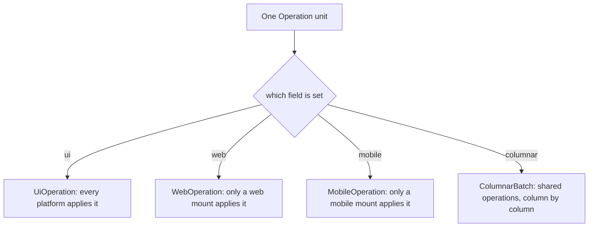

# Feature 02: The vocabulary and the platform forms

_Written in ASD-STE100 Simplified Technical English (STE). Code and identifiers stay as they
are._

**Abbreviations in this file.** user interface (UI); Document Object Model (DOM); HyperText
Markup Language (HTML); Cascading Style Sheets (CSS); JavaScript (JS); identifier (id);
AeroSpace and Defence Industries Association of Europe (ASD), the owner of the STE standard
ASD-STE100.

## 1. Goal

The module `foundation_ui_wire::vocab` is the one place that says what each vocabulary number
means. It says which value type each property takes, how the web renders each core name, and
how each of the 19 current `DomOp` variants becomes a schema form. The platform of a form is
its union: `UiOperation`, `WebOperation` or `MobileOperation` (D42, D59). A generated JS file
gives the same tables to the web runtime.

## 2. Story

- **S1**: "A writer knows the group of a form from its type. There is no table to ask."
- **S2**: "A writer checks that a property has the right value type."
- **S3**: "The web runtime maps a core name to an HTML element."
- **S4**: "Current code that makes a `DomOp` gets the schema form of it."
- **S5**: "An old client declares a vocabulary version, and the server asks which numbers that
  client knows."
- **S6**: "A property arrives with a value of the wrong type."
- **S7**: "A client declares a vocabulary version that the server does not have."

| # | Use case | Actor | Trigger | Result |
|---|---|---|---|---|
| U1 | Group of a form | Any reader | The Rust type of the form | `UiOperation` = every platform, `WebOperation` = web, `MobileOperation` = mobile |
| U2 | Check a property | Feature 03 writer | `check_prop(prop, &value)` | `Ok(())` or `VocabError::PropKindMismatch` |
| U3 | Web mapping | Feature 09 | Reads `foundation-ui-vocab.js` | Tag, class and CSS rule of each core name |
| U4 | Map a `DomOp` | Features 08, 11 | `web_form(&dom_op)` | One `UiOperation` or `WebOperation` form |
| U5 | Look up a version | Feature 03 writer | `vocab_version(n)` | The highest known number of each enum for that version |

## 3. Bounded context

**Inside this feature:** the meaning tables for `NodeKind`, `PropId`, `EventId`,
`NativeCommandId` and the three behaviour enums; the group of each form (its union); the web
mapping; the `DomOp` mapping; `VOCABULARY_VERSION` and its history table; the design token
table type; the generated file `foundation-ui-vocab.js`.

**Outside:**

| Thing | Owner |
|---|---|
| The enum definitions, the three unions and their numbers | Feature 01 (schema) |
| `TAG_NAMES`, `ATTR_NAMES`, `HtmlTag`, `AttrName`, `DomOp` | `foundation_ui_traits` (`src/html.rs`, `src/dom_op.rs`) |
| Removing the web fields for a `Native` mount (the gate) | Feature 03 |
| Applying a mapping to the DOM | Feature 09 |
| Native views for each kind | Features 14 and 15 |
| The behaviour bindings of each platform | Feature 16 |

| Entity | Meaning | Owner (the one writer) |
|---|---|---|
| Group | The union of each form: `UiOperation`, `WebOperation`, `MobileOperation` | Feature 01 (the schema); this feature tests it |
| Prop table | `PropId` to `PropKind` | `vocab::props` |
| Web mapping | Core name to HTML tag, class and CSS | `vocab::web` |
| Version history | `VocabVersion` rows | `vocab::version` |
| `foundation-ui-vocab.js` | The same tables for JS | `tests/vocab_js_tests.rs` with `UPDATE_FIXTURES=1` |

All verbs here are pure look-ups. This feature has no story verb, so it has no fault table.

**Words.** "Core name" is a value of `NodeKind`, `PropId` or `EventId`. "Web name" is an HTML
tag or attribute; a known web name has a number in `TAG_NAMES` or `ATTR_NAMES`, and a custom
web name is a string. "Form" is a member of one of the three unions. "Group" is the union of
a form: the shared group, the web group or the mobile group (D42, D59).

## 4. Rules

### 4.1 Law worksheets

```
Entity: Group
Conserved value:         every form is a member of exactly one of the three unions
Bound:                   the group is one of three: shared, web, mobile
Inverse pairs:           none
Idempotent verbs:        none (the group is the Rust type of the form)
Ordering pairs:          none
Monotone values:         members are only added, and only to their own union
Freeze points:           the union of a released form never changes
Links to other entities: the three unions of feature 01, and their numbers
```

```
Entity: Prop table
Conserved value:         every PropId except UNKNOWN has exactly one PropKind
Bound:                   none
Inverse pairs:           none
Idempotent verbs:        prop_kind, check_prop
Ordering pairs:          none
Monotone values:         rows are only added
Freeze points:           the PropKind of a released PropId never changes
Links to other entities: the PropValue union of feature 01
```

```
Entity: Version history
Conserved value:         none
Bound:                   none
Inverse pairs:           none
Idempotent verbs:        vocab_version
Ordering pairs:          none
Monotone values:         version numbers and every max_* value never decrease from one row to the next
Freeze points:           a released row never changes
Links to other entities: the last row equals the current enums of feature 01
```

```
Entity: Web mapping
Conserved value:         every NodeKind except UNKNOWN has one tag and one class
Bound:                   none
Inverse pairs:           none
Idempotent verbs:        the look-ups
Ordering pairs:          none
Monotone values:         none
Freeze points:           none (a renderer mapping can change; it is not on the wire)
Links to other entities: foundation-ui-vocab.js equals the Rust tables
```

### 4.2 Invariants

| # | Invariant |
|---|---|
| I1 | The generated `UiOperation`, `WebOperation` and `MobileOperation` unions hold the members of section 6.3, in that order. A form is in exactly one of them. |
| I2 | No member of `UiOperation` holds a custom name or a web-only field; no member of `WebOperation` holds a mobile-only field; no member of `MobileOperation` holds a web-only field. |
| I3 | `HtmlMorph`, `ScriptNode` and `WebBehaviour` are members of `WebOperation`. `MountWebView`, `NativeCommand` and `MobileBehaviour` are members of `MobileOperation`. |
| I4 | `prop_kind` returns `Some` for each `PropId` except `UNKNOWN`. |
| I5 | `check_prop(p, v)` succeeds exactly when the `PropValue` member of `v` is the member of `prop_kind(p)`. |
| I6 | For each `DomOp` value `d`, `web_form(&d)` gives a `WireForm::Ui` or a `WireForm::Web` member listed in section 6.4, and `dom_op(&web_form(&d)) == Some(d)`. |
| I7 | The last row of `VOCAB_VERSIONS` has `version == VOCABULARY_VERSION`, and each `max_*` value equals the highest value of that enum in the generated code (the three behaviour maxima included). |
| I8 | `foundation-ui-vocab.js` holds the same rows as the Rust tables. |
| I9 | No core table has a free-form string name. Only a web or mobile form has a custom string (D10, D56). |
| I10 | Every behaviour name is in exactly one set. `SHARED_BEHAVIOUR_NAMES` holds the four shared names and no other name; `WEB_BEHAVIOUR_NAMES` holds the seven web names and no other name. |

### 4.3 Must have

- `WireForm`, `PropKind`, `VocabVersion`, `VocabError`, `TokenTable`.
- The functions of section 6.2.
- The generated file `backends/foundation_wasm_ui/runtimes/foundation-ui-vocab.js`.

### 4.4 Must do

- Fail the build when a new union member or enum value has no table row. A `match` with no
  wildcard arm over the generated enum does this for Rust enums; the union type is an open
  `u8` wrapper, so test I1 and I7 do it for the union and the maxima.

### 4.5 Must not

- Do not add a table that maps a form to a platform: the union is the platform (D42).
- Do not give a shared form a web twin or a mobile twin (D36, D59).
- Do not guess a core name for a web name on a native client (research 04 section 3.3).
- Do not change `TAG_NAMES` or `ATTR_NAMES` order. They are append-only.

## 5. Acceptance scenarios

```gherkin
Feature: Vocabulary and platform forms

  Scenario: A shared form applies on both mount surfaces
    Given a Message whose operation.ui is SetText
    When the server builds it for a Native mount and for a Web mount
    Then the unit is unchanged in both cases
    And SetText is a member of UiOperation

  Scenario: The HTML morph goes only to a web mount
    Given a Message whose operation.web is HtmlMorph
    When the server builds it for a Native mount
    Then the operation.web field is removed before the frame is sent
    And HtmlMorph is a member of WebOperation

  Scenario: A native command goes only to a mobile mount
    Given a Message whose operation.mobile is NativeCommand
    When the server builds it for a web mount
    Then the operation.mobile field is removed before the frame is sent

  Scenario: A form is in one union only
    When the test reads the three generated unions
    Then no member name appears in more than one of them
    And each member of UiOperation holds no custom name and no web-only field

  Scenario: A padding property takes a length
    Given a PropValue of Length { value: 8.0, unit: Point }
    When the caller calls check_prop(PropId::PADDING, &value)
    Then the call succeeds

  Scenario: A padding property with a text value is rejected
    Given a PropValue of Text { v: "8px" }
    When the caller calls check_prop(PropId::PADDING, &value)
    Then the call fails with VocabError::PropKindMismatch
      { prop: PADDING, expected: Length, found: Text }

  Scenario: A set-attribute DomOp becomes a WebSetAttribute form
    Given DomOp::SetAttribute { node_id: 42, name: class, value: "btn" }
    When the caller calls web_form(&op)
    Then the result is WireForm::Web(WebSetAttribute { node_id: 42, attr_id: 1,
      custom_attr: None, value: "btn" })

  Scenario: A remove-attribute DomOp becomes a WebRemoveAttribute form
    Given DomOp::RemoveAttribute { node_id: 42, name: class }
    When the caller calls web_form(&op)
    Then the result is WireForm::Web(WebRemoveAttribute { node_id: 42, attr_id: 1,
      custom_attr: None })

  Scenario: A custom tag keeps its string
    Given DomOp::CreateElement { node_id: 5, tag: "my-card", class: "" }
    When the caller calls web_form(&op)
    Then the result is WireForm::Web(WebElement { node_id: 5, tag_id: 0,
      custom_tag: Some("my-card"), class_name: Some("") })

  Scenario: A set-text DomOp becomes a shared form
    Given DomOp::SetText { node_id: 42, text: "1" }
    When the caller calls web_form(&op)
    Then the result is WireForm::Ui(SetText { node_id: 42, text: "1" })

  Scenario: An unknown vocabulary version has no row
    When the caller calls vocab_version(99)
    Then the answer is None

  Scenario: The JS vocabulary file matches the Rust tables
    When the test builds the JS text from the Rust tables
    Then the text equals the checked-in foundation-ui-vocab.js
```

## 6. Technical breakdown



_The diagram shows that the union type of an operation is its platform. There is no table
and no look-up._

### 6.1 Measured facts

| Fact | Source |
|---|---|
| `DomOp` has 19 variants with operation codes 0 to 18 | `backends/foundation_ui_traits/src/dom_op.rs:91-168`, `src/encoder.rs:44-65` |
| `HtmlTag` and `AttrName` are "known id or owned name"; `TAG_NAMES[i]` has id `i + 1` | `backends/foundation_ui_traits/src/html.rs:23-36`, `:174`, `:290-300`, `:386-387` |
| `SetProperty`, `SetStyle`, `AddEventListener` and `RemoveEventListener` all use `AttrName` for their name | `dom_op.rs:112-129`, `:147-151` |
| The JS runtime mirrors `TAG_NAMES` and `ATTR_NAMES` by hand today | `backends/foundation_wasm_ui/runtimes/foundation-wasm-ui.js:52-83` |
| `CreateElement` and `CreateTextNode` do not register the node; `RegisterNode` does | `dom_op.rs:13-27` |

### 6.2 Public API (`backends/foundation_ui_wire/src/vocab/`)

Files: `mod.rs`, `props.rs`, `web.rs`, `dom_op.rs`, `version.rs`, `tokens.rs`,
`behaviour.rs`.
Add `foundation_ui_traits = { path = "../foundation_ui_traits", version = "0.0.4" }` to the
crate.

```rust
// forms.rs  (the group is the union type; this module only names the two groups that a
// DomOp can become)
#[derive(Clone, Debug, PartialEq)]
pub enum WireForm { Ui(UiOperationT), Web(WebOperationT) }

// props.rs
#[derive(Clone, Copy, Debug, PartialEq, Eq)]
pub enum PropKind { Length, ColorToken, FontToken, Alignment, Axis, Bool, Text }
#[must_use] pub fn prop_kind(prop: PropId) -> Option<PropKind>;
#[must_use] pub fn value_kind(value: &PropValueT) -> Option<PropKind>;   // None for NONE
pub fn check_prop(prop: PropId, value: &PropValueT) -> Result<(), VocabError>;

#[derive(Clone, Debug, PartialEq, Eq)]
pub enum VocabError {
    UnknownProp { prop: u16 },
    PropKindMismatch { prop: PropId, expected: PropKind, found: Option<PropKind> },
}

// version.rs
pub const VOCABULARY_VERSION: u32 = 2;
#[derive(Clone, Copy, Debug, PartialEq, Eq)]
pub struct VocabVersion {
    pub version: u32,
    pub max_node_kind: u16, pub max_prop_id: u16, pub max_event_id: u16,
    pub max_tag_id: u16, pub max_attr_id: u16, pub max_native_command: u16,
    pub max_behaviour: u16, pub max_web_behaviour: u16, pub max_mobile_behaviour: u16,
}
pub static VOCAB_VERSIONS: &[VocabVersion];          // rows for versions 1 and 2
#[must_use] pub fn vocab_version(version: u32) -> Option<&'static VocabVersion>;

// tokens.rs
/// Design token names of an app. The id of a token is its index plus 1.
#[derive(Clone, Debug, Default, PartialEq, Eq)]
pub struct TokenTable { colors: Vec<String>, fonts: Vec<String> }
impl TokenTable {
    #[must_use] pub fn new() -> Self;
    /// `css_var` is a CSS custom property name, for example "--color-primary".
    pub fn color(&mut self, css_var: impl Into<String>) -> u32;   // returns the new id
    pub fn font(&mut self, css_var: impl Into<String>) -> u32;
    #[must_use] pub fn color_id(&self, css_var: &str) -> Option<u32>;
    #[must_use] pub fn font_id(&self, css_var: &str) -> Option<u32>;
    /// ":root{--ewe-color-1:var(--color-primary);…--ewe-font-1:var(--font-body);…}"
    #[must_use] pub fn to_css_aliases(&self) -> String;
}

// web.rs
pub struct WebKind { pub kind: NodeKind, pub tag: &'static str, pub class: &'static str,
                     pub attrs: &'static [(&'static str, &'static str)] }
pub static WEB_KINDS: &[WebKind];
pub static WEB_EVENTS: &[(EventId, &'static str)];
/// The base stylesheet for the core classes (section 6.5).
pub const CORE_CSS: &str;
/// Builds the text of foundation-ui-vocab.js from the tables.
#[must_use] pub fn vocab_js() -> String;

// dom_op.rs  (removed by feature 12 together with DomOp)
#[must_use] pub fn web_form(op: &DomOp) -> WireForm;
#[must_use] pub fn dom_op(form: &WireForm) -> Option<DomOp>;   // None for a form with no DomOp
```

`max_tag_id` is `TAG_NAMES.len()` and `max_attr_id` is `ATTR_NAMES.len()` at the time the
row is written. Write them as numbers in the row; test I7 compares them with the tables.
Version 1 is the row before the behaviour enums: its three behaviour maxima are 0 (D56).
Version 2 is the current row.

### 6.3 The groups

The platform of a form is its union (D42, D59). There is no table to build or to test for a
mapping.

| Group | Union | Members |
|---|---|---|
| Shared: every runtime applies | `UiOperation` | `CreateNode`, `SetText`, `SetProp`, `AppendChild`, `InsertBefore`, `Remove`, `ReplaceSubtree`, `BindAction`, `UnbindAction`, `AttachState`, `LiveMount`, `UiBehaviour` (12) |
| Web only | `WebOperation` | `WebElement`, `WebText`, `WebSetAttribute`, `WebRemoveAttribute`, `WebProperty`, `WebAddListener`, `WebRemoveListener`, `WebReplaceNode`, `WebStyle`, `WebAddClass`, `WebRemoveClass`, `HtmlMorph`, `WebRegisterNode`, `WebUnregisterNode`, `ScriptNode`, `WebBehaviour` (16) |
| Mobile only | `MobileOperation` | `MountWebView`, `NativeCommand`, `MobileBehaviour` (3) |

A unit can hold a `ui` and a `web` field for one step (D44). A `Native` mount never receives a
`web` field: the server removes it before it sends (D42). The reader's rule "apply what you
know, ignore the rest" is the second defence.

| `PropId` | `PropKind` | Web rendering (feature 09 applies it) |
|---|---|---|
| `PADDING` | `Length` | `style.padding` |
| `SPACING` | `Length` | `style.gap` |
| `ALIGN` | `Alignment` | `style.alignItems`: `flex-start`, `center`, `flex-end`, `stretch` |
| `COLOR` | `ColorToken` | `style.color = "var(--ewe-color-<id>)"` |
| `FONT` | `FontToken` | `style.font = "var(--ewe-font-<id>)"` |
| `ENABLED` | `Bool` | The `disabled` attribute is present when the value is false |
| `A11Y_LABEL` | `Text` | The `aria-label` attribute |
| `AXIS` | `Axis` | `style.flexDirection`: `column` (Vertical), `row` (Horizontal) |
| `VALUE` | `Text` | The `value` property |
| `CHECKED` | `Bool` | The `checked` property |
| `SOURCE` | `Text` | The `src` attribute |
| `PLACEHOLDER` | `Text` | The `placeholder` attribute |
| `BACKGROUND` | `ColorToken` | `style.backgroundColor = "var(--ewe-color-<id>)"` |
| `WIDTH` | `Length` | `style.width` |
| `HEIGHT` | `Length` | `style.height` |
| `HIDDEN` | `Bool` | The `hidden` attribute is present when the value is true |

A `Length` becomes CSS text like this: `Point` gives `"<value>px"`, `Percent` gives
`"<value>%"`, `Auto` gives `"auto"`.

### 6.4 The `DomOp` mapping (R5)

| `DomOp` (code) | Form | Field mapping |
|---|---|---|
| `CreateElement` (0) | `WebElement` | Known tag: `tag_id = id`, `custom_tag = None`. Custom tag: `tag_id = 0`, `custom_tag = Some(name)`. `class_name = Some(class)` |
| `CreateTextNode` (1) | `WebText` | `content` |
| `SetText` (2) | `SetText` (shared) | `text` |
| `SetAttribute` (3) | `WebSetAttribute` | `value` |
| `RemoveAttribute` (4) | `WebRemoveAttribute` | no `value` field: the type names the action |
| `SetProperty` (5) | `WebProperty` | `name_id` or `custom_name` from the `AttrName` |
| `AddEventListener` (6) | `WebAddListener` | — |
| `RemoveEventListener` (7) | `WebRemoveListener` | — |
| `AppendChild` (8) | `AppendChild` (shared) | — |
| `RemoveChild` (9) | `Remove` (shared) | `node_id = child_id`. The parent is not needed: a node has one parent |
| `RemoveNode` (10) | `Remove` (shared) | — |
| `InsertBefore` (11) | `InsertBefore` (shared) | `before_id = ref_id` |
| `ReplaceNode` (12) | `WebReplaceNode` | — |
| `SetStyle` (13) | `WebStyle` | — |
| `AddClass` (14) | `WebAddClass` | — |
| `RemoveClass` (15) | `WebRemoveClass` | — |
| `MorphNode` (16) | `HtmlMorph` | `TargetSelector` kind and `MorphAction` keep their numbers |
| `RegisterNode` (17) | `WebRegisterNode` | — |
| `UnregisterNode` (18) | `WebUnregisterNode` | — |

`RemoveChild` and `RemoveNode` both map to `Remove`. So `dom_op(Remove)` returns
`RemoveNode`, and the round trip of I6 holds for `RemoveChild` only up to that rule. State
this in the test: `dom_op(&web_form(&RemoveChild{p, c})) == Some(RemoveNode{c})`.

**Registration rule.** A shared `CreateNode` registers its node in the id table when it
applies. `WebElement` and `WebText` do not; `WebRegisterNode` does it, as today.

### 6.5 The web mapping of the core names

| `NodeKind` | Tag | Class | Fixed attributes |
|---|---|---|---|
| `STACK` | `div` | `ewe-stack` | — |
| `TEXT` | `span` | `ewe-text` | — |
| `IMAGE` | `img` | `ewe-image` | — |
| `BUTTON` | `button` | `ewe-button` | `type="button"` |
| `TEXT_INPUT` | `input` | `ewe-text-input` | `type="text"` |
| `TOGGLE` | `input` | `ewe-toggle` | `type="checkbox"`, `role="switch"` |
| `LIST` | `div` | `ewe-list` | `role="list"` |
| `SCROLL` | `div` | `ewe-scroll` | — |
| `SPACER` | `div` | `ewe-spacer` | `aria-hidden="true"` |
| `OVERLAY` | `div` | `ewe-overlay` | — |

`CORE_CSS` is exactly:

```css
.ewe-stack{display:flex;flex-direction:column}
.ewe-list{display:flex;flex-direction:column}
.ewe-scroll{overflow:auto}
.ewe-spacer{flex:1 1 auto}
.ewe-overlay{position:fixed;inset:0}
```

| `EventId` | DOM event |
|---|---|
| `TAP` | `click` |
| `CHANGE` | `change` |
| `SUBMIT` | `submit` |
| `FOCUS` | `focus` |
| `BLUR` | `blur` |

The names in this section are renderer choices. They are not on the wire.

### 6.6 The generated JS file

`vocab_js()` returns an ES module with these exports, in this order, each a frozen object or
array: `VOCABULARY_VERSION`, `PROP_KIND` (index is the `PropId`), `WEB_KINDS` (index is
the `NodeKind`; each entry `{tag, cls, attrs}`), `WEB_EVENTS` (index is the `EventId`),
`TAG_NAMES`, `ATTR_NAMES`, `CORE_CSS`. The first line is the comment
`// Generated by foundation_ui_wire::vocab::vocab_js. Do not edit.`

There is no `FORM_PLATFORM` export: the JS runtime learns the group from the union byte of
each unit (D42).

`tests/vocab_js_tests.rs` compares `vocab_js()` with
`backends/foundation_wasm_ui/runtimes/foundation-ui-vocab.js` and writes the file when
`UPDATE_FIXTURES=1`. Add the file to `embedded.rs` as `FOUNDATION_UI_VOCAB_JS`.

### 6.7 The behaviour names (D56)

The authoring enum `Behaviour` stays in `foundation_ui_components::behaviour` (feature 16).
This module gives the wire names, so that the lowering of feature 08 and the web registry of
feature 09 read one table.

```rust
// behaviour.rs
/// The shared behaviours, with the `BehaviourId` that each one travels as (feature 01).
pub const SHARED_BEHAVIOUR_NAMES: &[(&str, BehaviourId)] = &[
    ("dialog", BehaviourId::DIALOG),
    ("dismiss", BehaviourId::DISMISS),
    ("scroll_lock", BehaviourId::SCROLL_LOCK),
    ("transition", BehaviourId::TRANSITION),
];

/// The web-only behaviours, in this order.
pub const WEB_BEHAVIOUR_NAMES: &[&str] = &[
    "composite", "focus_trap", "gestures", "hover", "listbox", "measure", "position",
];

/// The shared id of a name, or `None` for a web-only name and for an unknown name.
#[must_use] pub fn shared_behaviour(name: &str) -> Option<BehaviourId>;
/// `true` for a web-only name; `false` for a shared name and for an unknown name.
#[must_use] pub fn is_web_behaviour(name: &str) -> bool;
```

| Name | Set | Wire member |
|---|---|---|
| `dialog` | shared | `UiBehaviour { behaviour: DIALOG }` |
| `dismiss` | shared | `UiBehaviour { behaviour: DISMISS }` |
| `scroll_lock` | shared | `UiBehaviour { behaviour: SCROLL_LOCK }` |
| `transition` | shared | `UiBehaviour { behaviour: TRANSITION }` |
| `composite` | web | `WebBehaviour { behaviour: UNKNOWN, custom: "composite" }` |
| `focus_trap` | web | `WebBehaviour { behaviour: UNKNOWN, custom: "focus_trap" }` |
| `gestures` | web | `WebBehaviour { behaviour: UNKNOWN, custom: "gestures" }` |
| `hover` | web | `WebBehaviour { behaviour: UNKNOWN, custom: "hover" }` |
| `listbox` | web | `WebBehaviour { behaviour: UNKNOWN, custom: "listbox" }` |
| `measure` | web | `WebBehaviour { behaviour: UNKNOWN, custom: "measure" }` |
| `position` | web | `WebBehaviour { behaviour: UNKNOWN, custom: "position" }` |

The shared set is the one of D56. `MobileBehaviourId` holds only `UNKNOWN = 0` in version 2,
so no name travels as a mobile behaviour. A name outside the two tables gives
`LowerError::BadProp` at lowering (feature 08). A shared name gives no `custom` text: a
shared behaviour is one that every platform knows (D56).

## 7. Tests

All tests are in `backends/foundation_ui_wire/tests/`, registered in `tests/mod.rs`.

| Law or scenario | Test | Oracle |
|---|---|---|
| I1; Scenario: A form is in one union only | `vocab_forms_tests.rs::each_form_is_in_one_union` (reads the three generated unions and compares the member lists with section 6.3) | property |
| I2; Scenarios: shared form on both surfaces, HTML morph, native command | `vocab_forms_tests.rs::shared_forms_hold_no_platform_field` and `vocab_forms_tests.rs::platform_forms_hold_only_their_fields` | property |
| I3 | `vocab_forms_tests.rs::markup_and_script_forms_are_web_only` | example |
| I4 | `vocab_props_tests.rs::every_prop_has_a_kind` | property |
| I5; Scenarios: padding takes a length, padding with text is rejected | `vocab_props_tests.rs::check_prop_accepts_only_the_table_kind` (every prop against every kind) | property |
| I6; Scenarios: set-attribute, remove-attribute, custom tag, set-text | `vocab_dom_op_tests.rs::each_dom_op_round_trips` (one value of each of the 19 variants, with a known and a custom name where the variant has a name) | example |
| I7; Scenario: An unknown vocabulary version has no row | `vocab_version_tests.rs::last_row_matches_the_enums`, `::unknown_version_has_no_row`, `::rows_never_decrease` | example, property |
| I8; Scenario: The JS vocabulary file matches | `vocab_js_tests.rs::js_file_matches_tables` | example |
| I9 | `vocab_forms_tests.rs::shared_forms_have_no_custom_name` (reads the field lists of the generated shared types and checks that none has a field named `custom_*`) | example |
| I10 | `vocab_behaviour_tests.rs::each_behaviour_name_is_in_one_set` (every `BehaviourId` value above `UNKNOWN` has exactly one shared name; the two tables share no name; every name is lower case) | property |
| `TokenTable` ids start at 1 and `to_css_aliases` lists every token | `vocab_tokens_tests.rs::token_ids_and_css` | example |

## 8. Tasks

- [ ] 1. Add the `foundation_ui_traits` dependency and the `vocab` module skeleton.
- [ ] 2. Write `forms.rs` and its tests.
- [ ] 3. Write `props.rs` and its tests.
- [ ] 4. Write `version.rs` and its tests.
- [ ] 5. Write `tokens.rs` and its tests.
- [ ] 6. Write `dom_op.rs` and its tests.
- [ ] 7. Write `web.rs`, `vocab_js()` and the JS file test; generate the JS file; add it to `embedded.rs`.
- [ ] 8. Write `behaviour.rs` and its tests; update the three behaviour maxima in `version.rs`.
- [ ] 9. Bump `foundation_ui_wire` to `0.0.2` (new public API).
- [ ] 10. Update `progress.md` and `learnings.md`.

## 9. Verify

```bash
cargo fmt --all -- --check
cargo check  -p foundation_ui_wire --profile uat
cargo clippy -p foundation_ui_wire --profile uat --no-deps -- -D warnings
cargo test   -p foundation_ui_wire --profile uat
cargo check  -p foundation_ui_wire --profile uat --target wasm32-unknown-unknown
cargo test   -p foundation_wasm_ui --profile uat
node --check backends/foundation_wasm_ui/runtimes/foundation-ui-vocab.js
```

## 10. Done when

- [ ] All tasks are complete and every command of section 9 passes with no warning.
- [ ] Each invariant and each scenario has a passing test (section 7).
- [ ] The tables of sections 6.3 to 6.5 and 6.7 and the code agree, row for row.
- [ ] No `TODO`, `FIXME`, `todo!()` or `unimplemented!()` is in the module.
- [ ] The check list of the `story-driven-specification` skill passes.

---

_Created: 2026-11-13_
