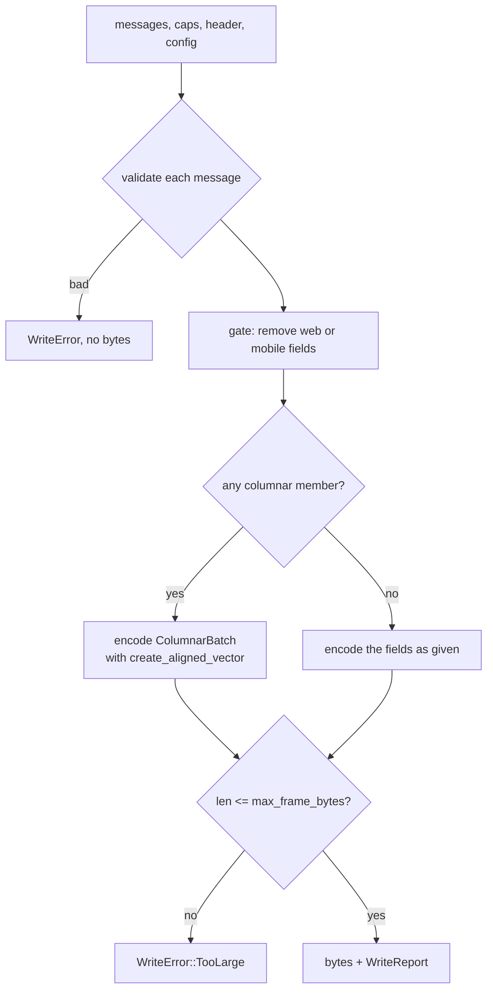

# Feature 03: The frame writer

_Written in ASD-STE100 Simplified Technical English (STE). Code and identifiers stay as they
are._

**Abbreviations in this file.** user interface (UI); HyperText Markup Language (HTML);
identifier (id); inter-process communication (IPC); AeroSpace and Defence Industries
Association of Europe (ASD), the owner of the STE standard ASD-STE100.

## 1. Goal

The module `foundation_ui_wire::writer` turns a list of `Message` units into the bytes of one
`Frame` for one client. It checks the units, applies the gate, and encodes the columnar member.
The sender puts in the list what it wants: the writer does not pick an encoding or a
representation (D41). It also writes data tables as a stream of frames and gives each frame
its `sequence_id`. Every producer of frames (server, WASM, device Rust) uses this one writer.

## 2. Story

- **S1**: "A producer writes a small update for a web client."
- **S2**: "A producer writes a large list render in the columnar form."
- **S3**: "A producer writes one operation unit that has a web form and a mobile form, for a
  native client."
- **S4**: "A producer sends a large data table as many frames."
- **S5**: "A producer gives a property the wrong value type."
- **S6**: "A producer writes a frame that is larger than the limit."
- **S7**: "A producer writes a state that nobody signed."
- **S8**: "An old client does not know a new node kind."

| # | Use case | Actor | Trigger | Result |
|---|---|---|---|---|
| U1 | Write messages | Producer | `write_messages` | Frame bytes and a `WriteReport` |
| U2 | Encode columnar | Writer | A `Message` whose `operation.columnar` is set | A `ColumnarBatch` with aligned columns |
| U3 | Gate | Writer | `ClientCaps` | The operation holds only the fields for the mount |
| U4 | Stream a table | Producer | `table_frames` | An iterator of frames with at most `max_table_rows` rows each |
| U5 | Reject | Producer | A bad message or a large frame | `WriteError` and no bytes |
| U6 | Number frames | Producer | `StreamSequencer::next` | Strictly increasing `sequence_id` |

## 3. Bounded context

**Inside this feature:** `ClientCaps`, `WriterConfig`, `FrameHeader`, `WriteReport`,
`WriteError`, `StreamSequencer`, the write functions, the column layout of the columnar
member.

**Outside:**

| Thing | Owner |
|---|---|
| The schema, `WireLimits`, `create_aligned_vector`, `finish_frame` | Feature 01 |
| `check_prop`, `vocab_version`, the vocabulary maxima | Feature 02 |
| Sealing a state (the tag) | Feature 04 |
| Building `ClientCaps` from `ClientHello` | Feature 07 |
| Reading the columns | Features 09, 14, 15 |

| Entity | Meaning | Owner (the one writer) |
|---|---|---|
| Frame bytes | One finished `Frame` buffer whose kind is `FrameMessage` | `writer` |
| `ClientCaps` | What one connection declared | The caller (feature 07 builds it) |
| `StreamSequencer` | The counter of one stream | The producer that owns the stream |
| `WriteReport` | What the gate removed and which unknown node kinds the writer replaced | `writer` |

| Verb | Kind | Trigger | Effect |
|---|---|---|---|
| `write_messages` | story | Producer | Validate, gate, encode, check size |
| `table_frames` | story | Producer | Split rows, number each frame, encode |
| `next` | entity | Producer | Returns the next `sequence_id` and increments |
| `write_error`, `write_caps`, `write_arrow_ipc`, `write_messagepack` | entity | Producer | Encode one control or data message |

**Words.** "Gate" is the step that removes a field that the mount must not receive. "Filtered"
means removed by the gate and listed in the report. "Unit" is one `Operation` inside one
`Message`. "Columnar form" is the `columnar` member of an `Operation`.

## 4. Rules

### 4.1 Law worksheets

```
Entity: Frame bytes
Conserved value:         messages out = messages in minus filtered messages, in the same order
Bound:                   length <= WireLimits::max_frame_bytes
Inverse pairs:           write then read gives the kept messages
Idempotent verbs:        write_messages is a pure function of its arguments
Ordering pairs:          validate before gate; gate before encode; encode before size check
Monotone values:         none
Freeze points:           none
Links to other entities: sequence_id comes from the header that the caller filled
```

```
Entity: StreamSequencer
Conserved value:         stream_id
Bound:                   sequence_id >= 1
Inverse pairs:           none
Idempotent verbs:        none (each next() gives a new number)
Ordering pairs:          none
Monotone values:         sequence_id strictly increases
Freeze points:           stream_id is fixed at construction
Links to other entities: none
```

```
Entity: WriteReport
Conserved value:         kept + count(part == Message in filtered) == input length
                         (top-level messages)
Bound:                   none
Inverse pairs:           none
Idempotent verbs:        none
Ordering pairs:          none
Monotone values:         message_index values in `filtered` increase
Freeze points:           none
Links to other entities: every index in `replaced_kinds` is the index of a kept message
```

### 4.2 Invariants

| # | Invariant |
|---|---|
| I1 | The bytes of `write_messages` for `mount: Native` never hold a `web` field, at any depth of `ReplaceSubtree`. |
| I2 | The bytes of `write_messages` for `mount: Web` never hold a `mobile` field, at any depth. |
| I3 | The kept messages keep their relative order. |
| I4 | Reading the frame gives the same messages that the writer encoded. A columnar read maps an empty string to "absent". |
| I5 | Every row of a `ColumnarBatch` is a shared `UiOperation`; `op_codes[row]` is the `UiOperation` union number. |
| I6 | Every `[uint]`, `[int]`, `[long]` and `[double]` vector in a `ColumnarBatch`, `DataTable` or `ArrowIpcBlob` that the writer makes starts on an 8-byte boundary of the buffer. |
| I7 | A frame longer than `max_frame_bytes` is never returned. |
| I8 | A `SetProp` whose value type does not match its property is never written. |
| I9 | An `AttachState` whose state has an empty `tag` is never written, unless `allow_unsealed_state` is true. |
| I10 | `StreamSequencer::next` returns 1, then 2, then 3, and so on, with no repeat and no gap. |
| I11 | Each frame of `table_frames` has at most `max_table_rows` rows, and the rows of all frames, in order, are the rows of the input. |
| I12 | A top-level `Message` whose `operation` has no field set after the gate is removed and listed with part `Message`. |
| I13 | Every frame that a writer function or `table_frames` returns has kind `FrameMessage`; its `ack` equals the header `ack`, which is 0 for a push. |

### 4.3 Must have

- `WriterConfig` with `max_table_rows` (default 8192), `allow_unsealed_state` (default false)
  and a `WireLimits`. There is no threshold and no tier choice (D41).
- One gate function that every write path calls. No second copy of the rule.

### 4.4 Must do

- Report every removed message or field with its message index and reason.
- Return an error, not a partial frame, when validation fails.
- Replace an unknown `NodeKind` with `UNKNOWN` for an old client, and report it (research 11
  section 3.3: the client shows a fallback view).

### 4.5 Must not

- Do not choose the columnar form in the writer. The sender puts the `columnar` member in the
  list (D41).
- Do not let the action author pick an encoder (D16).
- Do not drop a message in silence. A removed message or field is in the report.
- Do not write an Arrow IPC body for UI operations. `write_arrow_ipc` is for data that goes
  to Arrow tools (D28).
- Do not apply a form-to-platform table. The union of the operation is the platform (D42).

## 5. Acceptance scenarios

```gherkin
Feature: The frame writer

  Scenario: A small update keeps its one message
    Given one Message whose operation.ui is SetText for node 42 with text "1"
    And ClientCaps for a web mount with vocabulary version 2
    When the producer calls write_messages with header stream 7, sequence 20, ack 5
    Then the call succeeds with no filtered message
    And read_frame gives one message whose operation.ui is that SetText

  Scenario: A large list render stays columnar
    Given one Message whose operation.columnar holds 65 SetText rows for nodes 1 to 65
    And the default WriterConfig
    When the producer calls write_messages for a web mount
    Then the frame holds one ColumnarBatch with 65 rows
    And report.filtered is empty

  Scenario: A native client does not receive the web field
    Given one Message whose operation holds ui SetText(42) and web HtmlMorph(node 40, "<b>x</b>")
    And ClientCaps for a native mount
    When the producer calls write_messages
    Then the frame holds one message whose operation.ui is SetText(42)
    And that operation has no web field
    And report.filtered == [{ message_index: 0, part: Web, reason: OtherPlatform }]

  Scenario: A web client does not receive the mobile field
    Given one Message whose operation holds ui SetText(42) and mobile NativeCommand(HAPTIC)
    And ClientCaps for a web mount
    When the producer calls write_messages
    Then the frame holds one message whose operation.ui is SetText(42)
    And that operation has no mobile field
    And report.filtered == [{ message_index: 0, part: Mobile, reason: OtherPlatform }]

  Scenario: A message with only a web field is removed for a native client
    Given one Message whose operation holds only web HtmlMorph(node 40, "<b>x</b>")
    And ClientCaps for a native mount
    When the producer calls write_messages
    Then the frame holds no message
    And report.filtered == [{ message_index: 0, part: Message, reason: OtherPlatform }]

  Scenario: A web form inside a subtree is removed for a native client
    Given ReplaceSubtree(node 40, [Operation{ui: CreateNode(41, TEXT)},
      Operation{web: WebAddClass(41, "x")}])
    And ClientCaps for a native mount
    When the producer calls write_messages
    Then the frame holds ReplaceSubtree(node 40, [Operation{ui: CreateNode(41, TEXT)}])
    And report.filtered == [{ message_index: 0, part: Web, reason: OtherPlatform }]

  Scenario: A wrong property value is rejected
    Given SetProp(node 1, PADDING, Text "8px")
    When the producer calls write_messages
    Then the call fails with WriteError::Vocab(PropKindMismatch { .. }) at message 0
    And no bytes are returned

  Scenario: An unsealed state is rejected
    Given AttachState(root 40) whose SignedState has an empty tag
    And the default WriterConfig
    When the producer calls write_messages
    Then the call fails with WriteError::UnsealedState { message_index: 0 }

  Scenario: A frame above the limit is rejected
    Given one Message whose operation.ui is SetText with a text of 2000 bytes
    And WireLimits with max_frame_bytes 1024
    When the producer calls write_messages
    Then the call fails with WriteError::TooLarge { limit: 1024, .. }

  Scenario: An old client gets a fallback kind
    Given CreateNode(node 9, kind 11) where 11 is above max_node_kind of the client's version
    When the producer calls write_messages
    Then the frame holds CreateNode(node 9, UNKNOWN)
    And report.replaced_kinds == [0]
    And report.filtered is empty

  Scenario: A version 1 client gets no behaviour
    Given one Message whose operation.ui is UiBehaviour(node 40, SCROLL_LOCK, [])
    And ClientCaps with vocabulary version 1
    When the producer calls write_messages
    Then the frame holds no message
    And report.filtered == [{ message_index: 0, part: Message, reason: UnknownVocabulary }]

  Scenario: A table of 20000 rows becomes three frames
    Given a DataTable with 20000 rows and one I64 column
    And max_table_rows 8192
    When the producer collects table_frames with a sequencer that is at 0
    Then there are 3 frames with 8192, 8192 and 3616 rows
    And their sequence ids are 1, 2 and 3
```

## 6. Technical breakdown

### 6.1 Public API (`backends/foundation_ui_wire/src/writer/`)

Files: `mod.rs`, `caps.rs`, `config.rs`, `gate.rs`, `columnar.rs`, `table.rs`,
`sequencer.rs`, `error.rs`.

```rust
/// What one connection declared in its ClientHello.
#[derive(Clone, Debug, PartialEq, Eq)]
pub struct ClientCaps {
    pub platform: Platform,
    pub mount: MountSurface,
    pub vocabulary_version: u32,
}
impl ClientCaps {
    /// A web client with the current vocabulary.
    #[must_use] pub fn web_current() -> Self;
    /// A native client with the current vocabulary.
    #[must_use] pub fn native_current(platform: Platform) -> Self;
}

#[derive(Clone, Debug, PartialEq, Eq)]
pub struct WriterConfig { /* private fields */ }
impl Default for WriterConfig { /* 8192, false, WireLimits::default() */ }
impl WriterConfig {
    #[must_use] pub fn max_table_rows(self, rows: usize) -> Self;   // must be > 0
    #[must_use] pub fn allow_unsealed_state(self, allow: bool) -> Self;
    #[must_use] pub fn limits(self, limits: WireLimits) -> Self;
    // one getter for each field
}

#[derive(Clone, Copy, Debug, PartialEq, Eq)]
pub struct FrameHeader { pub stream_id: u64, pub sequence_id: u64, pub ack: u64 }

/// Which part of a Message the gate removed.
#[derive(Clone, Copy, Debug, PartialEq, Eq)]
pub enum FilteredPart { Message, Web, Mobile, NestedOperation }
#[derive(Clone, Copy, Debug, PartialEq, Eq)]
pub enum FilterReason { OtherPlatform, UnknownVocabulary }
#[derive(Clone, Copy, Debug, PartialEq, Eq)]
pub struct FilteredMessage { pub message_index: usize, pub part: FilteredPart,
    pub reason: FilterReason }
#[derive(Clone, Debug, PartialEq, Eq)]
pub struct WriteReport {
    pub filtered: Vec<FilteredMessage>,
    /// The index of each kept message that holds at least one `CreateNode` whose kind the
    /// writer replaced with `UNKNOWN`. An index appears at most once, in increasing order.
    pub replaced_kinds: Vec<usize>,
}

#[derive(Clone, Debug, PartialEq, Eq)]
pub enum WriteError {
    Vocab { message_index: usize, error: VocabError },
    UnsealedState { message_index: usize },
    /// A Message whose operation has no field set.
    EmptyMessage { message_index: usize },
    TooLarge { limit: usize, actual: usize },
    /// A table column whose length is not `rows`.
    ColumnLength { column: usize, expected: u64, actual: u64 },
    /// The client declared a vocabulary version that this build does not have.
    UnknownVocabularyVersion { version: u32 },
    /// The frame builder rejected the root. Only `WireError::NoKind` is possible, and the
    /// writer always sets the kind; the variant exists so that no return value is dropped.
    Wire(WireError),
}

pub fn write_messages(messages: Vec<MessageT>, caps: &ClientCaps, header: FrameHeader,
    config: &WriterConfig) -> Result<(Vec<u8>, WriteReport), WriteError>;

/// Applies only the gate. Feature 11 uses it to encode one batch per mount surface.
pub fn gate(messages: Vec<MessageT>, caps: &ClientCaps)
    -> Result<(Vec<MessageT>, Vec<FilteredMessage>), WriteError>;

pub fn write_error(error: &ActionErrorT, header: FrameHeader, config: &WriterConfig)
    -> Result<Vec<u8>, WriteError>;
pub fn write_caps(caps: &ServerCapsT, header: FrameHeader, config: &WriterConfig)
    -> Result<Vec<u8>, WriteError>;
pub fn write_arrow_ipc(target_node: u32, ipc: &[u8], header: FrameHeader, config: &WriterConfig)
    -> Result<Vec<u8>, WriteError>;
pub fn write_messagepack(target_node: u32, bytes: &[u8], header: FrameHeader,
    config: &WriterConfig) -> Result<Vec<u8>, WriteError>;

/// Splits `table` by rows. Each item is one finished `FrameMessage` frame. Lazy: it encodes a
/// frame when the caller asks for it.
pub fn table_frames<'a>(table: &'a DataTableT, sequencer: &'a mut StreamSequencer,
    config: &'a WriterConfig) -> Result<TableFrames<'a>, WriteError>;
pub struct TableFrames<'a> { /* private */ }
impl Iterator for TableFrames<'_> { type Item = Result<Vec<u8>, WriteError>; }

#[derive(Debug)]
pub struct StreamSequencer { /* stream_id, last */ }
impl StreamSequencer {
    #[must_use] pub fn new(stream_id: u64) -> Self;            // last = 0
    #[must_use] pub fn resume(stream_id: u64, last: u64) -> Self;
    #[must_use] pub fn stream_id(&self) -> u64;
    #[must_use] pub fn last(&self) -> u64;
    pub fn next(&mut self) -> u64;                             // last + 1, saturating at u64::MAX
    /// A header for a push (pass 0 for `ack`) or an answer.
    pub fn header(&mut self, ack: u64) -> FrameHeader;
}
```

`write_error` and `write_caps` make a frame with one `Message` whose `control` holds the
`error` or `caps` table. `write_arrow_ipc` and `write_messagepack` make a frame with one
`Message` whose `data` holds the Arrow IPC blob or the MessagePack blob.

Every writer function and `table_frames` builds a `FrameT` of kind
`FrameKindT::FrameMessage(Box::new(FrameMessageT { ack, messages }))` and calls
`finish_frame`. An error from `finish_frame` becomes `WriteError::Wire` with `?`.

### 6.2 The steps of `write_messages`



_The diagram shows the fixed order of the steps of one write._

1. **Validate** each message and each nested operation of a `ReplaceSubtree`, in order:
   - a `Message` with no field set, or an `operation` with no field set, gives `EmptyMessage`;
   - `SetProp`: `check_prop`; an error gives `Vocab`;
   - `AttachState`: read the `state` bytes with `read_signed_state`; a read error or an empty
     `tag` gives `UnsealedState`, unless `allow_unsealed_state` is true (then only a read
     error fails).
   The `message_index` is the index of the top-level message.
2. **Gate** (section 6.3).
3. **Encode.** Build a `FrameT` with `schema_version: SCHEMA_VERSION`, the header values and
   kind `FrameKindT::FrameMessage(Box::new(FrameMessageT { ack: header.ack, messages }))`,
   then call `finish_frame` and map an error with `?` to `WriteError::Wire`. A `columnar`
   member uses section 6.4 and `create_aligned_vector`. The writer does not choose a
   representation (D41).
4. **Size check** against `config.limits().frame_bytes()`.

### 6.3 The gate

`caps.vocabulary_version` must have a row in `vocab_version`; if not, return
`UnknownVocabularyVersion`. For each `Message`, in order, and for each nested `Operation` of a
`ReplaceSubtree`, the first rule that matches decides:

| # | Condition | Effect | Part | Reason |
|---|---|---|---|---|
| 1 | `mount == Native` and `operation.web` is set | Clear `operation.web`; keep the other fields | `Web` | `OtherPlatform` |
| 2 | `mount == Web` and `operation.mobile` is set | Clear `operation.mobile`; keep the other fields | `Mobile` | `OtherPlatform` |
| 3 | `CreateNode.kind > max_node_kind` | Keep, with `kind = UNKNOWN`; add the message index to `replaced_kinds` | — | — |
| 4 | An enum field is above its version maximum: `SetProp.prop`, `BindAction.event`, `UnbindAction.event`, `WebElement.tag_id`, `WebSetAttribute.attr_id`, `WebRemoveAttribute.attr_id`, `WebProperty.name_id`, `WebStyle.name_id`, `WebAddListener.name_id`, `WebRemoveListener.name_id`, `NativeCommand.command`, `UiBehaviour.behaviour`, `WebBehaviour.behaviour`, `MobileBehaviour.behaviour` | Remove the operation. At top level this removes the message | `Message` at top level, `NestedOperation` inside `ReplaceSubtree` | `UnknownVocabulary` |
| 5 | `vocabulary_version == 1` and the operation holds `UiBehaviour`, `WebBehaviour` or `MobileBehaviour` | Remove the operation. At top level this removes the message | `Message` at top level, `NestedOperation` inside `ReplaceSubtree` | `UnknownVocabulary` |
| 6 | `ReplaceSubtree` | Apply rules 1 to 5 to each nested operation. A rule that removes the message at top level removes only that nested operation here. A nested `Operation` with no field left is removed. List the top-level message once with the part of the first removal | the part of the first removal | — |
| 7 | The top-level operation has no field left after rules 1, 2 and 6 | Remove the message | `Message` | the reason of the removal that emptied it |
| 8 | Otherwise | Keep | — | — |

The gate does not resolve an action name. `BindAction.action` is the reference text
(`origin:name`, D50), and the dispatcher owns the route.

A report entry with part `NestedOperation` says that the removed field or operation was inside
a `ReplaceSubtree`. Its `message_index` is still the index of the top-level message.

The `web` field is a `WebOperation`. The `mobile` field is a `MobileOperation`:
`MountWebView` (D46), `NativeCommand` or `MobileBehaviour`. A native mount never receives a
web form (App Store rule 2.5.2 of D42); a web mount never receives a mobile form.

### 6.4 The columnar layout

`op_codes[i]` is the `UiOperation` union number. A column that a shared form does not use
holds `0`. A blob that a form does not use is an empty range. `blob_a_off` and `blob_b_off`
each have `rows + 1` entries; the bytes of blob `x` of row `i` are
`blob_bytes[x_off[i] .. x_off[i + 1]]`. Write all `blob_a` bytes of all rows first, then all
`blob_b` bytes, so each offset column increases. `blob_b_off[0]` equals `blob_a_off[rows]`.

The columnar form holds only shared `UiOperation` rows (D59). A web or mobile form is never a
row; the sender uses separate `Operation` units for those.

| Form | `node_ids` | `arg_a` | `arg_b` | `blob_a` | `blob_b` |
|---|---|---|---|---|---|
| `CreateNode` | `node_id` | `kind` | — | — | — |
| `SetText` | `node_id` | — | — | `text` | — |
| `SetProp` | `node_id` | `prop` + (`unit` << 16) | see below | text value | — |
| `AppendChild` | `parent_id` | `child_id` | — | — | — |
| `InsertBefore` | `parent_id` | `child_id` | `before_id` | — | — |
| `Remove` | `node_id` | — | — | — | — |
| `BindAction` | `node_id` | `event` | — | `action` | — |
| `UnbindAction` | `node_id` | `event` | — | — | — |
| `AttachState` | `root_node` | — | — | `state` bytes | — |

`SetProp` `arg_b` by the `PropKind` of the property: `Length` gives `value.to_bits()` (and
the unit goes in `arg_a` bits 16 to 23); `ColorToken` and `FontToken` give the token id;
`Alignment` and `Axis` give the enum number; `Bool` gives 0 or 1; `Text` gives 0 and the
text goes in `blob_a`.

**Not eligible:** `ReplaceSubtree` (it holds nested operations), `LiveMount` (its
`channel_id` and `resume_from` are 64-bit) and `UiBehaviour` (its arguments do not fit a
column). A message with one of them encodes the operation in its normal form.

Build the five `uint` columns with `create_aligned_vector`. Build the table with the
generated `ColumnarBatchBuilder`, not with `pack`.

`pub fn columnar_rows(batch: ColumnarBatch<'_>) -> Result<Vec<UiOperationT>, ColumnarError>`
in `columnar.rs` is the inverse, for tests and for Rust readers. `ColumnarError` has
`LengthMismatch { column: &'static str, expected: usize, actual: usize }`,
`BadOffsets { row: usize }`, `UnknownOp { row: usize, code: u8 }` and
`InvalidUtf8 { row: usize }`. It checks that every column has `rows` entries (the offset
columns `rows + 1`) and that the offsets increase and stay inside `blob_bytes`.

### 6.5 Tables

`table_frames` first checks each column: the length of its data vector must equal
`table.rows`, else `ColumnLength`. Frame `k` holds rows `k * max .. min((k + 1) * max, rows)`
of every column, the matching slice of `validity` (bit `r` of the bitmap is row `r`; copy
bit by bit into a new bitmap that starts at bit 0), and the same `target_node`. Each frame
holds one `Message` whose `data.table` is that slice. A table with 0 rows gives one frame
with 0 rows. Each frame takes `sequencer.header(0)`. Build `I32s`, `I64s` and `F64s` vectors
with `create_aligned_vector`.

### 6.6 Fault tables

**`write_messages`**

| Step that fails | What the system does | What the caller sees | What is left behind |
|---|---|---|---|
| Validate | Stops at the first bad message | `WriteError::{Vocab, UnsealedState, EmptyMessage}` with the message index | nothing |
| Gate: unknown vocabulary version | Stops | `WriteError::UnknownVocabularyVersion` | nothing |
| Encode: the frame builder rejects the root | Stops | `WriteError::Wire`; only `NoKind` is possible and the writer always sets the kind | nothing |
| Size check | Drops the encoded bytes | `WriteError::TooLarge` | nothing. The caller's sequencer did advance if the caller took the header from it; the next frame then has a gap of one, which a client treats as a gap and resumes (feature 11). Callers that must not skip a number call `write_messages` with a header built from `sequencer.last() + 1` and call `next()` only on success |

**`table_frames`**

| Step that fails | What the system does | What the caller sees | What is left behind |
|---|---|---|---|
| Column length check | Fails before the first frame | `Err(ColumnLength)` from `table_frames` | nothing; the sequencer did not advance |
| A frame is above the limit | That item is `Err(TooLarge)`; the iterator then ends | The frames before it were already given | The frames already sent. The caller sends a `Control{error}` frame with `write_error` so the client does not wait |

## 7. Tests

All in `backends/foundation_ui_wire/tests/`. Use `ClientCaps::web_current()` and
`ClientCaps::native_current(Platform::Ios)`.

| Law or scenario | Test | Oracle |
|---|---|---|
| I1, I2 | `writer_gate_tests.rs::no_other_platform_field_in_bytes`: for 200 seeded random message lists (seed from a fixed `u64`, messages drawn from all forms, nesting depth up to 3), read the bytes back and walk every message | property |
| I3 | `writer_gate_tests.rs::kept_messages_keep_order` (tag each message with an increasing node id) | property |
| I4 | `writer_columnar_tests.rs::columnar_rows_round_trips`: `columnar_rows` of the written batch equals the shared operations after "empty string = absent" | metamorphic |
| I5; Scenario: large list render | `writer_columnar_tests.rs::columnar_holds_shared_rows`, `::large_list_render_stays_columnar` | example |
| I6 | `writer_align_tests.rs::numeric_columns_are_8_aligned` for 1, 3, 65 and 1000 rows, and for a table frame | property |
| I7; Scenario: A frame above the limit | `writer_error_tests.rs::frame_above_limit_is_rejected` | expected outcome |
| I8; Scenario: A wrong property value | `writer_error_tests.rs::wrong_prop_value_is_rejected` | expected outcome |
| I9; Scenario: An unsealed state | `writer_error_tests.rs::unsealed_state_is_rejected`, `::unsealed_state_is_allowed_by_config` | expected outcome |
| I10 | `sequencer_tests.rs::next_is_strictly_increasing`, `::resume_continues_after_last` | property |
| I11; Scenario: A table of 20000 rows | `writer_table_tests.rs::table_splits_by_rows`, `::validity_bits_follow_rows`, `::empty_table_gives_one_frame` | example |
| I12 | `writer_gate_tests.rs::empty_operation_after_gate_is_removed` | example |
| I13; Scenario: a small update | `writer_roundtrip_tests.rs::write_then_read_gives_a_message_frame` (write one `SetText`, read with `read_frame`; `frame_kind` is `Message`; `ack` equals the header value) | example |
| Scenarios: native has no web field; web has no mobile field; only-web message removed; nested web form | `writer_gate_tests.rs::native_client_gets_no_web_field`, `::web_client_gets_no_mobile_field`, `::web_only_message_is_removed_for_native`, `::nested_web_form_is_removed_for_native` | example |
| Scenario: An old client gets a fallback kind | `writer_gate_tests.rs::unknown_kind_becomes_fallback` (uses a test-only `ClientCaps` with `vocabulary_version` 1 and an operation with kind 11) | example |
| Scenario: A version 1 client gets no behaviour | `writer_gate_tests.rs::version_1_client_gets_no_behaviour` | example |
| Fault: column length | `writer_table_tests.rs::bad_column_length_fails_before_first_frame` (asserts `sequencer.last() == 0`) | fault |
| The fixture `frame_columnar_3rows.bin` of feature 01 equals `write_messages` output | `writer_columnar_tests.rs::columnar_fixture_matches` (header 7/20/0) — update the fixture and the feature 01 test if the bytes differ, and record it | example |

## 8. Tasks

- [ ] 1. `caps.rs`, `config.rs`, `error.rs` and their constructors.
- [ ] 2. `sequencer.rs` and its tests.
- [ ] 3. Validation and its error tests.
- [ ] 4. `gate.rs` and its tests.
- [ ] 5. Encode the message fields that are not columnar, and `write_messages`.
- [ ] 6. `columnar.rs`: encode, `columnar_rows`, alignment tests.
- [ ] 7. The gate tests for fields, versions and behaviours.
- [ ] 8. `table.rs` and its tests; `write_error`, `write_caps`, `write_arrow_ipc`, `write_messagepack`.
- [ ] 9. Bump `foundation_ui_wire` to `0.0.3`.
- [ ] 10. Update `progress.md` and `learnings.md`.

## 9. Verify

```bash
cargo fmt --all -- --check
cargo check  -p foundation_ui_wire --profile uat
cargo clippy -p foundation_ui_wire --profile uat --no-deps -- -D warnings
cargo test   -p foundation_ui_wire --profile uat
cargo check  -p foundation_ui_wire --profile uat --target wasm32-unknown-unknown
mise run ui-wire:test-ts
```

## 10. Done when

- [ ] All tasks are complete and every command of section 9 passes with no warning.
- [ ] Each invariant and each scenario has a passing test (section 7).
- [ ] The gate is one function, and every write path of messages calls it.
- [ ] No `TODO`, `FIXME`, `todo!()` or `unimplemented!()` is in the module.
- [ ] The check list of the `story-driven-specification` skill passes.

---

_Created: 2026-11-13_
_Revised: 2026-11-14 (D41 to D59)_
