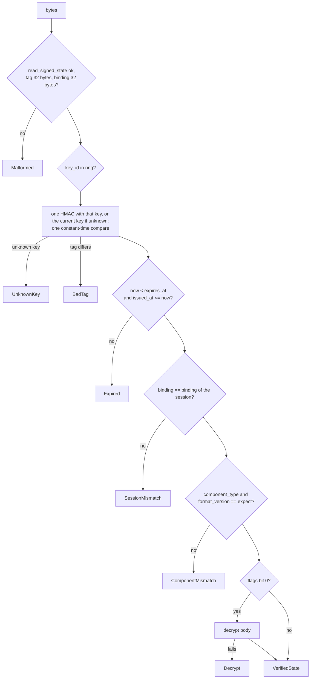

# Feature 04: Signed state

_Written in ASD-STE100 Simplified Technical English (STE). Code and identifiers stay as they
are._

**Abbreviations in this file.** user interface (UI); hash-based message authentication code
(HMAC); Secure Hash Algorithm 256 (SHA-256); authenticated encryption with associated data
(AEAD); WebAssembly (WASM); random number generator (RNG); identifier (id); AeroSpace and
Defence Industries Association of Europe (ASD), the owner of the STE standard ASD-STE100.

## 1. Goal

A new crate, `backends/foundation_ui_runtime`, has a `state` module. A server seals the state
of a component into `SignedState` bytes and opens the bytes that a client returns. The tag
binds the state to a purpose, a key, a time window, a component, a node and a session. The
checks run in one fixed order. A plain codec exists for a device, where no trust boundary
exists (D5).

## 2. Story

- **S1**: "A server seals the state of a component after an action."
- **S2**: "A server opens the state that a client returned."
- **S3**: "A component marks its state private, and the user cannot read it."
- **S4**: "An operator rotates the state key."
- **S5**: "A user changes one byte of the state."
- **S6**: "A user returns a state after it expired."
- **S7**: "User B returns a state that user A received."
- **S8**: "A client sends the state of component A to an action of component B."
- **S9**: "An attacker sends many bad states."
- **S10**: "A device runs actions with no server, and state needs no tag."

| # | Use case | Actor | Trigger | Result |
|---|---|---|---|---|
| U1 | Seal | Dispatcher | `seal` | `SignedState` bytes with a tag |
| U2 | Open | Dispatcher | `open` | `VerifiedState`, or one `StateError` |
| U3 | Private state | Component | `UnsealedState::private = true` | The body is encrypted, then tagged |
| U4 | Rotate | Operator | A new `StateKeyRing` | Old states open until they expire; new states use the new key |
| U5 | Limit failures | Dispatcher | `FailureLimiter::check` | `RateLimited` after too many failures |
| U6 | Plain codec | Device core | `PlainStateCodec` | Bytes with no tag; `open` checks shape only |

## 3. Bounded context

**Inside this feature:** `StateCodec`, `HmacStateCodec`, `PlainStateCodec`, `StateKey`,
`StateKeyRing`, `StateConfig`, `SessionBinding`, `UnsealedState`, `VerifiedState`,
`StateError`, `FailureLimiter`, `InMemoryFailureLimiter`, `FailureLimits`, the MAC input.

**Outside:**

| Thing | Owner |
|---|---|
| The `SignedState` table and `read_signed_state` | Feature 01 |
| The session id and who the user is | The host. It passes a `Session` value |
| The meaning of the body; domain checks; single use (D14) | The action and the domain data |
| Where keys come from (the secret source) | The host entry point |
| The clock and the RNG | `foundation_context::Ctx` |
| The base64url text form on the web (D12) | Feature 09 and 10 (the client), feature 07 (no decode: the request carries bytes) |

| Entity | Meaning | Owner (the one writer) |
|---|---|---|
| `SignedState` bytes | A sealed state | `StateCodec::seal` |
| `StateKeyRing` | One current key and the previous keys | The host; the codec only reads it |
| Failure record | Failures of one `FailureKey` in the window | `FailureLimiter` |

| Verb | Kind | Trigger | Effect |
|---|---|---|---|
| `seal` | entity | After an action | Makes bytes. Changes nothing else |
| `open` | entity | Before an action | Checks bytes. Changes nothing |
| `check`, `record_failure` | entity | Around `open` | Reads or changes the failure record |

No verb changes more than one entity. The story verb that joins them (`dispatch`) is in
feature 07, with its fault table.

**Words.** "Seal" is to set the times, the key id and the session binding and to compute the
tag. "Open" is to run the checks and return the plain body. "Tag" is the HMAC output. "Private"
means that the body is encrypted.

## 4. Rules

### 4.1 Law worksheets

```
Entity: SignedState bytes
Conserved value:         open(seal(s)).body == s.body, for the same session, inside the time window
Bound:                   body length <= StateConfig::max_body_bytes; tag length == 32; session_binding length == 32
Inverse pairs:           seal / open
Idempotent verbs:        open (it changes nothing; a second open gives the same result at the same clock time)
Ordering pairs:          the checks of open run in the order of section 6.4
Monotone values:         none
Freeze points:           the bytes never change after seal; any change makes open fail
Links to other entities: key_id must be in the ring; session_binding must equal the binding of the caller's session
```

```
Entity: StateKeyRing
Conserved value:         none
Bound:                   key ids are unique; a key has 32 bytes
Inverse pairs:           none
Idempotent verbs:        none
Ordering pairs:          none
Monotone values:         none
Freeze points:           a ring is immutable after it is built
Links to other entities: none
```

```
Entity: Failure record
Conserved value:         none
Bound:                   count <= max_failures before a block starts
Inverse pairs:           none
Idempotent verbs:        check
Ordering pairs:          check comes before open; record_failure comes after a failed open
Monotone values:         count increases inside one window
Freeze points:           none
Links to other entities: none
```

### 4.2 Invariants

| # | Invariant |
|---|---|
| I1 | For each valid `UnsealedState` `s`, session `x` and clock time `t`: `open(seal(s, x, t), x, t')` succeeds with the body of `s` when `t <= t' < t + ttl`. |
| I2 | A change of one bit in a sealed buffer, in any field, makes `open` fail. |
| I3 | `open` with a different session id fails with `SessionMismatch`. |
| I4 | `open` at `t' >= expires_at` fails with `Expired`. |
| I5 | `open` with an expected component type or format version that differs from the state fails with `ComponentMismatch`. |
| I6 | `open` never decodes or decrypts the body before the tag check passes. |
| I7 | The tag compare takes the same code path for a wrong tag and for an unknown key id (one HMAC, one constant-time compare). |
| I8 | A tag made with the purpose label of another token type does not open as a state. |
| I9 | A private state holds no run of 8 or more bytes of the plain body. |
| I10 | `seal` fails with `BodyTooLarge` when the body is longer than `max_body_bytes`, and returns no bytes. |
| I11 | After `max_failures` recorded failures inside `window` for one `FailureKey`, `check` fails with `RateLimited` until `block_for` has passed. Another `FailureKey` is not affected. |
| I12 | The codec reads time only from `Ctx::clock()` and randomness only from `Ctx::rng()`. |

### 4.3 Must have

- `StateConfig` with `ttl` (default 24 hours) and `max_body_bytes` (default 4096).
- `FailureLimits` with `max_failures` 5, `window` 600 s, `block_for` 600 s.
- A state key that is separate from every other key (research 08 section 4.3).

### 4.4 Must do

- Zero key bytes on drop.
- Return one typed error for each check that fails. The dispatcher maps them to wire codes
  (feature 07); the client sees only `StateRejected` or `StateExpired`.

### 4.5 Must not

- Do not accept a tag from a key that is not in the ring.
- Do not choose the body type from the payload. The caller says which component type it
  expects (research 08 section 4.5, "never decode attacker-chosen types").
- Do not add a nonce store or a used-id list (D14).
- Do not put a key in a config file in the repository.
- Do not call `SystemTime::now()`, `Instant::now()` or a global RNG.

## 5. Acceptance scenarios

All scenarios use `Ctx::with_seed(clock, 1)` with a test clock whose wall time is
1 000 000 s, session id `"sess-A"`, key id 1, and
`UnsealedState { format_version: 1, component_type: 7, root_node: 40, body: [1,0,0,0], private: false }`.

```gherkin
Feature: Signed state

  Scenario: A sealed state opens for the same session
    When the server seals the state and opens the bytes with Expect { component_type: 7, format_version: 1 }
    Then open succeeds with body [1,0,0,0], issued_at 1000000 and expires_at 1086400

  Scenario: A changed body is rejected
    Given sealed bytes whose body byte 0 is changed from 1 to 2
    When the server opens them
    Then open fails with StateError::BadTag

  Scenario: An expired state is rejected
    Given sealed bytes
    And the clock moves to 1086400 s
    When the server opens them
    Then open fails with StateError::Expired

  Scenario: A state of another session is rejected
    Given bytes sealed for session "sess-A"
    When the server opens them for session "sess-B"
    Then open fails with StateError::SessionMismatch

  Scenario: A state of another component is rejected
    Given sealed bytes with component_type 7
    When the server opens them with Expect { component_type: 8, format_version: 1 }
    Then open fails with StateError::ComponentMismatch

  Scenario: An unknown key id is rejected
    Given bytes sealed with key id 9
    And a ring that holds only key id 1
    When the server opens them
    Then open fails with StateError::UnknownKey

  Scenario: A state sealed with the previous key still opens
    Given bytes sealed with key id 1
    And a new ring with current key id 2 and previous key id 1
    When the server opens them
    Then open succeeds
    And a new seal uses key id 2

  Scenario: A private state hides its body
    Given an UnsealedState with body "secret-row-id-0001" and private true
    When the server seals it
    Then the sealed bytes do not contain "secret-r"
    And open returns the body "secret-row-id-0001"

  Scenario: A large body is rejected at seal
    Given an UnsealedState with a body of 4097 bytes
    When the server seals it with the default config
    Then seal fails with StateError::BodyTooLarge { limit: 4096, actual: 4097 }

  Scenario: Six failures block the sender
    Given 5 recorded failures for FailureKey { session: "sess-A", address: "10.0.0.1" }
    When the server calls check for the same key
    Then check fails with StateError::RateLimited
    And check for FailureKey { session: "sess-B", address: "10.0.0.2" } succeeds

  Scenario: A block ends after the block time
    Given a blocked FailureKey
    And the clock moves forward 600 s
    When the server calls check
    Then check succeeds

  Scenario: The plain codec keeps the body with no tag
    When a device seals the state with PlainStateCodec and opens it
    Then open succeeds with body [1,0,0,0]
    And the sealed bytes have an empty tag
```

## 6. Technical breakdown

### 6.1 Measured facts

| Fact | Source |
|---|---|
| `foundation_auth` has an HMAC-SHA256 signer with a key ring and a constant-time compare (`Mac::verify_slice`). It is private to that crate and signs text tokens | `backends/foundation_auth/src/shared/session.rs:553-605` |
| `foundation_auth` declares `sha2 = "0.10"` and `hmac = "0.12"` itself; they are not in `[workspace.dependencies]` | `backends/foundation_auth/Cargo.toml:28-29`; root `Cargo.toml` |
| `foundation_compact::crypto::chacha::encrypt` makes its nonce with `generate_nonce()`, a global entropy read | `backends/foundation_compact/src/crypto/chacha.rs:24-41` |
| `EncryptionKey<N>` zeroes on drop; `ChaChaKey = EncryptionKey<32>` | `backends/foundation_compact/src/crypto/key.rs:15`, `chacha.rs:15` |
| `Clock::wall_now()` gives the wall time; `Ctx::clock()` and `Ctx::rng()` exist | `backends/foundation_context/src/lib.rs:73-89`, `:437`, `:468` |
| `foundation_context` builds for `wasm32` | `backends/foundation_context/Cargo.toml` (`cfg(target_family = "wasm")` section) |

### 6.2 Prerequisite changes in other crates

1. **Workspace dependencies (rule 17).** Add `hmac`, `sha2` and `subtle` to the root
   `[workspace.dependencies]` at their latest stable versions. Change
   `backends/foundation_auth/Cargo.toml` to `hmac = { workspace = true }` and
   `sha2 = { workspace = true }`. Run the `foundation_auth` tests.
2. **`foundation_compact`.** Add, beside `encrypt` in `crypto/chacha.rs`:

```rust
/// Encrypt `plaintext` with ChaCha20-Poly1305 and a nonce that the caller gives.
/// Returns `nonce (12 bytes) || ciphertext || tag (16 bytes)`, the same layout as
/// [`encrypt`], so [`decrypt`] opens it. The caller must not use a nonce twice with one key.
pub fn encrypt_with_nonce(key: &ChaChaKey, nonce: [u8; 12], plaintext: &[u8])
    -> Result<Vec<u8>, String>;
```

   Make `encrypt` call it. Add a test in `backends/foundation_compact/tests/` that
   `decrypt(encrypt_with_nonce(k, n, p)) == p` and that two calls with one nonce give equal
   bytes. Bump the `foundation_compact` version and its consumers (AGENTS reminder 12).

### 6.3 The crate

```
backends/foundation_ui_runtime/
├── Cargo.toml
├── src/
│   ├── lib.rs
│   └── state/{mod.rs,codec.rs,hmac_codec.rs,plain_codec.rs,keys.rs,config.rs,mac_input.rs,limiter.rs,error.rs}
└── tests/{mod.rs,state_seal_open_tests.rs,state_tamper_tests.rs,state_keys_tests.rs,state_private_tests.rs,state_limiter_tests.rs,state_plain_tests.rs}
```

`Cargo.toml`: version `0.0.1`; dependencies `foundation_ui_wire`, `foundation_context`,
`foundation_compact` (`default-features = false, features = ["std"]`), `hmac`, `sha2`,
`subtle` (all `workspace = true` where the workspace has them), `zeroize` (the version that
`foundation_compact` uses; move it to the workspace if two crates now use it). The crate uses
`std`. It must compile for `wasm32-unknown-unknown`: set `wasm = "enforce"` for it in
`ci/packages.toml`.

**Public API**

```rust
/// Who is asking. The host builds it from its own session layer.
#[derive(Clone, Debug, PartialEq, Eq)]
pub struct Session { id: String }
impl Session {
    /// `id` must not be empty. An anonymous user also has an id; the host makes one.
    pub fn new(id: impl Into<String>) -> Result<Self, StateError>;   // Err(MissingSession)
    #[must_use] pub fn id(&self) -> &str;
}

#[derive(Clone, Debug, PartialEq, Eq)]
pub struct UnsealedState {
    pub format_version: u16,
    pub component_type: u32,
    pub root_node: u32,
    pub body: Vec<u8>,
    pub private: bool,
}

#[derive(Clone, Debug, PartialEq, Eq)]
pub struct VerifiedState {
    pub format_version: u16,
    pub component_type: u32,
    pub root_node: u32,
    pub body: Vec<u8>,          // plain
    pub issued_at: u64,
    pub expires_at: u64,
}

/// What the caller expects. It comes from the action signature, never from the payload.
#[derive(Clone, Copy, Debug, PartialEq, Eq)]
pub struct Expect { pub component_type: u32, pub format_version: u16 }

pub trait StateCodec: Send + Sync {
    fn seal(&self, ctx: &foundation_context::Ctx, session: &Session, state: &UnsealedState)
        -> Result<Vec<u8>, StateError>;
    fn open(&self, ctx: &foundation_context::Ctx, session: &Session, bytes: &[u8],
        expect: Expect) -> Result<VerifiedState, StateError>;
}

pub struct StateKey { /* id: u32, mac: Zeroizing<[u8; 32]>, enc: ChaChaKey */ }
impl StateKey {
    /// `id` must be greater than 0. `mac` and `enc` are two different 32-byte secrets.
    pub fn new(id: u32, mac: [u8; 32], enc: [u8; 32]) -> Result<Self, StateError>; // Err(BadKey)
    #[must_use] pub fn id(&self) -> u32;
}
impl core::fmt::Debug for StateKey { /* prints the id only */ }

pub struct StateKeyRing { /* current, previous */ }
impl StateKeyRing {
    #[must_use] pub fn new(current: StateKey) -> Self;
    pub fn with_previous(self, key: StateKey) -> Result<Self, StateError>; // Err(BadKey) on a duplicate id
    #[must_use] pub fn current_id(&self) -> u32;
}

#[derive(Clone, Copy, Debug, PartialEq, Eq)]
pub struct StateConfig { /* ttl: Duration, max_body_bytes: usize */ }
impl Default for StateConfig { /* 24 h, 4096 */ }
impl StateConfig {
    #[must_use] pub fn ttl(self, ttl: core::time::Duration) -> Self;
    #[must_use] pub fn max_body_bytes(self, n: usize) -> Self;
    #[must_use] pub fn ttl_value(&self) -> core::time::Duration;
    #[must_use] pub fn body_bytes(&self) -> usize;
}

pub struct HmacStateCodec { /* ring, config, limits: WireLimits */ }
impl HmacStateCodec {
    #[must_use] pub fn new(ring: StateKeyRing, config: StateConfig) -> Self;
}
impl StateCodec for HmacStateCodec { /* sections 6.4 to 6.6 */ }

/// For a device or a test: no key, no tag. `open` checks the shape and `expect` only.
#[derive(Clone, Copy, Debug, Default)]
pub struct PlainStateCodec { /* config */ }
impl StateCodec for PlainStateCodec { /* section 6.7 */ }

#[derive(Clone, Debug, PartialEq, Eq)]
pub enum StateError {
    MissingSession,
    BadKey,
    BodyTooLarge { limit: usize, actual: usize },
    Malformed { detail: String },     // read_signed_state failed, or a length is wrong
    UnknownKey,
    BadTag,
    Expired,
    SessionMismatch,
    ComponentMismatch,
    Decrypt,
    RateLimited,
    /// The Ctx has no clock or no RNG (rule 11: never fall back to a global).
    MissingEnv { what: &'static str },
}
impl core::fmt::Display for StateError {}
impl std::error::Error for StateError {}

#[derive(Clone, Debug, PartialEq, Eq, Hash)]
pub struct FailureKey { pub session: String, pub address: String }

#[derive(Clone, Copy, Debug, PartialEq, Eq)]
pub struct FailureLimits { /* max_failures: u32, window: Duration, block_for: Duration */ }
impl Default for FailureLimits { /* 5, 600 s, 600 s */ }
impl FailureLimits { /* builder setters and getters, as StateConfig */ }

pub trait FailureLimiter: Send + Sync {
    fn check(&self, ctx: &foundation_context::Ctx, key: &FailureKey) -> Result<(), StateError>;
    fn record_failure(&self, ctx: &foundation_context::Ctx, key: &FailureKey);
}
pub struct InMemoryFailureLimiter { /* limits, Mutex<HashMap<FailureKey, Record>> */ }
impl InMemoryFailureLimiter { #[must_use] pub fn new(limits: FailureLimits) -> Self; }
impl FailureLimiter for InMemoryFailureLimiter {}
```

Time: `ctx.clock().wall_now()` as seconds since the Unix epoch
(`duration_since(foundation_compact::SystemTime::UNIX_EPOCH)`; a time before the epoch gives
`MissingEnv { what: "clock" }`). The limiter uses `ctx.clock().now()`
(`foundation_compact::Instant`).

### 6.4 The MAC input (`mac_input.rs`)

```text
input = "ewe.ui.state.v1"            (15 ASCII bytes, no terminator)
     || format_version   (u16 LE)
     || flags            (u8)
     || key_id           (u32 LE)
     || issued_at        (u64 LE)
     || expires_at       (u64 LE)
     || component_type   (u32 LE)
     || root_node        (u32 LE)
     || len(session_binding) (u32 LE) || session_binding
     || len(body)            (u32 LE) || body          (the bytes on the wire: cipher text for private state)
tag   = HMAC-SHA256(key[key_id].mac, input)            (32 bytes)
session_binding = SHA-256("ewe.ui.session.v1" || session_id bytes)   (32 bytes)
```

`pub fn mac_input(...) -> Vec<u8>` is public so a test can build a forged input.

### 6.5 `seal`, in order

1. `state.body.len() > max_body_bytes` gives `BodyTooLarge`.
2. `now = wall seconds`. `issued_at = now`; `expires_at = now + ttl seconds`.
3. If `state.private`: take 12 bytes from `ctx.rng()` (lock the mutex, `fill_bytes`), call
   `encrypt_with_nonce(current.enc, nonce, body)`; an error gives `Decrypt`. Set `flags = 1`.
   Else `flags = 0` and the wire body is the plain body.
4. Compute `session_binding` and the tag with the current key.
5. Build `SignedStateT` and return `finish_signed_state`.

### 6.6 `open`, in order (research 08 section 4.2)



_The diagram shows the fixed order of the checks. The body is decoded only after every check
before it passed._

- Step K and M: always compute one HMAC and one `verify_slice`, also for an unknown key id,
  as `TokenSigner::verify` does (`session.rs:599-604`). Return `UnknownKey` only after the
  compare ran.
- The session compare uses `subtle::ConstantTimeEq`.
- The failure limiter is not called here. The dispatcher calls `check` before `open` and
  `record_failure` after a failed `open` (feature 07), so the codec stays a pure check.
- `open` returns the first failure in this order. Test `state_tamper_tests.rs` depends on
  the order.

### 6.7 `PlainStateCodec`

`seal`: body size check; `flags = 0`, `key_id = 0`, `issued_at = now`, `expires_at = 0`,
empty `session_binding`, empty `tag`. `open`: `read_signed_state`; `tag` must be empty and
`key_id` must be 0 (else `Malformed`, so a server-sealed state is never taken as plain);
the `expect` check; return the body. It ignores the session and the expiry (D5: "for
on-device, this does not matter").

Browser WASM (D5, Q17): local logic in the browser uses `HmacStateCodec` with a key that it
makes at start from `ctx.rng()`. Only that runtime opens its states. A server ring never
holds that key, so a server rejects such a tag with `UnknownKey` or `BadTag`.

### 6.8 `InMemoryFailureLimiter`

`Record { count: u32, window_start: Instant, blocked_until: Option<Instant> }`.

| Call | Rule |
|---|---|
| `check` | If `blocked_until` is `Some(t)` and `now < t`: `RateLimited`. If `now >= t`: remove the record; `Ok`. Else `Ok` |
| `record_failure` | If no record, or `now - window_start >= window`: start a new record with `count = 1`. Else `count += 1`. If `count >= max_failures`: `blocked_until = now + block_for` |

A lock that is poisoned is recovered with `into_inner` (the data is a counter; a lost update
is safe). The map is bounded by the host: document that a host with many clients gives its
own `FailureLimiter` over its store.

### 6.9 Security

| Threat | Control |
|---|---|
| Edit the state | The tag covers every field (I2) |
| Replay after a long time | `expires_at` (I4) |
| Replay by another user | `session_binding` (I3) |
| State of component A to action B | `Expect` (I5) |
| Tag of another token type | The purpose label (I8) |
| Decode of attacker-chosen types | The caller fixes the type; decode after the tag (I6) |
| Timing of the tag compare | `verify_slice`, one HMAC always (I7) |
| Many guesses | The failure limiter (I11) |
| Read private state | Encrypt, then tag (I9) |
| Replay inside the window | Not stopped here. The domain data rejects a second request (D14). The server may load the truth from the backend (D13) |

## 7. Tests

All in `backends/foundation_ui_runtime/tests/`. Each test builds `Ctx::with_seed` with a
test clock; add a small `support.rs` with `fn test_ctx(wall_secs: u64) -> (Ctx, TestClock)`
whose clock can move.

| Law or scenario | Test | Oracle |
|---|---|---|
| I1; Scenario: A sealed state opens | `state_seal_open_tests.rs::sealed_state_opens_for_same_session`; `::round_trip_holds_for_random_bodies` (100 seeded bodies of length 0 to 4096, times `t`, `t + ttl - 1`) | example, property |
| I2; Scenario: A changed body is rejected | `state_tamper_tests.rs::any_bit_flip_fails_open` (flip each bit of the sealed buffer; `open` must return `Err`) | property |
| I3; Scenario: another session | `state_tamper_tests.rs::other_session_is_rejected` | expected outcome |
| I4; Scenario: expired | `state_tamper_tests.rs::expired_state_is_rejected` (at `expires_at` and at `expires_at - 1`) | expected outcome |
| I5; Scenario: another component | `state_tamper_tests.rs::other_component_is_rejected`, `::other_format_version_is_rejected` | expected outcome |
| I6 | `state_private_tests.rs::bad_tag_on_private_state_is_bad_tag_not_decrypt` (corrupt the cipher text; the error is `BadTag`) | expected outcome |
| I7 | `state_keys_tests.rs::unknown_key_is_rejected` plus a code review item in "Done when" | expected outcome |
| I8 | `state_tamper_tests.rs::tag_with_other_label_is_rejected` (build the tag with `mac_input` whose label is replaced by `"ewe.ui.other.v1"`) | expected outcome |
| I9; Scenario: private state | `state_private_tests.rs::private_state_hides_body` | example |
| I10; Scenario: large body | `state_seal_open_tests.rs::large_body_is_rejected_at_seal` | expected outcome |
| I11; Scenarios: six failures, block ends | `state_limiter_tests.rs::block_after_max_failures`, `::other_key_is_not_blocked`, `::block_ends_after_block_time`, `::window_resets_count` | stateful model |
| I12 | `state_seal_open_tests.rs::seal_is_deterministic_for_a_seed` (two `Ctx::with_seed(_, 1)` give equal private sealed bytes); `scripts/ci/check_time_sources.py` stays green | metamorphic |
| Scenario: previous key | `state_keys_tests.rs::previous_key_still_opens_and_new_seal_uses_current` | example |
| Scenario: plain codec | `state_plain_tests.rs::plain_codec_round_trip`, `::plain_codec_rejects_tagged_state` | example |
| The order of the checks | `state_tamper_tests.rs::first_failing_check_wins` (a state that is expired and of another session gives `Expired`) | expected outcome |

## 8. Tasks

- [ ] 1. Move `hmac`, `sha2`, `subtle` (and `zeroize` if shared) to `[workspace.dependencies]`; update `foundation_auth`.
- [ ] 2. Add `encrypt_with_nonce` to `foundation_compact` with its test; bump versions.
- [ ] 3. Create the `foundation_ui_runtime` crate; add its `ci/packages.toml` section (`wasm = "enforce"`).
- [ ] 4. `error.rs`, `config.rs`, `keys.rs`, `Session`.
- [ ] 5. `mac_input.rs` with a test of the exact byte layout.
- [ ] 6. `HmacStateCodec::seal` and the round-trip tests.
- [ ] 7. `HmacStateCodec::open` and the tamper tests.
- [ ] 8. Private state.
- [ ] 9. `PlainStateCodec`.
- [ ] 10. `limiter.rs` and its tests.
- [ ] 11. Update `progress.md` and `learnings.md`.

## 9. Verify

```bash
cargo fmt --all -- --check
cargo test   -p foundation_compact --profile uat
cargo test   -p foundation_auth --profile uat
cargo check  -p foundation_ui_runtime --profile uat
cargo clippy -p foundation_ui_runtime --profile uat --no-deps -- -D warnings
cargo test   -p foundation_ui_runtime --profile uat
cargo check  -p foundation_ui_runtime --profile uat --target wasm32-unknown-unknown
python3 scripts/ci/check_time_sources.py
python3 scripts/ci/ci.py plan
```

## 10. Done when

- [ ] All tasks are complete and every command of section 9 passes with no warning.
- [ ] Each invariant and each scenario has a passing test (section 7).
- [ ] A reviewer confirms by reading `open` that one HMAC and one compare run on every path
      before the first `Err` after the shape check (I7).
- [ ] `Cargo.lock` holds one version of `hmac`, `sha2` and `subtle`.
- [ ] No `TODO`, `FIXME`, `todo!()` or `unimplemented!()` is in the module.
- [ ] The check list of the `story-driven-specification` skill passes.

---

_Created: 2026-11-13_
