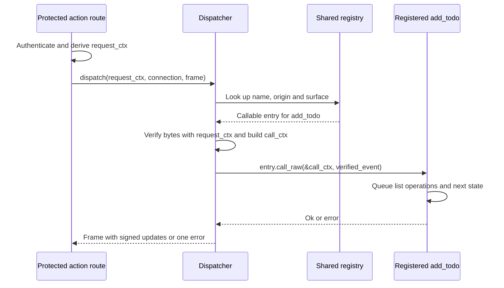

# Feature 05. Register an action and trigger it

An action is an asynchronous Rust function. The application registers it once.
A user clicks a button. The button's action reference tells the manager where to send the event.

## What the application author writes

The following example shows the intended interface. Feature 06 supplies the macro. Feature 08 supplies the template binding.

```rust
#[derive(serde::Serialize, serde::Deserialize)]
struct TodoList {
    items: Vec<String>,
}

#[action]
async fn add_todo(
    ctx: &Context,
    event: Interaction<TodoList>,
) -> Result<(), ErrorTrace<ActionError>> {
    let mut next = event.state;
    next.items.push(event.input_value);
    let out = ctx.receiver();

    html! { ctx, out, Some(&next),
        <List>{ next.items.iter().map(todo_row) }</List>
    };
    Ok(())
}
```

The registry adapter has already decoded the verified bytes into `event.state: TodoList`.
The first line moves that list into `next`. The second appends the text from this submit event.
For example, an existing list containing “Buy milk” and an input value of “Get eggs” produce a list with both items.
The application’s `todo_row` function renders one item. The receiver serializes the updated list when it records the next state.
The author registers the action with `registry.register(add_todo)?` and binds an input event to it with `on:submit={add_todo}`.

Suppose the list at node 40 owns the state. The input at node 42 explicitly names 40 as its state owner.
When the user submits “Buy milk”, the dispatcher gives the action the verified list and the input text.
The call context identifies node 40 as the output target for this component.

| What the author writes | What the receiver holds after the call |
|---|---|
| `html! { ctx, out, Some(&next), <List>…</List> }` | The view operations for the list and its rows, followed by one state item for node 40. |
| `html! { ctx, out, <List>…</List> }` | Only the view operations. The current attachment stays on node 40. |
| `out.state(40, &next)?` | Only the next state for node 40. The rendered rows stay as they are. |

Here 40 illustrates the resolved owner. Application code can obtain that node from `ctx.state_root()`.
The `<List>` represents the parent of the rendered rows. The macro uses the owner supplied by the call context for the state attachment.
It queues the attachment once for the list. Each row can still own separate state.
On success, the dispatcher signs the queued state and emits `AttachState` for node 40 after the view operations.
The next submit from node 42 uses that updated attachment. A trigger without an explicit owner uses its own node.

The proposed default uses Serde to encode and decode JavaScript Object Notation (JSON). A stateless action uses `Interaction<()>`.

## Stage 1. Define the trait the macro implements

```rust
pub type ActionResult = Result<(), ErrorTrace<ActionError>>;

pub struct Interaction<T> {
    pub node_id: u32,
    pub event_name: String,
    pub input_value: String,
    pub state: T,
}

pub trait Action: Send + Sync + 'static {
    type State: serde::Serialize + serde::de::DeserializeOwned + Send + 'static;
    const NAME: &'static str;
    fn origin() -> Option<Origin>;
    fn scope() -> Scope;
    fn call<'a>(&'a self, ctx: &'a Context, event: Interaction<Self::State>)
        -> ActionFuture<'a>;
}
```

`ActionFuture` is a boxed future that yields `ActionResult`. Native futures support transfer between threads. Browser futures can stay on one thread.
`ErrorTrace` carries the error details from `foundation_errstacks`.

The macro moves the function body into a private function. It generates this object for the registry.

```rust
#[allow(non_camel_case_types)]
struct add_todo;

impl Action for add_todo {
    type State = TodoList;
    const NAME: &'static str = "add_todo";
    fn origin() -> Option<Origin> { None }
    fn scope() -> Scope { Scope::All }

    fn call<'a>(&'a self, ctx: &'a Context, event: Interaction<TodoList>) -> ActionFuture<'a> {
        Box::pin(add_todo_body(ctx, event))
    }
}
```

`registry.register(add_todo)` receives this object. The author supplies neither a component number nor a manual encoder.

**Law and test.** Implement the todo action trait by hand in the runtime tests. Queue a view operation and the updated list.
Assert their order and state owner. Feature 08 runs the same test through the macro.

## Stage 2. Register and select an action

The registry stores a callable entry for each declaration. Its private adapter knows the concrete state type.
The manager reads the reference, checks the current platform and selects a transport.
A transport carries one action request to the selected runtime.

| Declaration | Example reference | Manager behaviour |
|---|---|---|
| `#[action(server)]` | `server:increment` | Send to the server. |
| `#[action(host, web)]` | `host:focus_field` | Run on the web host. |
| `#[action]` | `host:add_todo` | Prefer a local implementation. Use the advertised server implementation when the local one is absent. |

For the unqualified todo action, the template produces `host:add_todo`. The input supplies the submitted text and its selected owner’s bytes.

```rust
let frame = manager.trigger("host:add_todo", TriggerEvent {
    node_id: input_id,
    input: submit_input,
    state: list_state_bytes,
}).await?;
```

The example uses the generated action input for `submit_input`. The host gives the returned frame to its renderer.

A page script can register a named web host action. A mobile surface cannot select it.
The registry can hold separate web and mobile implementations of one name when their scopes do not overlap.

**Laws and tests.** A duplicate registration fails without changing the registry.
An unknown name, wrong scope or unavailable required origin returns a typed error. Verify that no transport receives the rejected request.
Use recording transports to test each row, including fallback and an explicit host action with no local implementation.

## Stage 3. Pass the request context to the action

Registration happens once at startup. It stores the callable for `add_todo`.
The selected registry entry receives the caller’s context **when the action executes**. This lets concurrent requests use the same registry.

| Lifetime | Value | Owner |
|---|---|---|
| Host | Base `foundation_context::Ctx`, authentication service and registry | The application at startup |
| Request | Forked `Ctx` with the verified user and signer binding | The protected route in [feature 04](../04-signed-state/feature.md#at-the-protected-route) |
| Action call | UI `Context` containing that request context, verified state owner and fresh receiver | The dispatcher |



The dispatcher passes the context explicitly. The following sketch shows the successful path inside dispatch.
The registry adapter decodes the verified body into `TodoList` and calls the generated `add_todo.call(&call_ctx, event)`.

```rust
let entry = self.registry.get(origin, name, surface)?;
let verified = verify_event(request_ctx, entry.as_ref(), request)?;
let call_ctx = Context::for_action(request_ctx.clone(), surface, verified.owner);
entry.call_raw(&call_ctx, verified.event).await?;
let items = call_ctx.into_receiver().drain();
encode_updates(request_ctx, items)
```

`Context::for_action` is a proposed constructor. It creates an empty receiver and retains the supplied request handle.
The action reads that receiver through `ctx.receiver()`. Application services can read the same `CurrentUser` through the underlying context.
On success, `encode_updates` signs queued state using the request signer that verified the incoming bytes.
On error, the caller drops the receiver and builds the error frame.

A network transport carries the action frame. The receiving host authenticates it through its request handler and creates its own context.
An in-process host passes its local request context directly. The template, component and registry need no cookie or binding-selection code.

| Participant | Responsibility |
|---|---|
| Manager | Build the request from the event, node and original state bytes. Route it once. |
| Dispatcher (feature 07) | Use the context supplied by the host to verify state, call the action and sign its next state. |
| Registry entry | Decode the action's state type. Call the function. For `()`, accept absent state. |
| Action | Write generated user interface (UI) operations, next state or application data to `ctx.receiver()`. |
| Dispatcher on success | Drain items in order. Sign new state. Pass the messages to the frame writer. |
| Dispatcher on failure | Discard all collected items. Send one control error. Keep the full error trace at the host. |

The client event supplies untrusted input text. The action validates that input.
The signer protects the returned component state. Output collection covers UI updates; it cannot undo a database write.

**Laws and tests.** Submit “Buy milk” from node 42. Verify that the returned view displays the new row and node 40 holds the updated list.
Trigger the action again and check that it receives the updated list.
Reject invalid signed bytes before decoding. Reject malformed list data before calling the action.
Run two authenticated users through one registry at the same time. Check each action sees its own user and returns state verifiable in that user’s context.
Reject an invalid session before lookup. Reject another user’s signed state before the action runs.
Queue a view change and state, then fail the action. Assert that the client receives only the error and retains its previous view and state.

## Delivery and verification

1. Add `Action`, `Interaction`, `Context` and its receiver under `foundation_ui_runtime::action`.
2. Add the registry adapter, reference parser and manager there. Use generated wire request types at the transport boundary.
3. Run the three stage tests with hand-written actions. Feature 07 repeats the trigger test through the real dispatcher and writer.
4. Update the runtime README with registration, the todo template, a state-only update and the failed-action example.
5. Align the macro, dispatcher and template plans with these signatures before implementing features 06 through 08.
   Replace their prototype `ComponentState` bounds and hand-assigned type numbers with the typed action contract.

```sh
cargo test -p foundation_ui_runtime --profile uat
cargo clippy -p foundation_ui_runtime --all-targets --no-deps -- -D warnings
cargo check -p foundation_ui_runtime --target wasm32-unknown-unknown
```

The [original action research](../../research/10-action-model.md) introduces the typed event.
The [owner decisions D50 to D52](../../requirements.md) define registration, template binding and receiver ownership.
