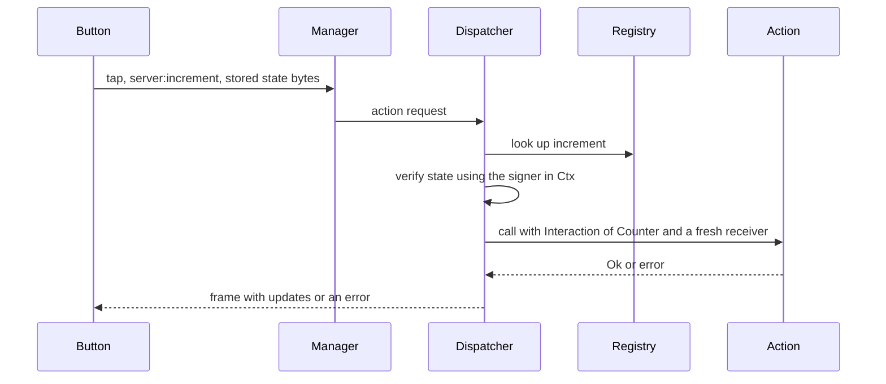

# Feature 05. Register an action and trigger it

An action is an asynchronous Rust function. The application registers it once.
A user clicks a button. The button's action reference tells the manager where to send the event.

## What the application author writes

The following example shows the intended interface. Feature 06 supplies the macro. Feature 08 supplies the template binding.

```rust
#[derive(serde::Serialize, serde::Deserialize)]
struct Counter { count: u32 }

#[action(server)]
async fn increment(ctx: &Context, event: Interaction<Counter>) -> ActionResult {
    let next = Counter { count: event.state.count.saturating_add(1) };
    ctx.receiver().state(event.node_id, &next)?;
    Ok(())
}

registry.register(increment)?;
html! { <Button on:tap={increment}>"Add one"</Button> }
```

The button reads and updates its own state at `event.node_id`. This rule also applies to a button inside another stateful component.
An action that requires a counter rejects missing state before it runs.
The application's `Counter` defines the data. The type in `Interaction<Counter>` tells the runtime how to read it.
The proposed default uses Serde to encode and decode JavaScript Object Notation (JSON). A stateless action uses `Interaction<()>`.

## Stage 1. Define the trait the macro implements

```rust
pub type ActionResult = Result<(), ErrorTrace<ActionError>>;

pub struct Interaction<T> {
    pub node_id: u32,
    pub event_name: String,
    pub input_value: String,
    pub state: T,
}

pub trait Action: Send + Sync + 'static {
    type State: serde::Serialize + serde::de::DeserializeOwned + Send + 'static;
    const NAME: &'static str;
    fn origin() -> Option<Origin>;
    fn scope() -> Scope;
    fn call<'a>(&'a self, ctx: &'a Context, event: Interaction<Self::State>)
        -> ActionFuture<'a>;
}
```

`ActionFuture` is a boxed future that yields `ActionResult`. Native futures support transfer between threads. Browser futures can stay on one thread.
`ErrorTrace` carries the error details from `foundation_errstacks`.

The macro moves the function body into a private function. It generates this object for the registry.

```rust
#[allow(non_camel_case_types)]
struct increment;

impl Action for increment {
    type State = Counter;
    const NAME: &'static str = "increment";
    fn origin() -> Option<Origin> { Some(Origin::Server) }
    fn scope() -> Scope { Scope::All }

    fn call<'a>(&'a self, ctx: &'a Context, event: Interaction<Counter>) -> ActionFuture<'a> {
        Box::pin(increment_body(ctx, event))
    }
}
```

`registry.register(increment)` receives this object. The author supplies neither a component number nor a manual encoder.

**Law and test.** Implement `Action` for a small counter by hand in the runtime tests.
Call it with count 4. Assert that the receiver holds count 5. This test runs before the macro exists.

## Stage 2. Register and select an action

The registry stores a callable entry for each declaration. Its private adapter knows the concrete state type.
The manager reads the reference, checks the current platform and selects a transport.
A transport carries one action request to the selected runtime.

| Declaration | Example reference | Manager behaviour |
|---|---|---|
| `#[action(server)]` | `server:increment` | Send to the server. |
| `#[action(host, web)]` | `host:focus_field` | Run on the web host. |
| `#[action]` | `host:toggle` | Prefer a local implementation. Use the advertised server implementation when the local one is absent. |

For the counter button, the template produces the reference `server:increment`.
The host supplies the event and the bytes it stored for that button.

```rust
let frame = manager.trigger("server:increment", TriggerEvent {
    node_id: button_id,
    input: tap_input,
    state: stored_state_bytes,
}).await?;
```

The example uses the generated action input for `tap_input`. The host gives the returned frame to its renderer.

A page script can register a named web host action. A mobile surface cannot select it.
The registry can hold separate web and mobile implementations of one name when their scopes do not overlap.

**Laws and tests.** A duplicate registration fails without changing the registry.
An unknown name, wrong scope or unavailable required origin returns a typed error. Verify that no transport receives the rejected request.
Use recording transports to test each row, including fallback and an explicit host action with no local implementation.

## Stage 3. Trigger the action and collect its output



The registry entry decodes verified bytes into `Counter`. The dispatcher owns the receiver for one call.

| Participant | Responsibility |
|---|---|
| Manager | Build the request from the event, node and original state bytes. Route it once. |
| Dispatcher (feature 07) | Look up the action. Resolve the trusted session and component purpose. Verify state through feature 04. |
| Registry entry | Decode the action's state type. Call the function. For `()`, accept absent state. |
| Action | Write generated user interface (UI) operations, next state or application data to `ctx.receiver()`. |
| Dispatcher on success | Drain items in order. Sign new state. Pass the messages to the frame writer. |
| Dispatcher on failure | Discard all collected items. Send one control error. Keep the full error trace at the host. |

The client event supplies untrusted input text. The action validates that input.
The signer protects the returned component state. Output collection covers UI updates; it cannot undo a database write.

**Laws and tests.** Trigger `server:increment` with verified count 4. Assert one call and one next-state item with count 5.
Reject invalid signed bytes before decoding. Reject malformed counter data before calling the action.
Have a second action queue an update and then fail. Assert that the client receives only the error.

## Delivery and verification

1. Add `Action`, `Interaction`, `Context` and its receiver under `foundation_ui_runtime::action`.
2. Add the registry adapter, reference parser and manager there. Use generated wire request types at the transport boundary.
3. Run the three stage tests with hand-written actions. Feature 07 repeats the trigger test through the real dispatcher and writer.
4. Update the runtime README with registration, a button trigger and the failed-action example.
5. Align the macro, dispatcher and template plans with these signatures before implementing features 06 through 08.
   Replace their prototype `ComponentState` bounds and hand-assigned type numbers with the typed action contract.

```sh
cargo test -p foundation_ui_runtime --profile uat
cargo clippy -p foundation_ui_runtime --all-targets --no-deps -- -D warnings
cargo check -p foundation_ui_runtime --target wasm32-unknown-unknown
```

The [original action research](../../research/10-action-model.md) introduces the typed event.
The [owner decisions D50 to D52](../../requirements.md) define registration, template binding and receiver ownership.
