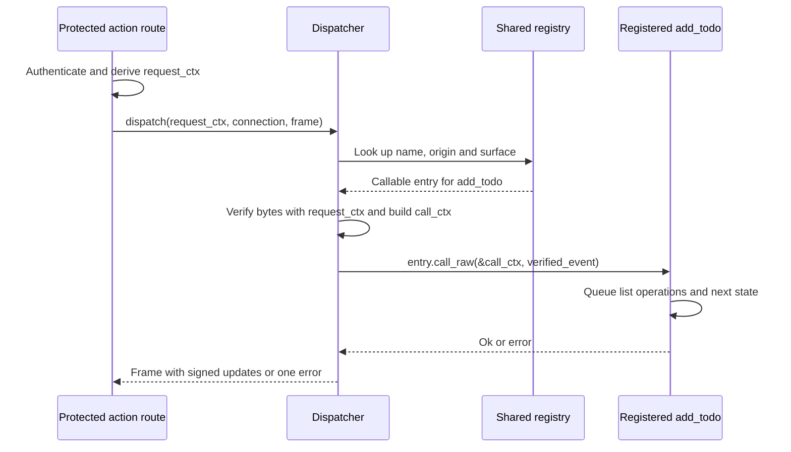

# Feature 05. Register an action and trigger it

An action is an asynchronous Rust function. The application registers it once.
A user submits text. The input’s action reference tells the manager where to send the event.

## What the application author writes

This is a proposed end-to-end example. Feature 06 supplies `#[action]`. Feature 08 supplies the template.
Feature 08 proposes a bare marker to attach the component’s signed state to another element.

### 1. Write the shared render function

The author defines the todo view once. The page route calls `todo_page` with the initial list.
The submit action can call the same function with the list it just changed.
Here the function builds the todo section. A render function can also build a whole page.

```rust
#[derive(serde::Serialize, serde::Deserialize)]
struct TodoList {
    items: Vec<String>,
}

fn todo_row(item: &str) -> Html {
    html! { <Text>{ item }</Text> }
}

fn todo_page(ctx: &Context, list: &TodoList) -> Result<Html, ErrorTrace<ActionError>> {
    let out = ctx.receiver();
    let view = html! { ctx, out, Some(list),
        <Stack>
            <List>
                { list.items.iter().map(String::as_str).map(todo_row) }
            </List>
            <TextInput primal::state on:submit={add_todo} />
        </Stack>
    };
    Ok(view)
}
```

The stack is the component root. The bare marker requests a copy on the input.
The host signs the list once and attaches the same bytes to both nodes.
A plain `state` attribute still follows ordinary attribute rules.

### 2. Handle the submit

```rust
#[action]
async fn add_todo(
    ctx: &Context,
    event: Interaction<TodoList>,
) -> Result<(), ErrorTrace<ActionError>> {
    let mut next = event.state;
    next.items.push(event.input_value);
    todo_page(ctx, &next)?;
    Ok(())
}
```

The action starts with a verified, decoded list. The submitted text is the new item.
Calling `todo_page(ctx, &next)` writes the new todo section to the action’s receiver.
The frontend applies those instructions to the section. The helper returns `Html` for callers that compose views. This action discards the tree after a successful render.
The receiver keeps the update for the existing component target. Each attachment describes the state supplied to that render.

The action author expresses element changes through `html!`. The runtime generates the attribute, text and node operations.
One successful call to `add_todo` delivers one reply frame. It contains the section, its event bindings and its signed attachments.
Each `todo_row` contributes to that section. Returning a row or calling another template helper does not send a frame.
A failed action discards the queued output and returns one error reply.

### 3. Connect the page and action handlers

Both routes use the [protected request helper](../04-signed-state/feature.md#at-the-protected-route).
These host integration snippets use proposed rendering and dispatcher interfaces.

```rust
// Once, when constructing App.
let mut registry = ActionRegistry::new();
registry.register(add_todo)?;
let dispatcher = Dispatcher::new(registry);

// Page route. Load the initial list for the authenticated caller.
let request_ctx = todo_request_ctx(app, req).await?;
let user = request_ctx.get::<CurrentUser>().ok_or(RouteError::LoginRequired)?;
let list = todos.load_for(&user.id).await?;
let page_ctx = Context::for_render(request_ctx.clone());
todo_page(&page_ctx, &list)?;
let first_frame = encode_updates(&request_ctx, page_ctx.into_receiver().drain())?;

// Action route, on a later submit. Read and authenticate this request independently.
let request_ctx = todo_request_ctx(app, req).await?;
let reply = app.dispatcher.dispatch(&request_ctx, &connection, &request_frame).await;
```

### 4. Follow one event through the two frames

Suppose the renderer assigns node 40 to the stack and 42 to the input.
This example uses a client without a local implementation. The host advertises `server:add_todo`.

| Step | Concrete result |
|---|---|
| First frame | The list displays “Buy milk”. The host attaches signed bytes A to stack 40 and input 42. |
| User submits “Get eggs” | Input 42 sends its own bytes A and the submitted text. |
| Dispatcher calls the action | The signer verifies A. The adapter decodes `TodoList`. Now `event.state.items == ["Buy milk"]` and `event.node_id == 42`. |
| Action renders the component | The existing component root is the output target. The new template marks its submit control again. |
| Reply after success | The frame updates the view and attaches signed bytes B to the root and marked input. |
| Next submit | The input sends B. The handler sees both items before adding the next one. |

The component root identifies where the host renders the reply. The event reads its state directly from the input.
The host must establish the render target from trusted component context or authenticated metadata.
A failed verification or decode stops the call. A signing failure discards the pending updates.

The proposed default uses Serde to encode and decode JavaScript Object Notation (JSON). A stateless action uses `Interaction<()>`.

## Stage 1. Define the trait the macro implements

```rust
pub type ActionResult = Result<(), ErrorTrace<ActionError>>;

pub struct Interaction<T> {
    pub node_id: u32,
    pub event_name: String,
    pub input_value: String,
    pub state: T,
}

pub trait Action: Send + Sync + 'static {
    type State: serde::Serialize + serde::de::DeserializeOwned + Send + 'static;
    const NAME: &'static str;
    fn origin() -> Option<Origin>;
    fn scope() -> Scope;
    fn call<'a>(&'a self, ctx: &'a Context, event: Interaction<Self::State>)
        -> ActionFuture<'a>;
}
```

`ActionFuture` is a boxed future that yields `ActionResult`. Native futures support transfer between threads. Browser futures can stay on one thread.
`ErrorTrace` carries the error details from `foundation_errstacks`.

The macro moves the function body into a private function. It generates this object for the registry.

```rust
#[allow(non_camel_case_types)]
struct add_todo;

impl Action for add_todo {
    type State = TodoList;
    const NAME: &'static str = "add_todo";
    fn origin() -> Option<Origin> { None }
    fn scope() -> Scope { Scope::All }

    fn call<'a>(&'a self, ctx: &'a Context, event: Interaction<TodoList>) -> ActionFuture<'a> {
        Box::pin(add_todo_body(ctx, event))
    }
}
```

`registry.register(add_todo)` receives this object. The author supplies neither a component number nor a manual encoder.

**Law and test.** Implement the todo action trait by hand in the runtime tests. Queue a view operation and the updated list.
Assert their order and state owner. Feature 08 runs the same test through the macro.

## Stage 2. Register and select an action

The registry stores a callable entry for each declaration. Its private adapter knows the concrete state type.
The manager reads the reference, checks the current platform and selects a transport.
A transport carries one action request to the selected runtime.

| Declaration | Example reference | Manager behaviour |
|---|---|---|
| `#[action(server)]` | `server:increment` | Send to the server. |
| `#[action(host, web)]` | `host:focus_field` | Run on the web host. |
| `#[action]` | `host:add_todo` | Prefer a local implementation. Use the advertised server implementation when the local one is absent. |

For the unqualified todo action, the template produces `host:add_todo`. The input supplies the submitted text and its own attached bytes.

```rust
let immediate_reply = manager.trigger("host:add_todo", TriggerEvent {
    node_id: input_id,
    input: submit_input,
    state: input_state_bytes,
}).await?;
```

The example uses the generated action input for `submit_input`.
On success, the manager returns `Option<Vec<u8>>`. With `Some(frame)`, the host gives the immediate reply to its renderer.
With `None`, the socket accepted the request. The receive path handles later frames.

A page script can register a named web host action. A mobile surface cannot select it.
The registry can hold separate web and mobile implementations of one name when their scopes do not overlap.

**Laws and tests.** A duplicate registration fails without changing the registry.
An unknown name, wrong scope or unavailable required origin returns a typed error. Verify that no transport receives the rejected request.
Use recording transports to test each row, including fallback and an explicit host action with no local implementation.

## Stage 3. Pass the request context to the action

Rust awaits the action on the host executor. The transport controls when the sender finishes.
HTTP waits for its reply under the configured request deadline. WebSocket completes its send at handoff and delivers updates separately.
See the [transport and render study](../../research/15-actions-signals-and-rendering.md).

Registration happens once at startup. It stores the callable for `add_todo`.
The selected registry entry receives the caller’s context **when the action executes**. This lets concurrent requests use the same registry.

| Lifetime | Value | Owner |
|---|---|---|
| Host | Base `foundation_context::Ctx`, authentication service and registry | The application at startup |
| Request | Forked `Ctx` with the verified user and signer binding | The protected route in [feature 04](../04-signed-state/feature.md#at-the-protected-route) |
| Action call | UI `Context` containing that request context, trusted component root and fresh receiver | The dispatcher |



The dispatcher passes the context explicitly. The following sketch shows the successful path inside dispatch.
The registry adapter decodes the verified body into `TodoList` and calls the generated `add_todo.call(&call_ctx, event)`.

```rust
let entry = self.registry.get(origin, name, surface)?;
let verified = verify_event(request_ctx, entry.as_ref(), request)?;
let call_ctx = Context::for_action(request_ctx.clone(), surface, verified.component_root);
entry.call_raw(&call_ctx, verified.event).await?;
let items = call_ctx.into_receiver().drain();
encode_updates(request_ctx, items)
```

`Context::for_action` is a proposed constructor. It creates an empty receiver and retains the supplied request handle.
The action reads that receiver through `ctx.receiver()`. Application services can read the same `CurrentUser` through the underlying context.
On success, `encode_updates` signs queued state using the request signer that verified the incoming bytes.
On error, the caller drops the receiver and builds the error frame.

A network transport carries the action frame. The receiving host authenticates it through its request handler and creates its own context.
An in-process host passes its local request context directly. The template, component and registry need no cookie or binding-selection code.

| Participant | Responsibility |
|---|---|
| Manager | Build the request from the event, node and original state bytes. Route it once. |
| Dispatcher (feature 07) | Use the context supplied by the host to verify state, call the action and sign its next state. |
| Registry entry | Decode the action's state type. Call the function. For `()`, accept absent state. |
| Action | Write generated user interface (UI) operations, next state or application data to `ctx.receiver()`. |
| Dispatcher on success | Drain items in order. Sign new state. Pass the messages to the frame writer. |
| Dispatcher on failure | Discard all collected items. Send one control error. Keep the full error trace at the host. |

The client event supplies untrusted input text. The action validates that input.
The signer protects the returned component state. Output collection covers UI updates; it cannot undo a database write.

**Laws and tests.** Submit “Buy milk” from node 42. Verify that the returned view displays the new row and node 40 holds the updated list.
Trigger the action again and check that it receives the updated list.
Reject invalid signed bytes before decoding. Reject malformed list data before calling the action.
Run two authenticated users through one registry at the same time. Check each action sees its own user and returns state verifiable in that user’s context.
Reject an invalid session before lookup. Reject another user’s signed state before the action runs.
Queue a view change and state, then fail the action. Assert that the client receives only the error and retains its previous view and state.

## Delivery and verification

1. Add `Action`, `Interaction`, `Context` and its receiver under `foundation_ui_runtime::action`.
2. Add the registry adapter, reference parser and manager there. Use generated wire request types at the transport boundary.
3. Run the three stage tests with hand-written actions. Feature 07 repeats the trigger test through the real dispatcher and writer.
4. Update the runtime README with registration, the todo template, a state-only update and the failed-action example.
5. Align the macro, dispatcher and template plans with these signatures before implementing features 06 through 08.
   Replace their prototype `ComponentState` bounds and hand-assigned type numbers with the typed action contract.

```sh
cargo test -p foundation_ui_runtime --profile uat
cargo clippy -p foundation_ui_runtime --all-targets --no-deps -- -D warnings
cargo check -p foundation_ui_runtime --target wasm32-unknown-unknown
```

The [original action research](../../research/10-action-model.md) introduces the typed event.
The [owner decisions D50 to D52](../../requirements.md) define registration, template binding and receiver ownership.
