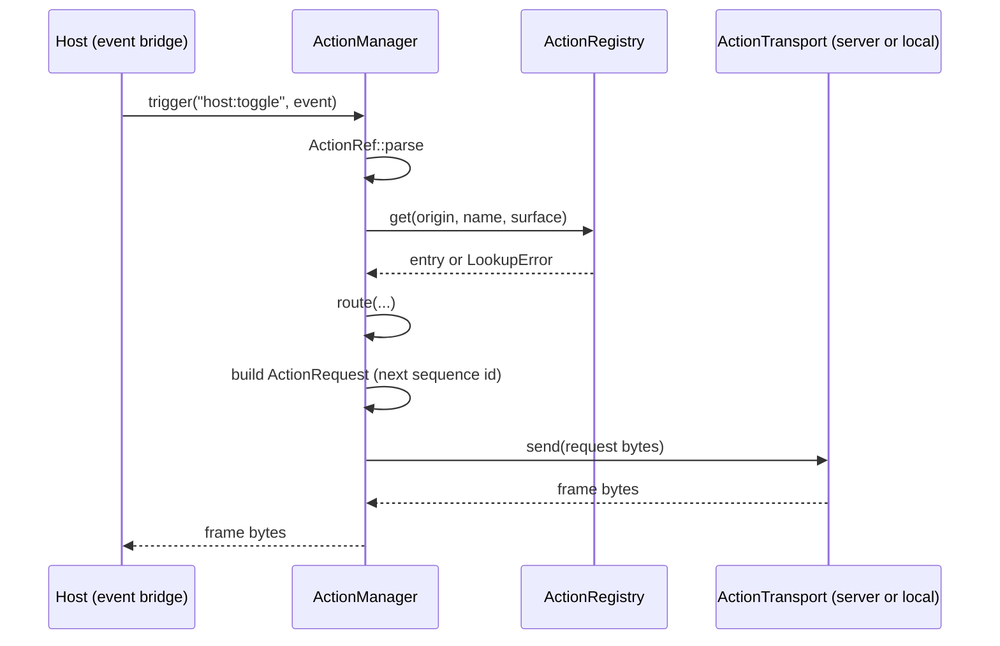

# Feature 05: The action runtime

_Written in ASD-STE100 Simplified Technical English (STE). Code and identifiers stay as they
are._

**Abbreviations in this file.** user interface (UI); WebAssembly (WASM); JavaScript (JS);
Secure Hash Algorithm 256 (SHA-256); identifier (id); AeroSpace and Defence Industries
Association of Europe (ASD), the owner of the STE standard ASD-STE100.

## 1. Goal

`foundation_ui_runtime::action` holds the one action model. An action is a plain async
function that returns `Result<(), ErrorTrace<ActionError>>`. The app builds a registry and
registers each action with `registry.register(action)`: the registry reads the origin and the
scope from the action struct (D50). An action manager reads a reference such as
`server:increment_counter` or `host:toggle`, checks the origin and the declared platform
scope, and routes the call. The receiver (`ctx.receiver()`) collects the UI operations and the
data that the action produces (D52). The same types run on the server, in WASM and on a
device.

## 2. Story

- **S1**: "An app registers an action, and the registry reads its origin."
- **S2**: "An event names an action, and the manager routes the call to the right place."
- **S3**: "An action reads the clock and the session from its context."
- **S4**: "An action writes a view update and data to its receiver, or returns an error."
- **S5**: "An event names an action that the registry does not have."
- **S6**: "An event names a `host:` action, and the host has no local transport."
- **S7**: "An event names a web-only action on a mobile surface."
- **S8**: "An app registers two actions with one name and one scope."
- **S9**: "An app registers a page script function as a `host`, web action."

| # | Use case | Actor | Trigger | Result |
|---|---|---|---|---|
| U1 | Register | App start code | `registry.register(action)` | The entry exists, or `RegistryError` |
| U2 | Look up | Dispatcher, manager | `registry.get(origin, name, surface)` | The action, or `LookupError` |
| U3 | Trigger | Device or WASM host | `manager.trigger(reference, event)` | Frame bytes from the route, or `ManagerError` |
| U4 | Run | Dispatcher | `ErasedAction::call_raw` | `Result<(), ErrorTrace<ActionError>>`; the receiver holds the items |
| U5 | Collect | Action | `ctx.receiver().push`, `.state`, `.data` | The items in the order that the action wrote them |

## 3. Bounded context

**Inside this feature:** `Ctx`, `Context`, `Surface`, `Origin`, `Scope`, `ActionRef`,
`Interaction`, `RawInteraction`, `ActionReceiver`, `ReceiverItem`, `ComponentState`, `Action`,
`ErasedAction`, `ActionRegistry`, `ActionManager`, `ActionTransport`, the route rule and its
shared test vectors.

**Outside:**

| Thing | Owner |
|---|---|
| The `#[action]` macro that writes an `Action` impl | Feature 06 |
| Verify state, sign state, seal a state, encode the receiver items (the dispatch story) | Feature 07 |
| `Session`, `Expect`, `StateCodec` | Feature 04 |
| `FrameT`, `FrameKindT`, `ActionRequestT`, `OperationT`, `UiOperationT`, `ActionErrorT`, `ActionInputT`, `ErrorCode`, `Platform`, `MountSurface`, `ServerActionT`, `finish_frame`, `read_frame`, `expect_kind`, `FrameKindName` | Feature 01 |
| `ErrorTrace` | `backends/foundation_errstacks` |
| `foundation_context::Ctx` | `foundation_context` |
| The JS action manager and the JS registry | Feature 10 |
| The network transport | The host (D25) |

| Entity | Meaning | Owner (the one writer) |
|---|---|---|
| `ActionRegistry` | Entries by origin and name | The app, through `register` |
| `Context` | The per-call values an action can read, and its receiver | The dispatcher (feature 07) |
| `ActionReceiver` | The items that one action produces | The action, through the context |
| Client sequence counter | The `sequence_id` of the next `ActionRequest` | `ActionManager` |

| Verb | Kind | Trigger | Effect |
|---|---|---|---|
| `register` | entity | App start | Adds one entry |
| `get` | entity | Dispatcher, manager | Reads |
| `trigger` | story | An event | Parse, look up, check, build the request, send, return frame bytes |
| `push`, `state`, `data` | entity | Action | Adds one item to the receiver, in call order |

**Words.** "Origin" is where an action runs at run time: `server` or `host`. "Scope" is where
an action exists: all, web or mobile. "Reference" is `origin:name`. "Surface" is the platform
and the mount surface of the caller. "Declared" means that the registry has an entry; a
`server:` entry in a client registry is a declaration that the client never runs.

## 4. Rules

### 4.1 Law worksheets

```
Entity: ActionRegistry
Conserved value:         an entry never changes after register succeeds
Bound:                   for one (origin, name): at most one All entry, or at most one Web and one Mobile entry
Inverse pairs:           none (no unregister in version 1)
Idempotent verbs:        get
Ordering pairs:          register comes before get
Monotone values:         the entry count only grows
Freeze points:           none
Links to other entities: one component_type number belongs to one state type
```

```
Entity: ActionRef
Conserved value:         parse(format(r)) == r
Bound:                   origin is one of two; name is 1 to 128 bytes of [A-Za-z0-9_]
Inverse pairs:           parse / to_string
Idempotent verbs:        parse
Ordering pairs:          none
Monotone values:         none
Freeze points:           none
Links to other entities: none
```

```
Entity: ActionReceiver
Conserved value:         the items keep the order of the calls that made them
Bound:                   none
Inverse pairs:           none
Idempotent verbs:        none
Ordering pairs:          each push, state or data call appends before the next call returns
Monotone values:         the item count only grows
Freeze points:           none
Links to other entities: `state` makes one state item for feature 07 to seal and attach
```

```
Entity: Client sequence counter
Conserved value:         none
Bound:                   >= 1
Inverse pairs:           none
Idempotent verbs:        none
Ordering pairs:          none
Monotone values:         strictly increases with each request that is built
Freeze points:           none
Links to other entities: ActionRequest.sequence_id
```

### 4.2 Invariants

| # | Invariant |
|---|---|
| I1 | `get(origin, name, surface)` returns an action only if an entry for `(origin, name)` exists and its scope includes `surface`. |
| I2 | `get` returns `UnknownAction` when no entry has that origin and name, and `UnsupportedAction` when entries exist and no scope includes the surface. |
| I3 | `register` fails, and changes nothing, when it would break the bound of the registry worksheet or give one `component_type` to two state types. |
| I4 | `Scope::All` includes every surface. `Scope::Web` includes exactly the surfaces with `mount == Web`. `Scope::Mobile` includes exactly the surfaces with `mount == Native` and `platform` `Ios` or `Android`. |
| I5 | `trigger` never sends a request to a transport before the reference parsed, the entry was found and the origin is available. |
| I6 | The manager sends only `server:` references to the server transport and only `host:` references to the local transport. |
| I7 | A `host:` reference with no local transport gives `UnavailableOrigin { origin: Host }`. |
| I8 | The receiver keeps the items in the order that the action wrote them. `state(root, &state)` adds one state item and no view change. |
| I9 | `call_raw` never calls the action function when the state body does not decode. It returns `Err` with code `BadRequest`, and the receiver stays empty. |
| I10 | Each request that one manager builds has a `sequence_id` greater than the one before. |
| I11 | The route decision of the Rust manager and of the JS manager (feature 10) is the same for every row of `fixtures/action_routes.json`. (This feature proves Rust.) |

### 4.3 Must have

- `action_reference(origin, name)`: the reference text of one action (`server:name`,
  `host:name`, or `host:name` for an action with no limit).
- `ActionReceiver` with `push`, `state(root, &state)`, `data(target, bytes)` and an ordered
  item list (D52).
- `Interaction<T>` with exactly the four fields of the source document.
- A registry that is a normal value. No global registry and no generated list (D23).

### 4.4 Must do

- Give a typed error for every reference that cannot run. Never a silent no-op (D37).
- Keep `Ctx` a thin wrapper: every clock and RNG read goes to `foundation_context::Ctx` (D17).
- Read the origin and the scope from the action struct at `register` (D50).

### 4.5 Must not

- Do not derive a numeric id from an action name (D31).
- Do not put an encoder or a wire format choice in an action. The receiver collects logical
  items (D16, D52).
- Do not build on `#[service]` or a router (D18).
- Do not add a `Response` type or an `ActionResult` type. The action returns `Result<()>`
  (D49, D52).
- Do not add a `js:` or a `native:` origin. A page script function is `host:` (D50).
- Do not guess an origin from a name with no prefix.

## 5. Acceptance scenarios

Surfaces: `WEB = Surface { platform: Web, mount: Web }`,
`IOS = Surface { platform: Ios, mount: Native }`,
`IOS_WEBVIEW = Surface { platform: Ios, mount: Web }`.

```gherkin
Feature: Action runtime

  Scenario: A registered action is found for its origin
    Given a registry that holds Increment (name "increment_counter", origin Server, scope All)
    When the caller calls get(Server, "increment_counter", IOS)
    Then the call returns the action

  Scenario: The registry reads the origin from the action struct
    Given AddTodo is an action declared with origin Server and scope All
    And an empty ActionRegistry
    When the app calls registry.register(add_todo)
    Then registry.get(Server, "add_todo", WEB) returns the action

  Scenario: An unknown action is a typed error
    Given an empty registry
    When the caller calls get(Server, "increment_counter", WEB)
    Then the call fails with LookupError::UnknownAction

  Scenario: The same name under another origin is unknown
    Given a registry that holds Increment under Origin::Server only
    When the caller calls get(Host, "increment_counter", WEB)
    Then the call fails with LookupError::UnknownAction

  Scenario: A web-only action is refused on a native mount
    Given a registry that holds OpenPickerWeb (name "open_picker", origin Server, scope Web)
    When the caller calls get(Server, "open_picker", IOS)
    Then the call fails with LookupError::UnsupportedAction

  Scenario: A web-only action exists in a WebView on iOS
    Given the same registry
    When the caller calls get(Server, "open_picker", IOS_WEBVIEW)
    Then the call returns the action

  Scenario: One name has a web form and a mobile form
    Given a registry that holds OpenPickerWeb (origin Server, scope Web) and
      OpenPickerMobile (origin Server, scope Mobile), both named "open_picker"
    When the caller calls get(Server, "open_picker", WEB) and get(Server, "open_picker", IOS)
    Then the first call returns OpenPickerWeb and the second returns OpenPickerMobile

  Scenario: A second action with the same name and scope is rejected
    Given a registry that holds Increment under Origin::Server
    When the app registers another action named "increment_counter" with origin Server and scope All
    Then register fails with RegistryError::DuplicateAction
    And get still returns the first action

  Scenario: A scoped action beside an unscoped action is rejected
    Given a registry that holds Increment (origin Server, scope All)
    When the app registers an action named "increment_counter" with origin Server and scope Web
    Then register fails with RegistryError::DuplicateAction

  Scenario: One name under two origins is rejected
    Given a registry that holds Increment (origin Server, scope All)
    When the app registers a host action named "increment_counter"
    Then register fails with RegistryError::DuplicateAction
    And get still returns the server action

  Scenario: A reference with no origin does not parse
    When the caller parses "increment_counter"
    Then the parse fails with RefError::MissingOrigin

  Scenario: A host reference with no local transport is unavailable
    Given a manager for surface IOS with a server transport and no local transport
    And a registry that declares "toggle" under Origin::Host
    When the host triggers "host:toggle"
    Then trigger fails with ManagerError::UnavailableOrigin { origin: Host }
    And no transport received a request

  Scenario: A server reference with no transport is unavailable
    Given a manager for surface IOS with no server transport
    And a registry that declares "increment_counter" under Origin::Server
    When the host triggers "server:increment_counter"
    Then trigger fails with ManagerError::UnavailableOrigin { origin: Server }

  Scenario: A host reference goes to the local transport
    Given a manager for surface IOS with a recording server transport and a recording local transport
    And a registry that holds Toggle (name "toggle", origin Host)
    When the host triggers "host:toggle" for node 42
    Then the local transport received one ActionRequest with action "host:toggle", node_id 42
      and sequence_id 1
    And the server transport received nothing

  Scenario: A state that does not decode never reaches the action
    Given Increment, whose state type decodes 4 bytes
    When the dispatcher calls call_raw with a state body of 3 bytes
    Then the call returns Err with ActionError code BadRequest
    And the action function did not run
    And the receiver is empty

  Scenario: The receiver keeps the order of the items
    Given an action that writes SetText(42, "a"), then data for node 42 with [0x91, 0x01],
      then SetText(42, "b")
    When the dispatcher calls call_raw
    Then into_items gives Operation(SetText "a"), Data, Operation(SetText "b") in that order

  Scenario: A failed action leaves no partial update
    Given an action that writes SetText(42, "a") and then returns Err
    When the dispatcher calls call_raw
    Then the call returns Err
    And the dispatcher drops the receiver
    And the answer holds only the error
```

## 6. Technical breakdown

### 6.1 Measured facts

| Fact | Source |
|---|---|
| `foundation_context::Ctx` is a clonable handle: `clock()`, `rng()`, `get::<T>()`, `config()`, `fork()`, `Ctx::host()`, `Ctx::fixed(clock)`, `Ctx::with_seed(clock, seed)` | `backends/foundation_context/src/lib.rs:211-246`, `:366`, `:437-484` |
| The source document gives `Interaction<T> { node_id: u32, event_name: String, input_value: String, state: T }` and a `Response` type; D52 removes `Response` | `research/10-action-model.md` section 1 |
| No action macro or registry exists today | `research/10-action-model.md` section 2; `grep -n "pub fn action" backends/foundation_macros/src/lib.rs` gives nothing |

### 6.2 Files

```
backends/foundation_ui_runtime/src/action/
├── mod.rs
├── ctx.rs          Ctx, Context, Surface
├── reference.rs    Origin, Scope, ActionRef, RefError
├── interaction.rs  Interaction, RawInteraction, ComponentState, StateDecodeError
├── receiver.rs     ActionReceiver, ReceiverItem
├── action.rs       Action, ErasedAction, ActionFuture
├── registry.rs     ActionRegistry, RegistryError, LookupError, action_hash
├── manager.rs      ActionManager, ActionTransport, TransportError, ManagerError, route
backends/foundation_ui_runtime/fixtures/action_routes.json
backends/foundation_ui_runtime/tests/{action_ref_tests.rs,action_registry_tests.rs,action_call_tests.rs,action_receiver_tests.rs,action_manager_tests.rs,action_routes_tests.rs,action_ctx_tests.rs}
```

Add `serde_json` (workspace) as a dev-dependency for the route vectors.

### 6.3 Public API

```rust
// ctx.rs ---------------------------------------------------------------
/// Our wrapper over `foundation_context::Ctx` (D17).
#[derive(Clone)]
pub struct Ctx(foundation_context::Ctx);
impl Ctx {
    #[must_use] pub fn new(inner: foundation_context::Ctx) -> Self;
    #[must_use] pub fn clock(&self) -> Arc<dyn foundation_context::Clock>;
    #[must_use] pub fn rng(&self) -> /* the same type that foundation_context::Ctx::rng returns */;
    #[must_use] pub fn get<T: Any + Send + Sync>(&self) -> Option<Arc<T>>;
    #[must_use] pub fn inner(&self) -> &foundation_context::Ctx;
}

#[derive(Clone, Copy, Debug, PartialEq, Eq)]
pub struct Surface { pub platform: Platform, pub mount: MountSurface }

/// What an action can read for one call, and the receiver that it writes to.
/// It can gain fields; `Ctx` does not change.
pub struct Context { /* ctx, session, surface, input, state_root, receiver */ }
impl Context {
    #[must_use] pub fn new(ctx: Ctx, session: Session, surface: Surface, input: ActionInputT) -> Self;
    /// Sets the root node of the component whose state the request carried.
    #[must_use] pub fn with_state_root(self, root_node: u32) -> Self;
    /// The root node from the verified state. `None` when the request had no state.
    #[must_use] pub fn state_root(&self) -> Option<u32>;
    /// The collector of this action's UI operations and data (D52).
    #[must_use] pub fn receiver(&self) -> &ActionReceiver;
    /// Takes the receiver after the action returns. The dispatcher owns the Context.
    #[must_use] pub fn into_receiver(self) -> ActionReceiver;
    #[must_use] pub fn ctx(&self) -> &Ctx;
    #[must_use] pub fn session(&self) -> &Session;
    #[must_use] pub fn surface(&self) -> Surface;
    /// The full input of the event (checked, key code, modifiers, parent node).
    #[must_use] pub fn input(&self) -> &ActionInputT;
}

// reference.rs -----------------------------------------------------------
#[derive(Clone, Copy, Debug, PartialEq, Eq, PartialOrd, Ord, Hash)]
pub enum Origin { Server, Host }
impl Origin { #[must_use] pub fn prefix(self) -> &'static str; }  // "server", "host"

#[derive(Clone, Copy, Debug, PartialEq, Eq, PartialOrd, Ord, Hash)]
pub enum Scope { All, Web, Mobile }
impl Scope { #[must_use] pub fn includes(self, surface: Surface) -> bool; }   // I4

#[derive(Clone, Debug, PartialEq, Eq, PartialOrd, Ord, Hash)]
pub struct ActionRef { pub origin: Origin, pub name: String }
impl ActionRef {
    pub fn parse(text: &str) -> Result<Self, RefError>;
    #[must_use] pub fn new(origin: Origin, name: &str) -> Self;   // panics never; name is not checked here
}
impl core::fmt::Display for ActionRef {}   // "origin:name"

/// The reference text of one action (D50). `Some(Server)` gives "server:name";
/// `Some(Host)` and `None` give "host:name". `None` means no origin limit, so the host
/// tries first and the manager falls forward to the server (D50 (7), (8)).
#[must_use] pub fn action_reference(origin: Option<Origin>, name: &str) -> String;

#[derive(Clone, Debug, PartialEq, Eq)]
pub enum RefError {
    MissingOrigin,                 // no ':' in the text
    UnknownOrigin { found: String },
    BadName { found: String },     // empty, longer than 128 bytes, or a byte outside [A-Za-z0-9_]
}

// interaction.rs ---------------------------------------------------------
/// The event that an action receives. The fields are those of the source document.
#[derive(Clone, Debug, PartialEq)]
pub struct Interaction<T> {
    pub node_id: u32,
    pub event_name: String,
    pub input_value: String,   // raw text from the user; untrusted
    pub state: T,
}

/// The event before the state is decoded.
#[derive(Clone, Debug, PartialEq, Eq)]
pub struct RawInteraction {
    pub node_id: u32,
    pub event_name: String,
    pub input_value: String,
    /// The plain state body, after the codec opened it. `None` when the request had no state.
    pub state_body: Option<Vec<u8>>,
}

/// The state type of a component. The body is opaque to the client.
pub trait ComponentState: Sized + Send + 'static {
    /// A number that the author chooses. One number belongs to one type in a registry.
    const COMPONENT_TYPE: u32;
    /// Increase it when the shape of the body changes.
    const FORMAT_VERSION: u16;
    /// True makes the dispatcher seal the state as private (encrypted).
    const PRIVATE: bool = false;
    fn decode(body: &[u8]) -> Result<Self, StateDecodeError>;
    fn encode(&self) -> Vec<u8>;
}
/// The state of an action that has no state. COMPONENT_TYPE 0, FORMAT_VERSION 0.
/// `decode` accepts only an empty body; `encode` returns an empty Vec.
impl ComponentState for () {}

#[derive(Clone, Debug, PartialEq, Eq)]
pub struct StateDecodeError { pub detail: String }

// receiver.rs ------------------------------------------------------------
/// One item that an action produced. The order of the items is the order of the calls.
#[derive(Debug, PartialEq)]
pub enum ReceiverItem {
    /// One operation unit. The gate of feature 03 removes the fields that a mount must not get.
    Operation(OperationT),
    /// The state of one component root, before sealing. Feature 07 seals it and makes the
    /// `AttachState` operation (D52). The fields are the values of the state type.
    State { root_node: u32, component_type: u32, format_version: u16, private: bool,
            bytes: Vec<u8> },
    /// Data for the app's own code. The delivery handler picks the encoding (D16).
    Data { target_node: u32, bytes: Vec<u8> },
}

/// The collector that the action writes to through `ctx.receiver()` (D52).
#[derive(Debug, Default)]
pub struct ActionReceiver { /* items: std::sync::Mutex<Vec<ReceiverItem>> */ }
impl ActionReceiver {
    #[must_use] pub fn new() -> Self;
    /// Adds one shared operation. It becomes `Operation { ui: Some(op), .. }`.
    pub fn push(&self, op: UiOperationT);
    /// Adds one operation unit as given, for a web or mobile form (D44).
    pub fn push_operation(&self, operation: OperationT);
    /// Adds one state item for `root_node`, with no view change. Feature 07 seals it and
    /// makes the `AttachState` operation.
    pub fn state<S: ComponentState>(&self, root_node: u32, state: &S);
    /// Adds data for the app's own code, for `target_node`.
    pub fn data(&self, target_node: u32, bytes: Vec<u8>);
    /// The number of items.
    #[must_use] pub fn len(&self) -> usize;
    #[must_use] pub fn is_empty(&self) -> bool;
    /// Takes the items in order. The dispatcher calls it after `Ok(())`.
    #[must_use] pub fn into_items(self) -> Vec<ReceiverItem>;
}

// action.rs --------------------------------------------------------------
#[cfg(not(target_arch = "wasm32"))]
pub type ActionFuture<'a> = Pin<Box<dyn Future<Output = Result<(), ErrorTrace<ActionErrorT>>>
    + Send + 'a>>;
#[cfg(target_arch = "wasm32")]
pub type ActionFuture<'a> = Pin<Box<dyn Future<Output = Result<(), ErrorTrace<ActionErrorT>>>
    + 'a>>;

pub trait Action: Send + Sync + 'static {
    /// The action tag. It is the function name (D31).
    const NAME: &'static str;
    /// The origin limit: `Some(server)` or `Some(host)` when the marker names one, and
    /// `None` for a plain `#[action]` (D50).
    fn origin() -> Option<Origin>;
    /// Which platform has the action: all, web or mobile (D50).
    fn scope() -> Scope;
    type State: ComponentState;
    fn call<'a>(&'a self, ctx: &'a Context, event: Interaction<Self::State>) -> ActionFuture<'a>;
}

/// The object-safe form that a registry stores. Every `Action` has it (blanket impl).
pub trait ErasedAction: Send + Sync + 'static {
    fn name(&self) -> &'static str;
    fn origin(&self) -> Option<Origin>;
    fn scope(&self) -> Scope;
    /// `None` when the state type is `()`.
    fn expect(&self) -> Option<Expect>;
    fn private_state(&self) -> bool;
    fn call_raw<'a>(&'a self, ctx: &'a Context, raw: RawInteraction) -> ActionFuture<'a>;
}
impl<A: Action> ErasedAction for A { /* section 6.4 */ }

// registry.rs ------------------------------------------------------------
#[derive(Default)]
pub struct ActionRegistry { /* BTreeMap<(Origin, String), Vec<Arc<dyn ErasedAction>>>,
                               BTreeMap<u32, core::any::TypeId> */ }
impl ActionRegistry {
    #[must_use] pub fn new() -> Self;
    /// Adds one action. The registry reads the origin and the scope from `action` (D50).
    /// A `None` origin registers the action under both `Server` and `Host`.
    pub fn register<A: Action>(&mut self, action: A) -> Result<(), RegistryError>;
    /// Declares a page script function: origin `host`, scope `Web`, no Rust body.
    pub fn declare_host(&mut self, name: &str) -> Result<(), RegistryError>;
    pub fn get(&self, origin: Origin, name: &str, surface: Surface)
        -> Result<Arc<dyn ErasedAction>, LookupError>;
    /// Every reference that exists on `surface`, sorted.
    #[must_use] pub fn refs_for(&self, surface: Surface) -> BTreeSet<String>;
    /// The `server:` actions for `surface`, sorted by name, with their declaration hash
    /// (D54). The caps frame carries this list.
    #[must_use] pub fn server_actions(&self, surface: Surface) -> Vec<ServerActionT>;
}

/// The 64-bit fingerprint of one declaration: the first 8 bytes of SHA-256 over the origin,
/// the name and the scope, read as a big-endian `u64` (D54).
#[must_use] pub fn action_hash(origin: Origin, name: &str, scope: Scope) -> u64;

#[derive(Clone, Debug, PartialEq, Eq)]
pub enum RegistryError {
    DuplicateAction { origin: Origin, name: String, scope: Scope },
    DuplicateComponentType { component_type: u32 },
    BadName { found: String },
}
#[derive(Clone, Debug, PartialEq, Eq)]
pub enum LookupError { UnknownAction, UnsupportedAction }

// manager.rs -------------------------------------------------------------
#[cfg(not(target_arch = "wasm32"))]
pub type TransportFuture<'a> = Pin<Box<dyn Future<Output = Result<Vec<u8>, TransportError>> + Send + 'a>>;
#[cfg(target_arch = "wasm32")]
pub type TransportFuture<'a> = Pin<Box<dyn Future<Output = Result<Vec<u8>, TransportError>> + 'a>>;

/// Carries one `ActionRequest` buffer and returns one `Frame` buffer. The host implements
/// it for the network (D25). Feature 07 implements it for the local dispatcher.
pub trait ActionTransport: Send + Sync {
    fn send<'a>(&'a self, request: Vec<u8>) -> TransportFuture<'a>;
}
#[derive(Clone, Debug, PartialEq, Eq)]
pub struct TransportError { pub detail: String }

/// The event that a host hands to the manager.
#[derive(Clone, Debug, PartialEq)]
pub struct TriggerEvent {
    pub node_id: u32,
    pub input: ActionInputT,
    /// The sealed state bytes from the component root, exactly as stored. Empty for none.
    pub state: Vec<u8>,
}

pub struct ActionManager { /* registry: Arc<ActionRegistry>, surface, stream_id: u64,
    server: Option<Arc<dyn ActionTransport>>, local: Option<Arc<dyn ActionTransport>>,
    next_sequence: AtomicU64 (starts at 1) */ }
impl ActionManager {
    #[must_use] pub fn new(registry: Arc<ActionRegistry>, surface: Surface, stream_id: u64) -> Self;
    #[must_use] pub fn with_server(self, transport: Arc<dyn ActionTransport>) -> Self;
    #[must_use] pub fn with_local(self, transport: Arc<dyn ActionTransport>) -> Self;
    /// Returns the bytes of the answer `Frame`. The host applies them.
    pub async fn trigger(&self, reference: &str, event: TriggerEvent)
        -> Result<Vec<u8>, ManagerError>;
}

#[derive(Clone, Debug, PartialEq, Eq)]
pub enum ManagerError {
    BadReference(RefError),
    UnknownAction { reference: String },
    UnsupportedAction { reference: String },
    UnavailableOrigin { origin: Origin },
    Transport(TransportError),
}

#[derive(Clone, Copy, Debug, PartialEq, Eq)]
pub enum Route { Server, Local }
/// The pure route rule (section 6.5). `lookup` is the result of `registry.get`.
pub fn route(reference: &ActionRef, surface: Surface, lookup: Result<(), LookupError>,
    has_server: bool, has_local: bool) -> Result<Route, ManagerError>;
```

### 6.4 `call_raw` (the blanket impl)

1. If `A::State` is `()`: the state is `()`; ignore `raw.state_body`.
2. Else: `raw.state_body` of `None` gives
   `Err(ErrorTrace::new(ActionErrorT { code: BadRequest, message: "state required",
   row_index: 0 }))`. `A::State::decode(body)` of `Err(e)` gives the same with
   `message = e.detail`.
3. Build `Interaction { node_id, event_name, input_value, state }` and return
   `self.call(ctx, interaction)`.

Steps 1 and 2 run before the future of the action is made, so the action function does not
run on a bad state (I9). The receiver stays empty on an error at this step.

### 6.5 The route rule

`route` applies these rows in order. The first row that matches decides.

| # | Condition | Result |
|---|---|---|
| 1 | `lookup == Err(UnsupportedAction)` | `Err(UnsupportedAction)` |
| 2 | `lookup == Err(UnknownAction)`, reference origin `Host`, `has_server` and the server caps list holds `name` | `Ok(Route::Server)`, with the name written as `server:<name>` (D50 (7), (8)) |
| 3 | `lookup == Err(UnknownAction)` | `Err(UnknownAction)` |
| 4 | origin `Server` and `!has_server` | `Err(UnavailableOrigin { Server })` |
| 5 | origin `Server` | `Ok(Route::Server)` |
| 6 | origin `Host` and `!has_local` | `Err(UnavailableOrigin { Host })` |
| 7 | origin `Host` | `Ok(Route::Local)` |

The scope check is inside `registry.get` (rows 1 to 3). Row 2 reads the server caps list of
D54, which holds every `server:` action name; a limit-free action is one of them. It is a
declaration, not an authority: the server rejects a forwarded name that it does not have, and
the client shows that typed error. `route` takes `server_has: impl Fn(&str) -> bool` for this
row.

`fixtures/action_routes.json` is an array of objects
`{ "reference", "platform", "mount", "declared": [{"origin","name","scope"}], "server_caps":
["name", …], "has_server", "has_local", "expect" }`, where `origin` is `"server"`, `"host"`
or `null` for a plain `#[action]`, and `expect` is `"server"`, `"local"`,
`"bad_reference"`, `"unknown_action"`, `"unsupported_action"` or `"unavailable_origin"`.
Write one row or more for each of the 7 rows of the table, for each `RefError` case, and for
each cell of the scope and origin table in `research/10-action-model.md` section 3.8.
`action_routes_tests.rs` builds a registry from `declared` (a test action type with a runtime
name is not possible with `const NAME`; so the test calls `route` with the lookup that it
computes from `declared` with `Scope::includes`, and a second test checks that `registry.get`
gives the same lookup for a fixed set of real test actions).

### 6.6 `trigger`, in order



_The diagram shows one trigger. The manager sends nothing before the checks pass._

1. `ActionRef::parse(reference)`; an error gives `BadReference`.
2. `registry.get(origin, name, surface)`, mapped to `Ok(())` or the `LookupError`.
3. `route(...)`; an error returns.
4. Take the next sequence id (`fetch_add(1)`).
5. Build `ActionRequestT { schema_version: SCHEMA_VERSION, stream_id, sequence_id,
   action: reference text, node_id, input, state }` and call `finish_action_request`.
6. `send` on the transport of the route. An error gives `Transport`.
7. Return the bytes. The manager does not read them.

**Fault table: `trigger`**

| Step that fails | What the system does | What the caller sees | What is left behind |
|---|---|---|---|
| 1 to 3 | Returns at once | `BadReference`, `UnknownAction`, `UnsupportedAction` or `UnavailableOrigin` | nothing; the sequence counter did not move |
| 6 (transport error) | Returns | `Transport` | The sequence counter moved by one. The server sees a gap in client sequence ids, which it accepts (feature 07: the client counter is for ordering and duplicate detection, not for gaps) |

### 6.7 `register`

1. Read `origin = A::origin()` and `scope = A::scope()` (D50). `origin` is `Some(Server)`,
   `Some(Host)` or `None`; `None` means no origin limit (D50 (8)).
2. Check the name as `ActionRef` does (`BadName`).
3. Among the entries of `(origin, name)`, and of both origin keys when `origin` is `None`:
   an entry with the same scope gives `DuplicateAction`; an existing `All` entry or a new
   `All` scope beside any entry gives `DuplicateAction`.
4. An entry of the name under the other origin gives `DuplicateAction`, unless the call is
   a `None` action that writes its two entries. One name is one logical action (D50 (1):
   one name space). The same name with another scope under the same origin stays allowed
   (D50 (2): a web form and a mobile form of one action). This rule makes the name check
   of the route rule sound.
5. If `A::State` is not `()`: if `COMPONENT_TYPE` is in the type map with another `TypeId`,
   `DuplicateComponentType`. `COMPONENT_TYPE == 0` for a type other than `()` also gives
   `DuplicateComponentType { component_type: 0 }`.
6. Insert. A `None` origin inserts one entry under `Server` and one under `Host`, for the
   same action. Steps 1 to 5 change nothing.

`server_actions(surface)` returns an entry for every `server:` action, and for every action
with no origin limit. For the second case it computes the hash with `Origin::Server`, because
that is the key of its `server:` entry.

`declare_host(name)`: name check; duplicate check; store a private `HostDeclared` entry whose
origin is `Host`, whose `scope()` is `Web`, whose `expect()` is `None`, and whose `call_raw`
returns `Err` with code `UnavailableOrigin` (a page script function never runs in Rust).

## 7. Tests

All in `backends/foundation_ui_runtime/tests/`. Test actions are hand-written `impl Action`
types in `tests/support.rs` (the macro is feature 06): `Increment` (state `Counter`, 4-byte
little-endian `u32`, `COMPONENT_TYPE` 7, origin `Some(Server)`, scope `All`), `Toggle` (state
`()`, origin `Some(Host)`, scope `All`), `Plain` (origin `None`, scope `All`),
`OpenPickerWeb`, `OpenPickerMobile`, and `Probe`, which sets an `AtomicBool` when its
function runs.

| Law or scenario | Test | Oracle |
|---|---|---|
| I1, I2; Scenarios: found, unknown, other origin, web-only refused, WebView, two forms | `action_registry_tests.rs::…` one test per scenario, named after it | example |
| I3; Scenarios: duplicate, scoped beside unscoped, one name under two origins | `action_registry_tests.rs::duplicate_is_rejected_and_first_stays`, `::scoped_beside_unscoped_is_rejected`, `::name_under_two_origins_is_rejected`, `::one_component_type_for_two_types_is_rejected` | expected outcome |
| Scenario: the registry reads the origin | `action_registry_tests.rs::register_reads_origin_and_scope`, `::plain_action_registers_under_both_origins` | example |
| D50 (8); route rows 2 and 3 | `action_manager_tests.rs::plain_host_miss_forwards_to_the_server`, `::host_limited_action_never_forwards`; `action_registry_tests.rs::server_actions_lists_a_plain_action` | example, fault |
| I4 | `action_ref_tests.rs::scope_includes_table` (all 3 scopes × 5 platforms × 2 mounts against the rule) | property |
| `ActionRef` law; Scenario: no origin | `action_ref_tests.rs::parse_format_round_trip`, `::missing_origin`, `::unknown_origin`, `::bad_name_cases` | property, expected outcome |
| D50 (7), (8); the reference text | `action_ref_tests.rs::reference_for_every_origin` (`Some(Server)` gives `server:x`, `Some(Host)` and `None` give `host:x`) | example |
| I5, I6; Scenarios: host goes local, server with no transport | `action_manager_tests.rs::host_reference_goes_to_local_transport`, `::server_reference_with_no_transport_is_unavailable`, `::no_request_before_checks_pass` | example, fault |
| I7; Scenario: host with no local transport | `action_manager_tests.rs::host_reference_with_no_local_transport_is_unavailable` | expected outcome |
| I8; Scenarios: receiver order, failed action | `action_receiver_tests.rs::items_keep_the_order`, `::state_adds_one_state_item`, `::data_keeps_the_target_node` | example |
| I9; Scenario: bad state | `action_call_tests.rs::bad_state_never_reaches_the_action`, `::missing_state_is_bad_request`, `::unit_state_ignores_body` | expected outcome |
| I10 | `action_manager_tests.rs::sequence_ids_increase` (5 triggers; ids 1 to 5) | property |
| I11 | `action_routes_tests.rs::route_matches_every_vector`, `::registry_lookup_matches_scope_rule` | example |
| `ServerCaps.actions`: sorted by name, one hash per declaration | `action_registry_tests.rs::server_actions_are_sorted_and_hashed` | example |
| `Ctx` passes the clock and RNG through | `action_ctx_tests.rs::ctx_reads_inner_clock_and_rng` | example |
| Fault: transport error | `action_manager_tests.rs::transport_error_is_returned` | fault |

## 8. Tasks

- [ ] 1. `ctx.rs` and its test.
- [ ] 2. `reference.rs` and its tests.
- [ ] 3. `interaction.rs`.
- [ ] 4. `receiver.rs` and `action_receiver_tests.rs`.
- [ ] 5. `action.rs` with the blanket impl; `action_call_tests.rs`.
- [ ] 6. `registry.rs`, `action_hash`, `server_actions` and their tests.
- [ ] 7. `route` and `fixtures/action_routes.json`; `action_routes_tests.rs`.
- [ ] 8. `ActionManager::trigger` and its tests; re-export the public types from `lib.rs`.
- [ ] 9. Bump `foundation_ui_runtime` to `0.0.2`.
- [ ] 10. Update `progress.md` and `learnings.md`.

## 9. Verify

```bash
cargo fmt --all -- --check
cargo check  -p foundation_ui_runtime --profile uat
cargo clippy -p foundation_ui_runtime --profile uat --no-deps -- -D warnings
cargo test   -p foundation_ui_runtime --profile uat
cargo check  -p foundation_ui_runtime --profile uat --target wasm32-unknown-unknown
python3 -c "import json;json.load(open('backends/foundation_ui_runtime/fixtures/action_routes.json'))"
```

## 10. Done when

- [ ] All tasks are complete and every command of section 9 passes with no warning.
- [ ] Each invariant and each scenario has a passing test (section 7).
- [ ] `Interaction` has exactly four public fields, and no `Response` type exists.
- [ ] The receiver keeps the order of the items and holds no encoder.
- [ ] No name from the "Must not" list is in the crate.
- [ ] No `TODO`, `FIXME`, `todo!()` or `unimplemented!()` is in the module.
- [ ] The check list of the `story-driven-specification` skill passes.

---

_Created: 2026-11-13_
_Revised: 2026-11-14 (D41 to D59)_
