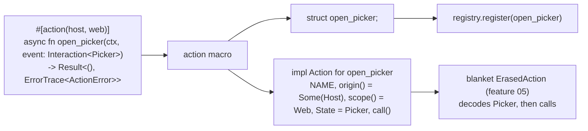

# Feature 06: The `#[action]` macro

_Written in ASD-STE100 Simplified Technical English (STE). Code and identifiers stay as they
are._

**Abbreviations in this file.** user interface (UI); identifier (id); AeroSpace and Defence
Industries Association of Europe (ASD), the owner of the STE standard ASD-STE100.

## 1. Goal

A developer writes a plain `async fn` with `#[action]`. The macro reads the signature and the
optional limit. It generates a unit struct with the same identifier as the function and an
`Action` impl for it: the name, `origin()`, `scope()`, the state type from `Interaction<T>`
and the call glue (D50). There is one marker. `#[remote_action]` does not exist (A7). The
decode of the state follows from the state type through the blanket `ErasedAction` impl of
feature 05, so no runtime look-up picks a type.

## 2. Story

- **S1**: "A developer marks an async function as an action for every origin and platform."
- **S2**: "A developer marks an action as server only, host only, or host on the web only."
- **S3**: "A developer registers the generated struct in the app's registry."
- **S4**: "A developer writes an action with a wrong signature, and the compiler says what is
  wrong and where."

| # | Use case | Actor | Trigger | Result |
|---|---|---|---|---|
| U1 | Declare | Developer | `#[action] async fn name(ctx: &Context, event: Interaction<T>) -> Result<(), ErrorTrace<ActionErrorT>>` | A struct `name` that implements `Action` |
| U2 | Limit | Developer | `#[action(server)]`, `#[action(host)]`, `#[action(host, web)]` | `origin()` and `scope()` follow the limit |
| U3 | Register | Developer | `registry.register(name)` | The entry exists (feature 05) |
| U4 | Reject | Compiler | A bad signature or a bad limit | One `compile_error!` at the bad token |

## 3. Bounded context

**Inside this feature:** the parse of the attribute limit and of the function signature; the
generated struct and impl; the compile errors.

**Outside:**

| Thing | Owner |
|---|---|
| `Action`, `Origin`, `Scope`, `Context`, `Interaction`, `ActionReceiver`, `ActionFuture`, `ErasedAction` | Feature 05 |
| `ErrorTrace` | `backends/foundation_errstacks` |
| `ActionErrorT` | Feature 01 |
| Verify, sign, route, encode (the steps that are the same for every action) | Features 04, 05, 07 (library code, D19) |
| `#[service]` | `foundation_macros::connectrpc_service`. This macro shares no code with it (D18) |
| The `on:` binding in `html!` that names the struct | Feature 08 |

| Entity | Meaning | Owner (the one writer) |
|---|---|---|
| Generated struct | `struct <fn name>;` | The macro |
| Generated impl | `impl Action for <fn name>` | The macro |

The macro has one verb, `expand`. It is a pure function from tokens to tokens, so it has no
fault table. Its failures are the compile errors of section 6.4.

**Words.** "Limit" is the optional origin and scope inside `#[action(...)]`. "State type" is
the `T` of `Interaction<T>`.

## 4. Rules

### 4.1 Law worksheet

```
Entity: Generated struct and impl
Conserved value:         the body of the function is used unchanged, one time
Bound:                   one struct and one impl for one function
Inverse pairs:           none
Idempotent verbs:        none (the macro runs one time for each function)
Ordering pairs:          none
Monotone values:         none
Freeze points:           NAME is the function identifier, as text; origin() and scope() come from the limit
Links to other entities: Action::State equals the T of Interaction<T> in the signature
```

### 4.2 Invariants

| # | Invariant |
|---|---|
| I1 | `<name as Action>::NAME` equals the function identifier as text. |
| I2 | `origin()` is `Some(Server)` for `#[action(server)]` and for `#[action(server, web)]`; it is `Some(Host)` for `#[action(host)]` and for `#[action(host, web)]`; it is `None` for a plain `#[action]`, which has no origin limit (D50). |
| I3 | `scope()` is `All` with no scope limit, `Web` for `web` and `Mobile` for `mobile`. |
| I4 | `<name as Action>::State` is the `T` of the second parameter. |
| I5 | Calling the generated action gives the same `Result` as the function body gives for the same context and event. |
| I6 | A function that does not have the shape of section 6.2 does not compile, and the error text is one of section 6.4. |
| I7 | The visibility, the doc comments and the other attributes of the function are on the generated struct. |
| I8 | The macro output names the runtime crate through `foundation_ui_runtime_path()`, so it works when the user crate renames the dependency. |

### 4.3 Must have

- The proc macro `action` in `backends/foundation_macros/src/lib.rs`, with its code in a new
  module `backends/foundation_macros/src/action.rs`.
- A re-export `pub use foundation_macros::action;` in `foundation_ui_runtime`.

### 4.4 Must do

- Put each compile error on the span of the token that is wrong.
- Write `origin()` and `scope()` from the one limit (D50). Do not take an origin from a
  registration argument.

### 4.5 Must not

- Do not generate a registry, a `static`, a constructor function or a link-time list (D23).
- Do not generate a numeric id or a registry hash (D31, D54).
- Do not add a `#[remote_action]` macro (A7).
- Do not call or copy `connectrpc_service` code (D18).
- Do not generate verify, sign or encode code (D19: shared steps stay in the library).

## 5. Acceptance scenarios

```gherkin
Feature: The #[action] macro

  Scenario: An action for every origin and platform
    Given the source
      """
      #[action]
      pub async fn increment_counter(ctx: &Context, event: Interaction<Counter>)
          -> Result<(), ErrorTrace<ActionErrorT>> {
          let next = Counter { current: event.state.current + 1 };
          ctx.receiver().push(set_text(42, next.current.to_string()));
          Ok(())
      }
      """
    Then <increment_counter as Action>::NAME is "increment_counter"
    And <increment_counter as Action>::origin() is None
    And <increment_counter as Action>::scope() is Scope::All
    And calling it with Counter { current: 1 } returns Ok and the receiver holds SetText(42, "2")

  Scenario: A server-only action
    Given the same function with #[action(server)]
    Then <increment_counter as Action>::origin() is Some(Origin::Server)
    And <increment_counter as Action>::scope() is Scope::All

  Scenario: A host-only action
    Given the same function with #[action(host)]
    Then <increment_counter as Action>::origin() is Some(Origin::Host)
    And <increment_counter as Action>::scope() is Scope::All

  Scenario: A host action on the web only
    Given the same function with #[action(host, web)]
    Then <increment_counter as Action>::origin() is Some(Origin::Host)
    And <increment_counter as Action>::scope() is Scope::Web

  Scenario: A host action on mobile only
    Given the same function with #[action(host, mobile)]
    Then <increment_counter as Action>::origin() is Some(Origin::Host)
    And <increment_counter as Action>::scope() is Scope::Mobile

  Scenario: An action with no state
    Given #[action] async fn ping(ctx: &Context, event: Interaction<()>)
        -> Result<(), ErrorTrace<ActionErrorT>>
    Then <ping as Action>::State is ()

  Scenario: The generated struct registers
    Given an empty ActionRegistry
    When the app calls registry.register(increment_counter)
    Then registry.get(Host, "increment_counter", WEB) returns the action
    And registry.get(Server, "increment_counter", WEB) returns the same action (D50 (8))

  Scenario: A function that is not async does not compile
    Given #[action] fn f(ctx: &Context, event: Interaction<()>)
        -> Result<(), ErrorTrace<ActionErrorT>> { .. }
    Then the build fails with "#[action] needs an `async fn`"

  Scenario: A wrong second parameter does not compile
    Given #[action] async fn f(ctx: &Context, event: String)
        -> Result<(), ErrorTrace<ActionErrorT>> { .. }
    Then the build fails with "the second parameter of an action must be `Interaction<T>`"

  Scenario: An unknown limit does not compile
    Given #[action(desktop)] async fn f(ctx: &Context, event: Interaction<()>)
        -> Result<(), ErrorTrace<ActionErrorT>> { .. }
    Then the build fails with "unknown action limit `desktop`; use `server` or `host`,
      then `web` or `mobile`"

  Scenario: A function with no return type does not compile
    Given #[action] async fn f(ctx: &Context, event: Interaction<()>) { .. }
    Then the build fails with "an action must return `Result<(), ErrorTrace<ActionErrorT>>`"
```

## 6. Technical breakdown



_The diagram shows what the macro makes from one function and where the result goes._

### 6.1 Measured facts

| Fact | Source |
|---|---|
| `foundation_macros` resolves crate paths with `proc-macro-crate` in `crate_paths.rs` | `backends/foundation_macros/src/crate_paths.rs:1-17` |
| `foundation_macros` uses `syn` 2 with the `full` feature | `backends/foundation_macros/Cargo.toml:22` |
| `foundation_macros` has compile-fail tests in `tests/trybuild` | `backends/foundation_macros/tests/trybuild/` |
| No proc macro named `action` exists | `grep -n "pub fn action" backends/foundation_macros/src/lib.rs` gives nothing (2026-11-13) |

### 6.2 The accepted shape

```text
#[action]  |  #[action(server)]  |  #[action(host)]  |  #[action(host, web)]
#[action(server, web)]  |  #[action(host, mobile)]  |  #[action(server, mobile)]
<attrs> <vis> async fn <name>(<p1>: &<Ty1>, <p2>: <path>::Interaction<<T>>) -> <Ret> <block>
```

- The limit is optional. It has one origin (`server` or `host`) and an optional scope (`web`
  or `mobile`). There is no origin, scope or flag outside the marker.
- No generic parameters, no `where` clause, no `self`, no `const`, `unsafe` or `extern`.
- Exactly two parameters. Each parameter pattern is one identifier (`ctx`, `_ctx`, `event`).
- The first parameter type is a shared reference `&Ty1` with no explicit lifetime.
- The second parameter type is a path whose last segment is `Interaction` with exactly one
  generic type argument `T`.
- A return type is present. The macro does not check that it is
  `Result<(), ErrorTrace<ActionErrorT>>`; the trait signature makes the compiler check it.

**No limit is a real state.** A plain `#[action]` has no origin limit, so `origin()` returns
`None` and both registries accept it (D50 (8)). `Some(origin)` states a limit. The action
manager falls forward to the server only for a `None` action, as feature 05 section 6.5
row 2 says.

### 6.3 The generated code

For `#[action(host, web)] /// doc\n pub async fn open_picker(ctx: &Context, event: Interaction<Picker>) -> Result<(), ErrorTrace<ActionErrorT>> { BODY }`
with `rt = foundation_ui_runtime_path()`:

```rust
/// doc
#[allow(non_camel_case_types)]
#[derive(Clone, Copy, Debug, Default)]
pub struct open_picker;

impl #rt::Action for open_picker {
    const NAME: &'static str = "open_picker";
    fn origin() -> #rt::Option<#rt::Origin> { #rt::Some(#rt::Origin::Host) }
    fn scope() -> #rt::Scope { #rt::Scope::Web }
    type State = Picker;

    fn call<'__a>(
        &'__a self,
        ctx: &'__a Context,                 // the user's identifier and type, with '__a added
        event: Interaction<Picker>,         // the user's identifier and type, unchanged
    ) -> #rt::ActionFuture<'__a> {
        ::std::boxed::Box::pin(async move { BODY })
    }
}
```

- The struct takes the visibility and every outer attribute of the function except
  `#[action]` itself.
- `NAME` is `stringify!` of the identifier. A raw identifier `r#type` gives `"type"`.
- `origin()` and `scope()` are constant functions; they take the values of the limit. A
  plain `#[action]` gives `None`.
- The first parameter type becomes `&'__a Ty1`. The body is not changed.
- The block is inserted as `async move #block`.
- Add `pub fn foundation_ui_runtime_path() -> TokenStream` to `crate_paths.rs`, in the style
  of the functions there.

Because the struct has the identifier of the function, the two forms of one name
(`#[action(host, web)]` and `#[action(host, mobile)]`) live in different modules (research 13
section 3.3). The macro adds no suffix.

### 6.4 The compile errors

Each row is one `syn::Error::new_spanned(token, message)`. The macro returns the first error
that it finds, in this order.

| # | Condition | Span | Message |
|---|---|---|---|
| 1 | The limit is not empty, `server`, `host`, `host, web`, `host, mobile`, `server, web` or `server, mobile` | The limit | ``unknown action limit `<arg>`; use `server` or `host`, then `web` or `mobile` `` |
| 2 | More than two limit arguments | The third argument | `#[action] takes at most an origin and a scope` |
| 3 | The item is not a function | The item | `#[action] can only be used on a function` |
| 4 | No `async` | The `fn` token | ``#[action] needs an `async fn` `` |
| 5 | `const`, `unsafe` or an ABI | That token | ``an action cannot be `const`, `unsafe` or `extern` `` |
| 6 | Generic parameters or a `where` clause | The generics | `an action cannot have generic parameters` |
| 7 | A `self` receiver | The receiver | `an action is a free function; it cannot take self` |
| 8 | Not exactly two parameters | The parameter list | `an action takes two parameters: a context reference and an Interaction<T>` |
| 9 | A parameter pattern is not an identifier | The pattern | `an action parameter must be a plain name` |
| 10 | The first parameter type is not `&T` or has a lifetime or `mut` | The type | `the first parameter of an action must be a shared reference, for example &Context` |
| 11 | The second parameter type is not `…::Interaction<T>` with one type argument | The type | ``the second parameter of an action must be `Interaction<T>` `` |
| 12 | No return type | The signature | ``an action must return `Result<(), ErrorTrace<ActionErrorT>>` `` |

### 6.5 Files

```
backends/foundation_macros/src/action.rs            parse + expand
backends/foundation_macros/src/lib.rs               #[proc_macro_attribute] pub fn action
backends/foundation_macros/src/crate_paths.rs       foundation_ui_runtime_path
backends/foundation_ui_runtime/src/lib.rs           pub use foundation_macros::action;
backends/foundation_ui_runtime/Cargo.toml           foundation_macros dependency; trybuild dev-dependency
backends/foundation_ui_runtime/tests/action_macro_tests.rs
backends/foundation_ui_runtime/tests/action_macro_fail_tests.rs
backends/foundation_ui_runtime/tests/trybuild/action/*.rs + *.stderr
```

The `lib.rs` entry:

```rust
/// Marks an `async fn` as a UI action. See `foundation_ui_runtime::Action`.
///
/// `#[action]` has no limit. `#[action(server)]` runs on the server,
/// `#[action(host)]` on the local host, and `#[action(host, web)]` on the web host only.
#[proc_macro_attribute]
pub fn action(attr: TokenStream, item: TokenStream) -> TokenStream {
    action::expand(attr.into(), item.into()).into()
}
```

`action::expand(attr: proc_macro2::TokenStream, item: proc_macro2::TokenStream)
-> proc_macro2::TokenStream` returns `error.to_compile_error()` on failure.

Use the `trybuild` version that `foundation_macros` uses; if both crates now use it, move
it to `[workspace.dependencies]` (rule 17).

## 7. Tests

| Law or scenario | Test | Oracle |
|---|---|---|
| I1, I2, I3, I4; Scenarios: every origin, server-only, host-only, host web-only, host mobile-only, no state | `action_macro_tests.rs::name_origin_scope_and_state_follow_the_declaration` (five modules, each with one action; a helper `fn state_is<A: Action<State = S>, S>()` proves `State` at compile time) | example |
| I5; Scenario: every origin (the call) | `action_macro_tests.rs::generated_action_runs_the_body` (drive the future with the `block_on` that `foundation_ui_runtime` tests of feature 05 use) | example |
| I7 | `action_macro_tests.rs::struct_keeps_visibility_and_attributes` (a `pub(crate)` action with `#[doc = "x"]` in a nested module is reachable from the parent) | example |
| I8 | `action_macro_tests.rs::macro_output_resolves_the_runtime_crate`: the test file is an integration test, so the macro resolves the crate by its name (`FoundCrate::Name`). The test compiles and runs one action. `crate_paths.rs` already uses the same `resolve_crate` helper for every other crate | example |
| Scenario: The generated struct registers | `action_macro_tests.rs::generated_struct_registers` | example |
| I6; Scenarios: not async, wrong second parameter, unknown limit, no return type | `action_macro_fail_tests.rs::compile_errors` runs `trybuild::TestCases::compile_fail("tests/trybuild/action/fail_*.rs")`. One file for each of the 12 rows of section 6.4, named `fail_01_unknown_limit.rs` to `fail_12_no_return.rs`, each with its `.stderr` | expected outcome |

## 8. Tasks

- [ ] 1. Add `foundation_ui_runtime_path` to `crate_paths.rs`.
- [ ] 2. Write the 12 `fail_*.rs` files (they fail now because the macro does not exist).
- [ ] 3. Write `action.rs`: the limit parse and errors 1 and 2.
- [ ] 4. Write the signature parse and errors 3 to 12.
- [ ] 5. Write the expansion; register the macro in `lib.rs`; re-export it from the runtime.
- [ ] 6. Write `action_macro_tests.rs`; record the `.stderr` files with `TRYBUILD=overwrite` and read each one.
- [ ] 7. Bump `foundation_macros` and `foundation_ui_runtime` versions and every consumer of `foundation_macros` (AGENTS reminder 12).
- [ ] 8. Update `progress.md` and `learnings.md`.

## 9. Verify

```bash
cargo fmt --all -- --check
cargo check  -p foundation_macros --profile uat
cargo clippy -p foundation_macros --profile uat --no-deps -- -D warnings
cargo test   -p foundation_macros --profile uat
cargo clippy -p foundation_ui_runtime --profile uat --no-deps -- -D warnings
cargo test   -p foundation_ui_runtime --profile uat
cargo check  -p foundation_ui_runtime --profile uat --target wasm32-unknown-unknown
cargo tree -i foundation_macros --workspace --depth 1     # then test each crate that uses a changed API
```

## 10. Done when

- [ ] All tasks are complete and every command of section 9 passes with no warning.
- [ ] Each invariant and each scenario has a passing test (section 7).
- [ ] Each of the 12 error rows has a `.stderr` file whose text holds the message of the row.
- [ ] The macro output holds no `static`, no registry, no numeric id and no hash.
- [ ] No `TODO`, `FIXME`, `todo!()` or `unimplemented!()` is in the new code.
- [ ] The check list of the `story-driven-specification` skill passes.

---

_Created: 2026-11-13_
_Revised: 2026-11-14 (D41 to D59)_
